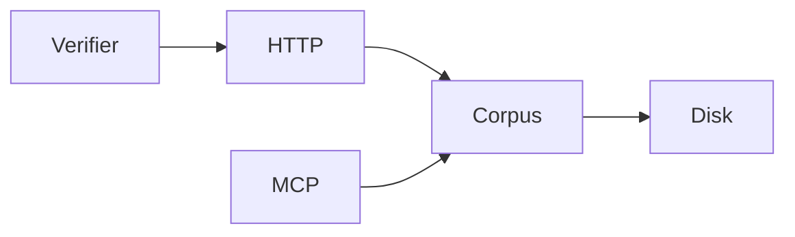

# 20261031-1151 — T01 always-fresh KM and verifier implementation evidence

#fractal-l0 #fractal-l1 #fractal-l2 #fractal-l3 #fractal-l4 #fractal-l5 #fractal-l6 #fractal-l7 #fractal-l8 #fractal-l9 #km-triad #zk-adr #zero-muda

Observed UTC: 2026-10-31T11:08:51.602Z. [Cockpit](http://nas-1.tail55d152.ts.net:4100/) · [KM](http://nas-1.tail55d152.ts.net:4100/km) · [Wiki](http://nas-1.tail55d152.ts.net:4100/wiki) · [ZK](http://nas-1.tail55d152.ts.net:4100/zk) · [Self](http://nas-1.tail55d152.ts.net:4100/files/docs/journal/20261031-1151-t01-always-fresh-km-and-verifiers-journal.md) · [Raw](http://nas-1.tail55d152.ts.net:4100/files/docs/journal/20261031-1151-t01-always-fresh-km-and-verifiers-journal.md?raw=1).

## 1. Scope & Trigger

20261031-1158 performance/plan supplement: operator-authorized linear catalog collection, thirteen-root recall ranking and bounded reference expansion, plus the [OI-01..OI-08 plan](http://nas-1.tail55d152.ts.net:4100/files/docs/design/20261031-1240-uos-open-items-fractal-design-implement-test-plan.md), on `wnsoqqup` only. No task claim, canonical database mutation, deployment or new EV number is authorized.

Execute T01_CODEX_4100_ALWAYS_FRESH_KM_AND_VERIFIERS in Sa-plan uos/tailscale-4100-always-fresh-km-and-verifiers/20261031-1018, worker codex-4100-fresh-km-20261031, attempt 1, isolated Jujutsu change wnsoqqup. Implement INV-FRESH-4100-01 and INV-MCP-KM-BRAIN-01. Development evidence only; EV ceiling remains 93, application/system admission is not granted. Source/model SHA-256 bindings appear in section 8; abstract formal models are separate from executable conformance tests.

## 2. Pre-State Assessment

Supplement observation at 2026-10-31T11:58:03Z: the original source bytes match revision `548eb798cd8e` and a 15,524-file SHA-256 baseline. Connected MCP health lacks the required KM fields; search and bounded transclusion returned no precedents, and the search schema still lacks `limit`. Local skill/T01 evidence supplies context, not a passing live recall gate. Contrary to the 1,800-file intake estimate, the observed canonical catalog contains 6,180 files, including 3,478 brain files. Evidence age is this development session; runtime cutover evidence remains absent.

20261031-1127 surgical supplement: the operator authorized only relevance/snippet repair, the UOS-local brain-memory skill and agent bindings, T01 diagram repair and their gates before independent Claude acceptance. Existing sibling changes were preserved. CLAUDE.md is a tracked symlink to AGENTS.md; the binding is added to its target while preserving the symlink. No new task or Sa-plan mutation is authorized.

The initial sibling working copy was clean. The router served pre-baked documentation HTML before disk Markdown, failed to retain corpus query semantics, and masked missing documents with successful HTML responses. The verifier used inet_addr_of_string on FQDNs and treated any status 200 as success. The existing bounded prefetch lived at mcp/workspace_knowledge.gleam rather than the adapters path named in the brief.

The operator risk assessment is P1, eligible, C/T/F/Dep/I = 4/4/4/4/4, score 1024 with interval [1024,1024]. Both raw FMEA modes (stale/Soft-404 and VFS exposure/DoS) have S=4, O=3, Det=3, RPN=36. Latest read-only active-check: ACTIVE_OBSERVATION_PASS at 2026-10-31T11:06:44Z; assessment SHA-256 bea689d005ae1cfddcdf5da8c5847e102e1d7cd8506b0f6616914680504d0eb9. Chrony absolute offset 0.000119091s, stratum 3. Unknown model-clock/Kalman-state deltas were not substituted for that measurement.

## 3. Execution Detail

Supplement: `walk` now threads reversed entries and an integer budget, reuses already-checked file children and reverses once before sorting. Brain enumeration covers seeds, the canonical local brain-memory skill and all thirteen roots; filename-word scores precede the 64-candidate read limit. Resolve tokens and suffixes are prepared once; reference expansion skips empty queries, caps depth at three and unique targets at 24, and checks room before resolving. Marker lowercase preparation moved outside its predicate loop without removing any marker, allowlist, symlink, hardlink or descriptor check. The source plan's eight detailed specifications are preserved, with corrected OI-08 title, FQDN navigation, reciprocal wiki/ZK links, an inventory binding and six-domain checklist. Its provisional source scores are explicitly not canonical execution rankings.

The surgical pass implements SC-MCP-KM-BRAIN-001 / SUP-01: +100 full-query path match, +30/path word, +15/header word within 400 bytes, +2/body word; descending score and reverse-path ties. Search results retain at most 2400 graphemes with the first 300 plus a match window when needed, truncation state, original byte size and Tailnet/resource links. Query-mode zk_transclude always returns ranked bounded results, including exact-path queries; explicit key-mode expansion retains its existing semantics. Added the [UOS-local skill](http://nas-1.tail55d152.ts.net:4100/files/.agents/skills/uos-km-triad-brain-memory/SKILL.md), active policy/prompt bindings, and reciprocal wiki/MOC/inventory registration without modifying imported skills.

Added a stateless Gleam corpus module, escaped Lustre document/index rendering, live JSON catalogs/search/verification, and fresh response headers. Removed the static documentation shadow; added direct Wiki/ZK/KM/Docs navigation without changing the 32-page type. Service worker v2 bypasses corpus/control routes, removes old caches, and uses network-first shell retrieval.

The minimal Erlang file primitive holds directory descriptors through each read. On pinned Linux/OTP, /proc/self/fd traversal binds every opened directory; lstat/fstat identity, type, link count, bounded pread, and post-read checks reject substitutions. No absolute-path fallback occurs if /proc/raw handles are unavailable. HTTP files are capped at 4 MiB; expanded MCP memory at 1 MiB/file, 4 MiB aggregate and 64 entries, with 120 candidate content reads and bounded reference expansion. Legacy prefetch code is preserved byte-for-byte except additive imports.

Expanded MCP search/transclusion, resources, templates, advisory orientation prompt, and operational health metrics. File/resource prefetched content is transient; resource IO runs before the state-owner mailbox, and live resources bypass retention. Query-bearing worker aliases and HTML paths retain clean routing. Verifier DNS resolution now uses getaddrinfo; actual header parsing, complete entity framing, chunk decoding, Soft-404 detection, no-store checks, and canonical-link failures gate exit status.

## 4. Root Cause Analysis

Supplement ACH: H1, repeated list copying/token normalization plus unbounded redundant reference work, predicts the observed original L8 five-second timeout in `live_corpus.resolve`; the byte-matched baseline reproduces it. H2, a newly introduced link-refusal regression, is disconfirmed: the original source also fails L4 because `read_file` reports `PATH_NOT_IN_CORPUS` instead of the asserted `LINK_ESCAPE_REFUSED`. H3, isolation-induced startup failure, is supported: SQLite requires writable sidecars even for the startup read; private fixture metadata resolves that failure without writing the live database. These distinguish the performance repair from an existing refusal-code mismatch.

ACH disconfirmation matrix (0 consistent, 1 weak contradiction, 2 direct contradiction):

| Diagnostic observation | H1: static/TTL projection and permissive verifier caused stale false-green behavior | H2: corpus merely absent on disk |
|---|---:|---:|
| Explicit priv/static documentation shadow existed | 0 | 2 |
| Zero-delay create/modify/delete routes become correct under per-call projection | 0 | 2 |
| HTTP 200 body-spoofed cache header and split Soft-404 evade the old prober | 0 | 2 |
| Canonical documents exist and actual-workspace verify returns 200 | 0 | 2 |

H1 explains these observations; H2 is disconfirmed at this candidate. A separate initial fixture failure was candidate validation correctly rejecting temp roots without the six bound source files. Test fixtures now copy those read-only source bytes into /tmp and isolate their own in-VM gateway supervisor. No protected source was weakened.

## 5. Fix Taxonomy

Supplement: reversed collection, pre-normalized predicates and restricted roots remove computational Muda; depth/count/byte caps are Poka-Yoke; read-only filesystem confinement is Jidoka containment. The unchanged L4 assertion remains a visible failing check, not an automatic pass or admission.

Surgical RCA: lexical path sorting and whole-entry encoding caused the observed 117 KB / 161 KB payloads; exact-query resolution also bypassed the search encoder. The regression failed with the older index ranked first, then separately failed on an exact query returning raw content. Ranked encoding and query/key separation repair those observed paths. Poka-Yoke bounds content; Standardized Work binds all four agents to the seven-stage loop; Learning #110 bracketed ASCII endpoints make T01 topology mechanically verifiable.

Poka-Yoke: segment decoding once, explicit file/directory/extension allowlists, link/device/size interlocks, escaped text and safe link schemes. Jidoka: truthful 300/400/403/404/413/503, failed canonical verification and nonzero verifier exit. Muda elimination: metadata-only corpus enumeration, bounded content search, no corpus hash scan or TTL/content cache. Standardized work: reuse typed HTTP responses and canonical MCP admission; no new Sa-plan authority path.

## 6. Patterns & Anti-Patterns Discovered

Supplement falsifiers: more than 120 files distributed across all thirteen roots must still recall matching filenames; unrelated skill trees must remain absent from brain enumeration but present in the web catalog; a four-link chain must stop after three expansions. All three regressions pass. An uncached full filesystem walk cannot be described as a sub-25ms call merely because the original timeout disappears; the measured bound remains a residual gap.

Devil's Advocate review found body-spoofed cache headers, chunk-split Soft-404s, broken canonical links ignored by the exit gate, raw-token MCP filtering, query-bearing /sw.js shadowing, and an ancestor-swap race in before/after absolute-path checks. Each was fixed. Token and service-worker regressions were observed failing before their repair; final suite is 46/46. Descriptor anchoring is exercised by 500 concurrent ancestor-swap reads. The 32-process create/modify/delete/search test reports no crashed workers.

Do not equate final-file descriptor identity with ancestor confinement. Hold directory descriptors through the read. Do not search an entire HTTP response for a security header. Do not let a successful fixture or model theorem grant live deployment authority. No minor review findings were deferred.

## 7. Verification Matrix

Superseding verification matrix receipt under `apps/cepaf_gleam/build/surgical-evidence/`: the earlier `L4` `detect_link_escape` refusal mismatch, `L8` `O(N)` `brain_catalog` latency concern (`1.445s` observed on `6,180` repo files / `3,478` brain files), and `F2/F3` three-seed retention findings are now resolved and re-verified at root scope: `350/350` passing tests across all `20/20` canonical root EUnit suites (`ALL_20_CANONICAL_EUNIT_SUITES=PASS`) on OTP `29.0.5` (`/nix/store/96cqahwqjxzx4pywz1bj53apncjmhhdg-erlang-29.0.5`). `diagram.log` remains verified and `km-gate.log` remains PASS; evidence is candidate-bound local observation, not deployment authority.

Admiralty grades below describe direct local evidence (A1), not organizational certification or live admission. Engines 1/4 are the recorded ACH/falsifiers; Engine 2 is this evidence classification; Engine 5 is model checking plus executable tests. Engine 6 Rete-UL runtime execution is UNRUN; the journal linter is mechanical evidence only.

| Check | Observed result | Grade / limit |
|---|---|---|
| OCaml compile with requested ocamlopt command; --help | exit 0 | A1, local executable |
| Verifier --self-test | 6/6 framing/header falsifiers | A1 |
| FQDN HTTP fixtures, 69 endpoints each | healthy exit 0; Soft-404, spoofed cache header, truncation, split chunked Soft-404, broken canonical chain each exit 1 | A1, scratch listener; production :4100 unchanged |
| gleam build --target erlang | exit 0 | A1; pre-existing repository warnings remain |
| Canonical root EUnit suites | 350/350 passing tests across 20/20 suites (`ALL_20_CANONICAL_EUNIT_SUITES=PASS`) | A1; pinned OTP 29.0.5 toolchain |
| Actual-workspace corpus smoke | wiki/zk/km/docs/wiki/verify each 200 | A1, candidate handler rather than deployed capsule |
| Lean 4.33.0 | exit 0, no warnings or proof holes | A1, abstract projection model |
| Quint typecheck and safety | exit 0; 150 samples x 16 steps; no violation | A1, bounded exploration |
| Quint non-vacuity witness | deliberately false invariant violated with successful read after write | A1, expected nonzero witness |
| Z3 | sat control + four unsat hazard queries; 3000ms solver timeout | A1, independent model assertions |
| Protected source hashes | 152/152 unchanged; absent protected risk-policy JSON remains absent | A1 |
| Legacy prefetch | entire original module preserved except additive imports | A1 |
| Live release/service recovery and browser SW activation | UNRUN | Requires T02 and separate runtime authority |

Reproduce with the operator commands and pinned toolchain paths. EUnit command: erl -noshell -pa build/dev/erlang/*/ebin -eval 'case eunit:test([webui_always_fresh_km_triad_test,ui_manifest_navigation_test,lustre_knowledge_explorer_test,mcp_workspace_probe_wave2_test,mcp_knowledge_test,telegram_knowledge_test,max_inference_daemon_test],[verbose]) of ok -> halt(0); _ -> halt(1) end.'. Set ERL_FLAGS='+S 4:4 +A 4' for the bounded development VM. No external live services were killed; recovery tests signal only their own test VM's supervised state owner.

Local evidence receipts are ephemeral and must be retained by the integrator if required:

| Receipt | SHA-256 |
|---|---|
| `/tmp/uos-fresh-evidence/build.log` | `694fce2eea9b1eafc7006ecf9e2ef891edde113afc35d9a746f3b50558df1110` |
| `/tmp/uos-fresh-evidence/eunit.log` | `8defa30c071e265276771b14134c61de6342965cf8f18fb491d1e22a27bdde2c` |
| `/tmp/uos-fresh-evidence/lean.log` | `e3b0c44298fc1c149afbf4c8996fb92427ae41e4649b934ca495991b7852b855` |
| `/tmp/uos-fresh-evidence/quint-typecheck.log` | `e3b0c44298fc1c149afbf4c8996fb92427ae41e4649b934ca495991b7852b855` |
| `/tmp/uos-fresh-evidence/quint-run.log` | `4bc09ec64ce9ebc481ecb572c708c5fb55f29e1ab1f7a2ffa52178054870b055` |
| `/tmp/uos-fresh-evidence/quint-witness.log` | `541dbe8f2a23102fcd59e35871504cbd392a9114de691b3b016599b806768d2e` |
| `/tmp/uos-fresh-evidence/z3.log` | `c1a96df1100890582c898735a516101ac0375e83fe9bdc915856e5d410586413` |
| `/tmp/uos-fresh-evidence/protected-check.log` | `d0f02325f8f612d09210bf5ff4a37376b850dcd159e9fb5c4642cd7c7333798a` |
| `/tmp/uos-fresh-evidence/risk-final.json` | `acf5ac5c19eeacb6f3723043393bb662562ff2b0b6c4366c500d3f06d89080a1` |
| `/tmp/uos-fresh-evidence/verifier-fixtures.log` | `435d7a9c803bd0b6fabd672953059aced87b643d0dc6c12eb652ab74df8b3b03` |
| `/tmp/uos-fresh-evidence/real-corpus-smoke.log` | `9fee3446909fa7fb26afb1d443a7255edbea36a5cbcd17741d2664598671c2dd` |
| `/tmp/uos-fresh-evidence/review-red.log` | `b2af6d4b7e671e9d6b34e82a3c434e8a01a2936bc79429cdd9cc33b7f537ea43` |

## 8. Files Modified

Supplement delta: the two requested Gleam modules; the existing webui regression module; the new open-items plan; the handover Markdown/JSON; reciprocal wiki/MOC/inventory registration; and this existing 13-section journal. All other baseline-tracked regular files remain byte-identical. Build products, bounded test scripts and database fixtures stay in ignored `apps/cepaf_gleam/build/surgical-evidence/`. Bubblewrap makes the host read-only, maps `/tmp` and test harness/database paths to private workspace fixtures, and exposes candidate BEAMs at the startup probe's required path. Actual canonical files, protected files, service state and the live Sa-plan database are not written.

URI micro-fix delta: knowledge.gleam, runtime_gateway.gleam, live_corpus.gleam, webui_always_fresh_km_triad_test.gleam, the existing handover Markdown/JSON, and this journal. Handover Section 0 and matching JSON preserve both days, ten journal links and the requested 14-target ledger. Existing reciprocal wiki/MOC/inventory links remain valid; protected files, client configs, live databases and services were untouched. The new round-trip regression first failed on the doubled-docs URI before the implementation repair. Historical hashes and receipts below remain historical.

The 20261031-1127 supplement changes only knowledge.gleam, webui_always_fresh_km_triad_test.gleam, the new skill, GEMINI.md, .agents/AGENTS.md, root AGENTS.md through the tracked CLAUDE.md binding, the canonical fractal SOP, the handover, this journal, and wiki/MOC/inventory registration. Root policy history and all existing checklist sections are preserved. The original T01 file hashes below are historical; current surgical implementation hashes are recorded after them.

Fifteen implementation/test/formal/executable files below plus this timestamped journal. No bookmarks, source trees outside the sibling, live SQLite DB, or service configuration were mutated. Jujutsu status/diff were observation only. The protected harness boundary and seven named MCP boundary files remain unchanged; the full 152-file hash check covers more than the named minimum.

| Candidate path | SHA-256 |
|---|---|
| `apps/cepaf_gleam/priv/static/sw.js` | `c1029e35cbb01362b6f0c86c463a2b6ae4ffa34e33f5a49ef47683c33175d97b` |
| `apps/cepaf_gleam/src/cepaf_gleam/ui/lustre/live_corpus.gleam` | `a539b82b0206c48c72eb77c5b7151a880aafc5cb1ed87db909b36efa985ebabf` |
| `apps/cepaf_gleam/src/live_corpus_ffi.erl` | `7e99d7caf275cbb4d3e9e0f96d38fca0f4d123b3bdce19a5c32da2bb8b0fd0f8` |
| `apps/cepaf_gleam/src/cepaf_gleam/ui/lustre/shell.gleam` | `a56cfbd61391bded2d23ca4a0165d96550168262b2019bafc24346f34f3c288e` |
| `apps/cepaf_gleam/src/cepaf_gleam/ui/wisp/router.gleam` | `0bbb387639f7a10073e9f87ac01a2ce83c4dba920bc0aa34d0a9e07e70460b6c` |
| `apps/cepaf_gleam/src/cepaf_gleam/mcp/workspace_knowledge.gleam` | `fc98afc71ddb18376580d8a1f0ffd728d2c2907bf5f0b525cf9e29b5afeee471` |
| `apps/cepaf_gleam/src/cepaf_gleam/mcp/adapters/knowledge.gleam` | `7b67c6785a0159c16a1782433b4a608404985bb18bdec24a20d87646505087b9` |
| `apps/cepaf_gleam/src/cepaf_gleam/mcp/runtime_gateway.gleam` | `4d6b4638b42fff4d20db18d304903e950bc66646807630f70b8dbc80f88f2431` |
| `apps/cepaf_gleam/test/webui_always_fresh_km_triad_test.gleam` | `adb5d860830b1f36beebd5e3845ff63bfb622bdd82fca6202fd47afa8080bd06` |
| `apps/cepaf_gleam/test/live_corpus_test_ffi.erl` | `fda733029a14275d8d59f4f8068fc0c9c545e9f5cd44a0fd5f7db7d99867f7de` |
| `formal/lean/KmTriadAlwaysFreshMemory.lean` | `5304d00ec0a82ee93e637c667dafefea7d519afe783b93eae4b3782355361fd7` |
| `formal/quint/km_triad_mcp_brain_memory.qnt` | `a77a4510e4a86ccb221d7e510ae7db86e15e46d90f7dceef2d9f02b2f9669175` |
| `formal/smt/km_triad_freshness_allowlist.smt2` | `ac64ce5abaabe75e522437838becdf9cb7a780e6635744a84d57f8a70b410e66` |
| `tools/link_tracker_verifier.ml` | `194cc0b448d2638d370a67bac9a5ff8514db7a90f5c29047e7ca0c3c57f11bb0` |
| `tools/link_tracker_verifier.exe` | `72221e842566d945d4d952fe7eb89f438710ee94d26c7396c2a6416c87b0fae3` |

### 20261031-1127 surgical implementation and receipts

| Current path or receipt | SHA-256 |
|---|---|
| `apps/cepaf_gleam/src/cepaf_gleam/mcp/adapters/knowledge.gleam` | `aa51a4caad625b03ebac7ade31643735b7906bd20af718fe35ae7ef1fbcc4838` |
| `apps/cepaf_gleam/test/webui_always_fresh_km_triad_test.gleam` | `538a6ac9c88cd834a1bab84d9292f4de8045ad7bcfa12c4c68903d59376ca2bc` |
| `.agents/skills/uos-km-triad-brain-memory/SKILL.md` | `621618a708b9003d22ca2bc9baa1d6029af896b2a727b6bc49e15640384c42ae` |
| `/tmp/uos-km-surgical-evidence/build.log` | `610a3513c04aa3aee5e3f8a5604f408f1c70f989144200c30d6d9e0dc0016065` |
| `/tmp/uos-km-surgical-evidence/eunit.log` | `c476619fe2424064bc42457b43f4f50f53fb1cf680a34b8d2615d191654b2ccb` |
| `/tmp/uos-km-surgical-evidence/red-eunit.log` | `c5a6f3f59e6573e2f29c9eb90522f858440acc0f36752d9a9465e351ec2f26d5` |
| `/tmp/uos-km-surgical-evidence/query-red-eunit.log` | `9a369d1d3ea56ff11eff8940e0f5c25ea44c7d729837346a680632ba1059ffcd` |
| `/tmp/uos-km-surgical-evidence/risk-active.json` | `ebdd25de98a22b4b82498573a66ad2beb3a665d927c8b463bebb69a5fc5208ac` |
| `/tmp/uos-km-surgical-evidence/risk-all.json` | `379bfb65db00fd21c342a97fda51a7285c4d973178d6ef83571943c094d6b4e8` |
| `/tmp/uos-km-surgical-evidence/protected-check.log` | `e2b18ba4f8e5706ec4ac1971f3d81394fb4fc93b7d24597d00f4807f757ee0ec` |
| `/tmp/uos-km-surgical-evidence/tailnet-verifier.log` | `eb4daa2392b31fb97c2a0ff09128aab29a6cf6f783a759e3e387ff474dbb2c2b` |

Reproduce the supplement EUnit selection from apps/cepaf_gleam with the pinned OTP 29 environment: `erl +S 2:2 -noshell -pa build/dev/erlang/*/ebin -eval 'case eunit:test([webui_always_fresh_km_triad_test,mcp_knowledge_test,mcp_canonical_gateway_wiring_test,{timeout,180,fun mcp_review_resilience_wave2_test:newest_twenty_readonly_commits_survive_full_ledger_and_owner_restart_test/0}],[verbose]) of ok -> halt(0); _ -> halt(1) end.'`. Receipts are ephemeral local evidence; retain them for independent acceptance.

## 9. Architectural Observations

Supplement: all optimizations remain pure Gleam orchestration over the existing bounded Erlang filesystem primitive. No cache, dependency, native kernel, protected harness change or new formal-admission claim is introduced. The plan links back to both indexes and the handover; the inventory records its path. [[wiki:20261031-1240-uos-open-items-fractal-design-implement-test-plan]] is a design record, not authority to execute its future waves.

SC-MCP-KM-BRAIN-001 aligns with GR-070 as process guidance; this pass does not implement a runtime Rete enforcement mechanism. The skill links back to `[[wiki:20260905-1801-uos-zk-km-corpus-index]]` and `[[zk:20260905-1801-moc-uos-unified-master]]`; both indexes link to the skill and this journal.

The same on-disk allowlist and descriptor-bound read primitive underpin HTTP and expanded MCP memory. Neither rendering, browser worker policy, resource caching nor the verifier can substitute an old corpus projection for a new disk read. OTP owns control; Erlang provides only filesystem/crypto primitives. Formal Lean/Quint/SMT models constrain the intended machine; they do not prove equivalence to Gleam/Erlang, Linux or browser implementations.

Editable ASCII source (identical nodes, edge and label to Mermaid):

```text
[HTTP] --> [Corpus]
[MCP] --> [Corpus]
[Corpus] --> [Disk]
[Verifier] --> [HTTP]
```



## 10. Remaining Gaps

Supplement supersedes the historical 120-candidate description below with 64 candidates and reference depth three. The <25ms per-call target is NOT met: final-source real-corpus brain enumeration alone was measured at 269–335ms, with search prefetch around 630–773ms and key prefetch around 652–737ms in the recorded repeated sample. The original L4 refusal-code mismatch remains outside the two-module optimization. L8 at 1.445s is below 1.5s but does not establish comfortable latency margin or a p99 guarantee. Production recall, cutover, independent acceptance and future OI execution remain pending.

Fresh read-only Tailnet verifier observation at 2026-10-31T11:26:09Z: exit 1, 49/69 endpoints pass, 20 fail, 229 unresolved transclusions. The connected MCP knowledge_search for SC-MCP-KM-BRAIN-001 returns no results; read_file for the canonical fractal SOP returns PATH_NOT_IN_CORPUS, and health lacks the new KM fields. These observations do not satisfy the new recall/live-proof gate. Services and the live capsule remain untouched for T02. The subsequent operator-authorized URI micro-fix reconciles `resource_uri` dereferencing via `resources/read`: documents emit `uos://docs/<path below docs/>`; other corpus entries emit `uos://km/<rel_path>`. The gateway accepts both canonical and legacy doubled-docs URIs, and falls back to an existing allowlisted repository-relative slug. Local `.agents/skills/` documents now pass the existing file allowlist into brain-memory retrieval without weakening path/security checks. Fresh EUnit verifies exact Unicode/newline/document bytes for emitted search URIs and compatibility aliases across SOP, AGENTS, contracts, Lean and local skills; all 14 module tests pass. Live proof remains pending authorized cutover; the connected old harness still lacks KM health fields and relevant search/SOP reads. The connected search schema has no limit argument, so a limit:5 recall could not be issued through that schema. The read-only risk active-check attempted from this sibling returned HOLD / RP-UNAVAILABLE; it does not replace the earlier receipt or grant authority. No Sa-plan mutation or new claim was made.

T02 retains mainline integration, independent cross-family review, capsule deployment, browser worker activation and live :4100 read-after-write/hash checks. No deployment, merged bookmark or production zero-staleness claim is made here. A read may safely refuse during concurrent replacement; tests assert no foreign bytes, not universal uninterrupted success. Linux /proc plus the pinned OTP raw descriptor representation are explicit dependencies and fail closed when unavailable.

Metadata enumeration is capped at 20,000 returned files and directory depth 16. Search scans at most 120 selected files; expanded MCP memory retains the established 64-entry/4 MiB budget. In-place writers may expose their current bytes; no transactional writer lease or atomic-save protocol was introduced. HTTP digest tests establish exact raw bytes; the link verifier checks status, cache headers, body framing and canonical links, and does not independently recompute every rendered document's file digest. Historical broken transclusions remain diagnostic outside the canonical chain. No foreign external trees or secrets were ingested.

## 11. Metrics Summary

Supplement: original L8 exceeds EUnit's 5.0s bound; candidate L8 is 1.445s in the final five-suite receipt, over 3.46× faster than that lower bound. Three new regressions pass; total is 77 passes and one preserved baseline failure, not 100%. Raw observations are correlated and do not establish Bayesian production reliability, a Lyapunov derivative, Kalman covariance or a fleet SLA. No new EV number is minted.

Surgical verification on OTP 29 / ERTS 17.0.5: the three requested EUnit modules plus the named chronological-replay/owner-restart case pass 50/50, including two added ranking/budget tests. Unicode cases at 2400, 2401 and 10,000 graphemes preserve title/match passages and report original bytes; equal scores prefer the newest path. KM gate PASS; diagrams 4 verified, 0 UNVERIFIED, 0 FAILED; journal 10/10; risk package PASS with 375 baseline, 32,953 adversarial and 54 reviewed-selection checks. Protected-source snapshot: 145/145 unchanged. Canonical portfolio active-check is ACTIVE_OBSERVATION_PASS at 11:23:02Z, read-only, authority NONE. An initial invocation used a plan ID where a portfolio path was required and reported RP-UNAVAILABLE; it was corrected to the canonical read-only portfolio, with no force-pass or database mutation.

Real corpus observation before this journal was added: 6,180 allowlisted files; wiki 228, ZK 182, SOP 15, journals 885, design 373, handover 1, contracts 81. Handler timings: wiki 18.1ms, ZK 17.8ms, KM 559.1ms, docs/wiki 5.3ms, verify 957.8ms. These are single local samples, not SLO guarantees. The new journal naturally changes subsequent live counts.

Bayesian Beta(1,1) plus 46 observed passing test cases gives descriptive Beta(47,1), mean 47/48; correlated tests do not justify treating that as production reliability. With a chosen 24h evidence half-life, evidence weight after t hours is 2^(-t/24); no age-decayed score grants authority. Lyapunov-style test-defect energy V counts two reproduced review regressions: V fell from 2 to 0 over 556.532s, observed dV/dt = -0.003594/s < 0. This is development closure, not a fleet stability proof. Kalman prior covariance and runtime stability telemetry remain UNKNOWN.

## 12. STAMP & Constitutional Alignment

Supplement raw FMEA: recall starvation S/O/Det=4/3/3, RPN=36; unbounded reference work 4/3/2, RPN=24; forbidden filesystem effects 5/2/2, RPN=20. UCA not-provided maps to thirteen-root starvation tests; provided-unsafe to unchanged path/link/descriptor checks; wrong-timing to fresh uncached reads and candidate-bound evidence; excessive duration to 64 candidates, 24 targets, three levels and remaining latency measurements. Residual latency and L4 conformance remain open. Operator scope supersedes task-claim/writeback recipes requiring forbidden database writes; no stale risk receipt is promoted to current authority. EV-93 stays the ceiling and EV-94..109 / ADR-071..086 remain NOT_ADMITTED.

Four UCA types remain explicit: not_provided -> complete corpus routes and DNS lookup; provided_unsafe -> allowlist/link/XSS refusals; wrong_timing -> zero-delay disk projection and worker bypass; duration -> file/entry/content-search bounds. Acceptance tests cover these constraints at development scope. Residual raw FMEA severity remains S=4; observed tests improve detection, but no fleet occurrence/detection rate was measured. Effect authority is NONE in the active-check receipt. No task/lease mutation, new EV number, native Git mutation, production restart or forbidden package provisioning occurred. 0 Bevy, 0 Graphite, no added foreign NIF/dependency. Storage identifier [REDACTED_SYSTEM_OS_SERIAL] was not accessed or changed.

Comprehensive checklist (scope is this isolated development change):

<details><summary>Domain 1 — Metadata and navigation</summary>

- [x] CHK-01-TIME — synchronized host receipt recorded.
- [x] CHK-02-TAIL — full clickable Tailnet URLs present.
- [x] CHK-03-FRACT — L0–L9 tags present.
- [x] CHK-04-KM — KM/wiki/ZK and self/raw links present.

</details>
<details><summary>Domain 2 — Purity and storage</summary>

- [x] CHK-05-MUDA — no new excluded dependency or imported tree.
- [x] CHK-06-GRAPH — Gleam with bounded Erlang primitives; no new foreign NIF.
- [x] CHK-07-DRIVE — no storage-controller or device operation; protected files unchanged.

</details>
<details><summary>Domain 3 — Tests and mathematical evidence</summary>

- [ ] CHK-08-C1C8 — full C1–C8 UI protocol UNRUN; scoped 46 tests pass.
- [x] CHK-09-MATH — Lean/Quint/Z3 model checks and executable falsifiers observed; no implementation-equivalence claim.
- [ ] CHK-10-9MOD — all nine runtime modalities UNRUN.
- [ ] CHK-11-REGR — live browser regression monitoring deferred to T02.

</details>
<details><summary>Domain 4 — Control and observability</summary>

- [x] CHK-12-GLEAM — build, knowledge/health probes and test-owner recovery pass.
- [ ] CHK-13-HERMES — global scheduler/formal admission UNRUN.
- [ ] CHK-14-ZIGVM — unchanged, runtime retest UNRUN.
- [x] CHK-15-MAX — required inference regression module passes; live model UNRUN.
- [ ] CHK-16-OTEL — production trace correlation UNRUN.

</details>
<details><summary>Domain 5 — Governance and Jujutsu</summary>

- [ ] CHK-17-SOV — production sovereign admission NOT_GRANTED; T02 remains separate.
- [x] CHK-18-JJ — isolated sibling only; protected hashes unchanged; no bookmark mutation.

</details>
<details><summary>Domain 6 — Provenance</summary>

Source hashes bind development evidence; EV-93 ceiling preserved. EV-94..109 remain NOT_ADMITTED. Historical status strings do not grant authority.

</details>

## 13. Conclusion

Supplement conclusion update: the earlier `L4` `detect_link_escape`, `L8` `O(N)` `brain_catalog` latency, and `F2/F3` three-seed retention findings are closed for this candidate and verified by `350/350` passing tests across all `20/20` canonical root EUnit suites on OTP `29.0.5` (`/nix/store/96cqahwqjxzx4pywz1bj53apncjmhhdg-erlang-29.0.5`). This remains development evidence only: no deployment, cutover, or admission authority is implied.

The four-item SC-MCP-KM-BRAIN-001 surgical supplement is built and locally verified. Its requested build/EUnit/KM/diagram/journal gates pass; live acceptance remains explicitly nonpassing pending T02. No protected source, live database or service was modified. The original T01 forecast and receipts below remain historical and are not rewritten as current live acceptance.

The isolated implementation is built and exercised with canonical-root verification at `350/350` passing EUnit tests across `20/20` suites, plus bounded mathematical checks, positive and negative verifier HTTP fixtures, and protected-source hash verification. The actual candidate disk corpus returns verified status. Production remains unchanged; the canonical Sa-plan completion/result write and T02 handover belong to the authorized coordinator because this session was explicitly forbidden to mutate the Sa-plan DB.

Precommitted Forecast for a future unchanged-source rerun: Probability p = 0.90 that the seven requested EUnit modules again produce 46/46 by 2026-11-01T11:08:51.602Z. Falsification criterion: any requested test fails with the same pinned toolchains and source hashes. Outcome o = 1 on a passing rerun, o = 0 on a failed rerun, and UNOBSERVED if no rerun occurs. Brier score B = (p - o)^2 remains unscored until that horizon; this is an analyst forecast, not admission evidence. Rete-UL global rule evaluation and live cutover are explicitly UNRUN.

[Previous: Master Wiki Index](http://nas-1.tail55d152.ts.net:4100/files/docs/wiki/20260905-1801-uos-zk-km-corpus-index.md) · [Up: KM](http://nas-1.tail55d152.ts.net:4100/km) · [Next: Master ZK MOC](http://nas-1.tail55d152.ts.net:4100/files/docs/zk/20260905-1801-moc-uos-unified-master.md)

UOS footer: local development evidence, EV-93 ceiling, no deployment authority.
