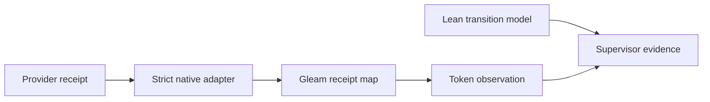

# 20261031-1432 — Agent control mathematics and Gleam token monitor: SC-JOURNAL-v3

Observed start 2026-10-31T14:47:32Z. Sa-plan uos/hive-agent-control-math/20261031-1431: M01_CONTROL_SAFETY, claude-hive-formal-20261031 attempt1; M02_TOKEN_MONITOR, pi-hive-token-monitor-20261031 attempt1. Root supervised scoped repairs. Native/model identity and local Codex relay work are distinguished below.

#fractal-l0 #fractal-l1 #fractal-l2 #fractal-l3 #fractal-l4 #fractal-l5 #fractal-l6 #fractal-l7 #fractal-l8 #fractal-l9 #km-triad #zk-adr #zero-muda

[Self](http://nas-1.tail55d152.ts.net:4100/files/docs/journal/20261031-1432-hive-agent-control-math-and-token-monitor-journal.md) · [Design and primary-source review](http://nas-1.tail55d152.ts.net:4100/files/docs/design/20261031-1432-hive-agent-control-formal-check-and-token-monitor.md) · [Observation packet](http://nas-1.tail55d152.ts.net:4100/files/governance/planning/20261031-1432-hive-agent-control-math-and-token-observations.json) · [Planning](http://nas-1.tail55d152.ts.net:4100/planning) · [Wiki](http://nas-1.tail55d152.ts.net:4100/wiki) · [ZK](http://nas-1.tail55d152.ts.net:4100/zk).

[[wiki:20260905-1801-uos-zk-km-corpus-index]]
[[zk:20260905-1801-moc-uos-unified-master]]

## 1. Scope & Trigger

Engine5 formal gateway. The operator asked for a formal mathematical agent-control check, token-use monitoring/optimization, official DeepSeek/Google/Microsoft research and extension of existing Gleam infrastructure. The right-problem question is whether concurrency remains fenced and economical under duplicate/stale commands and uncertain remote outcomes. M01 builds an abstract Lean safety model; M02 builds a read-only Gleam diagnostic. Neither is a live scale controller or a budget-enforcing deployment.

The existing nine-task handover and A01–A08 speedup plan remain canonical and incomplete. This added independent slice does not skip their dependencies, close sovereign work, invent EV cycles or authorize production cutover. EV ceiling93; application_admitted=false; SYSTEM_ADMITTED=false.

## 2. Pre-State Assessment

Engine7 prior. MCP observed KM healthy and canonical triad intact on OTP29/ERTS17.0.5. The full TwoLattice_STM.lean precedent and bounded lease-mutex recall were consulted. knowledge_search has no limit parameter in the connected schema; that capability gap is preserved. Existing coord.Usage is additive, so raw replay can overcount unless reduced by stable invocation identity first.

PREDICT: stale generation, unknown usage and replay should refuse or conserve authoritative state. Falsifiers include a fourth occupied slot, a reused provider receipt, negative/duplicate counters, counting one file twice, or treating the last multi-response Pi message as complete invocation usage. No calibrated Kalman prior/covariance exists for delivery or cost: UNKNOWN, not a fabricated confidence number.

## 3. Execution Detail

Engine6 production invariant rules. Canonical Sa-plan created M01/M02; risk preflight and current worker/attempt active observations passed before execution. Source work used an isolated standalone JJ workspace based on main a4dcfaa6124f647b1770e37288724a24ea8949c5. Integration ownership was reacquired as epoch105; any later mutation must recheck current ownership.

The real Pi Pro0813 one-shot call reserved USD0.25 in the existing canonical ledger and produced an OCaml normalization draft. Compilation failed and local review found accounting defects; the draft was retained privately as HOLD and excluded. A real Claude Sonnet5.5 call attempted the Lean implementation under a300s bound but timed out without a final source/aggregate receipt. Cost/tokens are UNKNOWN. No further model call was made. A local Codex relay salvaged scratch definitions and proved the model; root independently ran the Lean kernel and reviewed guard scope. This is not represented as a successful native Claude proof delivery.

ACT reused coord.Usage, daily_budget policy, canonical ledger and bounded file-read infrastructure. Root implemented Gleam immutable receipt reduction, provider adapters and development CLI, plus a short bounded OTP JSON/file adapter. Independent local review reproduced source-alias overcount and non-final Pi acceptance; root repaired both and added regression cases. The existing coordinator sources, protected harness catalog and ecology_process.ml were not modified.

## 4. Root Cause Analysis

Engine1 ACH disconfirmation matrix. Scores below are ordinal consistency judgments, not probabilities.

| Evidence | H1 incomplete implementation guards | H2 missing toolchain | H3 misleading accounting population |
|---|---:|---:|---:|
| Initial Pi module fails compilation on unsupported API | +2 | -2, pinned compiler works | 0 |
| Same physical receipt under two IDs double-counts | +2 | -2 | +2 |
| Pi pending/multi-response wrapper accepted as final | +2 | -2 | +2 |
| Actual20 native receipts parse with category controls | -1 after repair | -2 | -1 for selected population only |
| Claude timeout leaves no aggregate receipt | 0 | -1, local kernel available | +2 if falsely counted zero |
| Root identifies external budget receipt reuse gap | +2 | -2 | 0 |

H1 and H3 explain the defects better than H2. The fixes operate at stable identity, finality and guarded model transitions. They do not infer fleet correctness from a toolchain PASS or a local lease.

## 5. Fix Taxonomy

Engine6 Poka-Yoke: typed finite role slots, strict positive-time fences, permanent effect/payload binding, one-use reservation checks, unique-key bounded JSON and provider-specific disjoint counters. Muda: exclude the failed normalizer dependency and reduce broad context to needed fresh KM excerpts. No external framework runtime was installed.

Jidoka: malformed/unknown receipt usage returns HOLD; duplicate/conflicting source identity refuses. Budget uncertainty retains liabilities. Stopping a local owned subprocess does not prove cancellation of a remote model request or authorize a refund. A model recommendation cannot mutate tasks or admission state.

## 6. Patterns & Anti-Patterns Discovered

Engine4 Popperian falsification. Existing normalized unit tests passed while two raw-ingestion counterexamples failed. Raw provider fixtures and file-alias tests therefore belong in acceptance; implementation-shaped examples alone are insufficient. Pi/Claude model price is not cost per accepted work product; failed generation, repair and unknown timeout usage remain visible.

Formal anti-pattern: unique internal reservation serials do not establish uniqueness of an external receipt ID. Root required an explicit guard rather than burying the property in an assumed oracle. Three typed slots establish modeled cardinality, not unique real worker processes or native refinement. Readback authenticity and source/task fencing remain independent runtime obligations.

## 7. Verification Matrix

M03_METHOD_COVERAGE additionally applies an independent Quint interleaving model, bounded SMT QF_LIA constraints and an OCaml witness/refutation oracle. Algebraic, queueing, control, probability and optimization applicability is explicit in the design; non-fit techniques remain INAPPLICABLE rather than nominally green.

Engine2 Admiralty protocol. Candidate machine receipts are assessed A2 within their direct scope; independent local adversarial observations B2; model opinions alone E3. Labels are analyst assessments and confer no admission.

| Check | Observation | Scope / residual |
|---|---|---|
| Toolchain preflight |31 checks PASS, advisory | Tool availability only |
| Risk preflight/active | M01/M02 current plan observations PASS | Not atomic with a future effect |
| Gleam package | Latest gate count/hash in observation packet | Package tests, no production attachment |
| Actual receipt adapter |20 known invocations, then21 registered including1 unknown timeout | Selected population; incomplete supervisor coverage |
| Source alias counterexample | Initial overcount reproduced, repaired refusal exit2 | Same path, relative, symlink, hardlink, copied bytes covered |
| Non-final Pi counterexample | Initial false known result, repaired UNKNOWN | One-shot wrapper only; multi-response aggregation remains unsupported |
| Lean model | Root kernel observation, final hash/exit in packet | Abstract safety; no native equivalence or liveness proof |
| Negative controls | Concrete failing mutants and refused boundary examples in final source/packet | Finite witnesses supplement induction |
| SMT numeric admission | Guarded unsafe UNSAT; admissible and two mutant SAT witnesses independently evaluated |246000 finite refutation candidates,16800 valid cases; no general oracle proof of UNSAT |
| Oracle refusal controls | Unknown solver verdict and invalid counterexample both refuse exit2 | Fail-closed checker behavior |
| Journal/diagram/KM/live delivery | Final receipts recorded in packet | No passing status inferred before actual gate output |

SOURCE-GATE and effect-time fences must be refreshed for a new revision. No assertion here claims all testing modalities, mathematical engines or release checks passed.

## 8. Files Modified

Engine6 standalone Jujutsu accounting. New files: formal/lean/AgentScaleControl.lean; five Gleam source modules in apps/uos_swarm; short token_monitor_json_ffi.erl; targeted Gleam/Erlang tests; this timestamped journal, companion design and sanitized observation packet. Reciprocal wiki/ZK indexes and capability inventory are registered during closure. Exact paths/digests are in the packet and JJ diff.

No Python, provider SDK package, new budget database, production supervisor wiring, protected MCP module or external source tree was changed. Raw prompts, transcripts, private DB/WAL/SHM and credentials are not published. Storage OS serial is [REDACTED_SYSTEM_OS_SERIAL].

## 9. Architectural Observations

Engine5 sheaf/presheaf consistency. Provider-local token partitions map to one explicit shared Usage carrier. Agreement on overlaps is checked through immutable receipt identity; differing restrictions refuse instead of merging contradictory values. This is a design analogy, not a mechanized category-theory proof.

```ascii
[Provider receipt] --> [Strict native adapter]
[Strict native adapter] --> [Gleam receipt map]
[Gleam receipt map] --> [Token observation]
[Lean transition model] --> [Supervisor evidence]
[Token observation] --> [Supervisor evidence]
```



No observation edge is an actuation edge. Existing Gleam/OTP owns control; Sa-plan remains execution authority; durable budget ledger remains liability authority; signed Zenoh messages require canonical readback.

## 10. Remaining Gaps

Engine4 residual analysis. Runtime scale control/MCP/Zenoh binding, exact native-Gleam refinement, signed live round trips, persistent monitor attachment, general Pi multi-response accounting, provider-authenticated billing, current route-price admissibility and unknown Claude timeout usage remain open. The explicit local file interface is not a descriptor-relative VFS or a proof of wall-time bounded I/O on hostile filesystems.

Public OpenRouter Pro0813 headline output price exceeds the pinned UOS ceiling; a new paid request requires a fresh actual route quote and normal budget admission. No universal cheapest model or achieved10x throughput is claimed. The original nine tasks, OI08→OI09 dependency repair and separate release authority remain outstanding.

## 11. Metrics Summary

Engine3. Initial20 known native receipts report2061712 tokens and4054055178 nanodollars of unverified SDK/list-price/receipt estimates. Updated population21 includes one unknown timeout; those known totals are lower bounds. Monetary liabilities are separately USD2.50 canonical OpenRouter reservations, USD7.50 remaining, actual spend UNKNOWN. About85.06% of known input categories are cache reads; this is a token mix, not an accepted-work efficiency measurement.

No IID reliability estimate is inferred from test assertions. For the single independently reproduced alias defect and its precommitted refusal check only, a descriptive Beta(1,1) prior becomes Beta(2,1) on one successful check; it is not a software failure-rate posterior. Evidence decay weight w(age)=2^(-age/24h) is an advisory freshness policy; source changes invalidate candidate-bound proof immediately regardless of weight. Duplicate receipts are not independent observations.

Lyapunov model: V=max(0,occupied-3)+max(0,writers-2)+max(0,reviewers-1)+max(0,dayPaid-cap). Reachable safety implies V=0 and discrete ΔV=0 within the abstract model. Real-fleet dV/dt<0, recovery convergence and control stability are UNRUN; a conserved zero violation score is a safety invariant, not an asymptotic stability theorem.

## 12. STAMP & Constitutional Alignment

Engine6. Hazard H1: unfenced model dispatch; H2: misleading token/cost evidence. Raw FMEA S5/O3/D3 gives RPN45 and band5 for H1; S4/O3/D3 gives RPN36 and band4 for H2. These are ordinal judgments with residual uncertainty, not empirical frequencies.

| UCA type | Context | Constraint |
|---|---|---|
| not_provided | required fence or unknown-cost reconciliation omitted | refuse/hold before effect |
| provided_unsafe | stale command or duplicate receipt treated as fresh authority | recheck authority and immutable IDs |
| wrong_timing | dispatch after lease/deadline or before dependency | strict time and Sa-plan dependency gate |
| duration | uncertain worker or pending usage forgotten too soon | retain capacity/liability and require readback |

All L0–L9 roles and the six verification domains are bound in the companion design. Safety grants, budgets, review and telemetry do not substitute for sovereign deployment/admission authority.

<details><summary>Domain 1 — Metadata and navigation</summary>

- [x] CHK-01-TIME — Host clock observed; filename uses YYYYMMDD-HHSS, hour plus seconds.
- [ ] CHK-02-TAIL — Live candidate delivery and byte parity require publication proof.
- [x] CHK-03-FRACT — L0–L9 responsibilities recorded.
- [ ] CHK-04-KM — Reciprocal wiki, ZK, inventory and journal registrations require final reconciliation.

</details>
<details><summary>Domain 2 — Purity and storage</summary>

- [x] CHK-05-MUDA — No excluded runtime or package added.
- [x] CHK-06-GRAPH — Gleam owns policy; bounded OTP JSON/file adapter only.
- [x] CHK-07-DRIVE — No storage provisioning or interlock change.

</details>
<details><summary>Domain 3 — Tests and mathematical gates</summary>

- [ ] CHK-08-C1C8 — UI categories outside this CLI/model slice remain UNRUN.
- [ ] CHK-09-MATH — Source-bound kernel proof, independent review and mutant controls require final receipts; no blanket four-gate claim.
- [x] CHK-10-9MOD — Unit, negative, metamorphic and native-receipt checks are applicable; broader modalities remain UNRUN.
- [x] CHK-11-REGR — Replay, alias, missing usage, cache and reasoning boundaries have explicit falsifiers.

</details>
<details><summary>Domain 4 — Control and observability</summary>

- [ ] CHK-12-GLEAM — Development CLI executes on OTP29; production supervisor attachment is pending.
- [x] CHK-13-HERMES — Formal/evidence work is separate from effect authority.
- [ ] CHK-14-ZIGVM — Deterministic kernel unchanged; runtime integration UNRUN.
- [ ] CHK-15-MAX — Isolated inference unchanged; runtime integration UNRUN.
- [ ] CHK-16-OTEL — Host observation timestamps exist; full live exporter/span binding pending.

</details>
<details><summary>Domain 5 — Governance and Jujutsu</summary>

- [ ] CHK-17-SOV — Independent candidate acceptance and release authority remain separate.
- [x] CHK-18-JJ — Isolated standalone JJ workspace; no native Git mutation.

</details>
<details><summary>Domain 6 — Provenance extension</summary>

EV-93 ceiling. EV-94..109 / ADR-071..086 remain NOT_ADMITTED. No new EV identifier, runtime admission or sovereign adjudication follows.

</details>

## 13. Conclusion

Engine7 Forecast, recorded before Horizon: p=0.8 that the formal model and token monitor can be brought to reviewable scoped development evidence by2026-10-31T16:00:00Z. Score with Brier (p-o)^2 at that horizon; outcome is pending until final kernel/test/review/journal receipts exist. Keep any failed attempt and unknown invoice in the denominator.

The REFLECT step registers reciprocal KM links and source-bound receipts. Completion applies only to this defined development evidence slice when its gates pass; broader goal and original canonical tasks remain active.

[Previous: design](http://nas-1.tail55d152.ts.net:4100/files/docs/design/20261031-1432-hive-agent-control-formal-check-and-token-monitor.md) · [Cockpit](http://nas-1.tail55d152.ts.net:4100/) · [Next: planning](http://nas-1.tail55d152.ts.net:4100/planning).

UOS footer: report-only mathematical and diagnostic evidence; no runtime deployment or system admission.

