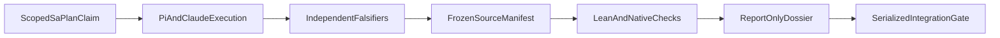

# 20261031-1445 — Codex, Pi and Claude hive wave 1 evidence ledger

Tags: #fractal-l0 #fractal-l1 #fractal-l2 #fractal-l3 #fractal-l4 #fractal-l5 #fractal-l6 #fractal-l7 #fractal-l8 #fractal-l9 #km-triad #zk-adr #zero-muda #tailscale-web #checklist-nav

Scope: OI01_EV94_109_SOVEREIGN_AUDIT in uos/codex-handover-open-items-fractal-plan/20261031-1240; A01_PLAN_10X in uos/hive-10x-speedup/20261031-1351. Both are attempt 1. Codex supervises; Pi and Claude execute and review. Administrative closure remains gated on final integration and canonical task receipts. All other tasks remain open. No production cutover or sovereign admission is performed.

[Self](http://nas-1.tail55d152.ts.net:4100/files/docs/journal/20261031-1445-codex-pi-claude-hive-wave1-journal.md) · [Master handover](http://nas-1.tail55d152.ts.net:4100/files/docs/handover/20261031-1100-agy-to-codex-always-fresh-km-mcp-brain-and-fractal-plan-handover.md) · [Speedup plan](http://nas-1.tail55d152.ts.net:4100/files/docs/plans/20261031-1339-uos-hive-10x-engineering-speedup-and-parallelism-plan.md) · [Observation packet](http://nas-1.tail55d152.ts.net:4100/files/governance/planning/20261031-1453-hive-speedup-observations.json) · [KM](http://nas-1.tail55d152.ts.net:4100/km).
Reciprocal anchors: [[wiki:20260905-1801-uos-zk-km-corpus-index]] · [[zk:20260905-1801-moc-uos-unified-master]].

## 1. Scope & Trigger

The operator requested all open-item execution under Codex supervision, Pi/OpenRouter/DeepSeek and Claude workers, POODAVR, fractal RCA, a measurable 10x plan, knowledge acceleration, MCP/Zenoh scale control and observed multilayer parallelism. The right problem is verified accepted work, not agent counts or unsupported performance claims. OI01 delivers a report-only forensic candidate and native kernel; it does not adjudicate the quarantined EV range. A01 delivers a plan and registered execution graph, not an implemented scale controller.

Engine 5 binds the bounded Lean model and native behavior by exact source hashes. Machine-checked model invariants, native conformance examples, source presence and sovereign admission are distinct claims.

## 2. Pre-State Assessment

The observed root working copy was clean, parent main and cached origin both a4dcfaa6124f647b1770e37288724a24ea8949c5. No fresh remote fetch was claimed. Host UTC at intake was 2026-10-31T13:34:24.207Z, chrony stratum 3 and system offset 0.000172235 seconds. Actual preflight passed 31 checks; a stale cached receipt was first rejected and preserved. KM MCP health reported healthy/intact and EV ceiling 93.

The nine original tasks were available, but only OI01 was dependency-ready. Seven master prompt task IDs differed from live Sa-plan; the companion DAG omitted OI09 and used historical 11/374 labels. OI08's stored DAG omitted OI09. The read-only feature-intent tool is not an actuator. The connected knowledge_search schema lacks limit. These observations require fresh rechecking before effects.

Engine 7 prior forecast in the speedup plan was p = 0.8 that the plan and bounded acceptance protocol would be reviewable by 2026-10-31T14:30:00Z. A 10x speedup was never pre-established.

## 3. Execution Detail

PREDICT used explicit scope, failure criteria and model bounds. OBSERVE used live MCP, host clock, current Sa-plan, source hashes and Tailnet reads. ORIENT separated source defects, stale recipes, process-local observations and runtime claims. DECIDE selected OI01 by complete-plan risk preflight and obtained task leases; ACT used isolated JJ workspaces and disjoint paths. VERIFY retained failed cases and independently rebuilt the source. REFLECT registers this ledger and reciprocal knowledge links.

The old file-journal CLI refused replay. Inspection established that the canonical SQLite coordinator, not that retired projection, was the correct backend. Its current state was read successfully; no journal was rewritten. Codex registered its real session and obtained integration epochs 103, then 104 after renewal/reclaim. A control-kind board message refused; the corrected observational Report succeeded without inventing peer acknowledgements.

Pi generated bounded native source; initial Flash syntax/type defects and a truncated Pro selftest were rejected. Pro generated the repair fragment. Claude implemented strict JSON, bounded stdin entrypoints, explicit advisory transitions and independent tests. Review found native record forgery; an abstract dossier and real negative compiler fixtures closed it. Pi then reproduced invalid UTF-8 acceptance. Claude added scalar and surrogate checks; the final kernel passes the independent malformed/valid boundary probes.

Engine 6 alignment is scoped: HOLD and UNKNOWN never became admission. Every paid Pi request used the canonical fixed reservation; new requests followed known failures, not unresolved retries. No unrestricted Pi tool loop was described as budget-enforced.

```ascii
[ScopedSaPlanClaim] --> [PiAndClaudeExecution]
[PiAndClaudeExecution] --> [IndependentFalsifiers]
[IndependentFalsifiers] --> [FrozenSourceManifest]
[FrozenSourceManifest] --> [LeanAndNativeChecks]
[LeanAndNativeChecks] --> [ReportOnlyDossier]
[ReportOnlyDossier] --> [SerializedIntegrationGate]
```



## 4. Root Cause Analysis

Engine 1 ACH scores use 0 for consistent, 1 for neutral and 2 for contradicted; these are diagnostic ordinal scores, not probabilities.

| Evidence | H1 implementation defect | H2 broken host/toolchain | H3 misleading observation or recipe |
|---|---:|---:|---:|
| Flash draft syntax failure with pinned compiler | 0 | 2 | 1 |
| Valid positive controls compile; forged record update fails after fix | 0 | 2 | 1 |
| Invalid UTF-8 accepted, then refused on same pinned toolchain | 0 | 2 | 2 |
| Retired file journal refuses; canonical SQLite replay succeeds | 2 | 2 | 0 |
| StdIO-local subscriber stopped while production ownership is separate | 2 | 1 | 0 |

The confirmed code causes were incomplete generated validation, an exposed record constructor and missing raw Unicode validation. Host/compiler failure is disconfirmed by positive controls. Several agent findings were false positives: Hashtbl.create 0 works, the master DAG already includes OI09, and HHSS filename prefixes cannot be interpreted as HHMM chronology. ISO observed_at is the time evidence.

Fractal RCA: L1 malformed bytes; L2 parser/API encapsulation; L3 duplicate/replay and task metadata; L4 process/transport ownership; L0 authority boundaries; L8 knowledge attribution; L9 reviewer scope and workflow ordering. The causes are not interchangeable.

## 5. Fix Taxonomy

Poka-Yoke: exact key sets, Unicode scalar validation, byte/depth/list bounds and abstract construction prevent malformed or forged states. Jidoka: failed generation, malformed input and uncertain outcomes stop affected work; previous HOLD reviews remain preserved. Muda reduction: slim native Claude contexts, bounded Pi requests and larger coherent implementation slices reduce repeated context without omitting failed attempts.

The new parser has no arbitrary locator reads or writes. Typed advisory recommendations remain advice and cannot promote status. Remaining LOW schema/comment issues are attributed below; they were not silently erased.

## 6. Patterns & Anti-Patterns Discovered

Engine 4 Popperian falsifiers were substantive: caller-supplied review/admission keys, repeated escaped keys, duplicate EV IDs, invalid Unicode, exact-cap and cap-plus-one stdin, and external native record construction. Compiler negative tests include a positive control; removing the abstract signature caused the expected three negative fixtures to fail, demonstrating non-vacuity.

Avoid accepting model code on generation success or treating a model HOLD without a concrete counterexample as a discovered exploit. Raw Pi HOLD opinions remain unchanged. A fresh Opus session accepted the narrower report-only development scope after full-source inspection and fresh execution; it did not certify global refinement or adjudication. No syscall-purity proof is claimed from static token scans.

Source inspection also found zenoh_publish_response returning published without invoking a publisher. That is OI03 counterevidence; no such acknowledgment is used as synchronization proof.

## 7. Verification Matrix

Engine 2 Admiralty grades describe evidence quality in this local ledger, not external certification. Pinned executed tools and retained matching source hashes are A2; independently repeated observations can support A1. Model opinions alone are E3, not admission evidence.

| Check | Actual outcome and scope | Grade |
|---|---|---|
| Toolchain | Fresh 31-check preflight; no package provision | A2 |
| Native package | Supervisor independently observed TOTAL=338 PASSED=338 FAILED=0, exit 0 | A2 |
| Unicode counterexamples | Independent repaired-behavior probe 24/24; original malformed encodings refused | A2 |
| CLI boundaries | 16 final Unicode success/refusal cases across both CLIs; typed HOLD exit 2 for invalid input | A2 |
| Actual forensic input | 16 claims processed by standalone and gate entrypoints, exit 0; outputs byte-identical and report-only | A2 |
| Lean | Pinned tool compiled exact f022c8370b23575fcd7a44995e521ef14a76169115553305b1bf1f20ea085400, exit 0 | A2 |
| Historical preservation | 32 historical-document/source checksum entries verified unchanged, exit 0 | A2 |
| Native forgery | Real core and positive caller compile; external forged record update refuses | A2 |
| Model/native relation | Finite boundary and transition examples; full mechanized refinement remains UNVERIFIED | A2 for execution only |
| Full-source Opus review | Scoped development acceptance, no blocking code finding; opinion does not grant authority | E3 opinion; execution separately above |
| Plan review | Scoped document acceptance; no 10x result or runtime authority | E3 opinion |
| Diagrams | Speedup topology compared and verified; this journal requires final G-DIAGRAM receipt | A2 when executed |
| Tailnet baseline | Master disk digest equals HTTP body and digest header, HTTP 200/no-store | A2 |
| New publication | Final live readback and task closure require separate current receipts | UNRUN at authoring |

Raw process, model and failed receipts remain in var/harness/20261031-1334-codex-hive/. That directory is private runtime evidence, not a public file-viewer link. The sanitized public packet carries safe observations; it contains no private DB or credential bytes. New metadata must not be cited as global system acceptance.

## 8. Files Modified

OI01 source: tools/km_provenance/km_adjudication.ml and km_adjudication_test.ml; Dune library/test wiring; the bounded km_gate stdin arm; tools/provenance_adjudicator.ml; formal/lean/ProvenanceAdjudication.lean; and the timestamped forensic JSON ledger. Native source/model hashes and final process receipts identify the candidate independently of this journal's own bytes.

A01 source: the timestamped 10x/parallelism plan and sanitized observation JSON. Reciprocal wiki index, ZK MOC and capability inventory registration accompany integration. The current master handover receives a continuation pointer and exact live task identifiers; historical quarantined ADRs and external source trees remain byte-preserved.

No protected harness module, pinned mcp/tools.gleam or tools/ecology_process.ml was changed. Standalone JJ is the VCS. No native Git mutation, production service restart, secret copy or new dependency occurred.

## 9. Architectural Observations

Engine 5 consistency: the abstract Lean Dossier preserves ceiling 93 and false admission flags under reachable transitions; native typed construction and empirical tests support bounded correspondence. The validated-subset native constructor is wider than Lean Reachable, so exact global refinement is not asserted. The default parser reports caller assertions, readback_verified=false and pending recommendations; typed advisory updates are a separate API.

ETS remains a metadata hint/mirror. Sa-plan is the durable authority. MCP/Zenoh scale control and read-only parallelism telemetry are proposed interfaces in A02/A05/A08, not live tools. The plan prevents metadata hints from excluding documents without a verified completeness protocol, and forbids stale byte caches or TTL-based document truth.

The 13D trace projection retains layer/component/surface/provenance coordinates; no new coordinate schema or EV number is introduced. Formal advice and cached knowledge cannot execute effects.

## 10. Remaining Gaps

Full sovereign Codex+AGY adjudication remains pending. Every EV94..109 / ADR071..086 claim stays NOT_ADMITTED; referenced code presence is not its runtime or formal rebind.

OI02–OI09 remain open until their own claims and acceptance. OI08's missing OI09 dependency needs a supported canonical API repair. Runtime effect-time fencing, a bounded Pi request adapter, actual signed synchronization, backend scaling and sustained 24-hour soak are unfinished. No measured 10x improvement exists.

Kernel LOW findings: extra-argument gate refusal has fewer metadata flags than other refusals, while still HOLD/NONE/exit 2; comments overstate exact reachability matching for validated subsets. Parser/CLI global refinement and syscall-level purity are unverified. Neither limitation is concealed by the scoped review acceptance.

## 11. Metrics Summary

Machine observations: 338 native assertions, 24 repaired Unicode probes, 16 final Unicode CLI cases, 16 forensic claim rows and 32 unchanged checksum entries. These populations differ and are not summed into a synthetic reliability percentage.

Engine 3 Bayesian bookkeeping: the single plan-review forecast outcome is not an IID software reliability sample. A descriptive Beta(1,1) prior with one observed successful review event gives Beta(2,1); its mean 2/3 is calibration bookkeeping only, not a product-failure estimate. For that unverified forecast population, use C(t)=(2/3)*2^(-delta_seconds/86400). Machine receipts use the separate seven-day half-life and invalidate immediately on relevant source change. No decayed score grants admission.

Model-only Lyapunov analysis uses E(d)=abs(d.ceiling-93)+indicator(applicationAdmitted)+indicator(systemAdmitted). For Lean-reachable states, reachable_inv makes E=0 and abs(delta E)=0<=epsilon with epsilon=0: an invariant orbital-stability result for the abstract admission fields. This is not fleet runtime stability or a measured dV/dt<0; those remain UNRUN.

Nine Pi calls reported about USD 0.031024 estimated token cost against USD 2.25 reserved liability. Native Claude CLI reported about USD 4.0173213 model-usage equivalent across execution/reviews, including the first budget-exhausted launch; this is not a verified subscription bill. Primary supervisor aggregate token accounting is a separate population and must be included in future throughput/cost studies. No price or speedup is inferred from token reduction alone.

At 14:26:43Z, there were zero active owned execution/review model requests plus one Codex supervisor; task leases still showed two executing task streams. Other long-running interactive Pi processes were outside this scope. No verified per-layer worker telemetry exists yet; A08 must report UNKNOWN instead of inventing it.

## 12. STAMP & Constitutional Alignment

Raw FMEA for false authority: S5/O3/Det3, RPN45, band5; document planning mode: S4/O2/Det2, RPN16, band4. All four UCAs were considered: missing guard/review; unsafe forged input or false publish acknowledgment; wrong dependency/order; and effects continuing beyond lease/deadline or stopping before durable recovery. Current risk preflight/active-check and independent evidence are observations; they do not establish mandatory runtime fencing.

Zero-Muda: 0 Bevy, 0 Graphite; no foreign NIF, new Python service or external ingestion. The storage interlock [REDACTED_SYSTEM_OS_SERIAL] is untouched; destructive storage testing is out of scope. EV ceiling remains 93. Application and system admission stay false.

<details><summary>Domain 1 — Metadata, timestamp and navigation</summary>

- [ ] CHK-01-TIME — Host clock observed; final timestamp check remains a closure receipt.
- [ ] CHK-02-TAIL — New live delivery is pending publication readback.
- [x] CHK-03-FRACT — L0–L9 and scoped trace implications recorded.
- [ ] CHK-04-KM — Reciprocal registration requires final integration verification.

</details>
<details><summary>Domain 2 — Zero-Muda and storage safety</summary>

- [x] CHK-05-MUDA — No excluded dependency introduced in the scoped diff.
- [x] CHK-06-GRAPH — Pure native evidence/model boundary preserved.
- [x] CHK-07-DRIVE — Interlock untouched; no storage effect invoked.

</details>
<details><summary>Domain 3 — Tests and mathematical gates</summary>

- [ ] CHK-08-C1C8 — No UI implementation changed; new document navigation remains to verify.
- [ ] CHK-09-MATH — Lean scope verified; fleet four-gate claims remain UNRUN.
- [x] CHK-10-9MOD — Applicable unit, negative compile, boundary and conformance examples recorded; performance/soak not claimed.
- [x] CHK-11-REGR — Concrete Unicode and record-forgery regressions checked.

</details>
<details><summary>Domain 4 — Cross-language control and observability</summary>

- [ ] CHK-12-GLEAM — Existing MCP observed; new scale-control actuation is unimplemented.
- [x] CHK-13-HERMES — Bounded native evidence tests and formal invocation observed.
- [ ] CHK-14-ZIGVM — Kernel runtime unaffected; no new runtime test claimed.
- [ ] CHK-15-MAX — Inference tier unaffected.
- [ ] CHK-16-OTEL — New worker telemetry/trace integration remains A08 work.

</details>
<details><summary>Domain 5 — Governance and Jujutsu</summary>

- [ ] CHK-17-SOV — Scoped reviews exist; global sovereign acceptance remains pending.
- [ ] CHK-18-JJ — Final serialized integration and exact candidate receipt pending.

</details>
<details><summary>Domain 6 — Provenance extension</summary>

EV-93 ceiling; EV94..109 / ADR071..086 NOT_ADMITTED. No new EV number, unilateral adjudication or system admission.

</details>

## 13. Conclusion

This wave has executed and independently tested a bounded report-only kernel and produced a reviewed parallel execution plan. Canonical task completion, integration and live metadata delivery are recorded only after their closure gates; this journal alone grants none of them.

Engine 7 forecast resolution: p = 0.8, Horizon 2026-10-31T14:30:00Z, outcome criterion a reviewable plan without unresolved authority/freshness contradiction. The reviewable document and scoped acceptance were observed before the horizon; o=1 and Brier=(0.8-1)^2=0.04. This is one forecast, not proof of calibration or a 10x result. HHSS filename prefixes do not encode hour/minute chronology; the review's contrary timestamp inference is preserved as counterevidence.

New Forecast: p = 0.7 that at least one next dependency-ready implementation slice is dispatched by Horizon 2026-10-31T15:30:00Z. Falsifier: no such canonically claimed, risk-cleared dispatch exists by that time. Resolution uses o in {0,1} and Brier=(0.7-o)^2; it must not be rewritten after observing the outcome.

[Previous: master handover](http://nas-1.tail55d152.ts.net:4100/files/docs/handover/20261031-1100-agy-to-codex-always-fresh-km-mcp-brain-and-fractal-plan-handover.md) · [Wiki](http://nas-1.tail55d152.ts.net:4100/wiki) · [ZK](http://nas-1.tail55d152.ts.net:4100/zk) · [KM](http://nas-1.tail55d152.ts.net:4100/km) · [Planning](http://nas-1.tail55d152.ts.net:4100/planning) · [Cockpit](http://nas-1.tail55d152.ts.net:4100/) · [Next: parallelism plan](http://nas-1.tail55d152.ts.net:4100/files/docs/plans/20261031-1339-uos-hive-10x-engineering-speedup-and-parallelism-plan.md).

UOS footer: scoped evidence, not global admission or release authority.
