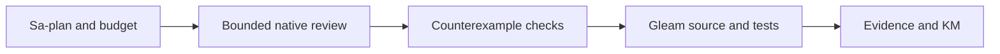

# 20261031-1621 — Requested native mathematical reviews and budget hardening

Observed 2026-10-31T16:00:21Z. Sa-plan `uos/hive-agent-control-math/20261031-1431`, M05–M11. Development source and bounded observations; no production control attachment or admission.

#fractal-l0 #fractal-l1 #fractal-l2 #fractal-l3 #fractal-l4 #fractal-l5 #fractal-l6 #fractal-l7 #fractal-l8 #fractal-l9 #km-triad #zk-adr #zero-muda

[Self](http://nas-1.tail55d152.ts.net:4100/files/docs/journal/20261031-1621-requested-native-math-reviews-and-budget-hardening-journal.md) · [Design](http://nas-1.tail55d152.ts.net:4100/files/docs/design/20261031-1432-hive-agent-control-formal-check-and-token-monitor.md) · [Observations](http://nas-1.tail55d152.ts.net:4100/files/governance/planning/20261031-1621-requested-native-math-reviews-and-budget-hardening.json) · [Planning](http://nas-1.tail55d152.ts.net:4100/planning).

[[wiki:20260905-1801-uos-zk-km-corpus-index]]
[[zk:20260905-1801-moc-uos-unified-master]]

## 1. Scope & Trigger

The operator requested actual Pi/OpenRouter Google Argon and DeepSeek Pro mathematical analysis, Claude analysis, formal agent-control checks and economical token monitoring using existing Gleam infrastructure. Right-problem check: optimize verified work per dollar while preserving safe concurrency and uncertain liabilities. An optional operator priority question remains independent of this authorized work.

## 2. Pre-State Assessment

Base main f47eb2b1caa98ff0a44b2e74d23ff1749ff49b22 already contains the abstract Lean control model, Quint model, SMT oracle and native Gleam monitor. The monitor lacked a distinct recommendation for known token usage with unknown cost. The canonical append-only ledger had ten reservations, USD2.50 liability, and a SQL schema derived from six exact model IDs. Adding Argon changed that schema. Existing healthy MCP/KM observation retained ceiling93 and no effect authority. Current native refinement and liveness remain unproved.

## 3. Execution Detail

PREDICT route/privacy mismatch, catalog-price drift and schema evolution; OBSERVE official model/endpoint/ZDR data and exact native receipts; ORIENT against existing coordinator/budget/Usage carriers; DECIDE through Sa-plan and fresh risk checks; ACT with one-shot no-tool model calls and disjoint local source scopes; VERIFY native outcomes, independent checks and rollback; REFLECT through this journal and reciprocal KM registration.

Exact requested aliases were google/gemini-4-argon and deepseek/deepseek-v4-pro-0813. Initial explicit AI Studio/DeepSeek routes were refused by existing privacy guardrails before inference. Distinct newly reserved requests used published ZDR Google Vertex global and DeepInfra FP8 routes, with ZDR explicitly required, fallback/retry disabled and unchanged price ceilings. Each request retained its own USD0.25 liability; none was refunded. Pi1.4 produced one assistant response per request, with a 512-token completion cap and input under16KiB. Native Claude Sonnet5.5 then completed one no-tool analysis turn; its USD1 CLI setting is a soft budget, not a hard invoice guarantee.

Local Codex relays implemented the reviewed fixes; they are not mislabeled native Pi/Claude execution. Argon admission added the exact ID to existing Gleam/OCaml ceilings at4000/20000 nanodollars per token. A maximum request costs155648000 nanodollars under the250000000 reservation. Explicit in-place upgrade accepts only exact legacy/current schemas, preserves every row and metadata, and retains append-only/cap/clock triggers. The later resource guard refuses a committed image above32MiB. The Gleam monitor now distinguishes HOLD_UNKNOWN_COST from HOLD_UNKNOWN_USAGE; it grants no monetary or task authority.

## 4. Root Cause Analysis

ACH H1, model math disproved safety: disconfirmed. Argon's proposed consumed-only liability equation contradicts intentional reservation accounting. Its replay critique confuses an unchanged-state ACK with a fenced dispatch. Worker identity injectivity and liveness remain explicit external obligations. Claude confirmed these distinctions; existing Lean replay and lifetimePaid=nextRes*unitCost properties already cover the requested abstract obligations.

ACH H2, reporting omitted an uncertainty dimension: supported. DeepSeek found known usage with absent cost can return ContinueWithinObservedLimit; Claude confirmed the reporting weakness and corrected its sample test syntax. An explicit unknown-cost hold fixes that recommendation without inventing financial authority.

ACH H3, catalog estimates equal served-route charges: disconfirmed. DeepSeek SDK estimateUSD0.00239976 differs from provider-reportedUSD0.0043355. Retain both; use provider metadata for this comparison. H4, source is broken when tests cannot load BEAM modules: disconfirmed by OTP29 reproduction. Root accidentally used systemOTP27, producing corrupt-atom-table/undefined-function failures; pinnedOTP29 passes730 tests. Earlier concurrent commands shared a build tree; later verification was serialized. Failed runs remain retained.

## 5. Fix Taxonomy

Poka-Yoke: exact model aliases, price/fee rejection, typed explicit migration requirement and distinct unknown-cost state. Jidoka: privacy refusal, missing-cost hold, schema refusal and post-rebuild resource refusal. Muda elimination: reuse one ledger, existing Gleam Usage and pure decision logic; no new framework dependency, model service or budget database.

## 6. Patterns & Anti-Patterns Discovered

Devil's Advocate / Popperian falsification: a degenerate monitor that always holds would appear conservative but fail the all-known continue and reached-cap stop cases. The property sweep includes these distinctions. The actual near-limit rebuild is a counterexample to unconditional storage-bound preservation; the new guard refuses it and the rollback test checks exact historical state. Hosted advice is challenged against the specified reservation and replay laws before acceptance.

Mathematical advice is a counterexample source, not proof or authority. Reject repairs that contradict the specification. Keep reservation liability separate from provider charges and SDK estimates. Preserve rejected calls and uncertain prior outcomes. Do not rely on PATH to select OTP. Risk failures are retained: root incorrectly claimed M09 while an assessment-owner mismatch remained HOLD; no source worker was dispatched until the complete portfolio identities were repaired and fresh active checks passed. This is recorded as a process defect, not rewritten as a passing preflight.

## 7. Verification Matrix

Admiralty assessment **B2** is restricted to independently repeated, hash-bound local test observations: pinned tools, retained failures and direct root reruns support usually-reliable/probably-true classification for that finite scope. Hosted model assertions remain advisory **C3**, with no automatic promotion from agreement. Signature truth, native refinement, fleet behavior and aggregate invoices do not meet this local acceptance scope.

| Check | Observation | Boundary |
|---|---|---|
| Gleam budget/engine |18 targeted tests PASS |Pure admission and existing engine boundaries |
| Gleam monitor |18 targeted tests, including4 new cases and64-size order/replay sweep PASS |Report-only recommendation |
| Full uos_swarm |730 tests PASS on pinnedOTP29 |Package scope, no fleet claim |
| Native budget |58 independent event-oracle checks +90 actual SQLite checks PASS; root repeated |No remote calls in tests |
| Migration conservation |Canonical ten prior rows/USD2.50 retained; exact row/meta/count/sum comparisons |No refund or second ledger |
| Resource falsifier |8192*4096-byte legacy fixture rebuilt to16375*4096=67072000bytes, refused and rolled back exactly |Committed image bound; temporary WAL/RSS not bounded to32MiB |
| SQL controls |Exact duplicate_call_id, clock_rollback, budget_exhausted and append_only refusals |No arbitrary-error passing shortcut |
| Models |Actual Pi Argon, Pi DeepSeek Pro and native Claude results retained |Advice only; Argon hit length cap |
| Formal baseline |50 Lean theorems/17 examples; Quint9 tests/2200 seeded traces; SMT246000 finite cases |Unchanged pinned sources; bounded models and explicit assumptions |

Private evidence is under var/harness/20261031-1334-codex-hive. Public observation packet contains sanitized metrics and source hashes; prompts, credentials and raw model traces are not published. Formal proof, parser, metamorphic, negative, differential, mutation and recovery methods are used where their subject fits. No claim that every mathematical technique applies, or that test counts prove native conformance, is made.

## 8. Files Modified

Six implementation/test sources: existing daily_budget.gleam and its test, ecology_budget.ml plus reusable ecology_budget_test.ml, token_monitor.gleam and its test. Documentation updates the existing design, this journal, sanitized observation packet, wiki index, ZK MOC and capability inventory. Exact source hashes and JJ accounting are in the packet. Protected MCP modules and ecology_process.ml remain unchanged.

## 9. Architectural Observations

Gleam/OTP retains control and policy ownership; bounded OCaml interprets durable budget evidence. External Google/Microsoft frameworks supply patterns, not imported control planes. MCP/Zenoh runtime attachment and native refinement remain separate open work. L0 authority, L1 task leases, L2 dependency scheduling, L3 fences, L4 bounded requests, L5 isolated inference, L6 accounting, L7 uncertainty, L8 KM and L9 review remain coherent obligations rather than ten independent runtime fleets.

```ascii
[Sa-plan and budget] --> [Bounded native review]
[Bounded native review] --> [Counterexample checks]
[Counterexample checks] --> [Gleam source and tests]
[Gleam source and tests] --> [Evidence and KM]
```



## 10. Remaining Gaps

The original nine handover tasks remain active work; this slice does not complete them. No production scale-control interface, signed readback refinement, automatic monetary enforcement by the monitor, unconditional liveness, unique real-worker proof or10x measured speedup is established. Prior timed-out Claude usage/cost remains unknown. SQL bounds are checked between native statements; an external bounded worker is still required to preempt/reap a blocked native query. Candidate publication and live byte parity require their separate receipts.

## 11. Metrics Summary

Native monitor:26 registered invocations,25 known-usage and1 unknown;2085154 known tokens; mixed SDK/list estimatesUSD4.137299838, not an invoice. Three invocations report errors. HOLD_UNKNOWN_USAGE persists. Canonical OpenRouter ledger:14 reservations,USD3.50 liability,USD6.50 remaining; aggregate actual spend remainsUNKNOWN. Two successful new Pi requests report chargesUSD0.012822+USD0.0043355=USD0.0171575. Native Claude reports list-equivalentUSD0.0680229. Local source execution peaked at root+2 Codex relays; actual new Pi inference requests overlapped2, then Claude1. These are observed orchestration phases, not deployed multilayer autoscaling metrics. No empirical Bayesian reliability update or Lyapunov stability claim is justified by these correlated tests; counts are verification evidence, not independent Bernoulli trials.

## 12. STAMP & Constitutional Alignment

Raw FMEA: understated spend S5/O3/D3/RPN45; schema migration loss S5/O2/D3/RPN30; stale owner S5/O2/D3/RPN30. Ordinal scores are not probabilities. All four UCAs: not_provided—missing usage/cost or release readback requires hold; provided_unsafe—model advice cannot grant effects/refunds; wrong_timing—dependencies and fresh active checks precede dispatch; duration—expired leases and long native queries require bounded workers. Residual signature/refinement/liveness and unknown-spend risks remain explicit. EV93 ceiling unchanged; EV94..109/ADR071..086 remain NOT_ADMITTED; no new EV number.

<details><summary>Domain 1 — Metadata and navigation</summary>

- [x] CHK-01-TIME — Observed host clock and HHSS prefix.
- [x] CHK-02-TAIL — Live journal and packet disk/header/body parity observed; final post-edit parity receipt retained separately.
- [x] CHK-03-FRACT — L0–L9 obligations recorded.
- [x] CHK-04-KM — Wiki, ZK and inventory registered; KM gate and fresh MCP search/readback pass.

</details>
<details><summary>Domain 2 — Purity and storage</summary>

- [x] CHK-05-MUDA — No excluded dependency added.
- [x] CHK-06-GRAPH — Existing Gleam/OTP and bounded OCaml retained.
- [x] CHK-07-DRIVE — No disk provisioning or OS interlock change.

</details>
<details><summary>Domain 3 — Tests and mathematics</summary>

- [ ] CHK-08-C1C8 — UI categories outside this CLI slice remain UNRUN.
- [x] CHK-09-MATH — Applicable proofs/oracles/negative controls scoped; blanket four-gate conformance unclaimed.
- [x] CHK-10-9MOD — Unit, property, negative, differential and rollback evidence scoped; fleet chaos remains UNRUN.
- [x] CHK-11-REGR — Accounting, aliases, conservation and bounds checked.

</details>
<details><summary>Domain 4 — Control and observability</summary>

- [ ] CHK-12-GLEAM — Development OTP29 observed; production attachment pending.
- [x] CHK-13-HERMES — Evidence remains separate from effect authority.
- [ ] CHK-14-ZIGVM — Unchanged kernel integration UNRUN.
- [ ] CHK-15-MAX — Unchanged isolated inference integration UNRUN.
- [ ] CHK-16-OTEL — Full live trace/export binding pending.

</details>
<details><summary>Domain 5 — Governance and JJ</summary>

- [ ] CHK-17-SOV — Model advice/review does not grant deployment or admission.
- [x] CHK-18-JJ — Standalone JJ; final serialized integration receipt required.

</details>
<details><summary>Domain 6 — Provenance extension</summary>

EV93 ceiling retained, no forged or quarantined event used as admission evidence.

</details>

## 13. Conclusion

Requested native analyses are complete; their valid findings produced tested changes while invalid recommendations were rejected. Forecast at this observation: p=0.85 that unchanged source hashes will pass final KM/journal/diagram checks within20minutes. Falsifier: any gate refusal or changed implementation digest. Brier scoring awaits that horizon; no outcome is invented. Production and original nine-task completion remain separate.

Closure observation 2026-10-31T16:04:30Z: journal10/10, diagram2 verified/0unverified and KM gates pass; fresh MCP search/read_file sees this journal and the new hold state. Local Codex cross-reviews found no blocking defect in the final source scope. Public packet41bb03cdaca850557706c333ca1e938d3db0a485b3b0fa898825c6530dca4b8f has observed disk/header/body equality. JJ publication remains a separate serialized receipt. Model advice is not independent proof of runtime conformance.

[Previous: mathematical contract](http://nas-1.tail55d152.ts.net:4100/files/docs/design/20261031-1432-hive-agent-control-formal-check-and-token-monitor.md) · [Wiki](http://nas-1.tail55d152.ts.net:4100/wiki) · [ZK](http://nas-1.tail55d152.ts.net:4100/zk) · [Next: observations](http://nas-1.tail55d152.ts.net:4100/files/governance/planning/20261031-1621-requested-native-math-reviews-and-budget-hardening.json).

UOS footer: development evidence and model advice grant no production or admission authority.
