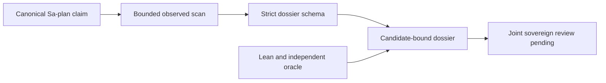

# 20261031-1658 — OI01 observed provenance dossier and formal gateway

Work observed 2026-10-31T16:08:13Z onward; publication preparation began 2026-10-31T16:23:58Z. Canonical Sa-plan `uos/codex-handover-open-items-fractal-plan/20261031-1240`, OI01 attempt2 and child OI01A/OI01B attempt1. This ledger records development verification, not sovereign adjudication or production admission.

#fractal-l0 #fractal-l1 #fractal-l2 #fractal-l3 #fractal-l4 #fractal-l5 #fractal-l6 #fractal-l7 #fractal-l8 #fractal-l9 #km-triad #zk-adr #zero-muda

[Self](http://nas-1.tail55d152.ts.net:4100/files/docs/journal/20261031-1658-oi01-observed-provenance-dossier-and-formal-gateway-journal.md) · [Observed sixteen-claim ledger](http://nas-1.tail55d152.ts.net:4100/files/governance/planning/20261031-1658-oi01-observed-provenance-verification.json) · [Verification packet](http://nas-1.tail55d152.ts.net:4100/files/governance/planning/20261031-1658-oi01-observed-provenance-verification.json) · [Original nine-task plan](http://nas-1.tail55d152.ts.net:4100/files/docs/design/20261031-1240-uos-open-items-fractal-design-implement-test-plan.md) · [Planning](http://nas-1.tail55d152.ts.net:4100/planning).

[[wiki:20260905-1801-uos-zk-km-corpus-index]]
[[zk:20260905-1801-moc-uos-unified-master]]

## 1. Scope & Trigger

The operator's goal is all nine handover tasks, with Codex supervision, bounded agentic execution, POODAVR, fractal RCA and truthful completion. OI01's explicit requirement is a candidate-bound dossier for joint Codex/AGY review. It does not authorize converting the quarantined range to either admitted or rejected history. Right-problem check: distinguish actual source presence, claimed evidence, formal conditional eligibility and sovereign authority. A green parser alone is insufficient.

Ruling: the plan's future-date example filename20261101 without HHSS is superseded by the observed timestamped ledger linked above, as required by the operator timestamp mandate. The original requirement and historical files remain preserved.

## 2. Pre-State Assessment

Canonical main cf7bfdcff6b8890fcb52c2577c1933112c58ef40 contains the preceding mathematical-control and accounting work. OI01 remained executing with eight dependent top-level tasks unfinished. MCP reported healthy/intact KM and ceiling93, without effect authority. The older isolated attempt1 parser/ledger did not satisfy the complete OI01 brief: observed filesystem/JJ collection, conditional contiguous-prefix proof and strict observed-output schema were missing.

The isolated change rpwuwsmr contains the historical wave1 journal and caller-assertion ledger. Both remain byte-preserved on preserved/oi01-20261031. They are not substituted for this observed dossier. The wave1 journal links an unmerged speedup draft and is retained as historical source evidence rather than published as a current passing handover.

## 3. Execution Detail

### 3.1 Observation, authority and execution scopes

PREDICT candidate/source drift, fabricated receipt booleans, unsafe paths and stale proof projections. OBSERVE fresh Sa-plan leases, MCP/KM health, source bytes and JJ parent ancestry. ORIENT against SC-PROVENANCE-001 and the full original acceptance brief. DECIDE through complete-plan risk/active checks, preserving ceiling93. ACT in disjoint isolated source paths; VERIFY with native tests, strict schema, Lean, Z3, independent oracles and CLI parity; REFLECT through the observed ledger and reciprocal KM links.

The original kernel includes bounded native Pi generation and native Claude review recorded in historical wave1 evidence. The new scanner/schema and formal/oracle extensions are locally authored Codex relay work, accurately attributed. No new remote model call occurred in this continuation. Actual Argon/DeepSeek/Claude analysis was completed separately in the preceding [native mathematical review](http://nas-1.tail55d152.ts.net:4100/files/docs/journal/20261031-1621-requested-native-math-reviews-and-budget-hardening-journal.md); it is not falsely described as sovereign adjudication of these claims.

### 3.2 Bounded observed scanner

The scanner observes the canonical JJ parent and at most six ancestry entries; compares allowed ADR/code/receipt bytes against that candidate with read-only JJ calls; and hashes the sorted candidate/path/digest/binding map using real SHA-256. Bounds are64KiB/source,16KiB/receipt,4096 directory entries,8 code references per claim,180 subprocess calls and2seconds per subprocess with group termination/reaping. Descriptor/path identity changes, symlinks, hardlinks, oversized data and unsafe locators produce explicit gaps. The frozen-root/quiescence premise remains necessary; this is an observed-change detector, not descriptor-relative hostile-directory isolation.

Quarantine is metadata presence only. No quarantined payload is opened or hashed. The current ledger observes sixteen exact EV94..109/ADR071..086 pairs,48 candidate-bound sources and24 quarantine locators at candidate cf7bfdcff6b8890fcb52c2577c1933112c58ef40. All sixteen recommendations are CODE_PRESENT_REQUIRES_FRESH_TWO_KEY_REBIND. Thirteen rejected historical source references and the absent sanitized receipt namespace remain explicit gaps. No live, signed two-key receipt is invented.

### 3.3 Schema, formal gateway and interfaces

The strict observed-output decoder reuses the existing UTF-8, RFC8259, depth, duplicate-key and exact-field checks. It validates the closed three-value recommendation vocabulary, exact sixteen-claim partition, path/source-reference identity, recomputed map digest and all closed authority fields. Null recommendations remain possible for insufficient observations; unknown evidence is never forced into fabrication. Shape/coherence success does not authenticate origin, bytes, clocks or signatures.

The Lean model proves totality/disjointness, a five-element information lattice, reachable dossier invariants and conditional proposal readiness. Every EV94..target must carry both independent candidate/source-bound keys with signed/confirmed/verified-origin predicates, a non-aliased typed-clock witness, strict freshness and independently recorded Codex+AGY target-bound review. Target95 with both94/95 present provides a nonvacuous positive witness. Canonical ceiling and historical status remain93/NOT_ADMITTED even when a proposal is eligible. Cryptographic truth, source normalization, real observation truth and native refinement remain external premises.

The standalone and KM-gate entry points support bounded caller-assertion stdin, real --scan and strict --validate-observed. Both scan modes validate their generated JSON before emitting it. Successful scan and validation outputs are byte-identical between entry points. Invalid JSON, authority escalation, unknown arguments and resource failures remain HOLD with closed authority fields.

## 4. Root Cause Analysis

| ACH hypothesis | Disconfirming observation | Finding |
|---|---|---|
| H1: A passing stdin parser completes OI01 | Original brief requires observed JJ/filesystem evidence and a conditional all-prefix proof | Rejected; scanner/schema/gateway added |
| H2: Three closed constructors validate observed JSON | Producer-only string option had no output decoder | Rejected; strict artifact validator added |
| H3: A solver verdict validates its own witness | Earlier oracle accepted changed fixed r96/candidate fields | Rejected; all43 positive and3 endpoint assignments now checked independently |
| H4: Unknown solver output always fails closed | Leading-whitespace unknown bypassed the old line check | Rejected by an actual old-pass/new-HOLD reproducer; trimmed verdict/error checks added |
| H5: Full Lean command reliably finishes below1s unchanged | Initial samples1.086221/1.003340/0.993752s and a later deadline timeout | Rejected; demonstration evaluation compilation removed, proofs retained, four-thread bounded invocation measured |

Fractal RCA: L0 separates proposals from admission; L1 binds current attempts and leases; L6 repairs witness validation and complete-prefix coverage; L8 separates source assertions from actual observations; L9 requires independent counterexamples and fresh candidate checks. A process-local model result, source hash or board lease cannot substitute for a different layer's missing authority.

## 5. Fix Taxonomy

Poka-Yoke: abstract recommendation constructors, strict JSON/scalar rules, observed-output schema, safe locators and exact fixed-witness checks. Jidoka: HOLD on missing candidate/receipt/schema/clock evidence, unexpected solver status or resource bounds. Muda elimination: reuse existing KM gate and core parser, existing Bos/Cryptokit/Mtime packages and pinned formal tools; no second coordinator, framework dependency or inference daemon.

## 6. Patterns & Anti-Patterns Discovered

Devil's Advocate / Popperian falsification found real gaps after initial green component counts. The same r96/coherent-identity changes once passed the old oracle and now fail. Leading-whitespace unknown likewise produced an actual old-success/new-HOLD control. The endpoint-only Lean mutant fails the required-intermediate proof; the SMT mutant exhibits EV95 present with EV94 absent. Positive controls prevent a permanently rejecting gate from appearing correct.

For performance, ten demonstration-only evaluations were replaced by stronger kernel-checked expected-value examples. All46 theorems and model definitions remain unchanged; examples increase from33 to43. Original source and timing failures remain preserved. Optional private-session artifact reads were removed from unit tests; operational artifact validation is a separate explicit CLI gate. No universal subsecond cold-start/load guarantee is inferred from three successful observations.

## 7. Verification Matrix

### 7.1 Evidence and requirement coverage

Admiralty **B2** is a bounded assessment for directly observed, independently repeated local source/test results. Model assertions, historical claims and missing signed receipts remain advisory or UNVERIFIED; agreement does not promote them. Exact hashes and invocation receipts are in the linked packet.

| Original requirement | Direct evidence | Scope |
|---|---|---|
| Sixteen-claim machine-checked dossier | Fresh observed ledger; strict CLI validation16/48;173 hermetic schema checks | Artifact coherence, not authentication |
| Unit/property negatives |338 strict parser tests +118 scanner checks | Includes forged clock aliases, missing candidate, unsigned/unverified data, Unicode, source-boundary and closed-authority negatives |
| Full formal specification |46 Lean theorems,43 checked examples, zero source sorry/axiom | Conditional abstract model; no native refinement claim |
| Fast formal gate |Full timeout1s tools/lean -j4 invocation:0.82/0.89/0.85s | Earlier failures retained; timeout is nonpassing |
| Z3 monotonicity |Positive SAT, seven UNSAT refutations, endpoint-only mutant SAT | Independent concrete witness evaluation and finite prefix oracle |
| Oracle controls |56 semantic negatives,9 file negatives, exact262144-byte positive,3 pre-read mutation controls and NUL refusal | No new packages/network; bounded child invocations |
| Independent finite check |65536 receipt patterns;8912896 prefix pairs;zero prefix counterexamples | Finite Boolean coverage, not every external cryptographic premise |
| CLI integration |Standalone/native scan and validation byte parity; invalid arguments/authority variants refuse | Read-only, no production deployment |
| KM regression |Current137/137 ADR coverage and16/16 quarantine marking required | Fresh integrated gate receipt retained separately |

The applicable modalities are unit, property/exhaustive finite, parser fuzz/boundary, formal, mutation/negative, native integration, resource/latency and regression checks. Production chaos/24-hour soak and deployed scalability are OI08 work, not declared passing here. The plan's “9 modalities” label does not justify nine invented PASS states.

### 7.2 Reproduction

Publication check found that the viewer deliberately refuses the provenance namespace with HTTP403. The served verification packet therefore embeds this generated, sanitized ledger at ledger.payload. Extracting it with jq -c yields bytes identical to the canonical repository ledger, whose SHA-256 is60248aa9d26801696afe192fb4f090c78a524f44ff33ad5b59191e663c7ecfc6. All dossier web links target that public packet; no viewer access rule is broadened and no private receipt/quarantine payload is copied.

Run from the canonical workspace with already-realized pinned toolchains. No dependency installation is implied.

```text
timeout 1s tools/lean -j4 formal/lean/ProvenanceAdjudication.lean
timeout 12s tools/z3 formal/smt/provenance_adjudication.smt2 > RETAINED_Z3_LOG
timeout 30s toolchains/opam-ocaml/bin/ocaml tools/provenance_adjudication_smt_oracle_test.ml RETAINED_Z3_LOG
toolchains/opam-ocaml/bin/ocaml tools/provenance_adjudicator.ml --scan
toolchains/opam-ocaml/bin/ocaml tools/provenance_adjudicator.ml --validate-observed < governance/provenance/20261031-1658-ev94-109-observed-adjudication-ledger.json
bash tools/km-gate --adjudication-report --scan
bash tools/km-gate --adjudication-report --validate-observed < governance/provenance/20261031-1658-ev94-109-observed-adjudication-ledger.json
bash tools/km-gate --gate
```

RETAINED_Z3_LOG denotes a caller-selected regular evidence file; it is not a promised repository artifact or a link. All execution still requires current Sa-plan/effect scope. The file viewer does not serve SMT extensions directly; exact editable SMT source is embedded below instead of a dead link. SHA-256: f924b3e75ced5f1c62d3262a345cc57c1e3bae1c286a0f1211d400a894a1e368.

### 7.3 Exact SMT source

```smt2
; OI01B_FORMAL_GATEWAY — CODEX RELAY local QF_LIA/Bool projection.
; Pure proposal readiness, NEVER canonical admission or a new EV allocation.
; Each rEV means a receipt for that EV has independently passed ALL Lean
; receiptValid obligations (including positive rebind information). This finite
; projection does not prove those external signature/origin/observation facts,
; nor establish native refinement. Common key/review/clock fields below expose
; their essential numerical fences independently of prefix coverage.
; Bounds: targets EV94..109, 16 receipt slots. No runtime or cryptographic claim.
; Coverage monotonicity is ONLY downward prefix inclusion under FIXED receipt
; facts: approving target109 never authorizes a different target's joint review.
(set-logic QF_LIA)
(set-option :timeout 10000)
(set-option :produce-models true)
(declare-const target Int)
(declare-const lower Int)
(declare-const candidate Int)
(declare-const source Int)
(declare-const runtimeCandidate Int)
(declare-const formalCandidate Int)
(declare-const runtimeSource Int)
(declare-const formalSource Int)
(declare-const runtimeSigner Int)
(declare-const formalSigner Int)
(declare-const runtimePresent Bool)
(declare-const formalPresent Bool)
(declare-const runtimeSigned Bool)
(declare-const formalSigned Bool)
(declare-const runtimeOrigin Bool)
(declare-const formalOrigin Bool)
(declare-const runtimeConfirmed Bool)
(declare-const formalConfirmed Bool)
(declare-const rebindInformation Bool)
(declare-const utcRaw Int)
(declare-const monoRaw Int)
(declare-const observed Int)
(declare-const now Int)
(declare-const expires Int)
(declare-const codexCandidate Int)
(declare-const agyCandidate Int)
(declare-const codexSource Int)
(declare-const agySource Int)
(declare-const codexTarget Int)
(declare-const agyTarget Int)
(declare-const codexSigner Int)
(declare-const agySigner Int)
(declare-const codexRecorded Bool)
(declare-const agyRecorded Bool)
(declare-const codexSigned Bool)
(declare-const agySigned Bool)
(declare-const codexOrigin Bool)
(declare-const agyOrigin Bool)
(declare-const jointFresh Bool)
(declare-const r94 Bool)
(declare-const r95 Bool)
(declare-const r96 Bool)
(declare-const r97 Bool)
(declare-const r98 Bool)
(declare-const r99 Bool)
(declare-const r100 Bool)
(declare-const r101 Bool)
(declare-const r102 Bool)
(declare-const r103 Bool)
(declare-const r104 Bool)
(declare-const r105 Bool)
(declare-const r106 Bool)
(declare-const r107 Bool)
(declare-const r108 Bool)
(declare-const r109 Bool)
(assert (and (<= 94 target) (<= target 109) (<= 94 lower) (<= lower target)))
(assert (and (<= 0 utcRaw) (<= 0 monoRaw) (<= 0 observed) (<= 0 now) (<= 0 expires)))
(define-fun covered ((t Int)) Bool
  (and (=> (<= 94 t) r94) (=> (<= 95 t) r95)
       (=> (<= 96 t) r96) (=> (<= 97 t) r97)
       (=> (<= 98 t) r98) (=> (<= 99 t) r99)
       (=> (<= 100 t) r100) (=> (<= 101 t) r101)
       (=> (<= 102 t) r102) (=> (<= 103 t) r103)
       (=> (<= 104 t) r104) (=> (<= 105 t) r105)
       (=> (<= 106 t) r106) (=> (<= 107 t) r107)
       (=> (<= 108 t) r108) (=> (<= 109 t) r109)))
(define-fun keys () Bool
  (and runtimePresent formalPresent runtimeSigned formalSigned
       runtimeOrigin formalOrigin runtimeConfirmed formalConfirmed
       (= candidate runtimeCandidate) (= candidate formalCandidate)
       (= source runtimeSource) (= source formalSource)
       (< 0 runtimeSigner) (< 0 formalSigner) (distinct runtimeSigner formalSigner)))
(define-fun clockFresh () Bool
  (and (distinct utcRaw monoRaw) (= utcRaw observed) (<= observed now) (< now expires)))
(define-fun jointReview () Bool
  (and (= candidate codexCandidate) (= candidate agyCandidate)
       (= source codexSource) (= source agySource)
       (= target codexTarget) (= target agyTarget)
       codexRecorded agyRecorded codexSigned agySigned codexOrigin agyOrigin jointFresh
       (< 0 codexSigner) (< 0 agySigner) (distinct codexSigner agySigner)))
(define-fun eligible () Bool
  (and keys clockFresh jointReview rebindInformation (covered target)))
; SAT control supplies a concrete nonempty two-receipt witness; higher slots may
; be false. Independent oracle must re-evaluate this control, not trust SAT alone.
(echo "positive_target95")
(push)
(assert (and (= target 95) (= lower 94) (= candidate 101) (= source 202)
  (= runtimeCandidate 101) (= formalCandidate 101) (= runtimeSource 202) (= formalSource 202)
  (= runtimeSigner 1) (= formalSigner 2) runtimePresent formalPresent
  runtimeSigned formalSigned runtimeOrigin formalOrigin runtimeConfirmed formalConfirmed
  rebindInformation (= utcRaw 5) (= monoRaw 7) (= observed 5) (= now 5) (= expires 10)
  (= codexCandidate 101) (= agyCandidate 101) (= codexSource 202) (= agySource 202)
  (= codexTarget 95) (= agyTarget 95) (= codexSigner 10) (= agySigner 11)
  codexRecorded agyRecorded codexSigned agySigned codexOrigin agyOrigin jointFresh
  r94 r95 (not r96) eligible))
(check-sat)
(get-value (target lower candidate source runtimeCandidate formalCandidate runtimeSource formalSource
            runtimeSigner formalSigner runtimePresent formalPresent runtimeSigned formalSigned
            runtimeOrigin formalOrigin runtimeConfirmed formalConfirmed rebindInformation
            utcRaw monoRaw observed now expires codexCandidate agyCandidate codexSource agySource
            codexTarget agyTarget codexSigner agySigner codexRecorded agyRecorded codexSigned agySigned
            codexOrigin agyOrigin jointFresh r94 r95 r96 eligible))
(pop)
(echo "missing_intermediate_refutation")
(push)
(assert (and eligible (not r94)))
(check-sat)
(pop)
(echo "equal_clock_refutation")
(push)
(assert (and eligible (= utcRaw monoRaw)))
(check-sat)
(pop)
(echo "strict_deadline_refutation")
(push)
(assert (and eligible (<= expires now)))
(check-sat)
(pop)
(echo "unsigned_or_missing_key_refutation")
(push)
(assert (and eligible (or (not runtimeSigned) (not formalPresent))))
(check-sat)
(pop)
(echo "candidate_source_mismatch_refutation")
(push)
(assert (and eligible (or (distinct candidate formalCandidate) (distinct source runtimeSource))))
(check-sat)
(pop)
(echo "unrecorded_joint_or_nonpositive_information_refutation")
(push)
(assert (and eligible (or (not agyRecorded) (not rebindInformation))))
(check-sat)
(pop)
(echo "prefix_coverage_monotonicity_refutation")
(push)
(assert (and (covered target) (not (covered lower))))
(check-sat)
(pop)
; Mutation control: a faulty endpoint-only check accepts a missing intermediate.
; SAT confirms that dropping inclusive coverage is a substantive weakening.
(echo "bad_endpoint_only_mutant_witness")
(push)
(assert (and (= target 95) r95 (not r94) (not (covered target))))
(check-sat)
(get-value (target r94 r95))
(pop)
```

## 8. Files Modified

Thirteen source/test files are integrated: Lean/SMT, the existing provenance Dune graph and KM gate, strict core/parser tests, scanner/tests, observed schema/tests, standalone adjudicator and reusable oracle/controls. The observed ledger, verification packet, this journal, original plan progress note, wiki index, ZK MOC and capability inventory provide durable handover. The older caller-assertion ledger and wave1 journal are preserved on the isolated bookmark, not silently overwritten or passed off as current observations. Protected MCP/control sources and ecology_process.ml remain untouched.

## 9. Architectural Observations

The evidence plane stays in bounded OCaml/Lean/SMT; Gleam/OTP remains the operational control authority. No solver/model result executes an effect. The same recommendation carrier is reused by strict schema decoding and native advisory state; Lean correspondence is supported by tests and explicit shape mapping, not a proved extraction/refinement theorem. Local schema consistency and candidate-map equality are compatible views, not proof that every live process runs this source.

```ascii
[Canonical Sa-plan claim] --> [Bounded observed scan]
[Bounded observed scan] --> [Strict dossier schema]
[Strict dossier schema] --> [Candidate-bound dossier]
[Lean and independent oracle] --> [Candidate-bound dossier]
[Candidate-bound dossier] --> [Joint sovereign review pending]
```



## 10. Remaining Gaps

All sixteen historical claims remain NOT_ADMITTED. The sanitized receipt namespace is UNRUN and its signature verifier is unavailable. No actual two-key observation or recorded joint Codex/AGY ratification is manufactured. Filesystem quiescence, authenticated clock/key provenance and native refinement remain external obligations. Initial latency failures are retained; the fast command fails closed when its deadline expires. OI02–OI09 and the original whole-goal completion remain open. OI08's missing canonical dependency on OI09 remains an explicit release blocker until repaired through a supported Sa-plan interface.

## 11. Metrics Summary

Observed dossier:16 claims,48/48 bound source entries,24 quarantine metadata locators,16 rebind recommendations,13 unsafe historical references disclosed. Hermetic native checks:338+118+173=629, plus chain controls. Formal:46 theorems/43 examples;65536 finite masks/8912896 prefix pairs;56 semantic and9 file negative controls, with separate boundary/mutation positives. These correlated checks are not independent Bernoulli trials; no unjustified Bayesian reliability uplift is reported. Lyapunov system stability and empirical trust half-life estimates remain UNRUN. No paid model invocation or new monetary reservation was made in this continuation.

## 12. STAMP & Constitutional Alignment

Raw FMEA: fabricated authority S5/O3/D3/RPN45; source drift S5/O3/D2/RPN30; false formal witness S5/O2/D4/RPN40; latency overrun S3/O3/D2/RPN18. These are ordinal risk judgments, not probabilities. All four UCAs: not_provided—missing receipts/candidate require hold; provided_unsafe—advice or source presence cannot grant admission; wrong_timing—task/attempt/lease and candidate checks precede effects; duration—subprocess, byte, entry and deadline bounds contain stalled work. Residual cryptographic/refinement/liveness and release risks are explicit. No source ingestion from external trees or quarantine payload occurs. EV93 ceiling retained; no EV number minted.

<details><summary>Domain 1 — Metadata and navigation</summary>

- [x] CHK-01-TIME — Observed host time and required prefix.
- [x] CHK-02-TAIL — Live journal/packet disk-header-body parity observed; embedded ledger extracts byte-identically and validates.
- [x] CHK-03-FRACT — L0–L9 responsibilities and RCA separated.
- [x] CHK-04-KM — Reciprocal wiki/ZK/inventory registered; KM and fresh MCP discovery pass.

</details>
<details><summary>Domain 2 — Purity and storage</summary>

- [x] CHK-05-MUDA — No excluded dependency or imported runtime.
- [x] CHK-06-GRAPH — Pure operational boundary retained; evidence tools bounded.
- [x] CHK-07-DRIVE — No storage provisioning/interlock mutation.

</details>
<details><summary>Domain 3 — Tests and mathematics</summary>

- [ ] CHK-08-C1C8 — UI categories outside this source/CLI slice remain UNRUN.
- [x] CHK-09-MATH — Applicable proof/oracle gates scoped; no blanket four-metric claim.
- [x] CHK-10-9MOD — Applicable modalities recorded; runtime soak/scalability unrun.
- [x] CHK-11-REGR — Parser/schema, control flags, candidate map and native CLI checks observed.

</details>
<details><summary>Domain 4 — Control and observability</summary>

- [ ] CHK-12-GLEAM — No new production attachment claimed.
- [x] CHK-13-HERMES — Formal/evidence tools remain outside effect authority.
- [ ] CHK-14-ZIGVM — Deterministic kernel unchanged; runtime integration UNRUN.
- [ ] CHK-15-MAX — Isolated inference unchanged; runtime integration UNRUN.
- [ ] CHK-16-OTEL — Full deployed trace/export binding pending.

</details>
<details><summary>Domain 5 — Governance and JJ</summary>

- [ ] CHK-17-SOV — Dossier ready for review, no sovereign ratification/admission.
- [x] CHK-18-JJ — Standalone JJ, isolated source preserved, serialized integration required.

</details>
<details><summary>Domain 6 — Provenance extension</summary>

EV94..109 and ADR071..086 remain NOT_ADMITTED; canonical ceiling93 and historical bytes preserved.

</details>

## 13. Conclusion

The OI01 dossier, observed schema and conditional gateway are implemented and tested for the original scope. Final source integration, live proof and canonical completion still require their own receipts. Forecast from publication preparation: p=0.85 that unchanged code hashes will pass canonical schema/KM/journal/diagram checks and source publication within30minutes. A gate refusal or changed implementation digest is the falsifier. Brier scoring awaits the observed outcome; no retrospective forecast success is invented. Original nine-task completion and production admission are not asserted.

[Previous: original plan](http://nas-1.tail55d152.ts.net:4100/files/docs/design/20261031-1240-uos-open-items-fractal-design-implement-test-plan.md) · [Wiki](http://nas-1.tail55d152.ts.net:4100/wiki) · [ZK](http://nas-1.tail55d152.ts.net:4100/zk) · [Next: observed dossier](http://nas-1.tail55d152.ts.net:4100/files/governance/planning/20261031-1658-oi01-observed-provenance-verification.json).

UOS footer: passing development checks and a coherent dossier grant no sovereign, deployment or admission authority.
