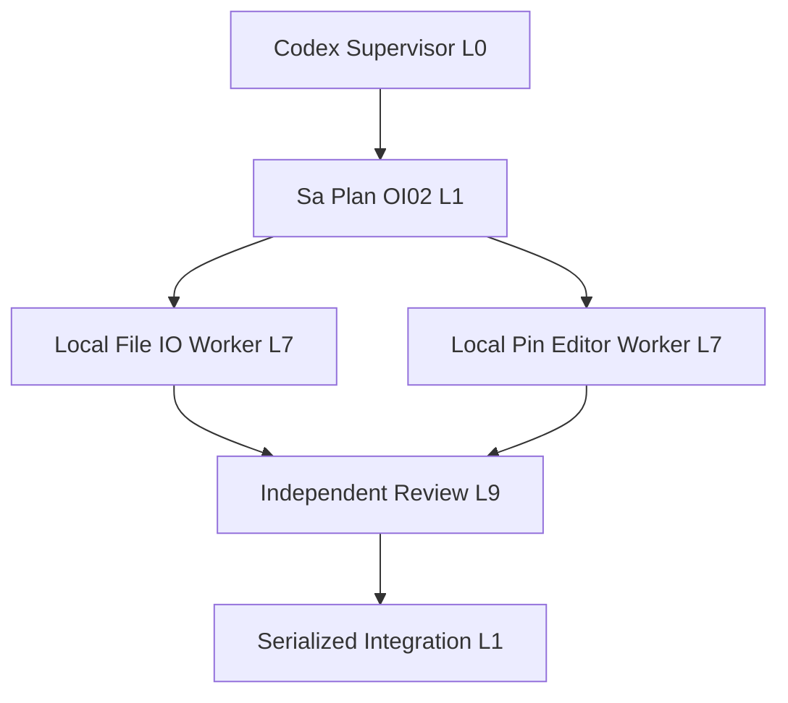
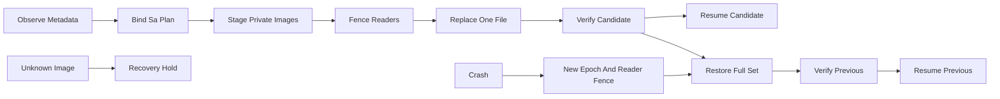

# 20261031-1756 — OI02 recoverable cutover foundations

Observed host clock: 2026-10-31T17:16:56Z. Filename uses the mandated hour/second prefix. Canonical Sa-plan: `uos/codex-handover-open-items-fractal-plan/20261031-1240`, task `OI02_ATOMIC_11_TARGET_CAPSULE_CUTOVER`, worker `codex-hive-cutover-20261031`, attempt1. **Development slice; OI02 remains executing.** Source integration, live release authority and system admission are separate states.

#fractal-l0 #fractal-l1 #fractal-l2 #fractal-l3 #fractal-l4 #fractal-l5 #fractal-l6 #fractal-l7 #fractal-l8 #fractal-l9 #km-triad #zk-adr #zero-muda

[Self](http://nas-1.tail55d152.ts.net:4100/files/docs/journal/20261031-1756-oi02-recoverable-cutover-foundations-journal.md) · [Evidence packet](http://nas-1.tail55d152.ts.net:4100/files/governance/planning/20261031-1756-oi02-recoverable-cutover-foundations.json) · [Original plan](http://nas-1.tail55d152.ts.net:4100/files/docs/design/20261031-1240-uos-open-items-fractal-design-implement-test-plan.md) · [Mathematical reviews and token monitor](http://nas-1.tail55d152.ts.net:4100/files/docs/journal/20261031-1621-requested-native-math-reviews-and-budget-hardening-journal.md) · [Planning](http://nas-1.tail55d152.ts.net:4100/planning).

[[wiki:20260905-1801-uos-zk-km-corpus-index]]
[[zk:20260905-1801-moc-uos-unified-master]]

## 1. Scope & Trigger

The operator requests mathematical agent-control checks, token accounting, cost-conscious parallel execution, Gleam reuse and completion of the handover plan. The preceding mathematical portfolio is completed at its recorded development scope. The original nine-task portfolio continues. Right-problem check: more concurrent model calls cannot repair a missing release-authority route or make fourteen renames group atomic. This slice implements reusable policy, pin editing and bounded file operations before integrating a live cutover controller.

Native Pi/OpenRouter Argon and DeepSeek Pro analysis and native Claude analysis were completed in the preceding linked journal. The two helpers in this continuation are local Codex relays, accurately attributed; no further paid model requests were made. The operator's asynchronous priority check remains optional and does not grant effect authority.

## 2. Pre-State Assessment

Main316f049b077a9e7ed4a75b8dccb01666c8e1afb9 contains the completed OI01 dossier slice. OI02 is the single executing top-level task; OI03..OI09 remain unfinished and dependency constrained. The isolated JJ workspace is `.uos-workspaces/pi-hive-oi02-20261031`, change rkozpuxz. Existing Gleam `release_rehearsal` is an in-memory model. The public gateway's grant reader supports task/control mutation, with no wired ReleaseAuthority issuer or cutover adapter. A grant constructor, risk PASS or coordinator lease cannot fill that gap.

MCP/KM health was freshly healthy/intact with ceiling93. Search returned the master handover and original plan; these two precedents bound the exact target inventory. The connected knowledge_search schema has no limit field; bounded zk_transclude used limit3 and no successful unsupported argument is invented. No production configuration or service was changed.

## 3. Execution Detail

### 3.1 POODAVR and parallel ownership

PREDICT: stale ACKs, incomplete backups, partial visibility, unknown file images and missing accounting. OBSERVE: canonical Sa-plan attempt, synchronized risk observations, existing code and tracked templates. ORIENT: distinguish fourteen logical surfaces from physical files and source tests from deployment. DECIDE: root owns control/integration; disjoint helpers own the pure pin editor and native file kernel. ACT in isolation; VERIFY using pinned compilers, independent review, seeded temporal checks and actual private filesystem faults; REFLECT through this journal and reciprocal KM records.

Peak observed collaboration width is three: one Codex supervisor and two local helpers under the one claimed OI02 task. This is neither three independently claimed top-level tasks nor evidence of a measured tenfold speedup. Integration remains serialized. Amdahl's bound still applies: with serial fraction s and overhead o, speedup at P workers is bounded by `1 / (s + (1-s)/P + o)`; a tenfold target requires the serial fraction plus overhead below0.1 and enough independent work.

The execution hierarchy has one supervisor, one canonical task and two disjoint implementation lanes. Review can reuse those agents; the review node below does not denote a fourth concurrent agent.

```ascii
[Codex Supervisor L0] --> [Sa Plan OI02 L1]
[Sa Plan OI02 L1] --> [Local File IO Worker L7]
[Sa Plan OI02 L1] --> [Local Pin Editor Worker L7]
[Local File IO Worker L7] --> [Independent Review L9]
[Local Pin Editor Worker L7] --> [Independent Review L9]
[Independent Review L9] --> [Serialized Integration L1]
```



### 3.2 Gleam policy and target inventory

The pure target catalog enumerates four repository configurations, seven home configurations and three logical runtime surfaces. The ecology unit/environment group is unresolved by default. The tracked template specifies its environment-file pattern, but that text is not a fresh observation of the installed home unit. Fourteen mutable physical files are possible only if the installed ecology template is verified and unchanged; replacing that template makes fifteen.

The opaque transaction protocol binds intended and previous candidates, transaction manifest, exact physical count, Sa-plan identity/worker/attempt/workspace, runtime owner and monotonic epoch. Every effect reuses existing MCP admission and checks source/risk freshness, ingress status and the reader barrier. Calls bind the exact command and generation. ACKs bind transaction, manifest, epoch, generation and command; preparing requires the expected complete backup-set witness, and verification requires the correct intended/previous digest. Failed or uncertain reader resume requires a new epoch and a new reader-fencing step before restoration. Terminal transactions cannot reopen as recovery.

These are pure conditional policy checks. The observation records and fabricated grants used in tests are not authenticated runtime facts. No new live MCP/Zenoh release ingress or actual barrier is claimed.

### 3.3 Scoped pin editing

The pure OCaml editor reuses the existing strict JSON validator and changes only the two existing owned release/payload string spans for explicitly selected servers. Other bytes remain unchanged, including disabled development slots, approvals, comments and opaque credentials. Public metadata and receipts never expose or hash unrelated values; the full edited buffer remains private staging input. TOML accepts a documented finite grammar and holds unsupported syntax, aliases, duplicate sections/keys, malformed Unicode, raw carriage returns and resource excess. Valid CRLF is preserved.

A read-only probe of the four tracked repository configs selects six server slots and twelve literals. It confirms parsing and idempotence with a synthetic replacement binding. It writes no config, emits no configuration hashes and reads no home configuration. This is not the complete fourteen-target live pin audit.

### 3.4 Bounded native operations and entrypoint

The native file kernel is a bounded IO interpretation, not a second supervisor or grant issuer. Its descriptor, opaque private preimages, same-directory stages and event checkpoints support per-file replacement and reverse restoration. The controller must supply genuine effect-time authority and preserve reader quiescence. Frozen owned directory topology is an explicit premise; this is not a hostile-directory descriptor-relative VFS implementation. Native calls still require bounded supervised execution.

The final native source is independently reviewed and passed3083 checks twice, once by its author and once by Codex under the unchanged60-second process guardian. Both runs exercised29 forward and29 reverse post-mutation process crashes with fresh-interpreter recovery. Supplementary-group UID/GID/mode preservation was actually exercised. Exact images may overlap as Both; idempotent Old/New/Both/Absent replay still syncs the parent before checkpoint. Fresh and reused stages validate actual bytes and metadata before rename. Recovery requires the controller's separately retained expected descriptor pin.

Forward effects reserve a complete intent/checkpoint pair plus count/byte credit for one uninterrupted full restore. A near-capacity test refuses the next forward effect without changing target/log, then completes the reserved rollback. Unlimited retries are not promised. Earlier1799/1811/3065-check receipts remain historical source-specific observations. Partial event tails, unknown images and unsupported metadata remain HOLD with evidence preserved; torn history requires separately authorized reconciliation. Exactly58 declared post-mutation crash points were tested, not every interrupted syscall, power loss or filesystem failure.

The Mojo wrapper now forwards a second path. Nine checks use an inert private OCaml backend to verify argv, exec status, length boundaries and literal shell characters. This is argv-shim evidence; the actual cutover/audit-pins backend and end-to-end OCaml/Mojo parity remain unwired.

### 3.5 Public framework research and reuse decisions

Google's [custom workflow documentation](https://adk.dev/agents/custom-agents/) describes parallel branches sharing session state and recommends distinct output keys. UOS uses disjoint source ownership and serialized integration; no Python/ADK orchestration runtime is imported. Microsoft's [checkpoint documentation](https://learn.microsoft.com/en-us/agent-framework/workflows/checkpoints) supports saving executor/workflow state; its [external request mechanism](https://learn.microsoft.com/en-us/agent-framework/workflows/human-in-the-loop) preserves pending interactions across checkpoints. The UOS design rechecks authority when resuming; restoring data is not renewed authorization.

DeepSeek's [chat-completion contract](https://api-docs.deepseek.com/api/create-chat-completion/) distinguishes cached and uncached prompt tokens and reports reasoning within completion details. OpenRouter's [cost/quality guidance](https://openrouter.ai/blog/insights/cost-vs-quality-tradeoff-framework-for-agent-models/) uses complete-run billed usage and task-specific quality, rather than selecting a universal cheapest model. Its [routing example](https://openrouter.ai/blog/tutorials/model-routing-for-support-bots-cheap-first-faq-handling/) explicitly retains missing cost as unknown and counts escalated drafts. These support the existing monitor's distinct token classes and unknown-usage/cost HOLD. Framework pages are read-only design evidence, not imported authority or evidence of UOS runtime enforcement.

## 4. Root Cause Analysis

| ACH hypothesis | Disconfirming evidence | Result |
|---|---|---|
| H1: Fourteen logical targets always mean fourteen files | The ecology unit/environment group can require an additional template write | Rejected; actual write set must be14 or15 |
| H2: Public release-rehearsal types are live authority | No admitted release issuer/adapter was found | Rejected; live cutover remains gated |
| H3: A command-only ACK is sufficiently scoped | Another transaction/epoch/generation can reuse that command | Rejected; exact ACK bindings added |
| H4: Uniform contents imply successful health verification | A uniform-new unverified-resume mutant passes coherence alone | Rejected; separate health-evidence invariant added |
| H5: A no-op recovery needs no directory sync | A prior process can crash after rename but before syncing its parent | Rejected; replay must sync before checkpoint |
| H6: A local descriptor digest authenticates the journal | Coherent descriptor/digest rewriting can preserve local equality | Rejected; recovery needs an independently retained expected pin |

Fractal RCA: L0 separates intent/authority/admission; L1 binds attempts and epochs; L6 makes observations and formal limits explicit; L7 separates source, filesystem and service effects; L8 preserves private evidence and unknown accounting; L9 uses peer falsification before integration.

## 5. Fix Taxonomy

Poka-Yoke: closed target IDs, opaque transaction state, scoped byte spans, strict parsers, complete backup evidence and exact ACK/call bindings. Jidoka: unknown state, stale source/epoch, unsupported grammar, absent authority or failed restoration retains the stop line. Muda elimination: reuse existing Gleam admission, validators, process guardian, pinned compilers and already-realized libraries. No second task database, orchestration framework or inference daemon was added.

## 6. Patterns & Anti-Patterns Discovered

Devil's Advocate and Popperian falsification continued after initial green tests. Independent review found real stale-ACK, terminal-recovery, metadata and durability defects. Earlier receipts remain preserved. The model's initial test command selected no runs; an overly broad match then selected stateful non-tests and failed. Run names were corrected to the standard Test suffix and ten actual tests are now observed. A passing exit without an observed test count was not accepted.

Observed source tests do not prove an authenticated issuer, persistent reader barrier, deployed controller, complete home inventory, subsecond runtime recovery or tenfold throughput. The native kernel's process-crash tests cover declared fault positions; they do not simulate every interrupted syscall or power loss.

## 7. Verification Matrix

Admiralty B2 is the bounded assessment for directly repeated local source/test observations. Supplied model facts and missing live authority remain advisory/UNRUN. Candidate/source hashes and exact retained receipts belong in the linked packet.

| Check | Observation | Scope |
|---|---|---|
| Gleam compile/tests |16 tests PASS, pinned Gleam1.16/OTP29, existing precompiled dependencies | Private compile output; no new live controller |
| Pure pin editor |82 checks PASS; four tracked config probes PASS | No home reads, config writes or unowned hashes |
| Mojo argv shim |9 checks PASS | Inert backend; actual cutover parity UNRUN |
| Quint controls |10 deterministic tests PASS, including two distinct mutants | Independent finite abstraction |
| Quint interleavings |2000 seeded traces each for14 and15, max100 steps; no invariant violation | Sampling, not exhaustive proof, liveness or native refinement |
| Native file kernel |3083 checks repeated by Codex;58 process-crash cases; supplementary GID PASS | Final hash64789f84; private synthetic fixtures, not power-loss evidence |
| Protected process helper |SHA b8ed1735909701376949b0ca00acd2f4cb8aac177fb771a5c59532319cea249b unchanged | No protected source relaxation |
| Full system/cutover |UNRUN | No live activation or admission |

Use the repository-pinned toolchains and no-install/frozen existing Mojo environment. New source can be compiled in a private low-level Gleam package against the existing canonical library output; no package download or shared build-tree concurrency is required. The JSON/TOML and filesystem suites use synthetic private fixtures. The full original release gates, seven services, route fidelity, security falsifiers and OI08 soak remain separate acceptance work.

### 7.1 Seventeen canonical aspects

PARTIAL and UNRUN are not admission passes. Aspect names follow the repository release-assurance review; unrelated global obligations are not averaged into this slice.

| ID | Aspect | Scoped evidence and remaining limit |
|---|---|---|
| A01 | Substrate and storage interlock | Private fixtures; no device effects. Hardware/interlock runtime UNRUN. |
| A02 | Standalone Jujutsu | Isolated change and source hashes; final integration receipt separate. |
| A03 | Zero-Muda | Existing dependencies/toolchains reused; no new framework or package. Whole-history audit UNRUN. |
| A04 | Gleam/OTP29 root supervision | Actual private OTP29 compile/test. New live controller supervision/restarts UNRUN. |
| A05 | ZigVM and VFS laws | Untouched. Native frozen-directory premise is not ZigVM descriptor-relative confinement. |
| A06 | Hermes formal evidence | Strict OCaml parsing, bounded IO and preserved receipts; native Gospel/refinement UNRUN. |
| A07 | Mathematical authority/conservation | Independent temporal invariants and mutants; observation/authentication truth remains external. |
| A08 | Cybernetic authority boundary | Explicit POODAVR and no model-granted effects; admitted live ingress UNRUN. |
| A09 | MAX/Mojo inference isolation | Existing Mojo argv shim tested; no inference change or new Python. |
| A10 | Zenoh backplane | Shared keys unchanged; new authenticated release-control route UNRUN. |
| A11 | AG-UI event protocol | No event-protocol change; new controller event delivery UNRUN. |
| A12 | A2UI catalog | Unaffected; no claim about the full component catalog. |
| A13 | Multi-interface accessibility | Source/tool slice only; GUI/TUI/accessibility release integration UNRUN. |
| A14 | Tailscale navigation | Full FQDN document links; final live byte parity requires publication. |
| A15 | Comprehensive checklist | Six-domain obligations recorded with unrun items visible. |
| A16 | KM triad | Fresh MCP recall; reciprocal registration/publication gates separate. |
| A17 | Sa-plan durable workflows | Exact OI02 attempt/risk observations; live release and global task completion absent. |

## 8. Files Modified

New Gleam catalog/protocol and their tests, the independent Quint model, native file kernel/tests, pure pin editor/tests, Mojo argv extension and its inert-backend test are confined to the isolated OI02 workspace. This journal and its packet record the development scope. Reciprocal wiki/ZK/inventory registration and the original plan progress note must be reconciled before publication. No protected harness cluster, process guardian, live config, service unit or pointer was changed.

## 9. Architectural Observations

Gleam/OTP owns control and effects policy. OCaml supplies strict pure editing and bounded native IO behind that boundary. The native library cannot establish authority from its own descriptor or event log. ETS can cache versioned read observations, and Wiki/ZK/KB recall can reduce repeated context; neither can replace fresh effect-time fences. MCP/admitted Zenoh ingress must bind real principals, grants and epochs before this source becomes operational.

```ascii
[Observe Metadata] --> [Bind Sa Plan]
[Bind Sa Plan] --> [Stage Private Images]
[Stage Private Images] --> [Fence Readers]
[Fence Readers] --> [Replace One File]
[Replace One File] --> [Verify Candidate]
[Verify Candidate] --> [Resume Candidate]
[Verify Candidate] --> [Restore Full Set]
[Restore Full Set] --> [Verify Previous]
[Verify Previous] --> [Resume Previous]
[Unknown Image] --> [Recovery Hold]
[Crash] --> [New Epoch And Reader Fence]
[New Epoch And Reader Fence] --> [Restore Full Set]
```



## 10. Remaining Gaps

OI02 remains executing. Remaining work includes the actual admitted release issuer/ingress, complete physical manifest and installed-template observation, seven home config audits, private secret/preimage boundary, concrete reader quiescence, bounded native adapter, clean candidate builds of both applications, actual cutover/audit-pins commands, equivalent native entrypoints, service activation and rollback, complete live gates and independently authorized release. ACL/xattr and unsupported filesystem metadata need explicit handling before production. Full-runtime recovery below1s and never-down behavior are unproved. Partial event tails/resource exhaustion require explicit bounded reconciliation behavior.

OI03..OI09 remain unfinished. OI08's missing OI09 dependency must be repaired through canonical Sa-plan APIs before final soak; no direct SQL repair is allowed. EV94..109 and ADR071..086 remain NOT_ADMITTED.

## 11. Metrics Summary

Peak actual collaboration width3; one claimed top-level execution. No measured tenfold speedup. Known registered token-monitor scope remains26 calls,25 known usage,1 unknown,2085154 known tokens,3 reported errors and mixed SDK/list estimate USD4.137299838. This is not global spend or an invoice. The decision remains HOLD_UNKNOWN_USAGE; no additional paid model calls were dispatched. Fixed OpenRouter reservation liability remains USD3.50 of the existing USD10/day budget; no second ledger or refund was created.

Correlated unit checks are not independent production reliability trials, so no fabricated Bayesian posterior or negative Lyapunov derivative is reported. These remain UNKNOWN without calibrated observations. Timing receipts are observed samples, not universal latency guarantees.

## 12. STAMP & Constitutional Alignment

Raw development FMEA: unfenced partial visibility S5/O3/D4 RPN60; stale or foreign ACK S5/O3/D3 RPN45; unsafe config edit S5/O2/D4 RPN40; unknown accounting S4/O3/D4 RPN48. These are ordinal analyst inputs, not probabilities. Control evidence is conditional policy tests, strict editing, bounded IO and stop lines; live residual risk remains unresolved until actual admission and runtime verification.

All four UCA types apply. Not provided: required reader fence, full restore or health check omitted. Provided unsafe: rename or resume under stale/unknown authority or file state. Wrong timing: cross-generation ACK, expired lease or premature resume. Too long: unbounded native IO, prolonged reader stop or repeated recovery without budget. Constraints: re-read typed authority at each effect, bind acknowledgements, preserve complete private recovery evidence, keep unknown states fenced and use bounded supervised workers. Development risk observations grant no production effect authority.

<details><summary>Domain 1 — Metadata and navigation</summary>

- [x] CHK-01-TIME — Observed synchronized host time and canonical prefix.
- [ ] CHK-02-TAIL — Final publication/live byte proof pending.
- [x] CHK-03-FRACT — L0..L9 tags and concrete affected-layer RCA.
- [ ] CHK-04-KM — Reciprocal registration and gate pending.

</details>
<details><summary>Domain 2 — Purity and storage safety</summary>

- [x] CHK-05-MUDA — No new barred dependency or package provisioning.
- [x] CHK-06-GRAPH — Gleam policy and bounded native evidence boundary.
- [x] CHK-07-DRIVE — Storage interlocks untouched; synthetic fixtures only.

</details>
<details><summary>Domain 3 — Verification</summary>

- [x] CHK-08-C1C8 — UI unaffected; no UI-category PASS invented.
- [ ] CHK-09-MATH — Four corpus thresholds H/CCM/D_EA/ITQS are not measured for a deployed new controller; scoped formal tests are recorded separately.
- [ ] CHK-10-9MOD — Applicable modalities recorded; complete scalability/chaos/soak remain UNRUN.
- [x] CHK-11-REGR — Frozen native/pin/protocol source regression observed; global release regression remains separate.

</details>
<details><summary>Domain 4 — Control and observability</summary>

- [ ] CHK-12-GLEAM — Actual OTP29 private compile/test observed; new live controller supervision/restarts UNRUN.
- [x] CHK-13-HERMES — Bounded OCaml evidence and source ownership.
- [x] CHK-14-ZIGVM — Unaffected; no kernel admission claim.
- [x] CHK-15-MAX — Existing Mojo toolchain only; inference unaffected.
- [ ] CHK-16-OTEL — New live release-controller trace remains UNRUN.

</details>
<details><summary>Domain 5 — Sovereignty and Jujutsu</summary>

- [ ] CHK-17-SOV — No genuine live release grant or system admission.
- [ ] CHK-18-JJ — Final candidate/source integration receipt pending.

</details>
<details><summary>Domain 6 — Provenance extension</summary>

Ceiling93 is preserved. EV94..109/ADR071..086 NOT_ADMITTED; no new EV number, application admission or system admission.

</details>

## 13. Conclusion

This is a verified-development-foundations record, not task completion or a live cutover receipt. Precommitted Brier-scored Forecast made before final integration: subjective p=0.75 that by2026-10-31T17:33:24Z the IO source is frozen, independently reviewed, has all currently identified guards implemented and has a repeated passing crash suite. At2026-10-31T17:23:36Z the frozen64789f84 source had the independent scope review and second3083-check/58-crash passing run, satisfying that event early: y=1 and Brier score `(0.75-1)^2 = 0.0625`. This single observation is not a calibration study. No prediction is made for sovereign admission or full-runtime subsecond recovery.

[Previous mathematical review](http://nas-1.tail55d152.ts.net:4100/files/docs/journal/20261031-1621-requested-native-math-reviews-and-budget-hardening-journal.md) · [Wiki](http://nas-1.tail55d152.ts.net:4100/wiki) · [ZK](http://nas-1.tail55d152.ts.net:4100/zk) · [Cockpit](http://nas-1.tail55d152.ts.net:4100/) · [Next original plan](http://nas-1.tail55d152.ts.net:4100/files/docs/design/20261031-1240-uos-open-items-fractal-design-implement-test-plan.md).

UOS footer: source integration and development checks grant no live release authority or system admission.
