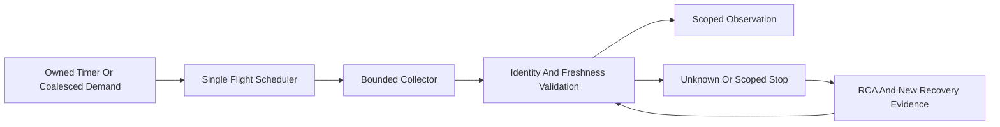

# 20261031-1807 — All-agent symbiosis preflight, performance and governance

#fractal-l0 #fractal-l1 #fractal-l2 #fractal-l3 #fractal-l4 #fractal-l5 #fractal-l6 #fractal-l7 #fractal-l8 #fractal-l9 #km-triad #zk-adr #zero-muda

Host timestamp basis2026-10-31T18:30:07Z. [SOP](http://nas-1.tail55d152.ts.net:4100/files/docs/sop/20261031-1807-all-agent-symbiosis-preflight-tps-and-evolution-sop.md) · [Contract](http://nas-1.tail55d152.ts.net:4100/files/contracts/rules/20261031-1807-all-agent-symbiosis-monitoring-contract.md) · [Verification packet](http://nas-1.tail55d152.ts.net:4100/files/governance/planning/20261031-1807-all-agent-symbiosis-preflight-verification.json).

## 1. Scope & Trigger

### 1.1 Authorized task and candidate

Sa-plan uos/codex-handover-open-items-fractal-plan/20261031-1240 / OI02B_ALL_AGENT_SYMBIOSIS_PREFLIGHT, worker codex-symbiosis-preflight-20261031, attempt1. The operator requested priority-one Codex symbiosis for Claude/Pi/AGY/Codex, periodic functional/performance/operational coverage, heartbeat anti-overchecking, intelligent token costs and updated canonical skills/rules/Rete-UL/Stan/FMEA/STPA/Superpowers/SOP/fractal artifacts.

Code revision b7a0b1d3c3411ff3a5cac0693d8707daa73e9df7, stable change qvrxxksymswypxunuyxootmpwtuvlpms, parent28c993235ae81f8d46885dd4774acf8c1ea5dd71. Eight implementation/test files are frozen. Documentation is a separate child. This is source development and verification, not activated monitoring, compulsory execution enforcement or full symbiosis.

### 1.2 Goal preservation

The original nine top-level tasks remain the objective. Only OI01 dossier is completed at top level; sovereign re-admission remains separate. OI02 and OI03..OI09 retain their original acceptance scope. OI02A read-only provider reconciliation completed with unknown charges explicit. Thirteen tasks total: four completed including scoped children, two executing and seven dependency-constrained successors at this continuation. No new EV number or production admission.

## 2. Pre-State Assessment

### 2.1 Live versus declared state

Fresh MCP observed OTP29, healthy/intact KM,228 wiki and182 ZK documents. Search, transclusion and document read work from Codex. This does not establish the other agents' authenticated operational parity. System dashboard worker counts are not measured parallelism: it reported22 workers with zero sessions/leases. Current authoritative plan counts and real execution handles must be used separately.

Zenoh TCP/REST reachability with subscriber stopped was observed in the stdio BEAM. Source diagnosis showed intentional stdio exclusion, not a proven production outage. Both server/router services were active in safe status observations. The protected HTTP owner health resource refused unauthenticated attempts with HTTP_ORIGIN_FORBIDDEN; no credentials, policy bypass, restart or per-agent subscriber was introduced. Actual owner subscriber/signed round-trip remains unverified.

### 2.2 Forecast prior

Initial policy data are UNKNOWN, not ready by construction. The forecast was a bounded development candidate, not a probability of live admission. Evidence needed to falsify full readiness includes missing official service IDs, wrong identities, stale/future receipts, unknown charges and unconfirmed worker cleanup. The development bootstrap still permits host tools; manual check invocation is not atomic effect-time enforcement.

## 3. Execution Detail

### 3.1 Pure policy and periodic observer

Closed four-agent enum, eight capability classes, three independent evidence dimensions and forty probe keys. Bindings include candidate/config/session; pending sequences and same-domain monotonic times are checked. One capability invocation supplies three independent dimensions without tripling probes. Heartbeat30s, function300s and coverage1800s defaults are explicit configurable bounds, not activated timers. Minimum spacing1000ms, single global flight, capped retry backoff/jitter, demand coalescing and heartbeat/deep fairness avoid probe storms.

Coverage opt-in uses exact required IDs, explicit Agent in proof and every leaf, bindings and per-dimension timestamps. Missing/duplicate/unexpected/stale/future/cross-agent evidence is refused. Legacy no-registry callers remain UNKNOWN. Recovery needs two genuinely new proofs; merely replaying old service samples with a new request cannot clear failure. Rebind drops only the changed agent's manifest/evidence. Collector truth and official catalog completeness remain external assumptions.

The OTP actor owns its timer, guardian and one collector. Startup, deadline, Stop, rebind and normal/abrupt owner death use bounded cleanup. Capacity is fenced until termination confirmation. Raw body/error strings do not reach snapshots. Counters distinguish ticks, starts, probe tiers, completion, errors, timeout, stale results, coalescing, cancellation and accepted bytes.

### 3.2 Typed Rete advisory bridge

One hundred four bounded facts cover96 capability dimensions, four heartbeats and four configured-service coverage results. Existing105 scalar guard rules remain byte-identical. Typed facts produce existing RuleEvaluation diagnostics using LogWarning/NoAction, scoped decisions and grouped RCA; no sentinel float encoding, global halt or side-effect interpreter was added. Canonical primary layers are mapped against the formal specification; zero/unassigned layers remain visible. Explicit invocation is required; live engine registration/enforcement is not established.

### 3.3 Knowledge performance

Request-local normalization removes repeated path/body case conversion while preserving scope/path/link guards, ADR boundaries, ranking/tie order, limits and snippets. No cross-request corpus cache was introduced. Two bounded live batches and private canonical-corpus profiling identified prefetch as the dominant cost. The synthetic benchmark compared baseline/current bytes across eight queries before five alternating timing pairs. This is a local ranking optimization, not proof of a high-performance serving mode.

### 3.4 Governance and source mirrors

New SOP and contract bind operational/evolutionary behavior, all17 aspects, raw FMEA, all four UCAs, lifecycle assumptions, Stan trigger and STANAG admissibility. Four active rule mirrors receive identical addenda. The shared active full-symbiosis, AK-47 and Gemini adapters, KM memory skill, canonical prompts/manual, Superpowers risk binding, root policy and inventories point to the same sources. Imported/history/global originals remain unchanged. New workflow bindings are not mislabeled as installed standalone skills.

## 4. Root Cause Analysis

### 4.1 ACH disconfirmation matrix

| Hypothesis | Counterevidence | Result |
|---|---|---|
| H1 Knowledge read access proves full symbiosis | Operational grants, writeback and exact service coverage remain unverified | Rejected |
| H2 Stdio stopped subscriber proves production outage | Stdio startup intentionally disables local subscriber | Rejected; owner state still UNKNOWN |
| H3 Frequent full checks maximize availability | Single-flight storms/overload simulations show stale evidence under infeasible load | Rejected; cadence and fairness required |
| H4 Matching bindings and counts prove per-agent coverage | Independent review found cross-agent proof reuse with identical bindings | Rejected; Agent header and every leaf now bound |
| H5 Faster ranking proves faster full service | Prefetch646–798ms dominates ranking35–48ms | Rejected; live collection remains priority |
| H6 SOP publication guarantees checks execute | Host-tool bootstrap and unwired consumers remain | Rejected; effect-time enforcement requires actual integration |

### 4.2 Structural repairs

Independent review prompted fair heartbeat/deep scheduling, fresh two-proof recovery, meaningful freshness JSON, exact registry proofs, explicit cross-agent attribution, error-counter correction, rebind validation before cancellation and canonical layer mapping. Earlier simpler policies and passing test logs are preserved; they are not relabeled as final-candidate evidence.

## 5. Fix Taxonomy

Poka-Yoke: closed identities, bounds, exact pending/time bindings and exact service membership. Jidoka: UNKNOWN/STOP scope and unconfirmed-reap fence. Heijunka: leveled due queue, heartbeat/deep fairness and minimum spacing. Muda: one capability call for three dimensions, no inference monitoring, valid evidence reuse and body/privacy limits. Standardized work: one canonical SOP/contract and byte-identical active rule mirrors. None creates production effect authority.

## 6. Patterns & Anti-Patterns Discovered

### 6.1 Devil's Advocate / Popperian falsification

Actual actor controls cover timeout, Stop, parent death, result/body errors, rebind and request storms. Cross-agent negatives deliberately share bindings/service IDs, including a relabeled header with leaves from another agent. Wrong-ID and expired coverage cannot make a different agent ready. A hostile exit-trapping collector combined with unexpected guardian death remains alive in its adversarial fixture; replacement remains fenced and fixture cleanup is explicit. This proves containment of new work, not automatic hostile-worker cleanup.

### 6.2 Evidence production failures retained

The first KM regression invocation used the repository root instead of the application working directory; fifteen fixture setup ENOENT failures were retained, then all24 passed from the required directory. One private benchmark and one pure test used outdated range APIs; compiler failures were preserved and corrected against pinned stdlib. A subsequent test attempt after failed compilation had no module and was not counted as a pass. Earlier source coordination exposed a stale heartbeat refusal; source metadata operations and manual asynchronous check orchestration do not establish atomic fencing. Automatic safety must be in the executor, independently of agent instructions.

## 7. Verification Matrix

### 7.1 Candidate-bound development evidence

| Scope | Observed result | Limitation |
|---|---|---|
| Pure preflight |28 tests PASS | Conditional supplied observations; no authentic collector proof |
| OTP observer |16 tests PASS | Private OTP29 actor runtime; trusted/preemptible collector boundary |
| Typed Rete bridge |10 tests PASS | Advisory explicit API; existing live consumer not wired |
| Knowledge ranking/security/freshness |24 tests PASS | Applicable source regression; not live load/SLO proof |
| Differential ranking |8 byte-identical query outputs | Finite synthetic corpus and query set |
| Source/compiled equality |8 files checked | Source identity is not system admission |
| Whole application / live activation / soak |UNRUN | No global green claim |

Pinned toolchain Gleam1.16.0, OTP29/ERTS17.0.5 and existing cached dependencies. Private low-level outputs avoid shared build races and downloads. Admiralty B2 applies to the bounded observed runtime receipts; caller-supplied proof truth and global service completeness are unverified. No new Lean/Gospel/Z3/Quint invocation is claimed by this slice. Earlier formal results are not implicitly recertified for new source.

### 7.2 Seventeen aspects

| ID | Aspect | Evidence / remaining gate |
|---|---|---|
| A01 | Substrate/storage | No device effects; hardware interlock untouched, runtime certification not inferred. |
| A02 | Standalone JJ | Root sole cooperative writer; exact code candidate and separate documentation child. |
| A03 | Purity/provenance | Cached dependencies; no barred runtime or source ingestion. |
| A04 | OTP supervision | Private lifecycle tests; actual production owner/restart binding UNKNOWN. |
| A05 | ZigVM/VFS | No collector VFS implementation; confinement laws not claimed. |
| A06 | Hermes evidence | Preserved failures, source hashes, command/exits; no new solver result. |
| A07 | Mathematics | Executable exact-set/time/recovery properties; no unbounded liveness/refinement proof. |
| A08 | Feedback/authority | All new monitor/advice APIs authority NONE; effect consumers absent. |
| A09 | Inference | No inference in this continuation's monitoring; budget observation does not authorize spending. |
| A10 | Mesh/observability | No shared key deletion; authenticated owner/round-trip parity requires evidence. |
| A11 | Agent events | Sanitized counters available in source; integrated event delivery UNRUN. |
| A12 | Declarative UI | No live component catalog/dashboard activation. |
| A13 | Interfaces/accessibility | API/Lustre/TUI/IDE parity and accessibility integration pending. |
| A14 | Navigation | Full Tailnet source links; final live byte/hash proof required. |
| A15 | Checklist | Six domains/18 core obligations, unknowns not averaged away. |
| A16 | KM triad | Reciprocal registration plus final live recall required. |
| A17 | Durable execution | Sa-plan development attempt/risk observed; runtime effects/completion still separately fenced. |

## 8. Files Modified

Eight source/test paths and hashes are in the packet. Governance updates include new SOP/contract/impact manifest, four active mirror addenda, shared adapted skills, memory skill, root policy, risk/Superpowers lifecycle binding, inventories, existing SOP/prompt and reciprocal wiki/ZK/plan/journal records. Imported governance/sources and 20261025-1953-imported-skills plus home/global files are untouched. The impact manifest excludes itself to avoid a circular hash.

## 9. Architectural Observations

### 9.1 Required operation gate

The actual end state must verify mandatory checks inside authenticated execution, bind agent/candidate/config/session/task/attempt/lease/scope, and require receipts before completion. The present observer can report and propose scoped stops; it cannot enforce operations that do not consume it. No constructor or positive test result authenticates its own inputs. This is the central remaining symbiosis gap.

```ascii
[Owned Timer Or Coalesced Demand] --> [Single Flight Scheduler]
[Single Flight Scheduler] --> [Bounded Collector]
[Bounded Collector] --> [Identity And Freshness Validation]
[Identity And Freshness Validation] --> [Scoped Observation]
[Identity And Freshness Validation] --> [Unknown Or Scoped Stop]
[Unknown Or Scoped Stop] --> [RCA And New Recovery Evidence]
[RCA And New Recovery Evidence] --> [Identity And Freshness Validation]
```



### 9.2 Performance and durable state

ETS may hold disposable derived observations; it is not authority or a freshness shortcut. Content indexes need verified generation/content invalidation and recovery before serving claims. SQLite/Sa-plan retains durable execution. A monitor restart starts with unknown evidence until genuinely observed. One new observer instance does not create a distributed singleton or cross-host leader election.

## 10. Remaining Gaps

OI02B remains executing until its requested operational integration is verified. Required: unique production owner and admitted lifecycle; authentic four-agent collectors; official required service manifests; real task/effect-time consumers; actual latency/budget checks; missing-service detection; safe registry/config replacement; event/API/dashboard integration; load/overhead and restart measurements; rollback and fault/soak acceptance. No automatic runtime rule registration or policy bypass is inferred.

The collector must be BEAM-preemptible, not trap exits or spawn untracked descendants. Combined guardian-loss/hostile-worker cleanup remains a residual. Filesystem/native process safety and authenticated cryptographic receipt truth require their own admitted adapters. OI02 original cutover/controller and OI03..OI09 remain open. OI08's missing OI09 dependency must be repaired through supported Sa-plan interfaces before soak. EV94..109 remain NOT_ADMITTED.

## 11. Metrics Summary

### 11.1 Observed measurements

Two three-request live batches: search1498/1570ms, ZK783/838ms, read1507/11ms. Private canonical corpus38 entries/756891 bytes: prefetch697235/798050/645634us, candidate ranking+response47970/34663/34575us. Synthetic32 documents/1153152 bytes, five alternating timing pairs: baseline80415/68220/66806/65182/63606us; candidate63131/62792/63181/64426/63383us. Ranking-only sample median improves66.806ms to63.181ms; no full-stack percentile or throughput claim.

Default nominal probe demand about0.2422/s assumes sufficient capacity. The pure healthy scheduler simulation covers2001 seconds of model time with50–200ms modeled responses; it is not a live2001-second soak. Infeasible-load controls surface stale evidence while preserving fairness. No Bayesian fleet reliability, posterior calibration or Lyapunov stability is established from these finite fixtures. Stan trigger is NOT_FIRED; real attributed longitudinal data and independent oracle are required.

### 11.2 Cost and uncertainty

No new inference was dispatched for this source/monitoring work. OpenRouter metadata reads are not extra inference calls; native Claude unknown usage remains explicit in the separately completed reconciliation slice. Account credits stay private and do not raise daily policy. Supervisor token metrics, SDK estimates and provider totals have different scopes and cannot be blindly added.

## 12. STAMP & Constitutional Alignment

Raw FMEA analyst rows: official inventory/authentic collector5/3/4 RPN60; cross-agent evidence4/3/3 RPN36; lost owner/hostile collector4/3/2 RPN24; overchecking/duplicate owners3/3/2 RPN18; unknown usage/authority5/3/3 RPN45. Residual occurrence is unmeasured, not an invented improvement percentage.

All four UCAs: not_provided—missing or overdue probe leaves UNKNOWN; provided_unsafe—incomplete/cross-agent proof cannot produce readiness; wrong_timing—late/expired/rebound evidence cannot recover current state; duration—worker continuation or early capacity release invokes kill/reap/fenced unknown behavior. Detailed constraints and activation residuals are in the SOP. Current source tests do not authorize native effects or reduce provenance boundaries. EV93 and standalone JJ remain fixed.

## 13. Conclusion

This candidate adds tested development mechanisms and synchronized canonical guidance. Full symbiosis, automatic all-agent preflight and high-performance knowledge serving remain unproven until real integrations pass their own gates. Forecast at this ledger: p=0.85 source publication with fresh recall and mirror/source parity within30 minutes; no deadline/probability asserted for production admission. Resolve this prediction against timestamped receipts and record its Brier score; do not rewrite it as a past certainty.

[[wiki:20260905-1801-uos-zk-km-corpus-index]] · [[zk:20260905-1801-moc-uos-unified-master]]

[Previous cost reconciliation](http://nas-1.tail55d152.ts.net:4100/files/docs/journal/20261031-1854-openrouter-usage-reconciliation-journal.md) · [Wiki](http://nas-1.tail55d152.ts.net:4100/wiki) · [ZK](http://nas-1.tail55d152.ts.net:4100/zk) · [Next execution plan](http://nas-1.tail55d152.ts.net:4100/files/docs/design/20261031-1240-uos-open-items-fractal-design-implement-test-plan.md).

UOS footer: source/test/process evidence; no system admission.

## Comprehensive verification checklist

These are obligations; unchecked global/runtime requirements are not passes.

<details><summary>Domain 1 — Metadata, timestamp and navigation</summary>

- [x] CHK-01-TIME — Host timestamp basis 2026-10-31T18:30:07Z.
- [ ] CHK-02-TAIL — Final published bytes and full FQDN links require live proof.
- [x] CHK-03-FRACT — Explicit L0–L9 implications and unobserved layers.
- [ ] CHK-04-KM — Final reciprocal wiki/ZK/inventory/journal reconciliation required.

</details>
<details><summary>Domain 2 — Zero-Muda and storage safety</summary>

- [x] CHK-05-MUDA — Reuse existing dependencies; no barred runtime introduced.
- [x] CHK-06-GRAPH — Pure Gleam policy and bounded supervised IO boundary.
- [x] CHK-07-DRIVE — No device effects; preserve existing storage interlocks.

</details>
<details><summary>Domain 3 — Tests and mathematical gates</summary>

- [ ] CHK-08-C1C8 — Integrated UI/accessibility categories remain UNRUN.
- [ ] CHK-09-MATH — Global four mathematical gates not inferred from finite tests.
- [ ] CHK-10-9MOD — All applicable modalities require candidate-bound evidence.
- [ ] CHK-11-REGR — Live actor/service/UI regression and load measurements required.

</details>
<details><summary>Domain 4 — Cross-language control and observability</summary>

- [ ] CHK-12-GLEAM — Actual production owner and restart behavior must be observed.
- [ ] CHK-13-HERMES — Applicable bounded evidence/solver gates require actual invocations.
- [ ] CHK-14-ZIGVM — No new deterministic-kernel or VFS proof claimed.
- [ ] CHK-15-MAX — No new inference or isolated-daemon readiness claimed.
- [ ] CHK-16-OTEL — Actual trace identity, clock domain and freshness required at integration.

</details>
<details><summary>Domain 5 — Sovereign governance and Jujutsu</summary>

- [ ] CHK-17-SOV — Independent runtime release and state authority outstanding.
- [ ] CHK-18-JJ — Final candidate, source pins and serialized integration receipt required.

</details>
<details><summary>Domain 6 — Provenance extension</summary>

EV93 ceiling; EV94..109 / ADR071..086 NOT_ADMITTED. No new EV numbers. Source guidance and tests do not grant system admission.

</details>

