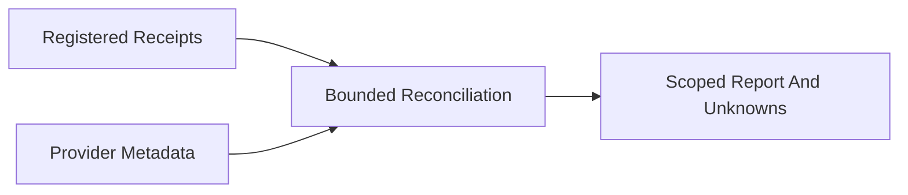

# 20261031-1854 — OpenRouter usage reconciliation

#fractal-l0 #fractal-l1 #fractal-l2 #fractal-l3 #fractal-l4 #fractal-l5 #fractal-l6 #fractal-l7 #fractal-l8 #fractal-l9 #km-triad #zk-adr #zero-muda

Observed host prefix: 2026-10-31T18:10:54Z. [Cockpit](http://nas-1.tail55d152.ts.net:4100/) · [KM](http://nas-1.tail55d152.ts.net:4100/km) · [Source packet](http://nas-1.tail55d152.ts.net:4100/files/governance/planning/20261031-1854-openrouter-usage-reconciliation.json).

## 1. Scope & Trigger

OI02A_OPENROUTER_USAGE_RECONCILIATION, attempt1, worker codex-openrouter-usage-20261031, under Sa-plan uos/codex-handover-open-items-fractal-plan/20261031-1240. The operator requested actual API costs and economical model selection. This child develops and observes a read-only accounting path; the original nine-task goal remains active. Code candidate 7beb9340e85224108a639989c358aca2144e6f35, stable change osmkpnntpsmrkllutorzoovosovzmmxz, parent f3778d5e47c656e10baefae1148f30a82ce57c64. No runtime release or system admission.

## 2. Pre-State Assessment

SDK estimates did not independently establish provider charges. Several generation IDs were absent from summary receipts but recoverable from existing registered event metadata. One earlier native Claude invocation still has unknown usage. These uncertainties do not disappear when credits are added. The thirteen-task portfolio includes OI02B monitoring development; only the OI01 dossier and its two children are completed at this observation.

## 3. Execution Detail

Gleam owns fixed GET endpoint selection, strict parsing, finite output projection and exact generation identity. Existing Erlang credential lookup and TLS transport are reused behind it. Endpoints are key, credits, generation and activity. Credentials stay inside the worker; no inference, key mutation, redirects or retries are dispatched. Thirty-second transport deadline, existing four-MiB wire guard and final 256-KiB body check are distinct bounds, not a heap guarantee.

The billing wrapper reuses the original token report, keeps its unknown-usage HOLD and separates provider generation costs, SDK estimates, native Claude estimates, key-wide usage and account credits. Explicit receipt paths, identities and generation IDs are deduplicated; every registered OpenRouter call must receive a known or unresolved disposition. Private account data remains private.

## 4. Root Cause Analysis

ACH disconfirmation: H1, SDK estimate equals billed cost, is contradicted by twelve provider receipts. H2, key-wide daily usage equals this task subset, is contradicted by their different scopes. H3, a null limit grants unlimited spending, is rejected because metadata is not authority. H4, an API error proves zero cost, remains unsupported; two requests without generation IDs stay unresolved. No historical receipt or unknown charge was erased.

## 5. Fix Taxonomy

Poka-Yoke: closed endpoint grammar, bounded numeric fields and exact generation binding. Jidoka: preserve unknown-cost stop lines and refuse malformed, duplicate, negative or overbound receipts. Muda: metadata GETs replace speculative cost estimates; deterministic checks precede paid advisory requests. Added credits do not change the existing USD10 daily policy or authorize refunds.

## 6. Patterns & Anti-Patterns Discovered

Use the cheapest model that passes the task's acceptance gates, with compact context and explicit limits. Escalate difficult mathematics or independent review only when needed. These source changes were implemented by local Codex relays; they are not new native Pi or Claude inference executions. Treating a credit balance, SDK zero, or provider subtotal as fleet-wide budget enforcement is an anti-pattern.

Devil's Advocate / Popperian falsification: malformed, duplicate, negative, null and mismatched generation receipts were exercised as refusal/unknown controls. These falsifiers challenge the interpretation of API metadata; they cannot prove completeness of invoices or turn a generation-less error into zero liability.

## 7. Verification Matrix

Pinned Gleam1.16.0 and OTP29: all37 tests passed, nineteen client and eighteen billing tests. Seven source bytes equal the private compiled inputs. Independent local Codex client review found no blockers. Actual generation GET12/12 HTTP200; key and credits HTTP200 before and after the credit addition. Current-day activity HTTP400 and completed-day activity HTTP403 are retained access limitations, not passing analytics coverage.

Twelve known generation costs total 55,783,730 nanodollars, versus SDK estimate 51,955,638, a 3,828,092 difference. Flash two generations:1,355,160; Pro nine:41,606,570; Argon one:12,822,000 nanodollars. These are provider API metadata, not invoices. Two generation-less requests and one native Claude usage record remain unknown. Admiralty B2 applies to observed provider responses within this subset; complete workflow billing is not established. No new solver or whole-system test was needed for this read-only adapter; prior mathematical results are not recertified here.

## 8. Files Modified

Seven implementation/test files are enumerated with SHA256 in the linked packet. This journal, packet and reciprocal wiki/ZK/inventory references add source documentation. Standalone JJ only. A stale coordinator-heartbeat refusal was noticed after source metadata freeze; heartbeat and ownership were re-established before further integration. No main movement, runtime effect or authority was inferred from that refusal.

Before publication, the input-equality guard found that the private FFI copy lacked the frozen source's positive-year check. The old inputs were preserved, all seven sources recopied and rebuilt, and all37 tests passed again. A representative generation GET using this rebuilt candidate returned HTTP200. Earlier tests alone were insufficient evidence for exact source equality.

## 9. Architectural Observations

Gleam policy and bounded native IO remain separate. The billing reader uses existing bounded file reads; it does not claim symlink confinement or an atomic snapshot. JSON amounts are rounded to the nearest nanodollar for reporting, never used as spend authority. Public packets omit key identifiers, credentials, account balances, raw prompts and raw provider errors.

```ascii
[Registered Receipts] --> [Bounded Reconciliation]
[Provider Metadata] --> [Bounded Reconciliation]
[Bounded Reconciliation] --> [Scoped Report And Unknowns]
```



## 10. Remaining Gaps

Management activity access is unavailable. Unknown invocation charges remain unresolved, and the canonical reservation ledger is neither refunded nor rewritten. No model-control dashboard or production billing poller is activated by this slice. OI02 release/controller work, OI02B all-agent monitoring and OI03..OI09 remain open. Full symbiosis and all-service coverage are unproven; EV94..109 and ADR071..086 remain NOT_ADMITTED.

## 11. Metrics Summary

Known provider subset USD0.05578373; SDK subset USD0.051955638. GET requests are accounting metadata reads and add no inference tokens to the invocation ledger. Do not add key-wide usage to this subset or add supervisor counters whose overlap is unknown. A finite 37-test pass is not a statistical uptime guarantee; Bayesian fleet reliability and Lyapunov stability remain unmeasured for this adapter.

## 12. STAMP & Constitutional Alignment

Raw FMEA: wrong attribution or false zero cost, severity5, occurrence3, detection3, RPN45, band5; residual unknowns remain. All UCA types: not_provided—missing usage retains UNKNOWN; provided_unsafe—credentials and raw errors are excluded; wrong_timing—reserve before inference and reconcile after provider receipts; duration—bounded metadata transport and task leases. No score, peer review, metadata balance or formal model grants effect authority. EV ceiling93 is unchanged.

<details><summary>Domain 1 — Metadata, timestamp and navigation</summary>

- [x] CHK-01-TIME — Observed host timestamp and fresh toolchain/risk observations.
- [ ] CHK-02-TAIL — Final live byte parity pending publication.
- [x] CHK-03-FRACT — L0–L9 accounting/control implications bound.
- [x] CHK-04-KM — Reciprocal registration included in this source package.

</details>
<details><summary>Domain 2 — Zero-Muda and storage safety</summary>

- [x] CHK-05-MUDA — No new dependencies or barred runtime roles.
- [x] CHK-06-GRAPH — Gleam/native boundary preserved; no foreign graph kernel.
- [x] CHK-07-DRIVE — No storage operations or interlock change.

</details>
<details><summary>Domain 3 — Tests and mathematical gates</summary>

- [ ] CHK-08-C1C8 — Dashboard UI is not part of this adapter's passing scope.
- [ ] CHK-09-MATH — Whole-system four mathematical gates not rerun.
- [x] CHK-10-9MOD — Relevant finite unit/adversarial fixtures and actual GETs observed; no full chaos claim.
- [ ] CHK-11-REGR — Final live recall verification pending publication.

</details>
<details><summary>Domain 4 — Cross-language control and observability</summary>

- [x] CHK-12-GLEAM — Pinned OTP29 private development execution observed.
- [ ] CHK-13-HERMES — No new formal/runtime admission claim.
- [ ] CHK-14-ZIGVM — No deterministic-kernel change or new execution claim.
- [ ] CHK-15-MAX — Inference tier unchanged; no new inference.
- [x] CHK-16-OTEL — Local observation timestamps retained; no invented distributed traces.

</details>
<details><summary>Domain 5 — Sovereign governance and Jujutsu</summary>

- [ ] CHK-17-SOV — Production admission remains withheld.
- [x] CHK-18-JJ — Standalone JJ source candidate bound; final publication separately checked.

</details>
<details><summary>Domain 6 — Provenance extension</summary>

EV93 ceiling; no new EV numbers. NOT_ADMITTED ranges unchanged. Development evidence does not confer application or system admission.

</details>

## 13. Conclusion

The scoped reader and reconciliation path are implemented and observed. Forecast at this ledger: p=0.9 source publication and fresh recall within twenty minutes; this is a precommitted prediction, not a result. Full workflow billing, live model control and full symbiosis remain open until their own evidence is obtained.

[[wiki:20260905-1801-uos-zk-km-corpus-index]] · [[zk:20260905-1801-moc-uos-unified-master]]

[Previous foundations](http://nas-1.tail55d152.ts.net:4100/files/docs/journal/20261031-1756-oi02-recoverable-cutover-foundations-journal.md) · [Wiki](http://nas-1.tail55d152.ts.net:4100/wiki) · [ZK](http://nas-1.tail55d152.ts.net:4100/zk) · [Next plan](http://nas-1.tail55d152.ts.net:4100/files/docs/design/20261031-1240-uos-open-items-fractal-design-implement-test-plan.md).

UOS footer: report-only development evidence, no runtime admission.
