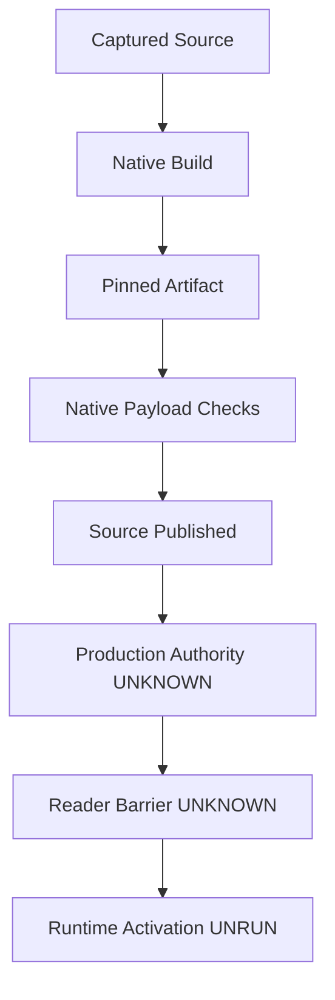

# 20261031-2048 — OI02 cutover control and native source build

Observed host 2026-10-31T20:33:48Z; active risk observation 20:33:29Z records chrony offset 0.000118618s, uncertainty 0.0142463485s, stratum3. Source revision **a09044f4136f142c9644be13ce706c4dd9aea62e**, main==origin confirmed by the supervisor at20:32UTC. Documentation is a separate child; its live parity is pending.

#fractal-l0 #fractal-l1 #fractal-l2 #fractal-l3 #fractal-l4 #fractal-l5 #fractal-l6 #fractal-l7 #fractal-l8 #fractal-l9 #km-triad #zk-adr #zero-muda

[Self](http://nas-1.tail55d152.ts.net:4100/files/docs/journal/20261031-2048-oi02-cutover-control-and-native-source-build-journal.md) · [Evidence packet](http://nas-1.tail55d152.ts.net:4100/files/governance/planning/20261031-2048-oi02-cutover-control-and-native-source-build.json) · [Task graph](http://nas-1.tail55d152.ts.net:4100/files/docs/design/20261031-1908-full-hive-outstanding-task-graph.md) · [Activation SOP](http://nas-1.tail55d152.ts.net:4100/files/docs/sop/20261031-1918-full-hive-service-activation-and-checks.md) · [Planning](http://nas-1.tail55d152.ts.net:4100/planning).

## 1. Scope & Trigger

The operator requested operational four-agent symbiosis, source integration, robust cutover/recovery, cost-aware parallel execution and a complete Codex handover. Right-problem check: close observable ownership, cleanup, build and storage seams before claiming availability. This slice publishes16 reviewed source files for OI02/OI02B; neither task is complete. Canonical plan uos/codex-handover-open-items-fractal-plan/20261031-1240 has15 tasks: **5 completed,2 executing,8 available** at20:33:29Z. Available is not dependency-ready; the overall nine-task objective remains open. OI01's completed dossier does not admit EV94..109.

Implementation and reviews here are attributed to local Codex supervisor/relays. Earlier actual native AGY Argon, Claude Fable and Pi/OpenRouter advice remains separately recorded; this slice made no new model calls and does not impersonate those native agents.

## 2. Pre-State Assessment

Previous main790f51bae67cf49924ec9c398dab588020aca465 contained the dependency repair and durable receipt sink. The current MCP/KM observation remains healthy/intact at EV93 but runs an older immutable capsule, not this new source. Missing seams included a typed receipt frontend, native cutover framing/checkpoints, candidate/config pin inspection/editor, controller ownership/recovery and a repeatable cached native build. Eleven config surfaces and15 existing physical paths were observed as metadata; those observations did not establish a candidate environment or authorized write set.

Fresh recall consulted the master handover and local symbiosis rules. The supervisor's actual knowledge_search using the task-graph identifier returned5 results, followed by successful transclusion/read_file of the task graph. This relay's different cutover/symbiosis query returned no result; that is not a general KM search failure. The connected search schema exposes no limit argument, a capability gap; the relay's bounded zk_transclude used limit2. Imported history remained read-only. Kalman state-prior inference is UNKNOWN: no attributed time-series fit is claimed. A stale preflight/risk observation initially refused progress; its failure and subsequent fresh31-check preflight/160-file active observation remain retained rather than overwritten.

## 3. Execution Detail

### Control and evidence boundaries

Gleam owns the one-flight controller, exact step/generation compare-and-set, owner/task/epoch bindings and post-intent source/admission reread. Worker death must be observed before capacity is released. Normal/abrupt owner loss, missing ACK, deadline/quiescence expiry and stale collector clocks fail closed. No concrete ReleaseAuthority issuer or production root wiring is supplied by these constructors.

The typed receipt frontend creates sanitized raw assertions: all-true stays UNKNOWN; any false dimension becomes STOP. It preserves the paired guardian exit witness. CleanupUnconfirmed is terminal for both submit and readback; a stored row cannot prove process reaping. Confirmed cleanup permits exact-ID/hash/sequence reconciliation; absent rows do not permit automatic resubmission. Immutable intent aliases require one local owner honoring the returned state; no global linearity claim is made.

### Native file and build boundaries

The native port wraps the existing file kernel with bounded strict framing, independent descriptor pin, append-only intent/result checkpoints, exact replay and explicit recovery epochs. Review found pair-only log reservation could strand rollback, and targets could overlap private control files. Pre-intent exclusions and finite full-recovery record/byte escrow close those findings. All post-append readback failures remain UNKNOWN. One uninterrupted recovery fits its reserve; unlimited retries, torn-log repair and hostile filesystem containment are not promised.

The build helper strips exactly the two verified Kernel directives and one Port directive, preserving remaining bytes; comments/strings containing # are not directives. It snapshots public sources and the unchanged process helper, uses fixed cached libraries/pinned tools, and publishes exact binary/manifest inventories under a full-manifest content ID. Captured inputs are rechecked before publication; **the complete compiler, assembler, linker, runtime and transitive build closure correspondence is UNPROVEN**. Actual output bytes are pinned. Permission immutability and the input lookup index are cooperative controls; the caller independently retains the artifact ID. Filesystem/hash/copy/fsync operations require outer OS supervision/local-FS assumptions; the internal guardian bounds compiler work and does not prove escaped-descendant containment.

### Integration and packaging

The pin auditor/editor preserve closed schemas and byte spans, refusing ambiguous/unknown fields and false success. stage-native verifies the independently retained native ID, six-field manifest schema, captured-input/recipe bindings, executable modes and fixed payload. Real native payload copy/verify/freeze passed in a private composition. Subsequent supervisor evidence stages and verifies the canonical development capsule var/releases/ecology/20261031-2024-0b4b73524dbdbb92ef069f1aecfdcaef1395ab6e43413fd065214c136de4d5b8:2317 files,62,819,326 bytes,36 apps, OTP29/ERTS17.0.5. Payload SHA6689dba2e10910abe06d7c09694725bd2c59948bf730b65aa08249765d397b12 and source SHA0d0b65c48e56453cc18698ed54cbe47a4e201460863eb29e641b759d1851e4bf bind that capsule. Separate packaged repeats pass27 controller/transport and15 frontend cases. The controller uses capsule worker352e/guardian13fd; the frontend uses capsule BEAM/guardian plus the external canonical Hermes848f test worker, which is NOT packaged. The older pinned capsule also verified with the new packager. Neither result is a new deployment or root activation.

## 4. Root Cause Analysis

ACH — Analysis of Competing Hypotheses is applied at each affected boundary below. H1–H6 concern separate fault mechanisms rather than mutually exclusive causes of one incident.

| Competing hypothesis | Disconfirming observation | Disposition |
|---|---|---|
| H1: A valid storage ACK proves cleanup | Generic transport discarded the exit witness | Rejected; pair result and witness, terminal uncertain cleanup |
| H2: Intent/result space is enough for recovery | A real prepared fixture filled the control log, then could not restore | Rejected; reserve the full finite recovery before forward effects |
| H3: Safe relative target names protect the control plane | A control-path target created a kernel stage inside the control namespace | Rejected; exclude control/staging/config/journal targets before intent |
| H4: A matching manifest can authenticate its outputs | Coherent binary+manifest rewrite could preserve an input-only ID | Rejected; full manifest digest must match the independently retained ID |
| H5: A private compile proves the application closure | Initial closure check found missing root .app metadata | Rejected; explicit bounded projections and module/dependency comparison |
| H6: Selected tool/library hashes prove a hermetic build | C compiler/linker/runtime dependencies are not fully captured | Rejected; captured-input and output-byte scope only |

The fifth failure was corrected with four local .app descriptors explicitly labeled PROJECTION, not official Gleam-generated metadata. Existing compiler warnings and the failed check are retained. Source drift before publication, two mutation controls and lost-ACK cases supply falsifiers rather than success-count agreement alone.

## 5. Fix Taxonomy

Poka-Yoke: closed identities, parser fields, independent artifact ID, exact schema/modes/inventory and byte-preserving edits. Jidoka: hold unknown cleanup, stale authority, conflicting replay, source drift, partial publication and ambiguous pins. Muda: reuse existing transport/guardian, Hermes store and cached compiler dependencies with an additive Gleam controller/frontend; no additional framework daemon or inference retry. Heijunka: disjoint bounded writers and independent reviews; root alone serializes source integration. Rete diagnostics and model advice do not issue grants.

## 6. Patterns & Anti-Patterns Discovered

Store evidence and process termination are different facts. A durable row is not accepted health, and accepted health is not effect authority. Verify the source of every success endpoint. Capture source bytes once through stable descriptors, retain failures, and separate candidate-dependent metadata from observed installed topology. Do not call manually constructed app metadata official, or selected library pins a complete compiler closure.

Devil's Advocate: removing the full-manifest-ID check must allow the coherent-rewrite negative to fail, and removing the final captured-input check must fail the source-drift test. Both mutants exit2. Removing raw-status/hash/cleanup barriers similarly fails the frontend controls. These are finite fault controls, not universal proofs or statistical reliability trials.

## 7. Verification Matrix

Counts below are separate scopes and are not summed into an aggregate proof.

| Scope | Observed result | Evidence/qualification |
|---|---|---|
| Gleam controller/transport | Root27 tests PASS against source-built worker352e620d…38eb/guardian13fd313f…2604 | native-tests-1793478602582689-2614727.log; owner loss, step CAS, native14/15, blocked OS/quiescence, new-epoch recovery; source revision a090 |
| Durable frontend |15 tests PASS; three mutants rejected | Actual pinned Hermes worker/guardian, four-agent hashes,864 raw-status combinations; no production owner attachment |
| Native cutover port |257 checks PASS with guardian | Private files, rollback escrow, aliases, lost ACK, uniform post-append uncertainty |
| Native builder | Root273 checks PASS; two mutants rejected | OCaml5.5.0/Dune3.23.1; actual cached build/private ABI; seeds17/91×100 suffix cases; captured closure only |
| Pin auditor / editor | Root51 /82 checks PASS | Separate native inspect/config-read and pure synthetic byte-editor scopes; config contents not published |
| Packager | Root35 selftests PASS | New six-field native schema and real native payload copy/verify/freeze; subsequent canonical capsule staged/verified |
| Packaged candidate repeats |27 controller/transport and15 frontend cases PASS | Separate test scopes from capsule BEAM/native files; frontend Hermes848f worker remains external, not packaged |
| Canonical Hermes target | Target build exit0;3 guarded synthetic tests PASS | Actual repository Dune target,0.77s/108024KiB observation; not full Hermes suite or supply-chain proof |
| Abstract Quint model | Root10 tests PASS, seed17 | candidate-cutover-quint-tests.log; bounded abstract checks, not native refinement |
| Four local application packages | Offline compile and36-app closure projection PASS |1165 production inputs stable before/after;875 test inputs sampled AFTER ONLY; tests not run by this build |
| Publication |16 source hashes bound to main==origin a090 | Supervisor-confirmed20:32UTC; docs/live parity remains a separate gate |

The four local descriptors are validated projections with no missing apps/modules or local inventory mismatch. Existing unused/list.length/transitive filepath warnings remain recorded; this is not an official whole-build zero-warning or warnings-as-errors claim. External cached artifacts were reused and pinned; none were fetched. STANAG B2 here is an analyst classification of directly repeatable scoped observations with independent review, not sovereign admission. Abstract Lean/Quint/SMT evidence remains separate; no new native refinement, runtime liveness or entropy/trajectory/ITQS/complexity proof is asserted. Across the nine modalities, unit/private-system/behavioral scenarios, finite properties, malformed-input fuzz and private fault/recovery cases are exercised; independent TDD chronology is not attested. Performance has a single build-time observation, and finite capacity cases do not establish fleet scalability. Full operational performance, scalability and24-hour chaos/soak acceptance remain open.

The initial journal gate rejected two of10 checks because explicit ACH hypothesis IDs and the recognized Forecast label were absent. Those failures are preserved; adding the required labels changes no evidence claim or checker. Supervisor diagram parity observed2/2 documents verified,0 UNVERIFIED. Final journal rerun remains pending until these corrected bytes freeze.

### Seventeen aspects

| ID | Aspect | Scoped result / remaining obligation |
|---|---|---|
| A01 | Substrate/storage interlock | Private fixtures; device operations UNRUN |
| A02 | Standalone JJ | Root source publication a090; docs child pending |
| A03 | Purity/provenance | Existing dependencies reused; EV93 unchanged |
| A04 | OTP supervision | Private owner/worker fault tests; production wiring UNVERIFIED |
| A05 | ZigVM/VFS | Untouched; native frozen-topology premise is not descriptor-relative confinement |
| A06 | Hermes evidence | Guarded receipt target observed; full runtime adoption UNVERIFIED |
| A07 | Mathematics | Finite properties/mutants; full refinement and mathematical gates open |
| A08 | Feedback/authority | Typed refusal/recovery; real issuer and readers barrier UNVERIFIED |
| A09 | Isolated inference | No new inference dispatch or dependency |
| A10 | Mesh/observability | Existing transport reused; live signed-control adoption UNVERIFIED |
| A11 | Agent events | Bound local test receipts; fleet event delivery UNVERIFIED |
| A12 | Declarative UI | No new UI claim |
| A13 | Interfaces/accessibility | Full GUI/TUI/API acceptance UNRUN |
| A14 | Tailnet navigation | Full FQDN references; new live byte parity pending |
| A15 | Checklist | Six-domain obligations below; no blanket pass |
| A16 | KM triad | Fresh recall and reciprocal local registration; publication pending |
| A17 | Durable execution | Canonical task snapshot; source tests do not complete OI02/B |

## 8. Files Modified

The machine packet enumerates all16 exact source paths/SHA-256 values at a090: six Gleam controller/transport/frontend implementation/test files; native port and tests; native builder and tests; pin auditor/library/CLI/tests; pin editor/tests; and release packager. Native Kernel, protected ecology_process, core MCP cluster and generic guardian source remain unchanged. This child changes only the new journal/packet, current task graph, wiki index, ZK MOC, capability inventory and original-plan addendum. No source code, live config, task DB, service or VCS mutation is performed by this documentation relay.

## 9. Architectural Observations

Arrows below are required succession, not a claim that unknown gates executed.

```ascii
[Captured Source] --> [Native Build]
[Native Build] --> [Pinned Artifact]
[Pinned Artifact] --> [Native Payload Checks]
[Native Payload Checks] --> [Source Published]
[Source Published] --> [Production Authority UNKNOWN]
[Production Authority UNKNOWN] --> [Reader Barrier UNKNOWN]
[Reader Barrier UNKNOWN] --> [Runtime Activation UNRUN]
```



L0 release authority is withheld; L1 identities/hashes/clocks are bounded; L2 private owner/worker lifetime is exercised; L3 transactions/recovery are tested; L4 package/KM boundaries are mapped; L5 prior native advice is advisory; L6 full catalog coverage remains unverified; L7 live federation ingress is unverified; L8 no self-authorized evolution occurs; L9 independent candidate checks remain distinct from deployment. This is not a full L0–L9 cross-product proof.

## 10. Remaining Gaps

OI02 and OI02B remain executing, OI03..OI09 plus OI02D remain dependency-constrained available. Required seams include a real ReleaseAuthority issuer, exact current candidate environment-file manifest, authenticated complete service catalogs/collectors, all-reader drain, effect consumers, root supervision/activation, signed ingress, dashboard truth and source-bound operational acceptance. The kernel has an Absent primitive; this does not establish the actual candidate environment or its authorized path.15 observed distinct runtime paths and11/11 config metadata are inventory evidence only. A canonical development capsule is now staged/verified; operational switch, rollback/recovery and the24-hour OI08 soak remain separate unrun work. Packaging and attaching the native Hermes receipt worker and frontend owner remain OI02B gaps. Full transitive compiler/runtime closure and native refinement remain unproved. No deadline for whole-system completion is supplied.

## 11. Metrics Summary

Fifteen canonical tasks now have5 completed/2 executing/8 available, replacing the earlier4/3/8 projection; C is done through the supported audited dependency API, not by this document. Source publication16 files is observed; activated services0. No new paid/native model call occurred. Test counts retain their separate denominators; deterministic fixtures do not justify a Bayesian Beta-Binomial reliability update, establish dV/dt<0 globally or calibrate a forecaster.

Resolve the prior1918 journal's p=0.8 source-publication forecast for20:15UTC: **outcome1, Brier0.04**, bound to main/origin790f51bae67cf49924ec9c398dab588020aca465 published19:41UTC and its four-document disk/header/body-parity receipt. This resolves only that earlier source/documentation event, not a090 or runtime readiness. One resolved forecast is not calibration.

## 12. STAMP & Constitutional Alignment

Raw FMEA values are review judgments, not measured failure probabilities; scores do not grant permission.

| Hazard | S | O | D | RPN | Control / residual |
|---|---|---|---|---|---|
| Release without issuer/reader drain |10|4|7|280|Typed gates and source/admission reread; actual issuer/barrier UNVERIFIED |
| New worker before uncertain cleanup reconciles |9|4|6|216|Terminal cleanup state, observed BEAM worker DOWN AND genuine paired native-exit/quiescence witness; escaped descendants require cgroup |
| Recovery exhausted or control namespace overwritten |9|3|6|162|Finite full-pass escrow and pre-intent alias exclusion; torn-tail/manual reconciliation limit |
| Stale/incoherent native artifact |8|3|6|144|Independent full-manifest ID, inventory/modes and captured-input recheck; full toolchain closure UNPROVEN |

UCA1—required safe control not provided: missing authority/catalog/quiescence remains HOLD, not silently skipped. UCA2—unsafe control provided: false source/step/pin/identity/cleanup claims are refused. UCA3—control too early/late/wrong order: dispatch-clock expiry, sequence/epoch and post-intent reread checks reject stale/reordered work. UCA4—control applied too long/stopped too soon: deadlines, worker DOWN/reaping and finite recovery capacity retain uncertainty rather than release a slot early.

POODAVR: predict partial writes/stale ACKs/closure gaps; observe frozen source and real private executions; orient against canonical ownership; decide within Sa-plan/risk; act in development; verify independent counterexamples; reflect into this ledger and reciprocal KM. Rete/Stan/model judgments remain advisory. Stan's longitudinal-data/useful-question/independent-oracle trigger is not met by these deterministic fixtures. EV93 remains the ceiling; EV94..109/ADR071..086 remain NOT_ADMITTED and no EV identifier is minted.

## 13. Conclusion

The16-file source integration, staged/verified candidate capsule and scoped development observations are concrete; production symbiosis and cutover remain unverified. The next work is candidate environment and authority/reader integration, then the dependent route/toolchain/KM/effect and full-hive acceptance work before soak.

Precommitted source-only prediction: probability0.65 that this documentation bundle passes local gates and is published to main/origin by2026-10-31T21:15:00Z. Resolve with o=1 only on a supervisor-confirmed publication of these exact documentation bytes. This conservative judgment predicts no production activation and makes no calibration claim.

Forecast p = 0.65; Horizon 2026-10-31T21:15:00Z; Brier = (0.65-o)^2. Outcome and Brier score are PENDING.

### Comprehensive verification checklist

<details><summary>Domain 1 — Metadata and navigation</summary>

- [x] CHK-01-TIME — Host/risk clock basis and HHSS prefix recorded.
- [ ] CHK-02-TAIL — New live byte parity awaits publication.
- [x] CHK-03-FRACT — Applicable L0–L9/17-aspect scope stated.
- [x] CHK-04-KM — Local reciprocal index/MOC/inventory/plan references authored.

</details>
<details><summary>Domain 2 — Purity and storage</summary>

- [x] CHK-05-MUDA — No new package/framework or external import.
- [x] CHK-06-GRAPH — Gleam control/Hermes bounded IO boundary preserved.
- [x] CHK-07-DRIVE — No device or production storage effect.

</details>
<details><summary>Domain 3 — Testing and mathematics</summary>

- [ ] CHK-08-C1C8 — Full UI/system acceptance remains UNRUN.
- [ ] CHK-09-MATH — Global four mathematical gates remain open.
- [x] CHK-10-9MOD — Applicable unit/integration/property/fuzz/fault tests scoped; performance/scalability/soak obligations remain open.
- [x] CHK-11-REGR — Separate observed component regressions and failed controls retained.

</details>
<details><summary>Domain 4 — Control and observability</summary>

- [ ] CHK-12-GLEAM — Production root attachment/owners unverified.
- [x] CHK-13-HERMES — Guarded canonical native target observed.
- [ ] CHK-14-ZIGVM — Applicable production kernel acceptance unrun.
- [ ] CHK-15-MAX — Full-hive inference readiness unrun.
- [ ] CHK-16-OTEL — Fleet-wide attributed trace/clock coverage unverified.

</details>
<details><summary>Domain 5 — Governance and JJ</summary>

- [ ] CHK-17-SOV — No production release/two-key admission inferred.
- [x] CHK-18-JJ — Source a090 publication observed; this docs-child publication pending.

</details>
<details><summary>Domain 6 — Provenance extension</summary>

EV93; EV94..109/ADR071..086 NOT_ADMITTED. application_admitted=false; system_admitted=false.

</details>

[[wiki:20260905-1801-uos-zk-km-corpus-index]] · [[zk:20260905-1801-moc-uos-unified-master]]

[Previous source journal](http://nas-1.tail55d152.ts.net:4100/files/docs/journal/20261031-1918-hive-task-fences-native-advice-and-activation-journal.md) · [Wiki](http://nas-1.tail55d152.ts.net:4100/wiki) · [ZK](http://nas-1.tail55d152.ts.net:4100/zk) · [Next original plan](http://nas-1.tail55d152.ts.net:4100/files/docs/design/20261031-1240-uos-open-items-fractal-design-implement-test-plan.md).

UOS footer: source/development verification only; full runtime cutover and admission remain unverified.
