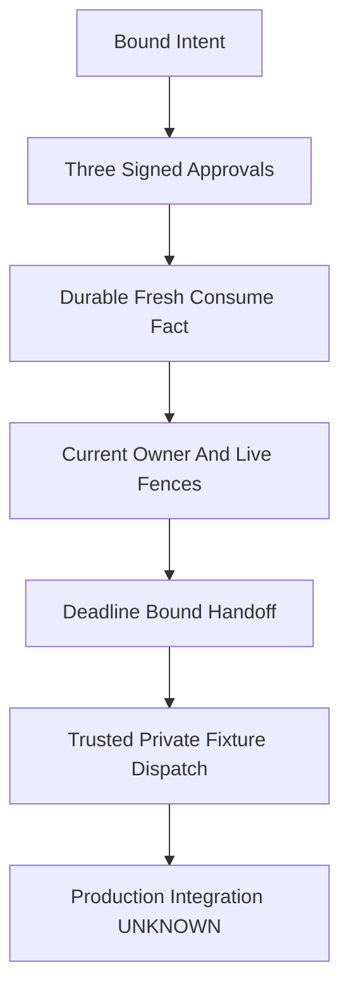

# 20261031-2102 — OI02E release authority preparation

Observed host2026-10-31T21:35:02Z and filename prefix20261031-2102 from the same date call; fresh chrony system offset0.000038753s fast, stratum3, leapNormal. An earlier unsupported minute inference from HHSS-only output was corrected before freeze. Retained active scope at21:30:26Z is ACTIVE_OBSERVATION_PASS; supervisor reports a refreshed ACTIVE_OBSERVATION_PASS at21:33:32Z, separately from that older receipt. Source19 committed5faf91982fd4033023265bdfc6f323b3cd4e8a72; source main==origin observed21:38:04Z; new document publication/parity PENDING. Prior published base b0b8624294dbff7f7ae82e7277a4808a11bdef2c remains historical.

#fractal-l0 #fractal-l1 #fractal-l2 #fractal-l3 #fractal-l4 #fractal-l5 #fractal-l6 #fractal-l7 #fractal-l8 #fractal-l9 #km-triad #zk-adr #zero-muda

[Self](http://nas-1.tail55d152.ts.net:4100/files/docs/journal/20261031-2102-oi02e-release-authority-preparation-journal.md) · [Machine packet](http://nas-1.tail55d152.ts.net:4100/files/governance/planning/20261031-2102-oi02e-release-authority-preparation.json) · [Task graph](http://nas-1.tail55d152.ts.net:4100/files/docs/design/20261031-1908-full-hive-outstanding-task-graph.md) · [Original plan](http://nas-1.tail55d152.ts.net:4100/files/docs/design/20261031-1240-uos-open-items-fractal-design-implement-test-plan.md) · [Planning](http://nas-1.tail55d152.ts.net:4100/planning).

## 1. Scope & Trigger

The operator requested complete hive functionality, robust source integration and Codex handover. Right-problem check: durable factual grants and authenticated preparation do not supply the missing real production identity, approval roster or effect-time boundary. This19-file slice prepares explicit three-of-three Operator/Codex/AGY signed intent checks, native append-only facts, a Gleam owner and explicit ingress. It is PREPARATION_NOT_ADMITTED. OI02E is not completed before supervisor publication; OI02/B and the original nine-task goal remain open.

Canonical Sa-plan has16 tasks:5 completed,3 executing,8 available;11 remain. Available does not mean dependency-ready. These are source-development observations by the local Codex supervisor and local Codex relays, not native Pi/Claude/AGY execution. No new external OpenRouter or native advisory invocation occurred. Local Codex execution does use models; provider costs are UNKNOWN.

## 2. Pre-State Assessment

The earlier candidate capsule and bounded cutover foundation existed, but a real release issuer, signed production approvals, authentic runtime boundary and all-reader drain were missing. The currently loaded production BEAM remains2673adf74bef1b2b61290cfa0d7a99bf04dfc379b8eb1497a18620527655c3f7 on its older capsule. No activation or service configuration change is claimed. Eleven config surfaces/15 physical targets are prior metadata inventory, not an authorized candidate environment.

Fresh MCP system_health reported healthy/intact KM at EV93. The relay's exact release-authority CAS knowledge_search returned no result; bounded zk_transclude returned the local release runbook and earlier independent release review. The runbook requires current candidate/task/runtime fences and distinguishes green component tests from production admission. The connected search schema has no limit argument; transclusion used limit2. Kalman prior/time-series fit remains UNKNOWN. Stale heartbeat refusal followed by an empty workspace creation is retained as a process-order failure with no product effect. Late OI02B renewal was refused, then reclaimed through canonical authority as attempt2; no force-pass.

## 3. Execution Detail

### Signed preparation and factual storage

Gleam binds intent/source/config/host/boot/clock/execution identity, authentic OIDC role/ACR and three distinct configured signatures. This profile is preparation, not sovereign system admission. Native OCaml records issue/revoke/consume facts under owned bounded SQLite transactions, exact schema/triggers and canonical request hashes. UNIQUE intent digest prevents reissuing the same sealed intent under another grant ID after revoke. Fresh Consumed differs from historical AlreadyConsumed; neither is a native bearer permit. Unknown ACKs permit only bounded reconciliation with confirmed guardian cleanup, never automatic consume resend. Forward appends reserve row/byte headroom for revocation; this is a finite conservative policy, not disk-full or power-loss universality.

Lookup may initialize SQLite schema/WAL: read-only means no grant/event append, not a physically read-only open. Replay/conflict fencing covers persisted event request IDs; IDs of historical aliases returning AlreadyConsumed/AlreadyRevoked are not globally reserved. The Gleam owner's deterministic IDs and typed historical outcomes preserve this distinction; the frontend accepts caller-supplied request IDs.

### Owner, lifecycle and candidate binding

Separate linked ledger/effect workers let a native Revoke ACK persist while the live observer is blocked. After fresh consume, the isolated observer checks live boundaries; the owner rechecks identity/approval, absolute job deadline and candidate binding before SEND. Handoff carries the actual event, the LiveCheck deadline and shorter crypto expiry. The worker fully revalidates opaque identity/approval lower and upper clock bounds. Revoke accepted after owner SEND cannot undo a queued/executing effect; no SQLite/filesystem atomicity claim is made. Unknown cleanup/owner loss remains held, with no automatic new client or resurrection from historical issuance.

P1 cross-candidate owner alias was found and fixed using mandatory expected-intent digest CAS on dispatch/revoke/get_bound and unique owner registry entries. Wrong candidate cannot consume, set revoke state or obtain another occupied intent's bound snapshot. NoGrant returns an explicitly unbound snapshot, not matching-candidate evidence. The A/B regression and two associated mutants are separate ingress controls. Default Startup/Dispatch boundaries and unconfigured service refuse; private successful fixtures do not install production adapters.

## 4. Root Cause Analysis

ACH disconfirmation separates the competing explanations.

| Hypothesis | Counterevidence | Disposition |
|---|---|---|
| H1 — A durable consume row authorizes replay | Lost ACK/restart tests preserve historical facts without new dispatch | Rejected |
| H2 — Timer arrival order is a sufficient deadline | Suspended owner receives Returned before Timeout after deadline | Rejected; absolute deadline required |
| H3 — Intent window alone proves caller validity | Worker UTC rollback passes intent lower bound but fails identity observation bound | Rejected; full opaque proof recheck |
| H4 — Per-step generation alone separates candidates | Same owner registered for A/B aliases the actual session | Rejected; digest CAS plus owner uniqueness |
| H5 — One serial worker suffices for durable revoke | Blocking observer delays ledger revoke | Rejected; separate effect and ledger lanes |
| H6 — Component success establishes live authority | Real issuer/roster/boundary/readers remain missing | Rejected; preparation only |

The common cause was loss of a binding or independent observation at an interface. Repair preserves the exact identity/candidate/time/cleanup witness instead of substituting status strings, counts or acknowledgements.

## 5. Fix Taxonomy

Poka-Yoke: closed schemas, exact semantic digests, per-intent CAS, unique registry owners and strict clock bounds. Jidoka: uncertainty, late results, stale identity and unconfirmed cleanup stop new handoffs. Muda elimination: reuse the existing guardian/transport, Hermes evidence schema and cached toolchains; additive controller/frontend rather than another framework daemon. Standardized work: exact request/ACK framing and retained source/evidence hashes. Rete-UL reasoning is advisory; this slice installs no new runtime rule enforcement or scalar proxy for typed facts.

## 6. Patterns & Anti-Patterns Discovered

Devil's Advocate/Red Team controls remove the owner deadline check or replace full worker proof validation with window-only validation. The initial weak deadline test survived because the downstream worker cap independently stopped effects. Preserve that SURVIVED result. Strengthening to exact RELEASE_JOB_DEADLINE_EXPIRED plus zero handoffs kills the deadline mutant; the clock mutant is also killed. Passing one protective layer did not prove another was exercised.

Use actual signatures/SQLite/guardian and private TLS fixtures with exact binary/source pins. Avoid promoting signed preparation to runtime authority, historical row to fresh permission, BEAM worker DOWN to proof of native reaping, or a caller-supplied trusted boundary result to independently verified production truth.

## 7. Verification Matrix

Admiralty/STANAG B2 is the minimum admissibility target for a reviewed attributed observation, not an automatic grade created by test counts. Exact source/binary receipts support the listed scopes; production authority and whole-system acceptance remain UNVERIFIED.

| Scope | Observation | Limit |
|---|---|---|
| Native factual ledger | Canonical Dune build;1152 checks PASS actual_guardian=true | Synthetic private DBs; not effect authority |
| Combined Gleam |55 tests PASS across7 modules against canonical worker/guardian;14 inputs stable; repeated from fresh full package closure without private Gleam overlay | Private fixture boundary/configuration |
| Intent and signatures |14 cryptographic/intent tests,2 mutants killed | Real fixture signatures, not production approvals |
| Identity and owner |5 identity and7 actor tests | No production OIDC endpoint acceptance |
| Guarded frontend |15 tests,2 mutants killed; independent exact-source scope acceptance | Exact historical/unknown/cleanup semantics only |
| Ingress |14 tests plus current-dependency private TLS observation21:32:40UTC; A/B alias regression/2 mutants | Explicit private service, not production route installation |
| Timing controls |2 focused baseline tests;2 source mutants killed | Prior weaker assertion survived and is preserved |
| Formal | One-intent1856 states/7304 edges/288 positive states;55188 numeric candidates;Quint8. Separate two-intent9 states/54 transitions/24 denials/6 positives/1 abstract CAS-omission mutant with3 counterexample witnesses/Quint8 | Models are not composed; no native/DB/liveness refinement |
| Four-package compile | Fresh isolated PASS:1172 source inputs stable,875 cached artifacts reverified,36-app closure,13 source-BEAM bindings | Local .app projections; unrelated warnings retained; no full compiler closure proof |

Nine modalities remain separate: unit/property/differential/actual integration/fault-recovery/concurrency/mutation/formal/performance. The first eight have scoped fixture evidence; production performance and24-hour soak are UNRUN. No arithmetic sum of these counts forms a whole-system proof.

### Seventeen aspects

| ID | Aspect | Evidence and gap |
|---|---|---|
| A01 | Substrate/storage | Private SQLite/guardian tests; device effects UNRUN |
| A02 | Standalone JJ | Root source5faf main==origin; documentation publication pending |
| A03 | Purity/provenance | Pinned dependencies reused; EV93 retained |
| A04 | OTP supervision | Two linked worker lanes; production root wiring UNVERIFIED |
| A05 | ZigVM/VFS | Unchanged; frozen local filesystem premise remains |
| A06 | Hermes evidence | 1152 canonical factual ledger checks; not ReleaseAuthority |
| A07 | Mathematics | Separate finite one-intent/two-intent models; no composition or refinement proof |
| A08 | Feedback/authority | Explicit three-of-three preparation; production credentials UNKNOWN |
| A09 | Isolated inference | No new external advisory inference; local Codex model cost UNKNOWN |
| A10 | Mesh/observability | Private ingress/TLS; production transport/telemetry UNVERIFIED |
| A11 | Agent events | Bound request/event facts; authenticated fleet operation UNVERIFIED |
| A12 | Declarative UI | Sanitized ingress diagnostics; no general UI acceptance |
| A13 | Interfaces/accessibility | Private API tests; GUI/TUI/accessibility UNRUN |
| A14 | Tailnet navigation | Full FQDN links; new live byte parity pending |
| A15 | Checklist | 18 core obligations plus provenance below; no blanket pass |
| A16 | KM triad | Fresh health/recall, reciprocal local registration; publication pending |
| A17 | Durable execution | Sa-plan16-task snapshot; OI02/E/B and overall goal remain open |

## 8. Files Modified

Nineteen source paths are bound below and in the packet:14 Gleam source/test inputs plus four native source/interface/test files and their shared Dune integration. The documentation relay changes only seven documentation/registration files: this journal, packet, current task graph, original plan addendum, wiki index, ZK MOC and capability inventory. The supervisor owns source/VCS integration; the19 sources are committed at5faf91982fd4033023265bdfc6f323b3cd4e8a72, source main==origin observed21:38:04Z; documentation publication pending. Historical journals, imported rules and global trees are not rewritten.

| Source path | SHA-256 |
|---|---|
| apps/cepaf_gleam/src/cepaf_gleam/ecology/release_identity.gleam | 27d0738cf0d927a3767bd07fd2e6111d95a34c18cda2271db6621c4bc2f85143 |
| apps/cepaf_gleam/src/cepaf_gleam/ecology/release_intent.gleam | e3a7505bead6d1247ad7b90416b473c45bc31348693c269ee4e1e6e65ef054f5 |
| apps/cepaf_gleam/src/cepaf_gleam/ecology/release_approval.gleam | c8a863f089c51cac6200f0a3fb63f775c9deaabf701463396e20f79f8ad1fca8 |
| apps/cepaf_gleam/src/cepaf_gleam/ecology/release_store.gleam | c6c72e249c2177efb955411e929e311ee8d9f995525e9783e9184eefc534b16d |
| apps/cepaf_gleam/src/cepaf_gleam/ecology/release_authority.gleam | 8c338e973119158ef0e2df6494d395ff3c86ecfe68aec0f5109921dd484af96e |
| apps/cepaf_gleam/test/ecology_release_identity_test.gleam | ff686cff7df91ad7bb114155bc802cc035ef3639d6fbc12bd62fc3280c3db6f6 |
| apps/cepaf_gleam/test/ecology_release_intent_test.gleam | c3fb341da9a240da68ae3f75f3694aa39d43f564fb08c7454866b5a403a63058 |
| apps/cepaf_gleam/test/ecology_release_approval_test.gleam | 845d917e336a59f576f1cc7747ea329cd70c2b209b305f4c0b48a25508fdbf1c |
| apps/cepaf_gleam/test/ecology_release_store_test.gleam | d34cfd4859239d271fefc537b52e360c8821db2058798c48c05f3189b962a986 |
| apps/cepaf_gleam/test/ecology_release_authority_test.gleam | bcf4440450ca3cf0e8d47244845cbeaaf68edc5294931c59e6e3cc563fc65a37 |
| apps/indrajaal_gleam_web/src/indrajaal/release_mcp.gleam | 80e11edfbf59f9bc6bdd5af8d831d1576f689d25ed8d6dfbd6c0bb033cc54d21 |
| apps/indrajaal_gleam_web/src/indrajaal/release_control_service.gleam | b7174a900397fe924ed86d91679e5609cb571affef6b80c8638fdc026b39e2dd |
| apps/indrajaal_gleam_web/test/release_mcp_test.gleam | a6250004ab0d68bd7fcacbf14f2a994f5e2fbfedca616372719ea4aa5ceacf53 |
| apps/indrajaal_gleam_web/test/release_control_service_test.gleam | 2b7104398938a9b9aafb0c325b99085e4fd91654bb09612357be7c91b8a6771c |
| engines/hermes/modules/hermes_harness/ecology_release_grants.ml | efbbcc5afa51d10c1b60a3522b152c96f298bdfe31795c74af75d934ec8100b0 |
| engines/hermes/modules/hermes_harness/ecology_release_grants.mli | 2ed305f4378da9e90beb14344ddd23b2192b544711876b17e631cb48377a62a4 |
| engines/hermes/modules/hermes_harness/ecology_release_grants_port.ml | 9d9172f0146cc01ed9f66fa72b0e1703b8c6819d2302138bc1df3f6eb279d80b |
| engines/hermes/modules/hermes_harness/test_ecology_release_grants.ml | 815636444e67f1d2290e9f96f49dfa4154708bdb3c486403125e959a51cbb8c8 |
| engines/hermes/modules/hermes_harness/dune | 4ca0ab2c25865feaf93a9f7330749a6ce5c97da5f21aea1067224c6f2f164f69 |

## 9. Architectural Observations

The arrows describe required succession, not a claim that production gates passed.

```ascii
[Bound Intent] --> [Three Signed Approvals]
[Three Signed Approvals] --> [Durable Fresh Consume Fact]
[Durable Fresh Consume Fact] --> [Current Owner And Live Fences]
[Current Owner And Live Fences] --> [Deadline Bound Handoff]
[Deadline Bound Handoff] --> [Trusted Private Fixture Dispatch]
[Trusted Private Fixture Dispatch] --> [Production Integration UNKNOWN]
```



L0 withholds actual release authority; L1 binds identities/clocks/hashes; L2 owns worker lifecycle; L3 stores factual transactions; L4 maps package/KM interfaces; L5 model advice stays advisory; L6 complete service catalog remains UNKNOWN; L7 explicit ingress needs actual production configuration; L8 source evolution has no self-release; L9 independent controls veto rather than execute. These projections do not establish a full layer/aspect cross-product.

## 10. Remaining Gaps

P0: obtain the real production OIDC issuer/audience and allowed subject/role/ACR, an admitted approver roster and actual signed production approvals. That operator question remains pending. Bind the actual candidate environment/path manifest, current task/risk/runtime ownership, all-reader drain, health and phase-appropriate cutover boundary. Root startup/consumer configuration and exact binary/package adoption remain UNVERIFIED. The new native grant worker is a temporary, unpackaged executable: ELF NEEDED includes sqlite3/libm/libc/loader and no RUNPATH. Its dynamic runtime closure is not pinned; copying that executable alone is not a self-contained release. No new default service or key ingestion is supplied by this document. Current-dependency private TLS rerun is a status-only exercise and invokes no native grant; actual native behavior is covered separately by the55-test combined run.

P1: publish the completed independent frontend review, fresh four-package/55-test closure and separate two-intent reference receipts with source/documentation parity. The two-intent model is not composed with the larger one-intent state graph. P2: collect operational performance, dashboard/service coverage and outcome telemetry. The original nine-task goal remains open; OI08 requires its actual24-hour soak after entry gates. Native clock sampling/COMMIT is not an atomic physical expiry proof. Captured build pins do not establish complete transitive compiler/linker/runtime closure.

## 11. Metrics Summary

Task projection is16 total/5 done/3 executing/8 available;11 remain. Newly activated production services0. New external OpenRouter/native advisory calls0; local Codex models still run and their provider cost is UNKNOWN. No Bayesian Beta-Binomial reliability posterior or half-life decay is fitted from deterministic fixtures; Lyapunov dV/dt<0 is UNPROVEN without an attributed operational time series.

Resolve the prior p=0.65 documentation-publication forecast by21:15UTC: outcome1; Brier=(0.65-1)^2=0.1225, bound to prior published documentation b0b8624294dbff7f7ae82e7277a4808a11bdef2c. One outcome is not calibration. Historical wording addendum: the previous journal's “no new model calls” meant no new external OpenRouter/native advisory invocations; the local Codex supervisor/relays did use models, with provider cost UNKNOWN. Preserve the earlier bytes; this addendum corrects the scope.

## 12. STAMP & Constitutional Alignment

Raw FMEA: severity5 × occurrence3 × detection4 = RPN60 for stale/cross-candidate or unreaped-effect permission. This is an ordinal prioritization input, not a measured failure probability. Digest CAS, exact candidate-bound signatures, independent clocks, native cleanup witnesses and durable revoke escrow reduce exposure; residual physical commit/effect windows, unconfigured production adapters and filesystem trust remain. Cleanup requires BEAM worker DOWN plus a genuine paired native exit/quiescence witness; DOWN alone cannot clear uncertainty.

| Unsafe control action | Control and residual |
|---|---|
| UCA1 — Required revoke not provided | Independent ledger lane and reserved row/byte headroom; disk failure can still HOLD |
| UCA2 — Wrong candidate/unauthenticated dispatch provided | Three signed bindings, OIDC and mandatory expected-intent CAS; real configuration still UNKNOWN |
| UCA3 — Dispatch too late or out of order | Absolute job deadline, worker proof checks, exact epoch/generation; physical effect recheck remains adapter duty |
| UCA4 — Permission lasts too long or stops too soon | Short monotonic/UTC caps, revocation veto, owner loss stop; post-SEND revoke cannot undo effect |

Sa-plan remains sole task authority. No grant/event receipt, advice, lease or gate badge establishes deployment authority. EV ceiling93; EV94..109/ADR071..086 NOT_ADMITTED; no new EV number. Existing formal kernels and production namespaces remain unchanged by this documentation slice.

## 13. Conclusion

This preparation closes observed factual-storage, signature, owner-deadline and candidate-alias seams at pinned sources. A successful private dispatch is explicit fixture evidence. The next step is supervisor source/documentation publication, then independently authorized production identity/approval/runtime-boundary and reader integration; no overall completion is inferred.

Forecast p = 0.70; Horizon2026-10-31T22:15:00Z: this source/documentation bundle is published with exact source pins and retained verification receipts. Outcome and Brier remain PENDING until observed; falsifier is no such publication receipt by the horizon. This predicts source publication only, not live cutover or admission.

### Comprehensive verification checklist

<details><summary>Domain 1 — Metadata and navigation</summary>

- [x] CHK-01-TIME — Host clock and active chrony receipt recorded.
- [ ] CHK-02-TAIL — New live header/body/disk byte parity pending.
- [x] CHK-03-FRACT — Scoped L0–L9 implications and editable diagrams.
- [x] CHK-04-KM — Local reciprocal references; live registration pending.

</details>
<details><summary>Domain 2 — Purity and storage</summary>

- [x] CHK-05-MUDA — Existing pinned dependencies; no new framework daemon.
- [x] CHK-06-GRAPH — Gleam policy and native factual evidence boundary.
- [x] CHK-07-DRIVE — No physical device effect.

</details>
<details><summary>Domain 3 — Tests and mathematics</summary>

- [ ] CHK-08-C1C8 — Full UI acceptance UNRUN.
- [ ] CHK-09-MATH — Operational four-math gates/refinement unproved.
- [ ] CHK-10-9MOD — Production performance and soak open.
- [ ] CHK-11-REGR — Full hive regression and24-hour soak open.

</details>
<details><summary>Domain 4 — Control and observability</summary>

- [ ] CHK-12-GLEAM — Production root/controller integration unverified.
- [ ] CHK-13-HERMES — Actual packaged runtime adoption unverified.
- [ ] CHK-14-ZIGVM — Applicable VFS/kernel operational acceptance open.
- [ ] CHK-15-MAX — Actual supervised inference acceptance open.
- [ ] CHK-16-OTEL — Attributed live clocks/traces/ages required.

</details>
<details><summary>Domain 5 — Governance and JJ</summary>

- [ ] CHK-17-SOV — Real release/two-key system admission withheld.
- [ ] CHK-18-JJ — Supervisor source/documentation publication pending.

</details>
<details><summary>Domain 6 — Provenance extension</summary>

EV93; EV94..109/ADR071..086 NOT_ADMITTED. application_admitted=false; system_admitted=false.

</details>

[[wiki:20260905-1801-uos-zk-km-corpus-index]] · [[zk:20260905-1801-moc-uos-unified-master]]

[Previous source journal](http://nas-1.tail55d152.ts.net:4100/files/docs/journal/20261031-2048-oi02-cutover-control-and-native-source-build-journal.md) · [Next original plan](http://nas-1.tail55d152.ts.net:4100/files/docs/design/20261031-1240-uos-open-items-fractal-design-implement-test-plan.md) · [Wiki](http://nas-1.tail55d152.ts.net:4100/wiki) · [ZK](http://nas-1.tail55d152.ts.net:4100/zk).

UOS footer: preparation and source evidence only; production activation and admission remain withheld.
