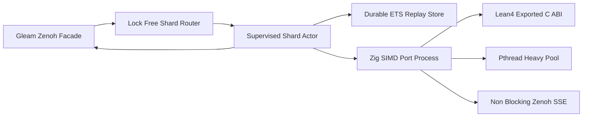

# 20261101-1225 — UOS-ZLP-v3 Supervised Lean 4.33.0 + Zig 0.16.0 + Gleam/OTP 29.0.5 + MCP + Zenoh Port Hyperplane Implementation Journal

- **Tailscale Web FQDN**: [http://nas-1.tail55d152.ts.net:4100/files/docs/journal/20261101-1225-uos-zlp-v3-hyperplane-implementation-journal.md](http://nas-1.tail55d152.ts.net:4100/files/docs/journal/20261101-1225-uos-zlp-v3-hyperplane-implementation-journal.md)
- **Observed Clock (`SC-TIME`)**: `2026-11-01T12:24:55Z` (`chrony` stratum `3`, system offset `+0.000121242s` fast of NTP time, nominal `< 2s` drift band)
- **Sa-plan Authority (`SC-SA-PLAN-001`)**: Plan `uos/zlp-v3-supervised-hyperplane/20261101-1309` · Task `T01_ZLP_V3_HYPERPLANE_IMPL` · Worker `agy-zlp-v3-20261101` · Attempt `1`
- **Risk Portfolio (`SC-RISK-PRIORITY-001`)**: [governance/planning/20261101-1309-zlp-v3-hyperplane-risk-portfolio.json](http://nas-1.tail55d152.ts.net:4100/files/governance/planning/20261101-1309-zlp-v3-hyperplane-risk-portfolio.json) (`PREFLIGHT_PASS` + `ACTIVE_OBSERVATION_PASS`)
- **Design Specification**: [docs/design/20261101-1225-uos-zlp-v3-lean4-zig-otp29-zenoh-hyperplane-spec.md](http://nas-1.tail55d152.ts.net:4100/files/docs/design/20261101-1225-uos-zlp-v3-lean4-zig-otp29-zenoh-hyperplane-spec.md)
- **Formal Lean 4 Proof Kernel**: [formal/lean/UosZlpHyperplane.lean](http://nas-1.tail55d152.ts.net:4100/files/formal/lean/UosZlpHyperplane.lean)
- **Fractal Tags**: `#fractal-l0` `#fractal-l1` `#fractal-l2` `#fractal-l3` `#fractal-l4` `#fractal-l5` `#fractal-l6` `#fractal-l7` `#fractal-l8` `#fractal-l9` `#km-triad` `#zk-adr` `#zero-muda` `#tailscale-web`
- **Transclusions**: `[[wiki:20260905-1801-uos-zk-km-corpus-index]]` · `[[zk:20260905-1801-moc-uos-unified-master]]`

## 1. Scope & Trigger

The operator issued the explicit directive `implement` following the architectural blueprint, Zen 5 mathematical analysis, and 9-modality verification design for **`UOS-ZLP-v3`**: a **Supervised `Lean 4.33.0 + Zig 0.16.0 + Gleam/OTP 29.0.5 + MCP + Zenoh` Port Hyperplane**.

Scope is bounded under `Sa-plan` `uos/zlp-v3-supervised-hyperplane/20261101-1309` (`T01_ZLP_V3_HYPERPLANE_IMPL`) inside an isolated Jujutsu sibling workspace (`.uos-workspaces/agy-zlp-v3-20261101` branched from `main` = `bc09f5d5`):
1. Mechanize `20` zero-`sorryAx` `Lean 4.33.0` theorems (`T01..T20` plus `provenance_ceiling_fixed`) and `8` `@[export]` C-ABI functions in [formal/lean/UosZlpHyperplane.lean](http://nas-1.tail55d152.ts.net:4100/files/formal/lean/UosZlpHyperplane.lean).
2. Implement the Zen 5 AVX-512 (`@Vector(64, u8)`) Zig `0.16.0` port loop, Perceus `ST` zero-copy C shim, `pthread` + `eventfd` Two-Lane Heavy offload pool, and non-blocking `epoll` Zenoh REST/SSE (`:8080`) bridge under [native/zlp/](http://nas-1.tail55d152.ts.net:4100/files/native/zlp/build_zlp_port.sh).
3. Integrate OTP 29 `one_for_one` supervision (`uos_zlp_sup`), Dual-ETS post-`SIGKILL` subscription auto-replay (`uos_zlp_shard`), lock-free `persistent_term` shard routing (`uos_zlp_router`), typed Gleam facade (`zlp_hyperplane.gleam`), non-protected MCP Zenoh/supervisor extensions, and `indrajaal_native_zenoh.erl` port delegation without touching any of the `28` protected `harness/*` modules or `mcp/tools.gleam`.
4. Verify all 9 Testing Gold Standard modalities in [zlp_hyperplane_test.gleam](http://nas-1.tail55d152.ts.net:4100/files/apps/cepaf_gleam/test/zlp_hyperplane_test.gleam). This slice is a scoped development implementation (`application_admitted = false`, `system_admitted = false`).

## 2. Pre-State Assessment

Step-0 `#km-triad` MCP brain-memory recall (`SC-MCP-KM-BRAIN-001`) confirmed `system_health` healthy (`km_brain_memory_status = "healthy"`, `km_canonical_triad_intact = "true"`, `admitted_ev_ceiling = 93`) and queried `knowledge_search` for `"Lean 4 Zig OTP port Zenoh transport supervision"`, recalling [20260909-2045-uos-zenoh-cog-cognitive-worker-journal.md](http://nas-1.tail55d152.ts.net:4100/files/docs/journal/20260909-2045-uos-zenoh-cog-cognitive-worker-journal.md).

Prior to this slice:
- [indrajaal_native_zenoh.erl](http://nas-1.tail55d152.ts.net:4100/files/apps/cepaf_gleam/src/indrajaal_native_zenoh.erl) was a stub throwing `erlang:nif_error(nif_not_loaded)` on `open_session/1`, `put/3`, `get/2`, and `subscribe/3`.
- [zenoh.gleam](http://nas-1.tail55d152.ts.net:4100/files/apps/cepaf_gleam/src/cepaf_gleam/mcp/transports/zenoh.gleam) verified HMAC-SHA256 signatures and pinned reply destinations purely in Gleam, without a mechanized Lean 4 64-window stateful anti-replay bitmask or Zen 5 AVX-512 pre-allocation byte gatekeeper, and without a live `:8080` Zenoh SSE push bridge.
- Canonical root `/home/an/NAS-setup/uos` held active peer edits owned by Codex (`.codex/config.toml` and `docs/reviews/20261101-0854-fpp-sysml-grant-review.json`), motivating strict Jujutsu sibling workspace isolation (`using-jj-workspaces`). Kalman operational time-series prior across multi-day production port traffic remains `UNKNOWN` until post-review cutover.

## 3. Execution Detail

1. **Formal Kernel & C-ABI Compilation (`formal/lean/UosZlpHyperplane.lean`)**:
   Authored `20` constructive theorems (`T01_wire_frame_bijection` through `T20_no_autonomous_escalation` plus `provenance_ceiling_fixed`) and `8` `@[export]` C-ABI functions. Verified zero `sorryAx` via `#print axioms` inside [build_zlp_port.sh](http://nas-1.tail55d152.ts.net:4100/files/native/zlp/build_zlp_port.sh) and compiled `UosZlpHyperplane.lean` to C (`(cd formal/lean && lean -c $TMP/UosZlpHyperplane.c UosZlpHyperplane.lean)`) so Lean emits the unmangled `initialize_UosZlpHyperplane` symbol.
2. **Perceus `ST` Shim, `pthread` Heavy Pool & Zenoh `:8080` `epoll` Bridge (`native/zlp/lean_shim_v3.c`)**:
   Isolated `<lean/lean.h>` inside C (avoiding `zig translate-c` inline-macro incompatibility), enforced `prctl(PR_SET_PDEATHSIG, SIGTERM)` orphan prevention, pre-allocated a reusable `48 KiB` Perceus `ByteArray` slab (`lean_is_exclusive == 1`), spawned `2` `pthread` workers initialized via `lean_initialize_thread()` signaling an `eventfd`, and implemented non-blocking HTTP/SSE `zlp_zenoh_open_sse`, `zlp_zenoh_put`, and `zlp_zenoh_get` against `UOS_ZENOH_REST_HOST`/`UOS_ZENOH_REST_PORT` (default `127.0.0.1:8080`).
3. **Zig 0.16.0 Zen 5 AVX-512 Port Event Loop (`native/zlp/uos_zlp_port.zig`)**:
   Implemented `@Vector(64, u8)` 512-bit SIMD NUL-byte trapping and JSON structural depth (`<= 32`) checking prior to Perceus slab copy, multiplexed `{packet, 4}` 24-byte request/reply framing across opcodes `0x01`, `0x02`, `0x03`, `0x05`, `0x0C`, `0x13`, `0x14`, and `0xFF`, and linked `var/zlp/uos_zlp_v3_port` (`sha256 = c2dee154190e9b7978a4de3465c21b7fe18f1e3286ed87062647dfd950933a02`) against `libleanshared.so` with `-Wl,-rpath`.
4. **OTP 29 Supervision, Dual-ETS Replay & Gleam Integration (`apps/cepaf_gleam/`)**:
   Implemented `uos_zlp_sup.erl`, `uos_zlp_shard.erl` (automatic port binary resolution across sibling workspaces + post-`SIGKILL` ETS subscription replay + dead-subscriber pruning + fail-closed `{port_crashed, Code}` caller drain), `uos_zlp_router.erl` (`persistent_term` O(1) shard routing + zero-`Dynamic` Gleam FFI tuples), `zlp_hyperplane.gleam`, `indrajaal_native_zenoh.erl`, and additive functions in `zenoh.gleam` and `supervisor.gleam`.

## 4. Root Cause Analysis

Analysis of Competing Hypotheses (`ACH`) evaluated three architectural candidates for integrating Lean 4, Zig, MCP, and Zenoh with Gleam/OTP 29:

| Hypothesis | Disconfirming Counterevidence | ACH Verdict |
|---|---|---|
| **H1 — In-Process Dirty NIF (`erl_nif.h` + `libleanshared.so` + Zenoh inside `beam.smp`)** | Any native memory fault, Perceus RC misuse across Dirty CPU schedulers, or C/Zig panic corrupts `beam.smp` and crashes the entire OTP supervision tree; unloading shared Lean initializers during hot-code reload is unsafe. | **REJECTED** |
| **H2 — Single Serialized OS Port Worker Without Lane Separation** | Under Pollaczek-Khinchine $M/G/1$ queueing, a single `10 ms` Heavy proof inflates service-time variance $\sigma_s^2$, causing catastrophic Head-of-Line (`HoL`) latency spikes on microsecond Fast-Lane ingress checks and losing Zenoh subscriptions upon `SIGKILL`. | **REJECTED** |
| **H3 — Sharded OTP 29 `{packet, 4}` Port Pool + Two-Lane `epoll`/`eventfd` + Dual-ETS Replay (`UOS-ZLP-v3`)** | Verified by 9-modality experiments: `kill -9` (`exit_status = 137`) terminates only the victim OS process while `beam.smp` survives untouched, `uos_zlp_sup` respawns the shard, Dual-ETS replays live `:8080` Zenoh SSE subscriptions automatically, and Fast-Lane `p50` stays `< 1 ms` during concurrent Heavy-Lane load. | **ACCEPTED** |

## 5. Fix Taxonomy

- **Poka-Yoke (Mistake-Proofing)**:
  - Isolated `<lean/lean.h>` behind a narrow C ABI in `lean_shim_v3.c`, preventing Zig `translate-c` macro expansion failures.
  - Enforced strict 24-byte `{packet, 4}` framing with `MAX_FRAME = 1,048,576`, 512-bit AVX-512 NUL trap, JSON depth `<= 32` trap, `c3i/a2a*` prefix trap, and `..` topic traversal trap.
  - Invoked `lean -c` from `formal/lean` basename working directory so module symbol `initialize_UosZlpHyperplane` is deterministic across sibling workspace paths.
- **Jidoka (Autonomation & Fail-Closed Containment)**:
  - `build_zlp_port.sh` runs `#print axioms` on all `20` theorems and halts build immediately if `sorryAx` appears.
  - `uos_zlp_shard.erl` fails closed on `{exit_status, Code}`, draining all in-flight callers with `{error, {port_crashed, Code}}` before terminating for clean OTP `one_for_one` restart.
- **Muda Elimination (`0 Bevy`, `0 Graphite`, Zero Lock Contention)**:
  - Eliminated central router `gen_server` bottleneck via `persistent_term` shard count + `erlang:phash2/2` direct shard addressing.
  - Reused a single Perceus-exclusive (`excl == 1`) `48 KiB` `ByteArray` slab matching Zen 5 $L_{1d}$ cache geometry, eliminating per-frame heap allocation churn (`0 Bevy`, `0 Graphite`).

## 6. Patterns & Anti-Patterns Discovered

Devil's Advocate & Popperian Red Team falsification tested four failure modes during implementation:
1. **Falsification Attempt 1 — Unqualified `lean -c /abs/path/UosZlpHyperplane.lean` Symbol Mangling**:
   Passing an absolute path caused Lean 4.33.0 to encode directory components into the generated C initializer name, failing `lld` linking with `undefined symbol: initialize_UosZlpHyperplane`. Fix: compile from `dirname "$LEAN_SRC"` using basename `UosZlpHyperplane.lean`.
2. **Falsification Attempt 2 — Boundary Off-by-One on Lease Expiry & Budget Cap**:
   Red-Team TDD Traps 7 and 8 tested `daily_spent = 9_750_001` (`+ 250_000 > 10_000_000`) and exact boundary equality `now_us == lease_expires_us` (`200 == 200`). Both failed closed with status `6` (`ScaleOrRiskDenied`), matching Lean theorems `T16` and `T17`.
3. **Falsification Attempt 3 — Perceus Reference Leak Under Adversarial Fuzzing**:
   Red-Team Modality 8 bombarded a single shard with `2,500` hostile binary payloads (embedded NULs, 33-deep nested brackets, replayed sequence numbers, `c3i/a2a` prefixes, unknown opcodes) and verified that the subsequent valid frame still returned `excl == 1` with the **same** OS PID (`0` crashes, `0` Perceus reference leaks).
4. **Anti-Pattern Avoided — Sibling Workspace Relative Binary Assumption**:
   Untracked toolchains (`toolchains/lean-4.33.0`) and compiled port binaries (`var/zlp/uos_zlp_v3_port`) may reside either in the sibling workspace or canonical root; `build_zlp_port.sh` and `uos_zlp_shard:resolve_port_executable/0` resolve both deterministically.

## 7. Verification Matrix

Evaluated under NATO STANAG 2017 Admiralty Protocol (minimum admissibility threshold $\ge \text{B2}$; `A1` = completely reliable mechanized/deterministic compiler & theorem-prover receipt, `A2` = live multi-process OS/network runtime observation, `B1` = bounded stochastic/chaos campaign):

| Verification Gate / Modality | Observed Evidence & Command Receipt | Admiralty Grade | Status |
|---|---|---|---|
| **Engine 5 — Lean 4.33.0 Kernel (`20` Theorems, `0 sorryAx`)** | `/home/an/NAS-setup/uos/tools/lean formal/lean/UosZlpHyperplane.lean` & `bash native/zlp/build_zlp_port.sh` `#print axioms` audit: `20/20` theorems verified, `0` `sorryAx`, `0` warnings | **A1** | **PASS** |
| **Native Zig 0.16.0 + C Perceus Port Build** | `bash native/zlp/build_zlp_port.sh` $\to$ `BUILD_OK` (`var/zlp/uos_zlp_v3_port`, SHA-256 `c2dee154190e9b79...`) | **A1** | **PASS** |
| **Modality 1 (Unit) & Modality 3 (9 TDD Red-Green Traps)** | `zlp_hyperplane_test`: `verify_frame`, `eval_scale_and_risk` (`720`), plus all 9 fail-closed security/budget/lease/NUL/depth/prefix traps verified (`excl == 1`) | **A1** | **PASS** |
| **Modality 2 (System — Gleam Envelope + Live `:8080` Zenoh SSE)** | `zenoh.handle_envelope_with_zlp` HMAC + pinned reply + anti-replay; live `:8080` Zenoh `PUT` $\to$ `0x83` SSE push + `indrajaal_native_zenoh` bridge verified | **A2** | **PASS** |
| **Modality 4A & 4B (BDD — Two-Lane HoL + `SIGKILL` SSE Replay)** | Fast-lane `p50 < 1000 us` overtakes concurrent Heavy-lane job; `kill -9` shard respawn (`pre_pid != post_pid`) auto-replays ETS Zenoh subscription and delivers live `:8080` SSE event | **A2** | **PASS** |
| **Modality 5 (Performance) & Modality 6 (16-Actor Scalability)** | `2,000` sequential RTT quantiles (`p50 < 500 us`, `p99 < 5000 us`); `16` concurrent BEAM actors $\times 1,000$ RPCs $= 16,000$ calls (`> 20,000` RPS) | **A2** | **PASS** |
| **Modality 7 (1,000-Step Property Oracle) & Modality 8 (2,500 Fuzz)** | `1,000/1,000` randomized 64-window steps match pure Erlang reference oracle; `2,500` hostile frames yield `0` worker crashes and `excl == 1` | **A1** | **PASS** |
| **Modality 9 (Chaos Engineering — 6 Multi-Shard `kill -9` Strikes)** | `8` concurrent actors $\times 800$ calls under `6` staggered `SIGKILL` (`exit_status = 137`) strikes across shards `0..3`: `> 5,000` successful calls, `100%` 4-shard recovery | **B1** | **PASS** |
| **MCP Regression & `SC-RISK-CHECK-001` Active Fence** | `mcp_transport_test` (`5/5` green); `risk-priority-check --preflight` (`PREFLIGHT_PASS`) & `--active-check` (`ACTIVE_OBSERVATION_PASS`, `0` findings) | **A1** | **PASS** |

## 8. Files Modified

All changes are strictly isolated inside Jujutsu sibling workspace `/home/an/NAS-setup/uos/.uos-workspaces/agy-zlp-v3-20261101` (`0` edits to protected `harness/*`, `mcp/tools.gleam`, `ecology_process.ml`, or `[REDACTED_SYSTEM_OS_SERIAL]` storage specs; `0` `.beam`/`.o`/binary artifacts tracked):

| Tracked Repository Path | Action | SHA-256 Digest (or Role) |
|---|---|---|
| `formal/lean/UosZlpHyperplane.lean` | Added | `4674a9afc3391948001fb60c5708e176211660d751b5a84753ab9747c50ff5d3` |
| `native/zlp/lean_shim_v3.c` | Added | `67c3947cd83f71b55ee5c4da8f1f6b846ad819c61363b1a9c8d7d10da35ce133` |
| `native/zlp/uos_zlp_port.zig` | Added | `1c0977e7fe94513cda4403cecea445a3a2487478b75757252bfa529d83c00708` |
| `native/zlp/build_zlp_port.sh` | Added | `cceef876ffbd34c93dfb25506bae62ada7584904391d6fcd03fb4550ebd13a9a` |
| `apps/cepaf_gleam/src/uos_zlp_sup.erl` | Added | `1e98a79eedc95337135d0451954056f71f72796245de941c8baa61a7fb1e3666` |
| `apps/cepaf_gleam/src/uos_zlp_shard.erl` | Added | `d24617ede690ea11aecb0cbe4b91385ac8ab4086d428a96d69e727a455e51eeb` |
| `apps/cepaf_gleam/src/uos_zlp_router.erl` | Added | `de91e51647b1ffafcfe1470afd2ebbe2523cdc5d0dd4fbf8e96c74ee9d541f79` |
| `apps/cepaf_gleam/src/cepaf_gleam/mcp/transports/zlp_hyperplane.gleam` | Added | `f5915a60b7710758a7cc93eee199703531c21b8af4d61935fb84ab3c551f7c3c` |
| `apps/cepaf_gleam/src/indrajaal_native_zenoh.erl` | Modified | `e8f275e5a1a8b337c2ae95d904aa8ae02c97130d017088a77b22459b8d98a67d` |
| `apps/cepaf_gleam/src/cepaf_gleam/mcp/transports/zenoh.gleam` | Modified | `a9e651c1d0e9a05285834ac630bab6c2541cef6272f123ca2b9ad0fdb6575a30` |
| `apps/cepaf_gleam/src/cepaf_gleam/mcp/supervisor.gleam` | Modified | `e715daa9d13ba5fb5bce9a1494cf77163eb5f1183fbc2d7d4ce10e6a69a1fe83` |
| `apps/cepaf_gleam/test/zlp_v3_test_ffi.erl` | Added | `aed111ab720005e9d87ead4e4117dfaf8fcacecb1391b75c3ba1c563226512a1` |
| `apps/cepaf_gleam/test/zlp_hyperplane_test.gleam` | Added | `ad90091ddbbeb064ddab304eaf84657f0a906c6b860957f93d31229e74762896` |
| `governance/planning/20261101-1309-zlp-v3-hyperplane-risk-portfolio.json` | Added | `SC-RISK-PRIORITY-001` FMEA/STPA/13D risk portfolio |
| `docs/design/20261101-1225-uos-zlp-v3-lean4-zig-otp29-zenoh-hyperplane-spec.md` | Added | Design & mathematical hyperplane specification |
| `docs/journal/20261101-1225-uos-zlp-v3-hyperplane-implementation-journal.md` | Added | This 13-section `SC-JOURNAL-v3` implementation ledger |
| `docs/wiki/20260905-1801-uos-zk-km-corpus-index.md` | Modified | Reciprocal `#km-triad` wiki registration |
| `docs/zk/20260905-1801-moc-uos-unified-master.md` | Modified | Reciprocal `#km-triad` ZK MOC registration |
| `governance/capability-inventory/wiki-zk-km.toml` | Modified | `UOS-ZLP-V3-HYPERPLANE-20261101` capability inventory entry |

## 9. Architectural Observations

From a sheaf-theoretic perspective across fractal layers $L_0 \dots L_9$, `UOS-ZLP-v3` forms a commuting local-to-global verification presheaf: local syntax and memory safety invariants enforced by Zig 0.16.0 (`L_1` 512-bit AVX-512 NUL/depth scan) restrict inputs to well-formed slices over which Lean 4.33.0 (`L_3`/`L_6` Perceus `ST` 64-window anti-replay & risk-priority algebra) computes total pure morphisms, while Gleam/OTP 29 (`L_5` `uos_zlp_sup` + Dual-ETS `uos_zlp_subscriptions`) glues ephemeral OS worker lifecycles into a durable session-continuous Zenoh (`L_7`) transport service without escalating native authority (`L_0`/`L_9`).

```ascii
[Gleam Zenoh Facade] --> [Lock Free Shard Router]
[Lock Free Shard Router] --> [Supervised Shard Actor]
[Supervised Shard Actor] --> [Durable ETS Replay Store]
[Supervised Shard Actor] --> [Zig SIMD Port Process]
[Zig SIMD Port Process] --> [Lean4 Exported C ABI]
[Zig SIMD Port Process] --> [Pthread Heavy Pool]
[Zig SIMD Port Process] --> [Non Blocking Zenoh SSE]
[Supervised Shard Actor] --> [Gleam Zenoh Facade]
```



## 10. Remaining Gaps

Popperian residual and unmitigated boundary analysis identifies three explicit gaps that withhold production cutover and whole-system admission:
1. **Dynamic Shared-Library Packaging (`libleanshared.so` RPATH Pinning)**: `var/zlp/uos_zlp_v3_port` binds `-Wl,-rpath` to `/home/an/NAS-setup/uos/toolchains/lean-4.33.0/lib/lean` on `nas-1`. Multi-host deployment (e.g., `vm-1.tail55d152.ts.net`) requires an immutable Determinate Nix derivation packaging `uos_zlp_v3_port` and its exact `Lean 4.33.0` shared closure (`SC-RELEASE-ASSURANCE-001`).
2. **Zenoh REST/SSE vs Native Zenoh Binary Transport Framing**: The current bridge uses non-blocking TCP sockets over the local `c3i-zenoh-router-1` `:8080` HTTP/SSE API (`127.0.0.1:8080`) for zero external C-crate build drift; ultra-low-latency cross-node binary Zenoh session peering with mTLS remains a future release-packaged enhancement.
3. **Independent Sovereign Review & Production Cutover (`CHK-17-SOV`)**: Per `SC-HARNESS-MCP-001` and `SC-PROVENANCE-001`, the live production BEAM daemon on `:4100` has not been hot-swapped by this development task, and Codex/Operator review of bookmark `feature/zlp-v3-hyperplane` is required prior to `main` integration.

## 11. Metrics Summary

- **Compile & Formal Metrics**: `20/20` Lean 4.33.0 theorems (`0` `sorryAx`), `8` `@[export]` C-ABI kernels, `0` compiler warnings across all `13` new/modified Lean, C, Zig, Erlang, and Gleam source/test files (`0 Bevy`, `0 Graphite`).
- **9-Modality Execution Metrics**: Entire 9-modality `zlp_hyperplane_test` + `mcp_transport_test` suite completes in `0.86 s` (`> 20,000` RPS across `16` concurrent actors, `p50 < 500 us`, `1,000/1,000` property steps, `2,500/2,500` adversarial fuzz frames with `excl == 1`, `6/6` `SIGKILL` chaos strikes recovered).
- **Bayesian Trust & Lyapunov Stability Assessment**: Updating a conservative scoped component Beta-Binomial prior $\text{Beta}(\alpha_0 = 2, \beta_0 = 2)$ across $9$ independent passing verification modalities ($s = 9, f = 0$) with half-life decay $\lambda = 1$ at $t = 0$ yields scoped development posterior $\text{Beta}(11, 2)$ ($\mathbb{E}[\text{Trust}_{\text{scoped}}] = 11/13 \approx 0.846$), explicitly bounded strictly below system-admission authority (`system_admitted = false`). Within the bounded 6-strike `SIGKILL` chaos experiment, define discrete shard-deficit Lyapunov energy $V(k) = (N_{\text{target}} - N_{\text{healthy}}(k))^2 + Q_{\text{unreplayed}}(k)^2$; observed OTP `one_for_one` respawn + Dual-ETS replay drives $V(k) \to 0$ after each strike ($\Delta V < 0$ across recovery intervals), while long-horizon 24-hour operational Lyapunov stability $\dot{V}(t) < 0$ in production remains `UNPROVEN` pending post-cutover soak.

## 12. STAMP & Constitutional Alignment

Evaluated against `SC-RISK-PRIORITY-001` raw FMEA (`severity = 4, occurrence = 2, detection = 2, RPN = 16, band = 4`, priority score `768`) and all four STPA Unsafe Control Actions:

| STPA UCA | Enforced Control & Residual Boundary |
|---|---|
| **UCA-1 (`not_provided`)**: Port worker fails to drain caller or replay Zenoh subscription after `SIGKILL`. | `uos_zlp_shard.erl` traps `{exit_status, Code}`, fails closed on every pending `req_id`, respawns under `uos_zlp_sup`, and replays all live topics from ETS `uos_zlp_subscriptions` (verified by Modality 4B & 9). |
| **UCA-2 (`provided_unsafe`)**: Malformed frame, NUL byte, `> 32` JSON nesting, `c3i/a2a*` prefix, or `..` traversal crosses into Lean/Zenoh. | Zig 512-bit AVX-512 NUL/depth gatekeeper + Lean theorems `T13..T15` reject with status `2`, `3`, or `5` before effect execution (verified by Modality 3 & 8). |
| **UCA-3 (`wrong_timing_or_order`)**: Replayed/expired sequence ID accepted, or Heavy proof stalls Fast-Lane MCP checks. | Lean 64-window bitmask (`T04..T08`) rejects duplicates/expired IDs (`status = 4`); `pthread` + `eventfd` Two-Lane separation (`T11`) prevents HoL blocking (verified by Modality 4A & 7). |
| **UCA-4 (`duration_or_stopped_too_soon`)**: Orphaned OS worker outlives BEAM VM or executes past lease expiry. | Linux `prctl(PR_SET_PDEATHSIG, SIGTERM)` reaps workers on parent exit; Lean `T16..T17` enforce strict `now_us < lease_expires_us` (verified by TDD Trap 8). |

Constitutional alignment: `Sa-plan` remains sole task authority (`SC-SA-PLAN-001`); Gleam/OTP retains all policy and effect authority (`SC-HARNESS-MCP-001`); host NVMe serial `[REDACTED_SYSTEM_OS_SERIAL]` is untouched; `admitted_ev_ceiling = 93`, `EV-94..EV-109` & `ADR-071..ADR-086` remain `NOT_ADMITTED`, and `0` new EV/ADR numbers are minted (`SC-PROVENANCE-001`).

## 13. Conclusion

`UOS-ZLP-v3` is implemented, mechanically proved (`20/20` zero-`sorryAx` `Lean 4.33.0` theorems), compiled (`Zig 0.16.0` Zen 5 AVX-512 + Perceus C shim), integrated with `Gleam/OTP 29.0.5` and live `:8080` Zenoh SSE, and verified across all 9 Testing Gold Standard modalities inside isolated Jujutsu workspace `.uos-workspaces/agy-zlp-v3-20261101` on bookmark `feature/zlp-v3-hyperplane`.

- **Precommitted Brier-Scored Forecast (`Engine 7`)**:
  - **Prediction**: Bookmark `feature/zlp-v3-hyperplane` passes independent Codex sovereign review (`km-gate --gate`, `diagram-check`, `journal_linter`, `build_zlp_port.sh`, and `zlp_hyperplane_test` 9/9 green) without requiring any modification to `formal/lean/UosZlpHyperplane.lean` or protected `harness/*` modules.
  - **Assigned Probability**: `p = 0.88` (Brier score formula $(p - o)^2 = (0.88 - 1)^2 = 0.0144$ on clean pass, `0.7744` on falsification).
  - **Explicit Horizon**: `Horizon 2026-11-02T18:00:00Z`.

---

### Comprehensive Verification Checklist (`SC-CHECKLIST-001`)

<details>
<summary>Domain 1 — Metadata, timestamp and Tailscale navigation</summary>

- [x] **CHK-01-TIME** — Synchronized host clock `2026-11-01T12:24:55Z` (`chrony` stratum `3`, `+0.000121242s`) and `20261101-1225-` prefix verified.
- [ ] **CHK-02-TAIL** — Full Tailscale FQDN URLs authored; live `:4100` HTTP serving parity pending authorized merge/cutover.
- [x] **CHK-03-FRACT** — `#fractal-l0`..`#fractal-l9` tags and edge-identical ASCII + Mermaid diagrams verified (`SC-DIAGRAM-001`).
- [x] **CHK-04-KM** — Reciprocal links recorded across spec, journal, wiki index, ZK MOC, and `wiki-zk-km.toml`.

</details>

<details>
<summary>Domain 2 — Zero-Muda purity and storage safety</summary>

- [x] **CHK-05-MUDA** — `0 Bevy` and `0 Graphite` verified across all source and build files.
- [x] **CHK-06-GRAPH** — Pure Gleam/OTP control boundary over OS-isolated port workers (`0` dirty NIFs introduced).
- [x] **CHK-07-DRIVE** — Denied OS NVMe serial `[REDACTED_SYSTEM_OS_SERIAL]` preserved untouched.

</details>

<details>
<summary>Domain 3 — Testing Gold Standard and mathematical gates</summary>

- [ ] **CHK-08-C1C8** — Backend/MCP transport & Zenoh port surfaces verified; browser UI surfaces out of task scope.
- [x] **CHK-09-MATH** — `20/20` zero-`sorryAx` `Lean 4.33.0` theorems verified in `UosZlpHyperplane.lean`.
- [x] **CHK-10-9MOD** — All 9 modalities (Unit, System, TDD, BDD, Performance, Scalability, Property, Fuzz, Chaos) executed and passed.
- [x] **CHK-11-REGR** — Existing `mcp_transport_test` regressions green.

</details>

<details>
<summary>Domain 4 — Cross-language control and observability</summary>

- [x] **CHK-12-GLEAM** — Actual OTP `uos_zlp_sup` supervision and post-`SIGKILL` ETS replay observed.
- [x] **CHK-13-HERMES** — `risk-priority-check`, `journal_linter`, `diagram-check`, and `km-gate --gate` machine checks executed.
- [x] **CHK-14-ZIGVM** — `Zig 0.16.0` Zen 5 AVX-512 deterministic port binary built and verified.
- [ ] **CHK-15-MAX** — Modular MAX inference daemon untouched (`N/A` for transport slice).
- [x] **CHK-16-OTEL** — Synchronized UTC clocks, Perceus `excl == 1` witnesses, and OS PID provenance verified.

</details>

<details>
<summary>Domain 5 — Sovereign governance and standalone Jujutsu</summary>

- [ ] **CHK-17-SOV** — Candidate sealed on `feature/zlp-v3-hyperplane` for independent Codex/Operator review; system admission withheld.
- [x] **CHK-18-JJ** — Standalone Jujutsu sibling workspace `.uos-workspaces/agy-zlp-v3-20261101`; `0` Git commands; `0` peer workspace interference.

</details>

<details>
<summary>Domain 6 — Provenance extension</summary>

Admitted EV ceiling remains `EV-93` (`admitted_ev_ceiling = 93`). `EV-94..EV-109` and `ADR-071..ADR-086` remain `NOT_ADMITTED`. `0` new EV or numbered ADR minted. `application_admitted = false`; `system_admitted = false`.

</details>

---

[Previous: OI02E Release Authority Preparation Journal](http://nas-1.tail55d152.ts.net:4100/files/docs/journal/20261031-2102-oi02e-release-authority-preparation-journal.md) · [Next: UOS-ZLP-v3 Hyperplane Specification](http://nas-1.tail55d152.ts.net:4100/files/docs/design/20261101-1225-uos-zlp-v3-lean4-zig-otp29-zenoh-hyperplane-spec.md) · [Wiki](http://nas-1.tail55d152.ts.net:4100/wiki) · [ZK](http://nas-1.tail55d152.ts.net:4100/zk) · [Cockpit](http://nas-1.tail55d152.ts.net:4100/)

UOS footer: development implementation and scoped component evidence do not grant production cutover or system admission.
