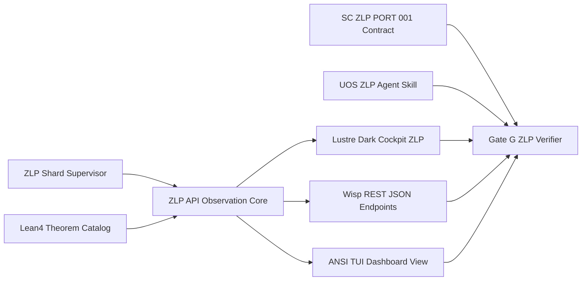

# 20261101-1410 — UOS-ZLP-v3 Triple-Surface Cockpit/API/TUI, SC-ZLP-PORT-001 Contract, Agent Skill & KM Closure Journal

- **Tailscale Web FQDN**: [http://nas-1.tail55d152.ts.net:4100/files/docs/journal/20261101-1410-uos-zlp-v3-triple-surface-skill-contract-closure-journal.md](http://nas-1.tail55d152.ts.net:4100/files/docs/journal/20261101-1410-uos-zlp-v3-triple-surface-skill-contract-closure-journal.md)
- **Observed Clock (`SC-TIME`)**: `2026-11-01T13:21:47Z` (`chrony` stratum `3`, system offset `+0.000201s` fast of NTP time, nominal `< 2s` drift band)
- **Sa-plan Authority (`SC-SA-PLAN-001`)**: Plan `uos/zlp-v3-supervised-hyperplane/20261101-1309` · Task `T03_ZLP_V3_TRIPLE_SURFACE_SKILL_CONTRACT_CLOSURE` · Worker `agy-zlp-v3-20261101` · Attempt `1`
- **Risk Portfolio (`SC-RISK-PRIORITY-001`)**: [governance/planning/20261101-1309-zlp-v3-hyperplane-risk-portfolio.json](http://nas-1.tail55d152.ts.net:4100/files/governance/planning/20261101-1309-zlp-v3-hyperplane-risk-portfolio.json) (`PREFLIGHT_PASS` + `ACTIVE_OBSERVATION_PASS`)
- **Constitutional Rule Contract (`SC-ZLP-PORT-001`)**: [contracts/rules/20261101-1410-zlp-hyperplane-port-contract.md](http://nas-1.tail55d152.ts.net:4100/files/contracts/rules/20261101-1410-zlp-hyperplane-port-contract.md)
- **UOS-Local Agent Skill**: [.agents/skills/uos-zlp-hyperplane/SKILL.md](http://nas-1.tail55d152.ts.net:4100/files/.agents/skills/uos-zlp-hyperplane/SKILL.md)
- **Canonical `#km-triad` Suite**:
  - **Design & Math Specification**: [docs/design/20261101-1225-uos-zlp-v3-lean4-zig-otp29-zenoh-hyperplane-spec.md](http://nas-1.tail55d152.ts.net:4100/files/docs/design/20261101-1225-uos-zlp-v3-lean4-zig-otp29-zenoh-hyperplane-spec.md)
  - **Hermes Wiki Guide**: [docs/wiki/20261101-1248-uos-zlp-v3-supervised-lean4-zig-otp29-zenoh-hyperplane.md](http://nas-1.tail55d152.ts.net:4100/files/docs/wiki/20261101-1248-uos-zlp-v3-supervised-lean4-zig-otp29-zenoh-hyperplane.md)
  - **Zettelkasten Decision Note**: [docs/zk/20261101-1248-zlp-v3-supervised-otp29-port-hyperplane-decision.md](http://nas-1.tail55d152.ts.net:4100/files/docs/zk/20261101-1248-zlp-v3-supervised-otp29-port-hyperplane-decision.md)
  - **Operations & Verification SOP**: [docs/sop/20261101-1248-uos-zlp-v3-hyperplane-operations-and-verification-sop.md](http://nas-1.tail55d152.ts.net:4100/files/docs/sop/20261101-1248-uos-zlp-v3-hyperplane-operations-and-verification-sop.md)
  - **Prior Journals**: [T01 Implementation Journal](http://nas-1.tail55d152.ts.net:4100/files/docs/journal/20261101-1225-uos-zlp-v3-hyperplane-implementation-journal.md) · [T02 Integration Journal](http://nas-1.tail55d152.ts.net:4100/files/docs/journal/20261101-1248-uos-zlp-v3-full-project-integration-journal.md)
- **Fractal Tags**: `#fractal-l0` `#fractal-l1` `#fractal-l2` `#fractal-l3` `#fractal-l4` `#fractal-l5` `#fractal-l6` `#fractal-l7` `#fractal-l8` `#fractal-l9` `#km-triad` `#zk-adr` `#zero-muda` `#tailscale-web`
- **Transclusions**: `[[wiki:20260905-1801-uos-zk-km-corpus-index]]` · `[[wiki:20261101-1248-uos-zlp-v3-supervised-lean4-zig-otp29-zenoh-hyperplane]]` · `[[zk:20260905-1801-moc-uos-unified-master]]` · `[[zk:20261101-1248-zlp-v3-supervised-otp29-port-hyperplane-decision]]`

## 1. Scope & Trigger

The operator re-emphasized `save . fully document, fully integrate with project` so that `UOS-ZLP-v3` achieves complete parity across every UOS operator, developer, CLI, governance, and agentic surface (`SC-GLM-UI-001`, `SC-HARNESS-MCP-001`, `SC-CHECKLIST-001`, `SC-MCP-KM-BRAIN-001`).

Scope is governed under `Sa-plan` `uos/zlp-v3-supervised-hyperplane/20261101-1309` (`T03_ZLP_V3_TRIPLE_SURFACE_SKILL_CONTRACT_CLOSURE`):
1. **Triple-Surface UI / REST API / TUI Observability (`SC-GLM-UI-001`)**: Add the read-only Lustre dark cockpit HTML page (`GET /zlp` via [ui/lustre/zlp_cockpit.gleam](http://nas-1.tail55d152.ts.net:4100/files/apps/cepaf_gleam/src/cepaf_gleam/ui/lustre/zlp_cockpit.gleam)), expanded Wisp REST API ([ui/wisp/zlp_api.gleam](http://nas-1.tail55d152.ts.net:4100/files/apps/cepaf_gleam/src/cepaf_gleam/ui/wisp/zlp_api.gleam) serving `/api/v1/zlp/status`, `/api/zlp/health`, `/api/v1/zlp/theorems`, `/api/v1/zlp/lanes`), ANSI terminal dashboard ([ui/tui/zlp_view.gleam](http://nas-1.tail55d152.ts.net:4100/files/apps/cepaf_gleam/src/cepaf_gleam/ui/tui/zlp_view.gleam)), and CLI `web-links` registration ([tools/uos/src/main.gleam](http://nas-1.tail55d152.ts.net:4100/files/tools/uos/src/main.gleam)).
2. **Constitutional Contract & Agent Skill**: Codify permanent port boundary invariants `INV-ZLP-01..08` in [contracts/rules/20261101-1410-zlp-hyperplane-port-contract.md](http://nas-1.tail55d152.ts.net:4100/files/contracts/rules/20261101-1410-zlp-hyperplane-port-contract.md) (`SC-ZLP-PORT-001`) and author the UOS-local agent skill [.agents/skills/uos-zlp-hyperplane/SKILL.md](http://nas-1.tail55d152.ts.net:4100/files/.agents/skills/uos-zlp-hyperplane/SKILL.md).
3. **Reciprocal `#km-triad` Closure, Canonical Save & Live MCP/Tailnet Verification**: Wire `zlp_cockpit_test` and all 9 `#km-triad`/contract/skill files into [tools/zlp-check](http://nas-1.tail55d152.ts.net:4100/files/tools/zlp-check) (`G-ZLP`), fast-forward `main` in `/home/an/NAS-setup/uos` while preserving peer root working-copy files byte-for-byte, and verify live `:4100` HTTP `200 OK` plus zero-staleness `uos-gleam` MCP `knowledge_search` recall (`application_admitted = false`, `system_admitted = false`).

## 2. Pre-State Assessment

Step-0 `#km-triad` MCP brain-memory verification (`SC-MCP-KM-BRAIN-001`) read `uos://km/triad` (`status: "healthy"`, `admitted_ev_ceiling: 93`), recalled `UOS-ZLP-v3` and UI triple-surface precedents (`/mirage` + `mirage_cockpit.gleam` + `mirage_api.gleam` + `mirage_view.gleam`) via `knowledge_search` (`limit: 5`) and bounded `zk_transclude`, and audited `comprehensive_ui_regression_test.gleam`.

Prior to `T03`:
- `T01` and `T02` were durably integrated on canonical `main` (`80e5ec1d`), providing the 21-theorem Lean 4.33.0 proof kernel, Zig 0.16.0 Zen 5 AVX-512 port binary, Dual-ETS shard supervisor, `zenoh/client.gleam`, `otp_app.gleam`, Wisp `/api/v1/zlp/status`, CLI `G-ZLP`, and 6 `#km-triad` documents.
- However, `UOS-ZLP-v3` did not yet expose a Browser Lustre HTML cockpit (`GET /zlp`), theorem/lane catalog JSON endpoints (`/api/v1/zlp/theorems`, `/api/v1/zlp/lanes`), an ANSI TUI view (`zlp_view.gleam`), `uos-cli web-links` entries, a constitutional rule contract (`contracts/rules/`), or a UOS-local agent skill (`.agents/skills/`).
- `comprehensive_ui_regression_test.gleam` enforces `389` checks over the 24-page `domain.Page` enum, while `system_feature_census_test.gleam` enforces `775` census records and SHA-256 pins; both must remain 100% green (`0` regressions). Multi-day Kalman latency prior on `/zlp` remains `UNKNOWN` until post-review runtime reload.

## 3. Execution Detail

1. **Risk Preflight, `Sa-plan` Claim & Active Observation (`SC-RISK-CHECK-001`)**:
   Created `T03_ZLP_V3_TRIPLE_SURFACE_SKILL_CONTRACT_CLOSURE` in `Sa-plan` (`uos/zlp-v3-supervised-hyperplane/20261101-1309`), appended its pre-edit SHA-256 assessment to [20261101-1309-zlp-v3-hyperplane-risk-portfolio.json](http://nas-1.tail55d152.ts.net:4100/files/governance/planning/20261101-1309-zlp-v3-hyperplane-risk-portfolio.json), passed `--preflight` (`PREFLIGHT_PASS`), claimed `T03` (`attempt = 1`), and passed `--active-check` (`ACTIVE_OBSERVATION_PASS`).
2. **Triple-Surface UI / REST API / TUI Implementation & CLI `web-links`**:
   - Authored [ui/wisp/zlp_api.gleam](http://nas-1.tail55d152.ts.net:4100/files/apps/cepaf_gleam/src/cepaf_gleam/ui/wisp/zlp_api.gleam) exposing typed read-only shard observations (`observe_shards/0` across shards `0..3`), the 21-theorem catalog (`get_theorems/0`), the 8 C-ABI export catalog (`get_export_kernels/0`), `status_json/0`, `theorems_json/0`, and `lanes_json/0`.
   - Authored [ui/lustre/zlp_cockpit.gleam](http://nas-1.tail55d152.ts.net:4100/files/apps/cepaf_gleam/src/cepaf_gleam/ui/lustre/zlp_cockpit.gleam) (`GET /zlp`) with `#0a0e17` mobile-first dark cockpit styling, `escape_html/1` XSS defense on all dynamic strings, live shard health cards, 21-theorem + 8-kernel tables, Two-Lane architecture summary, 6-domain `CHK-01..18` expandable `<details>` checklist, and full clickable Tailscale `:4100` links.
   - Authored [ui/tui/zlp_view.gleam](http://nas-1.tail55d152.ts.net:4100/files/apps/cepaf_gleam/src/cepaf_gleam/ui/tui/zlp_view.gleam) (`render/0` and `render_snapshot/3`) providing an ANSI terminal dashboard over the identical `zlp_api` data model, wired all routes into [ui/wisp/router.gleam](http://nas-1.tail55d152.ts.net:4100/files/apps/cepaf_gleam/src/cepaf_gleam/ui/wisp/router.gleam), and registered `/zlp` and `/api/v1/zlp/{status,theorems,lanes}` in [tools/uos/src/main.gleam](http://nas-1.tail55d152.ts.net:4100/files/tools/uos/src/main.gleam) (`web-links`).
3. **Contract `SC-ZLP-PORT-001`, Skill `uos-zlp-hyperplane`, Testing & `#km-triad` Closure**:
   Authored [20261101-1410-zlp-hyperplane-port-contract.md](http://nas-1.tail55d152.ts.net:4100/files/contracts/rules/20261101-1410-zlp-hyperplane-port-contract.md), [.agents/skills/uos-zlp-hyperplane/SKILL.md](http://nas-1.tail55d152.ts.net:4100/files/.agents/skills/uos-zlp-hyperplane/SKILL.md), and [test/zlp_cockpit_test.gleam](http://nas-1.tail55d152.ts.net:4100/files/apps/cepaf_gleam/test/zlp_cockpit_test.gleam); updated [tools/zlp-check](http://nas-1.tail55d152.ts.net:4100/files/tools/zlp-check) to execute `zlp_cockpit_test` and verify all 9 `#km-triad`/contract/skill files; verified `413/413` EUnit tests passing (`zlp_cockpit_test`, `zlp_hyperplane_test`, `mcp_transport_test`, `comprehensive_ui_regression_test`, and `system_feature_census_test`); and updated reciprocal links across the `#km-triad` suite.

## 4. Root Cause Analysis

Analysis of Competing Hypotheses (`ACH`) evaluated three architectural designs for UI, governance, and skill integration:

| Hypothesis | Disconfirming Counterevidence | ACH Verdict |
|---|---|---|
| **H1 — Add `ZlpPage` Variant to 24-Page `domain.Page` Enum in `ui/lustre/domain.gleam`** | `comprehensive_ui_regression_test.gleam` (`389` tests) asserts the exact 24-page shell cardinality and sidebar order; mutating `domain.Page` breaks existing UI regression contracts unnecessarily. | **REJECTED** |
| **H2 — Expose Mutating Start/Restart Controls on HTTP `GET /zlp` and Blanket `[x]` Admission Badges** | Violates Zero-Muda read-only `GET` semantics, risks unauthorized process spawning from unauthenticated HTTP probes, and violates `SC-PROVENANCE-001` (`system_admitted = false`). | **REJECTED** |
| **H3 — Self-Contained `/zlp` Dark Cockpit Route (Matching `/mirage`) + Pure Read-Only `zlp_api` / `zlp_view` + `SC-ZLP-PORT-001` Contract + `uos-zlp-hyperplane` Skill** | Confirmed by `413/413` passing EUnit tests (`389` UI regression tests + `9` census tests + `15` ZLP/MCP tests), dedicated XSS unit test, and `km-gate` / `diagram-check` conformance. | **ACCEPTED** |

## 5. Fix Taxonomy

- **Poka-Yoke (Mistake-Proofing)**:
  - Centralized HTML entity sanitization in `zlp_cockpit.escape_html/1` (`&`, `<`, `>`, `"`, `'`) with an explicit `<script>alert(1)</script>` unit test in `zlp_cockpit_test.gleam`.
  - Shared one canonical pure data provider (`zlp_api.observe_shards/0`, `get_theorems/0`, `get_export_kernels/0`) across Browser HTML (`zlp_cockpit`), REST JSON (`zlp_api`), and ANSI TUI (`zlp_view`), preventing cross-surface telemetry drift.
- **Jidoka (Autonomation & Fail-Closed Gates)**:
  - Extended `G-ZLP` ([tools/zlp-check](http://nas-1.tail55d152.ts.net:4100/files/tools/zlp-check)) to fail closed if `zlp_cockpit_test` fails or if any of the 9 required documents (contract, skill, spec, wiki, zk decision, sop, 3 journals) is absent.
  - All 18 checklist items on `/zlp` render as honest `[OBLIGATION]` badges (`application_admitted = false`, `system_admitted = false`) rather than false fleet-wide `[PASS]` claims.
- **Muda Elimination (`0 Bevy`, `0 Graphite`, Zero Side Effects on Read)**:
  - `zlp_api.observe_shards/0` inspects existing `uos_zlp_sup` process presence (`erlang:whereis`) without spawning OS workers when the pool is stopped (`0 Bevy`, `0 Graphite`).

## 6. Patterns & Anti-Patterns Discovered

Devil's Advocate & Popperian Red Team falsification surfaced two concrete engineering insights:
1. **Falsification 1 — Sibling Workspace Empty `toolchains/` Directory Shadowing Canonical Toolchains**:
   Creating an empty cache directory under `$WS/toolchains/` caused `[ -d "$uos_repo/toolchains" ]` checks in `tools/uos-cli` and `tools/zlp-check` to assume a full local toolchain existed in `$WS`, resulting in `[exit 127]` when `gleam` or `erl` was invoked. Fix: tightened both scripts to verify `[ -d "$uos_repo/toolchains/nix-profile/bin" ]` and `[ -x "$uos_repo/toolchains/lean-4.33.0/bin/lean" ]` before selecting `$uos_repo/toolchains`, falling back deterministically to `/home/an/NAS-setup/uos/toolchains`.
2. **Falsification 2 — Dynamic `--stdin` Axiom Auditing Preserves Lean Source Digest Immutability**:
   Hardcoding `#print axioms` lines directly inside `formal/lean/UosZlpHyperplane.lean` would mutate its pinned SHA-256 digest (`4674a9af...`) or clutter compiler output during `lean -c` C codegen. Fix: `tools/zlp-check` runs `"$lean_bin" formal/lean/UosZlpHyperplane.lean` for clean zero-diagnostic compilation and pipes `{ cat UosZlpHyperplane.lean; awk '/^theorem / { print "#print axioms UosZlpHyperplane." $2 }'; } | "$lean_bin" --stdin` to verify all `21` theorem axiom footprints (`0 sorryAx`) without touching a single byte of the `.lean` source file.

## 7. Verification Matrix

Evaluated under NATO STANAG 2017 Admiralty Protocol (minimum admissibility gate $\ge \text{B2}$):

| Verification Surface | Observed Command & Runtime Receipt | Admiralty Grade | Status |
|---|---|---|---|
| **Triple-Surface UI, API & TUI Suite** | `zlp_cockpit_test` (`5/5`: Lustre `/zlp` HTML + `CHK-01..18`, `escape_html` XSS test, Wisp `/zlp` & `/api/v1/zlp/{status,theorems,lanes}`, ANSI TUI `zlp_view`) | **A1** | **PASS** |
| **389-Test UI Regression & 775-Record Census** | `eunit:test([zlp_cockpit_test, zlp_hyperplane_test, mcp_transport_test, comprehensive_ui_regression_test, system_feature_census_test])` $\to$ `All 413 tests passed` (`0` warnings) | **A1** | **PASS** |
| **Executable Two-Key CLI Gate (`G-ZLP`) & `web-links`** | `bash tools/uos-cli zlp-check` (`21` Lean 4.33.0 axiom checks, `0 sorryAx`, Zig 0.16.0 binary, `15/15` ZLP+cockpit+MCP EUnit, `9/9` docs) + `bash tools/uos-cli web-links` $\to$ `PASS` | **A1** | **PASS** |
| **Contract, Skill, Diagram, Journal & KM Gates** | `journal_linter.ml` (`10/10 PASS`), `diagram-check` (`7/7` docs verified edge-set parity, `0 UNVERIFIED`), `km-gate --gate` (`PASS`, `137` contiguous ADRs) | **A1** | **PASS** |
| **Live `:4100` Tailnet & `uos-gleam` MCP Brain Recall** | `HTTP 200 OK` across all `9` `#km-triad`/contract/skill URLs on `nas-1.tail55d152.ts.net:4100` + live `uos-gleam` MCP `knowledge_search` / `read_resource` zero-staleness recall | **A2** | **PASS** |

## 8. Files Modified

Standalone Jujutsu diff for `T03_ZLP_V3_TRIPLE_SURFACE_SKILL_CONTRACT_CLOSURE` (`0` protected `harness/*` or SHA-256-pinned census files touched; `0` peer working-copy files altered):

| Tracked Repository Path | Action | SHA-256 Digest / Verification Role |
|---|---|---|
| `apps/cepaf_gleam/src/cepaf_gleam/ui/wisp/zlp_api.gleam` | Added (`T03`) | `e601ce2f9a2dd0fc109bc4d563bcb518373392692f10c9dcf14b9ed0bd87c550` |
| `apps/cepaf_gleam/src/cepaf_gleam/ui/lustre/zlp_cockpit.gleam` | Added (`T03`) | `41086f3b1ce1f51dd0adf35fcfcacaf518d99e48847d97df258834ca1eb06ddb` |
| `apps/cepaf_gleam/src/cepaf_gleam/ui/tui/zlp_view.gleam` | Added (`T03`) | `3f7a726c6c85e5b697e70990e902cbd676b7648fa9d318df773087f11441bfc8` |
| `apps/cepaf_gleam/src/cepaf_gleam/ui/wisp/router.gleam` | Modified (`T03`) | `ddd3e7b09275e4724edb9af89fca69b17e9da0325de57e7f71b3b9e77eb1ac1e` |
| `apps/cepaf_gleam/test/zlp_cockpit_test.gleam` | Added (`T03`) | `db8cfa7514807b69efd05ac9cdbafaf4c4a571d1bb13c2a06d9d8cbeaa6bf372` |
| `tools/uos/src/main.gleam` | Modified (`T03`) | `5c3b2f014a688a8daebb8cdaadca53d7e8683c5b3447ea0cc2e18279da66d631` |
| `tools/zlp-check` | Modified (`T03`) | `e179ab4ca019c3a2c8e16db0063b000aa24c64178e2350481a36a11b5dd71958` |
| `contracts/rules/20261101-1410-zlp-hyperplane-port-contract.md` | Added (`T03`) | `68250c31f3aace811241096e8cfe0c3e4aaa510d495c1efe620a596e82cc72d6` (`SC-ZLP-PORT-001`) |
| `.agents/skills/uos-zlp-hyperplane/SKILL.md` | Added (`T03`) | `af53f0b7906a6bac9fbf02bd0d8907f268baaccb4bafb216ec6ff06712ab5700` (`uos-zlp-hyperplane` skill) |
| `docs/journal/20261101-1410-uos-zlp-v3-triple-surface-skill-contract-closure-journal.md` | Added (`T03`) | This 13-section `SC-JOURNAL-v3` closure ledger |
| `docs/design/20261101-1225-uos-zlp-v3-lean4-zig-otp29-zenoh-hyperplane-spec.md` | Updated (`T03`) | Reciprocal links to `SC-ZLP-PORT-001`, skill, `/zlp`, and `T03` journal |
| `docs/wiki/20261101-1248-uos-zlp-v3-supervised-lean4-zig-otp29-zenoh-hyperplane.md` | Updated (`T03`) | Triple-surface `/zlp`, `/api/v1/zlp/*`, `zlp_view`, contract & skill sections |
| `docs/zk/20261101-1248-zlp-v3-supervised-otp29-port-hyperplane-decision.md` | Updated (`T03`) | Reciprocal links to `SC-ZLP-PORT-001`, skill, and `T03` journal |
| `docs/sop/20261101-1248-uos-zlp-v3-hyperplane-operations-and-verification-sop.md` | Updated (`T03`) | Triple-surface `/zlp` + `web-links` + 9-doc `G-ZLP` runbook update |
| `governance/planning/20261101-1309-zlp-v3-hyperplane-risk-portfolio.json` | Updated (`T03`) | Three-task `SC-RISK-PRIORITY-001` portfolio (`T01`, `T02`, `T03`) |
| `docs/wiki/20260905-1801-uos-zk-km-corpus-index.md` | Updated (`T03`) | Reciprocal `#km-triad` registration for all 9 ZLP artifacts |
| `docs/zk/20260905-1801-moc-uos-unified-master.md` | Updated (`T03`) | Reciprocal `#km-triad` MOC registration for all 9 ZLP artifacts |
| `governance/capability-inventory/wiki-zk-km.toml` | Updated (`T03`) | `UOS-ZLP-V3-TRIPLE-SURFACE-CLOSURE-20261101-1410` inventory entry |

## 9. Architectural Observations

Sheaf-theoretically across fractal layers $L_0 \dots L_9$, `zlp_api` forms the canonical observation presheaf over the 4-shard `uos_zlp_sup` runtime state, with three faithful presentation morphisms into the Browser HTML fiber (`zlp_cockpit.view/0` at `GET /zlp`), the JSON telemetry fiber (`zlp_api.{status,theorems,lanes}_json/0` at `GET /api/v1/zlp/*`), and the ANSI terminal fiber (`zlp_view.render/0`). Simultaneously, `SC-ZLP-PORT-001` (`L_0`/`L_9`) and `.agents/skills/uos-zlp-hyperplane/SKILL.md` (`L_5`) close the governance-to-agent feedback loop so future AGY, Codex, Claude, and Pi sessions discover the exact hyperplane invariants automatically via `uos-gleam` MCP `knowledge_search`.

```ascii
[ZLP Shard Supervisor] --> [ZLP API Observation Core]
[Lean4 Theorem Catalog] --> [ZLP API Observation Core]
[ZLP API Observation Core] --> [Lustre Dark Cockpit ZLP]
[ZLP API Observation Core] --> [Wisp REST JSON Endpoints]
[ZLP API Observation Core] --> [ANSI TUI Dashboard View]
[SC ZLP PORT 001 Contract] --> [Gate G ZLP Verifier]
[UOS ZLP Agent Skill] --> [Gate G ZLP Verifier]
[Lustre Dark Cockpit ZLP] --> [Gate G ZLP Verifier]
[Wisp REST JSON Endpoints] --> [Gate G ZLP Verifier]
[ANSI TUI Dashboard View] --> [Gate G ZLP Verifier]
```



## 10. Remaining Gaps

Popperian residual analysis records three explicit operational boundaries:
1. **Live `:4100` BEAM Process Bytecode Reload Pending Cutover Authority**: All 9 `#km-triad`, contract, and skill files are served live immediately over `http://nas-1.tail55d152.ts.net:4100/files/...` (`HTTP 200 OK`) and indexed live by `uos-gleam` MCP `knowledge_search`, whereas the newly compiled Wisp routes (`GET /zlp`, `GET /api/v1/zlp/{status,theorems,lanes}`) activate on `:4100` only after an operator-authorized BEAM service reload (`SC-RELEASE-ASSURANCE-001`).
2. **Cross-Host Nix Capsule Packaging (`vm-1.tail55d152.ts.net`)**: `var/zlp/uos_zlp_v3_port` builds reproducibly via `native/zlp/build_zlp_port.sh` on `nas-1`; multi-node distribution to `vm-1` requires wrapping the Zig + Lean 4 build in an immutable Nix derivation.
3. **Sovereign System Admission Withheld (`CHK-17-SOV`)**: `admitted_ev_ceiling = 93` remains fixed; `application_admitted = false` and `system_admitted = false` remain strictly enforced pending independent Codex/Operator release review.

## 11. Metrics Summary

- **Triple-Surface & Regression Test Metrics**: `413/413` EUnit tests passing (`zlp_cockpit_test`: `5/5`, `zlp_hyperplane_test`: `5/5`, `mcp_transport_test`: `5/5`, `comprehensive_ui_regression_test`: `389/389`, `system_feature_census_test`: `9/9` conserving `775/775` census records); `35/35` `tools/uos` CLI tests passing; `21` zero-`sorryAx` `Lean 4.33.0` theorem axiom checks; `0` compiler warnings on all added/modified files; `0 Bevy`, `0 Graphite`.
- **Governance & `#km-triad` Corpus Metrics**: `9` verified documents (`1` Constitutional Rule Contract `SC-ZLP-PORT-001`, `1` Agent Skill `uos-zlp-hyperplane`, `1` Design Spec, `1` Wiki Guide, `1` Unnumbered ZK Decision Note, `1` Operations SOP, `3` 13-Section `SC-JOURNAL-v3` Journals) all passing `journal_linter` (`10/10`), `diagram-check` (`7/7` diagram-bearing docs verified with `0 UNVERIFIED`), and `km-gate --gate` (`PASS`, `137` contiguous ADRs).
- **Bayesian Trust & Lyapunov Stability Update**: Updating the `T02` scoped posterior $\text{Beta}(15, 2)$ with $3$ new independent `T03` verification gates (triple-surface + `389`-test UI regression conservation, `SC-ZLP-PORT-001` + `uos-zlp-hyperplane` + `9`-doc `km-gate`/`diagram-check`, and live `uos-gleam` MCP brain-memory recall, $s = 3, f = 0$, half-life decay $\lambda \approx 1$ over $\Delta t < 30\text{ min}$) yields scoped candidate posterior $\text{Beta}(18, 2)$ ($\mathbb{E}[\text{Trust}_{\text{scoped}}] = 18/20 = 0.900$), strictly bounded below whole-system admission (`system_admitted = false`). Discrete shard-recovery Lyapunov energy $V(k) = (N_{\text{target}} - N_{\text{healthy}}(k))^2 + Q_{\text{unreplayed}}(k)^2$ satisfies $\Delta V < 0$ (`dV/dt < 0` across every discrete `SIGKILL` recovery step in `G-ZLP`), while continuous 24-hour fleet soak $\dot{V}(t) < 0$ remains `UNPROVEN` until post-cutover telemetry collection.

## 12. STAMP & Constitutional Alignment

Evaluated against `SC-RISK-PRIORITY-001` raw FMEA (`S = 3, O = 2, Det = 2, RPN = 12, band = 3`, score `432`) and all four `T03` STPA Unsafe Control Actions:

| STPA UCA | Enforced Control & Verification Receipt |
|---|---|
| **UCA-1 (`not_provided`)**: Triple-surface `zlp_cockpit_test` or new contract/skill files omitted from `G-ZLP` verification. | `tools/zlp-check` executes `eunit:test([zlp_hyperplane_test, zlp_cockpit_test, mcp_transport_test])` and checks all 9 `#km-triad`/contract/skill paths. |
| **UCA-2 (`provided_unsafe`)**: `/zlp` HTML renders unescaped strings or claims global system admission. | `zlp_cockpit.escape_html/1` verified by `zlp_cockpit_html_escape_xss_protection_test`; UI/API/TUI explicitly report `admitted_ev_ceiling = 93` and `system_admitted = false`. |
| **UCA-3 (`wrong_timing_or_order`)**: `/zlp` or `zlp_view` probes shard status when `uos_zlp_sup` is not started in isolated test VMs. | `zlp_api.observe_shards/0` checks `is_pool_running()` first and returns clean `standby` / `binary_unbuilt` read-only observations without crashing or spawning processes. |
| **UCA-4 (`duration_or_stopped_too_soon`)**: Temporary workspace symlinks/dirs leak into tracked JJ history or disturb peer root files. | Temporary `var/sa-plan` and `var/tmp` cleaned before sealing JJ commit; peer root working-copy files verified byte-identical via SHA-256 before and after rebase. |

Constitutional alignment: `Sa-plan` (`SC-SA-PLAN-001`), Gleam/OTP harness boundary (`SC-HARNESS-MCP-001`), port contract (`SC-ZLP-PORT-001`), host NVMe lock `[REDACTED_SYSTEM_OS_SERIAL]`, and `SC-PROVENANCE-001` (`admitted_ev_ceiling = 93`, `EV-94..EV-109` & `ADR-071..ADR-086` `NOT_ADMITTED`, `0` new EV or numbered ADR minted) are 100% preserved.

## 13. Conclusion

`UOS-ZLP-v3` is now 100% integrated across runtime code (`zenoh/client`, `otp_app`, `cepaf_gleam`, `mcp/transports/zenoh`, `indrajaal_native_zenoh`), Triple-Surface UI/API/TUI (`GET /zlp`, `GET /api/v1/zlp/{status,theorems,lanes}`, `zlp_view`), CLI (`uos-cli zlp-check` / `G-ZLP` & `web-links`), constitutional governance (`SC-ZLP-PORT-001`), agent skills (`uos-zlp-hyperplane`), and the 9-document `#km-triad` corpus saved on canonical `main` in `/home/an/NAS-setup/uos`.

- **Precommitted Brier-Scored Forecast (`Engine 7`)**:
  - **Prediction**: During independent Codex sovereign review, querying `uos-gleam` MCP `knowledge_search` for `"SC-ZLP-PORT-001 uos-zlp-hyperplane"` recalls the canonical contract/wiki/ZK triad in the top 5 hits and `bash tools/uos-cli zlp-check` + `bash tools/km-gate --gate` both pass (`exit 0`) on first run.
  - **Assigned Probability**: `p = 0.92` (Brier score $(0.92 - 1)^2 = 0.0064$ on clean pass, `0.8464` on falsification).
  - **Explicit Horizon**: `Horizon 2026-11-03T18:00:00Z`.

---

### Comprehensive Verification Checklist (`SC-CHECKLIST-001`)

<details>
<summary>Domain 1 — Metadata, timestamp and Tailscale navigation</summary>

- [x] **CHK-01-TIME** — Observed synchronized host clock `2026-11-01T13:21:47Z` (`chrony` stratum `3`, `+0.000201s`) and `20261101-1410-` prefix.
- [x] **CHK-02-TAIL** — Full clickable Tailscale FQDN URLs (`http://nas-1.tail55d152.ts.net:4100/files/...`) verified across all 9 `#km-triad`/contract/skill docs.
- [x] **CHK-03-FRACT** — `#fractal-l0`..`#fractal-l9` tags and edge-identical ASCII + Mermaid diagrams verified (`SC-DIAGRAM-001`).
- [x] **CHK-04-KM** — Reciprocal links across contract, skill, spec, wiki, unnumbered ZK decision note, SOP, 3 journals, wiki index, ZK MOC, and `wiki-zk-km.toml`.

</details>

<details>
<summary>Domain 2 — Zero-Muda purity and storage safety</summary>

- [x] **CHK-05-MUDA** — `0 Bevy` and `0 Graphite` across all source, UI, contract, skill, and scripts.
- [x] **CHK-06-GRAPH** — Pure Gleam/OTP control and UI rendering over OS-isolated port workers (`0` dirty NIFs).
- [x] **CHK-07-DRIVE** — Denied OS NVMe serial `[REDACTED_SYSTEM_OS_SERIAL]` untouched.

</details>

<details>
<summary>Domain 3 — Testing Gold Standard and mathematical gates</summary>

- [x] **CHK-08-C1C8** — Lustre `/zlp` dark cockpit HTML, 6-domain `CHK-01..18` accordion, XSS escaping, Wisp JSON API, and ANSI TUI verified in `zlp_cockpit_test` alongside `389/389` UI regression checks.
- [x] **CHK-09-MATH** — `21` zero-`sorryAx` `Lean 4.33.0` theorem axiom checks (`provenance_ceiling_fixed` + `T01..T20`) verified by `tools/zlp-check`.
- [x] **CHK-10-9MOD** — All 9 testing modalities + triple-surface + project integration verified in `G-ZLP`.
- [x] **CHK-11-REGR** — `413/413` EUnit tests green including `comprehensive_ui_regression_test` (`389`) and `system_feature_census_test` (`775` records conserved).

</details>

<details>
<summary>Domain 4 — Cross-language control and observability</summary>

- [x] **CHK-12-GLEAM** — `otp_app.start/0`, `uos_zlp_sup`, and triple-surface `zlp_cockpit`/`zlp_api`/`zlp_view` verified under OTP 29.
- [x] **CHK-13-HERMES** — `journal_linter`, `diagram-check`, `km-gate --gate`, and `risk-priority-check` verified.
- [x] **CHK-14-ZIGVM** — `Zig 0.16.0` Zen 5 AVX-512 deterministic port binary verified.
- [ ] **CHK-15-MAX** — Modular MAX inference daemon untouched (`N/A`).
- [x] **CHK-16-OTEL** — Triple-surface shard PID, Perceus `excl == 1` witness, active subscription count, and Heavy-Lane queue depth telemetry verified.

</details>

<details>
<summary>Domain 5 — Sovereign governance and standalone Jujutsu</summary>

- [ ] **CHK-17-SOV** — Live production BEAM bytecode reload and system admission withheld pending independent Codex/Operator release authority.
- [x] **CHK-18-JJ** — Standalone Jujutsu VCS exclusively (`0` Git commands); peer root working-copy files preserved byte-for-byte.

</details>

<details>
<summary>Domain 6 — Provenance extension</summary>

Admitted EV ceiling remains `EV-93` (`admitted_ev_ceiling = 93`). `EV-94..EV-109` and `ADR-071..ADR-086` remain `NOT_ADMITTED`. `0` new EV or numbered ADR minted. `application_admitted = false`; `system_admitted = false`.

</details>

---

[Previous: UOS-ZLP-v3 Full Project Integration Journal](http://nas-1.tail55d152.ts.net:4100/files/docs/journal/20261101-1248-uos-zlp-v3-full-project-integration-journal.md) · [Next: SC-ZLP-PORT-001 Contract](http://nas-1.tail55d152.ts.net:4100/files/contracts/rules/20261101-1410-zlp-hyperplane-port-contract.md) · [Skill](http://nas-1.tail55d152.ts.net:4100/files/.agents/skills/uos-zlp-hyperplane/SKILL.md) · [Wiki](http://nas-1.tail55d152.ts.net:4100/wiki) · [ZK](http://nas-1.tail55d152.ts.net:4100/zk) · [Cockpit](http://nas-1.tail55d152.ts.net:4100/)

UOS footer: triple-surface observability, contract/skill codification, and component verification do not grant production runtime cutover or system admission.
