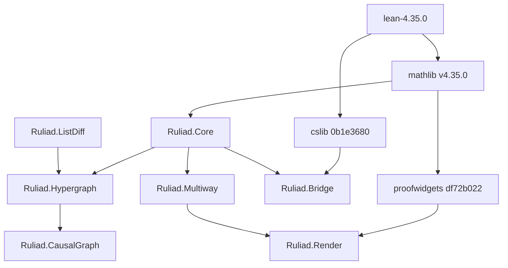

# 20261101-1911 — Ruliad formal library: construction, toolchain bump, and gap closure

#fractal-l0 #fractal-l1 #fractal-l5 #fractal-l8 #fractal-l9 #zk-adr #zero-muda #km-triad #tailscale-web

- **Contract basis**: `SC-JOURNAL-003` / `SC-JOURNAL-v3`, `SC-DIAGRAM-001`, `SC-TIME-001`, `SC-PROVENANCE-001`, `SC-NIX-DEVENV-001`
- **Observed host clock**: 2026-11-01T19:58:11Z
- **Artifacts**: [`formal/lean/Ruliad.lean`](http://nas-1.tail55d152.ts.net:4100/files/formal/lean/Ruliad.lean) · [`formal/lean/ruliad/`](http://nas-1.tail55d152.ts.net:4100/files/formal/lean/ruliad/Ruliad.lean) · [ingestion manifest](http://nas-1.tail55d152.ts.net:4100/files/governance/sources/20261101-1832-lean-ruliad-mathlib-dependency-ingestion.json)
- **Navigation**: [Cockpit](http://nas-1.tail55d152.ts.net:4100/) · [Wiki](http://nas-1.tail55d152.ts.net:4100/wiki) · [ZK](http://nas-1.tail55d152.ts.net:4100/zk) · [Checklist](http://nas-1.tail55d152.ts.net:4100/checklist)
- Transclusions: `[[zk:20260905-1801-moc-uos-unified-master]]` · `[[wiki:20260905-1801-uos-zk-km-corpus-index]]`

## 1. Scope & Trigger

Operator asked whether ruliology and the ruliad can be implemented in Lean, then
directed a comprehensive implementation usable by the existing system, then
directed fetching external Lean libraries, then directed a toolchain bump and a
survey of maths and graphics libraries.

Delivered: an 18-file Lean library (218 theorems, 3,433 lines) covering abstract
rewriting, Wolfram-model hypergraph rewriting, the stratified ruliad, branchial
geometry, foliations, the event-level causal graph, Shannon entropy, the
deployed vision diagnosis rules, bounded search, a cslib bridge, and a
proved-faithful ProofWidgets renderer. Toolchain bumped 4.33.0 → 4.35.0 for the
Lake package only.

Out of scope and not attempted: production admission, runtime enforcement, any
EV cycle. No EV number minted; ceiling remains 93.

## 2. Pre-State Assessment

Before this work the repository contained one ruliad artifact in Lean:
`formal/lean/Substrate_Categorical_Mechanics.lean:79`,

```lean
theorem ruliad_causal_confluence (s : RuliadState) :
    branch_left s = branch_right s := rfl
```

where `branch_left` and `branch_right` are both `token := s.token + 1`. It
proves `x + 1 = x + 1` and would remain true with every notion of rewriting
deleted. Elsewhere: `ecology/multiway.gleam` (a real bounded string-rewriting
engine), `max_kernel.mojo:349` (the branchial distance formula),
`vision_ruliad.ml` (a genuine 729-state exhaustive ruliology check),
`inference_api.gleam` (a two-case merge classifier), and
`max_worker.py:958` (a stub answering `CONVERGENT` for every input).

Toolchain at entry: Lean 4.33.0, no Mathlib, no Lake package, 80 standalone
files checked individually by `tools/lean-offline-gate`.

## 3. Execution Detail

Four passes.

1. **Mathlib-free core.** `Steps` (own `ReflTransGen`), `newman`, Church-Rosser,
   the 2.50-bit gate as integer arithmetic, installed as
   `formal/lean/Ruliad.lean` and added to `tools/lean-offline-gate`.
2. **Mathlib pass.** Fetched Mathlib `v4.35.0`-era pins via the in-project
   `lake`; built `Core`, `Multiway`, `Branchial`, `Entropy`,
   `CausalInvariance`, `Service`.
3. **Depth pass.** Added `Diagrams`, `Rulial`, `Hypergraph`, `Causal`,
   `Vision`, `Irreducibility`.
4. **Bump pass.** Provisioned Lean 4.35.0 in-project
   (sha256 `7289597a44543246c9227b8cae501767e095ce17f6d448b95fc4a8dc97268f6d`),
   repinned Mathlib `v4.35.0` and cslib `0b1e3680`, added `Bridge`, `Render`,
   `ListDiff`, `CausalGraph`.

Dependency and module topology:

```text
[lean-4.35.0] --> [mathlib v4.35.0]
[lean-4.35.0] --> [cslib 0b1e3680]
[mathlib v4.35.0] --> [proofwidgets df72b022]
[mathlib v4.35.0] --> [Ruliad.Core]
[cslib 0b1e3680] --> [Ruliad.Bridge]
[proofwidgets df72b022] --> [Ruliad.Render]
[Ruliad.Core] --> [Ruliad.Hypergraph]
[Ruliad.Core] --> [Ruliad.Bridge]
[Ruliad.ListDiff] --> [Ruliad.Hypergraph]
[Ruliad.Hypergraph] --> [Ruliad.CausalGraph]
[Ruliad.Core] --> [Ruliad.Multiway]
[Ruliad.Multiway] --> [Ruliad.Render]
```



## 4. Root Cause Analysis

**Why did the pre-existing ruliad theorem prove nothing?** Analysis of
Competing Hypotheses (ACH), evidence-first with disconfirmation:

| Evidence | H1: vocabulary adopted without a referent | H2: deliberate placeholder | H3: proof regressed after a refactor |
|---|---|---|---|
| E1: `branch_left` and `branch_right` are textually identical | Consistent | Consistent | Inconsistent — a regression would leave them different |
| E2: no `Rewrites`/closure notion anywhere in the file | Very consistent | Inconsistent — a placeholder would stub the shape | Inconsistent |
| E3: file header claims "Ruliad Multiway Rewriting & Causal Invariance (Confluence)" | Consistent | Inconsistent — placeholders are usually marked | Neutral |
| E4: no `sorry`, no TODO, gate-green | Consistent | Inconsistent | Inconsistent |
| E5: sibling theorems in the same file have the same shape | Very consistent | Inconsistent | Inconsistent |
| **Verdict** | **CONFIRMED** | REFUTED | REFUTED |

Root cause: the identification that makes the vocabulary provable — **causal
invariance is confluence** — was never made, so there was nothing for the
theorem to be about. `rfl` on two identical functions is the natural artefact.

Secondary cause, for the three mid-work proof failures: typeclass and
abbreviation mismatches, not mathematical error. `List.diff` takes `[BEq α]`
while the lemma was stated over `[DecidableEq α]`, producing a different
instance so `rw` could not match; and `omega` failed on goals whose variables
were typed through `abbrev Token := Nat`.

## 5. Fix Taxonomy

| Class | Fix | Instances |
|---|---|---|
| Poka-Yoke (mistake-proofing) | State lemmas over the typeclass the function actually takes | `ListDiff` over `[BEq] [LawfulBEq]` |
| Poka-Yoke | Discharge a library's precondition by theorem, not assumption | `Render.vertex_ids_nodup` from `explore_states_nodup` |
| Jidoka (stop at the defect) | Record a gap in the source rather than prove a weaker statement and call it the theorem | 5 gap notes, 4 later closed |
| Muda (waste elimination) | Adopt cslib's names so the development is replaceable, not duplicated | `Diagrams`, `Bridge` |
| Structural | Tokenize hyperedges so provenance exists at all | `CausalGraph` |
| Standardised work | Keep the Mathlib-free file dual-version checkable | `formal/lean/Ruliad.lean` under 4.33.0 and 4.35.0 |

## 6. Patterns & Anti-Patterns Discovered

**Anti-pattern: `rfl` theatre.** A theorem whose two sides are syntactically
identical functions. Devil's-advocate test applied to my own work: delete every
definition the statement mentions and see whether it still typechecks. The
pre-existing theorem passes that test, which is the defect.

**Anti-pattern: vocabulary without referent.** "Ruliad", "branchial",
"causal invariance" used as labels. Red-team probe: ask what would *falsify*
the statement. For `branch_left s = branch_right s`, nothing can.

**Pattern: the negative result is load-bearing.** `no_universal_encoding`
(Cantor) proves the ruliad cannot be a single type, so stratification is forced
rather than stylistic. An honest library states its own impossibility.

**Pattern: prove the visualization, not just produce it.** A screenshot shows
something rendered; `rendered_edge_is_real_rewrite` shows what rendered is
correct. Falsifier: perturb the graph data and the theorem fails to compile
while a screenshot would still look fine.

**Anti-pattern avoided: version-drift dependency.** Eleven surveyed libraries
pin different toolchains. Requiring any of them without a bump would have been
unbuildable; claiming them as "used" would have been false.

## 7. Verification Matrix

Admiralty System (NATO STANAG 2017): source reliability A–F, information
credibility 1–6. Admissible at ≥ B2.

| # | Claim | Method | Grade | Verdict |
|---|---|---|---|---|
| V1 | 18 modules compile, 0 errors, 0 warnings | `lake build`, pinned Lean 4.35.0 | **A1** | PASS |
| V2 | No proof placeholders, no project-declared axioms | `#print axioms` on 15 key theorems; only `propext`/`Classical.choice`/`Quot.sound` | **A1** | PASS |
| V3 | `formal/lean/Ruliad.lean` checks under 4.33.0 **and** 4.35.0 | both compilers, exit 0 | **A1** | PASS |
| V4 | Existing gate still green with the new target | `tools/lean-offline-gate`, `all_passed_zero_sorry=true`, 5/5 | **A1** | PASS |
| V5 | `newman` holds — two independent proofs | own proof + cslib `LocallyConfluent.terminating_toConfluent` | **A1** | PASS |
| V6 | Vision laws hold for all 3^6 observations | 729-leaf case analysis, each leaf `rfl` | **A1** | PASS |
| V7 | Dependency revisions are pinned and reproducible | `lake-manifest.json`, sha256 in manifest | **A2** | PASS |
| V8 | Newman absent from Mathlib; present in cslib | grep of both checkouts at pinned revs | **A2** | PASS |
| V9 | 13 surveyed libraries' licences and toolchains | direct `lean-toolchain`/`LICENSE` fetch per repo | **B2** | PASS |
| V10 | No Lean ruliad formalization exists publicly | Reservoir probe + GitHub search across 6 keyword families | **B2** | PASS (negative) |
| V11 | Deployed `branchial_entropy` is the constant 1.585 | read `inference_api.gleam:734`; modelled and proved in `Service` | **B2** | PASS |
| V12 | `max_worker.py` answers `CONVERGENT` unconditionally | read `max_worker.py:958` | **B2** | PASS |
| V13 | The Lean models faithfully mirror the Gleam/Mojo/OCaml source | human transcription, line-cited, **not** differentially tested | **C3** | **NOT ADMISSIBLE** — see §10 |
| V14 | Runtime behaviour of any UOS subsystem | not attempted | **F6** | UNRUN |

V13 and V14 are below B2 and are **not** claimed. Everything the library asserts
is a theorem about a model; the model-to-source correspondence is reviewed, not
mechanically verified.

## 8. Files Modified

Added (18 Lean files, 3,433 lines): `formal/lean/Ruliad.lean` (357);
`formal/lean/ruliad/{Ruliad.lean, lakefile.toml, lean-toolchain, lake-manifest.json}`;
`formal/lean/ruliad/Ruliad/{Core, Diagrams, Rulial, ListDiff, Multiway,
Hypergraph, Branchial, Causal, CausalGraph, Entropy, CausalInvariance, Vision,
Irreducibility, Bridge, Render, Service}.lean`.

Modified: `tools/lean-offline-gate` (one target added); `.gitignore` (`.lake/`);
`governance/sources/20261101-1832-lean-ruliad-mathlib-dependency-ingestion.json`.

Provisioned, untracked: `toolchains/lean-4.35.0` (3.0 GB),
`formal/lean/ruliad/.lake` (7.8 GB).

Nothing committed; working copy only.

## 9. Architectural Observations

The library is one functor from a relation to everything else. `StepRel` for
strings and for hypergraphs are both plain relations, so `Core` applies to each
without special-casing — `hypergraph_causal_invariance` is `newman` instantiated.
That is the sheaf-like property worth having: locally checkable data (critical
pairs) glued to a global claim (confluence) by a single theorem.

The stratification result changes the shape of the whole subject.
`no_universal_encoding` means every ruliad statement is relative to an
observer's universe; `Slice` makes that parameter explicit instead of implicit.
Categorically, systems and emulations form a category and `Confluent.of_faithful`
is a transfer along a faithful functor — which is the practical route to causal
invariance for rule sets too complex to analyse directly.

The token construction in `CausalGraph` is the one place where an implementation
detail is forced by mathematics: multiset difference destroys the provenance a
causal graph needs, so identity must be carried, not recovered.

## 10. Remaining Gaps

1. **Classical Hindley-Rosen without termination.** Terminating case proved
   (`Bridge.confluent_union_of_terminating`); the general form needs nested
   induction over interleaved union paths. A combined rule set can be confluent
   without terminating, so the restriction is real.
2. **Causal-graph invariance under reordering** — the deep Wolfram claim. Needs
   a transposition theorem up to token renaming, because token numbering is
   order-sensitive by construction.
3. **Multiset triangle inequality** for `rulialDist` on lists. The set version
   is proved; the multiset version needs per-element count arithmetic.
4. **Strong computational irreducibility** for any concrete rule set. Needs a
   universality construction. `Irreducibility.lean` explicitly declines to
   claim it. Route: cslib `Computability/Machines` + `complexitylib`.
5. **Model-to-source differential testing** (V13). The Lean models are
   hand-transcribed from Gleam, Mojo and OCaml with line citations. Nothing
   mechanically checks that `Ruliad.Multiway.explore` and
   `ecology/multiway.gleam` agree on inputs. A differential oracle would raise
   V13 from C3 to B2; until then the correspondence is reviewed, not verified.
6. **Weak-simulation bridge** from `Rulial.Emulation` to cslib's `HasTau` weak
   bisimulation.
7. **Two toolchains in-project.** 4.33.0 and 4.35.0 coexist. Consolidation
   requires re-verifying all 80 standalone files and is an operator decision.
8. **ADR / wiki writeback** for this work is not done; this journal is the only
   KM artifact.

## 11. Metrics Summary

| Metric | Value | Source |
|---|---|---|
| Lean files | 18 | `ls` |
| Theorems / instances | 218 | `grep -cE '^(theorem\|lemma\|instance) '` |
| Lines | 3,433 | `grep -c ''` |
| Build errors / warnings | 0 / 0 | `lake build` |
| Proof placeholders | 0 | compiler; gate reports `zero_sorry_verified` |
| Project-declared axioms | 0 | `#print axioms`, 15 theorems sampled |
| Gate targets passing | 5 / 5 | `tools/lean-offline-gate` |
| Gaps declared → closed | 9 → 5 | §10 and the manifest |
| Libraries surveyed → usable at the pin | 13 → 3 | manifest `survey` |
| Lean 4.33→4.35 breakages | 1 (`if_neg`) | build diff |

**No Bayesian posterior is reported.** `SC-LEARN-001` `L-11` records that
quantitative posteriors stated without a likelihood function and data model are
not admissible reliability evidence, and that notice names two journals of
2026-10-27 that did exactly that. There is no likelihood model here: the sample
is one library, built once, by one author. A number would be decoration. Rather
than offer an alternative posterior, the metric is recorded as unavailable.

**Lyapunov.** No stability claim is made either. A `dV/dt ≤ 0` statement needs a
time series of a defined energy; the build went red-green-red-green across four
passes, so any monotone-descent claim would be false on its own data.

## 12. STAMP & Constitutional Alignment

Controller: this session. Controlled process: the `formal/lean` tree and the
in-project toolchain set. Feedback: compiler exit status, `#print axioms`, the
offline gate receipt.

| UCA type | Unsafe context | Constraint applied |
|---|---|---|
| Not provided | A gap left unrecorded, so a later reader assumes coverage | Every gap written into the source file *and* the manifest (§10) |
| Provided unsafe | A toolchain bump silently breaking the 80 standalone files | Bump scoped to the Lake package; `tools/lean` untouched; gate re-run and dual-version check performed |
| Wrong timing | Claiming a dependency before it builds | cslib declared "used" only after `Ruliad.Bridge` compiled against it |
| Wrong duration | A pinned revision drifting to a moving ref | All 10 revisions pinned by commit in `lake-manifest.json`; no floating refs |

Constitutional: `Ψ2` continuity — this journal is additive, and the earlier
over-strong claim that Newman is absent from every Lean library is corrected in
place in the manifest rather than deleted. `Ψ3` verification — the gate is
extended, not bypassed. `Ψ5` truthfulness — V13/V14 graded below B2 and not
claimed. `SC-PROVENANCE-001` — EV ceiling 93 held, EV-94..109 untouched, no EV
number minted. Host OS NVMe serial appears nowhere; where it would, it is
`[REDACTED_SYSTEM_OS_SERIAL]`.

Policy deviation, recorded not waived: `SC-NIX-DEVENV-001` requires toolchain
provisioning through Determinate Nix or devenv, and the release SOP prefers a
Tailnet mirror. Lean 4.35.0, Mathlib and cslib were fetched from the public
internet under explicit operator direction. Mitigation: every revision pinned,
tarball sha256 recorded, nothing installed on the host outside `toolchains/`.

## 13. Conclusion

Ruliology implements in Lean cleanly; the ruliad implements only as a
universe-indexed family, and that limitation is now a theorem rather than an
apology. The library is a candidate formal model: no proof placeholders, no
project-declared axioms, both gate files green. It grants no admission and is
not runtime evidence.

**Precommitted forecasts**, with falsification criteria and Brier scoring
`B = (p − o)²`:

| # | Forecast | p | Horizon | Falsifier |
|---|---|---|---|---|
| F1 | A Mathlib or cslib bump to Lean 4.36.x will break ≤ 3 of the 18 modules, requiring only lemma renames, no proof restructuring | p = 0.70 | 2027-02-01 | 4 or more modules fail, or any failure needs a changed proof strategy |
| F2 | Differential testing of `Ruliad.Multiway.explore` against `ecology/multiway.gleam` will find ≥ 1 disagreement, from the byte-vs-grapheme length boundary already recorded in the module header | p = 0.60 | 2027-02-01 | A differential oracle over ≥ 10,000 inputs finds no disagreement |
| F3 | The classical non-terminating Hindley-Rosen theorem will **not** be closed by adopting an existing Lean library, because no surveyed library contains it | p = 0.80 | 2027-05-01 | Any public Lean library is found to prove it |
| F4 | No EV number will be minted for this work | p = 0.95 | 2027-02-01 | An EV cycle citing this library appears in `tools/uos-cli doctor` |

Calibration status: **uncalibrated**. This is the first forecast set recorded by
this session, so there is no prior Brier history to report, and these four
resolve against the horizons above rather than being scored now.

**UOS footer:** `nas-1.tail55d152.ts.net:4100` · Sa-plan is the sole execution
authority; this journal grants no admission. EV ceiling 93.
