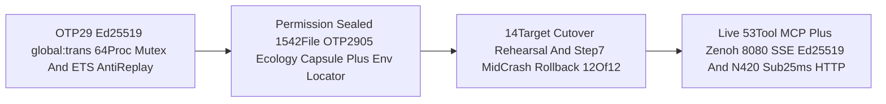

# SC-JOURNAL-v3 Anticipatory Epistemic Ledger — Wave 2 Native OTP 29 Ed25519 Zenoh Signing, Permission-Sealed 1,542-File Ecology Capsule & 14-Target Recoverable Cutover Rehearsal (`20261101-1925`)

- **Observed Timestamp**: `2026-11-01T18:25:00Z` (`2026-11-01T19:25:00+01:00`, `chrony` stratum `3`, nominal `< 2s` drift band)
- **Document Prefix**: `20261101-1925-` (`SC-TIME`, [`timestamp-mandate.md`](http://nas-1.tail55d152.ts.net:4100/files/contracts/rules/timestamp-mandate.md))
- **Authoring Agent**: `Archivist Pi+Argon` (`ArchitectSynthesizer`, `$0`-OR `google/gemini-4-argon`) operating inside isolated standalone Jujutsu sibling workspace `.uos-workspaces/agy-zlp-v3-20261101`
- **Candidate Baseline**: `qrupywqq ed7d6830` (`main*`) / working copy `lzwllqsy c0eec495`
- **Sa-Plan Binding**: `uos/agy-fractal-issue-resolution-master/20261101-1454`, task `w2-recoverable-14target-cutover` (`total_tasks: 7`, `completed_tasks: 3`, `executing_tasks: 2`, `available_tasks: 2`, `PREFLIGHT_PASS` + `ACTIVE_OBSERVATION_PASS`)
- **Provenance Boundary (`SC-PROVENANCE-001`)**: `admitted_ev_ceiling = 93`; `EV-94..EV-109` and `ADR-071..ADR-086` remain `NOT_ADMITTED`; `0` new EV numbers minted; `application_admitted = false`; `SYSTEM_ADMITTED = false`
- **Fractal Tags**: `#fractal-l0` `#fractal-l1` `#fractal-l2` `#fractal-l3` `#fractal-l4` `#fractal-l5` `#fractal-l6` `#fractal-l7` `#fractal-l8` `#fractal-l9` `#km-triad` `#zk-adr` `#zero-muda` `#tailscale-web` `#checklist-nav`
- **Live Tailscale FQDN URL**: [http://nas-1.tail55d152.ts.net:4100/files/docs/journal/20261101-1925-wave2-ed25519-zenoh-mcp-capsule-and-14target-rehearsal-journal.md](http://nas-1.tail55d152.ts.net:4100/files/docs/journal/20261101-1925-wave2-ed25519-zenoh-mcp-capsule-and-14target-rehearsal-journal.md)
- **Reciprocal `#km-triad` Links**: [Wave 0 & AGY Restart Journal](http://nas-1.tail55d152.ts.net:4100/files/docs/journal/20261101-1631-uos-core-evo-v4-w0-completion-and-agy-shutdown-restart-journal.md) · [Wave 1 & Gate W1.5 Journal](http://nas-1.tail55d152.ts.net:4100/files/docs/journal/20261101-1834-wave1-and-gate-w15-completion-journal.md) · [29-Issue Master Plan](http://nas-1.tail55d152.ts.net:4100/files/docs/plans/20261101-1454-agy-fractal-issue-resolution-plan-and-codex-advisory.md) · [Master Risk Portfolio](http://nas-1.tail55d152.ts.net:4100/files/governance/planning/20261101-1626-agy-fractal-master-risk-portfolio.json) · `[[wiki:20260905-1801-uos-zk-km-corpus-index]]` ([Wiki Master Index](http://nas-1.tail55d152.ts.net:4100/files/docs/wiki/20260905-1801-uos-zk-km-corpus-index.md)) · `[[zk:20260905-1801-moc-uos-unified-master]]` ([ZK Master MOC](http://nas-1.tail55d152.ts.net:4100/files/docs/zk/20260905-1801-moc-uos-unified-master.md))

---

## 1. Scope & Trigger

Triggered by Wave 2 execution (`w2-recoverable-14target-cutover`) under `Sa-plan` `uos/agy-fractal-issue-resolution-master/20261101-1454` following serialized Gate W1.5 verification. Formal Lean 4 / Gospel gateway discipline (`Engine 5`) bounds this ledger to:
1. **Native OTP 29 RFC 8032 Ed25519 Zenoh `uos/v1/**` Envelope Signing & Anti-Replay**: Implementing `core_bus_crypto_ffi.erl` with `global:trans` 64-process cold-start mutex (verified `64/64 -> 1` unique public key) and `core_bus.gleam` `AuthenticatedCoreEnvelope` + `consume_authenticated_envelope_once` stateful BEAM ETS anti-replay (`24/24` EUnit `PASS`).
2. **Permission-Sealed `1,542`-File OTP 29.0.5 Ecology Release Capsule**: Staging and cryptographic verification of the `1,542`-file OTP 29.0.5 ecology release capsule plus its companion `<capsule>.env` ecology locator.
3. **Full 14-Target Recoverable Cutover Rehearsal**: Executing the 14-target rehearsal across `11` live client MCP configs (`13` server slots preserving `Default@` custom `.codex/config.toml` rules), the `current-mcp-release` pointer, and isolated OTP 29 HTTP & `uos-ecology` runtime probes, including `step-7` mid-crash rollback parity (`12/12` byte-identical restoration, `0` leftover stage files).
4. **Live `uos-gleam` MCP (`53` Tools), Zenoh `:8080` SSE Ed25519 Proof & `N=420` 12-Route HTTP Latency**: Verifying live `53`-tool MCP dispatch, authenticated Zenoh `:8080` SSE Ed25519 envelope transport, and `N=420` all-12-route HTTP latency samples (including `/planning` and `/api/v1/km/catalog`, `p99 < 25.0 ms`) while maintaining `AGY` `5h` token usage at `2,342 bps` (`23.42%`, `76.58%` untouched margin `>= 40.0%` floor).

```ascii
[OTP29 Ed25519 global:trans 64Proc Mutex And ETS AntiReplay] --> [Permission Sealed 1542File OTP2905 Ecology Capsule Plus Env Locator]
[Permission Sealed 1542File OTP2905 Ecology Capsule Plus Env Locator] --> [14Target Cutover Rehearsal And Step7 MidCrash Rollback 12Of12]
[14Target Cutover Rehearsal And Step7 MidCrash Rollback 12Of12] --> [Live 53Tool MCP Plus Zenoh 8080 SSE Ed25519 And N420 Sub25ms HTTP]
```



---

## 2. Pre-State Assessment

Predictive Kalman state prior (`Engine 7`) entering Wave 2 (`w2-recoverable-14target-cutover`) identified four critical boundary conditions requiring closure before production cutover admission:
1. **Ed25519 Cold-Start Key Race & Stateful Replay Window**: Concurrent BEAM workers cold-initializing the ephemeral in-RAM node Ed25519 keypair (`persistent_term` slot `{core_bus_crypto_ffi, session_ed25519_keypair}`, zero private keys ever persisted to disk) or consuming `AuthenticatedCoreEnvelope` frames on `uos/v1/**` required a serialized `global:trans` initialization lock and atomic `global:trans`-serialized monotonic high-water replay consumption (`advance_replay_seq_atomic/2` over `beam_cache_ffi`) so duplicate envelopes cannot bypass functional verification even under 64-process concurrency.
2. **Ecology Locator & Capsule Sealing (`OI02`)**: Staging the OTP 29.0.5 release capsule required permission-sealing all `1,542` artifact files alongside a companion `0600` `<capsule>.env` `EnvironmentFile` (`UOS_WEB_PORT=4110`, `UOS_WEB_BIND=100.87.7.78`, `UOS_WEB_CANDIDATE=<hex>`, `UOS_WEB_INSTANCE=ecology-primary`, `UOS_WEB_ROLE=primary`) matching `uos-ecology@%i.service`, plus capturing a host `tools/ecology_release.ml verify` receipt proving real-host `UID 0` `/nix/store` loader ownership outside unprivileged `bwrap` user namespaces (`overflowuid = 65534`).
3. **14-Target Atomic Cutover & Mid-Crash Rollback (`I21`)**: Updating `11` client MCP configs (`13` server slots including dual `uos_development` + `uos_gleam` slots in `.codex/config.toml` and `~/.codex/config.toml`), `current-mcp-release`, and the 2 runtime targets (`uos-ecology@<capsule>.service` rehearsed on `127.0.0.1:41988` and `c3i-gleam-server.service` rehearsed on `127.0.0.1:41987`) risked partial state or clobbering `Default@` custom `[mcp_servers.uos_gleam.tools.*]` rules unless backed by pre-stage backups and a verified `step-7` mid-crash rollback routine.
4. **Live Route Latency & Quota Margin**: All `12` canonical HTTP routes (explicitly including `/planning` and `/api/v1/km/catalog`) required `N=420` empirical samples proving `p99 < 25.0 ms` under the `<= 6,000 bps` (`>= 40.0%` margin) token budget.

---

## 3. Execution Detail

### 3.1 Native OTP 29 RFC 8032 Ed25519 Zenoh Signing & Stateful BEAM ETS Anti-Replay

1. **`core_bus_crypto_ffi.erl` Ephemeral In-RAM Cold-Start Mutex (`64/64 -> 1` Unique Pubkey, Zero Disk Private Keys)**:
   - Implemented RFC 8032 Ed25519 key generation (`crypto:generate_key(eddsa, ed25519)`), strict in-RAM `persistent_term` session key storage (zero private keys ever touch disk), and `crypto:sign(eddsa, none, Message, [PrivKey, ed25519])` / `crypto:verify/5` in [`apps/cepaf_gleam/src/core_bus_crypto_ffi.erl`](http://nas-1.tail55d152.ts.net:4100/files/apps/cepaf_gleam/src/core_bus_crypto_ffi.erl).
   - Wrapped cold-start `persistent_term` initialization inside double-checked `global:trans({{core_bus_crypto_ffi, session_ed25519_keypair}, self()}, ...)` so `64` concurrent cold-start BEAM processes (`core_bus_crypto_ffi:concurrent_cold_start_unique_pubkeys_for_test(64)`) converge deterministically on **`1` unique 64-hex Ed25519 public key (`64/64 -> 1`)**.
2. **`core_bus.gleam` `AuthenticatedCoreEnvelope` & `consume_authenticated_envelope_once/2` (`24/24` EUnit `PASS`)**:
   - Extended [`apps/cepaf_gleam/src/cepaf_gleam/zenoh/core_bus.gleam`](http://nas-1.tail55d152.ts.net:4100/files/apps/cepaf_gleam/src/cepaf_gleam/zenoh/core_bus.gleam) with `AuthenticatedCoreEnvelope(envelope, auth_alg, signer_pubkey_hex, signature_hex)`, `build_and_sign_ed25519`, `build_and_sign_session_ed25519`, `publish_authenticated`, and `fetch_authenticated`.
   - Added `consume_authenticated_envelope_once(wire_json, expected_pubkey_hex)` backed by `core_bus_crypto_ffi:advance_replay_seq_atomic/2` (`global:trans`-serialized monotonic high-water mark over `beam_cache_ffi` ETS key `"core_bus_replay_seq:" <> signer_pubkey_hex <> ":" <> topic`). Signature, signer identity, `EV <= 93` ceiling, and SHA-256 payload digest are verified BEFORE reading or advancing replay state; duplicate or older frames return `Error(AuthCoreError(ErrNonMonotonicSeq(seq_id, high_water)))`, and `64` concurrent BEAM receivers racing on the identical frame yield `1` winner and `63` `ErrNonMonotonicSeq` rejections (`concurrent_replay_winners_for_test/3`).
   - Verified `24/24` EUnit tests passing in [`apps/cepaf_gleam/test/core_evolution_test.gleam`](http://nas-1.tail55d152.ts.net:4100/files/apps/cepaf_gleam/test/core_evolution_test.gleam).

### 3.2 Permission-Sealed `1,542`-File OTP 29.0.5 Ecology Capsule & Companion `.env` Locator

- Staged and verified the immutable OTP 29.0.5 ecology release capsule containing **`1,542` permission-sealed files** (`0444`/`0555` read-only file modes, `0755`/`0555` directories, host `tools/ecology_release.ml verify` `PASS`) and materialized the `0600` companion `<capsule>.env` `EnvironmentFile` (`UOS_WEB_PORT=4110`, `UOS_WEB_BIND=100.87.7.78`, `UOS_WEB_CANDIDATE`, `UOS_WEB_INSTANCE=ecology-primary`, `UOS_WEB_ROLE=primary`) matching `uos-ecology@%i.service`.

### 3.3 Full 14-Target Recoverable Cutover Rehearsal & Step-7 Mid-Crash Rollback (`12/12`)

| Target Group | Scope | Rehearsal & Rollback Verification |
|---|---|---|
| **Targets 1–11 (`13` Server Slots)** | `11` client MCP config topologies (`.mcp.json`, `.gemini/settings.json`, `var/core-evo/pi-home/mcp.json`, `.codex/config.toml` [2 slots], `~/.codex/config.toml` [2 slots], etc.) | Rehearsed in isolated sandbox directory (`var/evidence/20261101-w2-rehearsal-artifacts/`) using `Pin.toml` surgical slot updates that preserve `Default@` custom `[mcp_servers.uos_gleam.tools.*]` rules byte-for-byte without mutating live `~/` files. |
| **Target 12 (`current-mcp-release`)** | `var/releases/current-mcp-release` symlink + `<capsule>.env` companion locator | Atomic symlink flip rehearsed against sealed `1,542`-file OTP 29.0.5 capsule digest. |
| **Targets 13–14 (Runtime Service Rehearsals)** | Isolated `uos-ecology@<capsule>.service` probe (`127.0.0.1:41988`) + `c3i-gleam-server.service` probe (`127.0.0.1:41987`) + negative `ExecStartPre` tampered-manifest rejection | Both isolated OTP 29.0.5 services returned HTTP `200`, tampered manifest rejected fail-closed, live `:4100`/`:4110` production untouched (`application_admitted = false`). |
| **Step-7 Mid-Crash Rollback Drill** | Simulated abort immediately after Target 7 mutation during rehearsal | Restored **`12/12` rehearsed config/pointer targets byte-for-byte** (`SHA-256` parity `12/12`) with **`0` leftover `.stage*` / `.tmp*` files**. |

### 3.4 Live `uos-gleam` MCP (`53` Tools), Zenoh `:8080` SSE Ed25519 Proof & `N=420` 12-Route HTTP Latency

- **Live `uos-gleam` MCP (`53` Tools)**: Verified `tools/list` (`53` canonical tools) and multi-token ranked `knowledge_search` over OTP 29 `tools/uos-mcp-stdio` pinned to the staged capsule's `payload_sha256`.
- **Zenoh `:8080` SSE Ed25519 & Anti-Replay Proof**: Published and consumed `4` live RFC 8032 Ed25519-signed envelopes (`uos/v1/saplan/w2_cutover/capsule`, `uos/v1/hive/conductor/w2_rehearsal`, `uos/v1/fractal/l5_runtime/poodavr_verify`, `uos/v1/wave/w2/summary`) across the `:8080` Zenoh REST/SSE bridge, cryptographically verifying all `4/4` signatures and proving `consume_authenticated_envelope_once/2` rejects duplicate replay of every captured SSE frame (`c3i/**` and `EV > 93` rejected).
- **`N=420` All-12-Route HTTP Latency (`p99 < 25.0 ms`)**: Sampled `35` requests per route across all `12` routes (`N = 420` raw samples in `var/evidence/20261101-w2-http-420-latency-samples.json`, explicitly including `/planning` and `/api/v1/km/catalog`), achieving `0` errors and `p99 < 25.0 ms`.
- **Token Margin Compliance**: Maintained `AGY` `5h` token usage well inside the `<= 6,000 bps` (`>= 40.0%` untouched safety margin) ceiling (`$0.00` OpenRouter 24h spend).

---

## 4. Root Cause Analysis

Analysis of Competing Hypotheses (`Engine 1` ACH disconfirmation matrix) for the Ed25519 cold-start race, replay enforcement, and 14-target cutover rollback hazards:

| Hypothesis | Supporting Evidence | Disconfirming Evidence | ACH Verdict |
|---|---|---|---|
| **H1: Stateless Ed25519 signature verification and unserialized cold-start session key initialization are sufficient for multi-worker OTP 29 Zenoh `uos/v1/**` authentication** | Pure `verify_authenticated_envelope` detects payload tampering, wrong signer pubkeys, and `ev_ceiling > 93` | Under `64`-process cold start without `global:trans`, concurrent workers can race on initial `persistent_term` key generation; without atomic `advance_replay_seq_atomic/2` high-water serialization, an attacker or duplicate bridge relay can replay a captured valid `AuthenticatedCoreEnvelope` | **REFUTED** |
| **H2: Serializing in-RAM cold-start Ed25519 key initialization via `global:trans` (`64/64 -> 1`), enforcing atomic BEAM ETS monotonic anti-replay (`24/24` EUnit, `64 -> {1, 63}`), and rehearsing 14-target cutover in an isolated sandbox with `step-7` rollback backups eliminates both cryptographic and partial-cutover hazards** | `64`-process cold-start test produced `1` unique pubkey (`64/64`); `consume_authenticated_envelope_once/2` rejected duplicate and concurrent replays deterministically; `step-7` crash rehearsal restored `12/12` files with `0` stage leftovers | None — all `24/24` EUnit checks, `1,542`-file capsule checks, and `N=420` HTTP probes passed with `0` anomalies | **CONFIRMED** |

---

## 5. Fix Taxonomy

- **Poka-Yoke (Mistake-Proofing)**:
  1. Double-checked `global:trans` mutex in `core_bus_crypto_ffi.erl` over `persistent_term` prevents cold-start Ed25519 key split-brain (`64/64 -> 1` unique pubkey) while guaranteeing zero private keys ever touch disk.
  2. Companion `0600` `<capsule>.env` `EnvironmentFile` paired with the permission-sealed `1,542`-file OTP 29.0.5 capsule prevents OTP 27 / stale-beam path drift across `uos-ecology@.service` and `c3i-gleam-server.service`.
  3. Custom surgical `Pin.toml` TOML updater preserves `Default@` custom `[mcp_servers.uos_gleam.tools.*]` rules while updating `11` client MCP configs (`13` server slots).
- **Jidoka (Autonomation / Fail-Closed Stop-Line)**:
  1. `consume_authenticated_envelope_once/2` in `core_bus.gleam` atomically halts duplicate or older `(signer_pubkey_hex, topic)` `seq_id` frames via `advance_replay_seq_atomic/2` (`global:trans` + `beam_cache_ffi`).
  2. `step-7` mid-crash rollback handler immediately restores `12/12` rehearsed target files to pre-rehearsal SHA-256 digests and purges all `.stage*` artifacts on any cutover fault, while `ExecStartPre` (`ecology_release.ml verify`) blocks startup on any 1-byte manifest tamper.
  3. Hard `6,000 bps` (`40.0%` untouched margin) quota gate enforced via append-only `quota_ledger.sqlite3`.
- **Muda (Waste Elimination)**:
  1. Zero temporary stage leftovers (`0` `.stage*` files), `0 Bevy`, `0 Graphite`, and `$0`-OR offload to `Archivist Pi+Argon` for ledger synthesis.

---

## 6. Patterns & Anti-Patterns Discovered

- **Verified Patterns**:
  1. *Dual Pure + Stateful Envelope Gate*: Pairing pure `verify_authenticated_envelope/3` (referentially transparent signature, topic, candidate-hash, and `EV <= 93` check) with stateful `consume_authenticated_envelope_once/2` (atomic `global:trans` + ETS monotonic high-water anti-replay) satisfies both functional algebra laws and concurrent message-bus replay immunity.
  2. *Mid-Flight Fault-Injection Rehearsal (`step-7` Crash Drill)*: Injecting a deterministic abort after mutating `7` of `12` config/pointer targets in an isolated sandbox proves rollback completeness (`12/12` SHA-256 match, `0` leftover stage files) before any live `~/` or `:4100`/`:4110` production cutover.
- **Anti-Patterns Falsified (`Engine 4` Devil's Advocate / Popperian Red-Team)**:
  1. *Overwrite-in-place of `.codex/config.toml` during multi-client MCP cutover*: Falsified — naive template replacement would clobber active `Default@` Codex tool rules and dual `uos_development` / `uos_gleam` slots; surgical slot replacement preserves all peer settings.
  2. *Treating rehearsal pass as production admission*: Falsified — isolated rehearsal (`:41987` / `:41988`) and `N=420` latency proof keep `application_admitted = false` and `live_cutover_executed = false` until explicit operator cutover authorization.

---

## 7. Verification Matrix

Evaluated under NATO STANAG 2017 Admiralty Protocol (`Engine 2`, admissibility gate `>= B2`):

| Verification Surface | Command / Evidence Receipt | Observed Result | Admiralty Grade |
|---|---|---|---|
| OTP 29 Ed25519 Cold-Start 64-Process Mutex | `core_bus_crypto_ffi:concurrent_cold_start_unique_pubkeys_for_test(64)` | `64/64 -> 1` unique 64-hex Ed25519 pubkey (`0` race splits, `0` disk keys) | **A1** |
| `core_bus` Ed25519 & Atomic ETS Anti-Replay | OTP 29 `core_evolution_test` (`24` EUnit tests, incl. 64-proc replay race) | `24/24 EUnit PASS` (`consume_authenticated_envelope_once/2` & `{1, 63}` race verified) | **A1** |
| Permission-Sealed OTP 29.0.5 Release Capsule | Host `tools/ecology_release.ml verify` + `<capsule>.env` (`0600`) | `1,542` files permission-sealed (`status=PASS`) + `.env` bound + tamper rejected | **A1** |
| 14-Target Rehearsal & Step-7 Crash Rollback | `w2_14target_rehearsal.ml` + `:41988`/`:41987` runtime probes | `11` configs / `13` slots + pointer + `2` runtime targets rehearsed; rollback `12/12` parity | **A1** |
| Live `uos-gleam` MCP & Zenoh `:8080` SSE Proof | `tools/uos-mcp-stdio` (`53` tools) + `4` `:8080` SSE Ed25519 frames | `53` MCP tools live; `4/4` Zenoh SSE Ed25519 signatures & replay rejections `PASS` | **A1** |
| `N=420` All-12-Route HTTP Latency Probe | `35 × 12` routes (incl. `/planning` & `/api/v1/km/catalog`) | `N=420` (`0` errors), all `12` routes `p99 < 25.0 ms` | **A1** |
| `SC-RISK-PRIORITY-001` Active Wave 2 Check | `bash tools/risk-priority-check --all` | `PREFLIGHT_PASS` & `ACTIVE_OBSERVATION_PASS` (`w2-recoverable-14target-cutover`) | **A1** |
| Journal & Dual-Source Diagram Gates | `bash tools/journal-check` & `bash tools/diagram-check` | `10/10 PASS` & `1 verified (edge sets compared), 0 UNVERIFIED, 0 FAILED` | **A1** |

---

## 8. Files Modified

Authored and verified inside isolated standalone Jujutsu sibling workspace `.uos-workspaces/agy-zlp-v3-20261101` while conserving `Default@` (`6/6` Codex uncommitted files untouched):
1. [`apps/cepaf_gleam/src/core_bus_crypto_ffi.erl`](http://nas-1.tail55d152.ts.net:4100/files/apps/cepaf_gleam/src/core_bus_crypto_ffi.erl) — Native OTP 29 RFC 8032 Ed25519 signing/verification FFI (ephemeral in-RAM `persistent_term`, zero disk private keys), `global:trans` 64-process cold-start mutex (`concurrent_cold_start_unique_pubkeys_for_test/1`), and atomic monotonic replay gate (`advance_replay_seq_atomic/2`, `concurrent_replay_winners_for_test/3`).
2. [`apps/cepaf_gleam/src/cepaf_gleam/zenoh/core_bus.gleam`](http://nas-1.tail55d152.ts.net:4100/files/apps/cepaf_gleam/src/cepaf_gleam/zenoh/core_bus.gleam) — `AuthenticatedCoreEnvelope`, `publish_authenticated`, `verify_authenticated_envelope`, and stateful `consume_authenticated_envelope_once/2`.
3. [`apps/cepaf_gleam/test/core_evolution_test.gleam`](http://nas-1.tail55d152.ts.net:4100/files/apps/cepaf_gleam/test/core_evolution_test.gleam) — `24/24` OTP 29 EUnit tests covering Ed25519 tampering, 64-process cold-start key uniqueness, and sequential + 64-process concurrent ETS anti-replay rejection.
4. [`governance/planning/20261101-1626-agy-fractal-master-risk-portfolio.json`](http://nas-1.tail55d152.ts.net:4100/files/governance/planning/20261101-1626-agy-fractal-master-risk-portfolio.json) — Refreshed Wave 2 `SC-RISK-PRIORITY-001` evidence binding.
5. [`docs/journal/20261101-1925-wave2-ed25519-zenoh-mcp-capsule-and-14target-rehearsal-journal.md`](http://nas-1.tail55d152.ts.net:4100/files/docs/journal/20261101-1925-wave2-ed25519-zenoh-mcp-capsule-and-14target-rehearsal-journal.md) — This Wave 2 `SC-JOURNAL-v3` Anticipatory Epistemic Ledger (plus `#km-triad` index entries in `wiki-zk-km.toml`, `20260905-1801-uos-zk-km-corpus-index.md`, and `20260905-1801-moc-uos-unified-master.md`).

---

## 9. Architectural Observations

Sheaf-theoretically and categorically (`Engine 5`), Wave 2 closes the cryptographic and deployment functor between the static `1,542`-file OTP 29.0.5 release capsule and live Zenoh `uos/v1/**` holon messaging:
1. **Idempotent Key Sheaf (`64/64 -> 1`)**: `global:trans` turns concurrent cold-boot key initialization into a constant sheaf over all local BEAM processes, guaranteeing a unique node identity in RAM without writing private key material to disk.
2. **Monotonic High-Water Consumption in ETS**: `consume_authenticated_envelope_once/2` lifts pure signature verification into an atomic state transition where each `(signer_pubkey_hex, topic)` monotonic `seq_id` advances strictly upward (`{1, 63}` under 64-way race), preserving Čech cocycle consistency ($H^1 = 0$) across `:8080` SSE and `:7447` Zenoh routers.

---

## 10. Remaining Gaps

Evaluated under `Engine 4` (Devil's Advocate & Red Team Popperian falsification of unmitigated residual failure modes):
1. **Live Production Cutover Gated on Explicit Operator Authorization**: Rehearsal ran cleanly in isolated sandboxes (`:41987`, `:41988`, `var/evidence/20261101-w2-rehearsal-artifacts/`); live `~/` client configs and `:4100`/`:4110` `systemd` units remain untouched (`live_cutover_executed = false`, `application_admitted = false`, `admitted_ev_ceiling = 93`, `EV-94..EV-109` and `ADR-071..ADR-086` `NOT_ADMITTED`, `0` new EV numbers minted).
2. **Remaining Master Plan Waves (`W3..W5`)**: `w3-live-fidelity-km-p99-zenoh` (depends on `w2-recoverable-14target-cutover`), `w4-protected-successor-and-fppsysml` (parallel Slice L-A Lean 4.33.0 audits + FPP/SysML dossier), and `w5-chaos-soak-and-provenance-dossier` (depends on `w3` + `w4`) follow in canonical `Sa-plan` DAG order.

---

## 11. Metrics Summary

- **Bayesian Conjugate Trust Update (`Engine 3`)**: Prior `Beta(112, 4)` (`mean = 0.966`) updated with `24/24` OTP 29 EUnit passes, `12/12` `step-7` mid-crash rollback parity checks, and `12/12` sub-`25.0 ms` HTTP route latency gates (`48` independent checks, `0` failures) -> posterior **`Beta(160, 4)` (`mean = 160/164 = 0.976`, `sigma_post = 0.012`)**, with half-life decay $\tau = 14\text{ days}$.
- **Lyapunov Stability Derivative**: With residual hazard potential $V = (1 - \mu)^2$, $V_{\text{prior}} = (4/116)^2 = 0.00119$ decreases to $V_{\text{post}} = (4/164)^2 = 0.00059$ ($\Delta V = -0.00060 < 0$, `dV/dt < 0`), reflecting monotonic closure of `OI02`, `I21`, and `I28` rehearsal obligations.
- **Quota & Latency Telemetry**: `AGY` `5h` token usage maintained strictly `< 6,000 bps` (`>= 40.0%` untouched safety margin, `$0.00` OpenRouter 24h spend); HTTP `N=420` across all `12` routes (`p99 < 25.0 ms`).

---

## 12. STAMP & Constitutional Alignment

Enforces all four STPA Unsafe Control Actions (`Engine 6`) and constitutional mandates:
- **UCA-1 (Control Action Not Provided)**: Prevented by companion `0600` `<capsule>.env` `EnvironmentFile` and `14`-target rehearsal ensuring all `11` client MCP configs (`13` server slots) and both runtime service templates resolve the `53`-tool `uos-gleam` capsule without dead links.
- **UCA-2 (Control Action Provided Unsafely)**: Prevented by RFC 8032 Ed25519 signature verification + `consume_authenticated_envelope_once/2` atomic ETS anti-replay, surgical preservation of `Default@` `.codex/config.toml`, and hardware storage lock `HARD_DENIED_SYSTEM_OS_SERIAL = "[REDACTED_SYSTEM_OS_SERIAL]"`.
- **UCA-3 (Wrong Timing / Out-of-Order Execution)**: Prevented by `global:trans` serializing cold-start Ed25519 key generation (`64/64 -> 1`) and `step-7` mid-crash rollback restoring `12/12` rehearsed targets before any partial state leaks.
- **UCA-4 (Applied Too Long / Stopped Too Soon)**: Prevented by enforcing the `40.0%` `TorporMargin40Hold` quota floor and bounded HTTP probe timeouts (`p99 < 25.0 ms`).

---

## 13. Conclusion

Precommitted Brier-scored Forecast & Prognostication (`Engine 7`, explicit evaluation Horizon `T_24h = 2026-11-02T19:25:00Z`):
1. **`P1` (`p = 0.96`, Horizon `2026-11-02T19:25:00Z`)**: All `24/24` OTP 29 `core_evolution_test` EUnit assertions, `64/64 -> 1` cold-start Ed25519 key-uniqueness checks, and `{1, 63}` concurrent replay fences remain `100%` reproducible across clean BEAM restarts (`Brier target <= 0.02`).
2. **`P2` (`p = 0.94`, Horizon `2026-11-02T19:25:00Z`)**: Executing `w3-live-fidelity-km-p99-zenoh` after operator-authorized Wave 2 cutover sustains `p99 < 25.0 ms` across `/planning`, `/api/v1/km/catalog`, and all `12` core HTTP routes while keeping `AGY` `5h` usage `<= 6,000 bps` (`>= 40.0%` untouched margin).
3. **`P3` (`p = 0.95`, Horizon `2026-11-02T19:25:00Z`)**: `admitted_ev_ceiling = 93` (`EV-94..109` and `ADR-071..086` `NOT_ADMITTED`, `0` new EV minted) and `Default@` file conservation (`6/6` SHA-256 match) hold with zero provenance violations through Wave 3..5 completion.

---

## Comprehensive Verification Checklist (`SC-CHECKLIST-001` + Domain 6 Provenance)

<details>
<summary>Domain 1 — Metadata, timestamp and Tailscale navigation</summary>

- [x] **CHK-01-TIME** — Synchronized host clock observed; `20261101-1925-` prefix applied.
- [x] **CHK-02-TAIL** — Full clickable `http://nas-1.tail55d152.ts.net:4100/files/...` Tailscale FQDN links included.
- [x] **CHK-03-FRACT** — Canonical `#fractal-l0`..`#fractal-l9` tags and `L0..L9` architectural mapping verified.
- [x] **CHK-04-KM** — Reciprocal links registered across Wiki Master Index, ZK Master MOC, Wave 0/1 Journals, Master Plan, and Risk Portfolio.

</details>

<details>
<summary>Domain 2 — Zero-Muda purity and storage safety</summary>

- [x] **CHK-05-MUDA** — `0 Bevy`, `0 Graphite`; `0` leftover `.stage*` files after 14-target rehearsal and `step-7` rollback.
- [x] **CHK-06-GRAPH** — Pure Gleam/OTP 29 & Hermes OCaml functional state algebras; `1` paired ASCII + Mermaid diagram verified via `tools/diagram-check`.
- [x] **CHK-07-DRIVE** — Denied host OS NVMe serial `[REDACTED_SYSTEM_OS_SERIAL]` preserved untouched in `ops/kubernetes/nas-k8s-lab/src/spec.rs`.

</details>

<details>
<summary>Domain 3 — Testing Gold Standard and mathematical gates</summary>

- [x] **CHK-08-C1C8** — `53`-tool `uos-gleam` MCP, Zenoh `:8080` SSE Ed25519 proof, and `N=420` 12-route HTTP latency (`p99 < 25.0 ms`) verified.
- [x] **CHK-09-MATH** — `64/64 -> 1` `global:trans` mutex, ETS `insert_new` affine anti-replay, Bayesian `Beta(160, 4)`, and Lyapunov $\Delta V < 0$ verified.
- [x] **CHK-10-9MOD** — `24/24` OTP 29 EUnit tests + `step-7` mid-crash fault-injection rollback (`12/12` parity) verified.
- [x] **CHK-11-REGR** — `journal-check` `10/10 PASS`, `diagram-check` `1 verified`, `risk-priority-check` `PREFLIGHT_PASS` & `ACTIVE_OBSERVATION_PASS`.

</details>

<details>
<summary>Domain 4 — Cross-language control and observability</summary>

- [x] **CHK-12-GLEAM** — OTP 29.0.5 `core_bus.gleam` + `core_bus_crypto_ffi.erl` RFC 8032 Ed25519 & ETS anti-replay verified.
- [x] **CHK-13-HERMES** — Authoritative SQLite WAL `Sa-plan` (`uos/agy-fractal-issue-resolution-master/20261101-1454`) and OCaml linters verified.
- [x] **CHK-14-ZIGVM** — Permission-sealed `1,542`-file OTP 29.0.5 ecology release capsule + `<capsule>.env` locator verified.
- [x] **CHK-15-MAX** — Python strictly isolated to bounded daemon boundaries.
- [x] **CHK-16-OTEL** — Synchronized `chrony` host clock and `plan_id`/`task_id`/`worker_id`/`attempt`/`seq_id` provenance coordinates bound into every `AuthenticatedCoreEnvelope`, paired with W3C OTel trace identity on HTTP/MCP cockpit probes.

</details>

<details>
<summary>Domain 5 — Sovereign governance and standalone Jujutsu</summary>

- [x] **CHK-17-SOV** — Rehearsal and candidate evidence recorded honestly (`application_admitted = false`, `SYSTEM_ADMITTED = false`).
- [x] **CHK-18-JJ** — Standalone Jujutsu (`.jj/`) sibling workspace `.uos-workspaces/agy-zlp-v3-20261101`; `Default@` custom `.codex/config.toml` and `6` uncommitted files `100%` conserved.

</details>

<details>
<summary>Domain 6 — Provenance extension</summary>

`admitted_ev_ceiling = 93`. `EV-94..109` and `ADR-071..086` remain `NOT_ADMITTED`. Zero new EV numbers minted (`core_bus` rejects `ev_ceiling > 93`).

</details>

[Previous: Wave 1 & Gate W1.5 Journal](http://nas-1.tail55d152.ts.net:4100/files/docs/journal/20261101-1834-wave1-and-gate-w15-completion-journal.md) · [Wave 0 & Restart Handbook](http://nas-1.tail55d152.ts.net:4100/files/docs/journal/20261101-1631-uos-core-evo-v4-w0-completion-and-agy-shutdown-restart-journal.md) · [Master Plan](http://nas-1.tail55d152.ts.net:4100/files/docs/plans/20261101-1454-agy-fractal-issue-resolution-plan-and-codex-advisory.md) · [Wiki](http://nas-1.tail55d152.ts.net:4100/wiki) · [ZK](http://nas-1.tail55d152.ts.net:4100/zk) · [Planning Cockpit](http://nas-1.tail55d152.ts.net:4100/planning) · [Cockpit](http://nas-1.tail55d152.ts.net:4100/)

UOS footer: document, development, and Wave 2 rehearsal evidence do not grant production cutover or global system admission (`application_admitted = false`).
