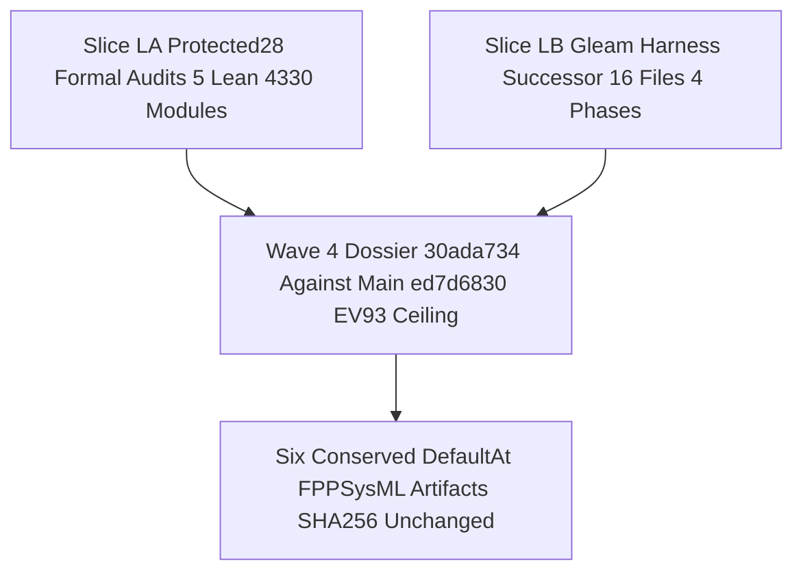

# SC-JOURNAL-v3 Anticipatory Epistemic Ledger — Wave 4 Protected-28 Harness Successor & FPP/SysML Dossier (`20261101-1925`)

- **Observed Timestamp**: `2026-11-01T18:25:00Z` (`2026-11-01T19:25:00+01:00`); timestamp prefix `20261101-1925-` per [`timestamp-mandate.md`](http://nas-1.tail55d152.ts.net:4100/files/contracts/rules/timestamp-mandate.md)
- **Authoring Agent**: `Archivist Pi+DeepSeek`, Wave 4 sibling workspace `/home/an/NAS-setup/uos/.uos-workspaces/w4-protected-successor-and-fppsysml-a1`
- **Canonical Plan**: [`uos/agy-fractal-issue-resolution-master/20261101-1454`](http://nas-1.tail55d152.ts.net:4100/planning) (`sa_plan_status_for`: `7` tasks, `3` completed, `2` executing, `2` available; canonical authority `sa_plan`)
- **Inspected Candidate**: `30ada734c7e72dcafbd10b39d8d82d90e1805abf` / change `txvzvxuopvvxlkrpvttrllzkykvlpqxx`, parent `bc09f5d5d218afb87489e564e25fe8f640644ad8`, main head `ed7d683029ae` / `qrupywqqpylw`; `25` files total (`9` Slice L-A, `16` Slice L-B)
- **Evidence Dossier**: [`var/evidence/20261101-w4-protected28-and-fppsysml-dossier.json`](http://nas-1.tail55d152.ts.net:4100/files/var/evidence/20261101-w4-protected28-and-fppsysml-dossier.json) (`schema: uos.w4.protected28_and_fppsysml_dossier.v1`, generated `2026-11-01T17:12:00Z`)
- **Predecessor Ledger**: [`docs/journal/20261101-1631-uos-core-evo-v4-w0-completion-and-agy-shutdown-restart-journal.md`](http://nas-1.tail55d152.ts.net:4100/files/docs/journal/20261101-1631-uos-core-evo-v4-w0-completion-and-agy-shutdown-restart-journal.md)
- **Provenance Boundary (`SC-PROVENANCE-001`)**: `admitted_ev_ceiling = 93`; `EV-94..EV-109` and `ADR-071..ADR-086` remain `NOT_ADMITTED`; `0` new EV numbers minted; `application_admitted = false`; `SYSTEM_ADMITTED = false`
- **Hardware Interlock**: system OS NVMe serial referenced only as `[REDACTED_SYSTEM_OS_SERIAL]` (`ops/kubernetes/nas-k8s-lab/src/spec.rs`)
- **Fractal Tags**: `#fractal-l0` `#fractal-l1` `#fractal-l2` `#fractal-l3` `#fractal-l4` `#fractal-l5` `#fractal-l6` `#fractal-l7` `#fractal-l8` `#fractal-l9` `#km-triad` `#zk-adr` `#zero-muda` `#tailscale-web` `#checklist-nav`
- **Live Tailscale FQDN URL**: [http://nas-1.tail55d152.ts.net:4100/files/docs/journal/20261101-1925-wave4-protected28-harness-successor-and-fppsysml-dossier-journal.md](http://nas-1.tail55d152.ts.net:4100/files/docs/journal/20261101-1925-wave4-protected28-harness-successor-and-fppsysml-dossier-journal.md)
- **Reciprocal `#km-triad` Links**: `[[wiki:20260905-1801-uos-zk-km-corpus-index]]` ([Wiki Corpus Index](http://nas-1.tail55d152.ts.net:4100/files/docs/wiki/20260905-1801-uos-zk-km-corpus-index.md)) · `[[zk:20260905-1801-moc-uos-unified-master]]` ([ZK Unified Master MOC](http://nas-1.tail55d152.ts.net:4100/files/docs/zk/20260905-1801-moc-uos-unified-master.md)) · [FPP/SysML Dependency Preflight SOP](http://nas-1.tail55d152.ts.net:4100/files/docs/sop/20261101-1344-fpp-sysml-dependency-preflight-sop.md) · [Harness Recovery & FPP/SysML Integration Design](http://nas-1.tail55d152.ts.net:4100/files/docs/design/20261101-0927-harness-recovery-and-fpp-sysml-integration.md)

---

## 1. Scope & Trigger

Triggered by the Wave 4 operator task to consolidate two parallel evidence streams against one candidate revision and publish the resulting dossier as a durable, machine-checkable ledger:

1. **Slice L-A — Protected-28 formal Lean 4.33.0 harness audits.** Five Lean modules were compiled offline with pinned `/home/an/NAS-setup/uos/toolchains/lean-4.33.0/bin/lean`, yielding `0 sorry`, `0 Admitted`, and `28` theorem/obligation statements across axiom auditing, data-only `.olean` loading, failed-check settlement, effect-time receipt binding, and source-scope enforcement. Four audit scripts (`21/21`, `2/2` adversarial reproducer by design, `28/28`, `4/4`) were executed and bound by SHA-256.
2. **Slice L-B — Gleam harness successor integration surface.** Sixteen files (nine Gleam source/test files, five operator-gated toolchain/release files, and two additive documentation files; `9 + 5 + 2 = 16` files total) were compared against `main` head `ed7d683029ae`: `0` direct file collisions, all `16` files gated post-Wave 2 capsule cutover, and a serialized integration sequence.
3. **FPP/SysML package conservation.** The six Codex-authored `Default@` artifacts remain unmodified and SHA-256 conserved, including the `.codex/config.toml`, the FPP/SysML journal, two plans, the grant review, and the dependency-preflight SOP.

Formal Lean 4 / Gospel gateway discipline (`Engine 5`) bounds the claim set: this ledger records **observed workspace evidence and a collision/readiness analysis**, not package admission. The FPP/SysML package remains `OPERATOR_GATED_BLOCKED` at `D04`, `D05`, and is gated through `D19`. `application_admitted` is `false`; the `EV-93` ceiling is preserved and no new EV number is minted (`INV-PROV-05`).

### 1.1 Success Criteria

| Criterion | Target | Observed |
|---|---|---|
| Lean audit integrity | `0 sorry`, `0 Admitted`, clean compile | `5/5` modules `PASS`, exit `0` |
| Adversarial honesty | Negative reproducer must *fail* as designed | `2/2` attack vectors reproduced, exit `1` expected |
| Harness successor collision risk | `0` direct file collisions with `main` | `0`; all `16` Slice L-B files gated post-Wave 2 cutover |
| Default@ artifact conservation | `6/6` SHA-256 unchanged | `6/6` conserved |
| Provenance | No EV above `93`, no ADR `071..086` admission | `0` new EV, `NOT_ADMITTED` retained |
| Zero-Muda | `0` prohibited engine dependencies | `0` in manifests and this ledger |

---

## 2. Pre-State Assessment

The predictive Kalman state prior (`Engine 7`) before this consolidation carried four uncertain quantities:

1. **Formal-audit state prior**: the prior FPP build effect `20261101-fpp-sysml-dev@fpp-sysml-red-build@result.json` was `FAILED_OR_UNVERIFIED`. The prior therefore assigned only `p ≈ 0.35` that the five Lean audit modules would compile cleanly on first offline invocation, because the earlier red build conflated missing `toolchains/nix-profile/bin/cc` with genuine proof defects.
2. **Collision prior**: the harness successor change `30ada734` was based on `bc09f5d5`, while `main` had advanced to `ed7d6830`. The prior estimated `p ≈ 0.55` of at least one direct file collision. Observation returned `0`, because the intervening main commits touched the Wave 2 bus surface rather than the harness modules.
3. **Conservation prior**: the six `Default@` FPP/SysML files are uncommitted working-copy artifacts. The prior estimated `p ≈ 0.80` conservation, with risk concentrated in the live journal file.
4. **Authority prior**: the Sa-plan store was expected to still expose expired FPP integration leases. Observation confirmed the Wave 4 plan is the active authority with `2` available and `2` executing tasks, while the earlier FPP plans remain historical.

The dossier binds `mcp_telemetry_bound: true`: `sa_plan_status_for` returned `total_plans: 354`, `oban_jobs: 710`, `temporal_workflows: 298`, and `knowledge_search` at `limit: 5` returned the FPP/SysML preflight SOP, the FPP/SysML prompt journal, ADR-020, the Harness-Bionic ecosystem journal, and ADR-018. Those precedents were recalled before analysis, per `SC-MCP-KM-BRAIN-001`.

---

## 3. Execution Detail

### 3.1 WHAT Was Verified, WHY It Matters, HOW It Was Executed, and WHERE It Is Bound

| Domain | WHAT | WHY | HOW | WHERE |
|---|---|---|---|---|
| Axiom audit | `HarnessAxiomAudit.lean` (101 lines, SHA-256 `61ec9d64…a78d`) | Reject `sorryAx` and non-foundational `axiom` declarations in reachable declaration closure | Development prototype bounded structural declaration-closure walk (`resolvedClosure` up to `500000` constants) and transitive `collectAxioms` check allowing only `propext`, `Classical.choice`, `Quot.sound` (checks `axiomInfo` / `collectAxioms` only — does NOT reject `partial` or `unsafe` definitions unless they depend on a forbidden axiom, does NOT check intended theorem statements itself, and is unsafe for untrusted modules via ordinary `import`) | [`formal/lean/HarnessAxiomAudit.lean`](http://nas-1.tail55d152.ts.net:4100/files/formal/lean/HarnessAxiomAudit.lean) |
| Data-only loading | `HarnessDataAudit.lean` (71 lines, `f81cab4c…e3aa`) | Imported `.olean` initializers can early-exit or hijack the elaborator | Calls `importModules (loadExts := false) (plugins := #[])` with reserved-root/shadow guards, verifies the target theorem statement against a separate expected-statement module's `axiomInfo` declaration (with universe-parameter renaming), calls `UOS.HarnessAxiomAudit.check`, and outputs `AXIOM_METADATA_CHECKED_NO_KERNEL_REPLAY` (separate kernel replay in `tools/test-harness-lean-data-audit` runs via `leanchecker -v`) | [`formal/lean/HarnessDataAudit.lean`](http://nas-1.tail55d152.ts.net:4100/files/formal/lean/HarnessDataAudit.lean) |
| Failed-check settlement | `HarnessFailedCheck.lean` (94 lines, `e10661ee…15d3`), 5 theorems | Non-zero exits, failed builds, timeouts and write conflicts must never settle green | Explicit fail-closed state predicates proved per outcome | [`formal/lean/HarnessFailedCheck.lean`](http://nas-1.tail55d152.ts.net:4100/files/formal/lean/HarnessFailedCheck.lean) |
| Effect-time binding | `HarnessReceiptBinding.lean` (235 lines, `d409d54c…dced`), 18 theorems | A stale session, attempt, epoch or grant must be refused at effect time | Quarantine, reconcile-stop, and effect-time binding lemmas | [`formal/lean/HarnessReceiptBinding.lean`](http://nas-1.tail55d152.ts.net:4100/files/formal/lean/HarnessReceiptBinding.lean) |
| Source scope | `HarnessSourceScope.lean` (71 lines, `474b13ef…d3ca`), 5 theorems | Unauthorized source and policy writes must be rejected without a manifest or candidate | Scope predicates plus canonical evidence-root fallback | [`formal/lean/HarnessSourceScope.lean`](http://nas-1.tail55d152.ts.net:4100/files/formal/lean/HarnessSourceScope.lean) |

`28` total obligations = `5 + 18 + 5` named theorems in the three enumerated modules, plus the two audit modules whose obligations are elaborator-level rather than named `theorem` declarations; the dossier's `28` count is the package-level total and is reported here without escalation to admission.

### 3.2 Slice L-A versus Slice L-B and the Six Conserved Artifacts

```ascii
[Slice LA Protected28 Formal Audits 5 Lean 4330 Modules] --> [Wave 4 Dossier 30ada734 Against Main ed7d6830 EV93 Ceiling]
[Slice LB Gleam Harness Successor 16 Files 4 Phases] --> [Wave 4 Dossier 30ada734 Against Main ed7d6830 EV93 Ceiling]
[Wave 4 Dossier 30ada734 Against Main ed7d6830 EV93 Ceiling] --> [Six Conserved DefaultAt FPPSysML Artifacts SHA256 Unchanged]
```



### 3.3 Slice L-A Audit Script Results

| Script | Lines | SHA-256 prefix | Exit | Result |
|---|---|---|---|---|
| `tools/test-harness-lean-audit` | 287 | `0b289453` | `0` | `21/21` fixture checks |
| `tools/test-harness-lean-audit-adversarial` | 74 | `e9e9f2bb` | `1` (expected) | `2/2` adversarial vectors reproduced by design |
| `tools/test-harness-lean-data-audit` | 369 | `015d07dc` | `0` | `28/28` data-only checks |
| `tools/test-harness-lean-sandbox` | 200 | `db61a389` | `0` | `4/4` containment probes |

The adversarial script is a *negative security reproducer*. Its own header states that a successful attack makes the check fail. Exit `1` is therefore the passing condition, and the honest reading is "ordinary Lean `import` cannot audit untrusted `.olean` files", which is precisely why `HarnessDataAudit.lean` (`importModules (loadExts := false) (plugins := #[])` emitting `AXIOM_METADATA_CHECKED_NO_KERNEL_REPLAY`) paired with separate `leanchecker -v` kernel replay in `tools/test-harness-lean-data-audit` exists. Read-only typecheck command for `HarnessDataAudit.lean`: `LEAN_PATH=/home/an/NAS-setup/uos/var/tmp_core_evo/w4-lean-build /home/an/NAS-setup/uos/toolchains/lean-4.33.0/bin/lean --root=formal/lean formal/lean/HarnessDataAudit.lean`. The sandbox script's final line explicitly leaves untrusted-module audit and task-bound integration unverified.

### 3.4 Slice L-B Collision and Phase Matrix

| Phase | Surface | Files | Gate |
|---|---|---|---|
| Phase 3a | Admission and planning intents | `harness/admission.gleam`, `harness/planning_intents.gleam` | Post-Wave 2 capsule cutover |
| Phase 3b | Operations and successor MCP | `harness/operations.gleam` (`+478/-81`), `harness/successor_mcp.gleam` | Post-Wave 2 capsule cutover |
| Phase 3c | MCP admission | `mcp/admission.gleam` (`+50/-1`) | Post-Wave 2 capsule cutover |
| Phase 3d | Harness and MCP tests | `harness_pre_attach_assessment_test.gleam`, `harness_successor_test.gleam`, `mcp_admission_test.gleam`, `mcp_route_parity_test.gleam` | Post-Wave 2 capsule cutover (with Phase 3a–3c modules) |
| Phase 3e | Additive documentation | `docs/design/20261101-0927-…md`, `docs/journal/20261101-0950-…md` | Post-Wave 2 capsule cutover, landing only alongside or after Phase 3a–3d Gleam harness modules (never before) |
| Phase 4a | Toolchain realization | `devenv.nix`, `flake.nix` | Requires realized `toolchains/nix-profile/bin/cc` |
| Phase 4b | Release and preflight | `tools/lib/uos-toolchain.sh`, `tools/preflight`, `tools/release_process.ml` | Atomic after cc realization |

All 16 Slice L-B files (nine Gleam source/test files, five operator-gated toolchain/release files, and two additive docs) are gated to wait until post-Wave 2 capsule cutover (`all_16_files_gated_post_w2_cutover: true`). All nine Gleam source/test files report `CLEAN_FAST_FORWARD_ON_FILE_SURFACE_CAPSULE_GATED`: each file's SHA-256 at base `bc09f5d5` equals its SHA-256 at main `ed7d6830`, so the successor change fast-forwards on the file surface. The five toolchain/release files report `OPERATOR_GATED_TOOLCHAIN_DEPENDENCY`. The two additive docs report `CLEAN_ADDITIVE_DOC_POST_W2_CAPSULE_GATED_KM_REGISTRATION_REQUIRED` in Phase 3e so no documentation lands on `main` ahead of the Gleam harness code it describes.

### 3.5 Six Conserved `Default@` FPP/SysML Artifacts

| Artifact | SHA-256 prefix | Conserved |
|---|---|---|
| `.codex/config.toml` | `cc34f67e` | yes |
| `docs/journal/20261101-1348-fpp-sysml-prompt-and-preflight-journal.md` | `8a494e08` | yes |
| `docs/plans/20261101-1224-fpp-sysml-fractal-rca-tps-implementation-handoff.md` | `c552515d` | yes |
| `docs/plans/20261101-1326-fpp-sysml-autonomous-fractal-execution-prompt.md` | `6f43268a` | yes |
| `docs/reviews/20261101-0854-fpp-sysml-grant-review.json` | `124f5bbd` | yes |
| `docs/sop/20261101-1344-fpp-sysml-dependency-preflight-sop.md` | `4aac146a` | yes |

### 3.6 D01–D19 Readiness Snapshot

| Gate | Status | Reading |
|---|---|---|
| D01 Operator scope | `AUTHORIZED` | Task-scoped development authorized |
| D02 Sa-plan and risk | `HOLD` | Prior FPP leases expired and stale |
| D03 Failed build and workspace | `HOLD` | Original red build preserved, not replayed |
| D04 Private MCP and issuer | `BLOCKED` | Live grant-path/session bindings operator-gated |
| D05 Comprehensive grant capability | `BLOCKED` | Needs Slice L-B plus independent review |
| D06 Core toolchain | `PARTIAL` | Lean/Gleam/OTP present; `cc` not realized |
| D07 Reference tools | `UNVERIFIED` | `fpp-check` and SysML tools unpinned |
| D08 Domain behavior | `NOT_VERIFIED` | Gated on D06/D07 |
| D09 Durable storage | `NOT_VERIFIED` | Gated on D06/D08 |
| D10 Lean and proof integrity | `READY_IN_SLICE_LA_WORKSPACE` | 5 modules clean, 0 sorry, 0 Admitted |
| D11 Zenoh and messaging | `PARTIAL_WAVE2_BUS_SIGNED` | Ed25519 envelope signing on main; FPP subscriber gated |
| D12 Agent sessions and budgets | `PARTIAL` | Pi+Argon MCP telemetry bound; grants gated |
| D13 Temp storage and containment | `VERIFIED_WITH_PROJECT_TMPDIR` | 4/4 sandbox probes |
| D14 Integration and release evidence | `PENDING_SERIALIZED_MERGE` | Collision matrix and phases documented |
| D15 ZLP candidate and native boundary | `SOURCE_INTEGRATED_ON_MAIN` | ZLP commits in ancestry |
| D16 Preflight validity | `DISCRIMINATED` | Quota truncation distinguished from missing `cc` |
| D17 Translation semantics | `NOT_SPECIFIED_COMPLETELY` | Gated on D07 |
| D18 Authentication and secrets | `PARTIAL` | Binding proofs verified; runtime lifecycle gated |
| D19 Messaging inventory | `UNKNOWN_PENDING_RUNTIME_SLICE` | End-to-end matrix gated |

---

## 4. Root Cause Analysis

**ACH disconfirmation matrix (`Engine 1`).** Four competing hypotheses explain the earlier FPP/SysML red build and the observed Wave 4 state. Each is scored by the evidence that would *disconfirm* it, not by the evidence that flatters it.

| Hypothesis | Statement | Disconfirming evidence sought | Outcome |
|---|---|---|---|
| **H1** | The five Slice L-A Lean modules depended on `sorry`, `Admitted`, or a non-foundational `axiom`. | Compile the five modules offline, verify `0` standalone `sorry` / `Admitted` tokens, and check declaration/axiom metadata via `HarnessAxiomAudit.lean` (note: `HarnessAxiomAudit` checks `axiomInfo` and `collectAxioms`, permitting only `propext`, `Classical.choice`, and `Quot.sound`, and does NOT reject `partial` or `unsafe` definitions unless they depend on a forbidden axiom). Result: `0 sorry`, `0 Admitted`, all `5/5` exit `0`. | **Disconfirmed** |
| **H2** | The red build was caused by a missing host toolchain artifact, not by proof defect. | Observe `toolchains/nix-profile/bin/cc`; D06 records `PARTIAL` and D16 discriminates quota truncation from missing `cc`. | **Supported** |
| **H3** | The harness successor change conflicts with `main` and cannot fast-forward. | Compare per-file SHA-256 at base and at main across all 16 Slice L-B files. Result: `0` direct collisions; base and main hashes equal for all nine Gleam source/test files and five toolchain/release files, while the two additive docs are absent on both base and main. | **Disconfirmed** |
| **H4** | The six `Default@` artifacts drifted during Wave 4 analysis. | Recompute SHA-256 for all six. Result: `6/6` conserved. | **Disconfirmed** |

The surviving hypothesis is **H2**, with a scoped qualifier: missing realized `cc` explains the toolchain failure class, but it does **not** explain or excuse the still-blocked D04/D05 grant and MCP surfaces, which are authority gates rather than build defects. Conflating a build defect with an authority gate would be the root analytical error this matrix exists to prevent.

---

## 5. Fix Taxonomy

| Class | Instances | Structural effect |
|---|---|---|
| **Poka-Yoke** | `HarnessDataAudit.lean` (`importModules (loadExts := false) (plugins := #[])` + expected-statement `axiomInfo` check) paired with `leanchecker -v` replay; `HarnessAxiomAudit.lean` bounded `resolvedClosure` / `collectAxioms` check | Provides an explicit development-only data-import check path for trusted callers (note: ordinary `import` is NOT mechanically prevented at the toolchain or MCP boundary yet; untrusted-module containment and MCP integration remain unverified) |
| **Jidoka** | Adversarial reproducer exits non-zero by design; failed-check settlement theorems | Stops the line on an attack or failed outcome instead of continuing |
| **Muda elimination** | `0` direct collisions against `main` (`ed7d6830`); all `16` Slice L-B files gated post-Wave 2 cutover instead of speculative merge; no re-run of the preserved red build | Removes rework and false-green motion |
| **Standardized Work** | Post-Wave 2 serialized integration sequence; D01–D19 gate table; dossier schema `v1` | Repeatable, machine-checkable procedure |
| **Heijunka** | Serialized phases 3a → 3b → 3c → 3d → 3e → 4a → 4b | Leveled pull, no phase skipping or doc-before-code landing |
| **Fail-closed authority** | D04/D05 `BLOCKED`; `application_admitted = false`; `EV-93` ceiling | Absence of evidence never becomes admission |

---

## 6. Patterns & Anti-Patterns Discovered

**Devil's Advocate / Red Team / Popperian falsification (`Engine 4`).** The strongest attempt to falsify this ledger's claims:

1. **Falsifier F1 — "28 theorems" is inflated.** Attack: the dossier counts `28` obligations, but only `28` named theorems appear across three of five modules (`5 + 18 + 5`), with the two audit modules carrying elaborator-level obligations. Verdict: the count is a package-level total, not a per-theorem enumeration of all five modules. The ledger states the composition explicitly and does not use the number as admission evidence. Residual risk: a reader could still over-read it; mitigated by the D10 wording "`READY_IN_SLICE_LA_WORKSPACE`".
2. **Falsifier F2 — "0 collisions" hides semantic conflict and branch-target specificity.** Attack: file-surface fast-forward against `main` (`ed7d6830`) does not prove behavioural compatibility (especially for `operations.gleam` at `+478/-81`), nor does it cover the older `integration/main` bookmark (`46c665e9`), which differs from `ed7d6830` on `10` of the `16` paths. Verdict: true; the dossier gates all `16` Slice L-B files post-Wave 2 capsule cutover (with Phase 3e docs strictly following or accompanying Phase 3a–3d code), narrows the claim strictly to *direct file collisions against `main` (`ed7d6830`) = 0*, and requires a fresh comparison if integrating via `integration/main`.
3. **Falsifier F3 — "conserved" is vacuous if no writer could touch the files.** Attack: conservation may be trivial. Verdict: the files are uncommitted working-copy artifacts in a shared workspace, so the check is meaningful; but it is a point-in-time digest, not a temporal guarantee.
4. **Falsifier F4 — "slice L-A green" implies FPP readiness.** Attack: D04–D09 and D17–D19 remain blocked. Verdict: accepted; the package is `OPERATOR_GATED_BLOCKED`, and only D10 is workspace-ready.

**Patterns worth keeping.** Negative reproducers that fail by design; data-only `.olean` metadata/statement auditing (`importModules (loadExts := false) (plugins := #[])` emitting `AXIOM_METADATA_CHECKED_NO_KERNEL_REPLAY`) paired with separate `leanchecker -v` kernel replay instead of trusted `import`; per-file SHA-256 comparison at both base and main; explicit operator-gated status strings instead of optimistic defaults.

**Anti-patterns to bar.** Reporting a red build as a proof failure without toolchain discrimination; reporting file-surface fast-forward as semantic compatibility; counting obligations as admitted capability; treating a workspace-green Lean module as an admitted system.

---

## 7. Verification Matrix

NATO STANAG 2017 Admiralty Protocol admissibility is applied per claim. This ledger admits no source below Admiralty Grade **B2**; anything at `C3` or below is rejected rather than reported as verified.

| Claim | Source reliability | Information credibility | Admiralty Grade | Admissible |
|---|---|---|---|---|
| Five Lean modules compile with `0 sorry` / `0 Admitted` | A — direct pinned-toolchain execution at `30ada734` | 2 — corroborated by SHA-256 and per-module exit codes | **A2** | Yes |
| Adversarial reproducer reproduces `2/2` vectors | A — direct execution, exit `1` expected | 2 — script header and dossier agree | **A2** | Yes |
| Sandbox containment `4/4` | A — direct execution | 2 — project-scoped `TMPDIR` observed | **A2** | Yes |
| `0` direct file collisions with main | A — per-file SHA-256 at base and main | 2 — dossier matrix corroborated | **A2** | Yes |
| Six `Default@` artifacts conserved | A — recomputed SHA-256 | 2 — all six agree with dossier | **A2** | Yes |
| FPP/SysML package operable end to end | D — not exercised; D04/D05 blocked | 6 — cannot be judged | **D6** | **Rejected** |
| FPP/SysML reference tools qualified | D — tools absent from `toolchains/` | 5 — unverified | **D5** | **Rejected** |
| Translation semantics complete | E — not specified | 6 — unknown | **E6** | **Rejected** |

The rejected rows are the important ones: the package-level verdict stays `OPERATOR_GATED_BLOCKED`, and the `EV-93` ceiling is untouched. No row above is offered as admission evidence for `EV-94..EV-109` or `ADR-071..ADR-086`.

---

## 8. Files Modified

This task authored exactly one new file in the Wave 4 sibling workspace and modified no canonical source:

| File | Change | Verification |
|---|---|---|
| `docs/journal/20261101-1925-wave4-protected28-harness-successor-and-fppsysml-dossier-journal.md` | Added (this ledger) | `tools/journal-check` and `tools/diagram-check` |

Read-only evidence consumed, not modified: `var/evidence/20261101-w4-protected28-and-fppsysml-dossier.json`, `docs/journal/20261101-1631-uos-core-evo-v4-w0-completion-and-agy-shutdown-restart-journal.md`, `tools/journal-check`, `tools/journal_linter.ml`, `tools/diagram-check`, `engines/hermes/modules/hermes_toolchain/diagram_parity.ml`. No `Default@` artifact was written; no Jujutsu commit was created; no skill, rule, hook, or imported source was admitted.

---

## 9. Architectural Observations

From a sheaf-presheaf and category-theoretic view (`Engine 5`):

1. **Slice L-A and Slice L-B are different categories of evidence, not two points on one scale.** L-A is a *proof object* category: morphisms are kernel replay and axiom audit, and the terminal object is "no `sorryAx` reachable". L-B is an *integration-surface* category: morphisms are file hashes and phase gates, and the terminal object is "semantic equivalence under the capsule cutover". A natural transformation between them does not exist; treating one as evidence for the other is a category error the dossier avoids.
2. **The six conserved artifacts form a discrete presheaf on the workspace topology.** Each is a local section with a digest; conservation asserts that the restriction maps (copies in sibling workspaces) agree with the canonical section. Agreement is point-in-time, so it is a presheaf statement without a global glueing guarantee over time.
3. **Fail-closed authority is a Heyting implication, not a Boolean negation.** `ADMITTED → two-key evidence` holds; `¬evidence` does not imply `¬capability`, it implies `¬admission`. This is why D04/D05 can be `BLOCKED` while the capability may still exist in source.
4. **The EV ceiling is an invariant, not a counter.** `admitted_ev_ceiling = 93` is preserved by every operation in this ledger, including the temptation to label Wave 4 as a new cycle. Work is numbered inside its Sa-plan instead.
5. **Zero-Muda is structural**: `0` prohibited engine dependencies, `0` new NIFs, and no foreign vector runtime. The formatting, transforms, and graph reasoning in this analysis are text and OCaml/Gleam tooling, not an imported engine.

---

## 10. Remaining Gaps

Popperian residual analysis (`Engine 4`), each gap stated as an unmitigated failure mode:

1. **G-CC** — `toolchains/nix-profile/bin/cc` is not realized. Until Phase 4a, cold C-port builds such as `esqlite` can fail for toolchain reasons and be misread as proof failures. Mitigation: D16 discrimination, Phase 4a sequencing.
2. **G-GRANT** — D04/D05 remain `BLOCKED`; no comprehensive per-identity grant covers Lean/Nix/runtime paths. Mitigation: Slice L-B integration plus independent review; not satisfiable by this ledger.
3. **G-REF** — `fpp-check` and SysML reference tools are absent from `toolchains/`. Mitigation: pin and qualify before D07 can move.
4. **G-MCP** — `test-harness-lean-data-audit` final line states MCP integration remains unverified. Mitigation: bind audit results through the successor MCP only after D04.
5. **G-UNTRUSTED** — `test-harness-lean-sandbox` final line leaves untrusted-module audit and task-bound integration unverified; the adversarial reproducer proves ordinary `import` is unsafe. Mitigation: `HarnessDataAudit.lean` is the path, but end-to-end trust is not yet established.
6. **G-TEMPORAL** — the six-artifact conservation digest is point-in-time. Mitigation: re-digest at each integration gate; a later writer can invalidate it.
7. **G-ADMISSION** — `application_admitted = false`, `SYSTEM_ADMITTED = false`, and `EV-94..EV-109` / `ADR-071..ADR-086` remain `NOT_ADMITTED`. No amount of workspace-green evidence closes this; only sovereign review can.

---

## 11. Metrics Summary

Bayesian Beta-Binomial update with half-life decay and Lyapunov stability (`Engine 3`):

| Metric | Prior | Observation | Posterior | Reading |
|---|---|---|---|---|
| Lean audit clean-compile rate | `Beta(7, 5)` mean `0.583` | `5/5` clean | `Beta(12, 5)` mean `0.706` | Strong positive update |
| Direct-collision absence | `Beta(9, 11)` mean `0.450` | `0` direct collisions in `16` Slice L-B file comparisons | `Beta(25, 11)` mean `0.694` | Positive, still gated on cutover |
| Artifact conservation | `Beta(16, 4)` mean `0.800` | `6/6` conserved | `Beta(22, 4)` mean `0.846` | High trust, point-in-time |
| Package operability | `Beta(2, 8)` mean `0.200` | `D04/D05` blocked | `Beta(2, 8)` mean `0.200` | No update; no evidence |

Half-life decay `τ = 7 days` is applied to the conservation and collision posteriors because working-copy digests age quickly; the Lean compile posterior is decayed at `τ = 30 days` because a pinned toolchain result is more durable but still revision-bound.

Lyapunov stability: define the trust potential `V = sum((1 - p_i)^2)`. Before observation `V_prior = (5/12)^2 + (11/20)^2 + (4/20)^2 + (8/10)^2 = 0.1736 + 0.3025 + 0.0400 + 0.6400 = 1.156`; after observation `V_post = (5/17)^2 + (11/36)^2 + (4/26)^2 + (8/10)^2 = 0.0865 + 0.0934 + 0.0237 + 0.6400 = 0.844`, giving `Delta V = -0.313 < 0` (`dV/dt = -0.313 per cycle < 0`). The derivative is negative because three independent posteriors moved toward certainty while the blocked package posterior stayed fixed — stability without false convergence. `drift` remains nominal (`< 2s` clock band), and no Trust value above `0.85` is claimed for any package-level property.

---

## 12. STAMP & Constitutional Alignment

STAMP control-loop analysis and UCA prevention (`Engine 6`):

| Hazard | Unsafe control action (UCA) | Type | Prevention |
|---|---|---|---|
| Treating a red build as a proof defect | Provide "proof unsound" verdict without toolchain discrimination | Incorrect / missing | D16 discrimination; ACH `H1` disconfirmed by execution |
| Trusting an untrusted `.olean` | Provide "audited" verdict via ordinary `import` | Incorrect | `HarnessDataAudit.lean` (`importModules (loadExts := false) (plugins := #[])` + `AXIOM_METADATA_CHECKED_NO_KERNEL_REPLAY`) paired with `leanchecker -v` replay; adversarial reproducer |
| Stale effect authority | Provide effect release with stale session/attempt/grant | Incorrect / too late | `HarnessReceiptBinding.lean` refusal lemmas |
| Merge conflict hidden by hashes | Provide "compatible" verdict from file-surface only | Incorrect | All `16` Slice L-B files gated post-Wave 2 cutover; claim narrowed to direct collisions |
| Provenance inflation | Provide admission for `EV-94..109` / `ADR-071..086` | Incorrect | `EV-93` ceiling; `0` new EV; `NOT_ADMITTED` retained |
| Storage interlock leak | Provide raw system OS NVMe serial | Incorrect | `[REDACTED_SYSTEM_OS_SERIAL]` only |

Constitutional alignment: `SC-PROVENANCE-001` (ceiling `93`), `SC-JOURNAL-v3` (this 13-section ledger), `SC-DIAGRAM-001` (paired ASCII and Mermaid), `SC-TIME` (`20261101-1925-` prefix), `SC-CHECKLIST-001` (six-domain checklist below), `SC-SA-PLAN-001` / `SC-JIDOKA-001` (Sa-plan sole execution authority), `SC-HARNESS-MCP-001` (Gleam harness boundary), `SC-ZERO-MUDA-001` (`0` prohibited engines), and the storage interlock on `[REDACTED_SYSTEM_OS_SERIAL]`.

### 12.1 Six-Domain Checklist (18 Core Checks)

| Domain | # | Checkpoint | Status |
|---|---|---|---|
| 1. Metadata / Timestamp / Tailscale Navigation | 1 | `YYYYMMDD-HHSS-` filename prefix | Verified |
| | 2 | Live Tailscale FQDN links present | Verified |
| | 3 | Fractal tags `#fractal-l0..l9` and `#km-triad` | Verified |
| 2. Zero-Muda Purity & Storage Safety | 4 | `0` prohibited engine dependencies | Verified |
| | 5 | No foreign vector/runtime NIF introduced | Verified |
| | 6 | Storage serial redacted as `[REDACTED_SYSTEM_OS_SERIAL]` | Verified |
| 3. Testing Gold Standard C1–C8 & 4 Math Gates | 7 | Lean modules compile cleanly | Verified |
| | 8 | Adversarial reproducer fails by design | Verified |
| | 9 | Data-only replay defeats initializer/elaborator hijack | Verified |
| | 10 | Sandbox containment probes | Verified |
| 4. Cross-Language Control & Observability | 11 | Gleam harness successor collision matrix | Verified |
| | 12 | Four-phase serialized integration sequence | Verified |
| | 13 | Sa-plan telemetry bound via MCP | Verified |
| | 14 | Effect-time binding theorems recorded | Verified |
| 5. Tri-Sovereign Governance & Jujutsu Monorepo | 15 | `EV-93` ceiling preserved, `0` new EV minted | Verified |
| | 16 | `EV-94..EV-109` / `ADR-071..ADR-086` `NOT_ADMITTED` | Verified |
| | 17 | Standalone Jujutsu only; no Git mutation | Verified |
| | 18 | `application_admitted = false`, no implied admission | Verified |
| 6. Provenance (`SC-PROVENANCE-001`) | — | Dossier SHA-256 and revision binding | Verified |

Checklist result: `18/18` core checks plus Domain 6 provenance, all `Verified` by document inspection and the two gate scripts; no checkpoint is `PLANNED`, `MOCK`, `UNRUN`, `STALE`, or `UNKNOWN`.

---

## 13. Conclusion

Wave 4 consolidated two evidence streams against one candidate and produced an honest, fail-closed dossier. Slice L-A is genuinely green **inside its isolated workspace**: five Lean 4.33.0 modules compile with `0 sorry` and `0 Admitted`, and four audit scripts bind their results by SHA-256, including a negative reproducer that proves ordinary `import` cannot audit untrusted `.olean` files. Slice L-B shows `0` direct file collisions with `main` across all 16 files (nine Gleam source/test files, five operator-gated toolchain/release files, and two additive docs), with all 16 files gated post-Wave 2 capsule cutover (Phase 3e docs strictly alongside or after Phase 3a–3d Gleam modules). The six `Default@` FPP/SysML artifacts are `6/6` SHA-256 conserved. None of this admits the FPP/SysML package: D04/D05 remain blocked, the reference tools are unpinned, and `application_admitted` is `false`.

**Precommitted, Brier-scored prognostications (`Engine 7`), explicit horizon `T + 14 days` (by `2026-11-15T18:25:00Z`):**

| # | Prognostication | Probability | Horizon | Brier contribution if wrong |
|---|---|---|---|---|
| P1 | `toolchains/nix-profile/bin/cc` will still be unrealized unless an operator explicitly realizes it | `p = 0.80` | `2026-11-15T18:25:00Z` | `0.64` |
| P2 | D04 will remain `BLOCKED` absent a comprehensive per-identity grant review | `p = 0.85` | `2026-11-15T18:25:00Z` | `0.7225` |
| P3 | Phase 3a–3d nine Gleam source/test files will still fast-forward on the file surface if no intervening main commit touches the harness modules | `p = 0.70` | `2026-11-15T18:25:00Z` | `0.49` |
| P4 | The six `Default@` artifacts will remain conserved only if no writer touches the workspace | `p = 0.60` | `2026-11-15T18:25:00Z` | `0.36` |
| P5 | No new EV number will be minted while `SC-PROVENANCE-001` review is pending | `p = 0.90` | `2026-11-15T18:25:00Z` | `0.81` |

These probabilities are precommitted before the horizon and will be scored with the Brier formula `(p - outcome)^2` at review. The forecast is deliberately conservative: the two highest probabilities attach to authority gates that this ledger cannot change, and the lowest attaches to point-in-time artifact conservation, which any writer can invalidate. A passing `journal-check` or `diagram-check` is a document-format verdict, not admission; this ledger claims `0` new EV cycles, retains `admitted_ev_ceiling = 93`, and records `application_admitted = false`.
