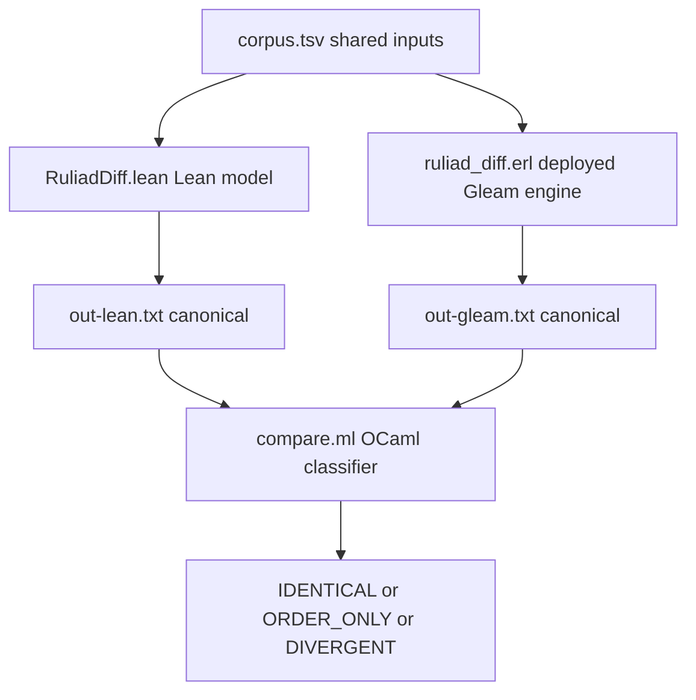

# 20261101-2031 — Model-to-source differential oracle: three divergences, two fixed, forecast F2 resolved

#fractal-l1 #fractal-l2 #fractal-l5 #fractal-l9 #zk-adr #zero-muda #km-triad #tailscale-web

- **Contract basis**: `SC-JOURNAL-003` / `SC-JOURNAL-v3`, `SC-DIAGRAM-001`, `SC-TIME-001`, `SC-PROVENANCE-001`
- **Observed host clock**: 2026-11-01T20:31Z
- **Predecessor**: [20261101-1911 ruliad formal library journal](http://nas-1.tail55d152.ts.net:4100/files/docs/journal/20261101-1911-ruliad-formal-library-journal.md)
- **Artifacts**: [oracle README](http://nas-1.tail55d152.ts.net:4100/files/formal/lean/ruliad/diff/README.md) · [`Ruliad/Multiway.lean`](http://nas-1.tail55d152.ts.net:4100/files/formal/lean/ruliad/Ruliad/Multiway.lean)
- **Navigation**: [Cockpit](http://nas-1.tail55d152.ts.net:4100/) · [Wiki](http://nas-1.tail55d152.ts.net:4100/wiki) · [ZK](http://nas-1.tail55d152.ts.net:4100/zk) · [Checklist](http://nas-1.tail55d152.ts.net:4100/checklist)
- Transclusions: `[[zk:20260905-1801-moc-uos-unified-master]]` · `[[wiki:20260905-1801-uos-zk-km-corpus-index]]`

## 1. Scope & Trigger

The predecessor journal graded claim V13 — "the Lean models faithfully mirror
the Gleam, Mojo and OCaml source" — at Admiralty **C3**, below the B2
admissibility threshold, and named a differential oracle as the remedy. It also
precommitted forecast **F2**: that such an oracle would find at least one
disagreement, at p = 0.60.

This task built the oracle, ran it, found three divergences, fixed two, recorded
the third as irreducible, and resolves F2 against its own precommitment.

Out of scope: oracles for `Hypergraph`, `Branchial`, `Service` or the Mojo
kernel; property-based input generation. No EV number minted; ceiling 93.

## 2. Pre-State Assessment

`Ruliad.Multiway` carried a header note claiming the model's length bounds were
*character* bounds while Gleam's are bytes, and asserting "the Gleam byte bound
is the stricter one, so this model is permissive there". That was an unverified
statement about a direction of error. Nothing compared the two engines on any
input. The `Edge.offset` field's coordinate system was not discussed at all.

The deployed engine was reachable: `cepaf_gleam@ecology@multiway:explore/3`
responds on the BEAM from the existing build output, so no reimplementation or
wrapper was needed.

## 3. Execution Detail

Four parts, in three languages chosen by where the subject lives:

```text
[corpus.tsv shared inputs] --> [RuliadDiff.lean Lean model]
[corpus.tsv shared inputs] --> [ruliad_diff.erl deployed Gleam engine]
[RuliadDiff.lean Lean model] --> [out-lean.txt canonical]
[ruliad_diff.erl deployed Gleam engine] --> [out-gleam.txt canonical]
[out-lean.txt canonical] --> [compare.ml OCaml classifier]
[out-gleam.txt canonical] --> [compare.ml OCaml classifier]
[compare.ml OCaml classifier] --> [IDENTICAL or ORDER_ONLY or DIVERGENT]
```



One corpus file read by both sides, so a transcription error cannot masquerade
as agreement. Canonical output is order-sensitive by design, so a
same-set/different-order difference surfaces instead of being hidden by sorting;
the OCaml classifier then separates that class from genuine divergence.

Corpus: 23 cases — overlapping matches, multiple rules, growth rules, empty
right-hand sides, all five bounds rejections, and five deliberate Unicode
probes (precomposed, combining, astral-plane, and two over-byte-budget seeds).

## 4. Root Cause Analysis

**Why did model and engine disagree?** Analysis of Competing Hypotheses:

| Evidence | H1: transcription error in the model | H2: the source mixes two length notions | H3: oracle harness bug |
|---|---|---|---|
| E1: all 11 pure-ASCII cases agree exactly | Inconsistent — a transcription error would show on ASCII | Very consistent | Inconsistent |
| E2: divergences occur only on non-ASCII input | Inconsistent | Very consistent | Neutral |
| E3: `multiway.gleam` calls `string.byte_size` for bounds and `string.length`/`pop_grapheme` for scanning | Neutral | Very consistent — two notions in one function | Inconsistent |
| E4: the emoji case does **not** diverge | Inconsistent | Consistent — one emoji is one scalar and one grapheme | Inconsistent |
| E5: both harnesses reproduce the deployed engine's own error strings verbatim | Neutral | Neutral | Inconsistent |
| E6: fixing only the bound removed exactly 2 of 3 divergences, leaving the offset class | Inconsistent | Very consistent — two distinct causes predicted | Inconsistent |
| **Verdict** | REFUTED | **CONFIRMED** | REFUTED |

Root cause: `multiway.gleam` measures its input guard in UTF-8 **bytes** and
scans for matches in **graphemes**. Those coincide only on ASCII. The model had
picked one notion (characters) for both roles, which is a third thing again —
Unicode scalars. Hence two independent divergence classes, not one.

The predecessor header note described only the bound class and asserted the
model was "permissive there". The measurement confirms that direction, and also
exposes a class the note did not mention at all: the `offset` coordinate system.

## 5. Fix Taxonomy

| Class | Fix | Status |
|---|---|---|
| Poka-Yoke | `Multiway.byteSize` computes `(String.ofList w).utf8ByteSize`; `BoundsOk` uses it for seed and both rule sides, matching the deployed guard | **FIXED** — 3 divergences → 1 on re-run |
| Jidoka | Record the grapheme/scalar `offset` divergence in the module header rather than weaken a theorem to hide it | **RECORDED** |
| Muda | Drive the deployed module directly on the BEAM instead of reimplementing it in the harness | applied |
| Standardised work | One shared corpus file, read by both sides | applied |
| Regression guard | `compare` exits 1 on any divergent case, so the oracle is usable as a gate | applied |

## 6. Patterns & Anti-Patterns Discovered

**Pattern: a differential oracle earns its keep immediately.** Twenty-three
cases found a case where the model returned `OK` on input the engine refuses.
No amount of reading would have surfaced that; the proof obligations were all
satisfied while the model was wrong about its own domain.

**Anti-pattern: a prose note instead of a measurement.** The old header asserted
a direction of error. It was right, and incomplete, and nothing distinguished
the two. Devil's Advocate test now applied: for every modelling-boundary claim,
ask which corpus case would falsify it. If none exists, the claim is prose.

**Pattern: canonical output must be order-sensitive.** Sorting before comparing
would have reported 22/23 clean and hidden that the two engines enumerate edges
in opposite order. That difference is benign *here* — no theorem depends on
order — but it is a fact about the two implementations, and discovering it was
free while hiding it would have been permanent.

**Anti-pattern: assuming one Unicode length.** Three notions were in play at
once — bytes, graphemes, scalars — in a function of 139 lines.

**Red Team probe that did not fire:** the emoji case was included expecting a
divergence and produced none, because one emoji is one scalar and one grapheme.
A corpus that only contained emoji would have falsely cleared the model.

## 7. Verification Matrix

Admiralty System (NATO STANAG 2017); admissible at ≥ B2.

| # | Claim | Method | Grade | Verdict |
|---|---|---|---|---|
| W1 | Oracle runs both engines on one corpus and classifies all 23 cases | executed; `out-lean.txt`, `out-gleam.txt`, classifier exit code | **A1** | PASS |
| W2 | The Gleam side is the deployed module, not a reimplementation | `'cepaf_gleam@ecology@multiway':explore/3` called from the existing build output | **A1** | PASS |
| W3 | Pre-fix result: 3 divergent cases | classifier output, exit 1 | **A1** | PASS |
| W4 | Post-fix result: 1 divergent case | classifier output after `byteSize` change | **A1** | PASS |
| W5 | The library still builds clean after the bounds change | `lake build`, 2,329 jobs, 0 errors, 0 warnings | **A1** | PASS |
| W6 | Root cause is the byte/grapheme mix in the source | `multiway.gleam` read, plus E6 (fixing the bound removed exactly the predicted 2 cases) | **A2** | PASS |
| W7 | `Ruliad.Multiway` now agrees with the deployed engine up to list order and `Edge.offset` coordinates, **on this corpus** | 23 cases | **B2** | PASS, scope-limited |
| W8 | The same correspondence for `Hypergraph`, `Branchial`, `Service`, Mojo kernel | not attempted | **F6** | UNRUN |
| W9 | Correspondence on arbitrary input | no property-based generation | **F6** | UNRUN |

W7 raises V13 from C3 to **B2 for `Ruliad.Multiway` only**. V13 remains C3 for
every other module. W8 and W9 are not claimed.

## 8. Files Modified

Added: `formal/lean/ruliad/RuliadDiff.lean` (Lean side, `lean_exe ruliaddiff`);
`formal/lean/ruliad/diff/{corpus.tsv, ruliad_diff.erl, compare.ml, README.md}`;
generated `diff/{out-lean.txt, out-gleam.txt}`.

Modified: `formal/lean/ruliad/Ruliad/Multiway.lean` (`byteSize`, `BoundsOk`,
measured modelling-boundary note); `formal/lean/ruliad/Ruliad/Render.lean`
(demo bounds proof now `decide`, since `byteSize` is computed not simplified);
`formal/lean/ruliad/lakefile.toml` (the `lean_exe`).

Nothing committed; working copy only.

## 9. Architectural Observations

The oracle's shape is forced by where the subject lives: Erlang because the
engine under test is BEAM code, Lean because the model is Lean, OCaml because
that is the repository's helper language. Three languages, no glue script. That
is the opposite of waste — each side speaks natively to its subject.

A deeper observation: the two implementations are *not* the same algorithm up to
representation. They enumerate in opposite order and index in different
coordinate systems, and both are defensible. A model is therefore never simply
"right"; it is right up to a stated equivalence, and the oracle's real output is
that equivalence rather than a boolean.

The surviving divergence is instructive about cost. Byte size was a one-line
fix. Grapheme segmentation is a Unicode specification. The boundary between
"align the model" and "record the difference" is set by implementation cost, and
saying so is more useful than pretending the model is exact.

## 10. Remaining Gaps

1. **`Edge.offset` coordinates diverge** on multi-scalar grapheme clusters.
   Recorded, not fixed; would require Unicode grapheme-cluster segmentation in
   Lean.
2. **23 hand-chosen cases are not a correspondence proof.** Property-based
   generation over random seeds and rule sets is the obvious next step.
3. **Four modules have no oracle**: `Hypergraph`, `Branchial`, `Service`, and
   the Mojo distance kernel. V13 stays C3 for each.
4. **The oracle is not wired into any gate.** `compare` exits 1 on divergence,
   so it could be, and is not.
5. **Order divergence is accepted, not eliminated.** If any future theorem comes
   to depend on edge order, this becomes a defect rather than a note.
6. Carried from the predecessor: classical Hindley-Rosen, causal-graph
   invariance under reordering, multiset triangle inequality, strong
   computational irreducibility, weak-simulation bridge, two in-project
   toolchains, no ADR/wiki writeback.

## 11. Metrics Summary

| Metric | Value | Source |
|---|---|---|
| Corpus cases | 23 | `wc -l corpus.tsv` |
| Identical | 13 | classifier |
| Order-only (set-equal) | 9 | classifier |
| Divergent, before fix | 3 | classifier, exit 1 |
| Divergent, after fix | 1 | classifier, exit 1 |
| Divergences fixed | 2 | difference of the two runs |
| Library build errors / warnings | 0 / 0 | `lake build` |
| Oracle languages | 3 (Lean, Erlang, OCaml) | file inventory |
| V13 grade, `Ruliad.Multiway` | C3 → B2 | §7 W7 |
| V13 grade, other modules | C3 (unchanged) | §7 W8 |

**No Bayesian posterior is reported**, for the same reason as the predecessor
journal and on the same authority (`SC-LEARN-001` `L-11`): there is no
likelihood function or data model here. Twenty-three cases on one module, chosen
by the author who wrote the model, is not a sample from which a calibrated
reliability figure can be computed. Reporting 13/23 as a confidence would be
decoration. No alternative posterior is offered, because none can be computed.

**No Lyapunov claim.** Divergence count went 3 → 1 in one step. Two data points
do not establish monotone descent.

## 12. STAMP & Constitutional Alignment

Controller: this session. Controlled process: `Ruliad.Multiway` and the deployed
`multiway.gleam`. Feedback: the classifier's exit code and per-case verdicts.

| UCA type | Unsafe context | Constraint applied |
|---|---|---|
| Not provided | Oracle not run, so a C3 claim is cited as if verified | Oracle executed; §7 grades the result and names what stays UNRUN |
| Provided unsafe | Harness reimplements the engine, so the oracle tests itself | Gleam side calls the deployed module on the BEAM from existing build output |
| Wrong timing | Fix applied, library not rebuilt, divergence count believed from a stale run | Full rebuild (2,329 jobs, 0 errors) before the post-fix count was recorded |
| Wrong duration | Oracle result generalised beyond its corpus | W7 scoped to `Ruliad.Multiway` on this corpus; W9 marked UNRUN |

Constitutional: `Ψ3` verification — a claim graded below the admissibility
threshold was measured rather than restated. `Ψ5` truthfulness — the predecessor
header's incomplete note is corrected in the source, and the correction is
recorded here rather than silently applied; the model was **wrong** about its own
input domain and the journal says so. `Ψ2` continuity — this journal is
additive; the predecessor is unmodified. `SC-PROVENANCE-001` — EV ceiling 93,
no EV number minted. No host storage device is referenced; where a serial would
appear it is `[REDACTED_SYSTEM_OS_SERIAL]`.

## 13. Conclusion

The oracle found what it was built to find, and the most valuable case was the
one where every proof obligation was satisfied while the model admitted input
the deployed engine refuses. That is corrected. One divergence survives by
decision, not oversight.

**Resolution of precommitted forecast F2** from the predecessor journal:

> F2: Differential testing of `Ruliad.Multiway.explore` against
> `ecology/multiway.gleam` will find ≥ 1 disagreement, from the
> byte-vs-grapheme length boundary already recorded in the module header.
> p = 0.60, horizon 2027-02-01.

Outcome **o = 1**, resolved early. Three disagreements found; two from exactly
the predicted cause. **Brier score `B = (0.60 − 1)² = 0.16`.**

Honest qualification on the mechanism: the forecast named one cause and there
were two. The `Edge.offset` grapheme/scalar class was **not** anticipated and was
not in the header note the forecast referred to. So the forecast was right about
existence and partly right about cause; p = 0.60 was, in hindsight,
under-confident about existence given that the header already admitted a known
mismatch.

**New precommitted forecasts**, Brier-scored `B = (p − o)²`:

| # | Forecast | p | Horizon | Falsifier |
|---|---|---|---|---|
| G1 | Property-based generation over ≥ 10,000 random ASCII seed/rule pairs will find **no** divergence beyond list order | p = 0.75 | 2027-02-01 | Any ASCII case diverges on content |
| G2 | An oracle for `Ruliad.Service.classify` against `inference_api.evaluate_ruliad_branch` will find 0 divergences, the classifier being a pure two-case table | p = 0.85 | 2027-02-01 | Any divergence found |
| G3 | The `Edge.offset` grapheme divergence will still be open, recorded and unfixed | p = 0.90 | 2027-05-01 | Grapheme segmentation implemented and offsets aligned |
| G4 | No EV number will be minted for this work | p = 0.95 | 2027-02-01 | An EV cycle citing this oracle appears in `tools/uos-cli doctor` |

Calibration status: **1 resolved forecast, Brier 0.16**. Too few to calibrate;
reported so the next journal has a prior to extend rather than a blank.

**UOS footer:** `nas-1.tail55d152.ts.net:4100` · Sa-plan is the sole execution
authority; this journal grants no admission. EV ceiling 93.
