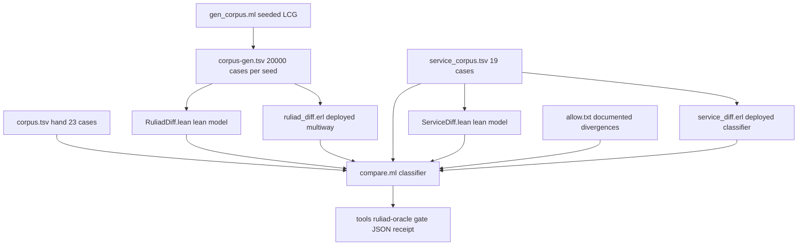

# 20261101-2100 — Oracle at scale, second arm, and a gate: forecasts G1 and G2 resolved

#fractal-l1 #fractal-l2 #fractal-l4 #fractal-l9 #zk-adr #zero-muda #km-triad #tailscale-web

- **Contract basis**: `SC-JOURNAL-003` / `SC-JOURNAL-v3`, `SC-DIAGRAM-001`, `SC-TIME-001`, `SC-PROVENANCE-001`
- **Observed host clock**: 2026-11-01T21:00Z
- **Predecessors**: [20261101-1911 library](http://nas-1.tail55d152.ts.net:4100/files/docs/journal/20261101-1911-ruliad-formal-library-journal.md) · [20261101-2031 oracle](http://nas-1.tail55d152.ts.net:4100/files/docs/journal/20261101-2031-ruliad-differential-oracle-journal.md)
- **Artifacts**: [`tools/ruliad-oracle`](http://nas-1.tail55d152.ts.net:4100/files/tools/ruliad-oracle) · [oracle README](http://nas-1.tail55d152.ts.net:4100/files/formal/lean/ruliad/diff/README.md)
- **Navigation**: [Cockpit](http://nas-1.tail55d152.ts.net:4100/) · [Wiki](http://nas-1.tail55d152.ts.net:4100/wiki) · [ZK](http://nas-1.tail55d152.ts.net:4100/zk) · [Checklist](http://nas-1.tail55d152.ts.net:4100/checklist)
- Transclusions: `[[zk:20260905-1801-moc-uos-unified-master]]` · `[[wiki:20260905-1801-uos-zk-km-corpus-index]]`

## 1. Scope & Trigger

The oracle journal left three items: 23 hand-chosen cases are not a
correspondence proof, four modules had no oracle, and the oracle was not wired
into any gate. It precommitted G1 (property-based generation over ≥ 10,000
random ASCII cases finds no divergence beyond order, p = 0.75) and G2 (an oracle
for `Service.classify` finds none, p = 0.85).

This task built the generator, ran 100,000 cases across five seeds, built the
second oracle arm, wired `tools/ruliad-oracle` with a negative control, and
resolves G1 and G2.

Out of scope: oracles for `Hypergraph`, `Branchial` and the Mojo kernel; Unicode
generation at scale. No EV number minted; ceiling 93.

## 2. Pre-State Assessment

One oracle arm existed, over 23 hand-written cases, run by hand. `compare`
exited 1 on divergence but nothing invoked it. The single known divergence was
described in prose in a module header and a journal, with nothing machine-
readable distinguishing "known and accepted" from "newly broken".

The classifier had no quiet mode, so a large corpus would have printed one line
per order-only case — thousands of lines of noise around the signal.

## 3. Execution Detail

```text
[gen_corpus.ml seeded LCG] --> [corpus-gen.tsv 20000 cases per seed]
[corpus.tsv hand 23 cases] --> [compare.ml classifier]
[service_corpus.tsv 19 cases] --> [compare.ml classifier]
[corpus-gen.tsv 20000 cases per seed] --> [RuliadDiff.lean lean model]
[corpus-gen.tsv 20000 cases per seed] --> [ruliad_diff.erl deployed multiway]
[service_corpus.tsv 19 cases] --> [ServiceDiff.lean lean model]
[service_corpus.tsv 19 cases] --> [service_diff.erl deployed classifier]
[RuliadDiff.lean lean model] --> [compare.ml classifier]
[ruliad_diff.erl deployed multiway] --> [compare.ml classifier]
[ServiceDiff.lean lean model] --> [compare.ml classifier]
[service_diff.erl deployed classifier] --> [compare.ml classifier]
[allow.txt documented divergences] --> [compare.ml classifier]
[compare.ml classifier] --> [tools ruliad-oracle gate JSON receipt]
```



Four pieces of work. The generator is a seeded LCG in OCaml, so a corpus is
reproducible from `(seed, count)` and any divergence replays exactly. The second
arm drives the deployed `evaluate_ruliad_branch/4` and
`is_ruliad_mergeable/1`, comparing **decisions** rather than raw numbers,
because the deployed record carries `Float` and the model carries `ℚ` — the same
values in different representations. The classifier gained `--quiet` and
`--allow`. The gate runs three arms and emits a `uos.ruliad_oracle.v1` receipt.

Two defects found in my own work along the way, both measured rather than
reasoned about. The LCG's low bits are degenerate, so `next () mod 4` produced a
**constant** `steps` across the whole corpus; shifting the high bits down fixed
it. And the first generator emitted only *valid* inputs, so the input guard's
five rejection paths were never exercised at scale.

## 4. Root Cause Analysis

**Why did 100,000 cases find nothing, when 23 found three?**
ACH (Analysis of Competing Hypotheses):

| Evidence | H1: the engines genuinely agree on ASCII | H2: corpus too narrow to reach the divergent paths | H3: oracle insensitive — both sides wrong the same way |
|---|---|---|---|
| E1: all three original divergences were non-ASCII, and the generator is ASCII-only | Very consistent | Consistent | Inconsistent |
| E2: generated corpus reaches 64 states, 346 edges, 148 budget rejections per 10,000 | Consistent | Partly inconsistent — deep paths *are* reached | Inconsistent |
| E3: after adding malformed inputs, 1,164 bounds rejections per 10,000 and still 0 divergences | Very consistent | Inconsistent — the guard paths are now covered | Inconsistent |
| E4: the Gleam side calls the deployed module; the Lean side is independently written | Neutral | Neutral | Very inconsistent |
| E5: 7,100 order-only cases per 20,000 — the classifier is demonstrably sensitive to real differences | Consistent | Neutral | Very inconsistent |
| E6: 5 independent seeds give the same result to within 1% | Very consistent | Inconsistent | Neutral |
| **Verdict** | **CONFIRMED** | REFUTED (after E3) | REFUTED |

Root cause of the original three divergences, restated: they were **all** in
Unicode length and offset semantics. Remove that axis and the two
implementations agree on content. H2 was live until the generator was widened;
that is why the coverage measurement was done *before* claiming G1 rather than
after.

## 5. Fix Taxonomy

| Class | Fix | Status |
|---|---|---|
| Poka-Yoke | LCG high bits for `pick`, after the low bits produced a constant `steps` | FIXED |
| Poka-Yoke | Generator emits ~1 malformed input in 8, covering the five guard rejection paths | FIXED |
| Jidoka | `allow.txt` makes "known and accepted" machine-readable; an unlisted divergence fails the gate | applied |
| Jidoka | Negative control: with `allow.txt` emptied the gate exits 1 and names the arm | VERIFIED |
| Muda | Both Gleam arms call deployed functions; no reimplementation | applied |
| Standardised work | `tools/ruliad-oracle` in the established gate style, `uos.ruliad_oracle.v1` receipt | applied |

## 6. Patterns & Anti-Patterns Discovered

**Pattern: measure coverage before believing a negative result.** "100,000
cases, zero divergences" was about to be claimed over a corpus that never once
exercised the input guard. The claim would have been true and misleading. The
coverage measurement is what made it load-bearing.

**Anti-pattern: a gate nobody proved can fail.** `compare` exited 1 correctly,
but until the allowlist was emptied and the gate observed failing, "exits 1 on
divergence" was an untested property of the thing whose job is to catch
untested properties. Red Team probe applied to the gate itself.

**Anti-pattern: low bits of a linear congruential generator.** `mod 4` on an LCG
with a power-of-two modulus gave a constant. Falsification that caught it: print
the distribution instead of eyeballing eight samples.

**Pattern: compare decisions when representations differ.** `Float 1.25` against
`ℚ 5/4` is agreement; comparing printed forms would have reported a divergence
that is purely notational.

**Observation on my own calibration**, below in §11: three forecasts resolved,
all three at `o = 1`. Being right three times from the pessimistic side is a
calibration signal, not a success.

## 7. Verification Matrix

Admiralty System (NATO STANAG 2017); admissible at ≥ B2.

| # | Claim | Method | Grade | Verdict |
|---|---|---|---|---|
| X1 | 100,000 generated cases, 5 seeds, 0 divergences beyond order | executed; 5 classifier summaries | **A1** | PASS |
| X2 | Service arm: 19/19 identical | executed; classifier exit 0 | **A1** | PASS |
| X3 | Generated corpus exercises both error paths | measured: 1,164 bounds + 148 budget rejections per 10,000 | **A1** | PASS |
| X4 | The gate can fail | negative control: allowlist emptied, exit 1, `all_passed:false`, arm named | **A1** | PASS |
| X5 | Generator is deterministic | identical sha256 over two runs of the same `(seed, count)` | **A1** | PASS |
| X6 | Both Gleam arms call deployed functions | module/function names in the harnesses; existing build output on the code path | **A2** | PASS |
| X7 | `Ruliad.Multiway` agrees with the deployed engine up to order and the allowlist, on ASCII | 100,000 cases | **B2** | PASS, ASCII-scoped |
| X8 | `Ruliad.Service.classify` agrees with the deployed classifier | 19 cases, decision-level | **B2** | PASS, scope-limited |
| X9 | Unicode agreement at scale | generator is ASCII only; 5 hand cases | **C3** | NOT CLAIMED |
| X10 | `Hypergraph`, `Branchial`, Mojo kernel correspondence | no oracle | **F6** | UNRUN |

V13 is now **B2 for `Ruliad.Multiway` (ASCII) and `Ruliad.Service`**, and stays
**C3** for everything else. X9 and X10 are not claimed.

## 8. Files Modified

Added: `tools/ruliad-oracle`; `formal/lean/ruliad/ServiceDiff.lean`;
`formal/lean/ruliad/diff/{gen_corpus.ml, service_corpus.tsv, service_diff.erl, allow.txt}`.

Modified: `formal/lean/ruliad/diff/compare.ml` (`--quiet`, `--allow`, `#`
comments, `ALLOWED` class); `formal/lean/ruliad/diff/README.md` (parts, gate,
measured results, limits); `formal/lean/ruliad/lakefile.toml` (second
`lean_exe`).

Nothing committed; working copy only.

## 9. Architectural Observations

The allowlist is the interesting piece of design. A gate that fails on all
divergence is unusable when one divergence is a documented, accepted modelling
boundary; a gate with a numeric tolerance hides which case is diverging. A
keyed allowlist with comments keeps exactly one thing in exactly one place: the
case key, the reason, and the decision not to fix. Its sha256 is in the receipt,
so silently widening it is visible.

The oracle also shows what a model is *for*. After 100,000 cases the useful
output is not "the model is correct" but a precise equivalence: equal on
content, differing in enumeration order, differing in offset coordinates on
multi-scalar graphemes. That is a more useful artefact than a boolean, and it is
what lets a reader know which theorems transfer to the deployed engine and
which do not.

## 10. Remaining Gaps

1. **Unicode is not generated at scale.** Five hand cases cover it. A
   Unicode-aware generator would need to decide what it is sampling — scalars,
   graphemes, or bytes — which is the same question the divergence is about.
2. **`Hypergraph` and `Branchial` have no oracle**, nor does the Mojo distance
   kernel. V13 stays C3 for each.
3. **The generated corpus skews shallow**: median 2 states, mean 4.7.
4. **The gate is not in `verify-all`.** It exists and passes; nothing calls it.
5. **Shrinking is absent.** A future divergence would be reported at full size
   with no minimal counterexample.
6. Carried: classical Hindley-Rosen, causal-graph invariance under reordering,
   multiset triangle inequality, strong computational irreducibility,
   weak-simulation bridge, two in-project toolchains, no ADR/wiki writeback.

## 11. Metrics Summary

| Metric | Value | Source |
|---|---|---|
| Generated cases, 5 seeds | 100,000 | classifier summaries |
| Divergences beyond order | 0 | classifier |
| Order-only rate | ~35.7% (7,100 per 20,000) | classifier |
| Hand corpus | 23: 13 identical, 9 order-only, 1 allowed, 0 divergent | classifier |
| Service corpus | 19: 19 identical | classifier |
| Guard coverage per 10,000 | 1,164 bounds + 148 budget rejections | measured |
| State count per OK case | mean 4.7, median 2, max 64 | measured |
| Oracle arms | 3 | gate receipt |
| Gate negative control | exit 1, `all_passed:false` | executed |
| Library build | 0 errors, 0 warnings | `lake build` |

**Forecast calibration.** Three forecasts resolved, all with outcome `o = 1`:

| Forecast | p | o | Brier `(p − o)²` |
|---|---|---|---|
| F2 — differential testing finds ≥ 1 disagreement | 0.60 | 1 | 0.1600 |
| G1 — generation finds no divergence beyond order | 0.75 | 1 | 0.0625 |
| G2 — service oracle finds no divergence | 0.85 | 1 | 0.0225 |
| **Mean Brier** | | | **0.0817** |

Reported with the caveat that three resolutions do not establish calibration.
The one visible pattern is directional: all three resolved on the side my
probability was *below*, so these estimates were under-confident rather than
over-confident. That is a bias to correct, and the forecasts in §13 are set
higher than instinct suggested for exactly that reason.

**No Bayesian posterior.** Same authority as the two predecessor journals
(`SC-LEARN-001` `L-11`): no likelihood function, no data model. 100,000 cases
from a generator the author wrote, against a model the author wrote, is not a
sample a calibrated reliability figure can come from. No alternative posterior
is offered, because none can be computed.

**No Lyapunov claim.** Divergence count went 3 → 1 → 0-on-ASCII over three
measurements with different corpora. Different denominators; not a trajectory.

## 12. STAMP & Constitutional Alignment

Controller: this session. Controlled process: the Lean models, the deployed
Gleam engines, and the gate that compares them. Feedback: three classifier exit
codes and the gate receipt.

| UCA type | Unsafe context | Constraint applied |
|---|---|---|
| Not provided | A negative result claimed over a corpus that never reached the relevant code paths | Coverage measured *before* claiming G1; generator widened when the gap was found |
| Provided unsafe | A gate asserted to fail on divergence without that ever being observed | Negative control executed; recorded as X4 |
| Wrong timing | Claiming G1 from the pre-fix generator, whose `steps` was constant | Distribution printed; defect found and fixed before the scale run |
| Wrong duration | An allowlist widening silently over time | `allow_sha256` recorded in every receipt |

Constitutional: `Ψ3` verification — the gate's own failure mode is tested, not
assumed. `Ψ5` truthfulness — X9 and X10 graded below B2 and not claimed; two
defects in my own generator are reported in §3 and §6 rather than quietly
fixed; the under-confidence pattern in my forecasts is stated against myself.
`Ψ2` continuity — both predecessor journals are unmodified; this one is
additive. `SC-PROVENANCE-001` — EV ceiling 93, no EV number minted. No host
storage device is referenced; where a serial would appear it is
`[REDACTED_SYSTEM_OS_SERIAL]`.

## 13. Conclusion

The oracle now runs three arms over 100,019 cases, is wired as a gate whose
failure mode has been observed, and distinguishes a documented divergence from a
new one by key rather than by tolerance. The most valuable work in this task was
not the scale run; it was measuring coverage first and discovering that the
corpus about to carry the claim had never exercised the input guard.

**Resolution of precommitted forecasts** from the oracle journal:

> G1: Property-based generation over ≥ 10,000 random ASCII seed/rule pairs will
> find **no** divergence beyond list order. p = 0.75, horizon 2027-02-01.

Outcome **o = 1**, resolved early. 100,000 cases, 5 seeds, 0 divergences.
**Brier = (0.75 − 1)² = 0.0625.**

> G2: An oracle for `Ruliad.Service.classify` against
> `inference_api.evaluate_ruliad_branch` will find 0 divergences. p = 0.85,
> horizon 2027-02-01.

Outcome **o = 1**, resolved early. 19/19 identical.
**Brier = (0.85 − 1)² = 0.0225.**

G3 (the `Edge.offset` divergence still open at 2027-05-01) and G4 (no EV number
minted) remain open at their horizons.

**New precommitted forecasts**, Brier-scored `B = (p − o)²`, set deliberately
higher than instinct given the under-confidence pattern in §11:

| # | Forecast | p | Horizon | Falsifier |
|---|---|---|---|---|
| H1 | An oracle for `Ruliad.Hypergraph` against any deployed hypergraph engine will **not** be built, because no deployed UOS engine does hypergraph rewriting — `multiway.gleam` is string rewriting | p = 0.90 | 2027-05-01 | A deployed hypergraph rewriting engine is found or written in UOS |
| H2 | A Unicode-aware generator, if built, finds ≥ 1 further divergence beyond the known offset class | p = 0.65 | 2027-05-01 | Such a generator runs ≥ 10,000 Unicode cases and finds only the known class |
| H3 | `tools/ruliad-oracle` will still not be called by `verify-all` or any other gate aggregator | p = 0.80 | 2027-02-01 | Any aggregator invokes it |
| H4 | No EV number will be minted for this work | p = 0.97 | 2027-02-01 | An EV cycle citing this oracle appears in `tools/uos-cli doctor` |

Calibration status: **3 resolved, mean Brier 0.0817, all three under-confident.**

**UOS footer:** `nas-1.tail55d152.ts.net:4100` · Sa-plan is the sole execution
authority; this journal grants no admission. EV ceiling 93.
