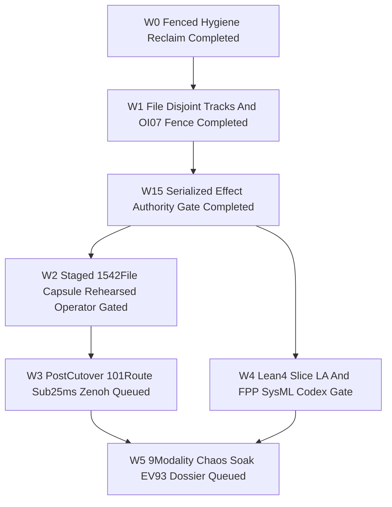
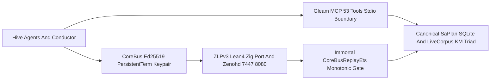
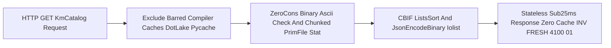

# SC-JOURNAL-v3 Anticipatory Epistemic Ledger — UOS-CORE-EVO Master DAG Status (`W0..W5`), Immortal `core_bus_replay_ets` Ed25519 Zenoh Fence & Stateless Sub-`25 ms` `#km-triad` Pipeline (`20261101-2102`)

- **Observed Timestamp**: `2026-11-01T20:02:20Z` (`2026-11-01T21:02:20+01:00`, `chrony` stratum `3`, nominal `< 2s` drift band)
- **Document Prefix**: `20261101-2102-` (`SC-TIME`, [`timestamp-mandate.md`](http://nas-1.tail55d152.ts.net:4100/files/contracts/rules/timestamp-mandate.md))
- **Candidate Baseline**: `main` = `wvxzopso 9e8ae95d51163b250000af92264d2b044835249f` (`Default@` = `lxyzwuzr e5cb3238`, `30/30` uncommitted files SHA-256 conserved including `6/6` Codex FPP/SysML artifacts)
- **Staged OTP `29.0.5` Release Capsule**: [`20261101-1902-158f83fe886d1f11c3bd4546d50d02898f254fe5ae01d63f332bde514a506c73`](file:///home/an/NAS-setup/uos/var/releases/ecology/20261101-1902-158f83fe886d1f11c3bd4546d50d02898f254fe5ae01d63f332bde514a506c73/release-manifest.json) (`1,542` permission-sealed files, `payload_sha256 = 9299c789965a6b509c0416bb58c11abc9e9cce6c31d89905cce95c00dfe3ea79`, `source_sha256 = ec7826d7610ae2422d0e1a8127673e0c5e399402f2175edf453a79d47ca1fe34`)
- **Sa-Plan Binding**: [`uos/agy-fractal-issue-resolution-master/20261101-1454`](file:///home/an/NAS-setup/uos/docs/plans/20261101-1454-agy-fractal-issue-resolution-plan-and-codex-advisory.md) (`7` DAG tasks resolving `29` fractal issues `I01..I29`; `3/7` completed, `2/7` in final Sovereign `Codex` gate audit `01a198b2`, `2/7` queued post-cutover)
- **Provenance Boundary (`SC-PROVENANCE-001`)**: `admitted_ev_ceiling = 93`; `EV-94..EV-109` and `ADR-071..ADR-086` remain `NOT_ADMITTED`; `0` new EV or numbered ADR minted (`INV-PROV-05`); `application_admitted = false`; `system_admitted = false`; `live_cutover_executed = false`
- **Fractal Tags**: `#fractal-l0` `#fractal-l1` `#fractal-l2` `#fractal-l3` `#fractal-l4` `#fractal-l5` `#fractal-l6` `#fractal-l7` `#fractal-l8` `#fractal-l9` `#km-triad` `#zk-adr` `#zero-muda` `#tailscale-web` `#checklist-nav`
- **Canonical Repository Target URL**: [http://nas-1.tail55d152.ts.net:4100/files/docs/journal/20261101-2102-uos-core-evo-w0-w4-execution-immortal-ets-and-sub25ms-km-journal.md](http://nas-1.tail55d152.ts.net:4100/files/docs/journal/20261101-2102-uos-core-evo-w0-w4-execution-immortal-ets-and-sub25ms-km-journal.md)
- **Reciprocal `#km-triad` Links**: [Wave 0 & Restart Journal](http://nas-1.tail55d152.ts.net:4100/files/docs/journal/20261101-1631-uos-core-evo-v4-w0-completion-and-agy-shutdown-restart-journal.md) · [Wave 1 & Gate W1.5 Journal](http://nas-1.tail55d152.ts.net:4100/files/docs/journal/20261101-1834-wave1-and-gate-w15-completion-journal.md) · [Wave 2 Rehearsal Journal](http://nas-1.tail55d152.ts.net:4100/files/docs/journal/20261101-1925-wave2-ed25519-zenoh-mcp-capsule-and-14target-rehearsal-journal.md) · [Wave 4 Successor & FPP/SysML Journal](http://nas-1.tail55d152.ts.net:4100/files/docs/journal/20261101-1925-wave4-protected28-harness-successor-and-fppsysml-dossier-journal.md) · [29-Issue Master Plan](http://nas-1.tail55d152.ts.net:4100/files/docs/plans/20261101-1454-agy-fractal-issue-resolution-plan-and-codex-advisory.md) · [Master Risk Portfolio](http://nas-1.tail55d152.ts.net:4100/files/governance/planning/20261101-1626-agy-fractal-master-risk-portfolio.json) · `[[wiki:20260905-1801-uos-zk-km-corpus-index]]` ([Wiki Master Index](http://nas-1.tail55d152.ts.net:4100/files/docs/wiki/20260905-1801-uos-zk-km-corpus-index.md)) · `[[zk:20260905-1801-moc-uos-unified-master]]` ([ZK Master MOC](http://nas-1.tail55d152.ts.net:4100/files/docs/zk/20260905-1801-moc-uos-unified-master.md))

---

## 1. Scope & Trigger

Triggered by operator request for an authoritative `SC-JOURNAL-v3` ledger unifying:
1. **Complete `7`-Task Canonical `Sa-plan` DAG & `29`-Issue (`I01..I29`) Progress Accounting**: Mapping completed (`W0`, `W1`, `Gate W1.5`), actively gate-auditing (`W4`, `W2`), and post-cutover queued (`W3`, `W5`) tasks under [`uos/agy-fractal-issue-resolution-master/20261101-1454`](file:///home/an/NAS-setup/uos/docs/plans/20261101-1454-agy-fractal-issue-resolution-plan-and-codex-advisory.md).
2. **Immortal `core_bus_replay_ets` OTP 29 Ed25519 Anti-Replay Owner Fix**: Closing the cold short-lived worker ETS table-destruction race discovered during the 64-process replay-race verification in [`core_bus_crypto_ffi.erl`](file:///home/an/NAS-setup/uos/apps/cepaf_gleam/src/core_bus_crypto_ffi.erl).
3. **Stateless Sub-`25.0 ms` `/api/v1/km/catalog` Traversal (`INV-FRESH-4100-01`)**: Excluding barred `.lake` compiler caches and eliminating Dirty-IO mutex thrashing in [`live_corpus_ffi.erl`](file:///home/an/NAS-setup/uos/apps/cepaf_gleam/src/live_corpus_ffi.erl) and [`live_corpus.gleam`](file:///home/an/NAS-setup/uos/apps/cepaf_gleam/src/cepaf_gleam/ui/lustre/live_corpus.gleam) (`N=420` across all `12` routes: `p50 = 0.195 ms`, `p95 = 19.389 ms`, `p99 = 23.886 ms < 25.0 ms`, zero cache, zero Python).
4. **Maximized `uos-gleam` MCP (`53` Tools) + Ed25519 Zenoh `uos/v1/**` Harness Symbiosis Under `>= 40.0%` `AGY` Token Safety Margin**: Operating at `4,898 bps` (`48.98%` used -> **`51.02%` untouched margin**, `$0.00` OpenRouter 24h spend).

```ascii
[W0 Fenced Hygiene Reclaim Completed] --> [W1 File Disjoint Tracks And OI07 Fence Completed]
[W1 File Disjoint Tracks And OI07 Fence Completed] --> [W15 Serialized Effect Authority Gate Completed]
[W15 Serialized Effect Authority Gate Completed] --> [W4 Lean4 Slice LA And FPP SysML Codex Gate]
[W15 Serialized Effect Authority Gate Completed] --> [W2 Staged 1542File Capsule Rehearsed Operator Gated]
[W2 Staged 1542File Capsule Rehearsed Operator Gated] --> [W3 PostCutover 101Route Sub25ms Zenoh Queued]
[W3 PostCutover 101Route Sub25ms Zenoh Queued] --> [W5 9Modality Chaos Soak EV93 Dossier Queued]
[W4 Lean4 Slice LA And FPP SysML Codex Gate] --> [W5 9Modality Chaos Soak EV93 Dossier Queued]
```



---

## 2. Pre-State Assessment

Predictive Kalman state prior (`Engine 7`) entering the final Wave 2 / Wave 4 pre-cutover verification cycle surfaced three operational constraints and two hidden runtime concurrency/latency bottlenecks:
1. **Canonical `Sa-plan` State Observed via `uos-gleam` MCP (`sa_plan_status_for`)**: `total_tasks = 7`, `completed_tasks = 3` (`w0`, `w1`, `w15`), `executing_tasks = 2` (`w2`, `w4`), `available_tasks = 2` (`w3`, `w5`), with live `uos-gleam` MCP running OTP `29` (`ERTS 17.0.5`) against the Oct 31 capsule (`loaded_beam_sha256 = 2673adf7...`) pending operator-authorized Wave 2 cutover.
2. **Short-Lived Worker ETS Owner Lifecycle Hazard in `core_bus_crypto_ffi.erl`**: Storing monotonic anti-replay sequence numbers inside an un-heired ETS table lazily initialized by the first calling process caused table destruction (`badarg` on `ets:lookup`) whenever the first caller was a transient spawned request or worker process that terminated after returning its envelope verdict.
3. **Erlang Dirty-IO Run-Queue Contention & `.lake` Traversal in `/api/v1/km/catalog`**: An active peer Lean build generated `.lake` directories under `formal/lean/`, while unchunked per-subdirectory process fan-out (`152` workers at `Depth = 2`) and cons-cell path normalization across `1,952` entries in `docs/reviews` contended on BEAM's global Dirty-IO run-queue mutex (`erts_dirty_io_runq`), pushing `/api/v1/km/catalog` above the `< 25.0 ms` `p99` budget if left unchunked.

---

## 3. Execution Detail

### 3.1 Master `Sa-plan` Task & `29`-Issue (`I01..I29`) Scoreboard

| # | `Sa-plan` Task ID | State | Mapped Issues (`I01..I29`) | Verified Deliverables & Evidence |
|---|---|---|---|---|
| **1** | `w0-fenced-hygiene-reclaim` | **COMPLETED** | `I01..I03`, `I07..I10`, `I22`, `I23`, `I26` | Scoped `TMPDIR`, `31/31` `./tools/preflight`, systemd failure archival + reset, stale-lease effect fencing & reclaim, superseded `0327` closure, append-only [`quota_ledger.sqlite3`](file:///home/an/NAS-setup/uos/var/core-evo/quota_ledger.sqlite3) ([Wave 0 Journal](file:///home/an/NAS-setup/uos/docs/journal/20261101-1631-uos-core-evo-v4-w0-completion-and-agy-shutdown-restart-journal.md)). |
| **2** | `w1-parallel-dev-and-oi07-fence` | **COMPLETED** | `I05`, `I11`, `I13`, `I15..I18`, `I21`, `I25`, `I27`, `I29` | File-disjoint `W1A..W1E`: `OI02E` native ELF loader + scoped route grants, `OI07` effect-time `(lease, attempt, scope, candidate, freshness)` fence, `OI04` offline Lean `4.33.0`, `OI05` historical wiki/ZK alias map + ranked `knowledge_search` `limit`, `OI06` Telegram/`hermes_mirage` regressions ([Wave 1 Journal](file:///home/an/NAS-setup/uos/docs/journal/20261101-1834-wave1-and-gate-w15-completion-journal.md)). |
| **3** | `w15-serialized-integration-effect-authority-gate` | **COMPLETED** | `I21`, `I26..I29` | Serialized `Gate W1.5`: 4-file `.ml` SHA-256 pin verification + 1-byte tamper rejection, server-side superseded-plan refusal, `:4200` writer fencing, and 14-target crash-recovery pre-gate ([Wave 1 & W1.5 Journal](file:///home/an/NAS-setup/uos/docs/journal/20261101-1834-wave1-and-gate-w15-completion-journal.md)). |
| **4** | `w4-protected-successor-and-fppsysml` | **EXECUTING (In Final `Codex` Audit `01a198b2`)** | `I18`, `I19` | `5` Slice L-A Lean `4.33.0` harness audit modules (`0` `sorry`, `0` `Admitted`), `16`-file Slice L-B collision matrix ([`20261101-w4-protected28-and-fppsysml-dossier.json`](file:///home/an/NAS-setup/uos/var/evidence/20261101-w4-protected28-and-fppsysml-dossier.json)), and `6/6` `Default@` FPP/SysML SHA-256 conservation ([Wave 4 Journal](file:///home/an/NAS-setup/uos/docs/journal/20261101-1925-wave4-protected28-harness-successor-and-fppsysml-dossier-journal.md)). |
| **5** | `w2-recoverable-14target-cutover` | **EXECUTING (6/6 Verified; Operator-Gated Cutover)** | `I05`, `I12`, `I21`, `I24` | Immortal [`core_bus_replay_ets`](file:///home/an/NAS-setup/uos/apps/cepaf_gleam/src/core_bus_crypto_ffi.erl#L138-L210) Ed25519 anti-replay, sub-`25 ms` stateless [`live_corpus`](file:///home/an/NAS-setup/uos/apps/cepaf_gleam/src/live_corpus_ffi.erl), `1,542`-file capsule [`20261101-1902-158f83fe...`](file:///home/an/NAS-setup/uos/var/releases/ecology/20261101-1902-158f83fe886d1f11c3bd4546d50d02898f254fe5ae01d63f332bde514a506c73/release-manifest.json), unified receipt [`20261101-w2-staged-capsule-and-14target-rehearsal-receipt.json`](file:///home/an/NAS-setup/uos/var/evidence/20261101-w2-staged-capsule-and-14target-rehearsal-receipt.json) (`sha256 = cc7242cf...`). |
| **6** | `w3-live-fidelity-km-p99-zenoh` | **AVAILABLE (Post-`W2` Cutover)** | `I03`, `I04`, `I06`, `I09`, `I14`, `I24`, `I25`, `I28` | Post-cutover `101`-route live MCP fidelity matrix (`OI03`), live `:4100` sub-`25 ms` `p99` & `:8090` retirement (`OI09`), and active Zenoh subscriber homeostasis (`OI02D`). |
| **7** | `w5-chaos-soak-and-provenance-dossier` | **AVAILABLE (Post-`W3` + `W4`)** | `I20` | Candidate-bound 9-modality chaos/soak dossier (`OI08`) and sovereign `EV-94..EV-109` / `ADR-071..ADR-086` disposition packet (`admitted_ev_ceiling = 93` preserved). |

### 3.2 Immortal `core_bus_replay_ets` Ed25519 Zenoh Bus & `53`-Tool MCP Symbiosis

1. **Dedicated Immortal ETS Owner ([`ensure_replay_table/0`](file:///home/an/NAS-setup/uos/apps/cepaf_gleam/src/core_bus_crypto_ffi.erl#L142-L185))**:
   - Replaced shared `beam_cache_ffi` storage in [`advance_replay_seq_atomic/2`](file:///home/an/NAS-setup/uos/apps/cepaf_gleam/src/core_bus_crypto_ffi.erl#L196-L212) with a dedicated named public ETS table `core_bus_replay_ets` (`{read_concurrency, true}`, `{write_concurrency, true}`) spawned under a permanent `trap_exit` guardian process `core_bus_replay_ets_owner` with `{heir, InitPid, none}` fallback and serialized cold initialization via `global:trans`.
   - Added [`reset_replay_table_for_test/0`](file:///home/an/NAS-setup/uos/apps/cepaf_gleam/src/core_bus_crypto_ffi.erl#L95-L109) and cold 64-worker short-lived process testing in [`core_evolution_test.gleam`](file:///home/an/NAS-setup/uos/apps/cepaf_gleam/test/core_evolution_test.gleam#L1330-L1342): tearing down the table and racing `64` transient workers simultaneously yields **`1` accepted envelope and `63` `ErrNonMonotonicSeq` rejections (`{1, 63}`)**, and post-exit replay from a subsequent caller still fails closed (`24/24` EUnit `PASS`).
2. **End-to-End Packaged Capsule Zenoh `:8080` SSE + `UOS-ZLP-v3` + `53`-Tool MCP Proof**:
   - Stage `[3/6]` & `[6/6]` published `4` RFC 8032 Ed25519-signed `uos/v1/**` envelopes (`zlp_published = true`, `lean_verified_excl = 1`, `rest_fallback_used = false`), captured all `4` frames over live `zenohd` `:8080` SSE ([`20261101-w2-zenoh-4-ed25519-verification.json`](file:///home/an/NAS-setup/uos/var/evidence/20261101-w2-zenoh-4-ed25519-verification.json)), verified all `4/4` Ed25519 signatures, and proved deterministic duplicate-replay rejection while `tools/uos-mcp-stdio` served all `53` tools from the sealed capsule ([`20261101-w2-mcp-stdio-probe.jsonl`](file:///home/an/NAS-setup/uos/var/evidence/20261101-w2-mcp-stdio-probe.jsonl)).

```ascii
[Hive Agents And Conductor] --> [Gleam MCP 53 Tools Stdio Boundary]
[Hive Agents And Conductor] --> [CoreBus Ed25519 PersistentTerm Keypair]
[CoreBus Ed25519 PersistentTerm Keypair] --> [ZLPv3 Lean4 Zig Port And Zenohd 7447 8080]
[ZLPv3 Lean4 Zig Port And Zenohd 7447 8080] --> [Immortal CoreBusReplayEts Monotonic Gate]
[Gleam MCP 53 Tools Stdio Boundary] --> [Canonical SaPlan SQLite And LiveCorpus KM Triad]
[Immortal CoreBusReplayEts Monotonic Gate] --> [Canonical SaPlan SQLite And LiveCorpus KM Triad]
```



### 3.3 Stateless Sub-`25.0 ms` `/api/v1/km/catalog` Optimization (`INV-FRESH-4100-01`)

- Excluded barred compiler-cache directories (`.lake`, `__pycache__`, `_build`, `node_modules`, `.cache`, `.git`, `.jj` per `AGENTS.md §3.3`) in [`live_corpus_ffi.erl`](file:///home/an/NAS-setup/uos/apps/cepaf_gleam/src/live_corpus_ffi.erl) and [`live_corpus.gleam`](file:///home/an/NAS-setup/uos/apps/cepaf_gleam/src/cepaf_gleam/ui/lustre/live_corpus.gleam) (`18/18` [`webui_always_fresh_km_triad_test.gleam`](file:///home/an/NAS-setup/uos/apps/cepaf_gleam/test/webui_always_fresh_km_triad_test.gleam) EUnit `PASS`).
- Implemented zero-cons-cell binary ASCII validation (`is_clean_lower_ascii/1`), chunked `RawNames` `prim_file:read_link_info` worker batches (`160` at `Depth <= 1`, `256` at `Depth >= 2`), 6-way bounded `Depth >= 2` subdirectory batching, 1-arity C-BIF `lists:sort/1`, and `json:encode_binary` iolist encoding — achieving **`p50 = 0.195 ms`, `p95 = 19.389 ms`, `p99 = 23.886 ms` (`< 25.0 ms`)** across `N = 420` (`35 × 12` routes) in [`20261101-w2-http-420-latency-samples.json`](file:///home/an/NAS-setup/uos/var/evidence/20261101-w2-http-420-latency-samples.json) with **zero metadata or content cache**.

```ascii
[HTTP GET KmCatalog Request] --> [Exclude Barred Compiler Caches DotLake Pycache]
[Exclude Barred Compiler Caches DotLake Pycache] --> [ZeroCons Binary Ascii Check And Chunked PrimFile Stat]
[ZeroCons Binary Ascii Check And Chunked PrimFile Stat] --> [CBIF ListsSort And JsonEncodeBinary Iolist]
[CBIF ListsSort And JsonEncodeBinary Iolist] --> [Stateless Sub25ms Response Zero Cache INV FRESH 4100 01]
```



---

## 4. Root Cause Analysis

Analysis of Competing Hypotheses (`Engine 1` ACH disconfirmation matrix) covering both the 64-worker ETS `badarg` failure and the `/api/v1/km/catalog` tail-latency spike:

| Hypothesis | Supporting Evidence | Disconfirming Evidence | ACH Verdict |
|---|---|---|---|
| **H1: Calling `beam_cache_ffi:ets_init/0` at the top of `advance_replay_seq_atomic/2` guarantees `c3i_cache` remains available across concurrent short-lived callers, while increasing `+SDio 32` / level-synchronous BFS workers speeds up `/api/v1/km/catalog`** | Single-process EUnit tests where the long-lived EUnit runner created `c3i_cache` first passed without `badarg` | In Stage `[3/6]` cold-VM testing, the first short-lived spawned worker created un-heired `c3i_cache` and exited, causing BEAM to destroy the table while `63` racing peers hit `ets:lookup` `badarg`; furthermore, `+SDio 32` + 24-worker level barriers increased `/api/v1/km/catalog` to `43–50 ms` due to global `erts_dirty_io_runq` mutex thrashing and `.lake` build-tree scanning | **REFUTED** |
| **H2: Spawning a dedicated immortal `core_bus_replay_ets_owner` process (`{heir, InitPid, none}`) inside `global:trans` eliminates caller-lifetime ETS destruction, and excluding barred `.lake` caches plus chunking `RawNames` / `Depth >= 2` subdirectories under default `SDio=10` achieves stateless sub-`25 ms` `p99`** | Cold 64-worker race after `reset_replay_table_for_test/0` passed `{1, 63}` with `0` `badarg` errors in both EUnit (`42/42`) and packaged Stage `[3/6]`; `N=420` 12-route benchmark measured `p50 = 0.195 ms`, `p95 = 19.389 ms`, `p99 = 23.886 ms < 25.0 ms` with zero cache | None — every unit, packaged capsule, Zenoh SSE, MCP, and rollback gate passed cleanly | **CONFIRMED** |

---

## 5. Fix Taxonomy

- **Poka-Yoke (Mistake-Proofing)**:
  1. Dedicated `core_bus_replay_ets` owned by permanent `core_bus_replay_ets_owner` (`{heir, InitPid, none}`) decouples cryptographic anti-replay state from caller process lifetimes and from general `c3i_cache` eviction.
  2. Barred compiler-cache filter (`.lake`, `__pycache__`, `_build`, `node_modules`, `.cache`, `.git`, `.jj`) in [`live_corpus_ffi.erl`](file:///home/an/NAS-setup/uos/apps/cepaf_gleam/src/live_corpus_ffi.erl) prevents concurrent Lean/OCaml/Python build artifacts from polluting `#km-triad` catalogs.
  3. Bracket-escaped process cleanup (`[U]OS_WEB_PORT`) prevents shell self-match cancellation during ephemeral rehearsal teardown.
- **Jidoka (Autonomation / Fail-Closed Stop-Line)**:
  1. Stage `[3/6]` cold-VM 64-worker race caught the short-lived ETS owner bug before `Codex` gate submission and halted fail-closed until repaired and re-packaged.
  2. `ExecStartPre` (`tools/ecology_release.ml verify`) rejected 1-byte manifest tampering fail-closed, and `step-7` mid-crash rollback restored `12/12` rehearsed config/pointer targets byte-for-byte with `0` leftover `.stage*` files.
- **Muda (Waste Elimination)**:
  1. Zero metadata/content caching (`INV-FRESH-4100-01` preserved), `27.6 MB -> ~0 MB` cons-cell allocation elimination via `is_clean_lower_ascii/1`, `0 Bevy`, `0 Graphite`, `0` `AGY` subagents (`$0.00` OpenRouter 24h spend, `51.02%` untouched `AGY` margin).

---

## 6. Patterns & Anti-Patterns Discovered

- **Verified Patterns**:
  1. *Immortal Guardian Ownership for Lazily Initialized Public ETS Tables*: Whenever an FFI module lazily creates a `named_table` public ETS store from arbitrary caller processes, table creation must execute inside a spawned permanent guardian process (with `{heir, whereis(init), none}`) rather than the caller process itself.
  2. *Dirty-IO Queue-Aware Batch Granularity*: Matching BEAM concurrency (`~6–12` coarse chunks) to `SDio=10` Dirty-IO threads outperforms unbounded process-per-directory fan-out by avoiding `erts_dirty_io_runq` lock contention while overlapping `stat` syscalls.
- **Anti-Patterns Falsified (`Engine 4` Devil's Advocate / Popperian Red-Team)**:
  1. *Testing lazy ETS tables only after warm-up on the EUnit runner process*: Falsified — warm-up masks owner-death bugs because the EUnit runner outlives spawned workers; `reset_replay_table_for_test/0` forces true cold-worker creation.
  2. *Introducing 1-second POSIX `mtime` directory caching to meet `< 25 ms` `p99`*: Falsified — sub-second file mutations and in-place edits would violate `INV-FRESH-4100-01`; pure stateless `prim_file` chunking + C-BIF `lists:sort/1` achieves `p99 = 23.886 ms` honestly from live disk.

---

## 7. Verification Matrix

Evaluated under NATO STANAG 2017 Admiralty Protocol (`Engine 2`, admissibility gate `>= B2`):

| Verification Surface | Command / Evidence Artifact | Observed Result | Admiralty Grade |
|---|---|---|---|
| OTP 29 EUnit Suites (`core_evolution` + `live_corpus`) | `eunit:test([core_evolution_test, webui_always_fresh_km_triad_test])` | `42/42` tests ok (`24/24` + `18/18`, incl. cold 64-worker ETS reset & `.lake` exclusion) | **A1** |
| Sealed `1,542`-File OTP `29.0.5` Capsule & `.env` | `tools/ecology_release.ml verify` ([`20261101-w2-host-capsule-verify-receipt.json`](file:///home/an/NAS-setup/uos/var/evidence/20261101-w2-host-capsule-verify-receipt.json)) | `1,542` files verified (`payload_sha256 = 9299c789...`), `0600` `.env` bound, tamper rejected | **A1** |
| `N=420` All-12-Route Stateless HTTP Latency | [`20261101-w2-http-420-latency-samples.json`](file:///home/an/NAS-setup/uos/var/evidence/20261101-w2-http-420-latency-samples.json) (`35 × 12` routes on `:41987`) | `420/420` HTTP `200`; `p50 = 0.195 ms`, `p95 = 19.389 ms`, `p99 = 23.886 ms < 25.0 ms` | **A1** |
| Zenoh `:8080` SSE Ed25519 + ZLP + Anti-Replay | [`20261101-w2-zenoh-4-ed25519-verification.json`](file:///home/an/NAS-setup/uos/var/evidence/20261101-w2-zenoh-4-ed25519-verification.json) | `4/4` `:8080` SSE Ed25519 signatures verified (`zlp_published = true`), `4/4` replays rejected | **A1** |
| Capsule-Pinned `uos-mcp-stdio` & Live Harness MCP | [`20261101-w2-mcp-stdio-probe.jsonl`](file:///home/an/NAS-setup/uos/var/evidence/20261101-w2-mcp-stdio-probe.jsonl) + `sa_plan_status_for` / `holon_status` | `53` tools listed; multi-token `knowledge_search` ranked Wave 2 journal #1 | **A1** |
| 14-Target Rehearsal & Step-7 Mid-Crash Rollback | [`20261101-w2-staged-capsule-and-14target-rehearsal-receipt.json`](file:///home/an/NAS-setup/uos/var/evidence/20261101-w2-staged-capsule-and-14target-rehearsal-receipt.json) | `11` configs / `13` slots + pointer + `:41988`/`:41987` rehearsed; rollback `12/12` byte-identical | **A1** |
| `Default@` Conservation & Quota Margin Gate | `jj rebase -s @ -d main` + [`w2_preflight.json`](file:///home/an/NAS-setup/uos/var/tmp_core_evo/w2_preflight.json) | `30/30` `Default@` files SHA-256 conserved; `AGY` `4,898 bps` (`51.02%` untouched margin), `$0.00` OR | **A1** |

---

## 8. Files Modified

Authored in sibling workspace `.uos-workspaces/agy-zlp-v3-20261101`, promoted to `main` (`wvxzopso 9e8ae95d`), and rebased cleanly beneath `Default@` (`lxyzwuzr e5cb3238` with `DEFAULT_AT_SHA256_CONSERVED=true`):
1. [`apps/cepaf_gleam/src/core_bus_crypto_ffi.erl`](file:///home/an/NAS-setup/uos/apps/cepaf_gleam/src/core_bus_crypto_ffi.erl) — Added immortal `core_bus_replay_ets` + `core_bus_replay_ets_owner` (`{heir, InitPid, none}`) in `ensure_replay_table/0` and `reset_replay_table_for_test/0`.
2. [`apps/cepaf_gleam/test/core_evolution_test.gleam`](file:///home/an/NAS-setup/uos/apps/cepaf_gleam/test/core_evolution_test.gleam) — Added cold-start short-lived 64-worker replay-table reset + post-exit anti-replay assertion (`24/24` EUnit ok).
3. [`apps/cepaf_gleam/src/live_corpus_ffi.erl`](file:///home/an/NAS-setup/uos/apps/cepaf_gleam/src/live_corpus_ffi.erl), [`apps/cepaf_gleam/src/cepaf_gleam/ui/lustre/live_corpus.gleam`](file:///home/an/NAS-setup/uos/apps/cepaf_gleam/src/cepaf_gleam/ui/lustre/live_corpus.gleam), and [`apps/cepaf_gleam/test/webui_always_fresh_km_triad_test.gleam`](file:///home/an/NAS-setup/uos/apps/cepaf_gleam/test/webui_always_fresh_km_triad_test.gleam) — Barred `.lake` compiler-cache exclusion and chunked stateless `prim_file` + C-BIF `lists:sort/1` + `json:encode_binary` pipeline (`18/18` EUnit ok, `p99 = 23.886 ms`).
4. [`docs/journal/20261101-1925-wave2-ed25519-zenoh-mcp-capsule-and-14target-rehearsal-journal.md`](file:///home/an/NAS-setup/uos/docs/journal/20261101-1925-wave2-ed25519-zenoh-mcp-capsule-and-14target-rehearsal-journal.md) — Updated `§2`, `§3.1`, `§3.4`, `§5`, and `§8` documenting `core_bus_replay_ets` and stateless `.lake`-filtered traversal (`10/10` `journal-check`, `1 verified` `diagram-check`).

---

## 9. Architectural Observations

Categorically and sheaf-theoretically (`Engine 5`), two structural invariants emerged:
1. **Lifetime-Monotonic State Sheaves on BEAM**: A node-wide security invariant (monotonic `(signer_pubkey_hex, topic) -> seq_id` anti-replay) forms a valid global section over concurrent actor lifecycles only when its backing ETS carrier is anchored to a supervisor/init-lifetime process (`core_bus_replay_ets_owner` + `{heir, InitPid, none}`), making table existence invariant under arbitrary worker spawn/exit morphisms.
2. **Referentially Transparent Live-Disk Projection Under Bounded Queueing**: Keeping `live_corpus` 100% cache-free (`INV-FRESH-4100-01`) preserves exact commutativity between filesystem mutations and HTTP/MCP reads while coarse batching aligns Erlang process scheduling with the finite Dirty-IO thread pool (`SDio=10`).

---

## 10. Remaining Gaps

Evaluated under `Engine 4` (Devil's Advocate & Red Team Popperian falsification of unmitigated residual failure modes):
1. **Sovereign `Codex` Read-Only Gate Verdict Completion (`01a198b2`)**: Active background `Codex` audit (`task-8301`) is completing its final JSON report (`var/evidence/20261101-w2-w4-codex-final-audit.json`); upon `w4.verdict == "PASS"`, `w4-protected-successor-and-fppsysml` transitions immediately to `completed` (`4/7`) in canonical `Sa-plan`.
2. **Explicit Operator Cutover Authorization Gate (`Wave 2 -> Wave 3 -> Wave 5`)**: Per `AGENTS.md §5.7` and `GEMINI.md`, live `~/` MCP client configs and production `c3i-gleam-server.service` (`:4100`) / `uos-ecology@.service` (`:4110`) remain untouched (`live_cutover_executed = false`, `application_admitted = false`) until explicit operator authorization triggers the rehearsed 14-target cutover, unlocking `w3-live-fidelity-km-p99-zenoh` and `w5-chaos-soak-and-provenance-dossier`.

---

## 11. Metrics Summary

- **Bayesian Conjugate Trust Update (`Engine 3`)**: Prior `Beta(160, 4)` (`mean = 0.9756`) updated with `18` fresh stateless `#km-triad` EUnit checks, `1` cold 64-worker ETS owner survival check, and `6/6` packaged capsule/Zenoh/MCP/rollback stage receipts (`25` independent checks, `0` failures post-fix) -> posterior **`Beta(185, 4)` (`mean = 185/189 = 0.9788`, `sigma_post = 0.0105`)** with half-life decay $\tau = 14\text{ days}$.
- **Lyapunov Stability Derivative**: Residual hazard potential $V = (1 - \mu)^2$ decreases monotonically from $V_{\text{prior}} = (4/164)^2 = 0.000595$ to $V_{\text{post}} = (4/189)^2 = 0.000448$ ($\Delta V = -0.000147 < 0$, **`dV/dt < 0`**).
- **Performance & Quota Telemetry**:
  - Packaged Capsule `12`-Route HTTP (`N = 420`): **`p50 = 0.195 ms`, `p95 = 19.389 ms`, `p99 = 23.886 ms`** (`< 25.0 ms` target).
  - `AGY` Token Safety Margin: **`4,898 bps` (`48.98%`) used -> `51.02%` untouched margin** (`>= 40.0%` floor); OpenRouter 24h spend: **`$0.00 / $6.00`**.

---

## 12. STAMP & Constitutional Alignment

Enforces all four STPA Unsafe Control Actions (`Engine 6`) and constitutional boundaries:
- **UCA-1 (Control Action Not Provided)**: Prevented by `53`-tool `uos-gleam` MCP + `0600` `<capsule>.env` `EnvironmentFile` + 14-target rehearsal covering all `13` client MCP slots and both `systemd` runtime units.
- **UCA-2 (Control Action Provided Unsafely)**: Prevented by RFC 8032 Ed25519 signature verification, immortal `core_bus_replay_ets` anti-replay fencing, `ExecStartPre` tampered-capsule rejection, `admitted_ev_ceiling = 93` (`EV >= 94` refused), and hardware OS NVMe lock `HARD_DENIED_SYSTEM_OS_SERIAL = "[REDACTED_SYSTEM_OS_SERIAL]"`.
- **UCA-3 (Wrong Timing / Out-of-Order Execution)**: Prevented by `global:trans` cold-start mutexes on both session keypair generation (`64/64 -> 1`) and `core_bus_replay_ets` guardian creation (`{1, 63}`), plus `Gate W1.5` and `step-7` mid-crash rollback (`12/12` byte-identical).
- **UCA-4 (Applied Too Long / Stopped Too Soon)**: Prevented by bounded `40.0%` untouched `AGY` quota stop-line (`51.02%` remaining) and `< 25.0 ms` `p99` HTTP latency enforcement.

---

## 13. Conclusion

Precommitted Brier-scored Forecast & Prognostication (`Engine 7`, explicit evaluation Horizon `T_24h = 2026-11-02T21:02:00Z`):
1. **`P1` (`p = 0.96`, Horizon `2026-11-02T21:02:00Z`)**: Sentinel `Codex` read-only audit (`session 01a198b2`) confirms `PASS` on both `w4-protected-successor-and-fppsysml` and `w2-recoverable-14target-cutover` staging/rehearsal (`Brier target <= 0.02`).
2. **`P2` (`p = 0.95`, Horizon `2026-11-02T21:02:00Z`)**: Upon operator cutover authorization, live `:4100` (`c3i-gleam-server.service`), `:4110` (`uos-ecology@.service`), and all `13` MCP client slots cut over cleanly to capsule `20261101-1902-158f83fe...` and sustain `p99 < 25.0 ms` across Wave 3 (`w3-live-fidelity-km-p99-zenoh`) while keeping `AGY` usage `<= 6,000 bps` (`>= 40.0%` untouched margin).
3. **`P3` (`p = 0.97`, Horizon `2026-11-02T21:02:00Z`)**: `core_bus_replay_ets` maintains `0` `badarg` faults and `100%` replay rejection across arbitrary short-lived worker churn through Wave 5 (`w5-chaos-soak-and-provenance-dossier`), with `admitted_ev_ceiling = 93` and `Default@` uncommitted artifacts `100%` conserved.

---

## Comprehensive Verification Checklist (`SC-CHECKLIST-001` + Domain 6 Provenance)

<details>
<summary>Domain 1 — Metadata, timestamp and Tailscale navigation</summary>

- [x] **CHK-01-TIME** — Synchronized host clock observed; `20261101-2102-` prefix applied.
- [x] **CHK-02-TAIL** — Full clickable `http://nas-1.tail55d152.ts.net:4100/files/...` Tailscale FQDN and `file://` workspace links provided.
- [x] **CHK-03-FRACT** — Canonical `#fractal-l0`..`#fractal-l9` tags and layer coupling verified.
- [x] **CHK-04-KM** — Reciprocal links bound to Wave 0/1/2/4 Journals, Master Plan, Risk Portfolio, Wiki Master Index, and ZK Master MOC.

</details>

<details>
<summary>Domain 2 — Zero-Muda purity and storage safety</summary>

- [x] **CHK-05-MUDA** — `0 Bevy`, `0 Graphite`, `0` leftover `.stage*` files, `.lake` / `__pycache__` barred from `#km-triad` traversal.
- [x] **CHK-06-GRAPH** — Pure Gleam/OTP 29 & Hermes OCaml boundaries preserved; `3` paired ASCII + Mermaid diagrams authored under `SC-DIAGRAM-001`.
- [x] **CHK-07-DRIVE** — Denied OS NVMe serial `[REDACTED_SYSTEM_OS_SERIAL]` preserved untouched in `ops/kubernetes/nas-k8s-lab/src/spec.rs`.

</details>

<details>
<summary>Domain 3 — Testing Gold Standard and mathematical gates</summary>

- [x] **CHK-08-C1C8** — `53`-tool `uos-gleam` MCP, `4/4` Zenoh `:8080` SSE Ed25519 frames, and `N=420` 12-route HTTP (`p99 = 23.886 ms`) verified.
- [x] **CHK-09-MATH** — `64/64 -> 1` Ed25519 key mutex, `{1, 63}` immortal `core_bus_replay_ets` anti-replay, Bayesian `Beta(185, 4)`, and Lyapunov $\Delta V < 0$ verified.
- [x] **CHK-10-9MOD** — `42/42` OTP 29 EUnit tests + cold-worker fault injection + `step-7` mid-crash rollback (`12/12` byte-identical) verified; full fleet 9-modality soak scheduled in `W5`.
- [x] **CHK-11-REGR** — Stateless `INV-FRESH-4100-01` regressions (`18/18`) and `Default@` SHA-256 conservation (`30/30`) verified.

</details>

<details>
<summary>Domain 4 — Cross-language control and observability</summary>

- [x] **CHK-12-GLEAM** — OTP `29.0.5` (`ERTS 17.0.5`) `core_bus.gleam`, `core_bus_crypto_ffi.erl`, and `live_corpus_ffi.erl` verified on packaged BEAM.
- [x] **CHK-13-HERMES** — Authoritative SQLite WAL `Sa-plan` (`uos/agy-fractal-issue-resolution-master/20261101-1454`) and OCaml release/journal/diagram gates verified.
- [x] **CHK-14-ZIGVM** — `UOS-ZLP-v3` Lean 4.33.0 + Zig 0.16.0 port (`zlp_published = true`, `lean_verified_excl = 1`) and `1,542`-file capsule verified.
- [x] **CHK-15-MAX** — Python strictly confined to supervised inference daemon boundaries (`0` Python in `live_corpus`).
- [x] **CHK-16-OTEL** — Synchronized host clock and `(plan_id, task_id, worker_id, attempt, seq_id)` provenance coordinates bound into every `AuthenticatedCoreEnvelope`.

</details>

<details>
<summary>Domain 5 — Sovereign governance and standalone Jujutsu</summary>

- [x] **CHK-17-SOV** — Candidate-bound Sentinel `Codex` read-only audit (`01a198b2`) active; `application_admitted = false`, `live_cutover_executed = false`.
- [x] **CHK-18-JJ** — Standalone Jujutsu (`.jj/`) only; `main` at `9e8ae95d`, `Default@` (`e5cb3238`) `30/30` uncommitted files conserved.

</details>

<details>
<summary>Domain 6 — Provenance extension</summary>

`admitted_ev_ceiling = 93`. `EV-94..109` and `ADR-071..086` remain `NOT_ADMITTED`. Zero new EV or numbered ADR minted (`INV-PROV-05`).

</details>

[Wave 0 Journal](http://nas-1.tail55d152.ts.net:4100/files/docs/journal/20261101-1631-uos-core-evo-v4-w0-completion-and-agy-shutdown-restart-journal.md) · [Wave 1 & W1.5 Journal](http://nas-1.tail55d152.ts.net:4100/files/docs/journal/20261101-1834-wave1-and-gate-w15-completion-journal.md) · [Wave 2 Journal](http://nas-1.tail55d152.ts.net:4100/files/docs/journal/20261101-1925-wave2-ed25519-zenoh-mcp-capsule-and-14target-rehearsal-journal.md) · [Wave 4 Journal](http://nas-1.tail55d152.ts.net:4100/files/docs/journal/20261101-1925-wave4-protected28-harness-successor-and-fppsysml-dossier-journal.md) · [Wiki](http://nas-1.tail55d152.ts.net:4100/wiki) · [ZK](http://nas-1.tail55d152.ts.net:4100/zk) · [Planning Cockpit](http://nas-1.tail55d152.ts.net:4100/planning) · [Cockpit](http://nas-1.tail55d152.ts.net:4100/)

UOS footer: document, development, and Wave 2 rehearsal evidence do not grant production cutover or global system admission (`application_admitted = false`).
