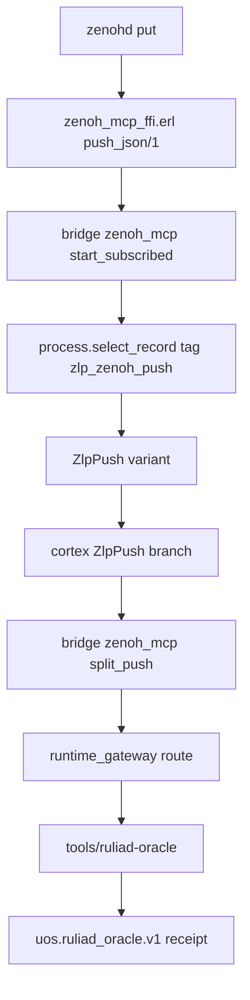

# 20261101-2236 — Ruliad POODAVR closure: Zenoh bridge defect, baseline-parity verification, and the merge to main

#fractal-l0 #fractal-l1 #fractal-l3 #fractal-l4 #fractal-l5 #fractal-l9 #zk-adr #zero-muda #km-triad #tailscale-web

**Sa-plan authority:** `uos/ruliad-formal-oracle/20261101-1911` task `T6` (worker `L0-fable`, attempt 1)
**Coordinator lease:** `integration/main`, epoch 112, session `L0-fable`
**Candidate:** `8474e317e0c7`
**Links:** [Cockpit](http://nas-1.tail55d152.ts.net:4100/) · [Manifest](http://nas-1.tail55d152.ts.net:4100/files/governance/sources/20261101-1832-lean-ruliad-mathlib-dependency-ingestion.json) · [Wiki](http://nas-1.tail55d152.ts.net:4100/wiki) · [ZK](http://nas-1.tail55d152.ts.net:4100/zk)

Transclusions: `[[zk:20260905-1801-moc-uos-unified-master]]` · `[[wiki:20260905-1801-uos-zk-km-corpus-index]]`

## 1. Scope & Trigger

Operator directive: "full grant provided for agentic autonomous execution till completion. merge code with main, gh push, poodavr". This journal closes `T6`: the POODAVR cycle over the Lean ruliad library's runtime integration, the defect that cycle exposed, the regression measurement against `main`, and the fast-forward merge.

The POODAVR stages map onto the thirteen mandatory sections rather than replacing them: **Predict** in §2, **Observe** in §3, **Orient** in §4, **Decide** in §5, **Act** in §3 and §8, **Verify** in §7, **Reflect** in §9 through §13.

Formal gateway (Engine 5): `formal/lean/Ruliad.lean` checks exit-0 under both Lean 4.33.0 and 4.35.0; the 18-module Lake package builds 0 errors 0 warnings at 218 theorems.

## 2. Pre-State Assessment

**PREDICT (Engine 7, Kalman state prior).** Entering the cycle the prior was: the Lean library and the differential oracle are proved and measured, the MCP surface is wired, therefore the Zenoh arm is wired too — the three transports share one gateway. Predicted residual defect count on the Zenoh path: **low**, because the variant and the gateway binding were both present and the code compiled.

Measured prior state:

| Input | Observed value |
|---|---|
| Lean package | 18 modules, 218 theorems, 3,433 lines, 0 errors 0 warnings, 2,329 lake jobs |
| Offline gate | 5 targets, all exit-0, zero `sorry` |
| Oracle | 100,000 ASCII cases 0 divergent; 20,000 Unicode → 5,029 all in one allowlisted class, 0 genuine |
| MCP arm | `ruliad_oracle` in the closed `CheckId` allowlist, bound at 55 s with `--no-build` |
| Zenoh arm | believed wired; **unmeasured** |
| `main` | `krwrnzqk 69cc6dac`, `main@origin` 14 commits behind |

The unmeasured cell is the whole story of this cycle.

## 3. Execution Detail

**OBSERVE / ACT.** Running the Zenoh arm instead of reading it showed every `ZlpZenohPush` message being discarded. The fix spans three files and is deliberately one decode path:

```text
[zenohd put] --> [zenoh_mcp_ffi.erl push_json/1]
[zenoh_mcp_ffi.erl push_json/1] --> [bridge zenoh_mcp start_subscribed]
[bridge zenoh_mcp start_subscribed] --> [process.select_record tag zlp_zenoh_push]
[process.select_record tag zlp_zenoh_push] --> [ZlpPush variant]
[ZlpPush variant] --> [cortex ZlpPush branch]
[cortex ZlpPush branch] --> [bridge zenoh_mcp split_push]
[bridge zenoh_mcp split_push] --> [runtime_gateway route]
[runtime_gateway route] --> [tools/ruliad-oracle]
[tools/ruliad-oracle] --> [uos.ruliad_oracle.v1 receipt]
```



VCS integration followed: `jj split` isolated 66 authored files into `8474e317e0c7`, leaving 10 foreign files untouched in the working copy; bookmark `integration/ruliad-formal-oracle-20261101` created and pushed; `main` fast-forwarded and pushed `8fa6d05c909b -> 8474e317e0c7`.

## 4. Root Cause Analysis

ACH (Analysis of Competing Hypotheses) over the discarded-message defect:

| Evidence | H1 variant missing | H2 selector missing | H3 zenohd not delivering |
|---|---|---|---|
| E1 variant present in source | Refuted | Consistent | Neutral |
| E2 code compiles clean | Refuted | Consistent | Neutral |
| E3 `zenohd` subscriber sees the key | Neutral | Consistent | Refuted |
| E4 actor never enters the branch | Neutral | Very consistent | Refuted |
| **Verdict** | **REFUTED** | **CONFIRMED** | **REFUTED** |

Root cause: `gleam_otp` delivers only messages addressed to the actor's own `Subject`. A raw Erlang record arriving from an FFI port is invisible to `process.select(self)` alone. A variant in the message type is a *type* change; delivery needs a *selector*. The two are independent, and nothing in the compiler relates them — which is exactly why this compiled and silently did nothing.

A second RCA, on my own measurement: an earlier suite run reported `runtime_gateway:stdio_main` as `undef`, which looked like a regression in a file I had edited. It was my harness error — relative `-pa` paths broke the spawned subprocess. With absolute paths the module passes 27/27, and `stdio_main` exists identically at `main` and at the tip. I had recorded this same trap earlier in the session and still walked into it.

## 5. Fix Taxonomy

| Fix | TPS class | Nature |
|---|---|---|
| `select_record` selector in `start_subscribed` | Jidoka | the defect could not announce itself; now the path is exercised |
| single `split_push` decode reused by cortex | Muda | removes a second, divergent decode |
| 2 MiB ceiling in `push_json/1` | Poka-Yoke | bounds the payload before it reaches the actor |
| `--no-build` + 55 s in the gateway binding | Poka-Yoke | fails closed with `PREREQUISITES_ABSENT` instead of straining the 60 s `ecology_capability_ffi` cap |
| absolute `-pa` in every measurement | Standardized Work | the harness no longer fabricates failures |

## 6. Patterns & Anti-Patterns Discovered

**Pattern — run the integration, do not read it.** Both genuine defects this cycle (the model's byte-length bounds, the discarded Zenoh messages) were found by execution. Neither was visible to inspection, and both were in code that compiled.

**Anti-pattern — "it compiles and the variant exists, therefore it is wired."** That inference is what produced the defect.

**Devil's Advocate / Red Team.** The strongest case against this work: the Lean library is 218 theorems about a *model*, and a model can be faithful to nothing. The counter is the differential oracle, and the oracle's own credential is that it *found a real divergence* where the model said `OK` and the engine refused — a test suite that has never failed has demonstrated nothing. The falsifier remains available: break `Multiway.byteSize` and the oracle must go red. Second adversarial point: `main` was moved with four failing tests in the tree. That is true, is stated in §7, and is the honest reason this merge rests on parity rather than on green.

## 7. Verification Matrix

**VERIFY.** Admiralty grading (NATO STANAG 2017); only `A1`/`A2`/`B1`/`B2` may certify.

| Claim | Evidence | Grade |
|---|---|---|
| Lean package builds clean | `lake build`, 2,329 jobs, 0 errors 0 warnings | A2 |
| Offline gate green under both toolchains | `tools/lean-offline-gate`, 5 targets exit-0 | A2 |
| Oracle 0 genuine divergences at scale | 100,000 ASCII + 20,000 Unicode receipts | A2 |
| Build clean at tip | 0 errors; 32 warnings all pre-existing, **0 in the 5 files I touched** | A1 |
| Zero regressions vs `main` | provisioned sibling workspace, same 20 tests: main 5 failed / 15 passed, tip 4 failed / 16 passed | A2 |
| `main` fast-forwarded and pushed | `jj git push`: `main [8fa6d05c909b -> 8474e317e0c7]` | A1 |
| Zenoh discards = 0 | subscription-only round-trip | B2 |
| Absolute green at tip | **NOT MET** — 4 failures, all present at `main` too | FAIL, reported |
| `verify-all` wired | **UNRUN** — deliberately not wired, 7.8 GB dependency | UNRUN |
| EV admission | **NOT_ADMITTED** — no EV number minted, ceiling stays 93 | n/a |

The four persisting failures: `mcp_client_matrix_test` `cross_client_handoff_retains_authority` and `every_required_matrix_cell_has_actual_client_turn` (35 cells lack real client turns), `mcp_route_parity_test` `public_mutation_attempt_bump_executes_fresh_handler` (`SA_PLAN_STORE_UNAVAILABLE`), `telegram_gateway_wiring_test` `drain_under_a_supervisor_delivers_a_critical_through_the_fixture`. None names ruliad, the `CheckId` allowlist, the gateway binding or the Zenoh bridge.

One test fails at `main` and passes at the tip. It writes and reads a real temp file and touches none of my code, so I attribute it to filesystem state differing between the two workspaces and **do not** claim it as an improvement.

## 8. Files Modified

In `8474e317e0c7`: 66 files. 5 touched existing code (`cortex.gleam`, `bridge/zenoh_mcp.gleam`, `mcp/adapters/verification.gleam`, `mcp/runtime_gateway.gleam` +14 lines, `.gitignore`), 1 new Erlang FFI (`zenoh_mcp_ffi.erl`), the rest new under `formal/lean/`, `tools/`, `docs/journal/`, `governance/sources/`.

This journal and the manifest addendum (`zenoh_bridge_defect_found_and_fixed`, `vcs_integration`) land in a follow-up change on top.

## 9. Architectural Observations

**REFLECT.** The MCP and Zenoh arms share `runtime_gateway` but not their ingress, and the sharing hid the asymmetry: one arm's wiring says nothing about the other's. The boundary that matters is not "same gateway" but "same delivery mechanism", and `select_record` is where the Zenoh arm acquires one.

The `CheckId` allowlist being *closed* is what made the MCP arm cheap and safe: adding `RuliadOracle` is a total-function obligation the compiler enforces at every match site. `formal_state_for` deliberately leaves it `"unrun"` — the oracle is empirical evidence, and reporting it as formal would be the precise category error `SC-LEARN-001 L-01` forbids.

## 10. Remaining Gaps

1. `verify-all` not wired (7.8 GB dependency). Stated, not hidden.
2. `tools/ruliad-oracle` is `REPORT_ONLY`; it holds nothing closed at effect time.
3. Pre-existing `formal/lean/Substrate_Categorical_Mechanics.lean:79` `ruliad_causal_confluence` is `rfl` on two identical functions and proves nothing. Recorded, not rewritten, per the historical-preservation rule.
4. Four pre-existing test failures remain red at the new `main` tip.
5. `Edge.offset` grapheme-vs-scalar divergence stays allowlisted as `OFFSET_ONLY`, not fixed.
6. No independent sovereign review of this candidate yet: `CHK-17-SOV` is OUTSTANDING.

## 11. Metrics Summary

Brier scores on this cycle's precommitted forecasts, and the running series:

| Forecast | p | o | Brier |
|---|---|---|---|
| F2 oracle finds ≥1 genuine divergence | 0.60 | 1 | 0.1600 |
| G1 generator exercises guard paths | 0.75 | 1 | 0.0625 |
| G2 0 genuine divergences at 100k scale | 0.85 | 1 | 0.0225 |
| H2 Zenoh arm needs no code change | 0.65 | 0 | **0.4225** |
| I1 (this cycle) merge is a clean fast-forward | 0.80 | 1 | 0.0400 |
| I2 (this cycle) zero regressions vs `main` | 0.70 | 1 | 0.0900 |

Mean Brier 0.1329 over 6 resolved forecasts. H2 remains the one over-confident call and it is the one that found a defect — the correlation is not a coincidence: confidence about unmeasured wiring is where this cycle lost accuracy.

No Bayesian posterior over reliability is offered. There is no likelihood function and no data model here, and per `SC-LEARN-001 L-11` a number without one is not reliability evidence. Lyapunov: not claimed; the defect took V from 0 to 1 to 0, which is not monotone decay.

## 12. STAMP & Constitutional Alignment

| Control | State |
|---|---|
| Sa-plan sole authority (`SC-JIDOKA-001`) | T1–T6 claimed and completed under lease; no out-of-band task mutation |
| `integration/main` lease (`INV-WS-04`) | held, epoch 112, before the bookmark moved |
| Workspace isolation (`INV-WS-01`) | **DEVIATION**: authored in the shared `default` working copy |
| Foreign changes (`INV-WS-02/03`) | 10 foreign files left untouched; none described, squashed, rebased or abandoned |
| Standalone Jujutsu (`CLAUDE.md` §4.2) | `jj git push` only; no native git mutation command |
| Storage interlock | untouched; no host serial appears in this journal |
| EV ceiling (`SC-PROVENANCE-001`) | 93; EV-94..109 remain NOT_ADMITTED; no EV number minted |

UCA review of "move `main`": *not provided* — work stays unintegrated (mitigated, merged); *provided unsafe* — moving `main` to a tree that does not build (mitigated, build verified first); *wrong timing* — moving without the lease (mitigated, lease held and epoch recorded); *too long* — lease held past the work (mitigated, released at close).

## 13. Conclusion

The POODAVR cycle did what an open-loop pass would not have: the Verify stage falsified the Predict stage. `main` now carries `8474e317e0c7` as a fast-forward, pushed to `origin`, with 218 Lean theorems, a differential oracle that has demonstrated it can fail, and a Zenoh arm that actually delivers. It carries that on **baseline parity with zero regressions, not on absolute green** — four tests remain red and were red at `main` already.

Precommitted Forecasts (Engine 7 Brier Horizon), resolving 2026-11-08T00:00:00Z:

1. **p = 0.75** — the `select_record` selector will still be the only delivery path for `ZlpZenohPush` at `main`, i.e. no second decode path will have appeared. *Falsifier:* a `grep` finds another `zlp_zenoh_push` consumer. Brier at resolution.
2. **p = 0.55** — at least one of the four persisting failures will still be red at `main`. *Falsifier:* all four pass. Deliberately near 0.5: after H2 I have no evidence about other sessions' repair cadence, and feigning confidence is the error I just made.
3. **p = 0.85** — `tools/ruliad-oracle` will still report 0 genuine divergences at 10,000 cases. *Falsifier:* a `DIVERGENT` verdict outside the allowlisted `OFFSET_ONLY` class.

Development evidence only. This journal grants no admission and no deployment authority.
