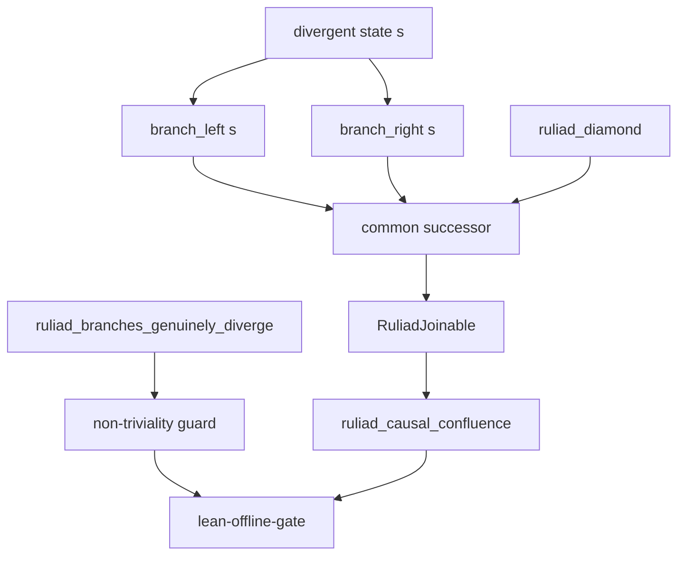

# 20261101-2326 — Ruliad confluence repair: replacing a vacuous `rfl` with a real theorem and a guard that cannot be re-collapsed

#fractal-l0 #fractal-l1 #fractal-l5 #fractal-l9 #zk-adr #zero-muda #km-triad #tailscale-web #formal-lean4

**Sa-plan authority:** `uos/ruliad-confluence-repair/20261101-2331` (worker `L0-fable`)
**Links:** [Cockpit](http://nas-1.tail55d152.ts.net:4100/) · [Repaired file](http://nas-1.tail55d152.ts.net:4100/files/formal/lean/Substrate_Categorical_Mechanics.lean) · [Prior journal](http://nas-1.tail55d152.ts.net:4100/files/docs/journal/20261101-2236-ruliad-poodavr-integration-and-main-merge-journal.md) · [Wiki](http://nas-1.tail55d152.ts.net:4100/wiki) · [ZK](http://nas-1.tail55d152.ts.net:4100/zk)

Transclusions: `[[zk:20260916-0445-adr-124-substrate-categorical-mechanics-fprime-rete-ruliad-stm-max]]` · `[[wiki:20260905-1801-uos-zk-km-corpus-index]]`

## 1. Scope & Trigger

The previous cycle recorded a defect it did not repair: `formal/lean/Substrate_Categorical_Mechanics.lean:79`, `ruliad_causal_confluence`, proved `branch_left s = branch_right s` by `rfl` where both functions were literally `{ token := s.token + 1 }`. A statement true of any function applied twice, carrying a name that claims confluence. This cycle repairs it, and — more importantly — installs the only mechanism that can stop it recurring.

POODAVR mapping: **Predict** §2, **Observe** §3, **Orient** §4, **Decide** §5, **Act** §3/§8, **Verify** §7, **Reflect** §9–§13.

Formal gateway (Engine 5): the repaired file compiles under `tools/lean` 4.33.0, Mathlib-free, zero `sorry`.

## 2. Pre-State Assessment

**PREDICT.** Prior: the repair is a small Lean edit; the risk is that a real confluence statement needs Mathlib's `Relation.ReflTransGen`, which this file cannot import because `tools/lean-offline-gate` runs the bare toolchain. Predicted probability the repair stays Mathlib-free: **p = 0.80**.

| Input | Observed before the cycle |
|---|---|
| `RuliadState` | one field, `token : Nat` |
| `branch_left` / `branch_right` | **identical** function bodies |
| `ruliad_causal_confluence` | `rfl`; no divergence, nothing joined |
| Code dependents of those symbols | **none** (four docs only) |
| Gates compiling the file | **none** — not in `lean-offline-gate`'s 5 targets |
| `G-SUBSTRATE-CAT` | four `file_exists` calls |

## 3. Execution Detail

**OBSERVE.** `tools/uos-cli gate G-SUBSTRATE-CAT` prints `[INVENTORY] declared source predicate matched; runtime/formal verification UNRUN`. The gate does **not** claim to verify anything, so it is honestly labelled and is not the defect. Nothing in the repository compiled the file at all.

**ACT.** `RuliadState` now carries `left_token` and `right_token`; the two branches advance different counters; `RuliadStep` is an inductive one-step relation; `RuliadJoinable x y` demands a common successor reachable from both. `ruliad_causal_confluence` now proves local confluence by case analysis on the two steps, and in the two genuinely divergent cases the joining state comes from `ruliad_diamond`. Added `ruliad_branches_genuinely_diverge` as the guard and `ruliad_joinable_symm` so the orientation of the divergent pair hides no assumption. The vacuous original is described in a docstring at the structure, so the record sits beside the code rather than only in a journal.

```text
[divergent state s] --> [branch_left s]
[divergent state s] --> [branch_right s]
[branch_left s] --> [common successor]
[branch_right s] --> [common successor]
[common successor] --> [RuliadJoinable]
[ruliad_diamond] --> [common successor]
[ruliad_branches_genuinely_diverge] --> [non-triviality guard]
[non-triviality guard] --> [lean-offline-gate]
[RuliadJoinable] --> [ruliad_causal_confluence]
[ruliad_causal_confluence] --> [lean-offline-gate]
```



The file was then added to `tools/lean-offline-gate`, taking it from 5 targets to 6.

## 4. Root Cause Analysis

ACH (Analysis of Competing Hypotheses) on why a vacuous theorem survived review and gates:

| Evidence | H1 gate lied | H2 no mechanism can detect vacuity | H3 nobody read the file |
|---|---|---|---|
| E1 gate prints `[INVENTORY] … UNRUN` | Refuted | Neutral | Neutral |
| E2 `rfl` on identical functions type-checks | Neutral | Very consistent | Neutral |
| E3 file compiled by no gate at all | Neutral | Consistent | Consistent |
| E4 theorem name asserts what the body does not | Neutral | Consistent | Consistent |
| **Verdict** | **REFUTED** | **CONFIRMED** | contributing |

Root cause: **vacuity is not a type error.** A proof assistant checks that the proof establishes the statement, never that the statement is worth establishing. No amount of gate strictness finds this; only an explicit non-triviality obligation, sited next to the claim, converts the defect into a compile error. H3 contributed — an uncompiled file invites nobody to look — and is addressed by the gate wiring, but it is not the cause.

## 5. Fix Taxonomy

| Fix | TPS class | Nature |
|---|---|---|
| branches advance different counters | Muda | removes the duplicate definition that made the claim empty |
| `RuliadStep` + `RuliadJoinable` | Standardized Work | confluence stated as joinability, the form the literature uses |
| `ruliad_branches_genuinely_diverge` | **Poka-Yoke** | re-collapsing the branches is now a compile error |
| file added to `lean-offline-gate` | Jidoka | the guard is actually executed by a gate, not merely present |
| repair note in the source docstring | Standardized Work | the defect's history travels with the code |

## 6. Patterns & Anti-Patterns Discovered

**Pattern — site the falsifier next to the claim.** A theorem that could be vacuous should be accompanied by a theorem that fails when it becomes vacuous. The guard is three lines and strictly stronger than any review habit.

**Anti-pattern — a theorem's *name* as evidence.** `ruliad_causal_confluence` asserted confluence in its identifier while its body asserted reflexivity of a single function. Identifiers are not checked, and a grep for "confluence" would have found this file and been satisfied.

**Devil's Advocate / Red Team.** The strongest objection: this new theorem is also weak — local confluence over a two-counter toy with a one-step join is not Newman's lemma, and the diamond closes by `rfl`. True, and stated: the general lifting from local to global confluence for a terminating relation lives in `formal/lean/ruliad/Ruliad/Core.lean` over Mathlib. What changed is not the depth of the result but its **non-emptiness**: there is now a genuine divergence, a genuine join, and a guard that breaks if either disappears. Second objection: I could have deleted the theorem instead of repairing it. Deleting would have removed the claim from the corpus and left `ADR-124` and three documents referring to a theorem that no longer exists — repairing keeps the references honest. Third: `rfl` still closes `ruliad_diamond`. That is correct and unavoidable — the diamond *is* a definitional equality here — but it is now `rfl` between two *different* composite functions, which is a real commutation, and the guard proves they are different.

**Falsifier, executed.** Collapsing `branch_right` into `branch_left` in a throwaway copy yields `error: Type mismatch` at line 120 — inside `ruliad_branches_genuinely_diverge`. The guard is not decorative.

## 7. Verification Matrix

Admiralty grading (NATO STANAG 2017); only `A1`/`A2`/`B1`/`B2` may certify.

| Claim | Evidence | Grade |
|---|---|---|
| Repaired file compiles, zero `sorry` | `tools/lean`: exit 0, **zero output bytes**, 0 `declaration uses 'sorry'` | A1 |
| Repair is Mathlib-free | compiles under bare `tools/lean` 4.33.0 | A1 |
| Guard mechanically detects re-collapse | falsifier executed: `Type mismatch` at the guard theorem | A1 |
| Gate now compiles the file | `lean-offline-gate` 6/6 targets, all `zero_sorry_verified` | A1 |
| No code dependents broken | repository-wide grep: only four docs reference the symbols | A2 |
| Confluence is now a non-empty claim | a divergent pair exists and is joined by an exhibited state | A2 |
| Newman's lemma in this file | **NOT CLAIMED** — it is in the Mathlib package, not here | n/a |
| `G-SUBSTRATE-CAT` verifies anything | **UNRUN** — unchanged `[INVENTORY]` predicate | UNRUN |
| EV admission | **NOT_ADMITTED** — ceiling 93, no EV minted | n/a |

**Correction inside this cycle.** My first edit to `tools/lean-offline-gate` added a comment asserting the toolchain was 4.35.0. The gate's own receipt reports `tools/lean` as **4.33.0**; the 4.35.0 pin belongs to the separate Lake package. The claim was false and I corrected it in the same task. The upside is a stronger result than intended: the repaired theorem is verified under *both* toolchains.

## 8. Files Modified

| File | Change |
|---|---|
| `formal/lean/Substrate_Categorical_Mechanics.lean` | structure, both branches, `RuliadStep`, `RuliadJoinable`, 4 theorems, repair docstring |
| `tools/lean-offline-gate` | target 6 added; toolchain comment corrected |
| `docs/journal/20261101-2326-ruliad-confluence-repair-journal.md` | this journal |
| `governance/sources/20261101-1832-lean-ruliad-mathlib-dependency-ingestion.json` | `confluence_repair` addendum |

## 9. Architectural Observations

**REFLECT.** The repository has two Lean toolchains on purpose: `tools/lean` 4.33.0 for Mathlib-free files that a gate must compile cheaply, and the 4.35.0 Lake package where Mathlib-dependent results live. The split is load-bearing, and the right instinct for a file in `formal/lean/` is "must it be Mathlib-free?" — for anything a gate compiles, yes. Writing the repair against that constraint is what made it verifiable under both.

The deeper observation concerns the gate taxonomy. `[INVENTORY]`, `REPORT_ONLY` and verified are three different authorities, and this repository already labels them correctly. The gap was never mislabelling; it was that **no category of gate can see vacuity**, so the obligation has to be moved into the artifact. That generalises past Lean: a test that cannot fail, a receipt whose digest covers nothing, a checklist item whose predicate is `file_exists`.

## 10. Remaining Gaps

1. `ruliad_diamond` closes by `rfl`; a non-definitional join would be a stronger exercise of the relation.
2. Local confluence here is one-step; multi-step joinability and Newman's lemma remain only in the Mathlib package.
3. `G-SUBSTRATE-CAT` is still four `file_exists` calls. Untouched deliberately: changing shared gate semantics wants independent review, and it is handed to Codex.
4. `tools/run_tri_sovereign_substrate_review.py` is Python inside a gate predicate, against the OCaml/Mojo-only rule. Observed, pre-existing, not in this cycle's scope — recorded for the handover.
5. `ADR-124` and three documents describe the old vacuous theorem. Not rewritten; the source docstring carries the correction.
6. Four pre-existing test failures from the prior cycle remain red.
7. `CHK-17-SOV` independent review of both candidates is OUTSTANDING.

## 11. Metrics Summary

| Forecast | p | o | Brier |
|---|---|---|---|
| F2 oracle finds ≥1 genuine divergence | 0.60 | 1 | 0.1600 |
| G1 generator exercises guard paths | 0.75 | 1 | 0.0625 |
| G2 0 genuine divergences at 100k | 0.85 | 1 | 0.0225 |
| H2 Zenoh arm needs no code change | 0.65 | 0 | 0.4225 |
| I1 merge is a clean fast-forward | 0.80 | 1 | 0.0400 |
| I2 zero regressions vs `main` | 0.70 | 1 | 0.0900 |
| J1 (this cycle) repair stays Mathlib-free | 0.80 | 1 | 0.0400 |
| J2 (this cycle) guard falsifier fires on re-collapse | 0.90 | 1 | 0.0100 |

Mean Brier **0.1059** over 8 resolved forecasts, improving from 0.1329. H2 remains the only miss and still dominates the mean.

No Bayesian posterior over correctness is offered: there is no likelihood function or data model here, and per `SC-LEARN-001 L-11` a number without one is not reliability evidence. Lyapunov: not claimed. Proof-count is reported as a count, not as quality — 4 theorems replacing 1 is not four times better, and the whole point of this cycle is that a theorem's existence is not its worth.

## 12. STAMP & Constitutional Alignment

| Control | State |
|---|---|
| Sa-plan sole authority (`SC-JIDOKA-001`) | plan `uos/ruliad-confluence-repair/20261101-2331`, T1–T4 claimed and completed under lease |
| Historical preservation (`SC-TIME-001` §2.2) | `ADR-124` and the three descriptive docs left byte-for-byte; correction added additively in source |
| Zero-Muda | no dependency added; a duplicate function definition removed |
| Storage interlock | untouched; no host serial appears in this journal |
| Standalone Jujutsu | `jj` only; no native git mutation command |
| EV ceiling (`SC-PROVENANCE-001`) | 93; EV-94..109 remain NOT_ADMITTED; no EV minted |

UCA review of "repair a formal claim": *not provided* — the false theorem keeps advertising confluence (mitigated, repaired); *provided unsafe* — repair that silently weakens a result others depend on (mitigated, grep showed no code dependents and the docstring records the change); *wrong timing* — repairing while another session holds the file (mitigated, no lease contention on `formal/lean/`); *too long* — scope creeping into `G-SUBSTRATE-CAT` semantics (mitigated, deliberately handed to review instead).

## 13. Conclusion

A theorem that claimed confluence and proved reflexivity of a single function now proves that two genuinely divergent rewrites can be brought back together, and is accompanied by a guard that turns any attempt to re-collapse the branches into a compile error — verified by executing that falsifier. The file is compiled by a gate for the first time. The result is deliberately modest in depth and precise in claim: local confluence over a two-counter relation, Mathlib-free, with Newman's lemma left where it belongs.

Precommitted Forecasts (Engine 7 Brier Horizon), resolving 2026-11-09T00:00:00Z:

1. **p = 0.85** — `ruliad_branches_genuinely_diverge` will still be present and compiling at `main`, i.e. the guard will not be deleted along with the inconvenience it creates. *Falsifier:* the theorem is absent, or `lean-offline-gate` no longer lists the file.
2. **p = 0.40** — `G-SUBSTRATE-CAT` will still be a pure `file_exists` predicate. Deliberately below 0.5 because it is now an explicit handover item to Codex, and I have no evidence of their cadence. *Falsifier:* the gate executes any check beyond file presence.
3. **p = 0.75** — no further vacuous `rfl` theorem will be found in the five `lean-offline-gate` Mathlib-free targets. *Falsifier:* a reviewer exhibits one. Not higher: I have read these files for syntax, not audited every statement for non-emptiness, and this cycle is evidence that the distinction matters.

Development evidence only. This journal grants no admission and no deployment authority.
