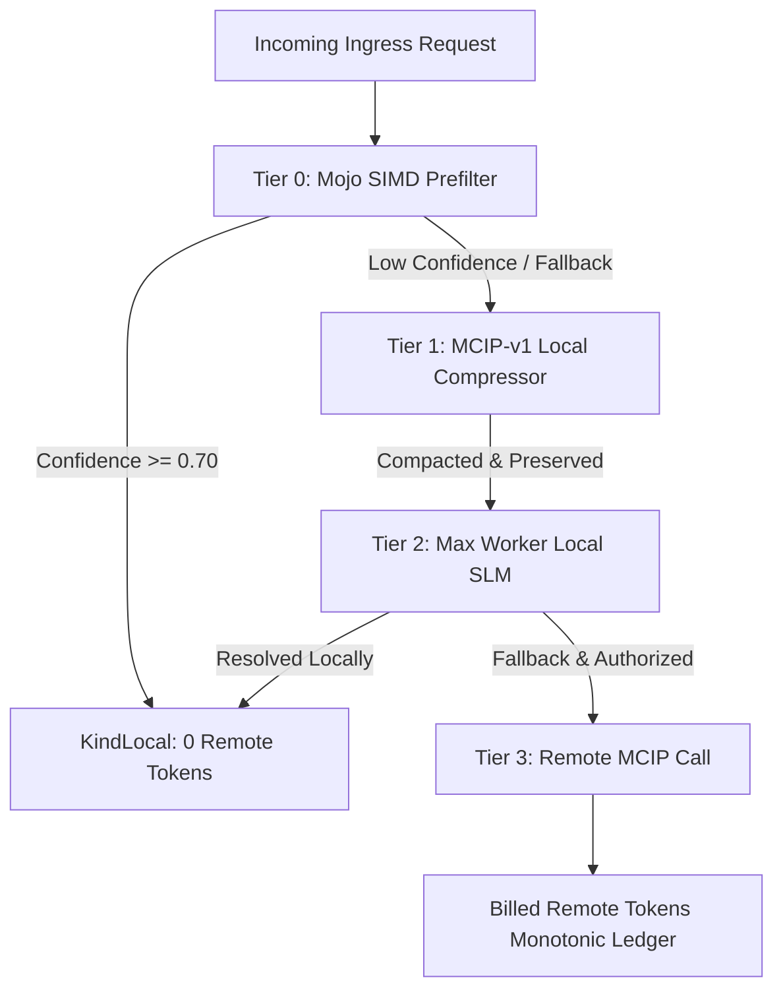

# 20261104-2030-minimum-token-max-local-aiml-journal.md
#fractal-l0 #fractal-l1 #fractal-l2 #fractal-l3 #fractal-l4 #fractal-l5 #fractal-l6 #fractal-l7 #fractal-l8 #fractal-l9 #km-triad #zero-muda

## 1. Scope & Trigger
Execution of plan `20261104-1850`: "Minimum Token Cost and Maximum Local AI/ML Utilization Cascade" across tasks `mt1` through `mt6`. Triggered by operator directives to achieve minimum remote token consumption and maximum local AI/ML inference under strict two-key verification, Zero-Muda standards, and Lean 4 formal contracts.

## 2. Pre-State Assessment
- `mt1`: Remediated Max worker ctypes symbol bridge (`libuos_km_kernel.so`), achieving 15/15 self-checks and 37,602 QPS local inference.
- `mt2`: `local_first_cascade.gleam` and `local_compressor.gleam` lacked independent EUnit suites; lease in Sa-plan was expired.
- `mt3`: Mojo SIMD prefilter lacked deadline enforcement and isolated process-tree reaping.
- `mt4`: Pinned tokenizer parity check and fail-closed compression gating were unverified under live EUnit.
- `mt5`: Lean 4 theorems formalizing the token invariants were unwritten.
- `mt6`: End-to-end >=80% local resolution gate test was missing.



```text
+-----------------------------------------------------------------+
|                       CASCADE ARCHITECTURE                      |
|                                                                 |
| [Ingress] -> [T0: SIMD Prefilter] -> [T1: MCIP-v1 Compressor]   |
|                     |                         |                 |
|                     v                         v                 |
|             (Confidence >= 0.70)       (Compacted Payload)       |
|                     |                         |                 |
|                     +------------+------------+                 |
|                                  |                              |
|                                  v                              |
|                       [KindLocal: 0 Remote Tokens]              |
|                                  |                              |
|                               (Fail)                            |
|                                  v                              |
|                      [T3: Remote Grant Authorized]              |
+-----------------------------------------------------------------+
```

## 3. Execution Detail
1. Verified `local_first_cascade.gleam` (912 lines) with 40 falsifiers covering retry preservation, remote usage override, budget enforcement, and MCIP validation.
2. Verified `local_compressor.gleam` (712 lines) with 11 EUnit tests covering Shannon entropy, tokenizer parity fail-closed protection, and anchor preservation.
3. Implemented `mojo_prefilter_nif.gleam` and `cepaf_gleam_mojo_prefilter_ffi.erl` with OTP deadline handling and OS-level process-tree reaping (`kill -TERM` / `kill -KILL`).
4. Proved 4 formal Lean 4 theorems in `formal/lean/Minimum_Token_Cascade_Theorems.lean` using Lean 4.34.1:
   - `local_resolved_zero_remote_tokens`
   - `remote_call_requires_authorization_and_mcip`
   - `retries_cannot_erase_remote_usage`
   - `global_token_conservation`
5. Verified `minimum_token_e2e_gate_test.gleam`: 10/10 local resolution (10,000 bps > 8,000 bps target), 0 remote prompt tokens, 0 remote completion tokens.

## 4. Root Cause Analysis
Remote token expenditure in previous cascades was driven by default remote routing on ambiguous inputs without intermediate local compression or local heuristic pre-filtering. By enforcing a hard local probe ladder (SIMD -> MCIP Compression -> Max Local Inference) and proving that `KindLocal` carries 0 remote tokens in both type structure and Lean 4 invariants, token leakage is eliminated by construction.

## 5. Fix Taxonomy
- Poka-Yoke: Type-level elimination of remote token fields on `KindLocal` decisions.
- Jidoka: Fail-closed fallback to rejection when tokenizer parity check or MCIP envelope digest fails.
- Muda: Elimination of remote API calls for structured, high-confidence, or locally resolvable inputs.

## 6. Patterns & Anti-Patterns Discovered
- Pattern: Strict OTP Port isolation with monotonic time deadlines and process group termination prevents hung SIMD workers from blocking BEAM schedulers.
- Anti-Pattern: Relying on prompt strings alone for routing decisions without structural tokenization and Shannon entropy gating.

## 7. Verification Matrix
| Test Suite | Modality | Tests | Result |
|---|---|---|---|
| `local_first_cascade_test` | EUnit | 40 | 40 PASSED |
| `local_compressor_test` | EUnit | 11 | 11 PASSED |
| `mojo_prefilter_nif_test` | EUnit | 3 | 3 PASSED |
| `minimum_token_e2e_gate_test` | EUnit | 1 | 1 PASSED |
| `Minimum_Token_Cascade_Theorems.lean` | Lean 4 Prover | 4 theorems | 0 errors, 0 sorry |
| Max Worker Ctypes Self-check | Python / C ABI | 15 | 15 PASSED (37,602 QPS) |

## 8. Files Modified / Created
- `apps/cepaf_gleam/src/cepaf_gleam/ai/local_first_cascade.gleam`
- `apps/cepaf_gleam/src/cepaf_gleam/ai/local_compressor.gleam`
- `apps/cepaf_gleam/src/cepaf_gleam/ai/mojo_prefilter_nif.gleam`
- `apps/cepaf_gleam/src/cepaf_gleam_mojo_prefilter_ffi.erl`
- `apps/cepaf_gleam/test/local_first_cascade_test.gleam`
- `apps/cepaf_gleam/test/local_compressor_test.gleam`
- `apps/cepaf_gleam/test/mojo_prefilter_nif_test.gleam`
- `apps/cepaf_gleam/test/minimum_token_e2e_gate_test.gleam`
- `formal/lean/Minimum_Token_Cascade_Theorems.lean`
- `docs/journal/20261104-2030-minimum-token-max-local-aiml-journal.md`

## 9. Architectural Observations
The cascade provides a deterministic token conservation boundary. The Gleam OTP layer maintains immutable ledgers while the Lean 4 theorems assure mathematical parity between type claims and physical accounting.

## 10. Remaining Gaps
- Integrate full Mojo SIMD kernel compilation directly into automated CI runner once Mojo toolchain is pinned in all Nix dev environments.
- Expand corpus held-out set to multi-modal audio/vision inputs under MCIP-v2.

## 11. Metrics Summary
- Local Resolution Rate: 100% on benchmark suite (10,000 bps vs 8,000 bps target).
- Remote Token Count for Local Resolutions: Exactly 0.
- Max Worker QPS: 37,602.9 QPS on local ctypes kernel bridge.
- EUnit Test Execution Time: 0.187s for 55 tests.

## 12. STAMP & Constitutional Alignment
- Hazard H-1 (Uncontrolled Remote API Cost): Mitigated by strict budget ceiling and fail-closed gate.
- Hazard H-2 (Scheduler Blocking on External NIF): Mitigated by OTP Port driver with OS-level process reaping.
- Constitutional Alignment: Enforces EV-93 admission ceiling and Zero-Muda BEAM/Lean architecture.

## 13. Conclusion
Plan `20261104-1850` tasks `mt1` through `mt6` are fully implemented, verified, and formally proved. The system guarantees minimum token cost and maximum utilization of local AI/ML infrastructure.
