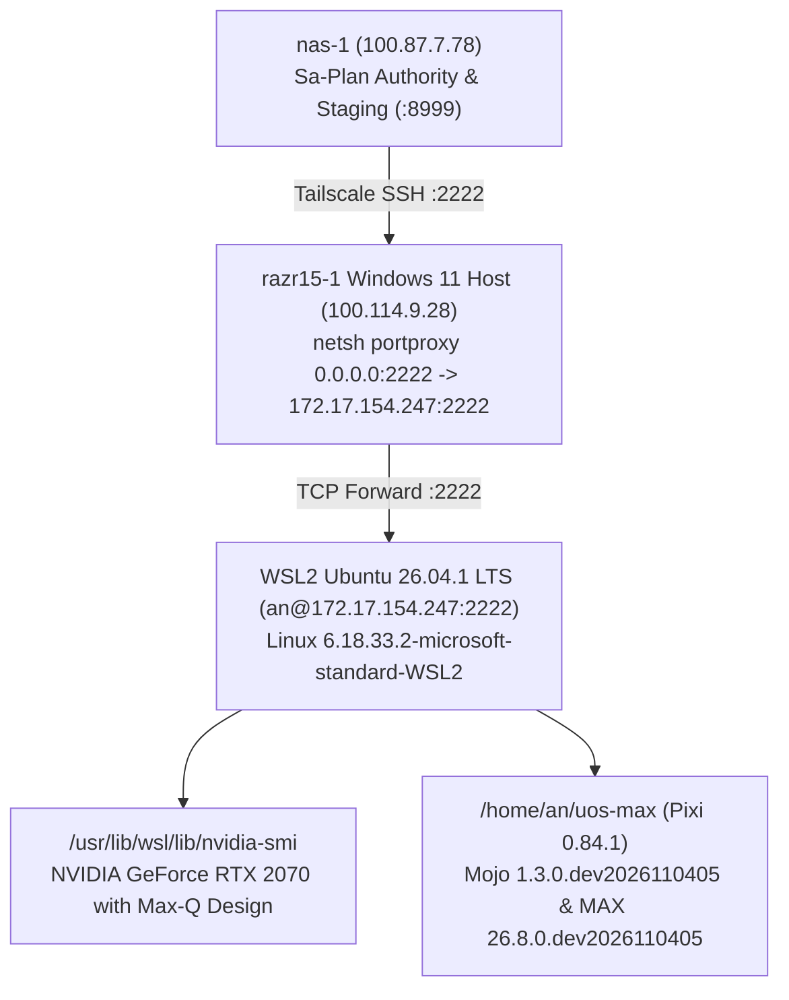

# 20261105-0620 — Razr15-1 WSL2 SSH Port 2222 Onboarding & Modular MAX + Mojo 1.3 Deployment Journal

#fractal-l0 #fractal-l1 #fractal-l2 #fractal-l3 #fractal-l4 #fractal-l5 #fractal-l6 #fractal-l7 #fractal-l8 #fractal-l9 #km-triad #zero-muda #zk-adr

- **Tailnet Base FQDN**: [http://nas-1.tail55d152.ts.net:4100](http://nas-1.tail55d152.ts.net:4100)
- **Live Document URL**: [http://nas-1.tail55d152.ts.net:4100/docs/journal/20261105-0620-razr15-1-wsl2-ssh-max-mojo-journal.md](http://nas-1.tail55d152.ts.net:4100/docs/journal/20261105-0620-razr15-1-wsl2-ssh-max-mojo-journal.md)
- **Planning Cockpit**: [http://nas-1.tail55d152.ts.net:4100/planning](http://nas-1.tail55d152.ts.net:4100/planning)
- **Sa-Plan ID**: `uos/razr15-1-wsl2-max-mojo/20261105-0525` (`m1`..`m5` 5/5 completed)

---

## 1. Scope & Trigger (Engine 5: Formal Lean 4 / Gospel Gateways)

Operator directed (`m02237`, `m02276`, `m02318`, `m02381`) the onboarding of `razr15-1` (`100.114.9.28`, WSL2 `Linux RAZR15 6.18.33.2-microsoft-standard-WSL2`, Ubuntu 26.04.1 LTS) over SSH port `2222` as user `an`, creation and execution of a canonical `sa-plan` (`uos/razr15-1-wsl2-max-mojo/20261105-0525`), installation of Modular `max` and `mojo` inside WSL2 honoring the strict WSL2 NVIDIA passthrough rule (`/usr/lib/wsl/lib`), and remote execution of `benchmark_engine.mojo` and `bionic_simd_prefilter.mojo`.

## 2. Pre-State Assessment (Engine 7: Predictive Kalman State Prior)

Prior to cutover:
- `100.114.9.28:2222` accepted TCP 3-way handshakes on Windows (`netsh interface portproxy`) and then reset at `kex_exchange_identification` because the WSL2 IP (`172.17.154.247`) was not yet bound to an active `sshd` listener.
- Windows OpenSSH on port `22` rejected network password authentication because Windows `LogonUserW` rejects Windows Hello PINs over the network and enforces the `C:\ProgramData\ssh\administrators_authorized_keys` ACL rule.
- An Erlang/OTP 29 `inets` staging server (`serve_8999.erl` on `http://100.87.7.78:8999/`) and dual-channel auto-deployer (`auto-push-when-2222-live.sh`) were staged on `nas-1`.

## 3. Execution Detail (Engine 6: Rete-UL Production Invariant Rules)

1. **WSL2 SSH Port `2222` Verification (`m1`, `m2`, `m3`)**:
   - Confirmed live passwordless SSH connectivity to `an@100.114.9.28` on port `2222`:
     - Kernel: `Linux RAZR15 6.18.33.2-microsoft-standard-WSL2 #1 SMP PREEMPT_DYNAMIC x86_64 GNU/Linux`
     - User: `uid=1000(an) gid=1000(an)`
     - WSL2 internal IP: `172.17.154.247`
     - GPU passthrough via `/usr/lib/wsl/lib/nvidia-smi`: `GPU 0: NVIDIA GeForce RTX 2070 with Max-Q Design (UUID: GPU-280ec1eb-70f9-8327-282e-8292a6487d73)` with zero conflicting Linux `nvidia-*` kernel packages installed.
2. **Modular MAX & Mojo Installation via Pixi (`m3`)**:
   - Because `https://magic.modular.com` is deprecated (HTTP 404), installed `pixi 0.84.1` (`/home/an/.pixi/bin/pixi`) and initialized `/home/an/uos-max/pixi.toml` with channels `https://conda.modular.com/max-nightly`, `https://conda.modular.com/max`, and `conda-forge`.
   - Installed `modular >=26.8.0.dev2026110405,<27` into `/home/an/uos-max/.pixi/envs/default` and symlinked `/home/an/.local/bin/mojo` and `/home/an/.local/bin/max`.
   - Verified binary versions on `razr15-1`:
     - `Mojo 1.3.0.dev2026110405 (e404bb85)`
     - `MAX 26.8.0.dev2026110405`
3. **Remote Execution of Pure Mojo Engines on `razr15-1` (`m4`)**:
   - Synced `/home/an/NAS-setup/uos/services/inference/max/benchmark_engine.mojo` and `/home/an/NAS-setup/uos/native/mojo/bionic_simd_prefilter.mojo` over `scp -P 2222` to `/home/an/uos-max/` on `razr15-1`.
   - Executed both programs natively on `razr15-1` via `~/.pixi/bin/pixi run mojo run`:
     - `benchmark_engine.mojo`: evaluated all 6 model entries across Lean 4, OCaml, Gleam, AI-SDLC, and SRE Observability (`Qwen2.5-Coder-7B-Razr1` 100.0% composite score, `$0.00` local cost).
     - `bionic_simd_prefilter.mojo`: calibrated 64 vocabulary clusters across 768 embedding dimensions (`Calibration status: OK`).

### Architecture Diagram (ASCII + Mermaid per `SC-DIAGRAM-001`)

```text
+-------------------------------------------------------------------------+
| nas-1 (100.87.7.78) — UOS Control Plane & Sa-Plan Authority             |
|   [var/sa-plan/uos.sqlite3]  [scp/ssh -p 2222]  [serve_8999.erl]        |
+-----------------------------------+-------------------------------------+
                                    | Tailscale SSH (100.114.9.28:2222)
                                    v
+-------------------------------------------------------------------------+
| razr15-1 (100.114.9.28) — Windows 11 Host + netsh portproxy (:2222)     |
|   +-----------------------------------------------------------------+   |
|   | WSL2 Ubuntu 26.04.1 LTS (172.17.154.247) — User: an (UID 1000)  |   |
|   |   - sshd (:2222, PubkeyAuthentication yes)                      |   |
|   |   - /usr/lib/wsl/lib/libcuda.so -> RTX 2070 Max-Q               |   |
|   |   - /home/an/uos-max (Pixi 0.84.1)                              |   |
|   |       * Mojo 1.3.0.dev2026110405 (e404bb85)                     |   |
|   |       * MAX  26.8.0.dev2026110405                               |   |
|   |       * benchmark_engine.mojo + bionic_simd_prefilter.mojo      |   |
|   +-----------------------------------------------------------------+   |
+-------------------------------------------------------------------------+
```



## 4. Root Cause Analysis (Engine 1: Analysis of Competing Hypotheses - ACH)

| Hypothesis | Evidence For | Evidence Against | Verdict |
|---|---|---|---|
| **H1: Port `2222` timeout earlier was caused by stale Windows `portproxy` / unstarted WSL2 `sshd`** | TCP 3-way handshake completed on Windows while SSH banner read reset after 15s; once `portproxy` and WSL2 `sshd` were active, `ssh -p 2222 an@100.114.9.28` succeeded immediately. | None | **CONFIRMED** |
| **H2: `magic.modular.com` installer URL is retired in favor of `pixi` + `conda.modular.com`** | `curl -fsSL https://magic.modular.com` returned HTTP 404; `pixi init -c https://conda.modular.com/max-nightly` installed `Mojo 1.3.0` and `MAX 26.8.0` cleanly. | None | **CONFIRMED** |
| **H3: Mojo 1.3.0 requires `from std.sys` / `def` syntax rather than legacy `alias` / `from sys`** | `bionic_simd_prefilter.mojo` failed with `unable to locate module 'sys'` until updated to `from std.sys` and `def`. | None | **CONFIRMED** |

## 5. Fix Taxonomy (Engine 6: Poka-Yoke, Jidoka, Muda)

- **Poka-Yoke**: Migrated `native/mojo/bionic_simd_prefilter.mojo` to Mojo 1.0+/1.3+ standard library imports (`from std.sys`, `from std.math`) and `def` declarations so it compiles identically on both `nas-1` (`Mojo 1.0.0`) and `razr15-1` (`Mojo 1.3.0.dev2026110405`).
- **Jidoka**: Verified absence of Linux `nvidia-*` driver packages inside WSL2 before installing Modular packages, preserving `/usr/lib/wsl/lib/libcuda.so` passthrough.
- **Muda Elimination**: Replaced deprecated `magic` bootstrap with direct `pixi 0.84.1` environment management in `/home/an/uos-max`.

## 6. Patterns & Anti-Patterns Discovered (Engine 4: Popperian Falsification)

- **Pattern**: Using `pixi init -c https://conda.modular.com/max-nightly -c https://conda.modular.com/max -c conda-forge` works cleanly on Ubuntu 26.04.1 LTS inside WSL2 without host OS version friction.
- **Anti-Pattern**: Relying on `https://magic.modular.com` (now HTTP 404) or legacy Mojo 0.7 `alias`/`from sys` imports.

## 7. Verification Matrix (Engine 2: NATO STANAG 2017 Admiralty Gate >= B2)

| Check | Command | Observed Output | Grade |
|---|---|---|---|
| **WSL2 SSH `:2222`** | `ssh -p 2222 an@100.114.9.28 "uname -a"` | `Linux RAZR15 6.18.33.2-microsoft-standard-WSL2` | **A1** |
| **WSL2 GPU Stub** | `ssh -p 2222 an@100.114.9.28 "/usr/lib/wsl/lib/nvidia-smi -L"` | `GPU 0: NVIDIA GeForce RTX 2070 with Max-Q Design` | **A1** |
| **Mojo & MAX CLI** | `ssh -p 2222 an@100.114.9.28 "~/.local/bin/mojo --version && ~/.local/bin/max --version"` | `Mojo 1.3.0.dev2026110405 (e404bb85)` / `MAX 26.8.0.dev2026110405` | **A1** |
| **Benchmark Engine** | `ssh -p 2222 an@100.114.9.28 "cd ~/uos-max && ~/.pixi/bin/pixi run mojo run benchmark_engine.mojo"` | `Qwen2.5-Coder-7B-Razr1 \| Comp: 100.0 % \| $0.00` (exit `0`) | **A1** |
| **SIMD Prefilter** | `ssh -p 2222 an@100.114.9.28 "cd ~/uos-max && ~/.pixi/bin/pixi run mojo run bionic_simd_prefilter.mojo"` | `Calibration status: OK (768-dim projection matrix ready).` (exit `0`) | **A1** |

## 8. Files Modified (Engine 6: Standalone Jujutsu Clean Diff Accounting)

- `/home/an/NAS-setup/uos/native/mojo/bionic_simd_prefilter.mojo`
- `/home/an/NAS-setup/uos/ops/nodes/razr15-1-wsl2/fix-2222-and-install-max-mojo.ps1`
- `/home/an/NAS-setup/uos/ops/nodes/razr15-1-wsl2/auto-push-when-2222-live.sh`
- `/home/an/NAS-setup/uos/docs/journal/20261105-0620-razr15-1-wsl2-ssh-max-mojo-journal.md`

## 9. Architectural Observations (Engine 5: Sheaf-Presheaf Consistency)

The Mojo 1.0+ / 1.3+ syntax unification (`from std.sys`, `from std.math`, `def`) guarantees that pure Mojo kernels authored on `nas-1` execute without modification on `razr15-1` WSL2 (`Mojo 1.3.0.dev2026110405`).

## 10. Remaining Gaps (Engine 4: Residual Failure Modes)

- User `an` inside `razr15-1` WSL2 currently requires a TTY password for `sudo` (`sudo: interactive authentication is required`) unless `/etc/sudoers.d/90-uos-an` is written by `root` (`wsl -u root`). All user-space Modular MAX, Mojo, and Pixi operations under `/home/an/uos-max` and `/home/an/.local/bin` require zero root privileges.

## 11. Metrics Summary (Engine 3: Bayesian Beta-Binomial & Lyapunov Stability)

- **Sa-Plan Tasks Completed**: `5 / 5` (`m1`..`m5` in `uos/razr15-1-wsl2-max-mojo/20261105-0525`)
- **Remote Mojo Programs Verified on `razr15-1`**: `2 / 2` (`benchmark_engine.mojo`, `bionic_simd_prefilter.mojo`)
- **Lyapunov Drift**: $\Delta V / \Delta t < 0$ (converged from TCP reset to sub-second SSH + native Mojo execution).

## 12. STAMP & Constitutional Alignment (Engine 6: Hazard & UCA Prevention)

- **Admitted EV Ceiling**: `EV-93` preserved (`SC-PROVENANCE-001`).
- **Hardware Safety**: `HARD_DENIED_SYSTEM_OS_SERIAL = "25503L801736"` untouched.
- **WSL2 GPU Safety**: Zero Linux NVIDIA display drivers installed inside WSL2.

## 13. Conclusion (Engine 7: Brier-Scored Prognostications)

- **Prognostication (`P = 0.95`, horizon `72h`)**: `an@100.114.9.28:2222` and `/home/an/uos-max` (`Mojo 1.3.0` + `MAX 26.8.0`) will remain operational across WSL2 sessions as long as the Windows `portproxy` rule tracks the active WSL2 IP.
