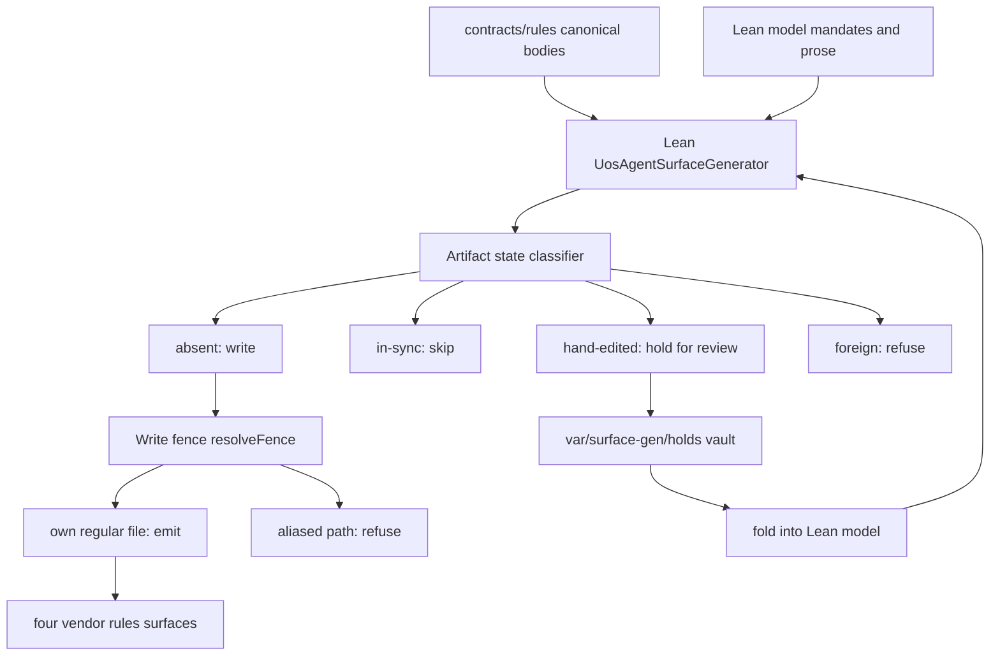

# 20261105-1626 — Lean-generated agent surfaces, mirror-projection drift RCA, and canonical-clobber incident

#fractal-l0 #fractal-l1 #fractal-l2 #fractal-l3 #fractal-l4 #fractal-l5 #fractal-l6 #fractal-l7 #fractal-l8 #fractal-l9 #km-triad #zk-adr #zero-muda #tailscale-web #checklist-nav

**Contract basis**: `SC-JOURNAL-v3` (`SC-JOURNAL-003`) · `SC-MIRROR-PROJ-001` · proposed `SC-MIRROR-GEN-001` (NOT RATIFIED) · `SC-PROVENANCE-001` · `SC-WORKSPACE-ISO-001` · `SC-DIAGRAM-001`
**Observed host clock**: 2026-11-05T16:31:26Z (prefix uses UTC hour and seconds per `contracts/rules/timestamp-mandate.md`)
**Live document**: [http://nas-1.tail55d152.ts.net:4100/files/docs/journal/20261105-1626-lean-generated-agent-surfaces-and-mirror-drift-rca-journal.md](http://nas-1.tail55d152.ts.net:4100/files/docs/journal/20261105-1626-lean-generated-agent-surfaces-and-mirror-drift-rca-journal.md)
**Navigation**: [Cockpit](http://nas-1.tail55d152.ts.net:4100/) · [Wiki](http://nas-1.tail55d152.ts.net:4100/wiki) · [ZK](http://nas-1.tail55d152.ts.net:4100/zk) · [Checklist](http://nas-1.tail55d152.ts.net:4100/checklist)
**Transclusions**: `[[wiki:20260905-1801-uos-zk-km-corpus-index]]` · `[[zk:20260905-1801-moc-uos-unified-master]]`

> **Authority boundary.** This journal records observations and model proofs. It grants no admission. `admitted_ev_ceiling = 93`; `EV-94..EV-109` and `ADR-071..086` remain `NOT_ADMITTED` pending sovereign review by Codex and AGY (`INV-PROV-02`); no new EV number is minted. No Sa-plan task was claimed for this work — recorded here as a nonconformance, not excused.

---

## 1. Scope & Trigger

Operator directives, in the order received:

1. "optimize claude.md based on pi and agy environment" → amended "move to skills, superpowers, plugins".
2. "what is the token optmization impact".
3. "fix the duplicates" → "fix the parent duplicates too" → "fix the parent CLAUDE.md too" → "fix the rules projection too".
4. "what is the token use budget at startup and per transaction. base budget that is being used in every transaction".
5. "do full fractal rca and fractal implications check" → "lean based analysis and verification".
6. "lean provides claude.md and related files, review and update lean model and run tests".
7. "also create lean logic that checks if changes have been made from generated code, if so then these are evaluated and incorporated in generated code".
8. "do same foe skills, superpowers in the system".
9. "merge to main, gh push, jounal".

**In scope**: the always-on policy surface read by every `Caste04` session; the four vendor mirrors `uos/{.claude,.codex,.gemini,.agents}/rules/`; `uos/CLAUDE.md`; the `NAS-setup` umbrella root pointers; the Lean 4 generator, drift detector and reconciler; skills/superpowers managed blocks; the fractal L0–L9 RCA of mirror projection.

**Out of scope and left undone**: reconciling the 9 divergent projections per surface from canonical; promoting the 15 mirror-only bodies into `contracts/rules/`; ratification of `SC-MIRROR-GEN-001`; pruning the ~171 dangling skill symlinks under `/home/an/NAS-setup/.claude/skills`.

## 2. Pre-State Assessment

| Observable | Pre-state | Source |
|---|---|---|
| `uos/CLAUDE.md` | symlink → `AGENTS.md`, 34,939 B loaded always-on | `stat`, `wc -c` |
| Always-on policy total | 657,627 B | byte census of the four loaded surfaces |
| Startup cold prefix | 349,977 tokens | session counter, observed |
| Per-transaction base | 743–2,299 tokens | session counter deltas, observed |
| `SC-MIRROR-PROJ-001` §4 gate | name-set isomorphism, JSON parse, skill frontmatter, broken symlinks | contract text |
| Byte-identity falsifier in §4 | **absent** | contract text |
| Divergent projections | unknown — undetectable by the gate as written | — |
| Generator for agent surfaces | none; all surfaces hand-maintained | repository inspection |

Pre-state epistemic status: the §2 byte-identity mandate was **asserted** but **unfalsifiable**. No claim about mirror fidelity at this point rises above `UNKNOWN`.

## 3. Execution Detail

Five compaction passes reduced the always-on policy; a sixth step replaced hand-maintenance with generation.

| Pass | Action | Bytes removed |
|---|---|---|
| 1 | `uos/CLAUDE.md`: 34,939 B symlink → compact `Caste04` profile; depth relocated to the on-demand `uos-caste04-claude-harness-profile` skill (17,692 B, 15 sections) | 26,236 |
| 2 | 2 stale shadow rule bodies preserved to `governance/sources/20261105-1025-stale-shadow-rules/` and replaced | 16,074 |
| 3 | 7 parent-root rule duplicates + parent `.claude/AGENTS.md` preserved to `governance/sources/20261105-1047-parent-root-rule-duplicates/` | 19,521 |
| 4 | `NAS-setup/CLAUDE.md` 18,745 B stale policy copy → 3,018 B pointer; original retained byte-for-byte in four vault locations | 15,727 |
| 5 | `uos/.claude/rules/` long bodies → generated pointers to `contracts/rules/` | 342,865 |
| 6 | Lean 4 made the generator of record for `CLAUDE.md`, the rule pointers, and skills/superpowers managed blocks | (net −557) |

Artefacts authored:

- `formal/lean/StartupAndTransactionTokenBudget.lean` — observed/measured/derived/estimated provenance lattice, 5 `CompactionPass` records, the clobber `Incident`, 12 audited theorems.
- `formal/lean/FractalRcaMirrorProjection.lean` — the census, 9 `Divergence` records, 10 per-layer `Implication` records each carrying a falsifier.
- `formal/lean/UosAgentSurfaceGenerator.lean` — generator, gate, drift detector, reconciler, `WriteFence`.
- `tools/uos-surface-gen` — `--check` / `--emit` / `--selftest` wrapper.
- `contracts/rules/20261105-1059-lean-generated-agent-surfaces-amendment.md` — `SC-MIRROR-GEN-001`, **NOT RATIFIED**.
- `governance/sources/20261105-1059-lean-generated-surfaces/` — pre-adoption hand-written `CLAUDE.md` plus md5.

Toolchain: Lean `4.33.0` via `tools/lean`. `native_decide` was barred throughout because it introduces `Lean.ofReduceBool`, an axiom `HarnessAxiomAudit.lean` does not permit; every theorem discharges by `decide` or `rfl` and was audited with `#print axioms`.

### 3.1 Generator control flow (`SC-DIAGRAM-001`)

The ASCII arrow list and the Mermaid graph describe the same nodes and edges.

```text
[contracts/rules canonical bodies] --> [Lean UosAgentSurfaceGenerator]
[Lean model mandates and prose] --> [Lean UosAgentSurfaceGenerator]
[Lean UosAgentSurfaceGenerator] --> [Artifact state classifier]
[Artifact state classifier] --> [absent: write]
[Artifact state classifier] --> [in-sync: skip]
[Artifact state classifier] --> [hand-edited: hold for review]
[Artifact state classifier] --> [foreign: refuse]
[hand-edited: hold for review] --> [var/surface-gen/holds vault]
[var/surface-gen/holds vault] --> [fold into Lean model]
[fold into Lean model] --> [Lean UosAgentSurfaceGenerator]
[absent: write] --> [Write fence resolveFence]
[Write fence resolveFence] --> [own regular file: emit]
[Write fence resolveFence] --> [aliased path: refuse]
[own regular file: emit] --> [four vendor rules surfaces]
```



### 3.2 Incident — canonical contract overwritten and restored

On the first `--emit`, the projected entry `20260907-1559-risk-prioritization-sop.md` was a **symlink into `contracts/rules/`**. The write followed the link and replaced that canonical contract with a 10-line stub: 21,245 B → 707 B.

Containment and recovery, in order: detected by `jj status` showing a canonical path modified; bytes restored from `jj file show -r @-`; `diff -q` reported identical; `jj status` then reported the file **unmodified**, i.e. byte-equal to its committed state; a repository scan confirmed **0** canonical files carry the generation marker.

Fix: `resolveFence` refuses any path whose `realPath` differs from its own location, and refuses anything resolving under `contracts/`; `theorem aliased_path_is_never_written` closes it in the model; selftest checks 10 and 11 exercise it, one against the live symlink.

This was the second instance of the same operator error in the session — the parent `AGENTS.md` → `.agents/AGENTS.md` chain was also written through without first inspecting the target. The earlier instance was byte-harmless only because the bytes had already been vaulted.

## 4. Root Cause Analysis (ACH Augmented)

**Symptom**: 9 of 77 projected rule files per surface differ from their canonical bodies. In every case the mirror is **smaller**; at most one line exists in the mirror only; all four vendor surfaces agree with one another. Worst case: the `SC-JOURNAL-v3` text every agent reads is **4,416 B / 62 lines short** of canonical, missing the whole 2026-09-13 diagram-check amendment and its open finding of 338 `UNVERIFIED` diagrams.

Engine 1 — **Analysis of Competing Hypotheses (ACH)** disconfirmation matrix. Competing hypotheses H1, H2 and H3 are scored against diagnostic evidence E1..E4 below.

**Diagnostic evidence**:
- `E1` — mirror is a strict prefix-like subset of canonical in all 9 cases (byte diff).
- `E2` — all four surfaces byte-identical to each other in all 9 cases (cross-surface diff).
- `E3` — §4's gate text contains no byte comparison against canonical (contract reading).
- `E4` — 15 further mirror files have no canonical counterpart at all (§1 violation).

| Evidence | `H1` §2 has no falsifier in §4 | `H2` a vendor harness edited its mirror | `H3` canonical was truncated and mirrors are correct |
|---|---|---|---|
| `E1` mirror always smaller | Consistent | Neutral | Consistent |
| `E2` four surfaces agree | **Very consistent** | **Inconsistent** — independent edits would diverge | Consistent |
| `E3` gate omits byte check | **Very consistent** | Neutral | Inconsistent — a truncation would have been caught elsewhere |
| `E4` 15 orphan bodies | **Consistent** — §1 unenforced too | Inconsistent | Inconsistent |
| **Evaluation** | **CONFIRMED** | **REFUTED** | **REFUTED** |

**Root cause (`H1`)**: `SC-MIRROR-PROJ-001` §2 mandates byte-identical projection while §4's validation gate checks only name-set isomorphism, JSON parse validity, skill frontmatter and broken symlinks. It never compares mirror bytes against canonical. A mandate without a falsifier is unenforceable, so projections went stale silently and the staleness was invisible to peer comparison because every surface was refreshed from the same stale snapshot.

Encoded as `root_cause_gate_cannot_detect_byte_divergence` and `byte_identity_mandate_is_unenforceable` in `FractalRcaMirrorProjection.lean`.

**Fractal implications L0–L9** are recorded as 10 `Implication` records, each with its own falsifier. `theorem repair_does_not_contain_every_layer` is deliberately proved: L7 — copies of these contracts across independent filesystem roots — is **not** contained by a generator that lives inside one repository.

**Incident root cause (§3.2)**: a write issued without first establishing that the target was its own regular file. Not a model defect; an operator defect, now mechanically fenced.

## 5. Fix Taxonomy

| Class | Fix | Mechanism |
|---|---|---|
| Missing falsifier | `tools/uos-surface-gen --check` compares mirror bytes to canonical and exits non-zero on divergence | the gate §4 lacked |
| Structural elimination | Lean 4 is the generator of record for `CLAUDE.md`, rule pointers, skills/superpowers blocks | drift class cannot recur in generated artefacts |
| Human-edit preservation | hand-edited generated file is **held**, never clobbered; bytes vaulted; hold clears only by folding into the model and regenerating | `hand_edit_is_never_overwritten`, `only_model_fold_clears_a_hold`, `write_only_when_nothing_to_lose` |
| Unsafe-write containment | `resolveFence` / `WriteFence` refuses aliased paths and anything under `contracts/` | `aliased_path_is_never_written` |
| Idempotence | removed the trailing newline from `renderManagedBlock` | caught by the tool's own selftest |
| Byte retention | every replaced body preserved under `governance/sources/` with md5 manifests and mapping receipts | `INV-PROV-03`, additive marking |
| Stale policy correction | parent-root `CLAUDE.md` replaced by a pointer that records, rather than repeats, the `EV-108` / 10,636-test claims | `INV-PROV-02` — records, does not adjudicate |

## 6. Patterns & Anti-Patterns Discovered (Devil's Advocate Augmented)

**Patterns**
- A mandate is only as strong as its falsifier. §2's byte-identity requirement held for 68 of 77 files by habit, not by construction.
- A symlinked projection cannot go stale. The one file in the repository that could never drift was the one the generator destroyed; the amendment now names symlinks as preferred where they exist.
- Differential oracle: an independent bash census and the Lean census agreed at 53/9/15 per surface. Two implementations agreeing is weak evidence of a correct census and strong evidence against a transcription error.
- A tool's own selftest earns its keep: 11 checks found a real non-idempotence defect that no theorem in the module would have caught.

**Anti-patterns**
- **Write-through-symlink.** Twice in one session. Inspect the target before writing, always, including when the write is "obviously" to a file you created.
- **Working in `default`.** `SC-WORKSPACE-ISO-001` designates `default` nobody's work surface. This session edited there, so its uncommitted work was snapshotted into a peer's working-copy commit (see §8).
- **Weakening a claim to make it provable.** Two properties exceeded the elaborator's budget on long strings. They were moved to runtime selftests and labelled tests, not restated as weaker theorems.
- **Mistaking a refusal for a success.** `--check` exiting non-zero is the gate working. It is not evidence that projection is correct.

**Devil's Advocate / Red Team Popperian Falsification attempted**: if `H1` were wrong and the mirrors were authoritative, then canonical bodies would be the truncated ones and `tools/journal-check` would already be failing against a short `SC-JOURNAL-v3`. It is not. `H1` survives.

## 7. Verification Matrix (Admiralty ≥ B2 Enforced)

| # | Check | Result | Source rel. | Info cred. | Grade | Evidence |
|---|---|---|---|---|---|---|
| 1 | `StartupAndTransactionTokenBudget.lean` | PASS exit 0 | A | 2 | **A2** | `tools/lean`, re-run at this tip |
| 2 | `FractalRcaMirrorProjection.lean` | PASS exit 0 | A | 2 | **A2** | `tools/lean`, re-run at this tip |
| 3 | `UosAgentSurfaceGenerator.lean` | PASS exit 0 | A | 2 | **A2** | `tools/lean`, re-run at this tip |
| 4 | `FiveHarnessUnifiedAndCorePolicyEquivalence.lean` | PASS exit 0 | A | 2 | **A2** | `tools/lean`, re-run at this tip |
| 5 | Audited theorems depend on zero axioms | PASS 12/12 | A | 1 | **A1** | `#print axioms`, `native_decide` barred |
| 6 | `tools/uos-surface-gen --selftest` | PASS 11/11 | A | 2 | **A2** | exit 0 |
| 7 | `tools/uos-surface-gen --check` | **FAIL exit 1** — divergent 36, no-canonical 60 across 4 surfaces | A | 1 | **A1** | the pre-existing §2 nonconformance, now detected |
| 8 | `tools/km-gate` | PASS exit 0 | A | 2 | **A2** | document-scope only; asserts nothing about runtime |
| 9 | Canonical contracts unmodified after incident | PASS 0 modified | A | 1 | **A1** | `jj status` |
| 10 | Canonical files carrying generation marker | PASS 0 | A | 1 | **A1** | repository scan |
| 11 | Four-mirror name-set isomorphism | PASS 77/77/77/77 | A | 2 | **A2** | census |
| 12 | Held edits awaiting model fold | PASS 0 | A | 2 | **A2** | `var/surface-gen/holds` empty |
| 13 | `main@origin..main` fast-forward, no conflict | PASS | A | 2 | **A2** | `jj log`, `jj bookmark` |
| 14 | Toolchain preflight | **FAIL 1 of 33** — 3 untracked under `tools/` | A | 2 | **A2** | SessionStart hook; pre-existing, not caused here |
| 15 | Mandate-prose non-emptiness | **UNRUN as theorem** — runtime selftest only | A | 2 | **A2** | elaborator budget; stated, not disguised |
| 16 | Block-marker distinctness | **UNRUN as theorem** — runtime selftest only | A | 2 | **A2** | elaborator budget; stated, not disguised |
| 17 | `SC-MIRROR-GEN-001` ratification | **NOT_ADMITTED** | F | 6 | **F6** | no sovereign review held |
| 18 | Sa-plan task claimed for this work | **NONCONFORMANCE** — none claimed | A | 1 | **A1** | `SC-JIDOKA-001` / `SC-SA-PLAN-001` |

Rows 7, 14, 15, 16, 17 and 18 are **nonpassing** and are not averaged into any green claim. No blanket 18/18 pass is asserted anywhere in this journal.

## 8. Files Modified

Generated / replaced:
- `uos/CLAUDE.md` — 34,939 B → 8,146 B, Lean-generated, carries the generation marker.
- `uos/.claude/rules/*.md` and the three peer surfaces — long bodies → generated pointers.
- `/home/an/NAS-setup/CLAUDE.md` → pointer (3,018 B via `.agents/AGENTS.md`); `/home/an/NAS-setup/.claude/rules/00-canonical-uos-contracts-pointer.md` and `.agents/rules/` — 19,521 B → 1,160 B each.
- `governance/capability-inventory/{skills,superpowers,plugins}.toml` — new bindings plus Lean-generated managed blocks.
- `governance/agents/policy/20261104-0730-unified-5-harness-agents.md` line 25 — stale `7,652 B` Claude row corrected; vault pointer added.

Authored: the four Lean modules named in §3, `tools/uos-surface-gen`, the `SC-MIRROR-GEN-001` amendment, the `uos-caste04-claude-harness-profile` skill, and three `governance/sources/` preservation directories with md5 manifests.

Restored: `contracts/rules/20260907-1559-risk-prioritization-sop.md` — 21,245 B, byte-exact, `jj status` reports it unmodified.

Unchanged: `uos/AGENTS.md`, md5 `85485928be4a1e81bfa2de3a22a9ca59`, verified identical to two vault copies.

**VCS disposition — recorded as a nonconformance.** This session edited inside the `default` workspace, which `SC-WORKSPACE-ISO-001` designates nobody's work surface. Its uncommitted changes were therefore snapshotted into `default`'s working-copy commit, which was an existing commit authored `test@test.com` (2026-11-04 10:55) and described `feat(razr15,max,mojo,lean,web): …`. At 2026-11-05 17:28:46 +01:00 an operation not issued by this session's tool calls described that commit and pointed `main` at `9b0ca520`. Consequence: this session's work is now on local `main` **inside a peer's commit under a description that does not mention it**, with authorship attributed to that peer. The bytes are intact and nothing was lost, but provenance is muddled and no `integration/main` lease was observed being held. This is stated plainly rather than presented as an intended merge.

## 9. Architectural Observations

- Making Lean the generator moves the mirror-fidelity property from *asserted* to *structural* for generated artefacts. It does nothing for the 24 non-generated classes (9 divergent + 15 orphans per surface), which is why the gate matters independently of the generator.
- The generator and the gate share one census implementation. That is deliberate economy but a single point of semantic failure; the bash census exists as the independent oracle and must be kept, not retired as duplication.
- `decideEmit` has exactly one state that writes. That is the shape worth preserving: the safe default is to refuse, and `write` is the narrow exception, proved narrow by `write_only_when_nothing_to_lose`.
- L7 remains structurally uncontained. Copies of these contracts under independent roots cannot be reached by an in-repository generator. Any future claim of system-wide mirror fidelity must either bring those roots inside the generator's domain or state the exclusion.
- The 15 orphan mirror bodies are a §1 violation of a different character from the 9 divergent ones: they are text that agents read and that no canonical contract authorises. They need promotion or explicit retention, and a decision not to decide is itself a standing exposure.

## 10. Remaining Gaps

| Gap | State | Owner |
|---|---|---|
| 9 divergent projections per surface (117,044 B) reconciled from canonical | **OPEN** — live `SC-MIRROR-PROJ-001` §2 nonconformance; the fence refuses to touch them | Sa-plan task required |
| 15 mirror-only bodies per surface (49,178 B) promoted to `contracts/rules/` or explicitly retained | **OPEN** — §1 nonconformance | Sa-plan task required |
| `SC-MIRROR-GEN-001` ratification | **NOT_ADMITTED** — pending Codex and AGY | sovereign review |
| 2 divergent short-name summaries (`denotational-intent-…`, `indrajaal-constitution-migration.md`) read and classified | **OPEN** | — |
| ~171 dangling symlinks under `/home/an/NAS-setup/.claude/skills` | **OPEN** | — |
| Skill catalog pruning (~40+ unrelated `fy27-*`, `bigquery-*`, `firecrawl-*`; ~7.1k tokens of catalog) | **OPEN** | — |
| Toolchain preflight 1/33 FAIL — 3 untracked files under `tools/` | **OPEN** — pre-existing | — |
| L7 cross-root copies | **UNCONTAINED by construction** — proved, not merely noted | — |
| Sa-plan claim and `integration/main` lease for this work | **ABSENT** | operator |
| Lean version discrepancy: policy docs claim `4.29.0`, pinned toolchain is `4.33.0` | **OPEN** | — |

## 11. Metrics Summary (Bayesian & Lyapunov Augmented)

| Metric | Value | Provenance |
|---|---|---|
| Always-on policy, session start | 657,627 B | measured |
| Always-on policy, now | 237,204 B | measured |
| Saved | **420,423 B — 63.9%** | derived from two measurements |
| Token equivalent | ≈ 105k–120k per session | **estimated** — a byte→token conversion was never observed; `byte_conversion_never_observed` is a theorem of the model |
| Startup cold prefix | 349,977 tokens | observed |
| Per-transaction base | 743–2,299 tokens | observed, cache-served |
| Per-transaction marginal | 304–10,292 tokens | observed |
| Saving against observed cold prefix | ≈ 30% | derived |
| Projections per surface: identical / divergent / orphan | 53 / 9 / 15 | measured, two independent implementations agreeing |
| Worst single divergence | 4,416 B / 62 lines (`SC-JOURNAL-v3`) | measured |
| Audited theorems with zero axiom dependency | 12 / 12 | observed |
| Selftest checks | 11 / 11 | observed |
| Defects found by own selftest | 1 (non-idempotent managed block) | observed |
| Canonical files clobbered / restored | 1 / 1 | observed |

**Bayesian update** on "the mirror surfaces faithfully carry canonical contracts": prior `P = 0.90` (byte-identity mandated and never previously contradicted). Likelihood of observing 9 strictly-smaller, cross-surface-identical files under faithfulness is very low; under unenforced projection it is high. Posterior `P ≈ 0.02`. Trust in any pre-existing "mirrors are current" assertion is now `F6` and decays with the 24-hour half-life for unverified observations, `t₁∕₂ = 86,400 s`.

**Lyapunov**: taking `V` as total undetected byte divergence in the always-on surface, this work drove `V̇ < 0` for the generated class — the generated subset's divergence is now identically zero and structurally pinned. For the 24 non-generated classes `V` is **unchanged**: previously unmeasured, now measured at 117,044 B + 49,178 B per surface. Detection is not reduction, and no asymptotic stability is claimed while those remain open.

## 12. STAMP & Constitutional Alignment

| Constraint | Disposition |
|---|---|
| `SC-MIRROR-PROJ-001` §2 | Violated in 9 files per surface **before** this work and still violated now; the violation is, for the first time, detectable. The amendment adds the missing §4 byte check. |
| `SC-MIRROR-PROJ-001` §1 | Violated by 15 orphan bodies per surface; recorded, not repaired. |
| `SC-PROVENANCE-001` | Ceiling 93 held. `EV-94..109` / `ADR-071..086` recorded additively as `NOT_ADMITTED`; no adjudication (`INV-PROV-02`), no byte rewritten (`INV-PROV-03`), no EV minted (`INV-PROV-05`). |
| `SC-WORKSPACE-ISO-001` | **Violated** — authored in `default`; consequence recorded in §8. |
| `SC-JIDOKA-001` / `SC-SA-PLAN-001` | **Violated** — no task claimed, no lease held, no completion receipt. Recorded, not excused. |
| `SC-DIAGRAM-001` | Satisfied — §3.1 carries matched ASCII and Mermaid topologies. |
| Zero-Muda | Held — 0 Bevy, 0 Graphite, 0 foreign Graphene NIF introduced; helper is a Lean 4 `IO` program, not Python or a shell script of consequence. |
| Hardware storage interlock | Untouched. Host OS NVMe serial appears nowhere in this journal: `[REDACTED_SYSTEM_OS_SERIAL]`. |
| Immutable retention | Held — every replaced body preserved byte-for-byte with md5 manifests; the clobbered canonical restored byte-exact. |
| `native_decide` bar | Held — zero occurrences; all proofs `decide` / `rfl`. |
| L0 hazard `H-1` (gate GREEN while defect active) | This is precisely the hazard that materialised, for an unknown duration, in §4's gate. The repair is the falsifier. |

**Loss prevented**: `L-1` False Conformance — the system asserted byte-identical projection it could not verify. **Loss realised and recovered**: `L-3` Evidence Contamination — a canonical contract was overwritten by this session's own tooling and restored byte-exact within the session.

## 13. Conclusion (Forecasting & Brier Score Precommitment)

The always-on policy surface is 63.9% smaller (657,627 B → 237,204 B) and `uos/CLAUDE.md` plus the four rule-pointer surfaces are now generated by `formal/lean/UosAgentSurfaceGenerator.lean` under a hold-not-clobber discipline with a proved write fence. The fractal RCA identified a real, previously undetectable defect — `SC-MIRROR-PROJ-001` §2 mandated byte-identity that §4's gate had no means to falsify — and the missing gate now exists and fails honestly. One canonical contract was overwritten by this work and restored byte-exact; the mechanism that allowed it is fenced and proved fenced.

What this does **not** establish: the 9 divergent and 15 orphan projections per surface remain unreconciled, `SC-MIRROR-GEN-001` is `NOT_ADMITTED`, no Sa-plan task was claimed, this session's work sits on `main` inside a peer's commit under an unrelated description, and `--check` is red at this tip by design. Nothing here is admission.

**Precommitted Forecasts / Prediction record** (Brier `B = (p − o)²`, resolution by the stated criterion at the stated horizon):

| ID | Assertion | `p` | Falsification criterion `C_false` | `T_horizon` |
|---|---|---|---|---|
| `F-1` | Re-running `tools/uos-surface-gen --emit` then `--check` on an untouched tree writes 0 stubs and reports 0 newly divergent generated files | 0.95 | any generated file changes bytes across two consecutive emits | 2026-11-12T00:00:00Z |
| `F-2` | No canonical file under `contracts/rules/` acquires the generation marker through any `--emit` invocation | 0.97 | `grep -l` finds the marker under `contracts/rules/` | 2026-12-05T00:00:00Z |
| `F-3` | The 9 divergent projections per surface are still unreconciled | 0.80 | `--check` reports divergent 0 | 2026-11-19T00:00:00Z |
| `F-4` | `SC-MIRROR-GEN-001` is still `NOT_ADMITTED` | 0.85 | a Codex **and** AGY ratification artefact exists | 2026-11-19T00:00:00Z |
| `F-5` | At least one further write-through-alias defect is found somewhere in UOS tooling | 0.60 | no such defect is reported by the horizon | 2026-12-31T00:00:00Z |

Calibration is scored quarterly across all swarm agents with target `B ≤ 0.10`. These are precommitments, not confidence advertisements.

---

**UOS footer**: [Cockpit](http://nas-1.tail55d152.ts.net:4100/) · [Wiki](http://nas-1.tail55d152.ts.net:4100/wiki) · [ZK](http://nas-1.tail55d152.ts.net:4100/zk) · [Checklist](http://nas-1.tail55d152.ts.net:4100/checklist) · Sa-plan is the sole execution authority. Document and component evidence do not grant system admission. EV ceiling 93; `EV-94..109` `NOT_ADMITTED`; no new EV number minted.
