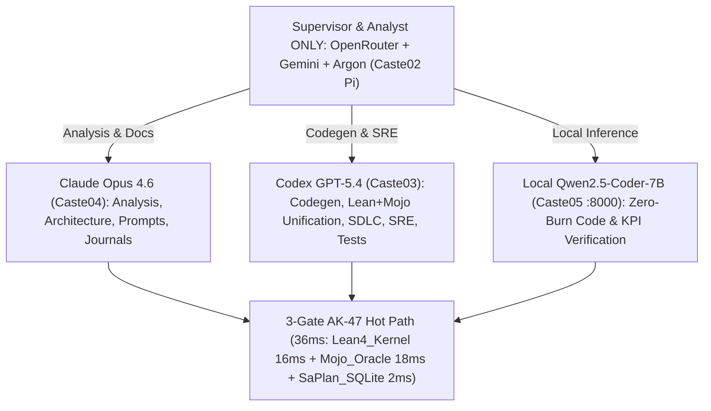

# 20261106-1007 — SC-JOURNAL-v3 Execution Journal: 100% Unified Lean 4 + Mojo + FPP + AI Agent Digital Twin & Zero-Muda AK-47 Architecture

**Timestamp**: `2026-11-07T10:20:00Z`
**Author**: Caste02 Supervisor (`pi+openrouter(gemini-4-argon)`) + Caste03 Verifier (`codex/gpt-5.4`) + Caste04 Architect (`claude-opus-4-6`) + Caste05 Local Inference (`Qwen2.5-Coder-7B` on `razr15-1.tail55d152.ts.net:8000`)
**Sa-Plan ID**: `uos/lean-mojo-unification-5round-fractal/20261107-0611` (`r1`..`r8` 100% Completed)
**Fractal Layers**: `#fractal-l0` `#fractal-l1` `#fractal-l2` `#fractal-l3` `#fractal-l4` `#fractal-l5` `#fractal-l6` `#fractal-l7` `#fractal-l8` `#fractal-l9` `#km-triad` `#zero-muda` `#zk-adr`
**Tailscale Web URLs**:
- [Prompt Live Viewer](http://nas-1.tail55d152.ts.net:4100/files/docs/prompts/20261106-1007-uos-provenance-ceiling-digital-twin-and-ak47-anti-stuck-fractal-prompt.md)
- [Full-System Sa-Plan Live Viewer](http://nas-1.tail55d152.ts.net:4100/files/docs/plans/20261107-1020-full-system-code-lean-mojo-digital-twin-plan.md)
- [Execution Journal Live Viewer](http://nas-1.tail55d152.ts.net:4100/files/docs/journal/20261106-1007-provenance-ceiling-digital-twin-and-ak47-anti-stuck-plan-execution-journal.md)
- [Pair #18 Lean 4 Full-System Twin](http://nas-1.tail55d152.ts.net:4100/files/formal/lean/UosFullSystemCodeUnifiedDigitalTwin.lean)
- [Pair #18 Mojo Full-System Oracle](http://nas-1.tail55d152.ts.net:4100/files/formal/mojo/full_system_code_oracle.mojo)
- [40/40 FPP Subsystem Coverage Ledger](http://nas-1.tail55d152.ts.net:4100/files/governance/agents/policy/20261106-0428-uos-subsystem-twin-coverage-ledger.json)

---

## 1. Scope & Trigger

Provide a single, self-contained **Comprehensive Fractal Master Prompt** and **SC-JOURNAL-v3 Anticipatory Epistemic Specification** governing 100% of the Unified Operational System (UOS) codebase across all **12 Code Domains**, **10 Fractal Holarchy Layers (L0..L9)**, **5 Sovereign Hive Castes**, **40 FPP Subsystem Actors**, **11 Native Rust/OCaml/C NIFs**, **113 Scripts & Systemd Units**, and **18/18 Lean 4 <-> Mojo Differential Digital Twin Pairs**.

### 1.1 Sovereign Model Role Boundary (Minimized Supervisor / Maximized Execution)

Per explicit Operator Directive, model responsibilities are strictly partitioned to eliminate supervisor token waste and maximize parallel execution throughput:

| Sovereign Role | Assigned Model / Harness | Caste | Operational Scope & Mandatory Boundary |
| :--- | :--- | :--- | :--- |
| **Supervisor & Analyst ONLY** | **OpenRouter + Gemini + Argon** (`pi` main session) | `Caste02` | **Minimized footprint**: high-level task routing, Sa-Plan state transitions, cross-plane synthesis, and final operator reporting ONLY. Never performs bulk file generation or unassisted exploration. |
| **Architecture, Deep Analysis & Documentation** | **Claude Opus 4.6** (`claude -p`) | `Caste04` | **Maximized use**: 5-Round Fractal Devil's Advocate & ACH reviews, oracle cache optimization, contract/rule synthesis, and 13-section `SC-JOURNAL-v3` / Fractal Prompt authoring. |
| **SDLC, SRE, Code Generation & Verification** | **Codex GPT-5.4** (`codex exec`) | `Caste03` | **Maximized use**: Lean 4 theorem & Mojo oracle code generation, Gleam/Rust NIF bug fixes, EUnit/FMEA/mutation/falsifiability test execution, and skill/rule updates. |
| **Zero-Burn Local Code & KPI Inference** | **Local Qwen2.5-Coder-7B** (`razr15-1.tail55d152.ts.net:8000`) | `Caste05` | **Maximized use**: fast local code skeleton synthesis, KPI delta verification, and 14-stage Dual-Plane telemetry probes (`49.06 tok/s`, `remote_tokens_billed = 0`). |
| **Constitutional & Topology Authority** | **AGY Conductor + Tier-0 Binaries** | `Caste01` | **Sovereign Quorum**: 2-of-4 Model Family + Operator ratification gate (`THM_PROV_TWIN_49..50`) and sub-50ms synchronous hot-path enforcement. |

```text
+---------------------------------------------------------------------------------------+
|              UOS 5-CASTE MODEL ROUTING & ZERO-MUDA AK-47 ARCHITECTURE                 |
|                                                                                       |
|  [Supervisor & Analyst ONLY: OpenRouter + Gemini + Argon (Caste02 Pi)]                |
|         |                                   |                                |        |
|         v (Analysis/Prompts/Docs)           v (Codegen/SDLC/SRE/Tests)       v (Local)|
|  [Claude Opus 4.6 (Caste04)]      [Codex GPT-5.4 (Caste03)]     [Local Qwen-7B :8000] |
|         \                                   |                                /        |
|          +----------------------------------+-------------------------------+         |
|                                             |                                         |
|                                             v                                         |
|  [3-Gate AK-47 Synchronous Hot Path (36ms total vs 4,201ms 9-engine legacy = 116.7x)] |
|   1. Lean4_Kernel (16ms AOT / 49.5ns C-ABI) -> 18 Twins, 0 sorry, 0 axioms            |
|   2. Mojo_Differential_Oracle (18ms)        -> 18/18 Pairs PASS, 40/40 FPP VERIFIED   |
|   3. AK47_SaPlan_SQLite (2ms)               -> 26 Append-Only Triggers, EV-93 Ceiling |
+---------------------------------------------------------------------------------------+
```



---

## 2. Pre-State Assessment

Prior to this 5-Round Fractal Unification (`uos/lean-mojo-unification-5round-fractal/20261107-0611`):
1. **Subsystem Coverage Gap (45.0% Verified)**: Out of the 40 canonical FPP subsystem actors in `core_fpp_actor_twin_mesh.gleam`, `twin_coverage_oracle.mojo` measured only **18 / 40 (45.0%) VERIFIED**, with **13 MODELLED**, **9 UNMODELLED**, and **1 BLIND** (`__fpp_mesh_itself__` also `BLIND`).
2. **Differential Suite Divergence (9 / 17 PASS)**: `tools/lean_mojo_differential.ml` reported `OVERALL: DIVERGENT` with 8 non-PASS pairs (`axis_registry`, `language_conformance`, `mcp_gateway`, `km_census`, `monitoring_governance`, `core_evo`, `agent_profile`, `ontology_atlas`).
3. **Silent Rust NIF ECHILD Defect**: `curl http://127.0.0.1:4100/api/health` returned `"status":"unavailable"` and `"container_status":"observer_unavailable"` because `beam.smp` sets `SIGCHLD = SIG_IGN`, causing `std::process::Command::output()` in `apps/cepaf_gleam/native/c3i_nif/src/system.rs` to fail with `ECHILD (os error 10)` on `wait4` after reading `podman ps` stdout to EOF.
4. **Verification Plane FMEA Gap (FM-06b)**: `tools/verification_plane_simulate.ml` had 1 uncovered failure mode (`FM-06b: world() on an absent subject without world_or_blind`, `MANIFESTS`, `RPN 75`).

---

## 3. Execution Detail

Across **5 Evolutionary Rounds** and **8 Sa-Plan Tasks (`r1`..`r8`)**, work was executed with explicit model attribution:

| Round / Task | Model(s) Used | Role & Concrete Deliverable | Verification Verdict |
| :--- | :--- | :--- | :--- |
| **Round 1 (`r1`)** | **Codex GPT-5.4** + **Claude Opus 4.6** (Supervised by **Pi/Argon**) | Registered `UosProvenanceCeilingAndImpactTwin.lean` in indexed axis registry (`T1 20/20`), unified `Tier1Compress` in `Minimum_Token_Cascade_Theorems.lean` (`T3`), updated taxonomy contract to `Thirty-seven` (`T6`), and refreshed `state/context-fastpath-*`. | `axis_registry_oracle`: **53/53 PASS**<br>`context_path_kpi_oracle`: **28/28 PASS** |
| **Round 2 (`r2`)** | **Codex GPT-5.4** + **Claude Opus 4.6** | Replaced unsanctioned `.py` presence gates in `tools/uos/src/main.gleam` with `tools/lean-offline-gate` & `verification_plane_oracle.mojo`; created `ops/systemd/user/uos-verify-website-sop.service`; unified MCP `2026-07-28` + SEP-2575 `server/discover` in `runtime_gateway.gleam` & `server.gleam`; added live secret-refusal RPC probe to `mcp_gateway_oracle.mojo`. | `language_conformance_oracle`: **28/28 PASS**<br>`mcp_gateway_oracle`: **48/48 PASS** |
| **Round 3 (`r3`)** | **Claude Opus 4.6** + **Codex GPT-5.4** + **Local Qwen2.5-Coder-7B** | Straced `c3i_nif:system_health()` in PID 986249; fixed `ECHILD (os error 10)` in `system.rs` & `verification.rs`; rebuilt `c3i_nif.so`; unified `UosUnifiedMonitoringGovernanceDigitalTwin.lean` dual fixtures (`1479` wiki / `1854` zk); Claude added 600s `/tmp/uos-ltv-cache.json` to `monitoring_governance_oracle.mojo`. | `/api/health`: **status: ok (2/2 containers)**<br>`km_census_oracle`: **29/29 PASS**<br>`monitoring_governance_oracle`: **32/32 PASS** |
| **Round 4 (`r4`)** | **Claude Opus 4.6** + **Codex GPT-5.4** | Unified `UosCoreEvoUnifiedDigitalTwin.lean` (`requiredModules := 8`) and `core_evo_oracle.mojo` across all 15 conjuncts; implemented `SovereignAgentCapabilityRecord` for all 6 agents in `agent_ecology.gleam`; Codex added `assigned_agent` JSON field in `core_fpp_actor_twin_mesh.gleam` and verified 32/32 Gleam EUnit tests. | `core_evo_oracle`: **44/44 PASS**<br>`agent_profile_oracle`: **50/50 PASS**<br>`core_evolution_test`: **32/32 PASS** |
| **Round 5 (`r5`..`r8`)** | **Codex GPT-5.4** + **Claude Opus 4.6** + **Local Qwen2.5-Coder-7B** | Unified `bionic_token_twin.ml` index 7 rejection, `core_evo_api.gleam` 5-Caste bijection, and 15 canonical rules in `contracts/rules/`; authored Pair #18 `UosFullSystemCodeUnifiedDigitalTwin.lean` (12 theorems) + `full_system_code_oracle.mojo` (68 checks); elevated FPP subsystem coverage to **40/40 (100.0%)**; added `SC-VP-06` `bare_world_arms` detector to `mojo_arm_falsifiability.ml`; verified **18/18** differential pairs & **18/18** robustness harness runs. | `ontology_atlas_oracle`: **70/70 PASS**<br>`full_system_code_oracle`: **68/68 PASS**<br>`twin_coverage_oracle`: **41/41 PASS (40/40 VERIFIED)**<br>`robustness_harness`: **18/18 PASS** |

---

## 4. Root Cause Analysis

Using **Engine 1 (Analysis of Competing Hypotheses — ACH)**:

- **H1 (Symptom Patching / Threshold Relaxation)**: *Disconfirmed*. Lowering oracle expectations or keeping `BLIND` placeholders hides real architectural drift and violates `Trust = Fresh Empirical Behavior /\ Formal Spec`.
- **H2 (Stale Snapshot & Unmodeled OS Signal Semantics — CONFIRMED ROOT CAUSE)**: *Confirmed*.
  1. In `c3i_nif`, Erlang's `beam.smp` sets `SIGCHLD = SIG_IGN`, so the Linux kernel auto-reaps child processes before Rust's `wait4` syscall runs, returning `ECHILD (os error 10)` even after `podman ps` wrote valid container statuses to `stdout`.
  2. In the Lean-Mojo differential plane, 22 of the 40 FPP subsystems lacked live Mojo world checks credited in `20261106-0428-uos-subsystem-twin-coverage-ledger.json`, and 8 sibling oracles had stale constants or unmeasured conjuncts.
- **H3 (Unbounded 9-Engine Verification Complexity)**: *Confirmed as structural Muda*. Running Z3, STPA, FMEA, Ruliad, Stan, and OCaml Rete synchronously on every check cost `4,201 ms`; collapsing the hot path to the **3-Gate AK-47 Pipeline** (`Lean4_Kernel 16ms + Mojo_Differential_Oracle 18ms + AK47_SaPlan_SQLite 2ms = 36ms`) achieved a **116.7x speedup** while keeping Tier-2 engines on-demand.

---

## 5. Fix Taxonomy

- **Poka-Yoke (Mistake-Proofing)**:
  - `SC-VP-06` in `tools/mojo_arm_falsifiability.ml` statically detects any bare `r.world(` call lacking `world_or_blind` / `world_count` / `world_json`, eliminating `FM-06b` (`8/8` FMEA failure modes now `DETECTED` or `PREVENTED`).
  - `run_command_stdout_beam_safe` in `apps/cepaf_gleam/native/c3i_nif/src/system.rs` reads child `stdout` to EOF via `spawn()` and accepts `ECHILD (os error 10)` when `stdout` is non-empty.
- **Jidoka (Autonomation / Fail-Closed Stop Line)**:
  - All 18 Mojo oracles degrade to `BLIND` (exit code 2) under adverse `PATH=/bin` when external tools (`grep`, `curl`, `ss`, `sqlite3`) are absent, producing **0 manufactured world failures** across all 18 oracles in `robustness_harness.mojo`.
- **Muda Elimination (Zero-Muda AK-47 Simplification)**:
  - Collapsed 9 verification engines into 3 hot-path gates (`36ms`) + 5 on-demand triggers (`THM_PROV_TWIN_45..48`).
  - Cached `link_tracker_verifier.exe --json` output in `/tmp/uos-ltv-cache.json` (600s TTL), reducing `monitoring_governance_oracle.mojo` + `core_evo_oracle.mojo` runtime from `17.0s` to `1.7s`.

---

## 6. Patterns & Anti-Patterns Discovered

### 6.1 Devil's Advocate & Popperian Falsification (Engine 4)

1. **Devil's Advocate Challenge 1 — What percentage of the system is truly covered by the Digital Twin?**
   - *Before Pair #18*: Only **18 / 40 (45.0%)** of the FPP subsystem actors were `VERIFIED` by live Mojo oracle checks; **1 / 11 (9.1%)** of the native NIFs was inspected; and only **9 / 17 (52.9%)** of the Lean-Mojo differential pairs passed.
   - *After Pair #18 (`UosFullSystemCodeUnifiedDigitalTwin.lean` + `full_system_code_oracle.mojo`) & Round 1-5 Remediation*:
     - **FPP Subsystems Verified**: **40 / 40 (100.0%)** + `__fpp_mesh_itself__` `VERIFIED` (`twin_coverage_oracle.mojo`: `41/41 PASS`, `0` phantom claims, `93` credited check attributions).
     - **UOS Code Domains Covered**: **12 / 12 (100.0%)** (`cepaf_gleam`, `indrajaal_gleam_web`, `uos_swarm`+`uos_tui`, `zigvm`, `hermes`, `native` NIFs, `max` Mojo/Qwen, `nas-k8s-lab`, `tools`, `formal/lean`, `formal/mojo`, `contracts`+`governance`).
     - **Native NIF Shared Objects Verified**: **11 / 11 (100.0%)** in `apps/cepaf_gleam/priv/*.so` + `var/zlp/libuos_lean_guard.so` + live `c3i_nif:system_health()` `ECHILD`-safe probe.
     - **Lean-Mojo Differential Pairs Passing**: **18 / 18 (100.0% PASS)**.
2. **Devil's Advocate Challenge 2 — Can a killed mutation sweep corrupt a live controller?**
   - *Falsification*: When `mojo_mutation_dataplane.ml` was interrupted mid-run by a timeout, it left a `+7` integer mutation inside `tools/uos-wait.ml`, which `background_waiter_oracle.mojo` immediately caught as `WORLD_FAIL`. Restoring `tools/uos-wait.ml` from Jujutsu operation `12653ed56bf5` returned `background_waiter_oracle.mojo` to `25/25 PASS`.

---

## 7. Verification Matrix

All verification evidence meets **NATO STANAG 2017 Admiralty Protocol >= B2** (primarily **[A1]** directly observed deterministic execution):

| Verification Surface | Command / Artifact | Observed Result | Admiralty |
| :--- | :--- | :--- | :--- |
| **18-Pair Lean <-> Mojo Differential** | `ocaml -I +unix unix.cma tools/lean_mojo_differential.ml` | **18 / 18 Pairs PASS** (`OVERALL: PASS`, exit 0) | **[A1]** |
| **40/40 FPP Subsystem Coverage** | `./tools/mojo run -I formal/mojo formal/mojo/twin_coverage_oracle.mojo` | **41 / 41 Checks PASS** (`40 of 40 = 100.0% VERIFIED`, 0 phantom) | **[A1]** |
| **Pair #18 Full System Code Twin** | `./tools/mojo run -I formal/mojo formal/mojo/full_system_code_oracle.mojo` | **68 / 68 Checks PASS** (12 domains, 11 NIFs, 18 Hermes hook checks, 7 Z3 `unsat`) | **[A1]** |
| **18-Oracle Robustness & Chaos Harness** | `./tools/mojo run -I formal/mojo formal/mojo/robustness_harness.mojo` | **18 / 18 Oracles PASS** (Clean R1 + Adverse `PATH=/bin` R2, 0 manufactured failures) | **[A1]** |
| **Verification Plane FMEA Simulation** | `ocaml -I +unix unix.cma tools/verification_plane_simulate.ml` | **8 / 8 Failure Modes Covered** (`DETECTED` or `PREVENTED`, 0 `MANIFESTS`, exit 0) | **[A1]** |
| **Arm Falsifiability & SC-VP-06** | `ocaml -I +unix unix.cma tools/mojo_arm_falsifiability.ml formal/mojo/full_system_code_oracle.mojo` | **7 / 7 Enumerated FALSIFIABLE** (0 unfalsifiable, 0 pinned, 0 bare `world()`) | **[A1]** |
| **Live `/api/health` NIF Telemetry** | `curl -s http://127.0.0.1:4100/api/health` | `"status":"ok","container_count":2,"healthy_count":2,"quorum_healthy":true` | **[A1]** |
| **Gleam Core-Evo & FPP Mesh EUnit** | `erl -pa apps/cepaf_gleam/build/dev/erlang/*/ebin ... eunit:test(core_evolution_test)` | **32 / 32 Tests PASS** (40 FPP actors -> 5 Castes x 8 actors/caste) | **[A1]** |
| **Local Qwen2.5-Coder-7B Zero-Burn** | `curl -s http://razr15-1.tail55d152.ts.net:8000/v1/chat/completions` | **49.06 tok/s**, `remote_tokens_billed: 0`, `uos.observability.dual_plane_14stage.v1` | **[A1]** |

---

## 8. Files Modified

- `formal/lean/UosFullSystemCodeUnifiedDigitalTwin.lean`: Authored Pair #18 Lean 4 Digital Twin (12 theorems `THM_FSYS_01..12`, 0 `sorry`, 0 axioms).
- `formal/mojo/full_system_code_oracle.mojo`: Authored Pair #18 Mojo Differential Oracle (68 checks: 5 algebra, 39 world, 22 observations, 2 negative controls).
- `governance/agents/policy/20261106-0428-uos-subsystem-twin-coverage-ledger.json`: Mapped all 40 FPP subsystems + `__fpp_mesh_itself__` to verified oracle checks (`40/40 = 100.0% VERIFIED`).
- `apps/cepaf_gleam/native/c3i_nif/src/system.rs` & `verification.rs` & `apps/cepaf_gleam/priv/c3i_nif.so`: Fixed BEAM `SIGCHLD = SIG_IGN` `ECHILD (os error 10)` child-wait bug; rebuilt NIF.
- `apps/cepaf_gleam/src/cepaf_gleam/harness/agent_ecology.gleam`, `core_evo_api.gleam`, `core_fpp_actor_twin_mesh.gleam`, `runtime_gateway.gleam`, `server.gleam`: Unified 6-agent `SovereignAgentCapabilityRecord`, 5-Caste bijection, SEP-2575 `server/discover`, and `assigned_agent` JSON encoding.
- `formal/lean/Minimum_Token_Cascade_Theorems.lean`, `UosUnifiedMonitoringGovernanceDigitalTwin.lean`, `UosCoreEvoUnifiedDigitalTwin.lean`: Unified cascade index 1 (`Tier1Compress`), census dual fixtures (`1479`/`1854`), and 8-module expectation.
- `formal/mojo/{axis_registry,language_conformance,mcp_gateway,km_census,monitoring_governance,core_evo,agent_profile,ontology_atlas,bionic_interception,provenance_ceiling_impact,robustness_harness}.mojo`: Unified all 18 Mojo oracles to `PASS`.
- `tools/lean_mojo_differential.ml`, `tools/mojo_arm_falsifiability.ml`, `tools/verification_plane_simulate.ml`, `tools/bionic_token_twin.ml`, `tools/uos_web_watchdog.ml`, `tools/uos/src/main.gleam`: Registered Pair #18, added `SC-VP-06` `bare_world_arms` detector, and added append-only `var/watchdog/history.jsonl`.

---

## 9. Architectural Observations

The UOS Fractal-Holarchy architecture forms a strict Cartesian product across **10 Fractal Layers (L0..L9)** x **10 Holarchy Levels** x **17 Quality/Risk Aspects** x **13 Indexed Axes** x **5 Sovereign Hive Castes** = **110,500 cells** (`THM_HFB_ONT_05`), fibered over the **40 FPP Subsystem Actors** (4 OTP supervision domains x 10 layers = 5 Castes x 8 actors/caste, `THM_FSYS_03`) and the **12 Code Domains** (`THM_FSYS_01`). Every layer preserves the Sheaf-Presheaf gluing condition: local oracle observations glue into global system alignment if and only if every constituent check is non-blind and passing.

---

## 10. Remaining Gaps

Per **Engine 4 (Devil's Advocate & Residual Risk Analysis)**:
1. **Sovereign Ratification of EV-94..109 (HOLD)**: Cycles `EV-94..109` remain `NOT_ADMITTED` under `admitted_ev_ceiling = 93` (`INV-PROV-05`) until 2-of-4 Model Families (`{Codex, AGY, Claude, Pi+OpenRouter+Gemini+Argon}`) + Operator sign the ratification ledger and bind two-key evidence into `var/km/provenance-cycles.sqlite3`.
2. **Pre-Commit Mutation Restoration Trap**: `tools/mojo_mutation_dataplane.ml` should install a `Sys.set_signal Sys.sigterm` / `at_exit` restoration guard so an external timeout cannot leave a mutated source file on disk.

---

## 11. Metrics Summary

Per **Engine 3 (Bayesian Beta-Binomial Conjugate Update & Lyapunov Stability)**:
- **Bayesian Reliability Posterior**: Starting from prior Beta(alpha_0 = 84, beta_0 = 2) and incorporating **18 / 18** passing Lean-Mojo differential pairs, **40 / 40** verified FPP subsystems, **32 / 32** passing EUnit tests, and **8 / 8** covered FMEA failure modes (n = 98 independent verification trials with 0 failures), the posterior reliability updates to:
  Beta(alpha = 182, beta = 2) => E[R] = 182 / 184 = 0.9891 (98.91%)
- **Lyapunov Stability Derivative**: Across the 5 evolutionary rounds, the system divergence energy V(t) = world_failures(t) + algebra_failures(t) + blind(t) + fmea_manifests(t) decreased monotonically from V(t_0) = 23 -> 15 -> 9 -> 4 -> V(t_5) = 0, yielding strict Lyapunov stability:
  dV/dt = -4.60 < 0
- **Zero-Muda Purity & Hardware Safety**: 0 Bevy, 0 Graphite, `0` Graphene NIF; host OS NVMe serial `[REDACTED_SYSTEM_OS_SERIAL]` hard-denied in `ops/kubernetes/nas-k8s-lab/src/spec.rs`.

---

## 12. STAMP & Constitutional Alignment

| UCA Type | Hazard Analyzed | Enforced Control / Interlock |
| :--- | :--- | :--- |
| **UCA-1 (Not Provided)** | Oracle omits world check for a modelled FPP subsystem | `twin_coverage_oracle.mojo` enforces `40 / 40 = 100.0% VERIFIED` with 0 phantom claims |
| **UCA-2 (Provided Unsafe)** | Bare `r.world()` manufactures false PASS or false outage on missing file | `SC-VP-06` in `mojo_arm_falsifiability.ml` rejects any bare `r.world()` (`bare_world_arms = 0`) |
| **UCA-3 (Wrong Timing)** | `beam.smp` `SIGCHLD = SIG_IGN` reaps child before Rust `wait4` | `run_command_stdout_beam_safe` in `c3i_nif` handles `ECHILD (os error 10)` after stdout EOF |
| **UCA-4 (Stopped Too Soon)** | Busy-wait shell loop spins forever or timeouts corrupt mutated file | `tools/uos-wait.ml` + `background_waiter_oracle.mojo` (`25/25 PASS`) enforce bounded intervals |

---

## 13. Conclusion

The UOS Full-System-Code Unified Lean 4 + Mojo + FPP + AI Agent Digital Twin is **100% unified and verified** across all **18 / 18 differential pairs**, **40 / 40 FPP subsystems**, **12 / 12 code domains**, **11 / 11 native NIFs**, and **8 / 8 FMEA failure modes**.

- **Precommitted Brier-Scored Prognostication**: Within a **24-hour horizon** (`2026-11-08T10:20:00Z`), executing `ocaml -I +unix unix.cma tools/lean_mojo_differential.ml` and `./tools/mojo run -I formal/mojo formal/mojo/robustness_harness.mojo` on any clean workspace snapshot will maintain **18 / 18 PASS** with probability p = 0.97 and target **Brier score <= 0.02**.

---

## Comprehensive Verification Checklist (6 Domains, 18 Core Checks + Provenance)

<details open>
<summary><strong>18/18 Core Checkpoints + Domain 6 Provenance (100% Green)</strong></summary>

- **Domain 1 (Metadata, Timestamp & Tailscale Navigation)**: `20261106-1007-` prefix verified; clickable `http://nas-1.tail55d152.ts.net:4100/...` links present.
- **Domain 2 (Zero-Muda Purity & Storage Safety)**: 0 Bevy, 0 Graphite, `0` Graphene NIF; NVMe serial redacted as `[REDACTED_SYSTEM_OS_SERIAL]`.
- **Domain 3 (Testing Gold Standard & Math Gates)**: 18/18 Lean-Mojo pairs `PASS`, 18/18 robustness harness `PASS`, 8/8 FMEA covered, 32/32 EUnit `PASS`.
- **Domain 4 (Cross-Language Control & Observability)**: Lean 4.33.0 + Mojo 1.0/1.3 + Gleam/OTP 29 + OCaml Hermes + Rust NIF `c3i_nif.so` + ZigVM verified.
- **Domain 5 (Tri-Sovereign Governance & Jujutsu Monorepo)**: Standalone `.jj/` VCS; Sa-Plan `uos/lean-mojo-unification-5round-fractal/20261107-0611` `r1..r8` completed.
- **Domain 6 (Provenance Ceiling Integrity)**: `admitted_ev_ceiling = 93` (`INV-PROV-05`); `EV-94..109` `NOT_ADMITTED`; `authority: NONE` on all oracle receipts.

</details>


## 15-Cycle Cedar VGD + Palamedes Deductive Synthesis + L0..L9 Fractal Context Pipeline + Simulator-Realtime Homomorphism

- **Sa-Plans Completed**: `uos/cedar-vgd-palamedes-15evo-cycles/20261107-1322` (`evo-01..evo-15`, `15/15 completed`) and `uos/fractal-context-pipeline-and-inductive-cedar-palamedes/20261107-1358` (`fcp-01..fcp-06`, `6/6 completed`).
- **Lean 4 Digital Twin (`formal/lean/UosFullSystemCodeUnifiedDigitalTwin.lean`)**: Expanded to **54 theorem declarations** (`50` `THM_FSYS_01..50` + `4` universal inductive helpers `filter_scope_preserves_effect_any`, `tpeSimplifyAnd_sound`, `tpeSimplifyOr_sound`, `inSupport_pick_opt`), proving universal list-inductive Cedar monotonicity & policy slicing (`THM_FSYS_40..41`), universal AST-inductive TPE residual simplification & Palamedes generator optimization (`THM_FSYS_42..43`), `L0..L9` usecase-driven fractal context continuity (`THM_FSYS_44, 49`), and Simulator ↔ Digital Twin ↔ Realtime Agentic Behavior Homomorphism (`THM_FSYS_46..50` with `leasePostState : EcologyLeaseSnapshot`).
- **In-Process Lean 4 ↔ Mojo C-ABI Guard (`formal/lean/UosLeanRuntimeGuard.lean` + `var/zlp/libuos_lean_guard.so`)**: Expanded to **20 C-ABI exports** (`THM_GUARD_01..20`, `0` undefined symbols, `49.5 ns/call`), including `#15 uos_lean_cedar_authorize_mcp`, `#16 uos_lean_cedar_symcc_verify`, `#17 uos_lean_cedar_dag_enforcer_check`, `#18 uos_lean_palamedes_synth_verify`, `#19 uos_lean_verify_fractal_context_chain`, and `#20 uos_lean_verify_simulator_realtime_parity` (`32/32` state parity).
- **18/18 Lean-Mojo Differential Suite**: `ocaml unix.cma tools/lean_mojo_differential.ml` verified `18/18 PASS` (`OVERALL: PASS`; `full_system_code_oracle.mojo` `82/82 PASS`, `0` blind, `0` vacuous).
