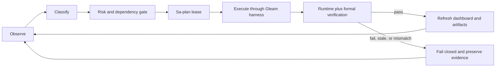

# UOS Execution Optimization Plan

**Plan:** `uos/system-mcp-features/20260919-1642`  
**Observed:** 2026-09-21 17:15 Europe/Stockholm  
**Authority:** Sa-plan only (`tools/sa-plan`)  
**Status:** active; not admitted

## Objective

Complete the database-backed feature/MCP tracker, declarative functional MCP
interfaces, holonic coordination, hive/swarm operation, dashboard completion
tracking, and independent release/operational acceptance. No blocked, stale,
unrun, quarantined, or unadmitted item counts as complete.

## Current baseline

The current Sa-plan projection is 21 tasks: 4 completed, 3 ready, 17 blocked,
0 executing, and 0 unknown. The dashboard projection is risk-aware and does
not inherit dependency priority after a dependency is completed. Runtime MCP
observations confirm the handlers are wired, but feature catalog, observation,
intent, and execution-progress calls remain fail-closed until their exact
task-bound journal and digest fences are satisfied.

## Optimization criteria

Selection is lexicographic:

1. **Safety and authority:** constitutional constraints, Sa-plan lease, worker
   identity, attempt, session, and effect-time fence.
2. **Dependency readiness:** only tasks whose prerequisites have passing,
   candidate-bound evidence may enter the ready set.
3. **Evidence freshness:** observed runtime behavior and formal evidence must
   bind to the same candidate and remain within the declared freshness window.
4. **Risk utility:** use the current risk portfolio's criticality, STPA/FMEA,
   dependency, and impact score; never let score override readiness.
5. **Throughput and fairness:** prefer the longest ready frontier, then oldest
   evidence, then least contention; preserve one active attempt per task.
6. **Recovery cost:** prioritize work that removes a shared blocker or restores
   provenance, while retaining all failed branches as evidence.

## Execution waves

| Wave | Entry gate | Work | Exit evidence |
|---|---|---|---|
| 0 | Sa-plan and source fence | Select independent authority, quiesce writers, enroll Claude/Codex/AGY sessions | signed scope, leases, writer observation |
| 1 | Wave 0 pass | Reconcile coordinator source and select the authenticated recovery prefix/cutover | verified append-only DB, source manifest, cutover receipt |
| 2 | Wave 1 pass | Fresh MCP task-bound probe: catalog, observations, intent, progress; repair exact journal/digest fences | per-tool runtime receipts plus formal schema checks |
| 3 | Wave 2 pass | Advance ready feature tasks in dependency order; run build/test through Gleam harness and Sa-plan | candidate-bound task receipts and formal obligations |
| 4 | Wave 3 pass | Exercise holon hierarchy, peer ACKs, leases, swarm backends, and failure recovery | end-to-end hive/swarm runtime and falsifier receipts |
| 5 | Wave 4 pass | Refresh dashboard, risk projection, artifact indexes, and uniform navigation | reconciled dashboard hash and current matrix |
| 6 | Wave 5 pass | Independent release review and operational acceptance | two-key release authorization; otherwise remain not admitted |

## Control loop

```text
Observe -> classify -> risk/dependency gate -> lease -> execute via Sa-plan
   ^                                                      |
   +---------- verify runtime + formal evidence <----------+
                         |
                    fail closed
```



## Stop conditions

Stop the wave immediately on journal replay mismatch, digest mismatch, lease
conflict, writer activity, missing formal evidence, stale risk evidence,
unauthorized effect, or any attempt to bypass Sa-plan. A passing catalog,
board acknowledgement, model result, or historical test count never grants
execution or admission authority.

## Dashboard contract

Every refresh records the Sa-plan status, observer digest, risk digest,
dependency DAG, selected frontier, blocked reasons, and admission state. The
dashboard must expose `completed`, `ready`, `executing`, `blocked`, and
`unknown` separately and link each value to a timestamped receipt. Current
baseline remains `4/21 completed`, `3 ready`, `17 blocked`, and `not_admitted`.

## Required receipts

- canonical source/cutover and independent authority decision;
- exact MCP schema and task-bound runtime probes;
- candidate-bound formal/runtime two-key evidence per feature;
- holon and swarm end-to-end failure/recovery evidence;
- dashboard/risk/matrix hash reconciliation;
- independent release and operational acceptance.

