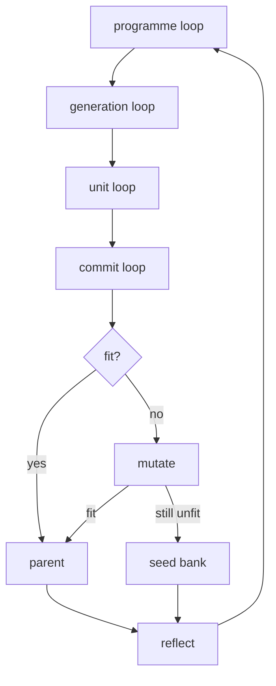
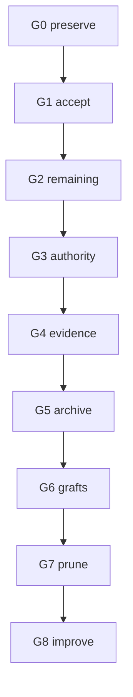

# 20261025-0638 — UOS full code merge plan: risk-optimized, organic-evolutionary, Codex execution handoff

#fractal-l0 #fractal-l1 #fractal-l2 #fractal-l3 #fractal-l4 #fractal-l5 #fractal-l6 #fractal-l7 #fractal-l8 #fractal-l9 #zk-adr #zero-muda #km-triad #stamp-stpa #cybernetics

**UOS / Plans / Merge** · [Cockpit](http://nas-1.tail55d152.ts.net:4100/) · [Planning](http://nas-1.tail55d152.ts.net:4100/planning) · [Wiki](http://nas-1.tail55d152.ts.net:4100/wiki) · [ZK](http://nas-1.tail55d152.ts.net:4100/zk) · [Checklist](http://nas-1.tail55d152.ts.net:4100/checklist)
**Live document:** [http://nas-1.tail55d152.ts.net:4100/files/docs/plans/20261025-0638-uos-full-code-merge-plan.md](http://nas-1.tail55d152.ts.net:4100/files/docs/plans/20261025-0638-uos-full-code-merge-plan.md)
**Related:** [Telegram critical path](http://nas-1.tail55d152.ts.net:4100/files/docs/design/20261024-1044-telegram-completion-critical-path.md) · [Workspace isolation](http://nas-1.tail55d152.ts.net:4100/files/contracts/rules/20260908-1030-workspace-isolation-contract.md) · [Risk SOP](http://nas-1.tail55d152.ts.net:4100/files/contracts/rules/20260907-1559-risk-prioritization-sop.md) · [Superpowers bindings](http://nas-1.tail55d152.ts.net:4100/files/plugins/uos-risk-prioritization/skills/uos-risk-prioritization/references/20260907-1559-superpowers-bindings.md) · [Fractal taxonomy](http://nas-1.tail55d152.ts.net:4100/files/contracts/rules/20260909-0704-fractal-layer-taxonomy-single-source.md) · [[zk:20260905-1801-moc-uos-unified-master]] · [[wiki:20260905-1801-uos-zk-km-corpus-index]]

| Field | Value |
|---|---|
| Author | Claude (Opus 5.5), workspace `fable-l0` (`/home/an/NAS-setup/uos/.uos-workspaces/fable-l0`) |
| Versions | v1 2026-10-25T06:48:38Z · v4 (reviewed by AGY, sha256 `fb14fb8e…`) 07:11Z · **v5 (this file) 2026-10-25T07:35:40Z**: incorporates the AGY review (§17) and the `main` move observed at 07:28:23Z |
| Clock | Host clock, chrony stratum 3, offset ≈ 0.0002 s. Host local time is **UTC+01:00** (DST ended this morning). `jj op log` and jj author timestamps print local time with an offset; every time in this plan is converted to **Z** |
| Executor | **Codex** (implementation owner; currently holds the session that moves `main`: `01a0f051-84d4-7be0-be4b-2c1055e89dd3`) |
| Independent reviewer | AGY `gemini-4-argon-high`: verdict **APPROVE_WITH_CHANGES** on v4; all 15 findings and 9 gaps dispositioned in §17. A delta review of v5 is recorded in §17.4 |
| Status | **PROPOSED.** This plan is not authority. It creates no task for Codex, holds no lease, moves no bookmark and grants no admission |
| Start condition | Operator answers D1–D5 (§14); Sa-plan plan registered (§8); §16.1 preconditions observed |
| Companion files (absolute paths) | `/home/an/NAS-setup/uos/.uos-workspaces/fable-l0/governance/planning/20261025-0738-merge-plan-deferred-trunk-code.txt`: the 113 trunk code files that still differ from `main`. `/home/an/NAS-setup/uos/.uos-workspaces/fable-l0/governance/planning/20261025-0738-merge-plan-review/`: review evidence |

---

## 0. Executive summary

1. **State at 07:35Z.** `main` = `qkwzxuouvmso` / `2ab401652a9f2122d58663157821ca7fde909254`. Codex moved it at **07:28:23Z** under `integration/main` epoch 2 (coordinator events 1977–1979).
   - `main` now = old `main` `a8adcc69` (2026-10-01) → `uumvpopz` / `8169e1b9` (curated Telegram trunk: 198 files, +49.6k) → `2ab40165` (retry-budget fix after job lease expiry: 3 files, +134).
   - Codex's board message reports AGY `4384289d` and `5093ed55` PASS, 26 focused tests and 3,383 regression tests green, and live binaries unchanged.
   - **The trunk's first generation has therefore landed**, and this plan treats it as an executed G1 that still has to be **accepted** (§6 G1).
2. **What is still unmerged.**
   - The trunk tip `lzqovyou` / `f3447366` (`integration/telegram-mini-health-20261025`) is 80 commits that are not ancestors of `main`.
   - **113 of its 317 code files differ from `main`**: 47 are absent from `main` and 66 are present in a different version. The companion file lists them.
   - Plus: 26 other unmerged heads, about 1,000 evidence files only in the `default` working copy, 7 divergent changes, and 2 accidental root-based snapshots (excluded).
3. **Biggest risk: losing work.** GitHub `origin` was last updated 2026-09-13. `main` moved before any preservation step, so **G0 is now the most urgent work**, and it runs before anything else moves.
4. **Method.** Organic, evolutionary, fractal growth (§4). Each generation must pass a fitness gate at its exact tip before it becomes the parent of the next. Units that fail go into a `preserved/*` seed bank instead of being dropped. One POODAVR loop runs at commit, unit, generation and programme scale. Ordering is safety class first, then C×T×F×Dep×I (§5).
5. **Order (v5).**
   - G0 preserve and authority hygiene
   - G1 accept the landed trunk
   - G2 remaining trunk code (113 files)
   - G3 authority and durability fixes
   - G4 `default` evidence
   - G5 September archive
   - G6 grafts
   - G7 prune
   - G8 improve the system
6. **Integration is not release.** Production (`uos-telegram-bridge.service`, cockpit release `20260930-0807`) is untouched. Release and admission stay with their existing Sa-plan tasks.

## 1. Outcome definitions

| Outcome | Meaning | Who may establish it |
|---|---|---|
| Preserved | The bytes exist on this host **and** off-host, and a restore has been tested | G0 executor, verified by restore |
| Integrated | Ancestor of `main`; `main` builds and tests green at that tip in a provisioned workspace | `integration/main` lease holder after §7 |
| Accounted | Every unmerged file or commit is integrated, superseded, deferred (owner + task) or excluded (reason) | ledgers (G1, G2, G4, G5) |
| Released | Production runs it | `SC-RELEASE-ASSURANCE-001`: out of scope |
| Admitted | Two-key verified | sovereign review: out of scope; EV ceiling 93 |

## 2. Context primer for the executor

### 2.1 Governing rules (non-negotiable)

| # | Rule | Source | Application |
|---|---|---|---|
| R1 | Standalone jj only; **no native `git`** in `/home/an/NAS-setup/uos` | CLAUDE.md §4 | `jj git push` only under D3 |
| R2 | Sa-plan is the sole task authority; work without a ledger triggers an Andon stop (-32002) | SC-SA-PLAN-001, SC-JIDOKA-001 | each generation is a claimed task (§8) |
| R3 | `default` is nobody's workspace | INV-WS-01 | merge work happens in `$M`; the one `default` reset in G4.6 needs explicit operator authorization (D5) |
| R4 | Never describe, squash, split, abandon or rebase a change you didn't author | INV-WS-02/03 | divergence, W split and grafts go to their authors; otherwise **preserve and wait**, never substitute |
| R5 | `main` moves only under an `integration/main` lease, after green at the new tip | INV-WS-04, SYNC-03 | §7, §9 |
| R6 | Provision before trusting tests | INV-WS-08/09 | §6 G1.3 |
| R7 | `var/` is canonical-only; tools resolve absolute canonical paths | INV-WS-05 | `UOS_SA_PLAN_DB`, `UOS_KM_DB` → `/home/an/NAS-setup/uos/var/...`; repo-tracked files are read from `$M` |
| R8 | Risk preflight before a claim; active-check during work; HOLD means repair, never force-pass | SC-RISK-CHECK-001 | §8 |
| R9 | EV ceiling 93; EV-94..109 NOT_ADMITTED; never mint a new EV number | SC-PROVENANCE-001 | G2 `ev98_*` files, G5 evidence |
| R10 | Zero-Muda: no Bevy, no Graphite | CLAUDE.md §1 | every generation |
| R11 | Never allocate, format, mount or wipe the OS NVMe (`HARD_DENIED_SYSTEM_OS_SERIAL`; write it as `[REDACTED_SYSTEM_OS_SERIAL]` in narratives). Do **not** touch the unmounted disks `sda`–`sdd` or `nvme1n1` either: storage activation is deferred (governance §4) | spec.rs, `uos-governance` | backups are ordinary files on the mounted `/` filesystem, plus the off-host copy |
| R12 | Docs: `YYYYMMDD-HHSS-` prefix (UTC hour + seconds), Tailscale FQDN links, L0–L9 tags, ASCII + Mermaid parity | mandates | journals |
| R13 | SC-JOURNAL-v3 13 sections, `tools/journal-check` exit 0 | SC-JOURNAL-003 | one journal per generation |
| R14 | In-project Nix toolchain; OTP 29 only | SC-NIX-DEVENV-001 | `source tools/lib/uos-toolchain.sh; uos_env` |
| R15 | External trees are read-only evidence | CLAUDE.md §3 | no ingestion |
| R16 | Runtime changes need a `runtime:<service>` claim | SYNC-04 | only G7 `reset-failed` |
| R17 | `jj op restore` is **repo-global** (one `.jj/repo` shared by every workspace) | AGY F-01 | never use it for per-generation rollback (§4.3) |

### 2.2 Environment

| Item | Value |
|---|---|
| Canonical repo `$U` | `/home/an/NAS-setup/uos` |
| Shell | **bash** (`bash -c '…'`). Under zsh, unquoted list variables don't word-split (an `erl -pa` list crashed with `system_limit`) |
| Toolchain | `source tools/lib/uos-toolchain.sh; uos_env` (Gleam 1.16.0 at `toolchains/gleam-1.16.0/bin/gleam`; OTP 29.0.5 from Nix; host OTP 27 barred) |
| jj | 0.44.0 from `~/.cargo/bin/jj`. SC-NIX-DEVENV-001 §13 prefers the Nix-profile jj: noted, **don't swap mid-merge** |
| Sa-plan | `UOS_SA_PLAN_DB=/home/an/NAS-setup/uos/var/sa-plan/uos.sqlite3 tools/sa-plan <noun> <verb>`. Help: `tools/sa-plan help task` (option-style `--help` is refused). **DEPS are comma-separated** (`"A,B"`): verified 07:3xZ on a scratch copy of the DB, and claims of tasks with unfinished deps are refused (`not claimable`) |
| Lease units | Sa-plan `task claim … LEASE_NS` is **nanoseconds** (1 h = `3600000000000`); coordinator `claim … TTL` is **seconds** |
| Coordinator store | `var/coordination/tri-agent/coordinator.sqlite3`: append-only, 1,979 events at 07:29Z, 0 quarantined, live |
| Coordinator CLI | `session_sync_cli status` **refuses**, `{"ok":false,"error":"journal sequence or digest mismatch; replay refused"}`, with both the canonical build (`apps/uos_swarm/build/dev/erlang`) and today's build (`var/recovery-runtime/20261025-0705-mainline-full-build/lib`). Yet Codex's session claimed and released `integration/main` at 07:28–07:29Z through its own adapter. **Use the adapter Codex used for events 1977–1979**, and record which one (G0.2) |
| Preflight | `bash tools/preflight` (`--full`, `--receipt`) |
| KM gate | `bash tools/km-gate --gate` (PASS at 06:2xZ), `--verify-chain` (CHAIN_INTACT) |
| Risk checker | `bash tools/risk-priority-check --all` (PASS at 07:3xZ: 375 baseline, 32,953 adversarial checks); `--record ONE_OBJECT.json`; `--preflight ARRAY.json TASK`; `--active-check ARRAY.json TASK WORKER ATTEMPT`. FMEA `band` must equal max(S, RPN band) |
| Diagram gate | `bash tools/diagram-check <file>` matches ASCII `[label] --> [label]` against **Mermaid labels**; never put ` -> ` inside a label (I14) |
| Journal gate | `tools/journal-check <file>` |
| `jj git push` | Flags in 0.44: `-b/--bookmark`, `--named NAME=REV`, `--all`, `--tracked`, `--dry-run`, `--allow-private`, `--allow-empty-description`, `--allow-conflicts`. There is **no `--allow-new`**; always run `--dry-run` first |
| NIF digests | `apps/cepaf_gleam/priv/*.sha256` lines are `<hash>  apps/cepaf_gleam/priv/<file>  <provenance text>`. Verify **from the workspace root** with `awk '{print $1"  "$2}' apps/cepaf_gleam/priv/*.sha256 \| sha256sum -c -` (plain `sha256sum -c` breaks on the trailing text) |
| Disks | `/` = `nvme0n1p2` (OS NVMe), 734 GB free. `sda`–`sdd` (3.6 T each) and `nvme1n1` are unmounted: **do not touch** (R11) |
| Production (do not touch) | `uos-telegram-bridge.service` (`tools/telegram_client.exe --poll`, since 2026-09-30); `c3i-gleam-server.service` :4100 (release `var/releases/ecology/20260930-0807-…`); zenohd :7447; clock guards; cognitive worker. The OTP 27 BEAMs belong to external C3I |

### 2.3 Owners and live claims (re-observe before acting)

| Item | Owner / holder | Basis |
|---|---|---|
| `main` moves today | Codex session `01a0f051-84d4-7be0-be4b-2c1055e89dd3` (registered as provider `codex`, workspace `/home/an/NAS-setup/uos`) | coordinator events 1, 1977–1979 |
| Telegram trunk, A2, Mini work | Codex (`codex-analysis-20261024`; workspaces `codex-telegram-mini-20261011`, `codex-telegram-mainline-20261025`) | Sa-plan `mini_api_impl` executing, attempt 5 |
| B1 `ptslsmlx` | Codex (`codex-agy-ops-20261024`) | workspace |
| B2 `vuystwzk` | **AGY** (`agy-telemetry-20261024`) | workspace |
| C1, C2, C3 | Codex | descriptions, workspace `codex-telegram-formal-20261011` (C3) |
| W (`default` working copy) | mostly Codex progress artifacts; the Oct 1 symbiosis files | file names and content |
| 7 divergent changes | **inferred Codex** for all 7 (bookmarks `integration/ev-root-bootstrap-20260909`, `review/codex-manual-ui`; workspaces `ev-*`, `codex-homeostasis-release-*`). Every commit's author field is `test@test.com`, so **identity cannot be verified from jj**; Codex must confirm or decline each | §3 |
| Reviews | AGY `agy-gemini4-*` workers | Sa-plan jobs |
| This plan | Claude, `fable-l0` | — |

## 3. Inventory (observed 07:35Z; re-observe at G0.1)

| ID | Change | Commit | Time (Z) | Description | Status |
|---|---|---|---|---|---|
| M0 | `xmovsnnotnwt` | `a8adcc6958e5c2378678b56adf9d5d14f44f02b3` | 2026-10-01 | restore: verified canonical direct reads… | old `main` |
| A′ | `uumvpopzttkl` | `8169e1b988aeb246779c0a50fd74acf596393ed4` | 10-25 06:50 | Prepare reviewed Telegram Mini features and prerequisites for mainline integration (`integration/telegram-mainline-20261025`) | **in `main`** |
| M1 | `qkwzxuouvmso` | `2ab401652a9f2122d58663157821ca7fde909254` | 10-25 07:20 (authored), bookmarked 07:28:23 | Respect retry budgets after Telegram job lease expiry (`integration/telegram-job-budgets-20261025`) | **`main`** |
| A1 | `mzskxrkwtqyk` | `c2490fa14cf96c4dacec1bf77e40684b3c22cc1a` | 10-25 05:37 | Complete authenticated Mini chat send user flow | trunk, not ancestor |
| A2 | `lzqovyoussno` | `f34473666902d7af46f313ac470cff5b81b70c23` | 10-25 06:11 | Complete Mini health observations (`integration/telegram-mini-health-20261025`) | trunk tip; 80 commits not in `main`; precedes A′ |
| B1 | `ptslsmlxnqwn` | `39794f705360a4b8f9c96d79cc03594dc047f8bb` | 2026-10-24 | test(browser): live recovery dashboard desktop/mobile | graft (4 early trunk commits in ancestry) |
| B2 | `vuystwzkvwnp` | `622edd3792fa1f35383b1638d067633e629b4511` | 2026-10-24 | fix(telemetry): pure Gleam typed evidence projection | graft (1 early trunk commit in ancestry) |
| C1 | `ykyxwruuuxxl` | `633bd519d0398c8e2a34e11e22fd862c0e9b775c` | 2026-10-01 | feat(store): pin trusted DB locator to argv[1]… | authority |
| C2 | `wqrnzsmptyry` | `a591b7edfbd22c13485d375323cabb31313e4a73` | 2026-10-01 | fix: confine provider migration to private staged candidates… | authority |
| C3 | `uuuxtmoltkvq` | `d75fe43304baf32f611cf775a510e676535f0dc1` | 2026-10-11 | work: isolated numeric specification repair candidate | formal |
| D1 | `nvsoyyywuqlk` | `7af086121d547a279802d54fa49c5f54c70dbb27` | 2026-09-09 | Await frozen full-closure EV2 successor… | evidence |
| D2 | `tzkvmxxpsmqp` | `8f80accd787f66acce99d2d7339e36ec32f9f00c` | 2026-09-09 | EV02 preserve final staging replay evidence | evidence |
| D3 | `xuvyktulmuxt` | `f09ca55a4517d147364a2d9c962c750782323bbe` | 2026-09-09 | docs(ev86): preserve incomplete transport review… | evidence |
| D4 | `wutmvmzkmuno` | `57b5579be29765ea946411324e1cc9c95d6b2bee` | 2026-09-09 | Bind EV02 directory-bound mapping evidence | evidence |
| D5 | `tuzsyylknolk` | `0bfe5cb47dfd054f9833084dd876d150eb4dddd8` | 2026-09-09 | Bind EV02 hardened mapping boundary evidence | evidence |
| D6 | `mnqlrtnqxxpo` | `e623b584b356bf5ebb0d346a1623e6df7def8c33` | 2026-09-09 | Preserve EV02 boundary risk… | evidence |
| D7 | `pmqyxrywrrnl` | `8d0b9d340ec3401fbf7ef93c23700ee9c184de12` | 2026-09-09 | Bind EV02 directive mapping checks… | evidence |
| D8 | `smswpotrysol` | `09f7620f0a9a4d0256fb5893f6416be69468d054` | 2026-09-09 | Preserve EV02 raw checks against 0a16… | evidence |
| D9 | `swpvlqvtxrkr` | `d2350ecb6eb23835b7fde923914b15d63d697e64` | 2026-09-09 | docs(ev01): bind immutable dossier reference verification | evidence |
| D10 | `tsxxzszonqyk` | `6968cb2bbb374a95f458b4ceeffec98b9dd6fb16` | 2026-09-07 | chore: working copy after EV-90 ratification | evidence (EV-90 ≤ 93) |
| D11 | `pnpktttvlnvy` | `fb945a48b815edefe6a7dada0032784a374c985b` | 2026-09-07 | merge(two-parent): telemetry reuse | probably superseded |
| D12 | `qtvsuzxulpvy` | `501fdbffc9089a347a4f6d50a5b938b08d1630f5` | 2026-09-07 | merge(two-parent): telemetry repair | probably superseded |
| X1 | `svrwyzwwwnmt` | `4452207cf7f61ba79ce83240d3420b206757096f` | 2026-10-24 | (none); **root-based**, 13,840 files, +3.37M | exclude |
| X2 | `ulurswzlqmqp` | `0e75c0ffe4176e6b649b38810df802cbe55ffeb8` | 2026-09-07 | (none); **root-based**, 8,211 files, +2.06M | exclude |

**Divergent changes.** Codex is the inferred owner of all seven (§2.3).

| Change | Commit a | Commit b | Bookmarks | Description |
|---|---|---|---|---|
| `suukkrkqkwuv` | `892008ae2734` | `c29b1127cd9f` | `default@` is one side; re-observe which | feat(telegram): Slice 2 supervised OTP actor API |
| `qnppzponnttw` | `1ad593ae55a3` | `b112a47c40cf` | b = `integration/ev-root-bootstrap-20260909` | EV scope / Bootstrap dossier |
| `rnqmowpoqvqr` | `dd5b6f753e72` | `3c13ba3b3e21` | — | fix(ev01): bind native JJ child cwd |
| `lwmwqpunqpws` | `5f6b9a12e9dd` | `0a8c03c55f91` | — | fix(ev01): refuse JJ secure-config init |
| `yzmpqqrkmuyl` | `ff0ed665fdb8` | `805b8667bfdf` | — | fix(ev01): observe standalone JJ behaviour |
| `zosuwowvmzst` | `c5a0d3e69067` | `5486a9816784` | a = `review/codex-manual-ui` | docs(testing): manual GUI/TUI guide |
| `owuunmmlvuts` | `0b23ec6b46c8` | `45435f5b215d` | — | work(unification): thirty bounded evidence cycles |

**Remaining trunk code** (companion file; `A` = absent from `main`, `M` = present in a different version): 113 files = 47 A + 66 M.
- By area: 69 `apps/cepaf_gleam`, 20 `formal/lean`, 9 `tools/validation` (including the 6 MB binary `validate.exe`), 7 risk-plugin validators, 5 `tools/uos`, 2 `engines/hermes`, 1 `apps/indrajaal_gleam_web`.
- **For M files, `main`'s version may be the newer, curated one.** Direction must be decided per file (G2).

**W (`default` working copy):** 998 files, +216k lines.

**Sa-plan (observed):**
- `uos/telegram-runtime/20261001-1150` is at 61/71 (1 executing, 9 available).
- `uos/telegram-admission/20261001-1015` is at 25/33.
- 21 tasks are stuck in `executing` with long-expired leases, and 4 jobs have attempt > max_attempts (`telegram/command-catalog1335`, `telegram/command-review1345`, `telegram/dashboard30-review`, `telegram/mini-zenoh-review`). M1's retry-budget fix may address the cause (verify in G1).

**Runtime noise:** 134 failed transient `uos-*` units; `/api/health` reports `zenoh_connected:false` while zenohd is listening.

## 4. Organic, evolutionary, fractal approach

### 4.1 Principle and mapping

Grow `main` one tested generation at a time, like rings on a tree. A generation becomes the parent of the next only if it is fit. Nothing is destroyed: anything that fails or isn't selected goes into the seed bank (`preserved/*` bookmarks plus the off-host copy).

| Biological term | Mechanism | Control |
|---|---|---|
| Seed bank | `preserved/*`, `recovery/*`, off-host `.jj` copy | INV-PROV-03 |
| Trunk | A′ + M1 (landed) with lineage to A2 | INV-WS-04 |
| Growth ring | A fit generation tip that `main` advances to | `integration/main` lease |
| Fitness | §7 at the exact tip, provisioned | INV-WS-08/09 |
| Selection | Only a fit generation becomes the parent | Jidoka |
| Mutation | Small `fix/merge-*` commits on top, never rewriting authors' commits | R4 |
| Damping | Repair lines ≤ 3% of the generation's changed lines; more sends the unit back to its owner | L8 μ ≤ 0.03 |
| Graft | B1/B2 rebased **by their owners only** | R4, AGY F-02 |
| Pruning | Exclude X1/X2; retire empty workspaces and stale claims | owner ACK |
| Speciation | A conflicting unit lives on as a preserved line one more generation | §4.3 |
| Adaptation | Re-rank and re-estimate after every generation, **and whenever `main` moves outside this plan** (as at 07:28Z) | SOP §5 |

### 4.2 One loop at every scale (POODAVR, SC-POODAVR-002)

| Step | Commit | Unit | Generation | Programme |
|---|---|---|---|---|
| Predict | expected diff | conflict and test forecast | green and duration forecast | effort, risk burn-down |
| Observe | `jj diff` | fork point, owner, claims | `main`, leases, coordinator | ledgers, backups, gates |
| Orient | invariant touched | class and score | units and dependencies | re-rank |
| Decide | commit or split | merge, rebase, graft or preserve | proceed or hold | continue or replan |
| Act | `jj commit` | `jj new` / `jj restore` | candidate tip | `jj bookmark set main` |
| Verify | focused test | unit tests + owner review | full §7 | all gates + restore |
| Reflect | — | conflict notes | journal | final journal, Brier scores |

Each loop runs POODAVR. Fitness by scale:
- **Programme:** all gates plus a restore test.
- **Generation:** the full §7 gate.
- **Unit:** unit tests plus owner review.
- **Commit:** a focused test.

Mutation is bounded to ≤2 attempts. Edge labels: fit? to parent = yes; fit? to mutate = no; mutate to seed bank = still unfit; mutate to parent = fit.

```text
[programme loop] --> [generation loop]
[generation loop] --> [unit loop]
[unit loop] --> [commit loop]
[commit loop] --> [fit?]
[fit?] --> [parent]
[fit?] --> [mutate]
[mutate] --> [seed bank]
[mutate] --> [parent]
[parent] --> [reflect]
[seed bank] --> [reflect]
[reflect] --> [programme loop]
```



### 4.3 Selection rules
1. **Fitness is measured live at the exact tip.** A checkpoint JSON or an earlier receipt is a forecast, not fitness.
2. **At most two mutation attempts** per unit and per generation. Then preserve the unit, file an owner repair task, and continue without it.
3. **Rollback of a failed generation (R17, AGY F-01):**
   - `main` hasn't moved yet (it moves only after §7 passes), so abandon only the candidate.
   - Bookmark it `preserved/failed-g<N>-<commit12>`, then in `$M` run `jj new main`.
   - **Never use `jj op restore` for this.** It rewinds every workspace's bookmarks and commits. It is reserved for host-wide emergency recovery, with every agent quiesced and the operator authorizing.
4. **Speciation:** a conflicting unit stays preserved for one more generation while its owner adapts it.
5. **Accounting is part of fitness.** A generation that silently drops files is unfit even if it is green.
6. **Post-move failure (AGY F-12):** if a quick row fails *after* `jj bookmark set main`, run `jj bookmark set main -r <previous main> --allow-backwards` **while still holding the lease**, then release and raise an Andon stop.

## 5. Risk- and criticality-optimized ordering (SC-RISK-PRIORITY-001)

### 5.1 Rule
1. P1 (loss and evidence integrity) first, then P2, then P3.
2. Within a class, sort by C×T×F×Dep×I, each factor 1–5.
3. Then adjust for merge risk and real dependencies: a consumer goes after its prerequisite, and urgency is inherited by the prerequisite.
4. Apply a ±1 sensitivity check to adjacent pairs (§5.3).

F = max(S, band(RPN)), with bands 1–5 → 1, 6–15 → 2, 16–35 → 3, 36–70 → 4, 71–125 → 5.

### 5.2 Scores

| Unit | Class | C | T | Dominant FM, S/O/Det (RPN) | F | Dep | I | Score | Merge risk | Gen |
|---|---|---:|---:|---|---:|---:|---:|---:|---|---|
| Local preservation (W + `.jj`) | P1 | 5 | 4 | evidence lost by abandon/resolve, 5/2/4 (40) | 5 | 5 | 4 | **2000** | none | G0 |
| Off-host copy | P1 | 4 | 3 | host loss, 5/1/5 (25) | 5 | 4 | 4 | **960** (v4 said 1200: arithmetic error, AGY F-10) | none | G0 |
| Coordinator adapter verified | P1 | 4 | 4 | lease against an unreadable journal, 4/3/3 (36) | 4 | 5 | 3 | **960** | none | G0 |
| Stale claims and jobs settled | P1 | 3 | 4 | dead owner's claim or job reused, 4/2/3 (24) | 4 | 4 | 3 | **576** (moved from G7, AGY F-08/F-10) | none | G0 |
| Divergence preserved (both sides) | P1 | 3 | 3 | losing side dropped, 4/2/4 (32) | 4 | 3 | 3 | **324** | none | G0 |
| Exclude X1/X2 | P1 | 2 | 3 | secrets or caches imported, 5/1/2 (10) | 5 | 1 | 3 | **90** | n/a | G0 |
| Accept landed trunk (A′ + M1) | P2 | 4 | 3 | landed without lineage note or ledger, 4/3/3 (36) | 4 | 5 | 4 | **960** | none (already in `main`) | G1 |
| Remaining trunk code (113) | P2 | 3 | 3 | needed code stranded, or a newer `main` version overwritten, 4/3/4 (48) | 4 | 4 | 3 | **432** | medium–high | G2 |
| C1 store locator | P2 | 3 | 4 | durability or authority regression, 4/2/3 (24) | 4 | 3 | 4 | **576** | medium | G3 |
| C2 provider migration | P2 | 3 | 4 | same, 4/2/3 (24) | 4 | 3 | 3 | **432** | medium | G3 |
| C3 formal repair | P2 | 2 | 2 | `sorry`/timeout, 3/1/1 (3) | 3 | 2 | 2 | **48** | low | G3 rider |
| W evidence and code | P2 | 3 | 3 | shared JSON/MD conflict drops a line, 3/4/3 (36) | 4 | 3 | 3 | **324** | high | G4 |
| D-code EV-01 fixes | P2 | 2 | 3 | stale fix reintroduced, 3/2/3 (18) | 3 | 2 | 3 | **108** | medium | G5 |
| D-ev September evidence | P3 | 2 | 2 | projection conflict, 3/3/3 (27) | 3 | 1 | 2 | **24** | medium | G5 |
| B1/B2 grafts | P2 | 2 | 2 | rebase breaks tests, or uncurated ancestry imported, 3/2/2 (12) | 3 | 2 | 2 | **48** | low | G6 |
| Workspace/bookmark/unit prune | P2 | 2 | 2 | untracked artifacts orphaned, 3/2/3 (18) | 3 | 2 | 3 | **108** | n/a | G7 |

### 5.3 Ordering, sensitivity and overrides

| Adjacent pair | Base order | ±1 on any single factor | Verdict |
|---|---|---|---|
| Local preservation (2000) vs off-host (960) | local first | stays | firm |
| Off-host (960) vs coordinator (960) | tie | either can lead | **provisional**: run in parallel inside G0 |
| Stale claims (576) vs divergence (324) | claims first | divergence +1 on I → 432 < 576 | firm |
| G1 accept (960) vs G2 remaining code (432) | G1 first | firm; also a dependency | firm |
| G2 (432) vs G3 C1 (576) | **override**: G2 first | — | dependency override: C1/C2 rebase onto the completed trunk once, not twice. If the G2 ledger shows ≥ 50% superseded, G2 shrinks and G3 follows at once |
| G3 C2 (432) vs G4 W (324) | C2 first | W +1 on C → 432 ties | **provisional** |
| G4 W (324) vs G5 D-code (108) | W first | firm | firm |
| G5 D-code (108) vs G6 grafts (48) | D-code first (v4 had the reverse, AGY F-10) | firm | firm |
| G6 grafts (48) vs G7 prune (108) | **override**: grafts first | — | dependency override: pruning requires everything merged |

### 5.4 Generations

| Generation | Contents (score) | `main` after |
|---|---|---|
| G0 Preserve (P1) | local preservation (2000), off-host (960), coordinator adapter (960), stale claims and jobs (576), divergence preserved (324), X1/X2 excluded (90) | unchanged |
| G1 Accept | lineage note, landed-trunk ledger, live fitness at `main` (960) | unchanged (already `2ab40165`) |
| G2 Remaining | 113-file ledger and surgical integration (432) | G2 tip |
| G3 Authority | C1 (576), C2 (432), C3 rider (48) | G3 tip |
| G4 Evidence | W split by owner (324) | G4 tip |
| G5 Archive | D-code (108), D-ev (24) | G5 tip |
| G6 Grafts | B1, B2 by owners (48) | G6 tip |
| G7 Prune | workspaces, bookmarks, failed units (108), off-host refresh | unchanged |
| G8 Improve | §13 items, each its own task | per item |

```text
[G0 preserve] --> [G1 accept]
[G1 accept] --> [G2 remaining]
[G2 remaining] --> [G3 authority]
[G3 authority] --> [G4 evidence]
[G4 evidence] --> [G5 archive]
[G5 archive] --> [G6 grafts]
[G6 grafts] --> [G7 prune]
[G7 prune] --> [G8 improve]
```



## 6. Runbook

Conventions:
- `$U=/home/an/NAS-setup/uos`; `$M=$U/.uos-workspaces/merge-20261025`; `$F=$U/.uos-workspaces/fable-l0`; `$P=uos/full-merge/20261025-0638`; `$BK=/home/an/uos-backups/20261025` (a directory on the mounted `/` filesystem).
- Run everything through `bash -c 'cd … && source $U/tools/lib/uos-toolchain.sh && uos_env && …'`.
- Every step records command, exit code and output digest in the generation journal (written in the executor's workspace). Stop conditions are in §16.2.

### G0 — Preserve and authority hygiene (`main` does not move)

| # | Action | Command / method | Pass condition |
|---|---|---|---|
| 0.1 | Re-observe | `jj log -r main`; `jj log -r 'heads(~::main & ~empty())'`; `jj log -r 'divergent()'`; `jj workspace list`; `jj op log -n 20`; Sa-plan executing tasks and jobs; coordinator `events` tail (read-only `sqlite3 -readonly`) | Differences from §3 recorded; re-rank if the set changed |
| 0.2 | **Coordinator adapter** (before any board message; AGY F-07) | Identify the adapter the Codex session `01a0f051…` used for events 1977–1979. Run its `status`. If only the CLI is available and it still refuses, **don't repair the store**: file a P1 incident for the coordinator owner (`codex-coordinator-recovery-20261024`) | `status` returns ok through a named adapter; recorded |
| 0.3 | Announce | Board message through that adapter: plan ID, scope, window ≤ 6 h; ask live claimants (incl. `mini_api_impl`) to finish, release or pause | sent (ACK is advisory) |
| 0.4 | Stale claims and jobs | For each of the 21 expired `executing` tasks: verify the owner is dead (SYNC-12: no live process, no heartbeat) or get its ACK, then `tools/sa-plan task release PLAN TASK WORKER ATTEMPT`. For the 4 jobs over `max_attempts`, record a settlement note and check whether M1 (`2ab40165`) prevents recurrence | each settled or explicitly held with a reason |
| 0.5 | Bookmarks (seed bank) | `jj bookmark create recovery/pre-merge-20261025 -r a8adcc6958e5` (old `main`); `jj bookmark create recovery/main-20261025-0728 -r 2ab401652a9f`; `jj bookmark create preserved/trunk-a2-20261025 -r f34473666902`; `jj bookmark create preserved/snapshot-x1 -r 4452207cf7f6`; `jj bookmark create preserved/snapshot-x2 -r 0e75c0ffe417`; for **both** sides of every divergent change: `jj bookmark create preserved/div-<change12>-<commit12> -r <commit12>` (14 bookmarks; this also covers `default@` without choosing a side; AGY gap 2) | `jj bookmark list 'glob:preserved/*'` shows 17; `recovery/*` shows 2 |
| 0.6 | Local backup | Quiesce writers about 1 minute (0.3). `mkdir -p $BK`; `tar -C $U -cf $BK/jj.tar .jj`; `tar -C $U --exclude=./.jj --exclude=./var --exclude=./.uos-workspaces --exclude='*/build' --exclude='*/_build' -cf $BK/default-wc.tar .` (an extra copy of W's on-disk bytes; AGY F-03); `sha256sum $BK/*.tar > $BK/SHA256SUMS` | files and digests recorded; `df -h /` shows enough free space before writing |
| 0.7 | Restore test | `mkdir $BK/restore && tar -C $BK/restore -xf $BK/jj.tar`; then compare `jj -R $BK/restore log -r main -n 3 --no-graph`, `jj -R $BK/restore bookmark list 'glob:preserved/*'` and `jj -R $BK/restore file list -r preserved/div-suukkrkqkwuv-<side> \| wc -l` with live. (`jj -R` on a `.jj` copy with no working copy is read-only; if jj insists on a working copy, restore both tars into one scratch tree) | identical |
| 0.8 | Off-host (D3) | (a) `jj git push --remote origin --dry-run -b main -b 'glob:preserved/*' -b 'glob:recovery/*'`, review the output, then repeat without `--dry-run` (track new bookmarks first if jj asks: `jj bookmark track <name>@origin`). (b) `gpg --symmetric` (or `age`) the two tars and copy them to `vm-1.tail55d152.ts.net`, then run a remote restore test | (a) `jj log -r 'main@origin'` == `main`; (b) remote restore matches |
| 0.9 | Divergence | Both sides are now preserved (0.5). The owner (Codex) resolves each change when convenient by abandoning only its own loser. **G0 doesn't wait for this.** The §7 VCS row only requires `::<tip>` to be free of divergence (AGY F-04) | 7/7 preserved; resolutions may lag |
| 0.10 | X1/X2 triage | `jj diff -r 4452207cf7f6 --stat \| head -40` and the same for `0e75c0ffe417`: top-level directories only; secrets checked by filename pattern only, never contents | classified; never merged; legitimate content → separate ingestion task via `governance/sources/` |
| 0.11 | Zero-Muda pre-scan | `jj diff --from main --to <head> \| grep -inE 'bevy\|graphite'` for each CODE head | 0 |
| 0.12 | Journal | `docs/journal/<YYYYMMDD-HHSS>-merge-g0-preserve.md` in the executor's workspace | `journal-check` 0 |

### G1 — Accept the landed trunk (A′ + M1 already in `main`)

| # | Action | Pass condition |
|---|---|---|
| 1.1 | Lineage note: A′'s **owner** records (journal and board, or a follow-up evidence commit) that A′ curates the source range `a8adcc69..f34473666902` and points to the companion ledger. Never rewrite A′ | lineage recoverable from repo text |
| 1.2 | Merge workspace: `jj workspace add --name merge-20261025 $M`; `cd $M`; `jj new main` | `jj log -r @-` == `main` |
| 1.3 | Provision: `cp $U/apps/cepaf_gleam/priv/*.so $U/apps/cepaf_gleam/priv/*.sha256 $M/apps/cepaf_gleam/priv/`; from `$M`: `awk '{print $1"  "$2}' apps/cepaf_gleam/priv/*.sha256 \| sha256sum -c -`; `(cd native/nifs/mojo && make all && make otp29)`; export `UOS_SA_PLAN_DB` and `UOS_KM_DB` to canonical | all `OK` |
| 1.4 | Baseline: in a second provisioned workspace at `recovery/pre-merge-20261025` (old `main`), run the §7 code rows and record failure sets (needed for D2) | recorded |
| 1.5 | Live fitness at `main` (`2ab40165`): run the §7 matrix. For the Telegram row run **the suite present in this tree**: `cd apps/cepaf_gleam && gleam test`, recording the actual count. Compare it with Codex's reported 26 focused + 3,383 regressions. The full 312-check + 25-group suite becomes mandatory at G2, once its deferred test files land (AGY F-09) | rows fit; counts recorded; receipts and checkpoints are **not** substitutes |
| 1.6 | Shared-file review: for the 66 `M` files, `jj diff --from main --to f34473666902 -- <file>`; the owner tags each as "main newer" (keep) or "trunk newer" (G2 candidate) | 66/66 tagged |
| 1.7 | Review evidence: confirm that AGY `4384289d` / `5093ed55` (reported PASS) are bound to `8169e1b9` / `2ab40165`. If not, get a bounded review (≤ 30 KB exact diff) | bound verdicts |
| 1.8 | Journal | journal-check 0 |

If 1.5 fails: `main` is already moved, so this is a **post-move failure**. Apply §4.3 rule 6 only with the holder's lease (Codex session `01a0f051…`) and operator awareness; otherwise open a P1 repair task on top of `main`.

### G2 — Remaining trunk code (113 files)

| # | Action | Pass condition |
|---|---|---|
| 2.1 | The owner classifies all 113 (companion file) as **integrate**, **keep-main** (main newer), **superseded**, **defer** (task ID) or **drop** (reason). Write the ledger to `governance/planning/<YYYYMMDD-HHSS>-merge-g2-ledger.json` in the executor's workspace | 113/113 |
| 2.2 | **A files (47):** integrate in module groups: `jj restore --from f34473666902 -- <paths>`, then `gleam build` and focused tests per group. **M files (66)** tagged "trunk newer": take hunks surgically (inspect `jj diff --from main --to f34473666902 -- <file>` and edit), never restore the whole file over a curated version, especially entrypoints `apps/cepaf_gleam/src/cepaf_gleam.gleam`, `cepaf_gleam_ffi.erl`, `mcp/tools.gleam`, `zenoh/client.gleam`, `ui/lustre/shell.gleam`, `web/server.gleam`, `tools/uos/src/main.gleam` (AGY F-11) | each group green |
| 2.3 | Special items: `gateway/telegram.gleam` (gateway task), `harness/agy_dispatch*.gleam`, `harness/admission.gleam`, `ha/lyapunov_proof.gleam`, `semantics/sheaf_cohomology.gleam`; the 20 `formal/lean` files (Lean 4.33.0 re-check); `engines/hermes` (2) | verdict per item |
| 2.4 | **EV-98 files** `apps/cepaf_gleam/test/ev98_health_projection_runner.gleam` and `ev98_sync_status_runner.gleam` (if still listed): default **defer** under `preserved/trunk-a2-20261025` while EV-94..109 are NOT_ADMITTED. Include them only if their text makes no admission claim and `km-gate --gate` stays PASS (AGY F-05) | explicit verdict |
| 2.5 | **Skill-mirror files** (16 across `.agents/.claude/.codex/.gemini`): for each, `test ! -L <p> \|\| test -e <p>` and confirm the target lies inside the repo; never integrate a broken or out-of-repo symlink (AGY F-13; see I13) | all pass |
| 2.6 | Never integrate `tools/validation/validate.exe` or any binary (I5) | absent |
| 2.7 | Full Telegram suite (312 unit/native + 25 HTTP/browser groups, scripts under `var/recovery-runtime/20261025-0559-mini-chat-flow5/`) re-run at the G2 tip | ≥ receipt counts |
| 2.8 | §7 → lease and move (§9) → journal | |

### G3 — Authority and durability (C1, C2, C3)

1. For each of C1, C2, C3 in order, from `$M`: `jj new main <commit>` (a two-parent merge; these heads fork from old `main` `a8adcc69` and carry no uncurated trunk ancestry, so a merge is safe here).
2. Resolve with `jj resolve` **without dropping either side's lines**, then run the focused tests.
3. C1 and C2 are authority boundaries: the **merged result** gets an R5 independent review.
4. C3: Lean 4.33.0 / Quint 0.32.0 on its changed `formal/` files. No `sorry`, no `Admitted`, no timeout. Reconcile with the `formal/lean` files handled in G2 and W.
5. §7 → move → journal.

### G4 — `default` evidence (owner: Codex)

1. In the owner's workspace: `jj new main`, then `jj restore --from preserved/div-suukkrkqkwuv-<chosen side> -- <paths>` in chunks. Check that the chosen side's tree equals `$BK/default-wc.tar` for the W paths.
2. Code files: diff against `main`. Identical → drop. Different → review as a G3-style unit.
3. Evidence (`governance/planning`, `docs/journal`, `docs/design`, screenshots): described commits, one per day or topic.
4. Binaries: **move** them (don't delete) to `$BK/binaries/` with SHA256SUMS; add `tools/validation/*.exe` to `.gitignore`; rebuild from source when needed.
5. Ledger: every W path is landed, dropped (identical to `main`) or excluded (binary), with counts that reconcile to 998.
6. **Reset `default`** (needs explicit operator authorization D5, an exception to INV-WS-01): verify `jj -R $U status` shows no paths outside the G4 ledger, then run `jj -R $U new main`. The old working-copy commit stays reachable via `preserved/div-suukkrkqkwuv-*`, and ignored files on disk are untouched (AGY F-06).
7. §7 (docs rows especially) → move → journal. From then on, progress artifacts are written only in the author's workspace (I2).

### G5 — September archive

1. **EV-01 code fixes** (`rnqmowpo`, `lwmwqpun`, `yzmpqqrk`, `swpvlqvt`): check whether the behaviour exists in `main`. Merge if missing (G3 method); preserve if present.
2. **Evidence heads D1..D10:** merge if current; seed-bank if superseded or on HOLD. Run `km-gate --gate` after each merge (EV ceiling 93, no new EV numbers).
3. **D11/D12:** prove they're superseded with `jj diff --from main --to <D>` before preserving.
4. §7 → move → journal.

### G6 — Grafts (owners only)

- B1 (Codex) and B2 (AGY): the owner runs `jj rebase -s <first own commit> -d main` in their own workspace. Find the first own commit with `jj log -r 'main..<B> ~ ::preserved/trunk-a2-20261025'`.
- **No integration-owner fallback.** Both heads have uncurated trunk commits in their ancestry, so a two-parent merge would pull those into `main` (AGY F-02). If an owner is unavailable, the graft stays preserved.
- §7 → move → journal.

### G7 — Prune

1. For each candidate workspace: run `jj -R <ws> status` and a scan for untracked, non-build files (`find <ws> -type f -newer <ws>/.jj -not -path '*/build/*' -not -path '*/_build/*'`). Archive any unindexed artifacts to `$BK/workspaces/<ws>.tar`. Then, with the owner's ACK, run `jj workspace forget <ws>` and **leave the directory in place** (AGY F-14).
2. `jj bookmark delete` for `integration/telegram-*` bookmarks whose `jj log -r '<bm> & ~::main'` is empty. Keep `preserved/*`, `recovery/*` and `tag/*`.
3. With `runtime:systemd-user` claimed: list `systemctl --user list-units --state=failed 'uos-*'`, confirm every entry is transient, then `systemctl --user reset-failed <units>`.
4. Refresh the off-host copy; write the final programme journal; score the forecasts (§15).

### G8 — Improve the system

§13. One Sa-plan task each under `$P/g8/<id>`, ordered P1 → P3.

## 7. Fitness gate (each generation tip; bound to the commit ID; UNRUN ≠ PASS)

Run from `$M` under `uos_env`. Repo-tracked inputs come from `$M`; only `var/` resolves to canonical (R7). Record the exact command, exit code, counts and duration.

| Row | Command | Fit when |
|---|---|---|
| Toolchain | `bash tools/preflight --full` | exit 0; erl resolves to the pinned OTP 29 store path |
| Gleam | `cd apps/cepaf_gleam && gleam build && gleam test`; likewise `apps/uos_swarm`, `apps/uos_tui`, `tools/uos` when touched | 0 errors; failures ⊆ baseline (D2); counts recorded |
| Hermes | `cd engines/hermes && dune build && dune runtest` | exit 0 |
| Native | `cd native/nifs/mojo && make all && make otp29 && make test`; `native/ocaml/telegram_store` tests | exit 0 |
| Rust | `cargo build && cargo test` in touched crates; diff grep for new `unwrap(`/`expect(`/`panic!` | none new |
| ZigVM | `cd engines/zigvm && zig build test` if touched | exit 0 |
| Formal | Lean 4.33.0 / Quint 0.32.0 on changed files | no `sorry`/`Admitted`/timeout |
| Telegram | G1: the suite in the tree (1.5); G2 onward: full 312 + 25 re-run | ≥ receipt |
| Storage safety | `cd ops/kubernetes/nas-k8s-lab && cargo test` | 7/7 |
| Zero-Muda | `jj diff --from <parent> --to <tip> \| grep -icE 'bevy\|graphite'` | 0 |
| Provenance | `bash tools/km-gate --gate`; `--verify-chain` | PASS; CHAIN_INTACT |
| Docs | `bash tools/uos-cli timestamp-check`; `bash tools/diagram-check <new docs>`; `tools/journal-check <journal>` | 0; pre-existing debt reported |
| Risk | `bash tools/risk-priority-check --all` (PASS at 07:3xZ) plus `--active-check` for the generation task | no HOLD |
| Secrets | filename-pattern presence scan of parent..tip | 0 new |
| VCS | `jj log -r '::<tip> & (conflicts() \| divergent())'` | empty |
| Accounting | the generation's ledger is complete | 100% |
| Damping | repair lines ÷ generation lines | ≤ 3% |

## 8. Sa-plan registration (verified syntax)

```bash
export UOS_SA_PLAN_DB=/home/an/NAS-setup/uos/var/sa-plan/uos.sqlite3
P=uos/full-merge/20261025-0638
tools/sa-plan plan create "$P" "$P" "Full code merge: organic generations G0..G8"
tools/sa-plan task create "$P" G0_PRESERVE  "$P/g0_preserve"  "Preserve, off-host, coordinator adapter, stale claims, divergence, X1/X2" - ""            2000
tools/sa-plan task create "$P" G1_ACCEPT    "$P/g1_accept"    "Accept landed trunk A' and M1: lineage, ledger, live fitness"             - "G0_PRESERVE"  960
tools/sa-plan task create "$P" G2_REMAINING "$P/g2_remaining" "Ledger and surgical integration of 113 remaining trunk files"           - "G1_ACCEPT"    432
tools/sa-plan task create "$P" G3_AUTHORITY "$P/g3_authority" "Merge C1, C2, C3 with R5 review"                                         - "G2_REMAINING" 576
tools/sa-plan task create "$P" G4_EVIDENCE  "$P/g4_evidence"  "Land default working-copy evidence by owner; reset default (D5)"        - "G3_AUTHORITY" 324
tools/sa-plan task create "$P" G5_ARCHIVE   "$P/g5_archive"   "September evidence and EV-01 fixes: merge or preserve"                   - "G4_EVIDENCE"  108
tools/sa-plan task create "$P" G6_GRAFTS    "$P/g6_grafts"    "Owner rebases of B1 and B2"                                              - "G5_ARCHIVE"   48
tools/sa-plan task create "$P" G7_PRUNE     "$P/g7_prune"     "Workspaces, bookmarks, failed units, off-host refresh"                   - "G6_GRAFTS"    108
```

- **Lease:** 1 h = `3600000000000` ns. Claim: `tools/sa-plan task claim <worker> "$P" 3600000000000 <TASK>`.
- **Before a claim:**
  1. Build a single-task portfolio record from template `governance/planning/20261024-1325-telegram-runtime-risk.json` record 0. A worked example is `$F/governance/planning/20261025-0738-merge-plan-agy-review-risk.json`.
  2. Set `task_state` to match Sa-plan exactly, `band = max(S, RPN band)`, and `snapshot.evidence` sha256 values of the current files.
  3. `bash tools/risk-priority-check --record <one object>`.
  4. `--preflight <array> <TASK>`.
- **After the claim:** set `task_state=executing` and run `--active-check <array> <TASK> <worker> <attempt>`.
- **Finish:** `tools/sa-plan task complete "$P" <TASK> <worker> <attempt> '<json>'`.
- **Bounded model jobs:** `tools/sa-plan job enqueue <id> <name> <queue> <worker> '<args json>' 1`, `job claim <queue> <worker> <lease_ns>`, `job complete <id> <worker> <attempt> OK|ERROR '<json>'`.

## 9. Coordination and lease protocol

The adapter is the one identified in G0.2. The CLI form is below; use it only if its `status` is ok:

```bash
bash -c 'cd /home/an/NAS-setup/uos && source tools/lib/uos-toolchain.sh && uos_env
  args=(); for d in <coordinator-lib>/*/ebin; do args+=(-pa "$d"); done
  erl -noshell "${args[@]}" -s session_sync_cli main -s init stop \
      -extra /home/an/NAS-setup/uos/var/coordination/tri-agent <command...>'
```

Commands:
- `register <session> <provider> <workspace> <revision> <metadata> <op>`
- `heartbeat <session> <revision> <metadata> <op>`
- `claim <session> integration/main <ttl_seconds> <op_id>`
- `renew <session> integration/main <epoch> <ttl_seconds> <op_id>`
- `release <session> integration/main <epoch> <op_id>`
- `status`

Use a unique `op_id` per command.

**Every `main` move:**
1. `status` ok.
2. `claim` `integration/main` (TTL ≤ 1800 s).
3. Record `prev=$(jj log -r main --no-graph -T commit_id)`.
4. Recheck the epoch.
5. `jj bookmark set main -r <tip>`.
6. Quick rows: Gleam build, preflight, km-gate.
7. **If any fail: `jj bookmark set main -r $prev --allow-backwards`** (still holding the lease), then Andon.
8. `release`.
9. Board message with the commit ID and journal link.

The lease is cooperative. Never move `main` without it.

## 10. Fractal layer coverage (SC-FRACTAL-TAXONOMY-001)

| Layer | Concern | Controls |
|---|---|---|
| L0 Constitutional | No bypass or downgrade | D1–D5 are the operator's; R1–R5, R17; Andon; storage interlock and deferred disks untouched; integration ≠ release |
| L1 Atomic | Data, absence, error, secrets | Binaries moved, not committed; secrets checked by presence only; root snapshots excluded; UNRUN ≠ PASS; ledgers |
| L2 Component | Real files and boundaries | Provisioning with the correct digest check; per-language rows; surgical M-file integration; symlink checks |
| L3 Transaction | Idempotent, bounded, leased | Task per generation; verified DEPS; candidate-only rollback; unique op IDs; ≤2 attempts; post-move rollback under lease |
| L4 System | Supervision, topology | OTP 29 tree builds at each tip; production untouched; coordinator adapter verified before any lease |
| L5 Cognitive | Decisions, residual risk | Scores with corrected arithmetic and a sensitivity table; journals; re-rank on external `main` moves |
| L6 Ecosystem | External sources | No ingestion; X1/X2 and Superpowers only via `governance/sources/` |
| L7 Federation | Cross-host | Off-host copy in G0 and refreshed at every move; Tailscale FQDN links |
| L8 Evolutionary | Adaptation | Generations, fitness, seed bank, damping, 24 h integration rule (I1) |
| L9 Sovereign | Provenance, two-key | EV ceiling 93, EV-98 files deferred by default, km-gate each generation, formal re-checks, no admission |

## 11. STPA and FMEA

**Control action:** advance `main`. Losses: L-3 evidence contamination, L-4 wasted effort, L-6 loss of deterministic authority.

| UCA type | Hazard | Constraint |
|---|---|---|
| Not provided | Drift grows; a single-host failure loses work | G0 first; generation-by-generation moves |
| Provided unsafely | Broken tip; curated tip strands code; graft imports uncurated ancestry; `op restore` rewinds other agents | §7 incl. accounting; G6 owner-only; R17 |
| Wrong timing | Move during a live write; lease against an unreadable journal; **move before preservation (happened at 07:28Z)** | G0.2–0.3; epoch recheck; G0 now precedes any further move |
| Too long / stopped too soon | Window blocks agents; stopping after G1 strands G2..G6 | bounded window; seed bank; task per generation |

Programme: P1, C4×T4×F5×Dep5×I4 = **1600**.

**Residual risks:**
- The lease is cooperative.
- The coordinator CLI's replay refusal is unexplained.
- The off-host copy depends on D3.
- Lineage of the squashed A′ depends on the `preserved/trunk-a2-20261025` bookmark and the owner's note.
- `main` already moved once without G0.

## 12. Rules, skills and Superpowers bound to the merge

**Inventory:** 35 `.claude/rules` (mirrored in `.agents`, `.codex`, `.gemini`), 56 `contracts/rules`, 175 skill entries, plugins `uos-risk-prioritization` and `uos-interface-quality`, agent `20261001-1117-full-symbiosis-supervisor`.

> **Defect: the Superpowers workflows can't be loaded in the repo.** All 14 vendored Superpowers skills are **broken symlinks** into `/home/an/.gemini/config/skills/`, on all four surfaces: `brainstorming`, `using-superpowers`, `writing-plans`, `executing-plans`, `test-driven-development`, `systematic-debugging`, `verification-before-completion`, `requesting-code-review`, `receiving-code-review`, `dispatching-parallel-agents`, `subagent-driven-development`, `finishing-a-development-branch`, `using-git-worktrees` and `writing-skills`. Working copies exist in `~/.codex/skills/` and `~/.codex/.tmp/plugins/plugins/superpowers/skills/`. **Codex may use its user-local copies.** Inside UOS, apply each workflow's entry and exit obligations from the repo-local [bindings table](http://nas-1.tail55d152.ts.net:4100/files/plugins/uos-risk-prioritization/skills/uos-risk-prioritization/references/20260907-1559-superpowers-bindings.md). Mark the workflows UNAVAILABLE (not PASS) until I13 is done.

**Precedence:** UOS rules and the bindings table override generic skill examples. `using-jj-workspaces` replaces `using-git-worktrees`. Tasks live in Sa-plan. Sub-agent workflows apply only where delegation is allowed.

### 12.1 By lifecycle step

| Step | Superpowers workflow (entry → exit) | UOS skills | Rules / contracts |
|---|---|---|---|
| Intake, ranking | `brainstorming`: rank real problems → bounded design | `uos-risk-prioritization`, `fractal-decision-calculus`, `observe`, `zk-recall` | SC-RISK-PRIORITY-001, SC-RISK-CHECK-001 |
| Plan | `writing-plans`: factors and graph → tasks in Sa-plan | `system-engineering-sop`, `stpa-safety-protocol`, `predict`, `resource-preflight`, `c3i-temporal-orchestration` | SC-SA-PLAN-001, `hive-decision-forecast-kpi-mandate` |
| Workspace | (`using-git-worktrees` replaced) | `using-jj-workspaces`, `timestamp-sync` | SC-WORKSPACE-ISO-001, `determinate-nix-devenv-mandate` |
| Execute a unit | `executing-plans`, `test-driven-development` | `gleam-expert`, `algebra-driven-beam`, `algebra-driven-ocaml`, `algebra-driven-zig`, `safe-rust-x-safety`, `fp-core-rust-architect`, `otp-conformance-protocol` | `c3i-cross-language-control-contract`, `dmc-tcm-mandate`, `zigvm-add-fractal-contract` |
| Conflict or red gate | `systematic-debugging`: cause note before retry | `stpa-safety-protocol` (CAST) | SC-JIDOKA-001, SYNC-12 |
| Formal re-check | `verification-before-completion` | `formal-technique-selection`, `formal-verification-pipeline`, `writing-gospel-specifications` | policy §7, `denotational-intent-algebraic-atlas-contract` |
| UI/Telegram fitness | `test-driven-development` | `ocaml-playwright-control`, `lustre-gleam-ui-expert`, `uos-gui-design`, `uos-tui-design`, `ui-report-quality`; plugin `uos-interface-quality` | `comprehensive-checklist-contract`, `tailscale-web-fqdn-mandate` |
| Independent review | `requesting-code-review`, `receiving-code-review` | `codex-symbiosis`, `gemini-symbiosis`, `swarm-verification-expert`, `multilayer-swarm` | `intelligence-routing-rule` (R5/R6), `swarm-monitoring-protocol`, SYNC-08/09 |
| Parallel owner work | `dispatching-parallel-agents`, `subagent-driven-development` (if allowed) | `harness-supervisor`, `codex-symbiosis` | SYNC-02/03, `gleam-harness-operations` |
| Before moving `main` | `verification-before-completion`, `finishing-a-development-branch` | `production-readiness`, `accidental-data-loss-prevention` | INV-WS-04, SC-RELEASE-ASSURANCE-001 |
| Evidence, knowledge | — | `journal-protocol`, `journal-artifact-publisher`, `living-ontology`, `zk-knowledge-base`, `wiki-design`, `docs-design` | SC-JOURNAL-v3, `km-wiki-zk-contract`, `provenance-integrity-contract`, timestamp/diagram/Rocha contracts |
| Mirror sync | `writing-skills` | `full-symbiosis`, `artifact-sync`, `skill-repair`, `learn-rule` | `full-symbiosis` |
| Evolution, cadence | — | `feature-evolution`, `evolve`/`fast-evolve` (scoped), `tensor-space-evolution` (advisory) | `fractal-cadence-matrix`, `hive-synchrony-protocol`, `cybernetic-orchestra-protocol` |

### 12.2 By fractal layer

| Layer | Rules | Skills |
|---|---|---|
| L0 | `uos-governance`, `provenance-integrity-contract`, `indrajaal-constitution-migration`, `sa-plan-fractal-jidoka-tps-mandate` | `uos-risk-prioritization`, `accidental-data-loss-prevention` |
| L1 | `dmc-tcm-mandate`, `iam-ferriskey-nif-rule` | `safe-rust-x-safety`, `algebra-driven-zig` |
| L2 | `c3i-cross-language-control-contract`, `determinate-nix-devenv-mandate` | `gleam-expert`, `otp-conformance-protocol`, `resource-preflight` |
| L3 | `workspace-isolation-contract`, `tri-agent-coordination` | `using-jj-workspaces`, `c3i-temporal-orchestration` |
| L4 | `gleam-harness-operations`, `sdlc-sre-verification-process-contract` | `production-readiness`, `observe` |
| L5 | `sc-journal-v3-anticipatory-contract`, `hive-decision-forecast-kpi-mandate` | `journal-protocol`, `predict`, `fractal-decision-calculus` |
| L6 | policy §3, `c3i-indrajaal-functional-mirroring` | `codex-symbiosis`, `gemini-symbiosis` |
| L7 | `tailscale-web-fqdn-mandate`, `swarm-monitoring-protocol` | `multilayer-swarm`, `cepaf-zenoh-expert` |
| L8 | `fractal-cadence-matrix`, `cybernetic-orchestra-protocol` | `feature-evolution`, `learn-rule`, `skill-repair` |
| L9 | `provenance-integrity-contract`, `comprehensive-checklist-contract`, `fractal-layer-taxonomy-single-source` | `formal-verification-pipeline`, `living-ontology` |

**Not used for this merge:** about 60 sales, FY27, marketing, GCP-data and Firecrawl skills.

## 13. G8 — Improve the system (lessons become controls)

Each item is its own Sa-plan task: proposed, reviewed, adopted, then mirrored to the four surfaces (`full-symbiosis`). None is in force until adopted and tested.

| # | Observed failure | Improvement | Skill | Falsifier |
|---|---|---|---|---|
| I1 | 80 commits unmerged for 24 days | **SC-INTEGRATION-CADENCE-001**: accepted work reaches `main` within 24 h; at most one long-lived integration line | `learn-rule`, `writing-skills` | Age checker: > 24 h after acceptance → HOLD |
| I2 | About 1,000 files authored into `default` | Advisory `PreToolUse` hook; preflight arm for a non-empty `default` working copy | `update-config`, `full-symbiosis` | Writing in `default` warns; the arm is red until it is empty |
| I3 | Off-host copy 6 weeks stale | Preflight arm on copy age; restore drill per release | `production-readiness`, `resource-preflight` | Red if > 24 h behind; drill matches |
| I4 | Root-based tree snapshots | Guard against root-descendant commits with > N files; `.gitignore` audit | `skill-repair`, `fractal-workspace-audit` | A synthetic commit is flagged |
| I5 | 6 MB binary tracked | Rule plus checker barring ELF/PE outside approved paths | `learn-rule` | Adding an ELF fails |
| I6 | 175 skills, about a third irrelevant | Relevance catalog in `governance/capability-inventory/skills.toml` | `skill-repair`, `artifact-sync` | 175/175 classified |
| I7 | `CLAUDE.md` status stale | Generated status projection from gates | `living-ontology`, `journal-artifact-publisher` | A gate change changes the projection |
| I8 | Expired claims; jobs over `max_attempts` | Confirm M1 (`2ab40165`) fixes the store side; add an expiry sweep through Sa-plan | `test-driven-development`, `systematic-debugging` | Law test: reclaim at max refused; sweep releases only expired claims |
| I9 | 134 failed transient units | `systemd-run --collect` for transients | `production-readiness` | A finished unit leaves no failed residue |
| I10 | `using-git-worktrees` conflicts with jj-only | Redirect note to `using-jj-workspaces` on 4 surfaces | `writing-skills` | grep shows 4/4 |
| I11 | Merge procedure not reusable | Skill **`uos-merge-generation`** (§4–§9) | `writing-skills` | Dry run passes; "merge all at once" refused |
| I12 | `zenoh_connected:false` while zenohd listens | Diagnostic task | `cepaf-zenoh-expert`, `systematic-debugging` | Root-cause note |
| I13 | 14 Superpowers links broken on 4 surfaces | Pinned ingestion via `governance/sources/`; replace links; preflight arm | `skill-repair`, `full-symbiosis` | `find .claude/skills -xtype l` empty on 4/4 |
| I14 | `G-DIAGRAM` says it matches IDs but matches labels | Make code and comment agree; law test; document the form | `algebra-driven-ocaml` | Law test pins the documented verdict |
| I15 | `session_sync_cli status` refuses replay with both available builds, while the live session claims fine | RCA: which adapter writes, which digest form, and why the CLI disagrees; then a preflight arm "coordinator readable by the canonical build" | `systematic-debugging`, `otp-conformance-protocol` | The arm goes red on refusal; RCA note |
| I16 | Curated squash integrations lose lineage | Rule: a curated commit names its source range and ledger; checker verifies coverage | `learn-rule` | A curated commit without a complete ledger → HOLD |
| I17 | AGY returned `status:"SUCCESS"` on a run that hit its print timeout with no response | Review collectors must validate `response` against the schema and plan hash (validator in §17.3), never trust `status` alone | `swarm-verification-expert` | A partial envelope is rejected |
| I18 | `main` moved before any preservation step | Precondition in the integration rule: `main` moves only when the off-host copy is ≤ 24 h old | `learn-rule` | A move with a stale copy → HOLD |

**Order:**
- **P1:** I3, I18, I2, I15, I8.
- **P2:** I13, I16, I17, I1, I4, I5, I7, I14.
- **P3:** I6, I9, I10, I11, I12.

## 14. Operator decisions (before G0.4)

| ID | Decision | Recommendation |
|---|---|---|
| D1 | Telegram development code in `main` before release/admission. **Codex already did this at 07:28Z** | **Ratify** (integration only; production unchanged), or direct a rollback to `recovery/pre-merge-20261025` |
| D2 | Test baseline: accept failures that also exist at the parent in the same provisioning state | **Yes** |
| D3 | Off-host target | **Both**: `jj git push` to GitHub `origin` and an encrypted copy to `vm-1.tail55d152.ts.net` |
| D4 | Curated A′ vs fast-forward A2 | **A′** (already landed) plus the G1/G2 ledgers; lineage via `preserved/trunk-a2-20261025` |
| D5 (new) | Authorize the one-time `default` reset in G4.6 (an exception to INV-WS-01) | **Yes**, after the G4 ledger reconciles to 998 |

## 15. Effort and forecasts (low confidence)

| Generation | Active hours |
|---|---:|
| G0 | 2.5–4 |
| G1 | 1.5–3 |
| G2 | 3–6 |
| G3 | 1.5–3 |
| G4 | 2–4 |
| G5 | 2–4 |
| G6 | 0.5–1.5 |
| G7 | 1.5–2.5 |
| G8 (proposals) | 2–4 |
| **Total** | **16.5–32 h**, excluding waits and repairs found by the gates |

Precommitted forecasts. Brier `(p − o)²` is scored only after each horizon, measured from T0, the time D1–D5 are answered.

1. p = 0.80: G0 is complete, with the restore verified locally and off-host, within 4 active hours.
2. p = 0.65: G1 live fitness at `2ab40165` is green on the first run.
3. p = 0.55: ≥ 50% of the 113 remaining files are classified keep-main, superseded or drop.
4. p = 0.50: `main` reaches the G3 tip within 14 active hours.

The v4 forecast "G1 fit on first attempt" is **void**: G1 was executed outside this plan.

## 16. Executor protocol (Codex)

### 16.1 Preconditions (before G0.4)
1. D1–D5 answered and recorded.
2. Plan `uos/full-merge/20261025-0638` registered; G0 record validated; preflight PASS.
3. This file's sha256 is the one bound in §17.4, or a new delta review was run.
4. G0.1–G0.3 done (coordinator adapter ok).

### 16.2 Stop conditions (Andon: stop, preserve, report)
- Any Sa-plan or risk-check refusal or HOLD.
- No working coordinator adapter.
- A conflict resolution that would drop lines.
- A row red after 2 attempts.
- Damping > 3%.
- Secrets, barred dependencies or EV > 93 claims found in merged content.
- `main` moved by anyone else during a generation (re-observe and re-rank).
- Any prompt to run native `git`.
- Any effect on production.
- Any instruction to use `jj op restore`.
- Any access to the unmounted disks.

### 16.3 Reporting
For each generation:
- A journal (SC-JOURNAL-v3, `journal-check` 0).
- A board message with task, tip, gate summary and journal link.
- A Sa-plan completion result `{tip, parent, gates, ledger, preserved, journal}`.

Report to the operator after G0, after G1, after G3, and at the end.

## 17. Independent review record (AGY Gemini 4 Argon High)

### 17.1 Runs

| Attempt | Sa-plan job | Scope | Result |
|---|---|---|---|
| 1 | `uos/merge-plan-review/20261025-0638/agy-review-0711` | plan v4 + read access to the whole repo | **No verdict.** Print timeout at 900 s with the turn still in progress; 403,014 input tokens (unbounded repo exploration). AGY nevertheless labelled the envelope `status:"SUCCESS"` with no `response` (I17). Job recorded as ERROR → discarded. Conversation `fd84be0c-16e7-49c2-8f9d-aac9707ad7d2` |
| 2 | `…/agy-review-0731` | plan v4 + companion list only, read-only plan mode, no other files | **Valid.** 269 s; 51,911 input / 21,100 output tokens; conversation `0455b28f-a794-4fd0-835c-285cff87d8c5` |

Both attempts ran under Sa-plan task `AGY_PLAN_REVIEW`, claimed by `claude-fable-l0-20261025` after `PREFLIGHT_PASS` (assessment `2c7714d7…`) and `ACTIVE_OBSERVATION_PASS`. The task portfolio is `$F/governance/planning/20261025-0738-merge-plan-agy-review-risk.json`.

### 17.2 Verdict on v4 (sha256 `fb14fb8e1cd46c4d900131ce63ef6e1d7772343879bf52edf1ae7c09a0b1c780`)

**APPROVE_WITH_CHANGES**: 15 findings (4 blockers, 7 major, 4 minor) and 9 executability gaps.

**Strengths noted:**
- Preservation before any `main` move.
- Adopting Codex's live candidate instead of competing with it.
- Strict separation of integration from release.
- Encoding the host's real pitfalls.
- Bounded damping and seed-banking, with an L0–L9 mapping and falsifiable G8 items.

### 17.3 Dispositions

Each finding was checked against the repo before acceptance. Full JSON: `$F/governance/planning/20261025-0738-merge-plan-review/attempt2-valid.json`. Validator: `validate-review.sh` (envelope SUCCESS + response present + schema + plan hash + complete findings).

| ID | Sev | Finding (short) | Verified? | Disposition | Where in v5 |
|---|---|---|---|---|---|
| F-01 | blocker | `jj op restore` is repo-global | Yes (one `.jj/repo` for all workspaces) | **Accepted** | R17, §4.3 r3, §16.2 |
| F-02 | blocker | Two-parent graft fallback imports uncurated trunk ancestry | Yes (B1 shares 4, B2 1 early trunk commit) | **Accepted**: owner-only; else preserve | G6 |
| F-03 | blocker | No backup path; W not covered by a `.jj` tar | Partly. Unmounted `sda`–`sdd`/`nvme1n1` exist but are barred (storage deferred). Writing a file to `/` is not an NVMe allocation, so the interlock isn't at stake | **Accepted with correction**: `$BK` on `/` plus a separate W tar plus off-host for disk loss | R11, G0.6–0.8 |
| F-04 | blocker | Divergence resolution can deadlock on unknown authors | Yes (all authors are `test@test.com`) | **Accepted**: preserve both sides, Codex inferred owner, VCS row scoped to `::tip` | §2.3, G0.5, G0.9, §7 |
| F-05 | major | EV-98 test files in the deferred list | Yes (lines 55–56 of v4 list) | **Accepted**: default defer | G2.4 |
| F-06 | major | No safe command to empty `default` | Yes | **Accepted**: D5 + `jj -R $U new main` after ledger | G4.6, D5 |
| F-07 | major | Board message before coordinator check; placeholder build path | Yes (both CLI builds refuse; Codex's adapter works) | **Accepted**: reordered; use Codex's adapter | G0.2–0.3, §9, I15 |
| F-08 | major | Gates from `$M` may read canonical paths; `--all` may fail on stale claims | Partly (`--all` PASS at 07:3xZ) | **Accepted**: R7 clarified; stale claims moved into G0 | R7, G0.4, §7 |
| F-09 | major | G1 can't run the full suite; checkpoint-as-fitness contradiction | Yes | **Accepted**: G1 runs the suite in the tree; full suite at G2; checkpoint wording removed | G1.5, G2.7, §7 |
| F-10 | major | 1200 arithmetic error; ordering inversions; no sensitivity table | Yes (4·3·5·4·4 = 960) | **Accepted**: fixed, reordered (archive before grafts), table added | §5.2–5.4 |
| F-11 | major | Whole-file restore breaks entrypoints; "A2 after A′" | Recommendation yes. **Timing premise no**: v4 printed local `+01:00` author times as Z (my error). A2 = 06:11Z precedes A′ = 06:50Z | **Accepted (method); premise rebutted; timestamps corrected** | §3, G2.2 |
| F-12 | minor | No rollback if post-move rows fail | Yes | **Accepted** | §4.3 r6, §9 |
| F-13 | minor | Symlink check for skill mirrors | Yes (14 broken links) | **Accepted** | G2.5 |
| F-14 | minor | `workspace forget` may orphan untracked artifacts | Yes | **Accepted** | G7.1 |
| F-15 | minor | D1–D3 vs D1–D4; truncated A′ ID; companion paths | Yes | **Accepted**: D1–D5 everywhere, full IDs, absolute paths | header, §3, §14 |
| Gaps 1–9 | — | coordinator path; `default@` side; backup path; `--allow-new`; divergence owners; `sha256sum -c` dir; companion paths; emptying `default`; DEPS/TTL units | Verified individually: jj 0.44 has **no** `--allow-new` (used `--dry-run` + track); `.sha256` lines carry trailing text (`awk` fix); DEPS comma-separated (scratch DB test); TTL ns vs s documented | **All addressed** | §2.2, G0, G1.3, §8 |

**Events since v4 that the review could not see:** `main` moved to `2ab40165` at 07:28:23Z. The remaining-code count changed from 125 to 113. G1 became an acceptance step, and G0 became the top priority.

### 17.4 Delta review of v5
Delta review result: recorded below when available (it binds this file's sha256).

## Appendix A — Known pitfalls (observed 2026-10-25)

1. zsh doesn't word-split unquoted lists. Use bash arrays for `erl -pa`.
2. `tools/sa-plan --help` is refused; use `tools/sa-plan help <noun>`. DEPS are comma-separated.
3. `risk-priority-check --record` takes one object; `--preflight`/`--active-check` take the array. `task_state` must equal Sa-plan's state. FMEA `band` = max(S, RPN band).
4. `diagram-check` matches ASCII bracket text against Mermaid labels.
5. Host is UTC+01:00 since this morning; jj prints local time with an offset. **Never append "Z" to a jj local time.**
6. AGY: an inline packet over about 50 KB, or a repo-wide `--add-dir`, timed out. Give it only the files under review. Validate `response`; `status:"SUCCESS"` is not proof.
7. An unprovisioned workspace gave 213 of 220 false failures (2026-09-08). `.sha256` files need the `awk` fix.
8. `session_sync_cli status` refuses replay with both available builds (I15).
9. Superpowers skill links in the repo are broken (§12).
10. `jj op restore` is repo-global (R17).
11. jj 0.44 `git push` has no `--allow-new`; use `--dry-run` and `jj bookmark track`.
12. `main` can move under you (it did at 07:28Z). Re-observe before every step.

---

## Comprehensive verification checklist

These are obligations for executing the plan. Only the document-level items are checked.

<details><summary>Domain 1 — Metadata, timestamp and Tailscale navigation</summary>

- [x] **CHK-01-TIME** — `20261025-0638-` prefix from the host clock; all times converted to Z; versions recorded.
- [x] **CHK-02-TAIL** — Full Tailscale FQDN links; whether they are served is unverified.
- [x] **CHK-03-FRACT** — L0–L9 mapped (§10, §12.2).
- [x] **CHK-04-KM** — MOC, corpus index and related contracts linked.

</details>
<details><summary>Domain 2 — Zero-Muda purity and storage safety</summary>

- [ ] **CHK-05-MUDA** — Per-generation scan: UNRUN.
- [ ] **CHK-06-GRAPH** — No new foreign NIF: UNRUN.
- [ ] **CHK-07-DRIVE** — Interlock 7/7; unmounted disks untouched: UNRUN.

</details>
<details><summary>Domain 3 — Testing and mathematical gates</summary>

- [ ] **CHK-08-C1C8** — Applicable UI surfaces: UNRUN.
- [ ] **CHK-09-MATH** — Four declared gates: UNRUN.
- [ ] **CHK-10-9MOD** — Relevant modalities: UNRUN.
- [ ] **CHK-11-REGR** — Telegram/browser regression at each tip: UNRUN.

</details>
<details><summary>Domain 4 — Cross-language control and observability</summary>

- [ ] **CHK-12-GLEAM** — OTP 29 build/test: UNRUN.
- [ ] **CHK-13-HERMES** — dune build/test: UNRUN.
- [ ] **CHK-14-ZIGVM** — If touched: UNRUN.
- [ ] **CHK-15-MAX** — Not applicable unless `services/inference/max` changes.
- [ ] **CHK-16-OTEL** — Not applicable to a VCS merge.

</details>
<details><summary>Domain 5 — Sovereign governance and standalone Jujutsu</summary>

- [x] **CHK-17-SOV** — Independent AGY review on v4: APPROVE_WITH_CHANGES, all findings dispositioned (§17). Per-generation reviews remain UNRUN.
- [x] **CHK-18-JJ** — jj only; no native Git; the off-host push is a jj command under D3.

</details>
<details><summary>Domain 6 — Provenance extension</summary>

EV ceiling remains 93. EV-94..109 remain NOT_ADMITTED. No new EV number is minted. EV-98 test files are deferred by default.

</details>

**Previous:** [Telegram critical path](http://nas-1.tail55d152.ts.net:4100/files/docs/design/20261024-1044-telegram-completion-critical-path.md) · **Next:** per-generation merge journals · [ZK Master MOC](http://nas-1.tail55d152.ts.net:4100/zk) · [Wiki Corpus Index](http://nas-1.tail55d152.ts.net:4100/wiki)

**UOS footer:** `nas-1.tail55d152.ts.net:4100` · peer `vm-1.tail55d152.ts.net:4100` · Proposed plan only; Sa-plan is the sole execution authority; integration grants no release or admission.
