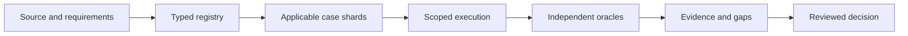

# 20261027-0312 — Telegram Fractal Test Implementation Plan

> For agentic workers: use the repository executing-plans workflow through an authorized Gleam/OTP harness. The steps below are a specification/projection of Sa-plan, never a competing task queue. This document authorizes no test execution.

**Goal:** establish reproducible, exhaustive accounting and verification of every applicable bounded Telegram feature × fractal layer × interaction × use case × production scenario × real-time data × testing modality × deployment-usecase combination.

**Architecture:** Gleam/OTP owns campaign control, authority, workers and budgets. Pure Gleam enumerates typed cases; an independent bounded Hermes OCaml oracle checks enumeration, state transitions and coverage. Native/HTTP/Zenoh/browser adapters execute only inside explicitly permitted environments.

**Tech stack:** repository-pinned Gleam/OTP, Hermes OCaml/Dune, existing native adapters, bounded Quint/Lean/Gospel evidence where applicable, existing browser verifier and Sa-plan. No new package provisioning in this planning task.

**Specs:** [Existing SOP modalities](http://nas-1.tail55d152.ts.net:4100/files/docs/design/20261027-0105-telegram-sop-10-modality-testing-and-production-scenarios.md), [existing journeys](http://nas-1.tail55d152.ts.net:4100/files/docs/design/20261026-0210-telegram-operator-journey-contract.md), domain A–D specifications dated 20261027-0030, and the companion matrix. Source behavior and requirements are reconciled in T00; historical claims are not silently adopted.

**Canonical plan:** uos/telegram-fractal-tests/20261027-0312. **Created:** 2026-10-27T03:56:47Z. **Base:** 73df20c4c9a67e76b670cdddc4e53e8d1379925e. **State:** PLANNED; campaign UNRUN; independent runtime admission NOT_GRANTED.
**Operator scope:** planning-only direct-tool exception explicitly approved after the write harness refused grant_path_missing. Claude review and dependency-safe parallel planning explicitly requested. Runtime work needs its own reviewed harness grant.

#fractal-l0 #fractal-l1 #fractal-l2 #fractal-l3 #fractal-l4 #fractal-l5 #fractal-l6 #fractal-l7 #fractal-l8 #fractal-l9 #zk-adr #zero-muda #km-triad

[Planning](http://nas-1.tail55d152.ts.net:4100/planning) · [Plan](http://nas-1.tail55d152.ts.net:4100/files/docs/plans/20261027-0312-telegram-fractal-test-plan.md) · [Matrix](http://nas-1.tail55d152.ts.net:4100/files/governance/planning/20261027-0312-telegram-fractal-test-matrix.json) · [Risk](http://nas-1.tail55d152.ts.net:4100/files/governance/planning/20261027-0312-telegram-fractal-test-risk.json) · [Journal](http://nas-1.tail55d152.ts.net:4100/files/docs/journal/20261027-0312-telegram-fractal-test-plan-journal.md) · [Wiki](http://nas-1.tail55d152.ts.net:4100/wiki) · [ZK](http://nas-1.tail55d152.ts.net:4100/zk)

## 1. As-is: observed baseline and limitations

| Surface | Evidence observed during planning | What it does not establish |
|---|---|---|
| Parser catalog | 77 entries plus /saplan; 78 invocations, 69 distinct canonical targets | 78 delivered capabilities or service acceptance of every invocation |
| Domain A–D documents | 16 named invocations absent from the strict parser catalog | Those features cannot disappear from delivery coverage because an unknown-command response is correct |
| Fractal combinations suite | Several independent command, identity, syntax, media and UI matrices; one assigned layer per command | Full feature × all-layer × all-interaction cross-product |
| SOP production tests | Some scenarios assert previews/refusals; a system-test fallback constructs a synthetic ok reply | Live backend success, real deployment or completed production journeys |
| Fuzz/TDD labels | Some hostile parser results are discarded; negative examples are labelled RED | Typed refusal/no-effect correctness, historical failing-test-before-change evidence |
| Mini App | 14 routes in telegram/types.gleam | 14 fully configured live backends; previous injected-document browser mode is distinct from navigation in Telegram |
| Existing journals | Recent 848/848 test result and plan closure recorded | Fresh tests at this plan's candidate; all production capabilities admitted |
| Layer vocabulary | Existing test-local L0–L9 map differs from the architectural actor map | A single unambiguous layer taxonomy; T00 must resolve the crosswalk |
| Harness | Read tools work; successor launcher refused grant_path_missing | Authority to execute this future campaign |

Documented parser gaps: /cost, /swarm, /ADR, /ask, /chat, /brief, /profile, /intent, /redteam, /warroom, /standup, /pair, /kudos, /oncall, /voice-brief, /voice-cmd. Their adapter/directive behavior must be inspected separately; parser absence does not imply every internal adapter is absent.

The companion matrix seeds **136 test targets**: 78 invocations, 16 documented gaps, 14 Mini-App pages, 8 media variants, and 20 cross-cutting mechanisms. This is a source-bound starting inventory, not a completeness claim. T00 must enumerate all service branches, subcommands, states, schemas, transports and documented use cases, including missing source locators.

## 2. To-be and measurable goals

1. Every discovered requirement, feature, alias, subcommand, state transition and documented capability has a stable registry ID and exact source/requirement reference.
2. Every feature is examined against all ten layers, every ordered layer pair, every interaction kind, every usecase/scenario and every modality. Unknown classifications are visible and block a complete claim.
3. Every applicable case has an independent response, state, side-effect and time oracle; no synthetic reply can replace a missing backend.
4. Real-time evidence binds actual source identity, event age, sequencing, uncertainty and environment; fixture/replay evidence never receives live-production credit.
5. All required finite cases are executed across resumable shards, or the campaign is explicitly INCOMPLETE. Sampling never masquerades as exhaustive coverage.
6. Deployment acceptance includes rollback, restore and outcome reconciliation, with scoped independent approval.
7. Execution uses exactly 20% Claude executor sessions in five-worker cohorts; review/model identity and token costs are measured separately.
8. A truthful dashboard reports coverage, missing capability, blocked cases, stale evidence and live-delivery coverage separately.

## 3. Decision rationale

| Decision | Alternatives considered | Selected approach and reason |
|---|---|---|
| Coverage denominator | Reuse test counts; multiply headline numbers; enumerate typed obligations | Enumerate source/requirement-bound tuples. Counts derive from IDs, not comments or loop iteration totals |
| Layer coverage | Single label per feature; many-to-many obligations | Many-to-many ownership and carried invariants, with directed source/target layers. Keep legacy test labels in a separate namespace until reconciled |
| Combinatorial size | Pairwise-only; materialize the entire raw product; bounded lazy full enumeration | Lazily enumerate all applicable finite cases in shards. Pairwise/3-way screens accelerate feedback but never close full-product coverage |
| Missing features | Exclude; mark refusal as delivery; preserve requirement and refusal evidence | Preserve the requirement as a delivery gap and independently test safe refusal |
| Real-time validation | Compare two changing live values; freeze everything; correlate by source sequence | Source-correlated event envelopes and agreed windows; replay for determinism and live reads for freshness |
| Parallelism | Launch unlimited writers; serial execution; dependency-safe pools | Ready-task scheduling, disjoint sibling JJ workspaces, five-worker cohorts, one integration writer |
| Agent economy | Replicate full context; cheapest model regardless of risk; deterministic-first delegation | Local deterministic enumeration; narrow packets; Claude at high-value oracle/recovery boundaries; bounded review |
| Release evidence | All tests green means deploy; independent environment-bound decision | Fresh candidate/configuration, rollback, state authority and independent review remain separate gates |

These are public decision summaries and falsifiers, not private model reasoning. A decision is revisited when source, configuration, authority, budget, observed behavior or user scope changes.

## 4. Full fractal coverage algebra

Let Unit be all recursively nested source-derived units; F be all reconciled targets; L = {L0,...,L9}; I be interaction kinds; U be all atomic/compound usecases; P be production scenarios; R be data modes/states; M be test modalities; D be deployment usecases; C be configuration/authority classes; H be bounded state histories.

**Universe:** (F union F × F) × Unit × Unit × L × L × I × U × P × R × M × D × C × H.

A single-feature obligation and an ordered feature-pair interaction are distinct. Include self-interactions, same-layer interactions, both directions of every cross-layer edge, request/response round trips, feedback cycles and multi-feature histories.

Every tuple belongs to exactly one applicability class:

- REQUIRED_POSITIVE: behavior must work under its declared conditions.
- REQUIRED_REFUSAL: the invocation is meaningful but must be rejected, with absence of prohibited effects observed.
- STRUCTURALLY_NOT_APPLICABLE: impossible or irrelevant by a named reviewed rule, with source/candidate and reviewer.
- UNKNOWN: not yet classified; remains visible and blocks completeness.

A missing backend is never structurally N/A. A forbidden action is a refusal obligation. A deadline, budget cut-off or skipped shard creates uncovered work, not an exclusion. Preserve both raw-product and applicable denominators plus exclusion counts.

Initial finite scope: every legal trace through depth 6; critical authority/delivery/recovery traces through depth 12; actor counts 1, 2 and 3. Extend these reviewed bounds when a journey is longer or failure evidence demands it. Explicitly report longer/unbounded histories as outside observed coverage. Concurrent histories must include all distinct relevant interleavings, not only sequential permutations; any partial-order reduction needs an independently checked equivalence argument.

Case identity includes manifest version, source/target features and layers, interaction, usecase/step, production scenario, data mode/state, modality, deployment state, authority/configuration and trace/seed. Retries share logical case ID and receive distinct attempt IDs. Deduplication must not erase required dimensions.

Enumerate lazily into at most 10,000 cases per shard and 600 seconds per shard; never assume these limits make the whole product cheap. T01 must produce an estimated total, storage/runtime budget and critical-path schedule before execution. Exhaustive small registries are compared against an independent OCaml enumerator; count conservation, partition disjointness, missing/duplicate detection and resume/cancel semantics are required laws.

## 5. Layers, features and interactions

The following architectural crosswalk is proposed for reconciliation, not a rewrite of historical source:

| Layer | Required test obligation |
|---|---|
| L0 | Constitutional authority, identity, deny rules and storage interlocks |
| L1 | Deterministic atomic primitives, VFS, byte and object identity |
| L2 | Component health, clocks, freshness and local quorum observations |
| L3 | Supervised durable tasks, jobs, workflows, inbox/outbox and leases |
| L4 | Service composition, operational monitoring and recovery |
| L5 | Inference, memory, prediction and rule evaluation |
| L6 | Agent/operator coordination, approvals and dispatch |
| L7 | Federated interfaces, Tailnet, transport and knowledge exchange |
| L8 | Independent formal, differential and adversarial verification |
| L9 | System-wide evidence closure, release decisions and learning |

A feature may carry L0 authorization and L2 freshness through an L7 interface to an L3 store even if its implementation owner is L4. Test all carried invariants at each boundary. Unknown features may not fall through to L9.

Classify all **100 directed layer pairs**, including ten self pairs, and every ordered feature pair. Twelve interaction types are mandatory: control request; data response; event stream; persistent state; authority/lease; feedback/alarm; supervision/restart; replay/recovery; concurrent contention; cross-host federation; budget/backpressure; cross-surface projection.

Feature scope includes all commands and aliases; all specialized service arms; /tool subcommands; /approval and /verify states; memory/history; inference/fallback; 14 Mini-App pages and APIs; photo/document/audio/voice/video/sticker/animation/unsupported media paths; inbox/outbox/gateway; vault file and NIF implementations separately; identity and permissions; Sa-plan jobs/workflows; clocks/telemetry; Zenoh/Tailnet; release/rollback.

```text
[Source and requirements] --> [Typed registry]
[Typed registry] --> [Applicable case shards]
[Applicable case shards] --> [Scoped execution]
[Scoped execution] --> [Independent oracles]
[Independent oracles] --> [Evidence and gaps]
[Evidence and gaps] --> [Reviewed decision]
```



## 6. Fractal testing modalities

Each modality is classified at every applicable tuple and at child, parent-composition, peer-interaction and full-journey scales. A parent PASS does not fill its child cells or vice versa.

| ID | Modality | Required evidence |
|---|---|---|
| M01 | fractal_unit | At every layer test the smallest owned pure function/actor/protocol; parent composition does not substitute for child laws |
| M02 | functional | Exact request/response plus persistent-state and effect oracle for successful, degraded and forbidden behavior |
| M03 | bdd | Given real preconditions, When exact action/ordered journey, Then response, state, timing and forbidden effects |
| M04 | tdd | Retained failing assertion before implementation, minimal change, passing regression after refactor at pinned revisions; malformed input test alone is not RED evidence |
| M05 | property | Generators, shrinking, seeds, metamorphic laws, independent reference model and bounded exhaustive temporal invariants |
| M06 | chaos | Controlled faults at every relevant boundary, bounded duration and blast radius, no-effect checks and witnessed recovery |
| M07 | scalability | Concurrency, tenant count, sustained arrival rate, queue length, media volume and backpressure under declared capacity bounds |
| M08 | performance | Warm/cold latency, end-to-end freshness, p50/p95/p99, CPU/RSS/mailboxes, sample counts and uncertainty at fixed load |
| M09 | deployment | Fresh install, upgrade, rollback, restart, restore, migration, rotation, failover and environment identity evidence |
| M10 | fuzz | Seeded malformed/protocol/UTF-8/size/state fuzzing with typed response and no-effect assertions |
| M11 | mutation | Compiled non-equivalent mutants at authority, freshness, bounds and coverage boundaries; killing assertions plus restored baseline |
| M12 | integration | Actual Gleam/OTP to native workers, SQLite/vault, HTTP/Zenoh and UI service paths with independent observations |

Concrete laws include parse/alias consistency, no authority escalation through composition, duplicate-effect suppression where the protocol supports it, correct uncertainty where delivery cannot be deduplicated, durable cursor monotonicity, UTF-8 chunk reconstruction, digest identity, quota conservation, tenant noninterference, replay equivalence under the same captured inputs, and projection agreement at the same source version.

For TDD, retain failing assertion output and revision before implementation, then implementation and passing regression/refactor revision. Do not retroactively claim TDD for existing code without that history. Mutation tests require a passing baseline, compiled non-equivalent mutant, killing assertion, restoration and a fresh passing baseline. Fuzz tests must assert exact typed behavior and forbidden effects, not merely ignore return values.

BDD steps must carry Given source/environment/authority, When exact input/order, Then reply class + fields + state change + no-effect conditions + deadline + recovery and evidence references. All 18 existing journeys must be extracted with their actual step counts and branches. Do not propagate the inconsistent historical 114-step headline.

## 7. Usecases and production scenarios

Include domains A–D, all three journey families (security incident, defence/HA, critical responder), every literal/subcommand and alias, all Mini-App pages, all supported/refused media kinds, vault/memory/verification lifecycles and cross-surface operator transitions.

| Scenario | Required oracle |
|---|---|
| PS01 nominal | Named backend values agree with independently observed state; no unsolicited effect |
| PS02 storage incident | Storage incident produces redacted evidence and denied OS-drive mutation; no disk writes in production probe |
| PS03 partition split brain | Partition isolates writers, denies expired owners, labels uncertain peer health and reconciles on recovery |
| PS04 release rollback | Candidate-bound verification, held release on missing evidence, bounded rollback state proven |
| PS05 field diagnostic handover | Captioned diagnostic retained by digest; no caption command execution; handover preserves provenance |
| PS06 identity abuse | Unauthorized identity learns no protected state and causes no task, media, inference or outbound effect |
| PS07 expired authority | Expiry/revocation between approval and effect is refused; no stale attempt resumes |
| PS08 duplicate reordered update | Duplicate/reordered updates do not duplicate logical effects or regress durable cursor |
| PS09 uncertain send | Lost send acknowledgement stays uncertain; no blind resend or invented Telegram receipt |
| PS10 rate limit | 429/retry-after and backlog priority obey configured deadlines and preserve Critical capacity |
| PS11 inference outage budget | Provider timeout, schema failure and budget exhaustion produce labelled degraded/unavailable behavior |
| PS12 media truncation poison | Truncated, changed-total, MIME-confused and oversize media are refused without partial adoption |
| PS13 vault seal rotation | Sealed/wrong-key store refuses access; cross-process persistence and rotation failure preserve recoverable state |
| PS14 supervisor crash | Crash before/after each durable boundary restarts within budget without authority or outcome invention |
| PS15 resource exhaustion | Bounded resource-pressure tests preserve safety and expose backpressure; no silent accepted-work loss |
| PS16 clock skew | Clock steps/skew create uncertainty or refusal; authorization never gains lifetime from wall-clock rollback |
| PS17 schema recovery | Schema migration/recovery compatibility verified on isolated stores; unknown schema rejected |
| PS18 telemetry loss | Missing telemetry stream is Unobserved/Stale, never healthy; recovery clears alarms exactly as specified |
| PS19 privacy leak | Secret sentinel absent in replies, traces, argv, actor snapshots and sanitized evidence |
| PS20 offline reconnect | Offline mode labels capabilities and data age; reconnect reconciles before retry |
| PS21 long soak | 24h staging soak reports age, queues, memory, error rate and all interruptions, no extrapolated production claim |
| PS22 overlapping incidents | All compatible scenario pairs plus authority-expiry/partition/restart triple preserve invariants |

Test every compatible pair of production-scenario classes and the explicit triple partition + authority expiry + worker restart. Additional higher-order compositions enter the bounded trace registry. Destructive faults belong to isolated replicas; storage interlock testing must never write the denied host OS device. Production observation is read-only until a separate bounded canary authorization exists.

## 8. Real-time data contract

Five evidence modes remain separate: deterministic fixture, sanitized recorded replay, live staging, live production read-only and approved production canary. Fourteen data-state classes are mandatory: fresh, stale, missing, late, reordered, duplicate, contradictory, malformed, oversized, partial, replayed, wrong tenant, wrong schema and clock uncertain.

Sources to inventory: Telegram update/message and delivery receipts; Sa-plan task/job/workflow state; coordinator epochs/leases; OTP supervision/mailboxes; gateway queues/alarms; SQLite integrity and sanitized state projections; vault availability/audit roots; Zenoh sequence/reconnect; inference reservation/usage/response; media ranges/digests; browser/API refreshes; runtime candidate/configuration identity.

Each event/result records event, ingest, decision and effect UTC times, monotonic local durations, observed clock uncertainty, source epoch/sequence/watermark, TTL/freshness limit, trace/span identity and environment. Never subtract unsynchronized host clocks as exact latency. If the uncertainty interval crosses a freshness boundary, classify INCONCLUSIVE/STALE or deny the dependent effect according to its contract.

Before effects, re-read real authority, task attempt and remaining lease against the operation deadline. No cached observation grants authority. Repeated fresh polling cannot turn an old source event fresh. Expose data gaps, late events, contradictions and reconnect resets to the operator.

Use source-version-correlated observations, not consecutive live equality assertions. Freeze only a replay snapshot when testing deterministic behavior. Compare Telegram, Mini-App and API output for the same source version or documented time window.

Secrets remain in authorized runtime stores. Redact before recording; do not copy/hash raw secret bytes, live databases or model weights into tracked evidence. Use per-run stable pseudonymous identity mappings where identity is not itself the test subject. Test secret leakage with synthetic sentinels and presence-only observations; preserve safe error classes.

Proposed campaign targets, to be accepted or replaced in T03 before execution:

- Local parser/guard/projection p95 <= 50 ms over >= 1,000 measured operations after 100 warm-ups; report cold starts separately.
- Fresh live status source age <= 5 s and non-AI staging request-to-delivered-receipt p95 <= 3 s; failures/429s are reported, not dropped.
- AI response deadline 30 s with explicit degraded/timeout behavior and durable cost accounting; this is a campaign target, not a promise of provider availability.
- Staging sustained/burst profiles of 1, 5 and 10 updates/s and 1, 2, 5, 10 concurrent chats; high-volume runs use transport fixtures unless a live-traffic budget is separately approved.
- At least 30 independent workload windows for distribution comparison, with seeds/configuration/hardware and confidence limitations recorded. Do not treat repeated identical samples as independent.
- Every queue, mailbox, media cache, inference reservation and worker pool has an observed finite configured cap; no vague O(1) or unlimited-scalability claim.
- A 24-hour staging soak includes controlled recovery only within its authorization. Any interruption, shortened window or unmet target remains visible.

## 9. Deployment-usecase matrix

Deployment is an independent axis, not a synonym for test execution. Apply each deployment case to its applicable features, layers, interactions, real-data states and modalities.

| ID | Deployment usecase | Required evidence |
|---|---|---|
| DEP01 | fresh install | Empty approved staging paths and pinned artifacts; no secret argv, wrong path or phantom ready state |
| DEP02 | clean restart | Preserve inbox/outbox/authority semantics; initialize only intended stores |
| DEP03 | crash restart | Crash around every durable commit/effect boundary; reconcile uncertain outcomes |
| DEP04 | same schema upgrade | Candidate/configuration identity changes atomically with health and authority checks |
| DEP05 | schema migration | Forward/backward compatibility on isolated fixture/replay stores; no unauthorized live migration |
| DEP06 | rolling mixed version | Old/new workers coexist only if protocol compatible; otherwise safe refusal, never assumed support |
| DEP07 | blue green or canary | Distinct state/identity, one effect writer, bounded traffic and measured cutover |
| DEP08 | rollback | Restore known candidate/configuration with compatible state; no blind database downgrade |
| DEP09 | backup restore | Recover sanitized representative state; integrity, cursor continuity, RPO/RTO and audit-chain checks |
| DEP10 | credential rotation | Old/new/revoked credentials, sealed store, no disclosure, durable recovery |
| DEP11 | configuration change | Allowlist, budgets, limits, model policy and observer changes validated before activation |
| DEP12 | host failover failback | nas-1.tail55d152.ts.net and vm-1.tail55d152.ts.net; single writer and reconciliation under partitions |
| DEP13 | offline reconnect | Missing packages/network/models yield truthful state; only realized pinned dependencies |
| DEP14 | resource drain shutdown | Stop intake, reconcile work, bound drain time and retain pending/uncertain effects |

Pin application, OTP/ERTS, native artifacts, schema and configuration identities. Exercise migration/restore/rollback on isolated state first. Record recovered state and measured RPO/RTO against precommitted limits. Mixed-version or failover paths that are unsupported remain delivery gaps; a safe refusal does not prove they work.

## 10. Goals-to-task approach and execution order

AUTHOR is this planning-only task. T00–T14 are future work packages. Their statuses live exclusively in Sa-plan. All future work requires fresh source/risk assessment and an admitted execution path.

| Task | Deliverable / acceptance | Dependencies |
|---|---|---|
| T00 — Inventory and reconcile contracts | Source-derived feature IDs, canonical aliases, layer roles, existing tests and doc/source contradictions; no implicit unknown-to-L9 mapping. | AUTHOR |
| T01 — Define coverage schema and pure enumerator | Versioned feature/layer/edge/use-case/scenario/data registries, stable case IDs, counts, disjoint partitions, exhaustive applicable tuples. | T00 |
| T02 — Define oracle and evidence contracts | Per-case exact response, state transition, prohibited effects, measurement window, independent oracle and evidence kind. | T00 |
| T03 — Authorize and configure isolated campaign | Canonical Sa-plan tasks, fresh risk assessment, approved launcher scope, separate staging identity/store, synchronized clock, finite budgets and cleanup. | T01, T02 |
| T04 — Control and security invariants | All identity/approval/lease/replay boundaries fail closed; no unsafe state/effect on refusal. | T03 |
| T05 — Storage, vault and media state machines | Crash/restart, corruption, range/limit/retention, wrong-key and cross-process persistence laws; no caption side effects. | T03 |
| T06 — All command and Mini-App surfaces | Every feature and alias routed through real service or truthful unavailable path; 14 route journeys, real browser navigation and async refresh. | T03 |
| T07 — All directed layer and feature interactions | All layer pairs and feature pairs classified; every admissible edge and specified bounded trace covered; forbidden edges refused with effect oracle. | T04, T05, T06 |
| T08 — Real-time data and telemetry | Source versus response receipts at event/ingest/decision/effect times; freshness, ordering, tenant isolation and gaps visible across all surfaces. | T03 |
| T09 — Full operator and production-scenario journeys | Every journey step, branch, rollback and handover uses a backend and state oracle; unit/preview evidence never relabelled as production. | T07, T08 |
| T10 — Load, race, fault and recovery campaign | Bounded concurrency/load profiles, latency distributions, mailbox/RSS/queue peaks, restart budgets, loss accounting, partition recovery and 24h staging soak. | T09 |
| T11 — Human-operated live staging validation | Actual Telegram mobile and WebApp client evidence with distinct staging credentials; exact messages/replies and delivery IDs; zero automated outbound under this planning request. | T09 |
| T12 — Deployment lifecycle, production observation and bounded canary | All 14 deployment usecases covered in isolated staging with candidate/state identity, rollback/restore and migration or refusal evidence; live production read-only first, separately authorized finite canary after independent release approval. | T10, T11 |
| T13 — Independent coverage and claim audit | No uncovered/unknown required full-campaign tuples; independently reviewed N/A; fresh receipts; auditor authored none of T00–T12; two-key evidence. | T10, T11, T12 |
| T14 — Publish results and close scoped programme | Sa-plan projection plus journal, wiki/ZK links, reproducible manifest, deficits and residual risks; EV-93 preserved. | T13 |

Implementation interfaces to establish in T01/T02:

- Proposed apps/cepaf_gleam/src/cepaf_gleam/harness/telegram_fractal_registry.gleam owns Registry, Feature, Layer, Interaction, UseCase and versioned applicability rules.
- Proposed telegram_fractal_matrix.gleam in that directory exports compile(Registry) -> Result(Campaign, List(Defect)) and case_at(Campaign, Int) -> Result(Case, Defect); it is pure and cannot dispatch.
- Proposed telegram_fractal_oracle.gleam exports judge(Case, Observation, Reference) -> Verdict, separating safety, capability, evidence mode and missing evidence.
- Proposed telegram_fractal_campaign.gleam owns bounded supervised shard execution through Sa-plan; no shell control plane or direct native authority.
- Proposed engines/hermes/modules/hermes_telegram_fractal holds an independently written bounded reference enumerator/state oracle.
- Proposed formal/quint/telegram_fractal_evidence.qnt models authority, retries, evidence invalidation and closure. Invocation-specific model bounds and controls are recorded.
- Proposed test modules: telegram_fractal_registry_test, telegram_fractal_matrix_test, telegram_fractal_oracle_test, telegram_fractal_campaign_test, telegram_fractal_interaction_test, telegram_realtime_evidence_test and telegram_deployment_journey_test under apps/cepaf_gleam/test.
- Reuse and extend existing command, approval, service_e2e, media, gateway, vault, journey and mini_* tests. Reuse tools/mini_app_browser_verify.ml while distinguishing injected-document mode from real client navigation.

These are planned paths and interfaces, not implemented tools. No executor may invent a success-returning stub to satisfy this plan.

For each implementation package:

1. Read its exact registered scope and prerequisites; run risk preflight before claim and active-check during work.
2. Add the named missing assertion and observe a genuine failure at the baseline.
3. Make the smallest implementation/adapter change within the owned files.
4. Execute targeted laws plus independent oracles, then relevant integration/regression gates through pinned harness profiles.
5. Preserve failed receipts, reproduce review findings, record source/configuration hashes, and request independent review.
6. Integrate with JJ under the sole integration owner only after candidate-bound gates. Runtime release remains a separate task and lease.

T00/T01 falsifiers: new catalog member silently omitted; unknown mapping defaults to L9; duplicate IDs increase coverage; empty registry passes; injected unreachable tuple disappears without an exclusion; cancelled shard is counted complete; integer overflow changes cardinality. T02/T08 falsifiers: synthetic ok accepted; unavailable credited as delivery; stale event re-timestamped; cross-tenant observation reused; clock uncertainty ignored; mismatched candidate/configuration admitted.

## 11. Parallelism, Claude allocation and token economy

Use dependency-ready pools; parallelism never overrides task/source/runtime fences. Read-only planning reviews can overlap; execution workers own disjoint task scopes and sibling standalone JJ workspaces.

**Execution ratio:** launch worker cohorts of five actual executor sessions: four non-Claude and one Claude. Track provider/model/session identity, task IDs and attempt IDs. Claude share = launched Claude executor sessions / all launched executor sessions = 1/5 for every admitted cohort. Review-only agents and the supervising coordinator do not count. Keep five logical worker slots with provider identity fixed. Restarts retain the logical slot but every actual session/replacement is separately recorded. At cohort closure the actual executing-agent/session share must also be 1/5; any mismatch is a visible deviation, never fixed by erasing failures or launching filler agents. Do not substitute a renamed non-Claude agent.

If fewer than five tasks are ready, retain the admitted cohort and leave excess slots idle; do not pad the plan with useless work. If the runtime supports fewer than five simultaneous execution sessions, register the five-session cohort and stagger within the actual cap; report achieved concurrency honestly. If a Claude slot cannot launch, hold that cohort or record a user-approved allocation change. There is no implicit model substitution.

**Ready-frontier schedule:** T00 first; T01 and T02 can overlap after T00. After T03, T04/T05/T06/T08 can run concurrently on distinct fixtures and stores. T07 waits for T04–T06. T09 waits for T07/T08. T10 and T11 may overlap only with distinct environments and a human live-traffic window. T12 deployment work uses isolated release slots; production cutover remains serialized. T13 independent audit and T14 publication close the programme.

For more ready shards, scale in additional five-worker cohorts only when CPU, memory, I/O, model budget and environment leases permit. Start with one cohort; measure useful throughput before widening. Per-service fault injection, schema mutation, shared risk-portfolio writes, integration/main and production runtime changes each have a single owner.

**Token economy:** deterministic enumeration/validation precedes model work. Send one task packet containing source hashes, exact files, acceptance, constraints, known findings and output schema; link the matrix instead of repeating it. Default advisory output <= 800 words; initial review budget <= 8,000 input and 2,000 output tokens per reviewer, measured where available. Execution task budget starts at 16,000 total model tokens with explicit extension justification. Cache by candidate + manifest + configuration; invalidate affected receipts on change. Avoid every agent rereading every specification. Claude should own high-value property/oracle or recovery work, not repetitive enumeration.

**Review independence:** Claude provides explicit feedback on the plan and later changed high-risk areas. A worker never independently approves its own code. Author-family reviewers provide useful advisory feedback but are labelled as such. Record accepted/rejected findings with reasons and resulting diff references. A board ACK or model verdict never grants admission.

## 12. Risk ordering and stop conditions

Apply authority/safety and prerequisite readiness before C × T × F × Dep × I. AUTHOR has an observed planning assessment (S4/O3/Det3, RPN36, F4; C3/T3/Dep4/I3, score432), an ordinal estimate rather than a measured failure frequency.

Future work packages retain task-specific severity and controls, with occurrence/detection/RPN unknown until the execution assessment observes the actual environment. Do not invent scores to unlock them. The risk portfolio is complete-plan metadata and must be refreshed before claims.

All four UCA types apply: required guard/evidence omitted; unsafe command/effect allowed; correct decision applied in the wrong order or against stale state; authority/fault/test applied too long or stopped before reconciliation.

Immediate affected-scope stop: invalid/expired grant or lease; identity mismatch; source/configuration drift; secret exposure; unauthorized effect; unbounded resources; clock uncertainty beyond the contract; unknown outcome before retry; missing/forged oracle; broken accounting; duplicate integration writer. Preserve evidence and reconcile through the owning authority; never force-pass.

### Operator utility and operational-use optimization

Apply **Q = utility × FMEA × criticality × STPA × operational use**, with each factor 1–5 and Q in 1–3125. FMEA uses the canonical severity-preserving band derived from raw S/O/detection, not raw RPN multiplied again. Utility means the marginal useful operator outcome or avoided loss; operational use means observed affected workflows, actors, frequency and required incident/recovery use.

Authority, fresh evidence, source/task/runtime fences and dependency readiness are hard gates before ranking. Retain the canonical C × T × F × dependency × impact assessment and safety class. Q adds the requested operator-value view within admissible ready work; it cannot waive mandatory safety/recovery tests or make a rare dangerous failure unimportant.

Anchor utility 1 to a minor convenience with verified workaround, 3 to a material named-journey improvement, and 5 to a mission-essential outcome. Anchor operational use 1 to rare optional work, 3 to recurring operator work, and 5 to continuous service or a required incident/recovery path. Record the usage window, sanitized counts, affected journeys, explicit utility rationale, raw FMEA, all four UCA types, evidence age and reviewer. T00 gathers these inputs and T03 freezes reviewed dispatch values. Unknown factors produce a null score and interval, never fabricated precision; current campaign Q values are UNKNOWN.

The practical order is: establish inventory/oracle/authority prerequisites; protect identity, effect-time authorization, durable delivery and freshness; verify complete operator journeys; then prove capacity, recovery and deployment. This is a dependency- and consequence-based initial sequence, not a measured numerical ranking. Among equally admissible comparable-value tasks, prefer earlier risk reduction per bounded worker-hour/token, reuse deterministic fixtures and assign disjoint ready tasks. Reassess after counterexamples, operational changes or stale evidence.

Every recursive unit, feature, layer interaction and journey inherits the same risk/utility assessment contract. Do not average a critical child failure into a passing parent score. Propagate shared-cause failures to affected parents and sibling obligations; maintain distinct local and aggregate exposure.

## 13. Acceptance and reporting

Maintain separate denominators for inventory reconciliation, structural applicability, executed contract cases, delivered capabilities, live-data cases, deployment journeys and reviewed evidence. A truthful refusal can pass its safety test while the feature remains NOT_DELIVERED.

A full scoped claim requires reconciled registry and layer crosswalk; UNKNOWN=0; independently reviewed exclusions; all required finite tuples passing at the exact candidate/configuration; no untriaged critical counterexample; completed authorized live and deployment evidence; correct 20% Claude execution accounting; reproducible commands/receipts; no silent loss/duplicate or secret exposure. Missing production authorization leaves production cases BLOCKED/UNRUN, not complete.

Every receipt contains the companion matrix's result fields, including prohibited-effect observations. Retain attempt history; stale evidence is invalidated, not overwritten. Formal proof is tied to its model and invocation bounds, and does not substitute for observed runtime behavior.

Report C1–C8 UI categories and four mathematical gates using their repository definitions; catalogue them explicitly in T00 rather than redefining them from test modality names. Report all 17 architectural aspects with scope-appropriate evidence and all six checklist domains.

T14 publishes a Sa-plan-derived matrix, candidate-bound evidence, failed cases, runtime configuration gaps, follow-up owners, the 13-section journal, wiki/ZK links and resource/token metrics. No overall percentage may hide an unverified safety-critical path. EV ceiling remains 93.

## 14. Review feedback and required refinements

Three native advisory reviews and actual Claude session `8ef8d687-3c5b-49c6-a3d1-5f8745852288` reviewed the draft. Claude returned **ACCEPT WITH REQUIRED PRE-T03 AMENDMENTS**. It self-reported `claude-opus-5`; Herdr verifies the Claude session, not that model string. Actual token usage is UNKNOWN. Review-only agents do not satisfy the future execution quota. The matrix records the reviewed hashes and dispositions; these amendments have author validation, not a second Claude approval.

| Finding | Disposition and concrete requirement |
|---|---|
| Layers alone omit recursive units | T00/T01 register unit_id, parent_unit_id, kind, owning layer, source, contract and feature links. Check parent-child contract refinement, error propagation, authority attenuation and budget/state conservation. |
| Finite traces need a finite model | Pin initial states, transition alphabet, finite parameter domains, actor schedules, time horizon and reduction proofs. Entire named journeys remain required even when longer than depth 6/12. |
| Raw product can be infeasible | The seed dimensions alone yield **5,784,565,248,000 raw tuples**, before units/usecases/configurations/authority/traces and applicability filtering. This corrects Claude's approximate arithmetic; it is not the applicable count. T01 cardinality, throughput estimate, resource ceilings and critical path are blocking exits before T03. |
| Scoped coverage must stay honest | Exhaust named reviewed subcampaigns; report pairwise/3-way screening of the remainder separately. Full-programme completion still requires all frozen required tuples. Cost cannot become an N/A reason; infeasible scope stays INCOMPLETE pending an explicit scope decision. |
| Evidence labels can inflate counts | Count obligation_id separately from execution_id. One run may satisfy several obligations only through explicit assertions. Report enumerated = required-positive + required-refusal + reviewed-N/A + unknown, grouped by feature/unit/layer/modality/data/deployment; retries add no coverage credit. |
| Oracle independence needs construction | A distinct author derives the OCaml oracle from the specification, without copying production decision logic. Record oracle input digest, observer adapter and transport. Enumerator mutants must be killed by the independent oracle. T13 auditor authored none of T00–T12; two-key evidence remains required. |
| Claude session share can conceal little work | Report unique executing identities, actual sessions, attempts, distinct cases, active wall-time and tokens by provider. Keep 1 Claude of 5 execution slots; replacement and realized-work deviations remain visible. Do not count review-only sessions or create filler work. |
| Production gate was insufficiently sequenced | T12 first completes isolated deployment evidence, then obtains independent candidate/state-bound release review and separately authorized production scope before any production observation/canary. T13 remains final audit, never retrospective permission. |
| Schema and scenario gaps | Every target has availability and delivery-obligation fields. T01 validates manifest shape, unique IDs and finite compatible/incompatible/unknown base-scenario pairs; PS22 is an aggregate, not a recursively paired scenario. T00 maps twelve modalities to the repository's distinct CHK-10-9MOD gate. |

**Modality evidence:** the matrix specifies tagged evidence for every M01–M12. BDD verifies Given state and exact Then outcomes; TDD requires actual red/green/refactor revisions, never an infrastructure error or legacy negative test; property/fuzz retain seeds, corpus and shrunk failures; mutation records equivalent-mutant decisions and killing assertions; chaos proves baseline, fault activation, cutpoint and recovery. An unactivated fault is INCONCLUSIVE. Performance retains samples/window/threshold/uncertainty. Deployment binds artifact and running-build identity, schema compatibility, rollback and restore checkpoints; failover binds identity on both hosts. Correct refusal does not establish supported deployment.

**Real-time refinement:** register each source's schema, epoch, authoritative observer, cadence, TTL, uncertainty, watermark and missing-event rule. Preserve capture/redaction lineage and original-event versus replay-execution times. Time-sensitive claims need synchronized host evidence and an independent host/time witness; unavailable evidence blocks the claim. Accept numeric RPO, RTO, drain, restart and oldest-queue-age limits before T03; UNKNOWN limits cannot pass. A 24-hour soak uses one durable soak ID with bounded 600-second collection chunks, continuous runtime epoch and heartbeat-gap accounting; chunk restarts cannot erase failures.

**Useful concurrency:** after T03, a possible five-lane cohort is T04, T05/storage-vault, T05/media, T06 and T08. T03 registers the T05 child tasks through Sa-plan before claims; T05 closes only after both children. Allocate one substantive lane to Claude. Resource admission enforces aggregate host CPU/RAM/I/O/spend/traffic limits and separate bot/chat/store/topic/port namespaces; use actual available slots and stagger excess work. This planning task registered the 15 parent packages only.

**Review process deviation:** Claude used Python for read-only JSON inspection despite the repository language boundary. No source or runtime changes were observed from that review. Record the deviation; do not treat that path as an admitted campaign executor. Future worker packets prohibit that tooling explicitly.

## 15. What, why, where, how and when

| Scale | What / why | Where / how | When |
|---|---|---|---|
| Programme | Establish truthful goals and completion boundaries | This plan, matrix, risk portfolio and canonical Sa-plan | Planning now; campaign UNRUN |
| Features and units | Reconcile every capability and recursive contract | T00 source census; T01 registries and applicability partitions | First authorized wave; exact denominator then frozen |
| Layers and interactions | Verify composition and prohibited effects | T04–T08 isolated lanes; independent state/effect oracles | After T03 grants, budgets and feasibility gate |
| Journeys and production scenarios | Verify complete operator sequences and recovery | T09–T11, real staging identities, continuous load/soak | After component and interaction evidence; soak alone needs 24 continuous hours |
| Deployment and closure | Bind results to running candidate and safe recovery | T12 independent preproduction gate, T13 audit, T14 publication | After prerequisite evidence and explicit effect authority |

There is no defensible calendar completion date before T01 measures applicable cardinality and T03 confirms capacity and operator windows. Its output must give shard count, measured cases/second, available worker-hours, the dependency critical path, 24-hour soak and human/release windows, then publish a dated estimate with uncertainty. Until then report stage readiness rather than an invented percentage or deadline.

## Review Focus

Five high-risk inputs are mandatory acceptance cases: expiry between approval and effect (T04/T07); delivery succeeded but acknowledgement was lost (T05/T09); media caption reaches a specialized action arm (T05/T06); live values change between observations or clocks disagree (T08); rollback encounters a newer incompatible schema (T12). Each requires a state/effect oracle, not a string-only assertion.

## Comprehensive verification checklist

These checkboxes describe this planning package. Unchecked runtime items are UNRUN, not inferred passes.

<details><summary>Domain 1 — Metadata and navigation</summary>

- [x] CHK-01-TIME — Host UTC observed; chrony stratum 3, Normal, offset approximately 0.0000646 s; prefix is hour/seconds.
- [x] CHK-02-TAIL — Full Tailnet links included; live serving remains unverified.
- [x] CHK-03-FRACT — L0–L9 obligations and mapping conflicts explicit.
- [x] CHK-04-KM — Plan, matrix, risk and journal linked; wiki/ZK publication is future T14.

</details>
<details><summary>Domain 2 — Zero-Muda and storage safety</summary>

- [x] CHK-05-MUDA — Planning adds no dependencies or forbidden engines.
- [ ] CHK-06-GRAPH — Runtime language/NIF conformance UNRUN in this planning task.
- [ ] CHK-07-DRIVE — Storage safety execution UNRUN; no physical fault injection authorized.

</details>
<details><summary>Domain 3 — Tests and mathematical gates</summary>

- [ ] CHK-08-C1C8 — Runtime/UI acceptance remains UNRUN.
- [ ] CHK-09-MATH — Model/oracle proofs and campaign statistics remain UNRUN.
- [ ] CHK-10-9MOD — Twelve modalities planned; no campaign executed.
- [ ] CHK-11-REGR — Candidate-bound runtime regressions remain UNRUN.

</details>
<details><summary>Domain 4 — Control and observability</summary>

- [ ] CHK-12-GLEAM — Future campaign requires Gleam/OTP harness authority.
- [ ] CHK-13-HERMES — Independent enumeration/model oracle remains planned.
- [ ] CHK-14-ZIGVM — Deterministic kernel interaction tests remain UNRUN.
- [ ] CHK-15-MAX — Real inference/fallback evidence remains UNRUN.
- [ ] CHK-16-OTEL — Live trace/freshness observations remain UNRUN.

</details>
<details><summary>Domain 5 — Governance and Jujutsu</summary>

- [ ] CHK-17-SOV — Planning feedback does not grant runtime or release admission.
- [x] CHK-18-JJ — Standalone JJ observed; no merge, push or native Git mutation.

</details>
<details><summary>Domain 6 — Provenance</summary>

EV ceiling remains 93; EV-94..109 remain NOT_ADMITTED. No new EV number is minted. Sa-plan is the sole task authority.

</details>

**Navigation:** Previous: [existing SOP modalities](http://nas-1.tail55d152.ts.net:4100/files/docs/design/20261027-0105-telegram-sop-10-modality-testing-and-production-scenarios.md) · Next: [coverage matrix](http://nas-1.tail55d152.ts.net:4100/files/governance/planning/20261027-0312-telegram-fractal-test-matrix.json). Raw source: [repository file](/home/an/NAS-setup/uos/docs/plans/20261027-0312-telegram-fractal-test-plan.md).

**UOS footer:** planning artifact; canonical execution authority remains Sa-plan; no campaign execution, release or system admission is asserted.

