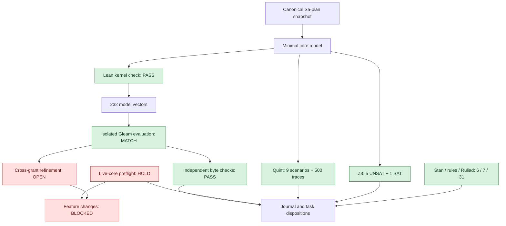

# Evolutionary UOS development core plan

> Use the repository-local executing-plans, TDD and independent-review lifecycle through canonical Sa-plan and the Gleam harness after explicit implementation resume. This planning packet does not launch workers.

**Goal:** establish an exceptionally reliable small development core, then evolve required capabilities one useful, reversible slice at a time.

**Architecture:** Gleam/OTP owns trusted control and supervised effects; Hermes Sa-plan owns tasks/jobs/workflows. Preserve pinned ZigVM/native/MAX boundaries and the existing feature DB. Functional/algebraic interfaces make pure decisions explicit and return typed success, refusal or uncertain outcomes. No extra queue, feature registry or orchestration framework.

**Spec:** [Harness contract](http://nas-1.tail55d152.ts.net:4100/files/contracts/rules/20260909-0412-gleam-harness-agent-operation-contract.md) · [Risk SOP](http://nas-1.tail55d152.ts.net:4100/files/contracts/rules/20260907-1559-risk-prioritization-sop.md) · [AINF specification](http://nas-1.tail55d152.ts.net:4100/files/docs/design/20260907-0550-uos-agentic-infrastructure-17-aspect-formal-spec.md).

Planning baseline2026-10-27T06:08:34Z; iterative proof/runtime analysis through06:48UTC. #fractal-l0 #fractal-l1 #fractal-l2 #fractal-l3 #fractal-l4 #fractal-l5 #fractal-l6 #fractal-l7 #fractal-l8 #fractal-l9 #zk-adr #zero-muda

[Cockpit](http://nas-1.tail55d152.ts.net:4100/) · [Planning](http://nas-1.tail55d152.ts.net:4100/planning) · [Manifest](http://nas-1.tail55d152.ts.net:4100/files/governance/planning/20261027-0634-hive-development-readiness-plan.json) · [Journal](http://nas-1.tail55d152.ts.net:4100/files/docs/journal/20261027-0634-hive-development-readiness-plan-journal.md) · [Lean source](http://nas-1.tail55d152.ts.net:4100/files/formal/lean/DevelopmentCoreGate.lean) · [Proof receipt](http://nas-1.tail55d152.ts.net:4100/files/governance/planning/20261027-0634-core-gate-proof-receipt.json)

## 1. Correct the work set before adding machinery

No, all17 registered additions are not mandatory for the first usable development loop. Registering a broad roadmap as mandatory gates added assessment and coordination work before demonstrating its utility. Preserve that history, visibly classify the rows, and keep them outside the first critical path. Never mark deferred or absorbed work completed merely to make counts green.

Canonical plan: `uos/hive-development/20261027-0532`. Preserve its10 original rows. The17 additions are now2 authorization/recovery gates,1 reuse-of-existing-evidence gate,1 genuinely new capability slice,5 items absorbed into core work,2 conditional items, and6 later roadmap items. No new task is added by this utility correction. The current Sa-plan CLI has no task cancellation or dependency edit operation; names and this assessment communicate deferral, while actual states remain available. Do not claim an implemented scheduler deferral or delete DB rows.

First delivery uses existing RECEIPT_FIX, MCP_ACTIVATE, AGENT_PARITY, SERVICE_VERIFY and HIVE_VERIFY. The only distinct new implementation is PLANNING_MCP, because missing canonical planning/journal writes repeatedly force manual bootstrap. CONTROL_ACCEPT consumes the same fresh activation evidence; it does not require another implementation or duplicated test suite. CONTROL_RECOVERY reconciles existing stopped work; it is not a second receipt fix.

| Registered task | Disposition | Smallest useful scope / trigger |
|---|---|---|
| OPERATOR_RESUME | gate | No product change; record resume evidence once. |
| CONTROL_RECOVERY | gate | Reconcile existing attempts only; do not reimplement the receipt repair. |
| CONTROL_ACCEPT | reuse | Consume the same independent evidence; no duplicate build, test suite or implementation. |
| PLANNING_MCP | next | One small typed planning/publication vertical slice; reuse Sa-plan and bounded file adapters. |
| READINESS_CENSUS | absorb | Include only the first workflow dependencies and existing feature DB entries in SERVICE_VERIFY. |
| NATIVE_BOUNDARY_REPAIR | conditional | Unknown/failed dependency remains unavailable until fixed; no blanket NIF redesign. |
| SCHEDULER_GATES | absorb | Verify existing fences in MCP_ACTIVATE/HIVE_VERIFY; open a scoped repair only for a demonstrated failure. |
| CAPABILITY_PARITY | later | Grow one required capability end to end; retain remaining features as explicit backlog. |
| FAULT_RECOVERY | absorb | Test bounded interruption/duplicate cases in HIVE_VERIFY; add partition depth when the operating profile uses it. |
| OPERATOR_SURFACES | later | Repair primary planning/evidence views only when they block or mislead the actual workflow. |
| PERF_SCALE | later | Run targeted baseline in HIVE_VERIFY; preserve the full Telegram soak for its operational campaign. |
| FORMAL_EVIDENCE | absorb | Use invocation-specific relevant properties in MCP_ACTIVATE/HIVE_VERIFY; deepen only for risk or a changed guarantee. |
| TELEGRAM_ACCEPT | later | Execute the existing Telegram plan once the control path is safe; no duplicate campaign. |
| COST_EFFICIENCY | absorb | Record per-slice tokens, latency, retries, failures and useful output; compare models only when a routing decision needs evidence. |
| KNOWLEDGE_SYNC | later | Repair active references and contradictions in AGENT_PARITY; defer unrelated retagging and EV documentation projects. |
| DEV_READY_REVIEW | later | First verdict is scoped CORE_DEV_READY or HOLD; full-profile readiness awaits its real feature/operational evidence. |
| DEV_INTEGRATE | conditional | Use existing serialized JJ process after candidate review; no new deployment mechanism or production cutover. |

The frozen dependency closure for HIVE_VERIFY plus PLANNING_MCP contains13 IDs, including already-completed history and gate records. It excludes all13 newly registered items classified absorbed/conditional/later. There are not13 new implementation tasks. The old RECEIPT_GRANT_REBIND remains completed history outside that closure.

## 2. Non-negotiable core before normal changes

Core laws: current scoped authority; durable effects and reconciliation; isolation/resource bounds; truthful evidence; bounded recovery and useful progress; actually loaded policy/rules/skills/SOPs. These are invariants to demonstrate under an explicit fault model, not an assertion of unlimited failure-proof operation.

Every normal source/configuration/dependency/runtime change must be preceded by fresh CORE_GREEN evidence for the current protected baseline, exact trusted task/attempt/epoch and host/boot, loaded policy identity, isolated candidate and tested rollback. Unknown or stale is a stop. Initial small golden-check target is <=60s, to be measured against the actual operating profile rather than claimed as a current SLO.

Keep an immutable known-good baseline serving while testing candidates in separate processes, stores and ports. Compare baseline health/identity before and after the candidate change. Candidate promotion requires its own green result, independent review, current authority and tested rollback; never update a baseline pointer from model advice or a board ACK.

If the core is already failed/unaccepted, normal feature work stops. Only a separately authorized bounded isolated repair may proceed after implementation resume. Requiring a healthy broken component before repairing it would be a circular prerequisite; the recovery path is explicit and cannot grant unrelated feature effects. Current live-core acceptance is HOLD. This operator-requested planning/document/formal-analysis recording is metadata work, not a runtime implementation change.

The overall goal remains paused. OPERATOR_RESUME requires an explicit implementation-resume instruction and fresh scope. Existing old task rows predate that gate; their availability is not permission. A goal pause is not a demonstrated global runtime scheduler interlock.

## 3. One useful vertical slice

1. Reobserve and reconcile the stopped RECEIPT_FIX worker, current lease/epoch, source/BEAM identities and durable effects. Use the applicable reclaim preflight; never force another owner's attempt.
2. Independently review the implemented repair and its actual red/green evidence; mint a finite current grant and verify in a fresh successor process through MCP. Keep the original HOLD/receipts.
3. Through an actual configured client, assign one task, perform a scoped change, build/test, obtain an independent verdict and record completion evidence. Exercise one interruption and lost reply without blind retry or unrelated mutation.
4. Verify only the services, native boundaries, operator projection and feature-DB entries used by that workflow. Repair a false-success or unsafe boundary when demonstrated; unknown dependencies remain visibly unavailable.
5. Add canonical plan/task and journal/evidence writing as a small typed MCP slice, reusing the existing Sa-plan bridge and bounded file primitives. No raw SQL, shell/eval or caller-supplied authority.
6. Accept CORE_DEV_READY only for the named profile; provider unavailability and excluded capabilities remain explicit. Full all-capability MCP coverage and Telegram acceptance remain the overall goals, not falsely discharged by first-slice success.

Before each bounded implementation task: observe scope/authority/risks and freeze the interface and expected behavior; write a failing behavior test; implement the smallest fix; run targeted and justified integration/failure checks; independently review exact candidate; record actual evidence and release the lease. Reuse the same accepted proof/test receipts where their scope and freshness genuinely apply.

## 4. Rules, skills, Superpowers and SOP must work under pressure

AGENT_PARITY owns one UOS-local active policy closure: canonical paths, precedence, source hashes and actual client-loaded versions. Reuse existing inventories and bindings. Preserve external/imported originals; repair missing references and stale imported directives in UOS-owned adapters. A symlink, plugin listing or advisory hook is not behavioral enforcement.

Pressure cases must be exercised in the actual client/tool boundary:
- Pause versus inherited autonomous goal: no further effects.
- Missing/unavailable tool: truthful refusal, no invented capability or forbidden bypass.
- Imported Git instruction versus standalone JJ: JJ boundary wins.
- Automatic delegation versus active restriction: no unauthorized worker.
- Payload role/identity/backend or model text versus trusted authority: rejected.
- Historical pass/EV/board ACK versus candidate evidence: no false completion/admission.
- Expired grant/attempt/epoch, wrong host/boot, stale clock or changed source: refuse.
- Lost reply, duplicate logical ID and uncertain effect: reconcile before retry.
- Provider quota failure: stop bounded routing/retry, preserve budget liability.
- Long/Unicode/NUL diagnostic and missing health source: byte integrity or explicit unavailable state.

Superpowers supplies lifecycle methods; it does not override Sa-plan, current authorization, language boundaries, pinned supply chain or pause. Prose checks, behavioral pressure checks and runtime enforcement have separate status. Current actual-client pressure evidence is UNRUN/HOLD until observed.

## 5. Fractal organic evolution with a protected core

The unit of growth is a useful capability, not another management layer. Observe an actual need/failure; choose the smallest dependency-ready change; define pure typed intent/result and falsifier; develop an isolated candidate; compare model and runtime; review and reversibly promote; measure useful outcome. Repeat the same laws at each child boundary. A child may restrict inherited authority, never enlarge it; an unknown required child cannot be hidden by a healthy parent.

| Layer | Relevant invariant |
|---|---|
| L0 Constitutional authority | Authorization, pause, release and safety constraints precede scores and model advice. |
| L1 Atomic evidence | Byte integrity, paths, clock domains, identity, ABI and bounded errors. |
| L2 Component contracts | Pure typed intent/result laws, real operations, invalid input and truthful absence. |
| L3 Transactions | Stable effect IDs, current attempt/epoch, durable result, replay and cancellation. |
| L4 System supervision | Observed OTP tree, resource bounds, shutdown, dependency failure and recovery. |
| L5 Cognition | Eligible model/mode, finite budget, task quality, uncertainty and advice/effect separation. |
| L6 Hive collaboration | Real identities, explicit ACKs, disjoint ownership, independent review and handoff. |
| L7 Federation | Authenticated transport, tenant namespace, correlation, duplicate/partition/reconnect behavior. |
| L8 Evolution | Pinned reproducibility, isolated experiments, formal bounds, useful work per resource and rollback. |
| L9 Assurance | Exact candidate, applicable runtime+formal evidence, independent verdict and visible residuals. |

Grow only for measured user demand, demonstrated safety/reliability failure, SLO breach or recurring manual cost. Retain, simplify or retire a capability from observed results. Keep Predict/Observe/Orient/Decide/Act/Verify/Reflect feedback; do not add biological terminology without a concrete control or measurement.

Authority/safety/pause/readiness precede C×T×F×Dep×I. Preserve raw FMEA S/O/Det, all four UCAs, evidence age and residuals. Unknown factors remain unknown; no fabricated numeric utility. Useful payoff means verified operator work and reduced failure/rework/blocking time per total resource cost. Shared costs, hidden dependencies and regression risk prevent an unsupported claim of global economic optimality.

## 6. Mathematical results and runtime correspondence

Published Lean source is a standalone bounded model, not a loaded service. Lean4.33.0 checked47 named theorems plus12 satisfiable examples. It models normal/recovery admission; protected candidate edits and promotion; distinct owner/attempt/epoch/host/boot fencing and operation horizon; durable dispatch reservation and unknown-outcome reconciliation; arbitrary-depth required-holon health and non-escalating child authority; canonical task dependency closure/minimality; nonnegative additive task cost; concrete grant-budget and replay conditions.

The core set is the least dependency-closed set containing the two frozen workflow targets. Under nonnegative additive task costs, a superset cannot cost less. This does not prove that the declared graph includes every real operational dependency, that task costs are independent, or that additional capabilities have no benefit. Those remain measurement/refinement obligations.

Proof foundations are explicitly Lean Init, propext and Quot.sound; there are no custom axioms, unchecked placeholders or unsafe/partial definitions in the accepted model. Earlier compiler failures are preserved. Three deliberately weakened final mutants are rejected: remove healthy-core admission, allow unknown-outcome redispatch, add PERF_SCALE to the supposedly minimal core.

Actual compiled Gleam comparison:
- admission.grant_budget_valid/3: all216 boundary cases match Lean, including negative input, strict expiry, 70000ms horizon and24h lifetime.
- operations.replay/2: all16 schema/kind/signature/status combinations match Lean;2 malformed/missing-field records are refused.
- effect_output_fields/1:10 actual fixtures (including NUL, long ASCII, Han, combining text, emoji and literal sentinel); independent GNU sha256sum matches all10 full and all10 retained digests, and byte counts/retention expectations match.
- No running service, product source, grant, task attempt or live data changed during these isolated checks.

The source and loaded-module identities are recorded in the receipt. These are bounded pure-function checks, not complete runtime refinement. Trusting a recovery observation, loading policy, atomic effect fences, real clients, external delivery, liveness under partitions, every parser case and all services remain unproven or unrun. No probability of full-system correctness is inferred from test counts.

Additional tools were used with explicit scope: existing Quint coordination specification passed9 deterministic scenarios and500 seeded traces at depth30, and detected2 intended mutants; Z3 returned5 UNSAT safety queries plus a SAT valid-work control under bounds; prebuilt advisory adapters passed6 Stan-model,7 rule-engine and31 Ruliad explorer tests. These do not prove global reliability, a full Stan sampler or a Rete-UL implementation. Current source-to-prebuilt-binary binding for those three adapters is not established. No new posterior is inferred from correlated boundary tests. [Raw Lean log](http://nas-1.tail55d152.ts.net:4100/files/governance/planning/20261027-0634-core-gate-proof.log); tool logs/inputs and limits are listed in the proof receipt.

## 7. Human-readable progress and evidence

```text
[Canonical Sa-plan snapshot] --> [Minimal core model]
[Minimal core model] --> [Lean kernel check: PASS]
[Lean kernel check: PASS] --> [232 model vectors]
[232 model vectors] --> [Isolated Gleam evaluation: MATCH]
[Isolated Gleam evaluation: MATCH] --> [Independent byte checks: PASS]
[Independent byte checks: PASS] --> [Journal and task dispositions]
[Live-core preflight: HOLD] --> [Feature changes: BLOCKED]
[Live-core preflight: HOLD] --> [Journal and task dispositions]
[Minimal core model] --> [Quint: 9 scenarios + 500 traces]
[Quint: 9 scenarios + 500 traces] --> [Journal and task dispositions]
[Minimal core model] --> [Z3: 5 UNSAT + 1 SAT]
[Z3: 5 UNSAT + 1 SAT] --> [Journal and task dispositions]
[Stan / rules / Ruliad: 6 / 7 / 31] --> [Journal and task dispositions]
[Isolated Gleam evaluation: MATCH] --> [Cross-grant refinement: OPEN]
[Cross-grant refinement: OPEN] --> [Feature changes: BLOCKED]
```



| Observation | Result | Meaning |
|---|---|---|
| Canonical registration |17 added,10 originals preserved,27 total;0 claims | Roadmap metadata, not implementation progress |
| Utility correction |1 distinct new core feature;13 new work packages outside first closure | Reduce first delivery scope; visibly retain backlog/history |
| Lean kernel |47 theorems+12 controls PASS | Model laws at stated assumptions |
| Adversarial mutants |3/3 rejected | Guards and minimality checks detect the intended weakening |
| Grant/replay comparisons |232/232 match;2 parser refusals | Existing compiled pure functions at tested scope |
| Retained/full byte checks |20/20 digests across10 fixtures match | Evidence byte contract under those fixtures |
| Quint / Z3 / advisory substrates |9 scenarios,500 seeded traces;5 UNSAT+1 SAT;6/7/31 adapter checks | Model/substrate evidence at explicit limits |
| Cross-grant logical identity |REFINEMENT NOT ESTABLISHED | Required recovery correspondence test; no physical duplicate demonstrated |
| Strong risk preflight |HOLD | Prior10-record portfolio omits the expanded canonical task set; selection also blocked |
| Live MCP/client/recovery acceptance |HOLD / UNRUN | No core or full-hive readiness claim |

## 8. Mandatory next evidence, rollback and stopping rule

First execution must repair the complete current risk assessment; the preserved10-record portfolio is not sufficient for27 tasks. Preserve it, reobserve all task dispositions/actors and source hashes, and use --preflight/--active-check or applicable expired-claim commands. These report-only checks do not replace effect-time fencing.

A concrete correspondence gap is now recorded: the model keeps logical identity stable across attempts, while runtime effect_path_for namespaces receipts by grant. Same intent/different grant produces different paths. No physical duplicate was demonstrated; cross-grant reconciliation must be tested before expanding effect capabilities.

Current independent-runtime trace obligations: policy-loaded flag -> actual client evidence; authority predicates -> trusted grant/task/epoch/clock checks; prepared/unknown/success -> durable store and external effect semantics; healthy holon -> actual required service probes and SLOs; protected baseline/promotion -> observed isolated candidate and rollback. Do not assign a global high-confidence percentage before closing these links.

For each required capability use direct evidence, exact inherited evidence, reviewed N/A or UNKNOWN across the canonical AINF-A01..A17 and relevant L0-L9 layers. This is an applicability/evidence map, not170 fresh tasks per feature. Relevant mathematical/runtime gates are non-negotiable; exhaustive unrelated proof/UI/scale work is not an initial-use gate.

Keep the existing Telegram plan and24h operational soak for actual Telegram acceptance. Performance/scalability work begins with a defined real workload and reviewed numerical thresholds, then saturation/recovery/soak; sequential parser timing cannot pass it. Large-scale, multi-interface, federation, all-model benchmarking and global KM/EV cleanup need a demonstrated payoff before promotion from backlog.

Stop recursion when the evidence question is answered or the next gain requires missing runtime evidence. More abstract theorems cannot replace that evidence. Preserve the protected baseline and failures; revert only owned candidate/configuration changes with current authority. Production release, new EV claims and unreviewed package fetches remain outside this work.


## Comprehensive verification checklist

Checks describe this planning packet only; unchecked runtime obligations remain pending.

<details><summary>Domain 1 — Metadata and navigation</summary>

- [x] CHK-01-TIME: observed host UTC and synchronized chrony, stratum3, absolute offset below1ms.
- [x] CHK-02-TAIL: full FQDN locators provided; live delivery remains unverified.
- [x] CHK-03-FRACT: L0-L9 responsibilities and canonical aspect mapping recorded.
- [x] CHK-04-KM: plan, manifest, journal and governing sources linked.

</details>
<details><summary>Domain 2 — Purity and storage</summary>

- [ ] CHK-05-MUDA: full candidate dependency/runtime exclusion scan pending.
- [ ] CHK-06-GRAPH: native and graph boundaries require actual runtime checks.
- [ ] CHK-07-DRIVE: denied OS serial preserved; physical storage tests not performed.

</details>
<details><summary>Domain 3 — Verification</summary>

- [ ] CHK-08-C1C8: actual UI/surface checks pending.
- [ ] CHK-09-MATH: applicable bounded mathematical checks pending.
- [ ] CHK-10-9MOD: unit, system, TDD, BDD, property, fuzz, chaos, performance and scalability campaign pending.
- [ ] CHK-11-REGR: affected regression and operational soak pending.

</details>
<details><summary>Domain 4 — Control and observability</summary>

- [ ] CHK-12-GLEAM: fresh successor acceptance pending.
- [ ] CHK-13-HERMES: candidate-bound analysis and oracle checks pending.
- [ ] CHK-14-ZIGVM: required kernel/VFS evidence pending.
- [ ] CHK-15-MAX: required inference boundary evidence pending.
- [ ] CHK-16-OTEL: actual end-to-end causal trace and failure visibility pending.

</details>
<details><summary>Domain 5 — Governance</summary>

- [ ] CHK-17-SOV: independent candidate acceptance remains pending.
- [x] CHK-18-JJ: standalone JJ observed; no VCS mutation or unrelated source overwrite in this planning action.

</details>
<details><summary>Domain 6 — Provenance</summary>

EV-93 ceiling. EV-94..109 remain NOT_ADMITTED. No new EV identifier. No task count or passing document validator confers runtime admission.

</details>

[Previous: bootstrap](http://nas-1.tail55d152.ts.net:4100/files/docs/plans/20261027-0532-hive-development-bootstrap.md) · [Planning](http://nas-1.tail55d152.ts.net:4100/planning) · [Wiki](http://nas-1.tail55d152.ts.net:4100/wiki) · [ZK](http://nas-1.tail55d152.ts.net:4100/zk)

UOS footer: canonical execution state lives in Sa-plan; this is a planning projection, not a second task queue.

