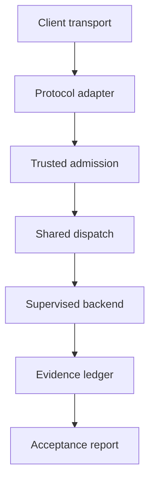

# UOS MCP Server Completion Implementation Plan

> **For agentic workers:** Execute task by task using the repository executing-plans workflow after canonical Sa-plan registration and fresh harness admission. Native execution is the proposed default. Independent review is required before integration and release. Delegation needs an authorized execution decision. Checkboxes are proposal annotations, not a task ledger.

**Goal:** Complete every declared UOS MCP function with real backends, bounded execution, five-client compatibility and candidate-bound positive, negative and recovery evidence.

**Architecture:** Gleam/OTP owns identity, policy, supervision, dispatch and effect admission. A shared typed registry/executor serves public, legacy-private and successor-private routes. Hermes provides bounded analysis/storage, ZigVM deterministic kernels, and isolated MAX/Mojo inference.

**Tech stack:** Repository-pinned Gleam/OTP 29, OCaml/Dune/SQLite, existing ZigVM/MAX/Mojo and realized Nix/devenv outputs. No new Python outside the existing inference service.

**Spec:** [Verified gap report](http://nas-1.tail55d152.ts.net:4100/files/docs/journal/20261029-1851-mcp-feature-and-merge-verification-summary.md), AGENTS.md, SC-HARNESS-MCP-001, SC-SA-PLAN-001 and the design/acceptance requirements below.

**Status:** PROPOSED; no implementation, canonical registration, acceptance or release has occurred.
**Proposed plan ID:** `uos/mcp-server-completion/20261029-1913`.
**Baseline:** `main=xuqyvwoq / 12bf3ee508829755ae2f527b5a5dcb88e351adc2`.
**Observed planning time:** 2026-10-29T19:33:13Z; chrony Normal, stratum 3, approximately 44 microseconds system offset. Prefix uses UTC hour and seconds.
**Navigation:** [Plan](http://nas-1.tail55d152.ts.net:4100/files/docs/plans/20261029-1913-uos-mcp-server-completion-plan.md) · [Machine proposal](http://nas-1.tail55d152.ts.net:4100/files/governance/planning/20261029-1913-uos-mcp-server-completion-proposal.json) · [Planning cockpit](http://nas-1.tail55d152.ts.net:4100/planning) · [Wiki](http://nas-1.tail55d152.ts.net:4100/wiki) · [ZK](http://nas-1.tail55d152.ts.net:4100/zk).

#fractal-l0 #fractal-l1 #fractal-l2 #fractal-l3 #fractal-l4 #fractal-l5 #fractal-l6 #fractal-l7 #fractal-l8 #fractal-l9 #zk-adr #zero-muda
[[wiki:index]] [[wiki:architecture]] [[zk:ADR-001]] [[zk:ADR-016]]

## Global constraints

- Sa-plan is the sole execution authority. Register the reviewed DAG through an admitted planning operation and verify persisted IDs/edges. Never patch SQLite directly or run the JSON proposal as a second scheduler.
- Preserve historical completed tasks; create successor tasks instead of reopening the old 21/21 and 52/52 records to manufacture fresh acceptance.
- Registration/preflight repair requires an existing admitted maintenance task or explicitly reviewed bounded bootstrap. T00 cannot grant its own authority. Completed LIVE_OPS/integration tasks cannot authorize new work.
- Every effect needs fresh grant/task/attempt/clock/source/lease/epoch fencing. Use risk --preflight PORTFOLIO TASK before claim and --active-check PORTFOLIO TASK WORKER ATTEMPT during execution. This proposal is not a validated risk portfolio.
- The earlier operator exception covered verification despite the untracked tools/validation/verify_guardian.exe failure. It is not an implementation/release waiver.
- Use isolated JJ sibling workspaces and one serialized integration/main writer. No native Git mutation, forced abandonment, destructive cleanup, remote push or production cutover follows from this planning request.
- Preserve original reviews, failed effects and held SourceFX bytes. EV-93 remains the ceiling; EV-94..EV-109 remain NOT_ADMITTED; mint no EV number.
- Gleam/OTP owns control; blocking storage/provers/inference remain supervised isolated services. Add 0 Bevy and 0 Graphite dependencies; use pure Gleam/Erlang or Hermes graph operations.
- Operational targets use Tailscale FQDNs. Protected remote MCP uses an approved HTTPS origin; the existing HTTP documentation origin is not a bearer-token endpoint.
- Only pinned Nix/devenv provisioning is allowed; no handler fetches packages/models implicitly. Existing MAX Python confinement remains unchanged.
- Preserve credentials and private configurations. Evidence retains approved redacted data/digests, never keys, raw secrets or token-bearing URLs.
- Runtime, development readiness, task completion and sovereign admission remain separate decisions.

## Design and approach

**Recommended: incremental shared core.** Preserve edge wire contracts while moving identity/admission, schema/dispatch and receipt execution behind a common Gleam service. Tool families can then achieve independent tested checkpoints.

A dispatch-only repair is insufficient: vault.gleam:init/unseal are unwired, vault.status returns a constant, and the gateway named by uos_root_spec is not started by the current root startup function. A wholesale replacement creates unnecessary compatibility/rollback risk. These alternatives are considered and rejected here as author recommendations, not operator-approved implementation choices.

Support two explicitly separated protocol eras. Retain the current 2024-11-05 handshake profile; add other legacy versions only when tested. Add the current 2026-07-28 profile using per-request metadata and server/discover. Do not require the legacy handshake on modern requests. Preserve logical UOS effect IDs across retries even when JSON-RPC request IDs change. Modern profile result/cache/subscription/error semantics need separate serializers. See the [official changes](https://modelcontextprotocol.io/specification/2026-07-28/changelog) and [transport specification](https://modelcontextprotocol.io/specification/2026-07-28/basic/transports).

Scope includes existing UOS tools plus resources, prompts, required subscriptions, cancellation/progress, a negotiated durable task extension and protected Streamable HTTP. Sampling/roots are not newly added; the current specification deprecates them. Optional MCP Apps/skills extensions are outside this plan unless the frozen census identifies an existing UOS requirement. Unsupported capabilities stay unadvertised.

## Baseline and preserved evidence

| Area | Observed result |
|---|---|
| Core grant-bound harness | 186/186 passed |
| Core plus interface suite | 190 passed, 4 failed |
| Telegram media fixtures | 204/204 passed, separate scope |
| Live v13 initialize/status | Passed on exact immutable backend |
| Public inventory | 65 declared; 12 unavailable; remaining 53 declared_unprobed |
| Calls to unavailable tools | 12/12 returned UNAVAILABLE with isError=true |
| Source identity | 44 scoped files match main; not every UOS source/dependency |
| Workspace ancestry | 143 registered workspaces; zero non-empty workspace ancestry heads outside main |
| Broader repository | 45 visible non-empty heads outside main; ten content-equivalent on changed files; dispositions incomplete |
| Review integrity | Prior Codex wrapper VERIFIED contradicts preserved raw NOT_VERIFIED |
| Execution freshness | v12 receipts say 185 tests, summary says 211; three scoped files changed later |
| Toolchain | Preflight fails 1/31 on untracked verify_guardian.exe |

These are retained observations, not acceptance credit for a future candidate.

## Complete public tool ownership

Each declared tool has one implementation owner. Preserve captured argument schemas or perform an explicit versioned migration.

| Task | Family | All declared public tools |
|---|---|---|
| T05 | planning read | `plan_status`, `plan_list_pending`, `plan_list`, `plan_get`, `plan_search`, `sa_plan_status`, `sa_plan_status_for`, `sa_plan_list`, `feature_tracker_status` |
| T06 | planning write | `plan_add`, `plan_update`, `sa_task_claim`, `sa_task_complete`, `sa_job_enqueue`, `sa_workflow_start`, `sa_bridge_submit` |
| T07 | observability | `system_health`, `system_dashboard`, `system_immune`, `system_zenoh`, `system_verification`, `podman_containers`, `metabolic_state`, `ooda_phase`, `fractal_status`, `prajna_health`, `dark_cockpit_mode`, `integrity_check`, `evolution_metrics`, `mesh_topology`, `ooda_decide`, `kms_catalog`, `holon_status`, `swarm_status`, `agent_hierarchy` |
| T08 | control safety registry | `control_loop`, `safety_status`, `registry_status` |
| T09 | verification | `verification_run`, `run_selfcheck`, `run_gate`, `preflight_check` |
| T10 | knowledge files | `knowledge_search`, `read_file`, `zk_search`, `zk_transclude` |
| T11 | vault metadata | `vault_status`, `vault_list_secrets`, `vault_policy_get`, `vault_audit_tail`, `vault_health` |
| T12 | analysis inference sciviz | `forecast_predict`, `stpa_fmea_hazard`, `rete_rule_conflict`, `ruliad_branch_eval`, `shruti_harmonics`, `ast_anomaly_detect`, `lyapunov_trend_predict`, `sciviz_extension_deep_dive`, `ggram_synthesize` |
| T13 | feature evidence | `mcp_capability_inventory`, `harness_system_feature_catalog`, `harness_system_feature_observations`, `harness_system_feature_intent`, `harness_execution_progress` |

Freeze both private routes independently: the current successor has 15 names; verify the claimed legacy-private 17. Shared names may have different schemas. Record planning_query and todo_status aliases separately if retained outside the public catalog.

Required profiles: agy, gemini, codex, claude, pi. The starting denominator is **325 public tool/profile pairs**, plus **160 private route/profile pairs** if the 17/15 census remains valid: **485 pairs** before multiplying by version, transport and scenario. These are coverage pairs, not test counts. Recalculate after T01; do not reuse the historical 388-cell denominator.

## Shared contracts and bounds

Proposed interfaces below do not claim that these modules already exist.

- mcp/principal.gleam: opaque Principal constructed only from admitted launcher, HTTP authentication or authenticated Zenoh ingress. Actor/clientInfo/arguments cannot construct authority.
- mcp/types.gleam: RequestContext(principal, role, source_binding, task_binding, trace, deadline); ToolSpec(route, name, schemas, effect_class, backend, scope, budget); ToolError(code, reason, retryability); Outcome = Complete(value,evidence) | Refused(error) | Uncertain(receipt).
- mcp/registry.gleam: lookup(route:String,name:String)->Result(ToolSpec,ToolError); definitions(profile:ProtocolProfile,access:AccessView)->List(ToolSpec).
- mcp/admission.gleam: admit(context:RequestContext,spec:ToolSpec,args:Value)->Result(ValidatedCall,ToolError), with opaque ValidatedCall. Observation permissions are separate from mutation/task authority.
- mcp/dispatch.gleam: execute(call:ValidatedCall)->Outcome. Family adapters expose call(context,name,args) for reads and call(ValidatedCall) for effects.
- mcp/worker.gleam, supervisor.gleam and receipts.gleam: bounded worker/queue lifetime, durable intent/result/reconciliation, candidate identity, clocks, hashes and trace/span context.
- mcp/version.gleam and wire.gleam: profile-specific request decoding/result encoding; protocol failures and tool failures remain distinct. No nested JSON-RPC error disguised as successful content.

**Proposed defaults:** frame 1 MiB, JSON depth 32, arguments 256 KiB, retained output 1 MiB, page default 100/max 500, gateway workers 16/pending 128, active mutations four per principal. Keep any current stricter limit until a reviewed change raises it. T01 freezes measured-compatible limits; tests cover limit-1/limit/limit+1. Reject remote schema references, cyclic unbounded local refs and caller-selected executables.

Local read/decision budget: three seconds. Build/check activity: at most 60 seconds plus at most ten seconds bounded teardown. Longer work uses multiple Sa-plan-owned activities and durable handles. Queue exhaustion is a typed retryable refusal. No unbounded actor mailbox or blocking NIF.

CapabilityRecord keeps declaration, implementation, observed execution, formal verification and admission distinct, each with candidate/time/freshness. Backend health, permission and feature acceptance are independent axes. Expected refusal is credit only for a refusal scenario.

## Architecture and dependencies

```text
[Client transport] --> [Protocol adapter]
[Protocol adapter] --> [Trusted admission]
[Trusted admission] --> [Shared dispatch]
[Shared dispatch] --> [Supervised backend]
[Supervised backend] --> [Evidence ledger]
[Evidence ledger] --> [Acceptance report]
```



| Stage | Tasks | Exit condition |
|---|---|---|
| Authority and foundations | T00–T04 | Valid task/grant/toolchain, frozen contracts, supervised recovery |
| Complete tool families | T05–T14 | Actual backend-positive behavior for all frozen route tools |
| Protocol/server/transports | T15–T18 | Versioned conformance and trusted ingress |
| Complete acceptance | T19–T20 | Five-client matrix and actual formal/fault/load evidence |
| Reconciliation and release | T21–T24 | Reviewed combined candidate, truthful docs, separately authorized cutover |

The machine proposal contains every dependency edge. Shared registry/server writes, grants, schema migrations, integration and runtime cutover are serialized. Independent family adapters may use disjoint workspaces after prerequisites pass; this document does not itself authorize parallel agents.

## Review focus

1. Spoofed actor/clientInfo, revoked grant and stale attempt refuse before effects — T03/T06.
2. Crash after effect but before reply yields reconciliation rather than duplicate execution — T04/T17.
3. Empty, stale or synthetic observations never become healthy — T07/T13.
4. Modern/legacy framing, errors and retries cannot change authority semantics — T15/T16.
5. Vault metadata, resources, errors and caches cannot cross principal/tenant boundaries — T10/T11/T18.

## Detailed task packets

All source paths are workspace-relative. Proposed new test names must first fail for the intended reason. Every task uses isolated development fixtures and its own canonical task receipt. Verification recipes are internal harness runner requirements, not permission for an alternate shell control plane.

### T00 — Admit fresh execution scope and restore verified tooling

**Dependencies:** external admitted registration/maintenance authority; none inside this DAG.
**Class/risk:** P1; authority profile.
**Modify/inspect:** `tools/preflight`, `tools/lib/uos-toolchain.sh`, `tools/validation/verify_guardian.exe`, `apps/cepaf_gleam/src/cepaf_gleam/harness/admission.gleam`.
**Create:** timestamped task evidence under admitted scope; no speculative source scaffolding.
**Interfaces:** Canonical registration readback, fresh reviewed grant, task/attempt/lease and toolchain receipt.

- [ ] **Red tests:** `registration_readback_preserves_exact_dag`; `conflicting_import_refused`; `unexplained_binary_cannot_be_admitted`. Assert the named behavior on isolated fixtures and retain the failing observation.
- [ ] **Implementation:** Use an already admitted maintenance path or explicitly reviewed bounded bootstrap; T00 cannot grant its own authority. Establish executable provenance and repair output packaging without deleting or tracking an unexplained binary. Preserve failed preflight evidence.
- [ ] **Green checks:** bash tools/preflight; risk --preflight PORTFOLIO TASK; verify persisted task IDs/edges and grant/source digests. Require actual exits and bounded logs; an absent prerequisite is UNRUN/HOLD.
- [ ] **Acceptance:** Fresh toolchain PASS and admitted canonical task scope; the earlier verification exception grants no implementation/release waiver.
- [ ] **Seal:** independently review applicable authority/effect changes, record candidate/grant/backend/input/output identities, and seal a descriptive JJ change under the canonical task. Record residual risk and recovery; do not advance main from a worker.


### T01 — Freeze route, source, protocol and client census

**Dependencies:** T00.
**Class/risk:** P1; evidence profile.
**Modify/inspect:** `apps/cepaf_gleam/src/cepaf_gleam/mcp/server.gleam`, `apps/cepaf_gleam/src/cepaf_gleam/mcp/tools.gleam`, `apps/cepaf_gleam/src/cepaf_gleam/harness/mcp.gleam`, `apps/cepaf_gleam/src/cepaf_gleam/harness/successor_mcp.gleam`, `apps/cepaf_gleam/test/system_feature_interfaces_test.gleam`.
**Create:** `apps/cepaf_gleam/test/mcp_route_census_test.gleam`.
**Interfaces:** RouteCatalog(route,name,schema_digest,effects,backend,clients,profiles,source_manifest).

- [ ] **Red tests:** `all_65_public_tools_have_one_owner_test`; `private_name_overlap_retains_route_schema_test`; `changed_schema_requires_migration_test`. Assert the named behavior on isolated fixtures and retain the failing observation.
- [ ] **Implementation:** Freeze all public/private routes, aliases, versions, actual client CLI versions and source identities. Reproduce four interface failures, then reconcile intended schemas and tests together; do not merely replace hashes.
- [ ] **Green checks:** eunit:test([mcp_route_census_test,system_feature_interfaces_test],[verbose]). Require actual exits and bounded logs; an absent prerequisite is UNRUN/HOLD.
- [ ] **Acceptance:** No missing/duplicate route owner; all four baseline failures resolved meaningfully; pinned source/spec/client census.
- [ ] **Seal:** independently review applicable authority/effect changes, record candidate/grant/backend/input/output identities, and seal a descriptive JJ change under the canonical task. Record residual risk and recovery; do not advance main from a worker.


### T02 — Implement shared typed registry and evidence verdicts

**Dependencies:** T01.
**Class/risk:** P1; evidence profile.
**Modify/inspect:** `apps/cepaf_gleam/src/cepaf_gleam/mcp/tools.gleam`, `apps/cepaf_gleam/src/cepaf_gleam/harness/system_feature_census.gleam`.
**Create:** `apps/cepaf_gleam/src/cepaf_gleam/mcp/types.gleam`, `apps/cepaf_gleam/src/cepaf_gleam/mcp/registry.gleam`, `apps/cepaf_gleam/src/cepaf_gleam/mcp/schema.gleam`, `apps/cepaf_gleam/src/cepaf_gleam/mcp/evidence.gleam`, `apps/cepaf_gleam/test/mcp_registry_test.gleam`.
**Interfaces:** lookup(route:String,name:String)->Result(ToolSpec,ToolError); validate(schema:Json,args:Value)->Result(Value,ToolError); Outcome=Complete(value,evidence)|Refused(error)|Uncertain(receipt).

- [ ] **Red tests:** `listed_tool_has_dispatch_schema_and_owner_test`; `backend_error_cannot_decode_as_success_test`; `recursive_local_ref_is_bounded_test`. Assert the named behavior on isolated fixtures and retain the failing observation.
- [ ] **Implementation:** Generate listing, dispatch and evidence projections from one typed registry. Bound schema depth/size/local references, reject remote references, and distinguish declaration, implementation, observation, formal verification and admission.
- [ ] **Green checks:** eunit:test([mcp_registry_test,system_feature_interfaces_test],[verbose]). Require actual exits and bounded logs; an absent prerequisite is UNRUN/HOLD.
- [ ] **Acceptance:** Listing/dispatch/coverage equality; old route contracts remain explicitly versioned; no nested JSON-RPC error reported as success.
- [ ] **Seal:** independently review applicable authority/effect changes, record candidate/grant/backend/input/output identities, and seal a descriptive JJ change under the canonical task. Record residual risk and recovery; do not advance main from a worker.


### T03 — Bind trusted principals and effect-time admission

**Dependencies:** T02.
**Class/risk:** P1; authority profile.
**Modify/inspect:** `apps/cepaf_gleam/src/cepaf_gleam/mcp/authz.gleam`, `apps/cepaf_gleam/src/cepaf_gleam/harness/admission.gleam`, `apps/uos_swarm/src/uos_swarm/session_authority.gleam`.
**Create:** `apps/cepaf_gleam/src/cepaf_gleam/mcp/principal.gleam`, `apps/cepaf_gleam/src/cepaf_gleam/mcp/admission.gleam`, `apps/cepaf_gleam/test/mcp_admission_test.gleam`.
**Interfaces:** Opaque Principal from admitted transport; admit(context:RequestContext,spec:ToolSpec,args:Value)->Result(ValidatedCall,ToolError), with opaque ValidatedCall.

- [ ] **Red tests:** `payload_actor_cannot_change_principal_test`; `completed_task_is_not_reusable_authority_test`; `revoked_grant_refused_at_effect_time_test`. Assert the named behavior on isolated fixtures and retain the failing observation.
- [ ] **Implementation:** Bind identity to trusted launcher/HTTP authentication/Zenoh ingress. Read permissions do not reuse completed task authority. Verify source, host, boot, worker, attempt, clock, lease and epoch again immediately before each effect; AuditOnly never authorizes mutations.
- [ ] **Green checks:** eunit:test([mcp_admission_test,harness_authority_test,harness_sa_plan_boundary_test],[verbose]). Require actual exits and bounded logs; an absent prerequisite is UNRUN/HOLD.
- [ ] **Acceptance:** All wrong-identity/expired/revoked/store-unavailable cases invoke no backend; independently reviewed admission boundary.
- [ ] **Seal:** independently review applicable authority/effect changes, record candidate/grant/backend/input/output identities, and seal a descriptive JJ change under the canonical task. Record residual risk and recovery; do not advance main from a worker.


### T04 — Supervise bounded workers and durable effect recovery

**Dependencies:** T03.
**Class/risk:** P1; recovery profile.
**Modify/inspect:** `apps/cepaf_gleam/src/cepaf_gleam/uos_sup.gleam`, `apps/cepaf_gleam/src/cepaf_gleam/harness/operations.gleam`.
**Create:** `apps/cepaf_gleam/src/cepaf_gleam/mcp/dispatch.gleam`, `apps/cepaf_gleam/src/cepaf_gleam/mcp/worker.gleam`, `apps/cepaf_gleam/src/cepaf_gleam/mcp/supervisor.gleam`, `apps/cepaf_gleam/src/cepaf_gleam/mcp/receipts.gleam`, `apps/cepaf_gleam/test/mcp_worker_recovery_test.gleam`.
**Interfaces:** execute(call:ValidatedCall)->Outcome; receipt key binds stable logical effect ID, task attempt, candidate, input/output hashes, trace and backend.

- [ ] **Red tests:** `gateway_is_actual_root_child_test`; `crash_after_effect_before_reply_is_uncertain_test`; `same_id_conflicting_payload_refused_test`; `poisoned_worker_is_replaced_test`. Assert the named behavior on isolated fixtures and retain the failing observation.
- [ ] **Implementation:** Start actual gateway/worker children rather than listing their names in uos_root_spec. Bound queue/worker/deadline/output/process-tree lifetime. Persist prepared/result transitions; reconcile unknown outcomes before retry; no generic exactly-once external-effect promise.
- [ ] **Green checks:** eunit:test([mcp_worker_recovery_test,harness_cas_critical_section_test,harness_stdio_pipe_test,harness_native_backend_test],[verbose]). Require actual exits and bounded logs; an absent prerequisite is UNRUN/HOLD.
- [ ] **Acceptance:** Observed parent/child ancestry, sibling isolation, queue refusal and descendant cleanup; durable replay/reconciliation laws.
- [ ] **Seal:** independently review applicable authority/effect changes, record candidate/grant/backend/input/output identities, and seal a descriptive JJ change under the canonical task. Record residual risk and recovery; do not advance main from a worker.


### T05 — Move every planning read to canonical Sa-plan

**Dependencies:** T02, T03.
**Class/risk:** P1; authority profile.
**Modify/inspect:** `apps/cepaf_gleam/src/cepaf_gleam/mcp/server.gleam`, `apps/cepaf_gleam/src/cepaf_gleam/planning/sa_plan_bridge.gleam`.
**Create:** `apps/cepaf_gleam/src/cepaf_gleam/mcp/adapters/planning_read.gleam`, `apps/cepaf_gleam/test/mcp_planning_read_test.gleam`.
**Interfaces:** planning_read.call(context:RequestContext,name:String,args:Value)->Outcome.

- [ ] **Red tests:** `legacy_and_sa_plan_reads_return_same_canonical_rows_test`; `unknown_plan_is_not_global_completion_test`; `unavailable_store_is_tool_error_test`. Assert the named behavior on isolated fixtures and retain the failing observation.
- [ ] **Implementation:** Route every planning read to canonical Sa-plan rather than legacy Smriti/NIF authority. Preserve old argument compatibility with explicit ID mappings; add bounded pagination/search and truthful empty/not-found distinctions.
- [ ] **Green checks:** eunit:test([mcp_planning_read_test],[verbose]); admitted read-only canonical status spot checks. Require actual exits and bounded logs; an absent prerequisite is UNRUN/HOLD.
- [ ] **Acceptance:** All nine planning reads agree with canonical fixture/readback; explicit DB selection and bounded output.
- [ ] **Seal:** independently review applicable authority/effect changes, record candidate/grant/backend/input/output identities, and seal a descriptive JJ change under the canonical task. Record residual risk and recovery; do not advance main from a worker.


### T06 — Enable fenced planning mutations and bridge intents

**Dependencies:** T04, T05.
**Class/risk:** P1; authority profile.
**Modify/inspect:** `apps/cepaf_gleam/src/cepaf_gleam/planning/sa_plan_bridge.gleam`, `apps/cepaf_gleam/src/cepaf_gleam/harness/planning_intents.gleam`, `engines/hermes/modules/sa_plan/sa_plan_store.ml`, `engines/hermes/modules/sa_plan/test/sa_plan_main.ml`.
**Create:** `apps/cepaf_gleam/src/cepaf_gleam/mcp/adapters/planning_write.gleam`, `apps/cepaf_gleam/test/mcp_planning_write_test.gleam`.
**Interfaces:** planning_write.call(call:ValidatedCall)->Outcome; closed create/update/claim/complete/job/workflow/bridge intent algebra.

- [ ] **Red tests:** `legacy_update_cannot_skip_transition_test`; `bridge_duplicate_does_not_double_submit_test`; `sixteen_claimants_have_one_owner_test`; `stale_attempt_cannot_complete_test`. Assert the named behavior on isolated fixtures and retain the failing observation.
- [ ] **Implementation:** Implement all seven mutation/bridge tools through canonical transitions and transactionally audited amendments where needed. Payload task IDs select objects but never supply authenticated worker identity. No raw SQL task mutation or arbitrary shell arguments.
- [ ] **Green checks:** eunit:test([mcp_planning_write_test,harness_sa_plan_boundary_test],[verbose]); relevant pinned Hermes Sa-plan lease/CLI tests. Require actual exits and bounded logs; an absent prerequisite is UNRUN/HOLD.
- [ ] **Acceptance:** Positive canonical readback plus denied, expired, conflict, crash and reconciliation outcomes; remove legacy refusal only after review.
- [ ] **Seal:** independently review applicable authority/effect changes, record candidate/grant/backend/input/output identities, and seal a descriptive JJ change under the canonical task. Record residual risk and recovery; do not advance main from a worker.


### T07 — Replace system projections with observed service adapters

**Dependencies:** T02, T03, T04.
**Class/risk:** P2; truth profile.
**Modify/inspect:** `apps/cepaf_gleam/src/cepaf_gleam/mcp/server.gleam`, `apps/cepaf_gleam/src/cepaf_gleam/ui/wisp/router.gleam`, `apps/cepaf_gleam/src/cepaf_gleam/harness/restoration_observer.gleam`.
**Create:** `apps/cepaf_gleam/src/cepaf_gleam/mcp/adapters/system_observation.gleam`, `apps/cepaf_gleam/test/mcp_observation_test.gleam`.
**Interfaces:** observe(context:RequestContext,name:String,args:Value)->Outcome with candidate/time/backend/freshness provenance.

- [ ] **Red tests:** `missing_backend_is_unknown_not_healthy_test`; `zero_containers_requires_successful_probe_test`; `stale_sample_cannot_pass_health_test`. Assert the named behavior on isolated fixtures and retain the failing observation.
- [ ] **Implementation:** Replace fixed health/count/energy/fitness/page-state values with real bounded Podman/Zenoh/OTP observations or explicit unavailability. Keep ooda_* names as compatibility aliases for POODAVR. ooda_decide is a preview and dark_cockpit_mode remains read-only unless separately versioned.
- [ ] **Green checks:** eunit:test([mcp_observation_test],[verbose]); real approved Tailnet service canaries and MCP/Wisp parity. Require actual exits and bounded logs; an absent prerequisite is UNRUN/HOLD.
- [ ] **Acceptance:** All 19 observation tools have observed backend evidence; outage/stale/empty states are honest; no cached effect authority.
- [ ] **Seal:** independently review applicable authority/effect changes, record candidate/grant/backend/input/output identities, and seal a descriptive JJ change under the canonical task. Record residual risk and recovery; do not advance main from a worker.


### T08 — Implement control, safety and registry backends

**Dependencies:** T04, T07.
**Class/risk:** P1; authority profile.
**Modify/inspect:** `apps/cepaf_gleam/src/cepaf_gleam/verification/master_verification_registry.gleam`.
**Create:** `apps/cepaf_gleam/src/cepaf_gleam/mcp/adapters/control.gleam`, `apps/cepaf_gleam/test/mcp_control_test.gleam`.
**Interfaces:** control.call(call:ValidatedCall)->Outcome; closed ControlIntent with explicit preview/execute distinction.

- [ ] **Red tests:** `registry_declaration_is_not_runtime_health_test`; `control_preview_has_no_effect_test`; `execute_rechecks_constraints_and_attempt_test`. Assert the named behavior on isolated fixtures and retain the failing observation.
- [ ] **Implementation:** Implement real control_loop, safety_status and registry_status. Observe actual controllers/constraints/registry instances. Treat executing control_loop actions as mutations despite current classification omissions; reject arbitrary actions and wrong ordering.
- [ ] **Green checks:** eunit:test([mcp_control_test],[verbose]); contained reversible controller canary. Require actual exits and bounded logs; an absent prerequisite is UNRUN/HOLD.
- [ ] **Acceptance:** Actual read state and one admitted reversible control action, tested reversal and all identity/freshness refusals.
- [ ] **Seal:** independently review applicable authority/effect changes, record candidate/grant/backend/input/output identities, and seal a descriptive JJ change under the canonical task. Record residual risk and recovery; do not advance main from a worker.


### T09 — Implement bounded verification, self-check and gate tools

**Dependencies:** T04.
**Class/risk:** P1; recovery profile.
**Modify/inspect:** `apps/cepaf_gleam/src/cepaf_gleam/verification/unified_verification_supervisor.gleam`, `apps/cepaf_gleam/src/cepaf_gleam/verification/vfs_selfcheck.gleam`.
**Create:** `apps/cepaf_gleam/src/cepaf_gleam/mcp/adapters/verification.gleam`, `apps/cepaf_gleam/test/mcp_verification_execution_test.gleam`.
**Interfaces:** verification.call(call:ValidatedCall)->Outcome; CheckId is an allowlist, not a command string.

- [ ] **Red tests:** `nonzero_exit_never_returns_verified_test`; `missing_prover_is_unrun_test`; `failed_check_does_not_poison_next_worker_test`; `output_and_exit_agree_test`. Assert the named behavior on isolated fixtures and retain the failing observation.
- [ ] **Implementation:** Implement verification_run, run_selfcheck, run_gate and preflight_check using bounded workers and actual exits. Separate policy assessment from executing checks; map long work to Sa-plan activities, not blocking calls.
- [ ] **Green checks:** eunit:test([mcp_verification_execution_test],[verbose]); positive/failing fixture checks and bounded solver satisfiable controls. Require actual exits and bounded logs; an absent prerequisite is UNRUN/HOLD.
- [ ] **Acceptance:** Exact check/source identities, exits, bounded logs, timeout cleanup and invocation-specific formal outcomes.
- [ ] **Seal:** independently review applicable authority/effect changes, record candidate/grant/backend/input/output identities, and seal a descriptive JJ change under the canonical task. Record residual risk and recovery; do not advance main from a worker.


### T10 — Implement scoped knowledge, ZK and file access

**Dependencies:** T02, T03, T04.
**Class/risk:** P2; privacy profile.
**Modify/inspect:** `apps/cepaf_gleam/src/cepaf_gleam/harness/files.gleam`, `apps/cepaf_gleam/src/cepaf_gleam/harness/telegram_knowledge_reader.gleam`.
**Create:** `apps/cepaf_gleam/src/cepaf_gleam/mcp/adapters/knowledge.gleam`, `apps/cepaf_gleam/test/mcp_knowledge_test.gleam`.
**Interfaces:** knowledge.call(context:RequestContext,name:String,args:Value)->Outcome.

- [ ] **Red tests:** `traversal_symlink_hardlink_and_credential_paths_refused_test`; `transclusion_cycles_are_bounded_test`; `cross_principal_scope_cannot_expand_test`. Assert the named behavior on isolated fixtures and retain the failing observation.
- [ ] **Implementation:** Implement knowledge_search, read_file, zk_search and zk_transclude using bounded canonical indexes and approved corpus roots. Keep external sources read-only; preserve quarantine markings and index provenance; no implicit ingestion.
- [ ] **Green checks:** eunit:test([mcp_knowledge_test],[verbose]); real disposable wiki/ZK corpus readback. Require actual exits and bounded logs; an absent prerequisite is UNRUN/HOLD.
- [ ] **Acceptance:** Positive query/read/transclusion evidence, Unicode/size/depth bounds and missing/corrupt index errors.
- [ ] **Seal:** independently review applicable authority/effect changes, record candidate/grant/backend/input/output identities, and seal a descriptive JJ change under the canonical task. Record residual risk and recovery; do not advance main from a worker.


### T11 — Complete supervised Vault backend and metadata tools

**Dependencies:** T04.
**Class/risk:** P1; privacy profile.
**Modify/inspect:** `apps/cepaf_gleam/src/cepaf_gleam/vault.gleam`, `apps/cepaf_gleam/src/cepaf_gleam/vault_supervisor.gleam`, `apps/cepaf_gleam/src/cepaf_gleam/vault_audit_reconcile.gleam`.
**Create:** `apps/cepaf_gleam/src/cepaf_gleam/mcp/adapters/vault_metadata.gleam`, `apps/cepaf_gleam/test/mcp_vault_metadata_test.gleam`.
**Interfaces:** vault_metadata.call(context:RequestContext,name:String,args:Value)->Outcome; admitted supervised handle registry.

- [ ] **Red tests:** `unwired_vault_is_not_reported_sealed_or_healthy_test`; `cross_tenant_metadata_refused_test`; `audit_and_error_redaction_canaries_test`. Assert the named behavior on isolated fixtures and retain the failing observation.
- [ ] **Implementation:** Reproduce unwired init/unseal and constant status before completing or selecting a verified backend. Blocking crypto/storage stays in supervised services, never new blocking NIFs. Implement five scoped metadata tools without adding raw secret-read/write tools.
- [ ] **Green checks:** eunit:test([mcp_vault_metadata_test],[verbose]); actual disposable vault sealed/unsealed/outage/restart/audit-corruption checks. Require actual exits and bounded logs; an absent prerequisite is UNRUN/HOLD.
- [ ] **Acceptance:** Verified service invocation and lifecycle; no constant Sealed/empty-list substitute; names/policy metadata authorized and redacted.
- [ ] **Seal:** independently review applicable authority/effect changes, record candidate/grant/backend/input/output identities, and seal a descriptive JJ change under the canonical task. Record residual risk and recovery; do not advance main from a worker.


### T12 — Verify analysis, isolated inference and SciViz adapters

**Dependencies:** T04, T10.
**Class/risk:** P2; truth profile.
**Modify/inspect:** `apps/cepaf_gleam/src/cepaf_gleam/services/max_inference_daemon.gleam`, `apps/cepaf_gleam/src/cepaf_gleam/ui/wisp/inference_api.gleam`, `apps/cepaf_gleam/src/cepaf_gleam/sciviz/extension_deep_dive.gleam`, `apps/cepaf_gleam/src/cepaf_gleam/sciviz/transpiler.gleam`, `engines/hermes/modules/hermes_harness/hermes_rete.ml`.
**Create:** `apps/cepaf_gleam/src/cepaf_gleam/mcp/adapters/analysis.gleam`, `apps/cepaf_gleam/test/mcp_analysis_test.gleam`.
**Interfaces:** analysis.call(call:ValidatedCall)->Outcome using closed model/kernel selections.

- [ ] **Red tests:** `model_absence_is_not_synthetic_prediction_test`; `inference_cannot_authorize_control_test`; `generated_plot_code_is_not_executed_test`. Assert the named behavior on isolated fixtures and retain the failing observation.
- [ ] **Implementation:** Complete nine analysis/inference/SciViz tools. Separate measured observations, deterministic results and estimates. Use supervised MAX/Mojo and bounded Hermes. Label the existing naive matcher honestly; do not claim Rete-UL alpha/beta mechanics without a separately verified upgrade.
- [ ] **Green checks:** eunit:test([mcp_analysis_test],[verbose]); reference vectors, approved model canary and outage/restart tests. Require actual exits and bounded logs; an absent prerequisite is UNRUN/HOLD.
- [ ] **Acceptance:** Real backend/model identity, usage and bounds, independent deterministic oracles, no paid routing/package fetch by tool handlers.
- [ ] **Seal:** independently review applicable authority/effect changes, record candidate/grant/backend/input/output identities, and seal a descriptive JJ change under the canonical task. Record residual risk and recovery; do not advance main from a worker.


### T13 — Implement feature inventory, observations and intent access

**Dependencies:** T02, T05, T06.
**Class/risk:** P1; evidence profile.
**Modify/inspect:** `apps/cepaf_gleam/src/cepaf_gleam/harness/system_feature_store.gleam`, `apps/cepaf_gleam/src/cepaf_gleam/harness/system_features.gleam`, `apps/cepaf_gleam/src/cepaf_gleam/harness/system_feature_census.gleam`, `apps/cepaf_gleam/src/cepaf_gleam/mcp/server.gleam`.
**Create:** `apps/cepaf_gleam/src/cepaf_gleam/mcp/adapters/features.gleam`, `apps/cepaf_gleam/test/mcp_feature_acceptance_test.gleam`.
**Interfaces:** features.call(context:RequestContext,name:String,args:Value)->Outcome; CapabilityRecord has separate declaration/implementation/execution/formal/admission fields.

- [ ] **Red tests:** `completed_task_without_receipt_is_not_complete_test`; `wrong_candidate_receipt_is_stale_test`; `wrapper_raw_verdict_conflict_rejected_test`. Assert the named behavior on isolated fixtures and retain the failing observation.
- [ ] **Implementation:** Implement the four task-bound feature tools and inventory. Replace completed t1-tracker as reusable read authority with current scoped read admission. Generate coverage from registry plus validated evidence; supersede contradictory reviews without changing originals.
- [ ] **Green checks:** eunit:test([mcp_feature_acceptance_test,system_feature_interfaces_test],[verbose]); persisted readback and stale/future/hash tests. Require actual exits and bounded logs; an absent prerequisite is UNRUN/HOLD.
- [ ] **Acceptance:** Truthful catalog/progress/intents and explicit unknown/unavailable evidence; no inherited all-green flags.
- [ ] **Seal:** independently review applicable authority/effect changes, record candidate/grant/backend/input/output identities, and seal a descriptive JJ change under the canonical task. Record residual risk and recovery; do not advance main from a worker.


### T14 — Converge public and private development harness execution

**Dependencies:** T04, T06, T09, T13.
**Class/risk:** P1; authority profile.
**Modify/inspect:** `apps/cepaf_gleam/src/cepaf_gleam/harness/mcp.gleam`, `apps/cepaf_gleam/src/cepaf_gleam/harness/successor_mcp.gleam`, `apps/cepaf_gleam/src/cepaf_gleam/harness/operations.gleam`, `apps/cepaf_gleam/src/cepaf_gleam/harness/planning_intents.gleam`, `apps/cepaf_gleam/src/cepaf_gleam/harness/admission.gleam`.
**Create:** `apps/cepaf_gleam/test/mcp_route_parity_test.gleam`.
**Interfaces:** Public/private adapters use shared execution core while preserving each captured route schema.

- [ ] **Red tests:** `same_name_different_route_does_not_expand_grant_test`; `legacy_finish_cannot_bypass_completion_evidence_test`; `all_fifteen_successor_tools_same_candidate_test`. Assert the named behavior on isolated fixtures and retain the failing observation.
- [ ] **Implementation:** Converge shared admission/worker/receipt behavior only; retain edge compatibility serializers. Execute actual claim/attach/assess/read/write/build/test/finish/reconcile flows under new tasks. Preserve historical SourceFX hold byte for byte.
- [ ] **Green checks:** Original 12-module EUnit suite, repaired interface suite, route parity and actual end-to-end fixtures. Require actual exits and bounded logs; an absent prerequisite is UNRUN/HOLD.
- [ ] **Acceptance:** Current-candidate evidence for 15 successor and frozen legacy-private route set; no reused historical test counts.
- [ ] **Seal:** independently review applicable authority/effect changes, record candidate/grant/backend/input/output identities, and seal a descriptive JJ change under the canonical task. Record residual risk and recovery; do not advance main from a worker.


### T15 — Implement legacy and modern MCP protocol compatibility

**Dependencies:** T02, T03.
**Class/risk:** P1; protocol profile.
**Modify/inspect:** `apps/cepaf_gleam/src/cepaf_gleam/mcp/protocol.gleam`, `apps/cepaf_gleam/src/cepaf_gleam/mcp/server.gleam`, `apps/cepaf_gleam/src/cepaf_gleam/harness/mcp.gleam`, `apps/cepaf_gleam/src/cepaf_gleam/harness/successor_mcp.gleam`.
**Create:** `apps/cepaf_gleam/src/cepaf_gleam/mcp/version.gleam`, `apps/cepaf_gleam/src/cepaf_gleam/mcp/wire.gleam`, `apps/cepaf_gleam/src/cepaf_gleam/mcp/profiles/legacy.gleam`, `apps/cepaf_gleam/src/cepaf_gleam/mcp/profiles/modern.gleam`, `apps/cepaf_gleam/test/mcp_protocol_conformance_test.gleam`.
**Interfaces:** decode(profile,raw)->Result(NormalizedRequest,ProtocolError); encode(profile,outcome)->Json.

- [ ] **Red tests:** `legacy_initialize_and_modern_discovery_do_not_mix_test`; `notification_is_silent_test`; `unsupported_version_refused_test`; `retry_id_change_keeps_logical_effect_test`. Assert the named behavior on isolated fixtures and retain the failing observation.
- [ ] **Implementation:** Preserve 2024-11-05 handshake compatibility and separately implement 2026-07-28 per-request metadata/discovery/result/cache/error semantics. Add other versions only after explicit tests. Client metadata is not authentication.
- [ ] **Green checks:** eunit:test([mcp_protocol_conformance_test,mcp_runtime_truth_test],[verbose]); pinned official-schema fixtures and independent wire comparison. Require actual exits and bounded logs; an absent prerequisite is UNRUN/HOLD.
- [ ] **Acceptance:** Protocol-specific ID/error/lifecycle behavior; no silently enabled unsupported capability or version downgrade.
- [ ] **Seal:** independently review applicable authority/effect changes, record candidate/grant/backend/input/output identities, and seal a descriptive JJ change under the canonical task. Record residual risk and recovery; do not advance main from a worker.


### T16 — Implement supervised stdio and authenticated Zenoh ingress

**Dependencies:** T04, T14, T15.
**Class/risk:** P1; protocol profile.
**Modify/inspect:** `apps/cepaf_gleam/src/cepaf_gleam/bridge/zenoh_mcp.gleam`, `apps/cepaf_gleam/src/mcp_stdio_ffi.erl`, `apps/cepaf_gleam/src/cepaf_gleam/harness/mcp.gleam`.
**Create:** `apps/cepaf_gleam/src/cepaf_gleam/mcp/transports/stdio.gleam`, `apps/cepaf_gleam/src/cepaf_gleam/mcp/transports/zenoh.gleam`, `apps/cepaf_gleam/test/mcp_transport_test.gleam`.
**Interfaces:** Trusted transport adapters deliver normalized requests plus Principal to shared dispatch.

- [ ] **Red tests:** `split_frame_and_slow_frame_are_bounded_test`; `malformed_zenoh_topic_has_no_unknown_fallback_test`; `foreign_reply_destination_refused_test`; `stdout_contains_only_jsonrpc_test`. Assert the named behavior on isolated fixtures and retain the failing observation.
- [ ] **Implementation:** Implement supervised stdio/Zenoh transport parity, strict topic grammar, authenticated sender/correlation and subscription-capability checks. Eliminate unknown/unknown fallback; REST-only subscription absence remains visible.
- [ ] **Green checks:** eunit:test([mcp_transport_test,harness_stdio_pipe_test],[verbose]); real isolated child and admitted Zenoh canaries. Require actual exits and bounded logs; an absent prerequisite is UNRUN/HOLD.
- [ ] **Acceptance:** Observed process ancestry, EOF/deadline/size/depth/Unicode/NUL bounds, router loss/reconnect and bounded teardown.
- [ ] **Seal:** independently review applicable authority/effect changes, record candidate/grant/backend/input/output identities, and seal a descriptive JJ change under the canonical task. Record residual risk and recovery; do not advance main from a worker.


### T17 — Add resources, prompts, subscriptions and durable task extension

**Dependencies:** T06, T10, T13, T15, T16.
**Class/risk:** P2; protocol profile.
**Modify/inspect:** `apps/cepaf_gleam/src/cepaf_gleam/harness/system_feature_store.gleam`.
**Create:** `apps/cepaf_gleam/src/cepaf_gleam/mcp/resources.gleam`, `apps/cepaf_gleam/src/cepaf_gleam/mcp/prompts.gleam`, `apps/cepaf_gleam/src/cepaf_gleam/mcp/subscriptions.gleam`, `apps/cepaf_gleam/src/cepaf_gleam/mcp/task_extension.gleam`, `apps/cepaf_gleam/test/mcp_server_facilities_test.gleam`.
**Interfaces:** resources/list/read/templates, prompts/list/get, version-specific subscriptions and negotiated task handles mapped to canonical Sa-plan.

- [ ] **Red tests:** `private_resource_cache_never_crosses_principal_test`; `prompt_cannot_authorize_effect_test`; `durable_handle_persisted_before_reply_test`; `cancel_ack_is_not_effect_stopped_test`. Assert the named behavior on isolated fixtures and retain the failing observation.
- [ ] **Implementation:** Add scoped UOS resources/prompts, bounded pagination/templates, modern subscriptions and task extension. Long work remains canonical Sa-plan-owned. Map input-required retry, tasks/get/update/cancel and progress with explicit state/identity/expiry rules; legacy task support is separate.
- [ ] **Green checks:** eunit:test([mcp_server_facilities_test],[verbose]); real canonical-backed fixture operation, reconnect, cancellation race and notification backpressure. Require actual exits and bounded logs; an absent prerequisite is UNRUN/HOLD.
- [ ] **Acceptance:** No alternate task scheduler; correct version negotiation, URI/cache isolation and durable ownership; unsupported facilities unadvertised.
- [ ] **Seal:** independently review applicable authority/effect changes, record candidate/grant/backend/input/output identities, and seal a descriptive JJ change under the canonical task. Record residual risk and recovery; do not advance main from a worker.


### T18 — Add protected Tailnet Streamable HTTP transport

**Dependencies:** T03, T15, T16, T17.
**Class/risk:** P1; privacy profile.
**Modify/inspect:** `apps/cepaf_gleam/src/cepaf_gleam/ui/wisp/router.gleam`, `apps/cepaf_gleam/src/cepaf_gleam/web/server.gleam`.
**Create:** `apps/cepaf_gleam/src/cepaf_gleam/mcp/transports/http.gleam`, `apps/cepaf_gleam/src/cepaf_gleam/mcp/http_auth.gleam`, `apps/cepaf_gleam/test/mcp_http_auth_test.gleam`.
**Interfaces:** Proposed /mcp on an approved HTTPS Tailscale FQDN; transport authentication feeds Principal, not effect authority.

- [ ] **Red tests:** `invalid_origin_issuer_audience_scope_refused_test`; `header_body_mismatch_refused_test`; `token_not_forwarded_as_backend_credential_test`. Assert the named behavior on isolated fixtures and retain the failing observation.
- [ ] **Implementation:** Implement Streamable HTTP, protected-resource metadata and reviewed authorization-server integration; exact per-version streaming/session behavior. Existing HTTP docs origin is not a token endpoint. Require separate runtime ownership for canary service changes.
- [ ] **Green checks:** eunit:test([mcp_http_auth_test],[verbose]); isolated HTTPS/proxy disconnect/restart/duplicate-operation canaries. Require actual exits and bounded logs; an absent prerequisite is UNRUN/HOLD.
- [ ] **Acceptance:** Actual approved origin, authenticated streaming/JSON parity, secret-safe errors, and canonical per-effect admission.
- [ ] **Seal:** independently review applicable authority/effect changes, record candidate/grant/backend/input/output identities, and seal a descriptive JJ change under the canonical task. Record residual risk and recovery; do not advance main from a worker.


### T19 — Execute five-client full route acceptance matrix

**Dependencies:** T05, T06, T07, T08, T09, T10, T11, T12, T13, T14, T16, T17, T18.
**Class/risk:** P1; evidence profile.
**Modify/inspect:** `apps/cepaf_gleam/src/cepaf_gleam/harness/client_profiles.gleam`, `apps/cepaf_gleam/src/cepaf_gleam/harness/client_mcp.gleam`, `apps/cepaf_gleam/src/cepaf_gleam/harness/client_config.gleam`.
**Create:** `apps/cepaf_gleam/test/mcp_client_matrix_test.gleam`.
**Interfaces:** AcceptanceKey(candidate,route,tool_or_method,client,version,transport,scenario) -> bounded raw evidence reference.

- [ ] **Red tests:** `every_required_matrix_cell_has_actual_client_turn_test`; `config_rollback_preserves_unrelated_private_entries_test`; `cross_client_handoff_retains_authority_test`. Assert the named behavior on isolated fixtures and retain the failing observation.
- [ ] **Implementation:** Execute every frozen required tool/route/profile pair through actual agy/gemini/codex/claude/pi native clients. Direct BEAM calls or config readback alone do not count as client execution. Pin versions and handle unsupported versions explicitly.
- [ ] **Green checks:** Bounded native-client probes plus eunit:test([mcp_client_matrix_test],[verbose]); complete valid/invalid/denied/outage/stale/replay/conflict/recovery matrix. Require actual exits and bounded logs; an absent prerequisite is UNRUN/HOLD.
- [ ] **Acceptance:** Zero unexplained failed/unknown/unrun cells in target; no silent denominator reduction; actual cross-client task handoff and concurrent ownership tests.
- [ ] **Seal:** independently review applicable authority/effect changes, record candidate/grant/backend/input/output identities, and seal a descriptive JJ change under the canonical task. Record residual risk and recovery; do not advance main from a worker.


### T20 — Run formal, fuzz, fault, performance and isolation gates

**Dependencies:** T19.
**Class/risk:** P1; recovery profile.
**Modify/inspect:** `formal/lean/TwoLattice_STM.lean`, `formal/lean/Traceability.lean`, `engines/hermes/modules/hermes_harness/test_hermes_rete.ml`.
**Create:** `apps/cepaf_gleam/test/mcp_assurance_test.gleam`.
**Interfaces:** Candidate-bound invariant, fault, fuzz, mutation, load and independent reference evidence bundle.

- [ ] **Red tests:** `deny_dominates_composition_test`; `observer_cannot_change_authority_test`; `killed_worker_leaves_no_unowned_descendants_test`; `overload_refuses_within_budget_test`. Assert the named behavior on isolated fixtures and retain the failing observation.
- [ ] **Implementation:** Apply bounded Lean/Gospel/Quint/reference checks for authority and replay invariants; fuzz wire/schema/URI/trace surfaces; inject crashes/store/router/clock/output failures on disposable fixtures. Missing tools or unsupported proofs fail closed.
- [ ] **Green checks:** Pinned formal invocations and relevant nine modalities; 10000 local fixture requests at concurrency 16; proposed warm-read p95 <=250ms plus all resource caps. Require actual exits and bounded logs; an absent prerequisite is UNRUN/HOLD.
- [ ] **Acceptance:** Measured targets, independent controls, killed critical mutants and all actual applicable formal/runtime results; no global completion percentage from suite size.
- [ ] **Seal:** independently review applicable authority/effect changes, record candidate/grant/backend/input/output identities, and seal a descriptive JJ change under the canonical task. Record residual risk and recovery; do not advance main from a worker.


### T21 — Reconcile all workspace content and build integration candidate

**Dependencies:** T20.
**Class/risk:** P1; evidence profile.
**Modify/inspect:** timestamped task-local candidate/evidence records; reviewed source changes only.
**Create:** timestamped task evidence under admitted scope; no speculative source scaffolding.
**Interfaces:** Immutable integrated candidate plus per-head/workspace dirty/content disposition and rollback locator.

- [ ] **Red tests:** `ancestry_without_content_disposition_is_not_integrated_test`; `combined_candidate_invalidates_parent_only_receipts_test`. Assert the named behavior on isolated fixtures and retain the failing observation.
- [ ] **Implementation:** Census all registered workspaces and visible heads, including 45 residual heads; inspect unsnapshotted work with owners. Classify incorporated/superseded/held/eligible by content/behavior, preserve originals, integrate reviewed eligible content in an isolated JJ workspace.
- [ ] **Green checks:** Reexecute complete affected suites and route/client acceptance on combined candidate; exact source hashes and actual ingress probes. Require actual exits and bounded logs; an absent prerequisite is UNRUN/HOLD.
- [ ] **Acceptance:** Independent candidate review, conflict rationale, tested rollback locator and effect-time integration/main coordinator fence before main advancement.
- [ ] **Seal:** independently review applicable authority/effect changes, record candidate/grant/backend/input/output identities, and seal a descriptive JJ change under the canonical task. Record residual risk and recovery; do not advance main from a worker.


### T22 — Publish truthful documentation and generated client guidance

**Dependencies:** T21.
**Class/risk:** P2; truth profile.
**Modify/inspect:** `contracts/rules`, `governance/agents`, `docs/wiki`, `docs/zk`, `.agents/rules`, `.claude/rules`, `.codex/rules`, `.gemini/rules`.
**Create:** timestamped task evidence under admitted scope; no speculative source scaffolding.
**Interfaces:** Evidence-derived docs/dashboard/client guides and superseding correction records; no rewrites of originals.

- [ ] **Red tests:** `refusal_is_not_operational_in_docs_test`; `completed_task_alone_cannot_turn_dashboard_green_test`; `raw_review_cannot_be_overridden_test`. Assert the named behavior on isolated fixtures and retain the failing observation.
- [ ] **Implementation:** Document supported names/schemas/versions/roles/bounds/errors/recovery; generate current truthful projections, 13-section journals, checklist/navigation and KM cross-links. Rebind evidence after generated source/config drift.
- [ ] **Green checks:** Journal/schema/link/diagram topology/four-surface parity checks, live Tailnet delivery and KM transclusion/index readback. Require actual exits and bounded logs; an absent prerequisite is UNRUN/HOLD.
- [ ] **Acceptance:** Published current instructions with exact candidate evidence; historical failures retained and post-generation affected tests rerun.
- [ ] **Seal:** independently review applicable authority/effect changes, record candidate/grant/backend/input/output identities, and seal a descriptive JJ change under the canonical task. Record residual risk and recovery; do not advance main from a worker.


### T23 — Obtain independent final development acceptance

**Dependencies:** T22.
**Class/risk:** P1; evidence profile.
**Modify/inspect:** timestamped task-local candidate/evidence records; reviewed source changes only.
**Create:** timestamped task evidence under admitted scope; no speculative source scaffolding.
**Interfaces:** Separate CORE_DEV_READY and MCP_FULL_DEV_READY decisions, each bound to final candidate and independent review.

- [ ] **Red tests:** `missing_positive_cell_blocks_development_acceptance_test`; `formal_or_runtime_missing_cannot_be_admitted_test`. Assert the named behavior on isolated fixtures and retain the failing observation.
- [ ] **Implementation:** Independent verifier checks raw exits/hashes/verdicts, reruns selected discriminating rows and reviews every required matrix cell and all 17 aspect rows. CORE requires real existing tool routes; FULL additionally requires clients, protocol/server facilities, transports and full assurance.
- [ ] **Green checks:** Verify exact final source/artifact/grant/backend identities, complete matrix, applicability explanations, rollback and canonical task result consistency. Require actual exits and bounded logs; an absent prerequisite is UNRUN/HOLD.
- [ ] **Acceptance:** No unresolved authority/recovery/data-disclosure defect; all target positives genuinely work. Task closure alone or expected refusal cannot qualify.
- [ ] **Seal:** independently review applicable authority/effect changes, record candidate/grant/backend/input/output identities, and seal a descriptive JJ change under the canonical task. Record residual risk and recovery; do not advance main from a worker.


### T24 — Perform separately authorized staged release and rollback rehearsal

**Dependencies:** T23.
**Class/risk:** P1; recovery profile.
**Modify/inspect:** `ops/systemd`, `ops/web`.
**Create:** timestamped task evidence under admitted scope; no speculative source scaffolding.
**Interfaces:** Immutable release artifact, separately fenced runtime owner, reversible cutover and operational acceptance; system admission remains separate.

- [ ] **Red tests:** `rollback_restores_compatible_tasks_and_receipts_test`; `old_runtime_cannot_resume_after_lease_loss_test`. Assert the named behavior on isolated fixtures and retain the failing observation.
- [ ] **Implementation:** Require explicit release/state authority and realized Nix dependencies or approved Tailnet fetch path. Rehearse fixture migration/rollback, then deploy a limited separately authorized canary; this task is not auto-authorized by the planning request.
- [ ] **Green checks:** Proposed 30-minute canary with agreed error/latency targets; zero unauthorized effects, unexplained evidence mismatch or restart-budget exhaustion; actual rollback rehearsal. Require actual exits and bounded logs; an absent prerequisite is UNRUN/HOLD.
- [ ] **Acceptance:** Independent operational acceptance; failed gates trigger tested rollback, not forced completion or implied sovereign admission.
- [ ] **Seal:** independently review applicable authority/effect changes, record candidate/grant/backend/input/output identities, and seal a descriptive JJ change under the canonical task. Record residual risk and recovery; do not advance main from a worker.


## Acceptance matrix and actual evidence

For every required route/tool/client/version/transport tuple, test valid input with actual backend output; invalid/missing/extra input; denied scope; absent/degraded backend; stale/future/wrong-candidate evidence; response schema and output limits. Mutations additionally require duplicate replay, changed-payload conflict, wrong attempt/epoch/lease, crash before/after effect, disconnect and reconciliation.

Evidence fields: canonical task/attempt/worker; client/version/transport; route/tool/method/scenario; source/artifact/grant/backend identities; input/output hashes with declared redaction policy; actual exit/verdict; UTC/monotonic bounds; trace/span; oracle; outcome; residual gap. Retain no secret bytes.

Readiness milestones:
- **CORE_DEV_READY:** all frozen public/private tools have genuine intended positive behavior and no unresolved authority/recovery/privacy defect.
- **MCP_FULL_DEV_READY:** CORE plus complete five-client, required transport, protocol/server-facility, formal/fault/load and integrated-source evidence.
- **Operational acceptance:** separate explicit release/state authority and tested canary/rollback. Neither development milestone grants system admission.

Unavailable positives, unknown/unrun cells, configuration entries, mock handlers, model opinions or task closure cannot satisfy readiness.

## Seventeen-aspect evidence requirements

| Aspect | Required evidence / owners |
|---|---|
| Substrate and storage safety | T00/T20/T24: resource bounds; interlock tests wherever touched; no destructive storage scope |
| Standalone JJ | T21: ownership, dirty manifests, content disposition, tested candidate/rollback |
| Zero-Muda | T00/T20: candidate source/dependency and ABI-boundary checks |
| Gleam/OTP supervision | T04/T16: actual process ancestry, restart isolation and bounded queues |
| Deterministic runtime | T08/T09/T20: real ZigVM binding or explicitly absent dependency |
| Formal evidence/analysis | T09/T12/T20: bounded Hermes and independent references |
| Mathematical authority | T20: invocation-specific Lean/Gospel/Quint, controls and limits |
| Cybernetic control | T08: actual POODAVR state and finite action ordering |
| Isolated inference | T12: real MAX/Mojo canary, outages and restart |
| Mesh telemetry | T16/T20: authenticated Zenoh and correlated traces |
| Agent event bus | T04/T17/T19: actual lifecycle/tool/progress events |
| Declarative UI catalog | T13/T22: truthful touched checklist/feature projections |
| Multi-interface access | T05/T07/T19: MCP/Wisp/CLI readback parity |
| Tailnet navigation | T18/T22/T24: approved FQDN, HTTPS and live delivery |
| Comprehensive checklist | T22/T23: per-view obligations with honest UNKNOWN/UNRUN |
| Knowledge triad | T10/T22: corpus/index provenance and live readback/transclusions |
| Sa-plan durable execution | T00/T06/T17: canonical DAG, task/job/workflow ownership, fencing/recovery |

## Risk, STPA and sequencing

Before claims, materialize fresh per-task assessments from proposal hazard profiles with candidate/age/uncertainty, all four UCA types, raw FMEA, C × T × F × Dep × I intervals, acceptance tests and rollback. Proposal hazard intervals are not runtime selection authority.

| Profile | Failure | Raw planning FMEA | Required control |
|---|---|---|---|
| authority | Invalid/stale identity performs effects | S=5, O=UNKNOWN [1..5], Det=1; RPN [5..25] | Trusted principal and effect-time fence |
| evidence | Completion label manufactures acceptance | S=5, O=5 for reproduced defect, Det=2; RPN 50 | Raw verdict/candidate/receipt consistency |
| recovery | Unknown result retried or poisoned worker reused | S=5, O=UNKNOWN [1..5], Det=2; RPN [10..50] | Durable intent, bounded worker, reconciliation |
| truth | Synthetic/stale observation becomes healthy | S=4, O=UNKNOWN [1..5], Det=2; RPN [8..40] | Actual provenance or UNKNOWN |
| privacy | Secret/URI/cache leaks across scope | S=5, O=UNKNOWN [1..5], Det=2; RPN [10..50] | Scope, redaction and isolated fixtures |
| protocol | Version/retry changes effect semantics | S=4, O=UNKNOWN [1..5], Det=2; RPN [8..40] | Versioned wire conformance and stable logical IDs |

Each profile covers absent required action, unsafe provided action, wrong timing/order and premature stop/excess duration. Unknown occurrence is not a probability. P1 authority/evidence/recovery blockers precede P2 work subject to dependency eligibility; a high score cannot unlock blocked tasks.

**Effort estimates, not promises:** T00–T04 8–15 engineer-days; T05–T14 18–35; T15–T18 12–25; T19–T23 12–22; T24 2–5. Total 52–102 serial engineer-days, not a calendar or token budget. Re-estimate after T01 and first backend acceptance. Shared-file ownership limits useful parallelism.

## Verification and final closure

Use pinned builds and admitted harness test dispatch. Internal existing OTP runner shape:

```sh
cd /home/an/NAS-setup/uos/apps/cepaf_gleam
/home/an/NAS-setup/uos/toolchains/nix-profile/bin/erl +S 2:2 +A 2 -noshell \
  -pa build/dev/erlang/*/ebin \
  -eval 'case eunit:test([system_feature_interfaces_test],[verbose]) of ok -> halt(0); _ -> halt(1) end.'
```

Fresh grants use UOS_HARNESS_GRANT_PATH and UOS_HARNESS_GRANT_SHA256; backend initialize/2 consumes admitted path/digest, and successor state uses initial/1. Direct Sa-plan maintenance invocations, when independently admitted, always set UOS_SA_PLAN_DB=/home/an/NAS-setup/uos/var/sa-plan/uos.sqlite3.

Final done means all frozen functionality truly works, every required acceptance row is resolved, all applicable proof/runtime gates pass at the exact integrated candidate, provenance is consistent, dirty work is preserved/disposed with ownership, and independent acceptance exists. No summing overlapping suite counts or promoting expected refusals to operational successes.

## Comprehensive verification checklist

These are implementation obligations. Checked entries concern this proposal only.

<details><summary>Domain 1 — Metadata and navigation</summary>

- [x] CHK-01-TIME — Host UTC/chrony and required timestamp prefix recorded.
- [x] CHK-02-TAIL — Full Tailscale locators included; delivery verified separately.
- [x] CHK-03-FRACT — L0–L9 tags and task scope included.
- [ ] CHK-04-KM — T10/T22 must verify indexes, transclusions and ingestion.

</details>
<details><summary>Domain 2 — Zero-Muda and storage</summary>

- [ ] CHK-05-MUDA — Candidate exclusions: T00/T20.
- [ ] CHK-06-GRAPH — Language/ABI/runtime bounds: T04/T20.
- [ ] CHK-07-DRIVE — No storage effects now; touched interlock checks: T20/T24.

</details>
<details><summary>Domain 3 — Tests and mathematical gates</summary>

- [ ] CHK-08-C1C8 — Applicable views: T22/T23.
- [ ] CHK-09-MATH — Actual four mathematical gates: T20.
- [ ] CHK-10-9MOD — Candidate-specific test modalities: T19/T20.
- [ ] CHK-11-REGR — Combined-candidate regressions: T21/T23.

</details>
<details><summary>Domain 4 — Control and observability</summary>

- [ ] CHK-12-GLEAM — Actual supervision: T04/T16.
- [ ] CHK-13-HERMES — Bounded authoritative storage/formal observations: T06/T09/T20.
- [ ] CHK-14-ZIGVM — Applicable deterministic kernel evidence: T08/T20.
- [ ] CHK-15-MAX — Real isolated inference: T12.
- [ ] CHK-16-OTEL — Actual request/effect/backend trace correlation: T04/T19/T20.

</details>
<details><summary>Domain 5 — Governance and JJ</summary>

- [ ] CHK-17-SOV — Independent final acceptance and separately authorized release: T23/T24.
- [x] CHK-18-JJ — Proposal creation performs no main advance or Git mutation.

</details>
<details><summary>Domain 6 — Provenance</summary>

EV ceiling 93 remains unchanged. Historical reviews/effects remain immutable. Canonical registration is pending; no runtime admission is granted.

</details>

## Sources and handoff

- [Official current MCP specification](https://modelcontextprotocol.io/specification/2026-07-28), [changes](https://modelcontextprotocol.io/specification/2026-07-28/changelog), [transports](https://modelcontextprotocol.io/specification/2026-07-28/basic/transports), [HTTP authorization](https://modelcontextprotocol.io/specification/2026-07-28/basic/authorization), [resources](https://modelcontextprotocol.io/specification/2026-07-28/server/resources), [Tasks extension](https://modelcontextprotocol.io/extensions/tasks/overview). Pin exact schemas/extension revisions at T01 before implementation.
- [UOS agent-operation contract](http://nas-1.tail55d152.ts.net:4100/files/contracts/rules/20260909-0412-gleam-harness-agent-operation-contract.md).
- [Prior UOS implementation proposal](http://nas-1.tail55d152.ts.net:4100/files/docs/design/20260927-0526-system-mcp-agy-implementation-plan.md): retain authority/recovery constraints; old task counts are historical.
- [Verified gap report](http://nas-1.tail55d152.ts.net:4100/files/docs/journal/20261029-1851-mcp-feature-and-merge-verification-summary.md).

[Previous: verified gaps](http://nas-1.tail55d152.ts.net:4100/files/docs/journal/20261029-1851-mcp-feature-and-merge-verification-summary.md) · [Next: proposal DAG](http://nas-1.tail55d152.ts.net:4100/files/governance/planning/20261029-1913-uos-mcp-server-completion-proposal.json)

UOS footer: detailed implementation proposal only; no task registration, implementation, merge, release or admission was performed.

