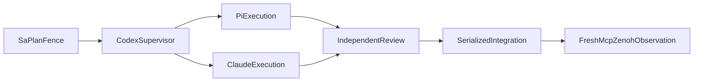

# 20261031-1339 — UOS hive 10x engineering speedup and parallelism plan

**Goal:** achieve a measured tenfold improvement in accepted engineering work per elapsed engineering hour, without weakening freshness, task authority, functional correctness or independent review. **Status: TARGET_NOT_MEASURED.** The required 24-hour soak is unchanged and is included separately in total handover wall time.

**Architecture:** Gleam/OTP owns control, ETS hints and bounded workers. Sa-plan owns durable tasks and attempts. MCP carries admitted control intents; signed Zenoh messages carry change notifications and evidence references. Hermes supplies bounded evidence analysis. Codex supervises and serializes integration; Pi and Claude execute disjoint slices.

**Authority:** Sa-plan `uos/hive-10x-speedup/20261031-1351`, task `A01_PLAN_10X`; continuation portfolio `uos/codex-handover-open-items-fractal-plan/20261031-1240`. This document is a plan, not a scheduler, release grant or benchmark result.

**Observed basis:** synchronized host observation began 2026-10-31T13:34:24Z, chrony offset 0.000172235 seconds; 24 logical CPUs and approximately 32 GiB available RAM were observed during planning. Recheck capacity before dispatch. The filename preserves the Pi draft's observed batch prefix. The supervisor corrected its mathematical, navigation, checklist and diagram defects before review.

Tags: #fractal-l0 #fractal-l1 #fractal-l2 #fractal-l3 #fractal-l4 #fractal-l5 #fractal-l6 #fractal-l7 #fractal-l8 #fractal-l9 #km-triad #zk-adr #zero-muda #tailscale-web #checklist-nav

[Cockpit](http://nas-1.tail55d152.ts.net:4100/) · [Planning](http://nas-1.tail55d152.ts.net:4100/planning) · [KM](http://nas-1.tail55d152.ts.net:4100/km) · [Master handover](http://nas-1.tail55d152.ts.net:4100/files/docs/handover/20261031-1100-agy-to-codex-always-fresh-km-mcp-brain-and-fractal-plan-handover.md) · [Risk SOP](http://nas-1.tail55d152.ts.net:4100/files/contracts/rules/20260907-1559-risk-prioritization-sop.md) · [Brain-memory skill](http://nas-1.tail55d152.ts.net:4100/files/.agents/skills/uos-km-triad-brain-memory/SKILL.md)

Reciprocal knowledge anchors: [[wiki:20260905-1801-uos-zk-km-corpus-index]] · [[zk:20260905-1801-moc-uos-unified-master]]. Bind layer, component, feature, surface, interaction, plane, disposition and formal profile to each slice's existing 13D trace record; do not invent a new coordinate schema.

The [sanitized observation packet](http://nas-1.tail55d152.ts.net:4100/files/governance/planning/20261031-1453-hive-speedup-observations.json) binds source paths and SHA-256 hashes, the parent revision, observed schema/DAG/budget facts and actual model usage. These are dated observations and must be refreshed before effects. Private raw review and process receipts remain in the operator's local evidence store; no private database or secret bytes are published. The canonical workspace's filesystem was observed as ext4 during this session; that observation is not a watcher-completeness proof.

## 1. Right problem and measurement contract

Every dispatch starts with: **Are we working on the right problem for verified completion of the operator's plan?** Reuse current precedents, remove already-completed work and reject optional optimization that delays a necessary safety repair.

Measure `speedup = sequential matched-fixture elapsed time / optimized matched-fixture elapsed time`. Both sides must produce the same accepted result at the same candidate and toolchain, including failed attempts, review, build, integration and recovery. Also report total handover wall time, including the 24-hour soak. A modeled sequential sum is labeled a counterfactual estimate, not an observed baseline.

Record p50/p95 latency, accepted slices per hour, first-pass yield, retries, queue time, critical path, input/output tokens, cost per accepted slice, peak RSS, ETS memory and refusal counts. Compare cold starts, warm metadata and invalidation. Never multiply overlapping hypothetical savings to claim 10x.

Amdahl's bound is `S(p) = 1 / (s + (1-s)/p)`. With three parallel workers, parallelism alone cannot exceed 3x. The proposed 10x requires measured reductions in serial overhead, redundant context, repeated analysis and repair. If the measured serial fraction or dependency chain makes 10x impossible, report the attainable bound and revise the target openly.

Writer-side parallelism initially has `p=2`; the reviewer overlaps as a separate pipeline stage. Include integration and synchronization overhead in measured time. If baseline engineering time is `R` hours and its improvement is `q`, total-wall speedup including the fixed soak is `(24+R)/(24+R/q)`. Even an unbounded engineering improvement cannot exceed `(24+R)/24`; total-wall 10x therefore requires at least 216 baseline non-soak hours, and a finite `q` requires more. At `R=48, q=10`, total-wall speedup is only 2.5x. The headline target exclusively concerns non-soak engineering throughput.

Pre-register an immutable fixture manifest and acceptance oracle before measurements. Use 30 paired repetitions for bounded local microbenchmarks, randomized sequential/optimized order, identical warm/cold conditions, median paired ratios and a 95% interval. For paid end-to-end model trials, reserve at most six matched pairs initially and report the small sample explicitly. A failed side has no accepted-result speedup; retain its censored time, failure and cost rather than dropping it. Token ratios never substitute for accepted-result timing. Measure node durations and compute the actual dependency critical path before estimating the serial fraction.

A03 must pre-register the interval method and fixture classes. A 10x claim requires the lower 95% bound to reach 10 for each claimed fixture class, with identical accepted functionality and all safety gates satisfied. Six paid pairs alone are exploratory and cannot certify a general engineering-wide 10x claim. Compute affordable pairs before admission as the lesser of six and the remaining routine request slots divided by the worst-case requests for both sides, including bounded repairs. Record the effective provider price window and UTC day for each request; report cost under its actual observed tariff rather than silently normalizing different windows.

Current receipts are diagnostics, not a paired benchmark: a reduced-context Claude review used 20,474 cache-created input tokens versus 295,983 in an earlier budget-exhausted launch; the workloads did not both finish successfully. Four initial Pi calls reported approximately USD 0.01545 usage cost against USD 1.00 reserved liability. Reservation is not actual spend or a refund entitlement. Failed Flash drafts remain in the denominator.

## 2. Execution waves and ownership

Initial WIP limit: **two disjoint writers and one independent reviewer**, subject to actual tool slots, CPU/RSS and budget. Reviewer and implementer must differ for the candidate being accepted. Every worker has an exact Sa-plan task, worker, attempt, lease, source binding, path set and timeout. Use isolated JJ workspaces and separate build directories; only the supervisor mutates integration bookmarks.

| Wave | Exact live task IDs | Eligibility and deliverable |
|---|---|---|
| A | `OI01_EV94_109_SOVEREIGN_AUDIT` | Read-only forensic dossier, bounded parser/CLI, formal model and independent falsifiers; retain NOT_ADMITTED. |
| B | `OI02_ATOMIC_11_TARGET_CAPSULE_CUTOVER` | After A: derive the actual 14-target manifest, implement durable intent/preimages, idempotent recovery and crash injection. Separate file restoration latency from end-to-end service recovery; neither is presumed under one second. |
| C | `OI03_101_ROUTE_LIVE_DAEMON_FIDELITY`, `OI04_OFFLINE_NIX_LEAN4_RESERVOIR`, `OI05_HISTORICAL_374_LINK_ALIAS_MAP`, `OI06_ISOLATED_7_FILE_TELEGRAM_MIRAGE`, `OI07_EFFECT_TIME_KM_RISK_FENCING` | After B: pull ready, non-overlapping scopes within WIP limits. Native daemon fidelity, realized toolchain closure, alias/limit wiring, isolated seven-file triage and effect-time fencing remain distinct acceptance gates. |
| D | `OI09_NATIVE_HERMES_WIKI_AND_KM_SERVICE_UNIFICATION` | After verified OI05 and OI07, with OI02 machinery available: supervise Hermes wiki, reconcile service consumers and prove fresh indexing. |
| E | `OI08_CHAOS_SOAK_AND_TWO_KEY_DOSSIER` | After verified OI03, OI04 and OI09 plus canonical prerequisites: 24-hour soak and candidate-bound release dossier. |

The observed live OI08 DAG lacks its OI09 edge. Repair that dependency through a supported canonical Sa-plan API before admitting the soak. Do not edit SQLite directly or treat the prose diagram as an execution fence. Historical task IDs containing `11` and `374` remain stable identifiers; current counts must come from fresh manifests.

Additional acceleration work belongs in the same canonical speedup portfolio: `A02_SCALE_CONTROL` is the pure controller and isolated interface implementation; `A03_BENCHMARK` owns the fixture/measurement harness; `A04_ETS_FRESHNESS` owns metadata hints and completeness falsifiers; `A05_ZENOH_SYNC` owns signed synchronization and recovery; `A06_PI_BUDGET_ADAPTER` owns per-request budget admission; `A07_SCALE_ACTIVATION` is the separately gated runtime activation. A03/A05/A06 depend on accepted A01; A04 depends on A03. A07 depends on A02/A03/A04/A05/A06 and additionally requires verified OI07 and explicit release authority checked against the other portfolio. A02 development cannot dispatch unrestricted paid workers while its backend adapter is absent. Cross-portfolio conditions are explicit release blockers until a supported cross-plan fence is verified.

A02 also depends on A01, as registered in Sa-plan. The sanitized observation packet carries read-only task/dependency readback for A01–A07; registration alone is not execution or approval.

`A08_PARALLELISM_MONITOR` additionally depends on A01 and is a disjoint read-only observation implementation. Pair it with controller or budget-adapter work after claim/risk readiness; do not make monitoring depend on runtime scale activation. Writer and reviewer queues are separate. A writer publishes a frozen source manifest and becomes idle before its independent reviewer starts; ready work from another path set may use the released writer slot. Integration remains one serialized lane.

```ascii
[SaPlanFence] --> [CodexSupervisor]
[CodexSupervisor] --> [PiExecution]
[CodexSupervisor] --> [ClaudeExecution]
[PiExecution] --> [IndependentReview]
[ClaudeExecution] --> [IndependentReview]
[IndependentReview] --> [SerializedIntegration]
[SerializedIntegration] --> [FreshMcpZenohObservation]
```



## 3. ETS and knowledge acceleration

**ETS:** protected, OTP-owned metadata tables can hold bounded candidate-path hints, token postings, worker-capacity observations and in-flight request identifiers. Use owner/heir recovery, bounded entries/bytes and explicit generation changes. ETS does not become the task store or evidence authority. Tune concurrency only against the pinned runtime's measurements; atomic operations on one object do not imply an atomic whole-table snapshot. [Erlang ETS reference](https://www.erlang.org/doc/apps/stdlib/ets.html).

**Freshness:** key index hints by canonical path and observed generation plus inode, size and ctime at the available precision; verify the actual platform's nanosecond support. A hint never authorizes a read or establishes freshness. Always re-read selected document bytes through the existing descriptor-anchored allowlist and bind their digest. Keep content bytes out of persistent ETS/cache checkpoints. A missing event, sequence gap, overflow, restart, nested-directory change, deletion or atomic rename invalidates affected hints; uncertain completeness falls back to a fresh bounded scan or a truthful refusal. Test new-token discovery as well as changed content in previously selected files.

The first implementation uses hints only to prioritize work, never to exclude a document from an exact query. Its completeness oracle is the existing fresh canonical corpus enumeration plus fresh reads required by the reference search; watcher delivery, matching metadata and TTL alone cannot certify completeness. A later exclusion index is eligible only after a separately verified completeness protocol on the actual filesystem, including remote-writer and metadata-precision behavior. If that proof is unavailable, continue the full bounded reference scan or return an explicit incomplete/refused result. A TTL never permits stale bytes. Every owner/heir transfer or restart advances generation and invalidates hints before service resumes. Benchmark the cost of this correctness barrier rather than omitting it.

**ZK, KB and wiki:** reuse concise decision capsules containing exact source paths, interfaces, acceptance tests, counterexamples and provenance. Search first; request ranked bounded transclusion and read only the top one or two needed documents. Keep snippets within 2,400 graphemes. The connected `knowledge_search` schema currently lacks `limit`; record that gap until OI05 closes it. Do not repeatedly inject the whole corpus into model context. Revalidate capsule references against current source/evidence digests; recall is not admission.

Primary implementation points are [workspace knowledge](http://nas-1.tail55d152.ts.net:4100/files/apps/cepaf_gleam/src/cepaf_gleam/mcp/workspace_knowledge.gleam), [live corpus](http://nas-1.tail55d152.ts.net:4100/files/apps/cepaf_gleam/src/cepaf_gleam/ui/lustre/live_corpus.gleam), [runtime gateway](http://nas-1.tail55d152.ts.net:4100/files/apps/cepaf_gleam/src/cepaf_gleam/mcp/runtime_gateway.gleam) and the existing `engines/hermes/modules/hermes_wiki` engine. No protected harness module is changed by this plan.

## 4. MCP control and Zenoh data synchronization

MCP control intents retain current task/attempt, coordinator epoch, candidate, risk receipt, resource bounds and effect-time policy. Sa-plan remains the sole durable task authority. Use [planning_write.gleam](http://nas-1.tail55d152.ts.net:4100/files/apps/cepaf_gleam/src/cepaf_gleam/mcp/adapters/planning_write.gleam); do not revive legacy planning databases or introduce a second scheduler.

Signed Zenoh notifications carry an effect/event ID, sender, scope, sequence, candidate, digest and evidence locator through the admitted transport. Duplicate suppression is bounded and recoverable from durable records. A notification triggers canonical readback; an ACK does not grant authority. Recover gaps, reordering, disconnects and restart by reconciling exact durable board bytes and digests. Never delete a shared key namespace to refresh it.

Use [the authenticated MCP Zenoh transport](http://nas-1.tail55d152.ts.net:4100/files/apps/cepaf_gleam/src/cepaf_gleam/mcp/transports/zenoh.gleam). Source inspection found `zenoh_publish_response` in [router.gleam](http://nas-1.tail55d152.ts.net:4100/files/apps/cepaf_gleam/src/cepaf_gleam/ui/wisp/router.gleam) returning `published` after a substring check without publishing. Track it in OI03; that acknowledgment is not synchronization proof. Likewise, a stdio child's intentionally stopped subscriber is not proof that the production subscriber is down. Verify the actual owner and signed round trip.

## 5. Bounded implementation and acceptance steps

| Phase | Interface / artifact | Required check |
|---|---|---|
| Baseline | Candidate-bound per-slice start/end, acceptance and cost receipts | Same fixture/candidate/toolchain; retain every failed attempt. |
| Work packets | Task, attempt, paths, source digest, inputs, output contract, timeout | Stale ownership, changed source and overlapping paths refuse. |
| Model routing | Exact model/provider, token bound and canonical reservation | Flash0731 for simple text only when yield supports it; Pro0813 for complex code; escalate on concrete failures. The preferred 1017 snapshot needs reviewed budget allowlist support before use. |
| Parallel execution | Isolated workers and builds with bounded queues | Saturation, worker death, cancellation and recovery; no worker JJ mutations. |
| Metadata hints | Bounded ETS generation and fresh-read oracle | Cold/warm, edit, rename, delete, new token, missed event, overflow and restart parity. |
| Sync | Signed notification plus canonical readback | Forged signature, duplicate ID, stale epoch, gap, reconnect and forged published ACK. |
| Acceptance | Independent review and source-bound build/test/formal receipts | No self-approval; no old receipt reused after candidate change. |

Native Pi currently exposes no documented hard per-run cost/turn cap. Until a verified request-budget adapter is available, use one-shot bounded requests with retries, compaction and cache warming disabled, exact canonical reservations and retained request/result metadata. Do not describe unrestricted agent loops as budget-enforced. The OpenRouter daily liability ceiling remains USD 10; current provider prices must be observed, and missing/uncertain charges remain liabilities. [Budget implementation](http://nas-1.tail55d152.ts.net:4100/files/tools/ecology_budget.ml).

The current reservation is fixed at USD 0.25 **per request**, so USD 10 admits at most 40 requests per UTC day before other reservations. USD 1.00 above describes four requests in aggregate. Reserve four request slots for recovery, leaving at most 36 routine requests when the ledger is otherwise empty; subtract actual prior liabilities at admission. Existing reservations have no refund mechanism: cancellation or a low token bill does not release liability. Right-sizing requires a separately reviewed budget policy and durable-store change, never an ad hoc refund or second ledger. Escalation after a known failed result is a new bounded request with a new reservation; unknown outcomes require reconciliation first.

The four recovery slots are a proposed A06 admission policy, not an already mechanized ledger partition. Routine escalation consumes routine slots. Recovery slots may fund only a separately authorized, bounded diagnostic/advisory request after a known incident; emergency drain/cancel itself must work locally without starting paid work. Every such request still consumes a normal canonical reservation under the same daily ceiling. No emergency label bypasses budget, task or effect authority.

## 6. Risk, POODAVR and 17 aspects

The A01 document assessment is P2, score 432, with raw FMEA S=4/O=2/Det=2, RPN=16, band=4. Future runtime work requires separate fresh assessments. Examples: stale index gives S4/O3/Det3, RPN36/F4; false task authority gives S5/O2/Det3, RPN30/F5. These are ordinal judgments, not probabilities or certifications.

All four UCAs are explicit: required invalidation/review not provided; unsafe cached authority or false acknowledgment provided; dependent work run in the wrong order; work continued too long after expiry or stopped before durable recovery. Controls are fresh reads, supported task fencing, dependency admission, bounded cancellation and tested recovery. HOLD/UNKNOWN/STALE requires evidence repair.

Apply PREDICT → OBSERVE → ORIENT → DECIDE → ACT → VERIFY → REFLECT per slice, with fractal RCA from L1 bytes and L2 modules through L3 transactions, L4 services, L0 authority and L9 workflow effects. Precommit forecast p=0.8 that the plan and bounded acceptance protocol are reviewable by 2026-10-31T14:30:00Z; falsifier is an unresolved authority, measurement or freshness contradiction. Resolve its Brier score from actual evidence, without treating it as a performance result.

| Aspect | Layers | Evidence obligation |
|---|---|---|
| Architecture | L0–L4 | Gleam control and bounded native boundaries. |
| Functionality | L2–L8 | Matched accepted outputs and real readback. |
| Trust / safety | L0/L3 | Forged authority and stale epoch refusal. |
| Reliability | L1/L7 | Owner/worker death and durable recovery. |
| Performance | L2/L5 | Cold/warm p50/p95 and total accepted time. |
| Scalability | L1/L4 | Bounded queue and saturation measurements. |
| Data integrity | L3/L8 | Exact source and board digest reconciliation. |
| Concurrency | L2/L7 | Disjoint scopes; one integration owner. |
| Observability | L5/L6 | Host clock, trace identity and failure receipts. |
| Deployment | L1/L7 | Separately reviewed immutable release. |
| Recovery | L1/L4 | Tested restoration and uncertain-effect handling. |
| Compatibility | L2/L6 | Native client and transport acceptance. |
| UI / access | L7/L8 | Real navigation, raw/rendered and checklist. |
| Formal evidence | L0/L6 | Invocation-specific non-vacuous checks. |
| Governance | L0/L9 | Canonical task, review and EV-93 boundary. |
| Supply chain | L4 | Already-realized pinned dependencies only. |
| Documentation | L8/L9 | Reciprocal indexes and 13-section journal. |

## 7. Agent scale-control MCP and Zenoh interface

**Capability status: DESIGN_ONLY; no live scale-control tool is advertised by this document.** Existing MCP `swarm_status`, `agent_hierarchy` and `harness_system_feature_intent` are observations, not worker actuators. Preserve the protected catalog and implement a reviewed extension or admitted private binding before exposing a new name.

Proposed MCP operation `hive_scale_control` and signed Zenoh ingress share one Gleam controller and one state machine. The request schema includes `operation` with `set_target`, `drain`, `cancel_owned` or `status`; `desired_workers`; `expected_generation`; stable `effect_id`; `plan_id`; `task_id`; `worker_id`; `attempt`; `coordinator_epoch`; `candidate_sha256`; `risk_receipt_sha256`; `budget_receipt_sha256`; and a bounded deadline. Zero is a valid drain target; negative, fractional and over-limit targets refuse.

Transport authentication determines the caller. Request fields are assertions that must match independently observed Sa-plan ownership, current epoch, verified source and reviewed grants. Caller-supplied identities, signatures, cached receipts or model recommendations never create authority. `status` is read-only; `cancel_owned` cannot cancel another worker's task. Separate proposals, admitted intent, executing effects and observed completion in responses.

Return `effect_id`, `generation`, `requested_workers`, `admitted_workers`, `running_workers`, `draining_workers`, `state`, typed `refusal` when present, `observed_at`, `candidate_sha256` and evidence locators. States are `proposed`, `refused`, `executing`, `observed` or `uncertain`; `observed` requires backend readback. Repeated identical effect IDs return the reconciled outcome; conflicting reuse refuses. An uncertain spawn or cancellation is reconciled before retry.

Terminal outcomes additionally distinguish `failed`, `expired`, `cancelled` and `drained`. Mutation requests require the full fencing tuple; `status` requires an authenticated observer grant and pool scope but no mutation-budget reservation. `drain` means target zero with a finite completion deadline; `cancel_owned` additionally names the exact owned job/effect. Targets are integral and the initial hard limit is three active remote workers globally, including the reserved reviewer slot. Raising that limit is a reviewed configuration change, not a request-body override.

The authenticated grant matrix is: observer → status; current plan supervisor → set_target/drain for its pool; current task worker → cancel_owned for its own effect; operator safety controller → bounded emergency drain/revocation only under a separate explicit grant. No caller string selects these roles. Emergency control uses reserved capacity and cannot start new paid work.

Desired targets and effect IDs are recorded as canonical Sa-plan workflow/job intent and outcome records, with the actual adapter selected and tested in A02/A06; the controller reconstructs them from that history. Until this store binding is implemented, actuation refuses. It is not a second scheduler. ETS is only a disposable mirror of durable IDs and capacity observations; capacity is re-observed at spawn, with a maximum five-second sample age and invalid samples refusing new admissions. Preserve effect-ID tombstones and durable sequence across restart; ETS eviction never makes an old ID executable. Signatures bind request/reply direction, exact topic/reply key, sender, client, workspace, session and payload. At an expired deadline, uncertainty remains a held reservation and blocks conflicting effects; it is not silently retried or reported cancelled.

Initially cap active writers at two plus one independent reviewer. Scaling considers current memory/CPU, queue bounds, required reviewer capacity, remaining canonical budget, provider eligibility and valid leases. Each remote request needs a verified budget reservation before dispatch. Lack of a bounded Pi request adapter blocks unrestricted agentic scale-up; a metadata preview is not a substitute for operational workers. Preserve a reserved capacity lane for cancellation, safety checks and recovery.

For Zenoh, use the existing authenticated MCP envelope and strict request/reply topic grammar; carry the same control payload inside the signed envelope, with a bounded event ID and sequence. Verify transport principal and workspace before dispatch into the controller. Publish progress/readback references only after durable recording, and reconcile signed board bytes with their exact digest. Do not introduce an unauthenticated `/scale` HTTP shortcut or use the false-success publish endpoint.

The proposed read-only `hive_parallelism_status` interface reports `observed_at`, `max_age_ms`, `pool_id`, `candidate_sha256`, `requested_capacity`, `admitted_capacity`, `active_request_ids`, `active_writers`, `active_reviewers`, `active_supervisors`, `queued_tasks`, `dependency_blocked_tasks`, `uncertain_workers`, `layer_assignments`, `unique_active_workers`, `budget_liability` and `source_receipts`. These are proposed fields until A08 is implemented and admitted. Use authenticated MCP reads plus signed Zenoh change notifications; re-read canonical state after a notification.

Degree of execution parallelism is the count of unique, currently observed worker IDs with active requests. Report supervision separately. Leased tasks, live processes, configured capacity and historical worker rows are different populations. One worker tagged L2/L6 counts once in the global degree, with both layer affinities displayed. Missing telemetry is UNKNOWN, never assumed zero. Reject stale samples; show uncertain outcomes and their held capacity explicitly. Sample at dispatch/completion/cancellation/integration and at bounded intervals while work runs, with a monotonic interval clock and UTC display. Lifecycle IDs and process/task readback must agree; unrelated native CLI sessions are excluded. Keep per-layer concurrency, queue wait, first-pass yield and actual overlap alongside the peak count.

Required tests: unauthorized caller, forged worker/attempt, expired lease/risk/budget, stale generation/epoch, negative/fractional/oversized target, concurrent opposing requests, duplicate/conflicting effect ID, memory or provider saturation, dropped/reordered/replayed Zenoh messages, reconnect, owner death, crash during spawn, uncertain cancellation, draining under load and recovery with a known final worker count. Exercise actual bounded Pi/Claude backends in isolated development after the pure-controller tests; record refusals when a backend or grant is absent.

Expose this capability for runtime use only after independent source review, source-bound tests, real signed MCP/Zenoh round trips, current OI07 effect-time fencing and a separately reviewed release decision. The controller derives desired state from canonical Sa-plan records; Sa-plan is the durable authority for both the recorded intent and execution tasks. AGY's separate sovereign role is preserved.

## 8. Six-domain verification obligations

Unchecked entries are execution obligations, not blanket passing claims.

A01 acceptance covers the plan's consistency, current task registration, evidence attribution, paired diagram, reciprocal knowledge links and completion journal. Runtime checkpoints below remain assigned to their implementation tasks; document acceptance cannot close them.

Additional acceleration acceptance gates: matched-fixture statistical protocol; critical-path accounting; false-negative freshness oracle; durable budget/request admission; scale-control negative cases; real signed transport readback. These supplement the canonical eighteen checkpoints and remain UNRUN until A02–A07 provide candidate-bound receipts. Document acceptance alone cannot satisfy a runtime gate.

<details><summary>Domain 1 — Metadata, timestamp and navigation</summary>

- [ ] CHK-01-TIME — Synchronized clock and timestamp prefix.
- [ ] CHK-02-TAIL — Full Tailnet links and live byte delivery.
- [ ] CHK-03-FRACT — Applicable L0–L9 trace bindings.
- [ ] CHK-04-KM — Reciprocal wiki, ZK, inventory and journal.

</details>
<details><summary>Domain 2 — Zero-Muda and storage safety</summary>

- [ ] CHK-05-MUDA — Excluded dependencies remain absent.
- [ ] CHK-06-GRAPH — Pure Gleam/OTP and Hermes graph boundaries.
- [ ] CHK-07-DRIVE — Preserve NVMe serial 25503L801736 interlock.

</details>
<details><summary>Domain 3 — Tests and mathematical gates</summary>

- [ ] CHK-08-C1C8 — Applicable UI test categories.
- [ ] CHK-09-MATH — Four candidate-bound mathematical gates.
- [ ] CHK-10-9MOD — Applicable nine testing modalities and gaps.
- [ ] CHK-11-REGR — Freshness, concurrency and performance regressions.

</details>
<details><summary>Domain 4 — Cross-language control and observability</summary>

- [ ] CHK-12-GLEAM — Observed OTP supervision and control fences.
- [ ] CHK-13-HERMES — Bounded evidence and differential oracles.
- [ ] CHK-14-ZIGVM — Deterministic kernel checks where affected.
- [ ] CHK-15-MAX — Supervised inference isolation where affected.
- [ ] CHK-16-OTEL — Actual trace identity, host clock and source fidelity.

</details>
<details><summary>Domain 5 — Sovereign governance and Jujutsu</summary>

- [ ] CHK-17-SOV — Independent candidate review and separate effect authority.
- [ ] CHK-18-JJ — Standalone JJ, preserved foreign work and verified diff.

</details>
<details><summary>Domain 6 — Provenance extension</summary>

EV-93 is the ceiling. EV-94..109 and ADR-071..086 remain NOT_ADMITTED. No new EV number; application_admitted=false and SYSTEM_ADMITTED=false.

</details>

[Previous: master handover](http://nas-1.tail55d152.ts.net:4100/files/docs/handover/20261031-1100-agy-to-codex-always-fresh-km-mcp-brain-and-fractal-plan-handover.md) · [Self](http://nas-1.tail55d152.ts.net:4100/files/docs/plans/20261031-1339-uos-hive-10x-engineering-speedup-and-parallelism-plan.md) · [Wiki](http://nas-1.tail55d152.ts.net:4100/wiki) · [ZK](http://nas-1.tail55d152.ts.net:4100/zk) · [KM](http://nas-1.tail55d152.ts.net:4100/km) · [Planning](http://nas-1.tail55d152.ts.net:4100/planning) · [Cockpit](http://nas-1.tail55d152.ts.net:4100/) · [Next: open-items specification](http://nas-1.tail55d152.ts.net:4100/files/docs/design/20261031-1240-uos-open-items-fractal-design-implement-test-plan.md)

UOS footer: proposed acceleration mechanisms and model advice are not runtime enforcement, measured 10x performance, deployment authority or system admission.
