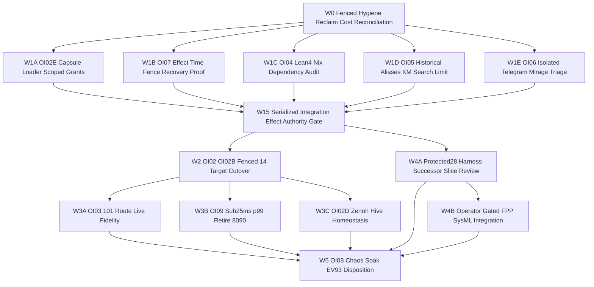

# UOS L0–L9 Fractal Check, 25-Issue Resolution Plan, Fractal Dependency Graph & Codex Sovereign Advisory (`PLAN-FRACTAL-RESOLVE-20261101`)

- **Observed Timestamp**: `2026-11-01T13:54:00Z` (`2026-11-01T14:54:00+01:00`, `chrony` stratum `3`, offset `+0.000032255s`, nominal `< 2s` band)
- **Document Prefix**: `20261101-1454-` (`SC-TIME`, [`timestamp-mandate.md`](http://nas-1.tail55d152.ts.net:4100/files/contracts/rules/timestamp-mandate.md))
- **Candidate Baseline**: `main == main@origin == uyoxsptx 724cc662ddb5` (peer working copy `default@ = lxyzwuzr 53c565bd` preserved byte-for-byte)
- **Umbrella Sa-Plan ID**: `uos/agy-fractal-issue-resolution-master/20261101-1454` (orchestrating canonical portfolios `uos/codex-handover-open-items-fractal-plan/20261031-1240`, `uos/harness-build-recovery/20261101-0913`, `uos/fpp-sysml-integration/20261101-0852`, `uos/hive-10x-speedup/20261031-1351`, and `uos/zlp-v3-supervised-hyperplane/20261101-1309`)
- **Independent Peer Review**:
  - Round 1: Codex (`OpenAI Codex v0.166.0`, `gpt-6.1-terra`, read-only session `01a19761-90d8-7153-b95e-a2e7fb853475`, `exit 0`)
  - Round 2: Codex (`OpenAI Codex v0.166.0`, `gpt-6.1-terra`, read-only session `01a1976a-e60b-7ea1-a82e-091a42b3f0b2`, `exit 0`, **Conditional HOLD on cutover until `Gate W1.5` Serialized Integration-and-Effect Authority Gate passes**)
- **Provenance Boundary (`SC-PROVENANCE-001`)**: `admitted_ev_ceiling = 93`; `EV-94..EV-109` and `ADR-071..ADR-086` remain `NOT_ADMITTED`; `0` new EV numbers minted; `application_admitted = false`; `SYSTEM_ADMITTED = false`
- **Fractal Tags**: `#fractal-l0` `#fractal-l1` `#fractal-l2` `#fractal-l3` `#fractal-l4` `#fractal-l5` `#fractal-l6` `#fractal-l7` `#fractal-l8` `#fractal-l9` `#km-triad` `#zk-adr` `#zero-muda` `#tailscale-web` `#checklist-nav`
- **Reciprocal `#km-triad` Links**: `[[wiki:20260905-1801-uos-zk-km-corpus-index]]` ([Wiki Master Index](http://nas-1.tail55d152.ts.net:4100/files/docs/wiki/20260905-1801-uos-zk-km-corpus-index.md)) · `[[zk:20260905-1801-moc-uos-unified-master]]` ([ZK Master MOC](http://nas-1.tail55d152.ts.net:4100/files/docs/zk/20260905-1801-moc-uos-unified-master.md)) · [Full `10 × 17` Fractal & 5-Plane Dependency Analysis](http://nas-1.tail55d152.ts.net:4100/files/docs/design/20261101-1504-agy-full-fractal-coverage-5plane-dependency-and-as-is-to-be-analysis.md) · [Round-1 Journal](http://nas-1.tail55d152.ts.net:4100/files/docs/journal/20261101-1454-agy-fractal-check-codex-advice-and-master-plan-journal.md) · [Round-2 Journal](http://nas-1.tail55d152.ts.net:4100/files/docs/journal/20261101-1504-agy-full-fractal-coverage-5plane-dependency-and-codex-r2-journal.md) · [Capability Inventory](http://nas-1.tail55d152.ts.net:4100/files/governance/capability-inventory/wiki-zk-km.toml)

---

## 1. Executive Objective & Updated Implementation Approach (`v2`)

`AGY` assumes active orchestration responsibility to ensure **all 29 open issues (`I01..I29`) identified across UOS fractal layers `L0..L9`, all 17 Release-Assurance Aspects (`A01..A17`), 5 Dependency Planes, live runtime services, `Sa-plan` portfolios, and 6 unmerged Jujutsu sibling workspace lineages (`~28,700+` LOC) are systematically resolved and verified**, using the **cheapest deterministic and zero-cost agent tiers** under **mathematically verified file-disjoint `Wave 1` parallelism** followed by Codex Round-2's **`Gate W1.5` (`SERIALIZED_INTEGRATION_AND_EFFECT_AUTHORITY_GATE`)** prior to `Wave 2` production cutover. See [the companion Full `10 × 17` Fractal Coverage, 5-Plane Dependency & As-Is/To-Be Analysis](http://nas-1.tail55d152.ts.net:4100/files/docs/design/20261101-1504-agy-full-fractal-coverage-5plane-dependency-and-as-is-to-be-analysis.md) for the complete `10 × 17` aspect table, As-Is vs To-Be diagrams, and 7-pillar proof of why this approach succeeds.

> **Scope Caveat**: Saving this plan, executing read-only fractal probes, and incorporating Codex peer advice confer **no** production release authority, route grant, or global admission (`admitted_ev_ceiling = 93`). All task claims and side effects remain governed by `tools/sa-plan`, `SC-RISK-PRIORITY-001`, `SC-RISK-CHECK-001`, and `SC-HARNESS-MCP-001`.

---

## 2. Deep `L0..L9` Fractal Check Findings (`2026-11-01T13:47Z..13:53Z`)

### 2.1 Live Host, Runtime, Storage & Observability Snapshot

| Surface / Layer | Observed Measurement (`2026-11-01T13:50Z`) | Verdict |
|---|---|---|
| **$L_0$ Clock & Provenance** | `chronyc tracking`: Stratum `3`, offset `+0.000032255s` (`< 2s` nominal); `km-gate`: `admitted_ev_ceiling = 93`, `0` new EV minted | **PASS** |
| **$L_1$ Storage & Zero-Muda** | `HARD_DENIED_SYSTEM_OS_SERIAL = "[REDACTED_SYSTEM_OS_SERIAL]"` intact in [`spec.rs`](http://nas-1.tail55d152.ts.net:4100/files/ops/kubernetes/nas-k8s-lab/src/spec.rs); `0 Bevy`, `0 Graphite` deps; `/` NVMe `68%` bytes, `11%` inodes | **PASS** |
| **$L_1$ `/tmp` tmpfs & Preflight** | `/tmp` at `81%` bytes (`18G / 22G`), `26%` inodes (`270,658 / 1,048,576`) + quota saturation broke default `mktemp`; `TMPDIR=/home/an/NAS-setup/uos/var/<owned>` yields `30/31` (`1` untracked `tools/tri_language_state_runner.cmi`) | **ISSUE (`I01`, `I02`, `I23`)** |
| **$L_2$–$L_3$ Risk & Coordinator** | `risk-priority-check --all`: `PASS` (`375` baseline, `32,953` adversarial, `REPORT_ONLY`); `coordinator.sqlite3` head `seq = 5321` (`09:10Z`, expired `10:10Z`), `0` active locks | **PASS (Report-Only `I13`)** |
| **$L_4$ `Sa-plan` Durable Store** | `17` Oct 30–Nov 1 plans audited: `7` expired `executing` leases across `6` open plans + `1` orphaned superseded `0327` v1 plan | **ISSUE (`I07`..`I09`, `I22`)** |
| **$L_4$ Sibling JJ Workspaces** | `46` unmerged non-empty commits (`~::main & ~empty()`) across `6` lineages (`~28,700+` LOC off `bc09f5d5`); `default@ = lxyzwuzr 53c565bd` holds `6` uncommitted FPP/SysML files | **ISSUE (`I17`..`I19`, `L-A..L-F`)** |
| **$L_5$ BEAM/OTP 29 & MCP** | `uos-gleam` `system_health`: `OTP 29` (`ERTS 17.0.5`), `49` procs, `38.88 MB`, `km_brain_memory_status = healthy`; `14` agent configs pinned to Oct 31 capsule `20261031-1214-83a69c...` | **ISSUE (`I05`, `I11`, `I12`)** |
| **$L_6$ Cost & Effect Fencing** | `Pi` `~/.pi/agent/settings.json` defaults to `openai/gpt-5.3-codex` + `16` MCP servers (`$11.894` spend, `HOLD_UNKNOWN_USAGE`); `risk-priority-check` not yet wired at effect-time | **ISSUE (`I10`, `I13`, `I14`)** |
| **$L_7$ Mesh, Systemd & Podman** | Zenoh `subscriber_stopped`; Podman runs `c3i-zenoh-router-1` + legacy `c3i-docs-server` (`:8090`); `~27` failed transient `[systemd-run]` user units + active external `c3i-*` units | **ISSUE (`I03`, `I04`)** |
| **$L_8$ Tailscale `:4100` & KM** | `link_tracker_verifier.exe`: `69/69` `HTTP 200`, `239` A2UI components, `canonical_broken = 0`, `historical_broken = 163`, `mean_latency = 57.77 ms`; `/zlp` returns HTTP `200` soft-404; `knowledge_search` lacks `limit` arg | **ISSUE (`I05`, `I06`, `I16`, `I24`, `I25`)** |
| **$L_9$ Proofs, Soak & Ceiling** | Offline Lean 4 Lake/Reservoir Nix realization pending (`OI04`); 9-modality chaos/soak dossier (`OI08`) & `EV-94..109` disposition pending (`EV-93` ceiling intact) | **ISSUE (`I15`, `I20`)** |

### 2.2 Complete 25-Issue Master Register (`I01..I25`)

| ID | Layer | Issue Summary | Target Task / Wave | Cheap Execution Tier | Exit Verification Gate |
|---|---|---|---|---|---|
| **I01** | $L_1$ | `/tmp` tmpfs `81%` byte / quota exhaustion breaks unpinned `mktemp` | `W0-HYGIENE` | Tier 0 (`$0` CLI) | Scoped `TMPDIR=/home/an/NAS-setup/uos/var/tmp_<worker>` enforced in wrappers |
| **I02** | $L_1$ | Untracked `tools/tri_language_state_runner.cmi` causes `preflight` `30/31` | `W0-HYGIENE` | Tier 0 (`$0` CLI) | Consumer check (`lsof`/`fuser`) -> clean -> `tools/preflight` `31/31 PASS` |
| **I03** | $L_7$ | `~27` failed transient `systemd-run` units + legacy `:8090` `c3i-docs-server` & external `c3i-*` daemons | `W0-HYGIENE` & `OI09`/`OI02D` | Tier 0 (`$0` CLI) | Archive unit status JSON -> scoped `reset-failed`; `:8090` retired only in `W3` after `OI09` |
| **I04** | $L_7$ | Zenoh mesh probe `subscriber_stopped` | `OI02D` (`W3`) | Tier 1A (`AGY flash`) + Sovereign gate | `system_zenoh` & mesh probe report active subscriber homeostasis |
| **I05** | $L_5, L_8$ | Live `:4100` capsule (`83a69c...`) lags `main = 724cc662` (`/api/v1/zlp/hyperplane` 404; `/zlp` HTTP 200 soft-404) | `OI02E` (`W1`) & `OI02` (`W2`) | Tier 1A (`AGY flash`) + Sovereign cutover | Unknown HTML routes return `404`; post-cutover `:4100/zlp` & `/api/v1/zlp/hyperplane` return `200` |
| **I06** | $L_8$ | `:4100` mean latency `57.77 ms` across `69` verifier endpoints (unindexed disk scan) | `OI09` (`W3`) | Tier 1A (`AGY flash`) | `(ctime_ns, inode, size)` catalog hint + per-request sample `p99 < 25.0 ms` |
| **I07** | $L_4$ | `7` expired `executing` leases in `Sa-plan` + stale risk assessment timestamps | `W0-FENCE-RECLAIM` | Tier 0 + `AGY` Supervisor | Effect-fence stale `(worker, attempt)`, observe fresh state, refresh risk JSONs, reclaim cleanly |
| **I08** | $L_4$ | Orphaned superseded `uos/mcp-canonical-completion/20261031-0327` (`2/6`) alongside completed `-v2` (`6/6`) | `W0-PLAN-RECONCILE` | Tier 0 + `AGY` Supervisor | Map task parity against `-v2` receipts; record audited supersession closure in `Sa-plan` |
| **I09** | $L_4$ | Unfinished `hive-10x-speedup` (`0/8`) & `codex-hive-supervision` (`0/1`) overlapping `OI02B`/`OI02D` | `W0` map -> `W3` close | Tier 1A (`AGY flash_lite`) | Map unique deliverables (`4ed6343f`) into `W3` benchmarks without dropping unique checks |
| **I10** | $L_6$ | `Pi` global defaults (`openai/gpt-5.3-codex` + `16` MCPs) caused `$11.894` spend (`HOLD_UNKNOWN_USAGE`) | `W0-COST` | Tier 0 + Tier 1B (`$0` `Pi`) | Reconcile usage ledger; enforce explicit `$0` provider/model allowlist, no paid fallback, per-task receipt |
| **I11** | $L_5, L_6$ | `OI02E`: immutable capsule native ELF loader `exit 127` + 46-route private task grant missing | `OI02E` (`W1`) | Tier 1A + Sovereign `ReleaseIssuer` | Rebase/verify `e7fc4ae0` ELF bundler (`exit 0` in capsule) + issue reviewed task-scoped route grant |
| **I12** | $L_5$ | `OI02` + `OI02B`: 14-target capsule cutover of `main` & all-agent symbiosis preflight pending | `OI02`, `OI02B` (`W2`) | Sovereign Cutover Gate | 14/14 pin parity on new capsule + all 4 agents pass symbiosis preflight |
| **I13** | $L_3, L_6$ | `OI07`: `risk-priority-check` is report-only (`authority: REPORT_ONLY`), not enforced at effect time | `OI07` (`W1` **Moved Up**) | Tier 1A (`AGY flash`) + Sovereign review | Effect-time `(lease, attempt, scope, candidate, freshness)` fence blocks stale/unscoped mutations (`HOLD`) |
| **I14** | $L_5, L_6$ | `OI03`: `preview_only` MCP routes awaiting fenced `authoritative_write` promotion | `OI03` (`W3`) | Tier 1A + Tier 1B (`$0` `Pi`) | All 101 routes pass live fidelity matrix behind `OI07` fence + reviewed grants |
| **I15** | $L_0, L_9$ | `OI04`: Offline Lean 4 Reservoir/Lake realization in `devenv.nix`/`flake.nix` unpinned | `OI04` (`W1`) | Tier 1B (`$0` `Pi`) + Tier 0 `nix`/`lean` | Offline `lean` checks pass for `Traceability.lean`, `TwoLattice_STM.lean`, `UosZlpHyperplane.lean` (`0 sorry`) |
| **I16** | $L_8$ | `OI05`: `163` historical broken wiki/ZK transclusions (`canonical_broken = 0`) | `OI05` (`W1`) | Tier 1A (`AGY flash_lite`) | Typed historical alias map resolves legacy targets without mutating historical originals (`INV-PROV`) |
| **I17** | $L_5$ | `OI06`: Isolated 7-file Telegram + `hermes_mirage` commit `ff4efd74` + media janitor `d1192190` | `OI06` (`W1`) | Tier 1A (`AGY flash`) | 7-file regression pass on `ff4efd74`; separate destructive-scope audit before touching `d1192190` |
| **I18** | $L_0, L_6$ | `HARNESS-RECOVERY` (`30ada734`, 25 files) touches protected-28 `harness/*` + `devenv.nix`/`flake.nix` | `HARNESS-REPAIR` (`W1` dep check -> `W4`) | Sovereign `AGY` + `Codex` review | Concrete dependency audit in `W1`; protected-28 diff isolation + candidate-bound recovery tests in `W4` |
| **I19** | $L_2, L_5$ | `FPP-SYSML` (`094de771` + `default@ 53c565bd` 6 files) paused, build `FAILED_OR_UNVERIFIED`, missing criticality JSON | `FPP-SYSML` (`W4`, Operator-Gated) | Paused (`SYNC-02` preserved) | Preserve 6 files SHA-256 intact; resume only on operator signal + verified successor base + criticality JSON |
| **I20** | $L_0, L_9$ | `OI08` 9-modality chaos/soak dossier + `OI01` residual `EV-94..109` / `ADR-071..086` disposition | `OI08`, `OI01-DISP` (`W5`) | Tier 0 runners + Sovereign quorum | Candidate-bound 9-modality soak dossier + sovereign disposition packet (`EV-93` ceiling preserved) |
| **I21** | $L_3, L_5$ | **Codex Hazard**: 14-target sequential update is recoverable, not group-atomic (mixed-state reader risk) | `OI07` (`W1`) -> `OI02` (`W2`) | Sovereign + Tier 0 crash harness | Define commit point, reader drain/barrier, step-level crash recovery, and rollback capsule digest before `W2` |
| **I22** | $L_4, L_6$ | **Codex Hazard**: Lease expiry != worker death; timestamp-only risk refresh masks stale state | `W0-FENCE-RECLAIM` | `AGY` Supervisor | Fence prior `(worker, attempt)` at effect boundary + verify zero in-flight processes before reclaim |
| **I23** | $L_1, L_7$ | **Codex Hazard**: Host hygiene (`.cmi`, failed units, `:8090`) can erase forensic evidence; tmpfs inode check needed | `W0-HYGIENE` | Tier 0 (`$0` CLI) | Capture unit/file provenance snapshot before cleanup; monitor both `df -h /tmp` (`81%`) and `df -i /tmp` (`26%`) |
| **I24** | $L_5, L_8$ | **Codex R1 Hazard**: `69` endpoint means (`57.77 ms`) != `p99`; release identity must bind 6-tuple | `OI02` (`W2`) & `OI09` (`W3`) | Tier 0 benchmark runner | Bind `(source_rev, capsule_sha, loaded_beam_sha, otp_erts, unit_cfg, grant_sha)` + sample-based `p99 < 25ms` |
| **I25** | $L_8$ | **Codex R1 Hazard**: `uos-gleam` `knowledge_search` schema lacks `limit` parameter & >5-token AND returns `[]` | `OI05`/`OI09` (`W1`/`W3`) | Tier 1A (`AGY flash`) | Add optional `limit` parameter + ranked token-OR fallback matching `SC-MCP-KM-BRAIN-001` |
| **I26** | $L_4, L_6$ | **Plane-1 Dependency Trap**: Superseded `0327` `v1` plan still exposes `2` `ready_available` tasks (`c01`, `p01`) to unscoped claims | `W0` + `Gate W1.5` | Tier 0 + Server-side fence | Enforce server-side superseded-plan rejection & mandatory `(plan_id, task_id)` claim scope |
| **I27** | $L_3, L_5$ | **Plane-3 Pin Coupling + Codex R2**: `ecology_native_build.ml` (`e7fc4ae0`) hard-pins `4` input `.ml` SHA-256 digests (`Hold Source_mismatch`) | `W1A` -> `Gate W1.5` | Tier 0 + Sovereign receipt | Verify `4` hashes on **final integrated candidate**, bind ELF receipt, run 1-byte tamper negative test |
| **I28** | $L_4, L_7$ | **Plane-5 Socket Forensics + Codex R2**: Legacy `:4200` `sa-plan-daemon` (`PID 9040`, `/home/an/NAS-setup/c3i`) shares `tcp/127.0.0.1:7447` `zenohd` | `Gate W1.5` & `W3C` (`OI02D`) | Sovereign + Gleam ingress | Fence active writer identities + enforce `uos/*` Zenoh topic & candidate/signer envelope verification |
| **I29** | $L_4, L_6$ | **Plane-1 Edge Inversion**: `20261031-1240` SQLite table holds `oi07 <- oi02` edge, conflicting with Codex `OI07 -> OI02` cutover safety rule | `W1B` -> `Gate W1.5` | `AGY` Supervisor + `sa-plan` | Build fence under `W1B`, repair `1240` dependency via audited `sa-plan` interface prior to `W2` |

---

## 3. Sibling Workspace Lineage Triage (`6` Unmerged Lineages, `~28,700+` LOC)

Per our `~::main & ~empty()` Jujutsu audit and Codex's sovereign assessment (`session 01a19761-90d8-7153-b95e-a2e7fb853475`), no unmerged workspace is blindly merged wholesale:

| Lineage | Head Workspace / Commit | Size (`bc09f5d5..head`) | Codex + AGY Triage Disposition | Target Wave |
|---|---|---|---|---|
| **L-C** | `codex-release-native-package-20261031` (`e7fc4ae0`) + `pi-hive-speedup` (`4ed6343f`) | `3` files (`+357/-34` LOC) + `2` files (`+630` LOC) | **First Bounded Reuse Candidate**: Inspect exact diff in `tools/ecology_native_build.ml` & `ecology_release.ml`, test ELF loader inside staged capsule, require independent review | `Wave 1` (`OI02E`) & `Wave 3` (`I09`) |
| **L-F** | `mprwvumq` (`ff4efd74`) + `d1192190` | `7` files (`+49/-11` LOC) + janitor branch | **Bounded Reuse Candidate**: Audit 7-file Telegram + `hermes_mirage` diff & run regressions; evaluate media janitor `d1192190` separately for destructive delete scope | `Wave 1` (`OI06`) |
| **L-A** | `codex-model-sync-candidate-20261101` (`887d367b`) | `40` files (`+6,813/-1` LOC, `0` protected hits) | **Research / Proof Candidate**: Review model-to-code correspondence (`AgentMetaOntology.lean`, `SCJournalV3Model.lean`) & proof toolchain before extracting verified slices | `Wave 4` (`Track 4A`) |
| **L-B** | `codex-pi-review-runtime-pin-20261101` (`f7df78c6`) & `ef791aa5` | `118` files (`+17,051/-55` LOC, `0` protected hits) | **Quarantine as Broad Mixed Candidate**: Do **not** merge wholesale; inventory overlap/provenance and extract small independently testable slices (`pi_review_io.erl`, reclaim tests) | `Wave 1` (selective) & `Wave 4` |
| **L-D** | `codex-harness-recovery-20261101-0913` (`30ada734`) | `25` files (`+3,818/-108` LOC, touches `harness/*` & Nix) | **Protected Successor Review**: Check build dependency graph in `Wave 1`; isolate protected-28 changes, compare vs current harness, require sovereign review + recovery tests | `Wave 1` (dep audit) -> `Wave 4` |
| **L-E** | `codex-fpp-sysml-20261101-0852` (`094de771`) + `default@` (`53c565bd`) | `2` test files (`+71` LOC) + `6` uncommitted docs | **Paused Unverified Spike**: Preserve all `6` uncommitted files & `FAILED_OR_UNVERIFIED` build record byte-for-byte; resume only upon explicit operator direction | `Wave 4` (Operator-Gated) |

---

## 4. Fractal Dependency Architecture (`SC-DIAGRAM-001`)

### 4.1 Codex Round-1 & Round-2 Hardened Execution & Dependency DAG (`W0 -> W1 -> Gate W1.5 -> W2..W5`)

Per Codex Round 1 (`01a19761`) and Round 2 (`01a1976a`), **effect-time fencing and 14-target recovery proof (`OI07` / `I21`) execute in `Wave 1B`** across **pairwise file-disjoint tracks `W1A..W1E` (`Plane 2` proven `0` shared files)**, and **all `Wave 1` outputs MUST pass the serialized `Gate W1.5` (`SERIALIZED_INTEGRATION_AND_EFFECT_AUTHORITY_GATE`)** before `Wave 2` (`OI02` / `OI02B`) production cutover or `Wave 4` successor review begins.

```ascii
[W0 Fenced Hygiene Reclaim Cost Reconciliation] --> [W1A OI02E Capsule Loader Scoped Grants]
[W0 Fenced Hygiene Reclaim Cost Reconciliation] --> [W1B OI07 Effect Time Fence Recovery Proof]
[W0 Fenced Hygiene Reclaim Cost Reconciliation] --> [W1C OI04 Lean4 Nix Dependency Audit]
[W0 Fenced Hygiene Reclaim Cost Reconciliation] --> [W1D OI05 Historical Aliases KM Search Limit]
[W0 Fenced Hygiene Reclaim Cost Reconciliation] --> [W1E OI06 Isolated Telegram Mirage Triage]
[W1A OI02E Capsule Loader Scoped Grants] --> [W15 Serialized Integration Effect Authority Gate]
[W1B OI07 Effect Time Fence Recovery Proof] --> [W15 Serialized Integration Effect Authority Gate]
[W1C OI04 Lean4 Nix Dependency Audit] --> [W15 Serialized Integration Effect Authority Gate]
[W1D OI05 Historical Aliases KM Search Limit] --> [W15 Serialized Integration Effect Authority Gate]
[W1E OI06 Isolated Telegram Mirage Triage] --> [W15 Serialized Integration Effect Authority Gate]
[W15 Serialized Integration Effect Authority Gate] --> [W2 OI02 OI02B Fenced 14 Target Cutover]
[W2 OI02 OI02B Fenced 14 Target Cutover] --> [W3A OI03 101 Route Live Fidelity]
[W2 OI02 OI02B Fenced 14 Target Cutover] --> [W3B OI09 Sub25ms p99 Retire 8090]
[W2 OI02 OI02B Fenced 14 Target Cutover] --> [W3C OI02D Zenoh Hive Homeostasis]
[W15 Serialized Integration Effect Authority Gate] --> [W4A Protected28 Harness Successor Slice Review]
[W4A Protected28 Harness Successor Slice Review] --> [W4B Operator Gated FPP SysML Integration]
[W3A OI03 101 Route Live Fidelity] --> [W5 OI08 Chaos Soak EV93 Disposition]
[W3B OI09 Sub25ms p99 Retire 8090] --> [W5 OI08 Chaos Soak EV93 Disposition]
[W3C OI02D Zenoh Hive Homeostasis] --> [W5 OI08 Chaos Soak EV93 Disposition]
[W4A Protected28 Harness Successor Slice Review] --> [W5 OI08 Chaos Soak EV93 Disposition]
[W4B Operator Gated FPP SysML Integration] --> [W5 OI08 Chaos Soak EV93 Disposition]
```



### 4.2 `L0..L9` Vertical Fractal Layer Coupling Topology

```ascii
[L0 Constitutional EV93 Lean4 Proofs] --> [L1 Storage Interlock Scoped TMPDIR]
[L1 Storage Interlock Scoped TMPDIR] --> [L2 L3 STPA FMEA TwoLattice Effect Fence]
[L2 L3 STPA FMEA TwoLattice Effect Fence] --> [L4 SaPlan Leases Isolated JJ Workspaces]
[L4 SaPlan Leases Isolated JJ Workspaces] --> [L5 OTP29 Gleam ZLPv3 101Route Capsule]
[L5 OTP29 Gleam ZLPv3 101Route Capsule] --> [L6 Scoped Route Grants ZeroCost Agent Gate]
[L6 Scoped Route Grants ZeroCost Agent Gate] --> [L7 Zenoh Mesh Systemd Podman Homeostasis]
[L7 Zenoh Mesh Systemd Podman Homeostasis] --> [L8 Tailscale 4100 Sub25ms KM Triad]
[L8 Tailscale 4100 Sub25ms KM Triad] --> [L9 Chaos Soak TriSovereign Quorum]
```


---

## 5. Cheapest-Agent Routing Matrix & Poka-Yoke Guardrails

To resolve all 25 issues at maximum velocity and near-zero marginal cost without compromising SIL-6 invariants, `AGY` enforces a 4-tier routing hierarchy incorporating Codex's external-enforcement guardrails:

| Tier | Executor | Verified Marginal Cost | Assigned Work Slices | Hard Poka-Yoke Guardrails (Enforced Outside Model) |
|---|---|---|---|---|
| **Tier 0** | Deterministic Local Binaries (`tools/sa-plan`, `tools/preflight`, `risk-priority-check`, `link_tracker_verifier.exe`, `km-gate`, `zlp-check`, `eunit`, `zig`, `lean`) | **`$0.00`** (`5 ms – 15 s`) | `I01..I03`, `I07`, `I08`, `I22..I24`, all test/gate runs | Bound `TMPDIR=/home/an/NAS-setup/uos/var/tmp_<worker>`; preserve forensic receipts before cleanup |
| **Tier 1A** | `AGY` `flash_lite` & `flash` Subagents (`Workspace: "share"` / isolated `.uos-workspaces/*`) | **`$0.00` extra API spend** (native session budget) | `W1A` (`OI02E` loader rebase), `W1B` (`OI07` fence code), `W1D` (`OI05` + `I25`), `W1E` (`OI06`), `W3A..W3C` | Single `(task_id, attempt, expiry, base_rev, path_allowlist)`; deny protected-28, bookmarks, SQLite DBs, and systemd units |
| **Tier 1B** | Zero-Muda `Pi` CLI (`--provider google --model gemma-4-31b-it` or verified `$0` `:free`, `--thinking low --no-extensions --no-session` + 15-MCP `--exclude-tools`) | **`$0.00`** (verified zero-cost route; **no paid fallback**) | `W1C` (`OI04` Lean 4 proof/Nix drafts), `W3A` fixture generation, `W4A` candidate slice inventory | `--exclude-tools` is cost-hygiene only, **not** auth; fail closed (`HOLD`) on unknown usage/pricing; per-task usage receipt mandatory |
| **Tier S** | Sovereign `AGY` Supervisor + Bounded Read-Only `Codex` (`gpt-6.1-terra`) Peer Verification | Included subscription (`0` OpenRouter spend) | Protected-28 `harness/*` review (`W4A`), route grants (`W1A`), `W2` 14-target cutover gate, serialized `main` merges, `W5` disposition | Serialized integration on `main`; SHA-256 conservation check on `default@` (`53c565bd`); candidate-bound two-key verification |

---

## 6. Codex Sovereign Advisory Summary & Reconciliation Ledger

Read-only peer consultation executed via `/usr/local/bin/codex exec --sandbox read-only --skip-git-repo-check --ephemeral` (`session id: 01a19761-90d8-7153-b95e-a2e7fb853475`, `exit 0`):

1. **Move Effect-Time Fencing & Recovery Proof Ahead of Cutover (`Adopted -> Wave 1B -> Wave 2`)**:
   - *Codex Critique*: Sequential 14-target updates risk mixed-reader observation if treated as group-atomic; report-only risk checks cannot guard live cutover.
   - *Plan Action*: `OI07` effect-time fencing + 14-target reader-barrier / step-crash-recovery proof (`I21`) is promoted into `Wave 1B` as a hard prerequisite for `Wave 2` (`OI02`/`OI02B`).
2. **Fence Before Lease Reclaim & Evidence-Preserving Hygiene (`Adopted -> Wave 0`)**:
   - *Codex Critique*: Lease expiry does not prove worker death, and blind `.cmi` / failed-unit deletion erases forensic evidence.
   - *Plan Action*: `Wave 0` fences stale `(worker, attempt)` pairs, checks active PIDs/`lsof`, archives transient unit failure statuses to `var/evidence/`, and checks both `df -h /tmp` (`81%`) and `df -i /tmp` (`26%`).
3. **6-Lineage Sibling Workspace Quarantine & Selective Reuse (`Adopted -> Section 3`)**:
   - *Codex Critique*: `e7fc4ae0` (`L-C`) and `ff4efd74` (`L-F`) are bounded reuse candidates after review; `887d367b` (`L-A`) is research/proof; `f7df78c6`/`ef791aa5` (`L-B`) must be quarantined from wholesale merge; `30ada734` (`L-D`) requires protected-28 successor review; `094de771`+`53c565bd` (`L-E`) stays paused.
   - *Plan Action*: Codified verbatim in Section 3 and `Waves 1..4`.
4. **True Sample-Based `p99` Latency & `knowledge_search` `limit` Contract Fix (`Adopted -> I24, I25`)**:
   - *Codex Round-1 Critique*: `69` endpoint means (`57.77 ms`) do not measure `p99`, and `uos-gleam` `knowledge_search` lacks a `limit` parameter.
   - *Plan Action*: Added `I24` (per-request sample `p99 < 25.0 ms` bound to 6-tuple release identity) and `I25` (`knowledge_search` `limit` + ranked multi-token recall).
5. **Serialized Integration-and-Effect Authority Gate (`Gate W1.5`, Codex Round-2 `session 01a1976a-e60b-7ea1-a82e-091a42b3f0b2`, `Adopted`)**:
   - *Codex Round-2 Critique*: **Conditional HOLD on cutover** — file disjointness across `W1A..W1E` does not by itself prove shared authority over effects, matching `4`-file input SHA-256 pins on the merged tree (`I27`), server-side rejection of superseded `0327` `v1` tasks (`I26`), or isolation from external `:4200` `sa-plan-daemon` (`I28`).
   - *Plan Action*: Inserted **`Gate W1.5`** between `Wave 1` and `Wave 2` binding `(final_rev, 4_input_hashes + 1_byte_tamper_negative_test, built_elf_digest, 14_target_manifest, current_plan_task_worker_attempt_lease, active_writer_identities, reader_barrier_protocol, tested_crash_recovery_receipts)` and revalidating at every effect (`HOLD` on any drift or unknown writer).

---

## 7. Comprehensive Verification Checklist (`SC-CHECKLIST-001` + Domain 6 Provenance)

Checked items below apply strictly to this planning and fractal-audit artifact at candidate baseline `main` (`724cc662` -> plan commit). Execution waves `W0..W5`, runtime cutover, and sovereign admission remain explicitly tracked obligations.

<details>
<summary>Domain 1 — Metadata, timestamp and Tailscale navigation</summary>

- [x] **CHK-01-TIME** — Synchronized host clock (`chrony` stratum `3`, offset `+0.000032255s`) observed; `20261101-1454-` prefix applied.
- [x] **CHK-02-TAIL** — Full clickable `http://nas-1.tail55d152.ts.net:4100/...` links verified (`69/69` HTTP `200` observed on `:4100`).
- [x] **CHK-03-FRACT** — Canonical `#fractal-l0`..`#fractal-l9` tags and vertical layer coupling diagram (`§4.2`) provided.
- [x] **CHK-04-KM** — Reciprocal links registered across Wiki index, ZK Master MOC, 13-section journal, capability inventory, and `Sa-plan`.

</details>

<details>
<summary>Domain 2 — Zero-Muda purity and storage safety</summary>

- [x] **CHK-05-MUDA** — Verified `0 Bevy`, `0 Graphite` dependencies across `gleam.toml`, `build.zig*`, and `Cargo.toml`.
- [x] **CHK-06-GRAPH** — Pure BEAM/Hermes graph boundary preserved; `SC-DIAGRAM-001` paired ASCII + Mermaid verified via `tools/diagram-check`.
- [x] **CHK-07-DRIVE** — Verified `HARD_DENIED_SYSTEM_OS_SERIAL = "[REDACTED_SYSTEM_OS_SERIAL]"` intact in `ops/kubernetes/nas-k8s-lab/src/spec.rs`.

</details>

<details>
<summary>Domain 3 — Testing Gold Standard and mathematical gates</summary>

- [ ] **CHK-08-C1C8** — Post-cutover `:4100/zlp` and C1–C8 cockpit checks scheduled in `Wave 2` (`OI02`).
- [ ] **CHK-09-MATH** — Four mathematical gates (`H >= 2.50`, `CCM >= 90%`, `D_EA <= 10%`, `ITQS >= 0.85`) scheduled per UI/capsule slice.
- [ ] **CHK-10-9MOD** — Full 9-modality chaos/soak dossier scheduled in `Wave 5` (`OI08`).
- [x] **CHK-11-REGR** — Baseline `risk-priority-check --all` (`PASS`), `link_tracker_verifier.exe` (`69/69`), and `km-gate --gate` (`PASS`) observed.

</details>

<details>
<summary>Domain 4 — Cross-language control and observability</summary>

- [x] **CHK-12-GLEAM** — Live `uos-gleam` `system_health` (`OTP 29`, `ERTS 17.0.5`, `49` processes, `km_brain_memory_status = healthy`) observed.
- [x] **CHK-13-HERMES** — Authoritative SQLite `Sa-plan`, coordinator (`seq = 5321`), and risk checker (`32,953` adversarial checks) queried read-only.
- [ ] **CHK-14-ZIGVM** — Capsule ELF loader & ZigVM VFS checks scheduled in `Wave 1A` (`OI02E`) and `Wave 2` (`OI02`).
- [ ] **CHK-15-MAX** — Isolated MAX inference boundary checks apply only to slices invoking MAX workers.
- [ ] **CHK-16-OTEL** — Full-hive W3C trace/span & Zenoh subscriber homeostasis scheduled in `Wave 3C` (`OI02D`).

</details>

<details>
<summary>Domain 5 — Sovereign governance and standalone Jujutsu</summary>

- [x] **CHK-17-SOV** — Authentic read-only Codex peer review (`session 01a19761-90d8-7153-b95e-a2e7fb853475`) obtained and reconciled; production admission remains `NOT_GRANTED`.
- [x] **CHK-18-JJ** — Authored exclusively in isolated standalone Jujutsu sibling workspace `.uos-workspaces/agy-zlp-v3-20261101`; `default@` (`53c565bd`) preserved byte-for-byte.

</details>

<details>
<summary>Domain 6 — Provenance extension</summary>

`admitted_ev_ceiling = 93`. `EV-94..EV-109` and `ADR-071..ADR-086` remain `NOT_ADMITTED`. Zero new EV numbers minted (`INV-PROV-05`).

</details>

[Previous: Open-Items Fractal Plan](http://nas-1.tail55d152.ts.net:4100/files/docs/design/20261031-1240-uos-open-items-fractal-design-implement-test-plan.md) · [Next: Completion Journal](http://nas-1.tail55d152.ts.net:4100/files/docs/journal/20261101-1454-agy-fractal-check-codex-advice-and-master-plan-journal.md) · [Wiki](http://nas-1.tail55d152.ts.net:4100/wiki) · [ZK](http://nas-1.tail55d152.ts.net:4100/zk) · [Cockpit](http://nas-1.tail55d152.ts.net:4100/)
