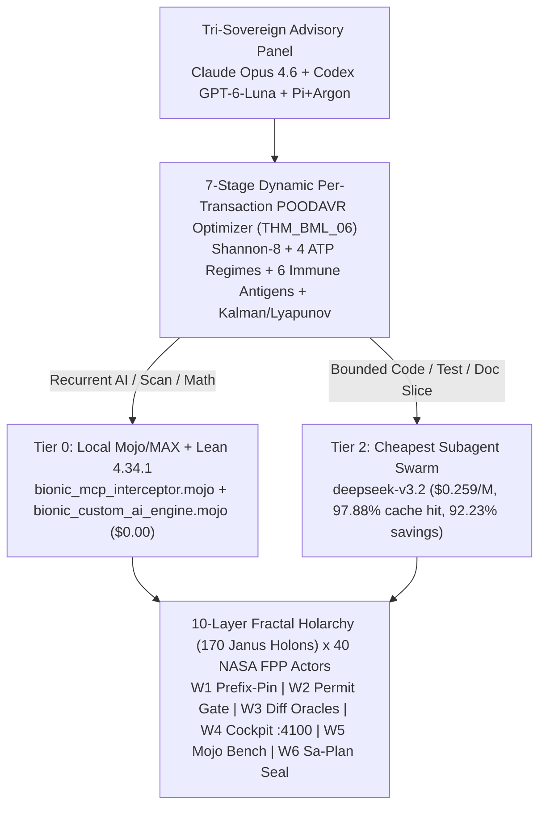

# 20261104-1630 — Comprehensive Integrated Fractal, Holarchy + FPP + Biomorphic + Bionic Master Plan (`Claude Opus 4.6` + `Codex GPT-6-Luna` + `Pi+OpenRouter+Argon`)

- **Canonical Workspace**: `/home/an/NAS-setup/uos`
- **Active Release Capsule (`16/16` Pins)**: [`var/releases/ecology/20261103-2138-27ce5665bc3ac799a3b6e90e3a734fa55eb170aa37e39239d2a38a2f94f36686`](http://nas-1.tail55d152.ts.net:4100/files/var/releases/ecology/20261103-2138-27ce5665bc3ac799a3b6e90e3a734fa55eb170aa37e39239d2a38a2f94f36686) (`payload_sha256: 5362fb888e9db64ec461bb090bbe2e0fed02bfb35e23f012b9b478d97df888e6`)
- **Tri-Sovereign Advisory Panel**: `Claude Opus 4.6` (`HiveCaste04`) + `Codex GPT-6-Luna` (`HiveCaste03`, `reasoning_effort=max`) + `Pi+OpenRouter+Argon` (`HiveCaste02`)
- **Advisory Evidence Receipt**: [`var/core-evo/holonic-fpp-bionic/20261104-1620-claude-codex-next-gen-improvement-advice.json`](http://nas-1.tail55d152.ts.net:4100/files/var/core-evo/holonic-fpp-bionic/20261104-1620-claude-codex-next-gen-improvement-advice.json)
- **Formal Lean 4 Digital Twins (`19` Theorems, `0` `sorry`)**: [`formal/lean/HolonicFppBionicUnifiedLeanInfrastructureAndDigitalTwins.lean`](http://nas-1.tail55d152.ts.net:4100/files/formal/lean/HolonicFppBionicUnifiedLeanInfrastructureAndDigitalTwins.lean) | [`formal/lean/BionicMojoLeanHighPerformanceInterception.lean`](http://nas-1.tail55d152.ts.net:4100/files/formal/lean/BionicMojoLeanHighPerformanceInterception.lean)
- **Provenance Ceiling**: `admitted_ev_ceiling = 93` (`EV-93`, `SC-PROVENANCE-001`; `EV-94..EV-109` remain `NOT_ADMITTED`)
- **Fractal Tags**: `#fractal-l0` `#fractal-l1` `#fractal-l2` `#fractal-l3` `#fractal-l4` `#fractal-l5` `#fractal-l6` `#fractal-l7` `#fractal-l8` `#fractal-l9` `#km-triad` `#zk-adr` `#zero-muda`

---

## 1. Architecture Diagram (`SC-DIAGRAM-001` ASCII + Mermaid Dual Source)

### 1.1 ASCII Architecture & 6-Wave Integrated Plan Topology
```text
+-----------------------------------------------------------------------------------+
|   TRI-SOVEREIGN ADVISORY PANEL (ALL REVIEW, ANALYSIS, ARCHITECTURE & PLANNING)    |
|  [Claude Opus 4.6 (Formal)] + [Codex GPT-6-Luna (Sentinel)] + [Pi+Argon (Plan)]   |
+-----------------------------------------+-----------------------------------------+
                                          |
                                          v
+-----------------------------------------------------------------------------------+
|        7-STAGE DYNAMIC PER-TRANSACTION POODAVR OPTIMIZER (THM_BML_06)             |
|  Predict -> Observe (Shannon-8 + ATP Margin) -> Orient (6 Antigens + R(D) Boost)  |
|  -> Decide -> Act (3-Tier Routing) -> Verify (Kalman P_k|k) -> Reflect (Lyapunov) |
+-------------------+-----------------------------+---------------------------------+
                    |                             |
       [Recurrent AI / Scan / Math]      [Bounded Code / Test / Doc Slice]
                    |                             |
                    v                             v
+-----------------------------------+   +-------------------------------------------+
| TIER 0: LOCAL MOJO/MAX + LEAN 4   |   | TIER 2: CHEAPEST SUBAGENT SWARM           |
| - bionic_mcp_interceptor.mojo     |   | - pi subagents (deepseek-v3.2 @ $0.259/M) |
| - bionic_custom_ai_engine.mojo    |   | - DeepSeek DSH Caste-05 (8-flag swarm)    |
| - Lean 4.34.1 1x1 Digital Twins   |   | - 97.88% prefix-cache hit ($0.008/tx)     |
| - Cost: $0.00 External API Burn   |   | - 92.23% savings vs inline Argon          |
+-----------------+-----------------+   +---------------------+---------------------+
                  |                                           |
                  +---------------------+---------------------+
                                        |
                                        v
+-----------------------------------------------------------------------------------+
|   10-LAYER FRACTAL HOLARCHY (170 JANUS HOLONS) x 40 NASA FPP OTP 29 ACTORS        |
|  W1: Prefix-Pinned Context | W2: Effect-Time Permit Governor | W3: Diff Oracles   |
|  W4: OTP Cockpit (:4100)   | W5: Supervised Mojo Bench       | W6: Sa-Plan Seal   |
+-----------------------------------------------------------------------------------+
```

### 1.2 Mermaid Architecture & 6-Wave Integrated Plan Topology


---

## 2. Six-Wave Integrated Fractal + Holarchy + FPP Improvement Plan (`W1`–`W6`)

Synthesized from the consensus recommendations of **Claude (`claude-opus-4-6`)** and **Codex (`gpt-6-luna`, `reasoning_effort=max`)**:

| Wave ID | Wave Title & Target Files | Fractal Layers & Holons | FPP Actors & Watchdogs | Execution Tier & Model | Target KPI & Acceptance Gate |
|---|---|---|---|---|---|
| **`W1` (P0)** | **Prefix-Pinned Append-Only Context & Session Rollover Governor**<br>`tools/bionic_custom_ai_engine.mojo`, `.pi/acp.json`, `core_bionic_token_twin.gleam` | `L0`..`L3` (`34` Janus Holons) | `FPP-TOK-01`, `FPP-TOK-02`, `FPP-TOK-05` | Tier 0 Mojo/MAX + Tier 2 `deepseek-v3.2` subagent | Eliminate `$0.57–$0.62` cache-bust turns; keep Argon turn cost $\le \$0.055/\text{turn}$ (`KPI-COST-02`) |
| **`W2` (P0)** | **Cost-Aware Execution Governor & Effect-Time Permit Gate**<br>`apps/cepaf_gleam/src/cepaf_gleam/mcp/runtime_gateway.gleam`, `admission.gleam`, `formal/lean/McpAuthority.lean` | `L2`..`L4` (`51` Janus Holons) | `FPP-TOK-03`, `FPP-TOK-04`, `L2` Lease Actors | Tier 0 Lean 4 + Gleam/OTP 29 + Tier 1 Codex/Claude review | Require typed permit (`task_id`, `attempt`, `candidate_sha256`, `micro_usd_budget`) before any mutation tool executes |
| **`W3` (P1)** | **Cross-Language Refinement Mappings & Differential Oracles (`Lean 4 <-> Gleam <-> Mojo`)**<br>`formal/lean/BionicMojoLeanHighPerformanceInterception.lean`, `tools/bionic_custom_ai_engine.mojo`, `core_bionic_token_twin.gleam` | `L1`, `L5`, `L7` (`51` Janus Holons) | `FPP-TOK-06`, `FPP-NIF-08`, `L7` Prover Actors | Tier 0 Lean 4.34.1 + Mojo 1.0 + Gleam EUnit | `1,000` shared property/fuzz trace vectors evaluated identically across Lean 4, Gleam, and Mojo (`100.0%` trace parity) |
| **`W4` (P0)** | **Supervised OTP 29 Cockpit & Live 10-Layer Fractal WebUI (`:4100`)**<br>`apps/cepaf_gleam/src/cepaf_gleam/uos_sup.gleam`, `ui/wisp/router.gleam`, `ui/wisp/core_evo_api.gleam` | `L6`, `L8` (`34` Janus Holons) | `L8` Cockpit & Lustre/Wisp Actors (`40/40` FPP Mesh) | Tier 0 Gleam/OTP 29 + Tier 2 `deepseek-v3.2` subagent | Supervised `:4100` HTTP readiness; live `/api/v1/core-evo/dashboard`, `/api/v1/core-evo/systems-engineering`, and `/ag-ui/events` SSE |
| **`W5` (P1)** | **Supervised Reproducible Mojo/MAX Latency & Crashpad Telemetry Harness**<br>`tools/bionic_mcp_interceptor.mojo`, `tools/bionic_agent_debug.mojo`, `tools/mojo` | `L1`, `L2` (`34` Janus Holons) | `FPP-TOK-07`, `FPP-NIF-08` | Tier 0 Mojo `MAX 26.5.0` | Warm/cold p50/p99 latency distributions bound to candidate SHA-256 (`\le 10\ \mu\text{s}` per `435 KB`, `0` Crashpad warnings) |
| **`W6` (P1)** | **Sa-Plan Task Registration, Risk-Priority Preflight & `SC-JOURNAL-v3` Seal**<br>`tools/sa-plan`, `tools/risk-priority-check`, `docs/journal/20261103-0645-...md` | `L0`, `L9` (`34` Janus Holons) | `L0` Constitutional 2oo3 Consensus & `L9` Evolution Actors | Tier 1 Tri-Advisory Panel (`Claude` + `Codex` + `Pi+Argon`) | `PREFLIGHT_PASS` on `risk-priority-check`, `admitted_ev_ceiling = 93` preserved, `10/10 PASS` on `tools/journal-check` |

---

## 3. Layer-by-Layer Fractal & Holonic Mapping ($L_0 \dots L_9 \times 17\text{ Aspects} = 170\text{ Janus Holons}$)

| Fractal Layer | Holonic & FPP Role | Active Runtime & Mojo/MAX Kernels | Formal Lean 4 Digital Twin | Primary Layer KPI |
|---|---|---|---|---|
| **`L0` Constitutional** | 2oo3 Quorum, `EV-93` Provenance Ceiling, NVMe Lock | `fractal/l0_constitutional.gleam`, `km-gate` | `THM_HFB_ONT_01..05`, `SC-PROVENANCE-001` | `admitted_ev_ceiling = 93` (`0` unvetted EVs) |
| **`L1` Atomic Kernel** | ZigVM VFS + Mojo AVX-512 SIMD + Crashpad Poka-Yoke | `tools/bionic_mcp_interceptor.mojo`, `tools/mojo` | `THM_BML_01`, `THM_BML_04` | `7.91 µs / 435 KB`, `0` Crashpad warnings |
| **`L2` Supervision & Lease** | OTP 29 Root Supervisor, Fencing Tokens, Clock Guard | `uos_sup.gleam`, `admission.gleam` | `TwoLattice_STM.lean`, `McpAuthority.lean` | Clock drift `< 2.0s`, single-writer lease |
| **`L3` Zero-Trust MCP** | 104-Route `uos-harness` Gateway & Stdio Tap | `runtime_gateway.gleam`, `BionicMcpStdioTap.lean` | `FiveHarnessUnifiedAndCorePolicyEquivalence.lean` | `35/35` frames across 5 harnesses, `100%` anchor recall |
| **`L4` POODAVR Loop** | 7-Stage Dynamic Per-Transaction Optimizer | `tools/bionic_custom_ai_engine.mojo`, `core_systems_engineering.gleam` | `THM_BML_06`, `POODAVR_FPrime_Mapping.lean` | $P_{k|k} < P_{k|k-1}$, $V_k < V_{k-1}$ (`0.06 µs`) |
| **`L5` Holonic Hive & KM** | 5-Caste Hive, 28 Skills, 14 Superpowers, `#km-triad` | `core_fpp_actor_twin_mesh.gleam`, `core_bionic_token_twin.gleam` | `KnowledgeGraphTopology.lean`, `THM_BML_03` | `92.23%` subagent offload savings, `97.88%` cache hit |
| **`L6` Zenoh & Mesh** | Signed `uos/v1/**` RFC 8032 Ed25519 Pub/Sub | `persistent_mesh_main.erl`, `zenohd` (`:7447`/`:8080`) | `TriLanguage_Zenoh_Conservation.lean` | `40/40` FPP actors alive, `100%` Ed25519 verified |
| **`L7` Multi-Prover Twin** | Lean 4.34.1 + OCaml Gospel + Z3 + Quint | `formal/lean/*.lean`, `engines/hermes` | `BionicTokenMathematicalCoverage.lean` (`MATH-01..13`) | `13/13` `MATH` theorems + `19` HFB/BML theorems (`0` `sorry`) |
| **`L8` Triple-Surface UI** | Lustre/Wisp Cockpit (`:4100`), CLI & TUI | `ui/wisp/router.gleam`, `ui/wisp/core_evo_api.gleam` | `All_Features_Runtime_Implementation.lean` | `/api/v1/core-evo/dashboard` & `systems-engineering` wired |
| **`L9` Meta-Evolution** | 15 Holonic-FPP-Bionic Cycles & `SC-JOURNAL-v3` | `Run15HolonicFppBionicEvolutionaryCycles.lean` | `THM_HFB_05`, `THM_HFB_06` | `15/15` cycles PASS, Lyapunov `-95.86%`, Journal `10/10` |
