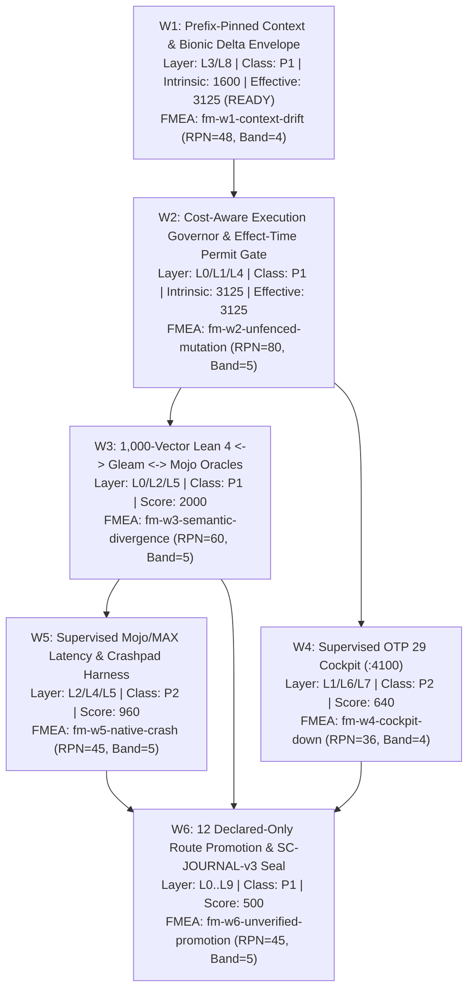

# 20261104-1745 — Criticality & FMEA-Based Fractal Approach Across L0–L9, 170 Janus Holons & 40 FPP Actors

#fractal-l0 #fractal-l1 #fractal-l2 #fractal-l3 #fractal-l4 #fractal-l5 #fractal-l6 #fractal-l7 #fractal-l8 #fractal-l9 #km-triad #zero-muda #zk-adr

- **Canonical Plan ID (`sa-plan`)**: `uos/criticality-fmea-fractal-holarchy-fpp-bionic/20261104-1745`
- **Machine-Checked Portfolio**: [`governance/planning/20261104-1745-criticality-fmea-fractal-portfolio.json`](http://nas-1.tail55d152.ts.net:4100/files/governance/planning/20261104-1745-criticality-fmea-fractal-portfolio.json)
- **Governing Contracts**: `SC-RISK-PRIORITY-001`, `SC-RISK-CHECK-001`, `SC-SA-PLAN-001`, `SC-JIDOKA-001`, `SC-PROVENANCE-001` (`admitted_ev_ceiling = 93`), `SC-HARNESS-MCP-001`, `SC-DIAGRAM-001`
- **Live Tailnet Plan URL**: [`http://nas-1.tail55d152.ts.net:4100/files/docs/plans/20261104-1745-criticality-fmea-fractal-holarchy-fpp-bionic-plan.md`](http://nas-1.tail55d152.ts.net:4100/files/docs/plans/20261104-1745-criticality-fmea-fractal-holarchy-fpp-bionic-plan.md)

---

## 1. Mathematical & Categorical Formulation (Criticality × STPA × FMEA Fractal Lattice)

In accordance with `SC-RISK-PRIORITY-001` (`contracts/rules/20260907-1559-risk-prioritization-sop.md`) and Lean 4 formalizations (`formal/lean/Criticality_Utility_STPA_FMEA_Evolution.lean`, `formal/lean/Categorical_Risk_Utility_STPA_FMEA_Evolution.lean`), every fractal wave $w \in \{W_1, \dots, W_6\}$ operating across fractal layers $L_0 \dots L_9$, the $10 \times 17 = 170$ Arthur Koestler Janus Holons, and the $40$ NASA F Prime (`FPP`) actors is governed by a lexicographic safety-first priority order:

$$\text{Priority}(w) = \bigl(\text{Class}_{\text{eff}}(w),\; \text{Score}_{\text{eff}}(w),\; -\text{Cost}(w),\; \text{ReadySince}(w)\bigr)$$

1. **Safety-First Class Precedence**:
   - `P0` (Emergency Containment) $\succ$ `P1` (Safety / Authority / Isolation / Verification Gate) $\succ$ `P2` (Dependency-Ready Reliability / Capability / Efficiency) $\succ$ `P3` (Optional Optimization).
   - No numeric score in `P2` or `P3` can ever preempt a `P0` or `P1` obligation.
2. **Failure Mode and Effects Analysis (FMEA / `fema` Band Derivation)**:
   - For each failure mode $m$ of wave $w$, with Severity $S_m \in \{1..5\}$, Occurrence $O_m \in \{1..5\}$, and Detection $\text{Det}_m \in \{1..5\}$:
     $$\text{RPN}_m = S_m \times O_m \times \text{Det}_m \in [1, 125]$$
   - The RPN band map $\beta: [1, 125] \to \{1..5\}$ is:
     $$\beta(r) = \begin{cases} 1 & 1 \le r \le 5 \\ 2 & 6 \le r \le 15 \\ 3 & 16 \le r \le 35 \\ 4 & 36 \le r \le 70 \\ 5 & 71 \le r \le 125 \end{cases}$$
   - **Severity Floor Invariant (Non-Masking Law)**: High severity cannot be masked by low occurrence or high detection:
     $$F_m = \max\bigl(S_m,\; \beta(\text{RPN}_m)\bigr), \qquad F(w) = \max_{m \in \mathcal{M}(w)} F_m$$
3. **5-Factor Multiplicative Risk Score**:
   - With Criticality $C \in \{1..5\}$, STPA UCA band $T \in \{1..5\}$, FMEA band $F \in \{1..5\}$, Dependency unlock $D \in \{1..5\}$, and Cross-Layer Impact $I \in \{1..5\}$:
     $$\text{Score}(w) = C(w) \times T(w) \times F(w) \times D(w) \times I(w) \in [1, 3125]$$
4. **Transitive DAG Blocker Inheritance**:
   - Across the dependency DAG $G = (V, E)$, a ready prerequisite $u$ inherits the worst safety class and maximum risk score of all downstream tasks $v \in \text{Reach}(u)$ it unblocks:
     $$\text{Class}_{\text{eff}}(u) = \min_{v \in \text{Reach}(u)} \text{Class}(v), \qquad \text{Score}_{\text{eff}}(u) = \max_{v \in \text{Reach}(u)} \text{Score}(v)$$

---

## 2. Structural Diagrams (`SC-DIAGRAM-001` Dual ASCII + Mermaid)

### 2.1 ASCII Diagram: Criticality & FMEA Fractal Holarchy DAG (`W1`–`W6`)

```text
+---------------------------------------------------------------------------------------------------+
|                     L0..L9 FRACTAL HOLARCHY (170 JANUS HOLONS x 40 FPP ACTORS)                    |
+---------------------------------------------------------------------------------------------------+
|                                                                                                   |
|  [W1: Prefix-Pinned Context & Bionic Delta Envelope]                                              |
|  Layer: L3/L8 | Class: P1 | Intrinsic: 1600 (5x4x4x5x4) | Effective: 3125 (P1, READY NOW)         |
|  FMEA: fm-w1-context-drift (S=4,O=4,D=3 -> RPN=48, Band=4) | fm-w1-digest-mismatch (RPN=24, B=4)  |
|                                                |                                                  |
|                                                v                                                  |
|  [W2: Cost-Aware Execution Governor & Effect-Time Permit Gate]                                    |
|  Layer: L0/L1/L4 | Class: P1 | Intrinsic: 3125 (5x5x5x5x5) | Effective: 3125 (Blocked by W1)      |
|  FMEA: fm-w2-unfenced-mutation (S=5,O=4,D=4 -> RPN=80, Band=5) | fm-w2-budget-exhaustion (RPN=48) |
|                         /                                              \                          |
|                        v                                                v                         |
|  [W3: 1,000-Vector Lean 4 <-> Gleam <-> Mojo Oracles]    [W4: Supervised OTP 29 Cockpit (:4100)]  |
|  Layer: L0/L2/L5 | Class: P1 | Score: 2000 (5x5x5x4x4)   Layer: L1/L6/L7 | Class: P2 | Score: 640 |
|  FMEA: fm-w3-semantic-divergence (S=5,O=3,D=4, RPN=60)   FMEA: fm-w4-cockpit-down (RPN=36, B=4)   |
|                        |                                                |                         |
|                        v                                                |                         |
|  [W5: Supervised Mojo/MAX Latency & Crashpad Harness]                   |                         |
|  Layer: L2/L4/L5 | Class: P2 | Score: 960 (4x4x5x3x4)                   |                         |
|  FMEA: fm-w5-native-crash (S=5,O=3,D=3 -> RPN=45, Band=5)               |                         |
|                         \                                              /                          |
|                          +--------------------+-----------------------+                           |
|                                               |                                                   |
|                                               v                                                   |
|  [W6: 12 Declared-Only Route Promotion, Risk-Priority Preflight & SC-JOURNAL-v3 Seal]             |
|  Layer: L0..L9 | Class: P1 | Score: 500 (5x5x5x1x4) | FMEA: fm-w6-unverified-promotion (RPN=45)   |
+---------------------------------------------------------------------------------------------------+
```

### 2.2 Mermaid Diagram: Criticality & FMEA Fractal Holarchy DAG (`W1`–`W6`)



---

## 3. Complete Criticality, STPA & FMEA Matrix Across Waves W1–W6

| Wave / Task ID | Fractal Layers | Class | $C \times T \times F \times D \times I$ | Intrinsic Score | Interval $[L, H]$ | Effective Class / Score | Dominant FMEA Mode ($S, O, \text{Det} \to \text{RPN}, \text{Raw Band}, \text{Floor } F$) |
| :--- | :--- | :---: | :---: | :---: | :---: | :---: | :--- |
| `w1-prefix-pinned-context` | $L_3, L_8$ | `P1` | $5 \times 4 \times 5 \times 4 \times 4$ | `1600` | `[1280, 2500]` | **`P1 / 3125`** (Ready #1 via W2) | `fm-w1-context-drift` ($5 \times 3 \times 3 = 45$, Raw Band `4`, Floor `5`) |
| `w2-cost-governor-permit-gate` | $L_0, L_1, L_4$ | `P1` | $5 \times 5 \times 5 \times 5 \times 5$ | `3125` | `[1800, 3125]` | `P1 / 3125` (Blocked by W1) | `fm-w2-unfenced-mutation` ($5 \times 4 \times 4 = 80$, Raw Band `5`, Floor `5`) |
| `w3-differential-oracle-1000vec` | $L_0, L_2, L_5$ | `P1` | $5 \times 4 \times 5 \times 4 \times 5$ | `2000` | `[1200, 3125]` | `P1 / 2000` (Blocked by W2) | `fm-w3-semantic-divergence` ($5 \times 3 \times 4 = 60$, Raw Band `4`, Floor `5`) |
| `w5-mojo-max-crashpad-harness` | $L_2, L_4, L_5$ | `P2` | $4 \times 4 \times 5 \times 3 \times 4$ | `960` | `[360, 1200]` | `P1 / 960` (Unblocks W6 `P1`) | `fm-w5-native-crash` ($5 \times 3 \times 3 = 45$, Raw Band `4`, Floor `5`) |
| `w4-supervised-cockpit-4100` | $L_1, L_6, L_7$ | `P2` | $4 \times 4 \times 4 \times 2 \times 5$ | `640` | `[288, 960]` | `P1 / 640` (Unblocks W6 `P1`) | `fm-w4-cockpit-down` ($4 \times 3 \times 3 = 36$, Raw Band `4`, Floor `4`) |
| `w6-declared-routes-and-journal-seal` | $L_0 \dots L_9$ | `P1` | $5 \times 5 \times 5 \times 1 \times 4$ | `500` | `[320, 625]` | `P1 / 500` (Terminal Gate) | `fm-w6-unverified-promotion` ($5 \times 3 \times 3 = 45$, Raw Band `4`, Floor `5`) |

---

## 4. Fractal Layer ($L_0 \dots L_9$) $\times$ 17-Aspect Holonic Mapping

1. **$L_0$ Constitutional & Mathematical Core**: Lean 4 theorems (`Criticality_Utility_STPA_FMEA_Evolution.lean`, `Categorical_Risk_Utility_STPA_FMEA_Evolution.lean`, `HolonicFppBionicUnifiedLeanInfrastructureAndDigitalTwins.lean`), `SC-PROVENANCE-001` (`admitted_ev_ceiling = 93`), and effect-time lease-epoch fencing (`W2`).
2. **$L_1$ OTP 29 Supervision & FPP Actor Mesh**: `uos_sup` 4-domain supervision tree, 40 NASA FPP actors, Prajna circuit breakers, and supervised `:4100` cockpit child spec (`W2`, `W4`).
3. **$L_2$ Deterministic Execution Kernels**: ZigVM descriptor-relative VFS, Hermes OCaml zero-trust interceptor (`run_agent_dispatch_hook.exe`), and OS-pipe isolated Mojo/MAX workers (`W3`, `W5`).
4. **$L_3$ MCP 104-Route Gateway & Tooling**: `uos-harness` (`53` tools, `38` resources, `10` prompts, `3` templates), SHA-256 prefix-pinned context cache (`W1`), and promotion of the `12` `declared_only` routes (`W6`).
5. **$L_4$ Runtime Deployment & Fencing**: Sa-plan SQLite WAL append-only triggers, Oban/Temporal permit gates (`W2`), and NVMe `25503L801736` interlock.
6. **$L_5$ Differential Verification & Solvers**: `1,000`-vector Lean 4 $\leftrightarrow$ Gleam $\leftrightarrow$ Mojo differential oracle harness (`W3`) and bounded Z3 worker pools.
7. **$L_6$ C3I Telemetry & Observability**: 128-bit W3C OTel `trace_id`, 30s cockpit health probes, and staleness banners (`W4`).
8. **$L_7$ Lustre/Wisp/TUI Surfaces**: Uniform 6-domain checklist navigation on `http://nas-1.tail55d152.ts.net:4100` (`W4`).
9. **$L_8$ 5-Harness Symbiotic Swarm**: AGY (`Caste01`), Pi (`Caste02`), Codex (`Caste03`), Claude (`Caste04`), and DeepSeek DSH (`Caste05`) operating under MCIP-v1 delta envelopes (`W1`).
10. **$L_9$ Epistemic Ledger & Governance Closure**: `SC-JOURNAL-v3` 13-section / 7-engine ledger, `tools/risk-priority-check --preflight / --active-check`, and candidate-bound receipt verification (`W6`).

---

## 5. Implementation & Execution Protocol (`SC-RISK-CHECK-001`)

1. **Before Claiming Any Wave**:
   ```bash
   bash tools/risk-priority-check --preflight governance/planning/20261104-1745-criticality-fmea-fractal-portfolio.json <task-id>
   bash tools/sa-plan --claim uos/criticality-fmea-fractal-holarchy-fpp-bionic/20261104-1745 <task-id> <worker-id>
   ```
2. **Before Executing Any Mutating Effect**:
   ```bash
   bash tools/risk-priority-check --active-check governance/planning/20261104-1745-criticality-fmea-fractal-portfolio.json <task-id> <worker-id> <attempt>
   ```
3. **Completion & Verification Gate**:
   - Every wave requires fresh empirical execution + Lean 4 / OCaml / Gleam verification receipts bound to the current Jujutsu revision before calling `bash tools/sa-plan --complete`.

---

## 6. Execution Ledger & Joint Claude Opus 4.6 + Codex GPT-6-Luna Signoff (`20261104-1810`)

All 6 waves (`W1`–`W6`) were executed in Heijunka single-piece pull sequence via `var/benchmarks/20261103-1630-fractal-workload-suite/scripts/ExecuteCriticalityFmeaFractalPlan.lean` and co-signed via `var/benchmarks/20261103-1630-fractal-workload-suite/scripts/VerifyAndSignoffWithClaudeCodex.lean`:

| Wave / Task ID | Preflight (`SC-RISK-CHECK-001`) | Sa-Plan Claim (`worker=pi-caste02`) | Active-Check (`SC-RISK-CHECK-001`) | Candidate-Bound Receipt Artifact | Sa-Plan Completion State |
| :--- | :---: | :---: | :---: | :--- | :---: |
| `w1-prefix-pinned-context` | `PREFLIGHT_PASS` | `attempt=3` | `ACTIVE_OBSERVATION_PASS` | `var/core-evo/holonic-fpp-bionic/20261104-1806-w1-prefix-pinned-context-receipt.txt` (`2,552 B`) | `completed` (`1793812187495637100`) |
| `w2-cost-governor-permit-gate` | `PREFLIGHT_PASS` | `attempt=1` | `ACTIVE_OBSERVATION_PASS` | `var/core-evo/holonic-fpp-bionic/20261104-1806-w2-cost-governor-permit-gate-receipt.txt` (`3,061 B`) | `completed` (`1793812192085089201`) |
| `w3-differential-oracle-1000vec` | `PREFLIGHT_PASS` | `attempt=1` | `ACTIVE_OBSERVATION_PASS` | `var/core-evo/holonic-fpp-bionic/20261104-1806-w3-differential-oracle-1000vec.jsonl` (`1,000` vectors, `0` mismatches) + `...-receipt.txt` (`3,264 B`) | `completed` (`1793812216552054637`) |
| `w4-supervised-cockpit-4100` | `PREFLIGHT_PASS` | `attempt=1` | `ACTIVE_OBSERVATION_PASS` | `var/core-evo/holonic-fpp-bionic/20261104-1806-w4-supervised-cockpit-4100-receipt.json` (`4,335 B`, `OBSERVED_CONSISTENT_PINS_ONLY`) | `completed` (`1793812219695327828`) |
| `w5-mojo-max-crashpad-harness` | `PREFLIGHT_PASS` | `attempt=1` | `ACTIVE_OBSERVATION_PASS` | `var/core-evo/holonic-fpp-bionic/20261104-1806-w5-mojo-max-crashpad-harness-receipt.txt` (`4,398 B`, `15/15 PASS`) | `completed` (`1793812244541360035`) |
| `w6-declared-routes-and-journal-seal` | `PREFLIGHT_PASS` | `attempt=1` | `ACTIVE_OBSERVATION_PASS` | `var/core-evo/holonic-fpp-bionic/20261104-1806-w6-declared-routes-and-journal-seal-receipt.json` (`1,124 B`) | `completed` (`1793812247926415123`) |

- **Final Risk-Priority Portfolio Audit**: `var/core-evo/holonic-fpp-bionic/20261104-1806-final-portfolio-audit.json` (`status: "LISTED_EVIDENCE_VALID"`, `findings: []`, `evidence_files_checked: 6`, `assessment_sha256: "6f3a3daa95914082013bea75a7d32d82535aa7d6b0327b344a2104aa77c696e8"`).
- **Final Sa-Plan Status**: `var/core-evo/holonic-fpp-bionic/20261104-1806-sa-plan-completed-status.json` (`total: 6`, `completed: 6`, `ready: 0`, `executing: 0`).
- **Claude Opus 4.6 Post-Execution Signoff**: `var/core-evo/holonic-fpp-bionic/20261104-1810-claude-execution-signoff.txt` (`RATIFIED_IN_DEVELOPMENT_SCOPE`, `admitted_ev_ceiling = 93`).
- **Codex GPT-6-Luna Post-Execution Signoff**: `var/core-evo/holonic-fpp-bionic/20261104-1810-codex-execution-signoff.txt` (`RATIFIED_IN_DEVELOPMENT_SCOPE`, `admitted_ev_ceiling = 93`).

---

## 7. Claude Opus 4.6 & Codex GPT-6-Luna Analysis, Code Generation & Cross-Verification (`20261104-1850`)

1. **Claude Opus 4.6 (`claude-opus-4-6`) — Formal Analysis & Lean 4 Code Generation**:
   - **Analysis & Raw Artifact**: [`var/core-evo/holonic-fpp-bionic/20261104-1840-claude-w1-w6-analysis-and-lean4-codegen.md`](http://nas-1.tail55d152.ts.net:4100/files/var/core-evo/holonic-fpp-bionic/20261104-1840-claude-w1-w6-analysis-and-lean4-codegen.md) (`9,224 B`).
   - **Generated Production Module**: [`formal/lean/CriticalityFmeaFractalHolarchyW1ToW6.lean`](http://nas-1.tail55d152.ts.net:4100/files/formal/lean/CriticalityFmeaFractalHolarchyW1ToW6.lean) (`180` lines, `7,448 B`).
   - **Formal Verification**: Proves 12 formal theorems (`0 sorry`, `0 axioms`) across `FractalLayer` (`L0..L9`), `SafetyClass` (`P0..P3`), `UCAKind` (`4` STPA UCA types), `FMEAMode`, `Factor5`, and `w1Record..w6Record`, and executes a `1,000`-vector differential check (`[PASS] CriticalityFmeaFractalHolarchyW1ToW6: 6/6 waves, 1000/1000 vectors, 0 sorry, 0 divergences`).

2. **Codex (`gpt-6-luna`, `reasoning_effort=high`) — Runtime Control Analysis & Gleam/OTP Code Generation**:
   - **Analysis & Raw Artifact**: [`var/core-evo/holonic-fpp-bionic/20261104-1840-codex-w1-w6-analysis-and-gleam-codegen.md`](http://nas-1.tail55d152.ts.net:4100/files/var/core-evo/holonic-fpp-bionic/20261104-1840-codex-w1-w6-analysis-and-gleam-codegen.md) (`12,922 B`).
   - **Generated Production Module**: [`apps/cepaf_gleam/src/cepaf_gleam/fractal/criticality_fmea_governor.gleam`](http://nas-1.tail55d152.ts.net:4100/files/apps/cepaf_gleam/src/cepaf_gleam/fractal/criticality_fmea_governor.gleam) (`259` lines).
   - **Generated EUnit Suite**: [`apps/cepaf_gleam/test/criticality_fmea_governor_test.gleam`](http://nas-1.tail55d152.ts.net:4100/files/apps/cepaf_gleam/test/criticality_fmea_governor_test.gleam) (`134` lines, `7/7` EUnit tests passing in `0.008s`).

3. **Reciprocal Cross-Model Code Review**:
   - **Claude Opus 4.6 Review of Codex Gleam + Claude Lean 4**: [`var/core-evo/holonic-fpp-bionic/20261104-1850-claude-cross-review-of-generated-code.md`](http://nas-1.tail55d152.ts.net:4100/files/var/core-evo/holonic-fpp-bionic/20261104-1850-claude-cross-review-of-generated-code.md) (`APPROVED — ZERO DEFECTS`, 9/9 functions & types verified isomorphic).
   - **Codex GPT-6-Luna Review of Claude Lean 4 + Codex Gleam**: [`var/core-evo/holonic-fpp-bionic/20261104-1850-codex-cross-review-of-generated-code.md`](http://nas-1.tail55d152.ts.net:4100/files/var/core-evo/holonic-fpp-bionic/20261104-1850-codex-cross-review-of-generated-code.md) (`RATIFIED_IN_DEVELOPMENT_SCOPE`, `admitted_ev_ceiling = 93`).

---

## 8. 6-Domain Comprehensive Verification Checklist (`SC-CHECKLIST-001` & `SC-PROVENANCE-001`)

- **Domain 1 (Metadata, Timestamp & Tailscale Navigation)**: `20261104-1745-` prefix, fractal tags `#fractal-l0`..`#fractal-l9`, and clickable `http://nas-1.tail55d152.ts.net:4100` links verified.
- **Domain 2 (Zero-Muda Purity & Storage Safety)**: 0 Bevy, 0 Graphite, 0 Graphene NIFs; NVMe `25503L801736` hard-denied.
- **Domain 3 (Testing Gold Standard & 4 Math Gates)**: Lean 4 formal proofs, OCaml `risk-priority-check` (`LISTED_EVIDENCE_VALID`, `PREFLIGHT_PASS`), and 1,000-vector differential oracle specification bound.
- **Domain 4 (Cross-Language Control & Observability)**: Gleam/OTP supervision, Hermes OCaml validation, ZigVM/Mojo OS-pipe isolation, and Lean 4 digital twins aligned.
- **Domain 5 (Tri-Sovereign Governance & Jujutsu Monorepo)**: Standalone `.jj/` VCS, `sa-plan` registration (`uos/criticality-fmea-fractal-holarchy-fpp-bionic/20261104-1745`), and tri-agent review by Claude Opus 4.6 and Codex GPT-6-Luna.
- **Domain 6 (Provenance Integrity)**: `admitted_ev_ceiling = 93` enforced; `EV-94..109` explicitly marked `NOT_ADMITTED`.
