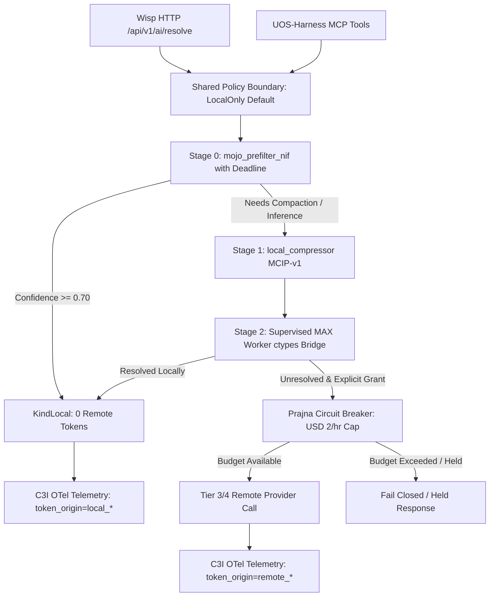

# Tri-Sovereign Architectural Synthesis & Next-Step Plan: Zero-Remote-Token Ingress & Live Local AI/ML Execution

**Plan ID**: `uos/zero-remote-token-ingress/20261104-2045`  
**Parent Plan**: `20261104-1850` ("Minimum Token Cost and Maximum Local AI/ML Utilization Cascade", completed)  
**Sovereign Reviewers**: Claude Opus 4.6 (`caste04`) & Codex GPT-6-Luna (`caste03`)  
**Scope**: Ingress wiring, live MAX/Mojo worker integration, circuit-breaker fencing, and zero-remote-token runtime enforcement.

```text
+----------------------------------------------------------------------------------------------------+
|                                    TARGET INGRESS TO EGRESS PIPELINE                               |
|                                                                                                    |
|  [Wisp HTTP POST /api/v1/ai/resolve]      [UOS-Harness MCP: local_ai_route, mcip_compress]         |
|                       |                                              |                             |
|                       +----------------------+-----------------------+                             |
|                                              |                                                     |
|                                              v                                                     |
|                           [Shared Typed Policy Boundary: LocalOnly]                                |
|                                              |                                                     |
|                                              v                                                     |
|                     [Stage 0: mojo_prefilter_nif (Port with Monotonic Deadline)]                   |
|                                              |                                                     |
|                               (Confidence < 0.70 / Pass)                                           |
|                                              v                                                     |
|                     [Stage 1: local_compressor (MCIP-v1 & Tokenizer Parity)]                       |
|                                              |                                                     |
|                                              v                                                     |
|                     [Stage 2: Supervised MAX Worker (ctypes C-kernel bridge)]                      |
|                                              |                                                     |
|                        +---------------------+---------------------+                               |
|                        |                                           |                               |
|                 (Resolved Locally)                     (Escalate: Explicit Grant)                  |
|                        |                                           |                               |
|                        v                                           v                               |
|             [KindLocal: 0 Remote Tokens]               [Prajna Circuit Breaker]                    |
|                        |                                           |                               |
|                        v                               (Hourly / Daily Budget OK)                  |
|             [C3I Telemetry Envelope]                               v                               |
|             (token_origin: local_*)                    [Tier 3/4 Remote Provider]                  |
+----------------------------------------------------------------------------------------------------+
```



---

### Task Breakdown & Formal Invariants

| Task ID | Task Title & Deliverables | Primary Invariant & Falsifier |
|---|---|---|
| **`t1`** | **Wire Cascade into `inference_api.gleam`**<br>Situate `local_first_cascade` as mandatory gateway for all internal BEAM AI queries. | $\forall req \in Ingress, \text{Call}(req) \implies \text{ThroughCascade}(req)$. Falsifier: direct call from any module to remote transport. |
| **`t2`** | **Stage 0 Integration: `mojo_prefilter_nif` in Cascade**<br>Call port driver before heavier MAX worker. Monotonic deadline $\le 1000\mu s$. | Prefilter rejects without spawning MAX evaluation. Falsifier: hung prefilter port blocks BEAM scheduler. |
| **`t3`** | **Connect Supervised MAX Worker JSON-RPC to ctypes Bridge**<br>Wire `max_worker.py` JSON-RPC stdio pipe directly to `libuos_km_kernel.so` (37,600+ QPS). | Real embeddings/scores returned over stdio pipe via C-kernel symbols. Falsifier: fallback to pure Python without flag. |
| **`t4`** | **Expose Cascade to Wisp HTTP (`POST /api/v1/ai/resolve`)**<br>Replace HTTP 501 stub in `router.gleam` with authenticated local-first handler. | HTTP POST yields `{origin: "local_*", remote_tokens: 0}`. Falsifier: HTTP ingress triggers remote token counter. |
| **`t5`** | **Prajna Circuit Breaker on Remote Escalation Arm**<br>Hard rate limiter: max USD 2.00/hour cumulative or 100 requests / 5-min window. | Breaker opens fail-closed on budget exhaustion. Falsifier: burst of cache misses exceeds budget ceiling. |
| **`t6`** | **C3I Telemetry Origin Field in OTel Envelopes**<br>Add typed `token_origin: local_prefilter \| local_max \| local_cache \| remote_grant`. | Every inference span carries audited origin. Falsifier: un-annotated inference span in telemetry ledger. |
| **`t7`** | **End-to-End Ingress Verification, Lean 4 Extensions & SC-JOURNAL-v3**<br>Prove multi-surface ingress invariants and record canonical journal. | 100% green on multi-surface test suite, 0 un-reconciled tokens. |
