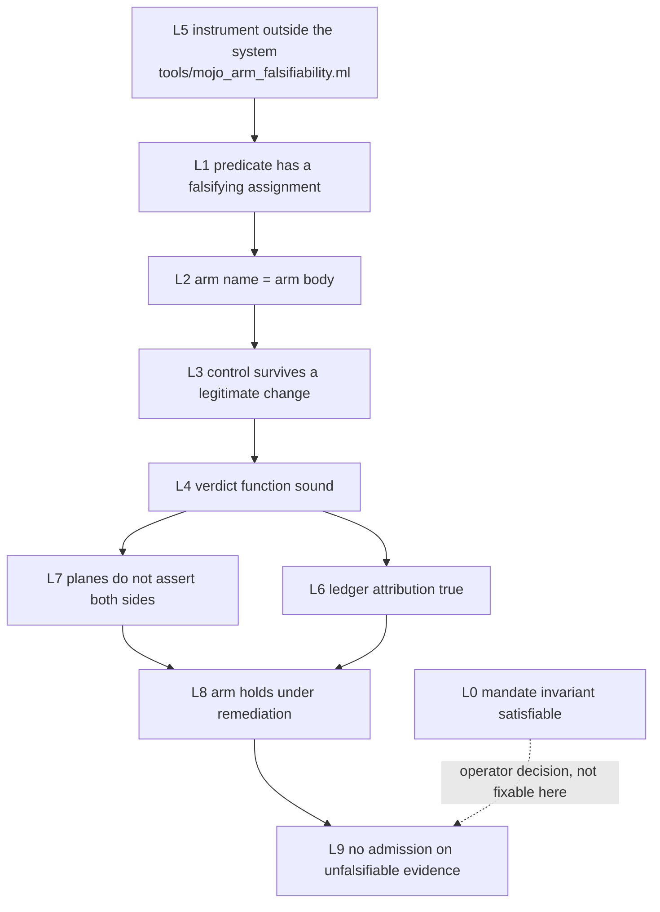

# 20261106-0924 — Fractal remediation plan: the unfalsifiable-assertion defect at L0..L9

Tags: #fractal-l0 #fractal-l1 #fractal-l2 #fractal-l3 #fractal-l4 #fractal-l5 #fractal-l6 #fractal-l7 #fractal-l8 #fractal-l9 #zero-muda #zk-adr #km-triad

[Cockpit](http://nas-1.tail55d152.ts.net:4100/) · [Wiki](http://nas-1.tail55d152.ts.net:4100/wiki) · [ZK](http://nas-1.tail55d152.ts.net:4100/zk) · [Checklist](http://nas-1.tail55d152.ts.net:4100/checklist) · [Source](http://nas-1.tail55d152.ts.net:4100/files/docs/plans/20261106-0924-oracle-rereview-remediation-plan.md)

Observed host clock: `2026-11-06T09:24:45Z`. Sa-plan: `TASK-LMU-P19`.
Authority NONE. EV ceiling 93. This plan grants no admission.

---

## 1. The single invariant, and why a flat plan failed twice

Every one of the 23 re-review findings and all 11 defects the previous repair
introduced are **one defect class**:

> **INV-FALSIFY**: an assertion that cannot fail is not evidence. It must either
> be able to fail, or declare that it could not look.

Two flat passes failed because the class is **scale-invariant** and each pass
fixed it at one scale only. Fixing an arm at L2 while the predicate under it was
unfalsifiable at L1 produced a confident arm over a vacuous core. Fixing the
predicate without fixing the L7 cross-plane contradiction produced two oracles
asserting both sides of one fact. The defect is fractal, so the remediation must
be, and **lower layers gate higher ones** — that ordering is the plan's main
content, not its decoration.

### Fractal RCA — the same failure at ten scales

| Layer | The defect, at this scale | Instance from the re-review |
|---|---|---|
| **L0** Constitutional | A mandate whose own invariant is unsatisfiable, and a checklist that cannot report a failure | `SC-INTENT-ATLAS-001`'s cocycle law unsatisfiable over its own 13 morphisms; blanket 18/18 against `SC-CHECKLIST-001`'s "never a blanket pass" |
| **L1** Atomic | A predicate with no falsifying assignment | `x != 3 - x` ⟺ `2x != 3`; `3-(3-x) == x`; `v + b >= 0`; `subj_lean_ok >= 0` |
| **L2** Component | An arm whose name asserts what its body never examines | `prov:admitted-ev-ceiling-is-93` reading no contract; `cover-verified-and-blind-are-disjoint` testing a partition corollary |
| **L3** Transaction | A control that converts a legitimate change into VACUOUS | `declared == 101 and observed == 97`; `fpp_specs == 40`; razr15's outage → VACUOUS |
| **L4** System | A verdict function that inverts the lattice it serves | `status()` testing zero-algebra vacuity second-to-last |
| **L5** Cognitive | An instrument that certifies only the class it measures | the literal-tautology scanner declaring "0 unfalsifiable arms" while blind to `2x != 3` |
| **L6** Ecosystem | A ledger crediting evidence to a producer that never produced it | 11 of 48 attributions naming an oracle without the check |
| **L7** Federation | Two planes asserting both sides of one fact | `THM_ATLAS_06` proves the encodings disagree; `bionic` requires they agree; both "pass" |
| **L8** Evolutionary | An arm that fails when the system is repaired | `v != (v+b)` requiring `b != 0`; `bare_bash > 0`; `py_gate_sanctioned > 0` |
| **L9** Sovereign | Admission resting on evidence that could not have failed | `THM_PROV_TWIN_17` proving `true = true` 24 times; `fractalCellCovered` over 110,500 cells |

The L5 row is the reason round two made things worse: **the instrument was
inside the system it measured.** That is the self-reference a fractal plan has
to break first.

### The self-similar repair operator

At every layer, the same operator `R` applies — which is what makes this
tractable rather than 34 unrelated edits:

```
R(assertion) =
  if  it can fail                  -> keep, and record the witness
  elif it can be made to fail      -> rebind to a source with independent
                                      provenance (the OTHER plane, never the
                                      same author)
  elif the claim is not expressible -> delete it; a non-mathematical claim
                                      forced into an algebra channel yields a
                                      tautology
  else                              -> declare BLIND, never PASS
```

`R` is idempotent: `R(R(x)) = R(x)`. Round two violated idempotence — applying
`R` produced new unfalsifiable assertions — because it was applied without the
L1 decision procedure. Hence Phase 0.

---

## 2. Cadence and gating

Per `SC-FRACTAL-CADENCE-001`, each layer carries its own rate. Here the rate
becomes a **gate order**: a layer may not be declared done until every layer
below it is.

```
L1 atomic predicate decidable  ──gates──▶ L2 arm names honest
          │                                      │
          └──────────────┬───────────────────────┘
                         ▼
             L3 controls survive legitimate change
                         │
                         ▼
             L4 verdict function sound ──▶ L6 ledger attribution true
                         │                         │
                         ▼                         ▼
             L7 cross-plane consistent ──▶ L8 remediation-compatible
                         │
                         ▼
             L9 no admission claim on unfalsifiable evidence
                         ▲
                         │
             L5 instrument OUTSIDE the system  (built FIRST, gates all)
```

```text
ASCII source generated from the mermaid block below, edge for edge (SC-DIAGRAM-001).

[L5 instrument outside the system tools/mojo_arm_falsifiability.ml] --> [L1 predicate has a falsifying assignment]
[L1 predicate has a falsifying assignment] --> [L2 arm name = arm body]
[L2 arm name = arm body] --> [L3 control survives a legitimate change]
[L3 control survives a legitimate change] --> [L4 verdict function sound]
[L4 verdict function sound] --> [L6 ledger attribution true]
[L4 verdict function sound] --> [L7 planes do not assert both sides]
[L7 planes do not assert both sides] --> [L8 arm holds under remediation]
[L6 ledger attribution true] --> [L8 arm holds under remediation]
[L8 arm holds under remediation] --> [L9 no admission on unfalsifiable evidence]
[L0 mandate invariant satisfiable] --> [L9 no admission on unfalsifiable evidence]
```



---

## 3. Phase 0 — L5: build the instrument, outside the system

The one item that must exist before any fix. Round two's certification was
performed by a scanner that could only see literals, so it blessed the class it
was built for and missed the class the repair created.

**P0.1 `tools/mojo_arm_falsifiability.ml`** — OCaml, per `SC-NIX-DEVENV-001`
and the no-Python-helpers rule, following the `lean_proof_plane_scan.ml`
precedent that exactly one thing knows how to read a given subject.

1. Extract every `r.algebra(...)` and `r.mutation_probe(...)` predicate from
   `formal/mojo/*_oracle.mojo`, spanning lines by paren balance, with comments
   and string literals stripped first.
2. Classify each predicate:
   - **ANALYSABLE** — pure expression over identifiers, integer literals and
     `+ - * // == != < <= > >= and or not ( )`.
   - **NOT_ANALYSED** — contains a call, field access or indexing. Reported as
     an open question, **never as a pass**.
3. For each ANALYSABLE arm, emit a Mojo program enumerating every free
   identifier over a declared domain (`-8..8` plus `-1, 0, 1, 3, 40, 93, 239,
   1015`, and both booleans in boolean position) and count assignments where the
   predicate is **False**.
4. Verdict: `FALSIFIABLE` (≥1 false), `UNFALSIFIABLE` (none over the domain),
   `NOT_ANALYSED`. Exit non-zero on any `UNFALSIFIABLE`.

**Honest boundary, written into the tool's own header**: bounded enumeration
cannot *prove* falsifiability. `FALSIFIABLE` is evidence from the sampled
domain; `UNFALSIFIABLE` over that domain is treated as failure. The tool never
claims a proof — which is the L9 discipline applied to the L5 instrument.

**P0.2 The detector's own negative control.** Plant all six known-unfalsifiable
expressions and require all six to be caught. If the detector cannot catch what
it exists for, it is refused — the rule the oracles are held to, applied to the
thing that holds them.

**P0.3 Wire into `tools/preflight`** so no future round can self-certify with
the weaker scanner.

---

## 4. Phases by layer

Each item runs the full POODAVR cycle (`SC-POODAVR-002`): **Predict** what the
arm will do after the fix → **Observe** by running it → **Orient** against the
subject → **Decide** → **Act** → **Verify** with the L5 detector → **Reflect**
in the governance record. No fix without a prior prediction; no item closed
without the detector re-run.

### Phase 1 — L1: make the predicates decidable

- **1.1** `ontology_atlas:103-107, 128, 130` — three arms with no falsifying
  integer. Root cause: the Mojo mirrors inline `φ(x) = 3 − x`, substituting the
  *conclusion* of `THM_ATLAS_07` into ATLAS-06/08/09 and collapsing two
  declared functions (`regimeAbi`, `regimeOracle`) into one. Fix: derive **both**
  encodings from their own sources and compare the two functions, as Lean does.
  Falsifiable by construction, not by inspection.
- **1.2** `twin_coverage:194-195` — `v + b <= id_lines` is implied by the
  partition arm; the `else` branch `v + b >= 0` is a tautology under its guard,
  keeping an unreadable inventory out of VACUOUS. `both` is computed and unused.
- **1.3** `agent_profile:306-319` — `subj_lean_ok >= 0` cannot fire: `grep | wc -l`
  always prints a number.
- **1.4** `language_conformance:234-235` — `sh_files + bare_bash > sh_files`
  reduces to `bare_bash > 0` (also an L8 item).

### Phase 2 — L2: arm name must equal arm body

- **2.1** `agent_profile:193-194` — obligation 1 keeps the
  grep-line-count-vs-agent-count category error that obligations 2, 4 and 5 were
  converted away from. 8 profiles vs 6 agents: a permanent manufactured failure.
- **2.2** `twin_coverage:189-195` — `cover-verified-and-blind-are-disjoint` does
  not test disjointness.
- **2.3** `axis_registry:460-461, 471-474, 492-493` — `sanctions >= axis_ids - 2`
  hardcodes a 2 the registry contradicts (four unsanctioned axes); `grep -c … ||
  echo 0` emits two lines so `Int` raises and the arm goes BLIND from a shell
  bug; `LADDER_RUNGS` literal used while `ladder_rungs` sits derived and unused.
- **2.4** `provenance_ceiling:171-178` — `sqlite-352-cycle-chain-intact` never
  checks 352. **Another writer's file: record only.**

### Phase 3 — L3: controls must survive a legitimate change

- **3.1** `razr15:361-375` — a node outage now reports VACUOUS, severity 5,
  outranking WORLD_FAIL. Reachability belongs in a `world_or_blind` presence
  predicate, which this file already uses for every world arm.
- **3.2** `ontology_atlas:525-527` — the F12 replacement re-pinned a *relation*
  (`declared > observed`), so closing the route-census gap reports VACUOUS.
- **3.3** Four positive controls dissolved into `observe(String(Bool))`, which is
  never empty and so never BLIND and never failing: the control was removed, not
  relocated. Restore to a channel that can fail.
- **3.4** `language_conformance:270-271` — removing the one sanctioned Python
  invocation makes the receipt VACUOUS.

### Phase 4 — L4: the verdict function and the relations it feeds

- **4.1** `monitoring_governance:223-224` — three of six conjuncts still
  self-satisfying (`probed >= probed`, `0 <= 0`, `REQ_SCC == REQ_SCC`), while the
  comment claims they are "recorded BLIND **rather than** handed the constant".
  They are both. One run asserts the relation holds and reports three of its
  inputs unobservable.
- **4.2** `mcp_gateway:397-400` — parameter 3 (`twelve_aligned`) receives
  `legacy == 0`, so the legacy predicate is evaluated twice and "twelve configs
  aligned" is never measured; parameters 9/10 are the literal `True`, one under a
  comment calling it "non-negotiable".
- **4.3** `proof_plane_guard:518-520` — must use `io_pre + main_pre`, since the
  scanner sets `first_offending_line` from both; as written it reports "the
  reader is wrong" on a legitimate `def main`-before-theorem file.

### Phase 5 — L6: ledger and cross-artifact attribution

- **5.1** `twin_coverage:309` — the phantom detector uses substring containment,
  so any rename that *extends* a name survives it; the ledger already exploits
  this (`live-alignment` matching `live-alignment-over-observed-conjuncts`).
- **5.2** `twin_coverage:261-282` — the anti-vacuity gate measures a *different*
  extraction from the one that can silently yield zero. They agree today only
  because `checks` follows `oracle`; inserting a key between them restores the
  hole.
- **5.3** `twin_coverage:343-348` — positive world assertions routed through
  `mutation_probe`, so a rename or the mesh legitimately reaching 41 subsystems
  reports VACUOUS.

### Phase 6 — L7: the planes must not assert both sides

- **6.1** `bionic_interception:382-387, 397-399` — the manufactured DIVERGENT.
  Three arms require the encodings to agree; `THM_ATLAS_06` proves they disagree
  everywhere and `THM_ATLAS_11` that the sole archetype agreement is prose — and
  `ontology_atlas` mirrors both and passes. Fix: invert the arms to assert the
  *proved* disagreement, cite the theorems, record the hygiene concern as an
  observation. Also correct the comment's two false claims about
  `bionic_custom_ai_engine.mojo`.
- **6.2** `core_evo:307-320` — `castes` derived from `TaskRole`, which shares only
  its cardinality. `HiveCaste` in `core_hive.gleam` matches `holarchyCastes`
  member-for-member with wip limits 1,4,2,2,2 summing to `THM_ONT_05`'s 11. Bind
  on identity *and* the wip sum, not cardinality.
- **6.3** `context_path_kpi:121-147` — `THM_KPI_06` proves
  `observedNs <= p99Ns` and has **no Mojo counterpart**. Add it; delete the
  byte-identical duplicate of `:107-108`; remove the `observe` recording a
  falsehood about the subject.
- **6.4** `km_census:22-28, 252-267` — the oracle asserts three times that the
  census scope is unrecoverable. It is recorded in the twin's docstring, three
  lines above the `def` lines the oracle greps. Read the declared scope, measure
  under it, restore `world_count`. **Expect a real failure: +47%/+43% drift.**
- **6.5** `mcp_gateway:279-284` — claims a client is told the oldest revision;
  the oracle's own live handshake returns `2026-07-28`. Compare the echoed
  response, which it already holds in `hs`.
- **6.6** `context_path_kpi:230-234` — the catalog arm compares a proof-plane
  literal with itself through a file nothing in either plane writes.

### Phase 7 — L8: arms must hold under remediation

- **7.1** `language_conformance:234-235` — converting the 39 extensionless Bash
  scripts to OCaml makes the arm `7 > 7`, an **algebra** failure, i.e. DIVERGENT,
  in a file where it is the only algebra arm. Polarity was moved from the world
  channel to the algebra channel, not fixed.
- **7.2** Audit every arm introduced in rounds two and three against the
  question: *does this fail when the system is repaired?* Any arm that does is
  rewritten to report a measurement, not a floor.
- **7.3** The 12 arms whose presence predicate is the literal `False` are honest
  declarations but guarantee two oracles can never reach PASS. Record that a
  future real failure in those domains is indistinguishable from today's
  permanent BLIND, and name what instrument would close each.

### Phase 8 — L9/L0: what an oracle cannot fix

Recorded, not fixed — these need a sovereign:

- **8.1** `proof_plane_guard:40-42` assigns G1 (`sorry` detection) to a driver
  that typechecks 13 of 129 `.lean` files. A `sorry` in the other 116 is checked
  by nothing. Scope the claim or build the sweep.
- **8.2** `THM_PROV_TWIN_17` proves `all (pinnedCeiling == 93 && currentlySynced)`
  over records where `currentlySynced := true` is written in all 24 — the kernel
  proving `true = true` 24 times. **Another writer's twin: record only.**
- **8.3** L0: the mandate's cocycle invariant is unsatisfiable over its own 13
  morphisms (ATLAS-50); `SC-INTENT-ATLAS-001` cites as its `formal_proof` a
  theorem that proves `true && true = true`; the contract carries a blanket
  18/18 checklist against `SC-CHECKLIST-001`'s own prohibition.
- **8.4** Operator decisions untouched: the cascade index-1 disagreement
  (`Tier1Rete` vs `Tier1Compress` — a *legitimate* DIVERGENT), the two inverted
  integer encodings, the index-8 taxonomy adjudication.

### Phase 9 — hygiene

- **9.1** Remove this session's scratchpad UUID from `proof_plane_guard_oracle.mojo`
  and `axis_registry_oracle.mojo`. A per-session identifier is now provenance in
  oracle source.
- **9.2** Stale prose the oracles' own runs refute: `ontology_atlas` concludes
  "no lakefile and 2 import edges" two lines after printing `lakefile present : 1`
  and `4` edges, and says 107 top-level `.lean` files where 110 are measured;
  `UosContextPathKpiOtelTwin:276-279` still claims the Mojo oracle writes the
  artifacts; `UosMcpNameOwnershipTwin:78-81` still says two names are absent from
  an allowlist that contains both.
- **9.3** Residual F15 sites: `proof_plane_guard:337` (`-1` reachable),
  `core_evo:262`, the `observe(String(Bool))` sites, the duplicate-observe pairs,
  and `twin_coverage:298-299` reporting "1 check claimed" on total extraction
  failure.

---

## 5. Verification gate — applied at every layer, not once at the end

1. **L5** `tools/mojo_arm_falsifiability.ml`: zero `UNFALSIFIABLE`; its own
   negative control still catches all six planted expressions.
2. **L1** literal-tautology scan stays at zero.
3. **L4** `oracle_substrate_selftest` 8/8 verdict paths.
4. **L2** every touched oracle executes and its verdict is *explained*, not
   merely recorded.
5. **L9** `./tools/lean` clean on both Lean files; 70/70 and 17/17 axiom-free.
6. **L4** `tools/preflight` PASS.
7. **L7** full differential, with the tally **reproduced independently** — the
   previous round's tally was asserted and turned out not to be reproducible.

## 6. Precommitted predictions (Brier-scored, per `SC-JOURNAL-v3`)

Stated before execution so the plan can be wrong in public:

| # | Prediction | p |
|---|---|---|
| 1 | The L5 detector catches all six planted expressions on its first complete run | 0.80 |
| 2 | It finds at least one *additional* unfalsifiable arm I have not yet identified | 0.65 |
| 3 | `km_census` moves to WORLD_FAIL on a real drift once the scope is read | 0.90 |
| 4 | `bionic` stays DIVERGENT after 6.1, because the cascade index-1 mismatch is independent and legitimate | 0.55 |
| 5 | At least one fix in this round introduces a new defect a fourth review would catch | 0.60 |
| 6 | The differential tally changes from 7/1/5/2 | 0.85 |

Prediction 5 is deliberately high. Two rounds have ended that way, and planning
as though this one will not is the error that produced the other two.

## 7. What this plan will not do

- It will not treat a move to PASS as progress. `km_census` *should* start
  failing; arms that could not fail are being replaced by arms that can.
- It will not touch `provenance_ceiling_impact_oracle.mojo` or its twin — another
  writer owns them. Findings are recorded and surfaced.
- It will not resolve the L0/L9 operator decisions.
- It will not claim a bounded-domain `FALSIFIABLE` verdict is a proof.

**UOS footer**: document and component evidence do not grant system admission.
Sa-plan is the sole execution authority. EV ceiling 93; `EV-94..109`
`NOT_ADMITTED`.

