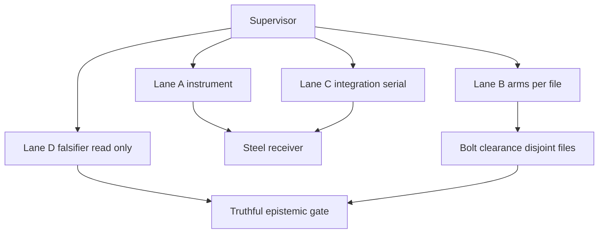

# 20261106-1043 — Oracle plane: prompt, as-is, to-be, execution, bottlenecks, under AK-47

Tags: #fractal-l0 #fractal-l1 #fractal-l2 #fractal-l3 #fractal-l4 #fractal-l5 #fractal-l6 #fractal-l7 #fractal-l8 #fractal-l9 #zero-muda #zk-adr #km-triad

[Cockpit](http://nas-1.tail55d152.ts.net:4100/) · [Wiki](http://nas-1.tail55d152.ts.net:4100/wiki) · [ZK](http://nas-1.tail55d152.ts.net:4100/zk) · [Checklist](http://nas-1.tail55d152.ts.net:4100/checklist) · [AK-47 rule](http://nas-1.tail55d152.ts.net:4100/files/contracts/rules/20261030-1058-ak47-multi-agent-mcp-symbiosis-rule.md) · [Source](http://nas-1.tail55d152.ts.net:4100/files/docs/plans/20261106-1043-ak47-oracle-plane-as-is-to-be-and-execution.md)

Observed host clock `2026-11-06T10:43:27Z`. Authority NONE. EV ceiling 93.
`SC-AK47-SYMBIOSIS-001` read from the canonical body before writing this.
This document grants no admission and no effect authority.

---

## 1. The prompt, as accumulated

One directive, restated and extended across the session. In its own terms:

> Unify all Lean code **and all system** into Lean + Mojo. Unify naming and system
> ontology. Full fractal check of all system aspects. Full holarchy + FPP + bionic
> naming and objects. Review with Codex, Pi + Astra, OpenRouter, Gemini, Argon,
> local Codex and local Claude — all at latest model in max deep thinking mode.
> Look at all SDLC and SRE artifacts. Create a comprehensive fractal prompt, a
> journal, and capture prompt history. Max parallel, POODAVR, fractal RCA, TPS.
> Evaluate existing ontology-unification analysis. Unification, standardization,
> consolidation, compaction, zero muda. **All functionality must have an ontology
> and a digital twin whose functionality is verified**, covering structural,
> information and runtime models, using ruliad, STPA, FMEA, algebraic atlas and an
> intent-based denotational approach, with mathematical structures throughout.
> Fully integrate agents into holarchy + FPP + bionic + aspects + agentic: each
> agent carries the aspects, maps to the holarchy, runs all FPP services, is
> bionic, has Zenoh and MCP, and may hold embedded intelligence. OpenRouter
> context must be 100% semantically equivalent to the raw prompt, and the context
> pipeline must preserve that equivalence. Do Admiralty, ACH, reality-check and
> devil's-advocate analysis. Ensure context reaching the models from the harness
> is correct. Then: fix the findings and re-review, repeatedly.

**What the prompt actually resolved to in practice.** The work converged on one
question, because every branch of the directive ran into it: *does the digital
twin verify anything, or does it only appear to?* "All functionality must have a
digital twin that has all functionality verified" is the clause that did the
work, and the answer turned out to be that large parts of the verification
plane could not fail.

---

## 2. As-is (measured 2026-11-06T10:43Z, not asserted)

### 2.1 What exists

| Surface | Measure |
|---|---|
| Mojo oracle plane | 15 `*_oracle.mojo` + substrate + selftest + control, 6,923 lines |
| Lean proof plane | 110 top-level `.lean` files; 22 named as differential subjects |
| Differential pairs | 15, 0 orphans |
| Falsifiability instrument | `tools/mojo_arm_falsifiability.ml`, enumerating 67 arms |
| Sa-plan tasks in this plan | 19 (`PLAN-LEAN-MOJO-UNIFY-20261106`) |
| Governance records | 3 (first review, repair pass + its own correction, round three) |

### 2.2 Verification state

- **0** unfalsifiable algebra arms among those the instrument can evaluate
  (6 flagged, all six are planted controls in `control_falsify_probe.mojo`).
- **0** literal tautologies.
- **108** arms `NOT_ANALYSED` because they contain function calls — an open
  question, not a pass. This is the single largest remaining blind spot.
- Substrate selftest: 8/8 verdict paths.
- `UosOntologyAtlas` 70 theorems, `UosAgentCapabilityProfile` 17, both 0 errors
  and axiom-free at Lean 4.33.0.
- `tools/preflight` PASS (33 checks).
- Differential: **7 PASS / 1 BLIND / 6 WORLD_FAIL / 1 DIVERGENT**, reproduced by
  two identical driver runs and by 15 direct runs.

### 2.3 What the three rounds cost and produced

| Round | Closed | Introduced | Why it ended that way |
|---|---|---|---|
| 1 — first review | — | — | 18 findings; the plane had never been read |
| 2 — flat repair | 6 of 18 | **11 new defects** | The instrument was inside the system it measured |
| 3 — fractal repair | 23 + the 11 | 3, all self-caught in the instrument | Detector built first, as an L5 gate on every other layer |

**The defect class, once, since every finding is an instance of it:** an
assertion that cannot fail is not evidence. It recurs at all ten fractal layers,
which is why two flat passes failed — each fixed it at one scale while the scale
beneath stayed broken.

### 2.4 Honest negatives in the as-is

- The 1 remaining `DIVERGENT` (cascade index-1, `Tier1Rete` vs `Tier1Compress`)
  is **legitimate** and independently confirmed as such. It is an operator
  decision, not a repairable defect.
- `monitoring_governance` is `BLIND` and **cannot reach PASS by construction**:
  its unobservable conjuncts are declared `False`-presence. A future real failure
  in that domain is today indistinguishable from the standing BLIND.
- `provenance_ceiling_impact_oracle.mojo` (228 lines, another writer's file,
  appeared mid-session) carries four recorded defects and has not been edited.
- Four L0/L9 items are recorded and unfixable by an oracle: the mandate's
  unsatisfiable cocycle invariant, `SC-INTENT-ATLAS-001` citing a
  `true && true = true` theorem as its `formal_proof`, the blanket 18/18
  checklist, and `THM_PROV_TWIN_17` proving `true = true` 24 times.
- **Codex has failed to deliver three times** across two prompt shapes.

---

## 3. To-be

Stated as properties that can be measured, not as adjectives.

| # | To-be property | Measurable as |
|---|---|---|
| T1 | No arm in the verification plane can pass without the ability to fail | `mojo_arm_falsifiability` reports 0 UNFALSIFIABLE **and** 0 NOT_ANALYSED |
| T2 | Every differential subject is compiled by something, not 13 of 129 | a tree-wide Lean sweep exists and the G1 claim is scoped to it |
| T3 | Every arm's name equals its body | name/body audit mechanised, not read by hand |
| T4 | No arm fails when the system is repaired | an L8 polarity check in the instrument |
| T5 | No oracle is permanently BLIND or permanently DIVERGENT | each `False`-presence arm has a named instrument that would close it |
| T6 | Cross-plane claims cannot contradict | an inter-oracle consistency check: two oracles may not assert both sides of one fact |
| T7 | Ledger attribution is derived, never transcribed | already held; keep the arm that enforces it |
| T8 | The implementer is never the falsifier | structural, per `SUP-01` |

**T1 and T6 are the two that matter.** T1 because 108 arms are currently
unexamined; T6 because the manufactured DIVERGENT was only found by a human-ish
reader noticing two oracles disagreeing, and nothing in the system would have
caught it.

---

## 4. How it will be executed — AK-47

`SC-AK47-SYMBIOSIS-001` is not a metaphor here; it is the execution model, and it
maps onto this work exactly.

### 4.1 Steel receiver — the invariants that do not move (`AK-47-02`)

These are pinned and may not be relaxed by a worker, a model verdict, a board
ACK, or a green test:

1. **INV-FALSIFY** — an assertion that cannot fail is not evidence; it must be
   able to fail or declare that it could not look.
2. **Two-key** — `Trust = Fresh Empirical Behavior ∧ Formal Spec`, with the two
   sides having **independent provenance**. One author on both sides is one key.
3. **Worst-wins lattice**, vacuity first. `Refused ≠ Operational`,
   `UNRUN / STALE / NOT_ADMITTED` nonpassing (`TEP-01..06`).
4. **Provenance ceiling 93.** No EV minted.
5. **Sa-plan sole execution authority** — claim before acting, receipt after.
6. **The instrument is outside the system it measures.** This is the steel part
   round two broke, and the reason it failed.

### 4.2 Bolt clearance — disjoint-file worker lanes (`AK-47-03`, `AK-47-04`)

The 108 `NOT_ANALYSED` arms partition cleanly by file, which is exactly the
shape bolt clearance wants: one worker, one file set, one observable acceptance,
no shared dispatcher.

The ASCII arrow list and the `mermaid` graph below describe the **same nodes and
edges** (`SC-DIAGRAM-001`): 8 nodes, 9 edges.

```text
[Supervisor] --> [Lane A instrument]
[Supervisor] --> [Lane B arms per file]
[Supervisor] --> [Lane C integration serial]
[Supervisor] --> [Lane D falsifier read only]
[Lane A instrument] --> [Steel receiver]
[Lane B arms per file] --> [Bolt clearance disjoint files]
[Lane C integration serial] --> [Steel receiver]
[Lane D falsifier read only] --> [Truthful epistemic gate]
[Bolt clearance disjoint files] --> [Truthful epistemic gate]
```

Lane A owns `tools/mojo_arm_falsifiability.ml`; Lane B owns exactly one
`formal/mojo/<name>_oracle.mojo` per worker; Lane C owns the shared dispatcher
(`oracle_substrate.mojo`, `tools/lean_mojo_differential.ml`) and wires it
serially; Lane D reads only and may return `HOLD`.



**Lane discipline.** Lane B workers never touch `oracle_substrate.mojo` or
`lean_mojo_differential.ml` — those are the shared dispatcher, and per `AK-47-05`
they are wired **serially by the integrator**, per file, never per directory.
Round three already followed this by accident; it becomes explicit.

### 4.3 Order of execution, gated by layer

Lower layers gate higher ones. A slice may not be claimed until the layer
beneath it is green.

| Step | Lane | Work | Acceptance |
|---|---|---|---|
| 1 | A | Teach the enumerator to evaluate mirror functions (the 108 `NOT_ANALYSED`) | its own six planted controls still caught, **and** at least one real arm reclassified |
| 2 | A | Add an L8 polarity check: flag any arm that fails when a measured count moves toward its target | planted inverted-polarity control is caught |
| 3 | A | Add a cross-oracle consistency check (T6) | planted contradictory pair is caught |
| 4 | B | One worker per oracle, closing its reclassified arms | per-oracle verdict explained, not just recorded |
| 5 | C | Integrator wires substrate changes serially, ≥2 mutants killed per change | selftest 8/8, differential reproduced twice |
| 6 | D | Falsifier re-reviews, read-only, may HOLD | findings graded Admiralty, competing hypothesis each |

**Step 1 before step 4 is the whole point.** Round two did step 4 first.

### 4.4 Zero Muda rules applied here (`AK-47-04`)

- **Pull, don't push.** A slice is claimed only when its layer-below gate is
  green. No queue of prepared-but-blocked work.
- **Do not hold a ready record whose real blocker is operator input.** The four
  L0/L9 items and the two encoding decisions are **surfaced and released**, not
  held. Work proceeds on clearance parts around them.
- **Do not recompute a landed candidate.** The three governance records stand;
  round four amends, never re-derives.
- **Refuse re-authoring regenerable narrative.** The oracles' correction comments
  are the record; they are not restated in new documents.

---

## 5. Issues and bottlenecks

Ranked by how much they slow or endanger progress.

### B1 — The implementer is also the falsifier (`SUP-01` violated) — **critical**

Across three rounds the same agent implemented and verified. Round two's 11
defects are the direct consequence: every self-certification passed. What
actually caught them was the **independent read-only reviewer**, twice.

*Mitigation, steel:* Lane D never implements. Round four's acceptance is the
falsifier's verdict, not the implementer's gate run. The falsifier's verdict
**stands as returned** (`TEP-03`) — it may be closed with laws and mutants and
re-reviewed, never edited.

### B2 — The instrument cannot see 108 arms — **high**

Every arm containing a function call is `NOT_ANALYSED`. That is honest but it is
also 62% of the plane. The next genuine finding is most likely in there.

*Bottleneck shape:* this needs the enumerator to evaluate Mojo mirror functions,
which is a real piece of work — a small interpreter or a harness that calls the
functions directly — not a tweak.

### B3 — Codex lane is down, 3 failures / 3 attempts — **high**

`SUP-03` assigns complex multi-file integration and security-sensitive slices to
Codex. That lane has produced nothing: exit 0 each time, twice derailing in its
KM-triad preamble, once emitting no response block at all. Two prompt shapes
tried, including one explicitly disabling the MCP preamble.

*Consequence:* integration slices currently fall to the same agent that
implements, which feeds B1. This is an **environment issue to fix**, not a
prompting one.

### B4 — Permanent BLIND and permanent DIVERGENT mask future failures — **medium**

12 arms have a literal `False` presence predicate. Honest, but they guarantee
two oracles never reach PASS, so a real failure there is indistinguishable from
today's state. Same for the legitimate cascade DIVERGENT.

*Mitigation:* T5 — every `False`-presence arm carries the name of the instrument
that would close it, so the backlog is explicit rather than ambient.

### B5 — Concurrent writers in the canonical checkout — **medium**

A 17th oracle and a Lean twin appeared mid-session, 56 seconds after an
unrelated edit, written by another writer. It could not compile when first
touched, which silently reduced the differential from 15 pairs to 14.

*Mitigation:* `SC-WORKSPACE-ISO-001` — author in `.uos-workspaces/fable-l0`, pin
hashes before editing, and treat another writer's files as read-only evidence.

### B6 — Operator decisions blocking closure — **medium, not fixable by an agent**

Four L0/L9 items plus the cascade index-1 and the two inverted encodings. Under
`AK-47-04` these are **released, not held**: surfaced here, work routes around
them.

### B7 — Bounded enumeration is not a proof — **low, structural**

`FALSIFIABLE` is evidence from a sampled domain. The instrument says so in its
own header. A sound decision procedure would need an SMT backend; the
`smtml-solver-substrate` skill exists and is the obvious upgrade path, gated by
its own substrate test.

---

## 6. How AK-47 ensures this works and makes progress

The rifle analogy earns its place here for a specific reason.

**Steel stops the catastrophic failure.** Rounds one and two could both have
ended with a plane that reported PASS everywhere and verified nothing, and the
reason neither did is that a small set of invariants refused to bend: vacuity
outranks every runtime verdict, a refusal is not an operation, and the two keys
must have independent provenance. Those are the parts that may not be relaxed
by a green test — and a green test is exactly what round two offered.

**Clearance keeps it moving.** The 108 unexamined arms partition by file, so
they are worked in parallel by disjoint-file workers who cannot collide, with the
shared dispatcher wired serially by one integrator. No worker waits on another's
file; no worker can move `main`.

**Zero Muda prevents the stall this work is prone to.** The failure mode here is
not slowness, it is *ceremony* — an arm manufactured to keep a counter above
zero, a document restating what a comment already says, a ready record held for
an operator decision that was never going to arrive from an agent. Every one of
those is refused by name.

**Truthful projection is what makes progress real rather than reported.** Three
oracles moved from PASS to BLIND or WORLD_FAIL in round three. Under a scoring
scheme that counts green, that is regression. Under `TEP-01..06` it is the
first honest measurement the plane has produced — arms that could not fail were
replaced by arms that can, or by an explicit declaration that the instrument
cannot see. **Progress here is measured in falsifiability gained, not in
verdicts improved.**

The one place the model was violated is B1, and it is also the one place the
work went backwards. That correlation is the strongest evidence in this document
for keeping the lanes separate.

---

## 7. Precommitted predictions for round four (Brier-scored)

| # | Prediction | p |
|---|---|---|
| 1 | Teaching the enumerator to evaluate mirror functions reclassifies ≥10 of the 108 arms as FALSIFIABLE | 0.75 |
| 2 | It finds ≥1 genuinely unfalsifiable arm among the 108 | 0.70 |
| 3 | The cross-oracle consistency check (T6) finds ≥1 further contradictory pair | 0.40 |
| 4 | Codex still fails to deliver without an environment fix | 0.80 |
| 5 | An independent falsifier finds ≥1 new defect introduced by round four | 0.55 |
| 6 | No round-four fix reintroduces a defect already closed in round three | 0.50 |

Prediction 6 at 0.50 is deliberate. Three rounds have each reintroduced
something; assuming the fourth will not is the error that produced the first
three.

**UOS footer**: document and component evidence do not grant system admission.
Sa-plan is the sole execution authority. EV ceiling 93; `EV-94..109`
`NOT_ADMITTED`.
