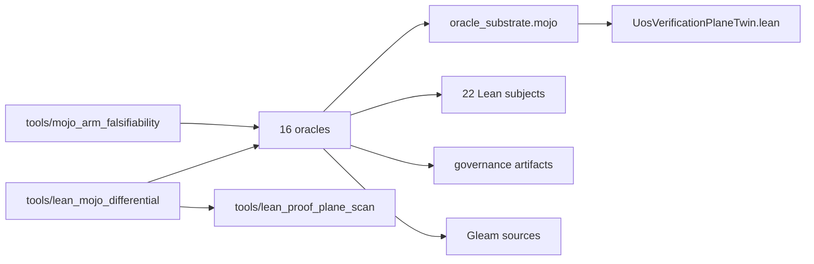
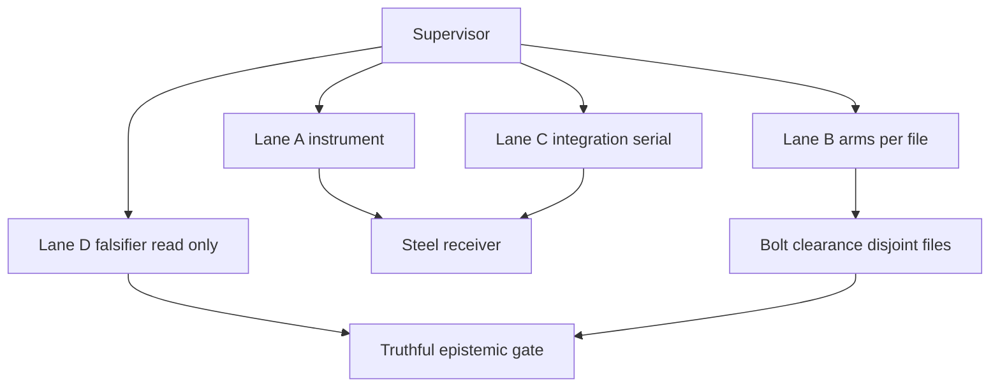

# 20261106-1115 — Verification plane: STPA, FMEA, twin, simulations, tradeoffs

Tags: #fractal-l0 #fractal-l1 #fractal-l2 #fractal-l3 #fractal-l4 #fractal-l5 #fractal-l6 #fractal-l7 #fractal-l8 #fractal-l9 #zero-muda #zk-adr #km-triad #stamp-stpa

[Cockpit](http://nas-1.tail55d152.ts.net:4100/) · [Wiki](http://nas-1.tail55d152.ts.net:4100/wiki) · [ZK](http://nas-1.tail55d152.ts.net:4100/zk) · [Checklist](http://nas-1.tail55d152.ts.net:4100/checklist) · [AK-47 rule](http://nas-1.tail55d152.ts.net:4100/files/contracts/rules/20261030-1058-ak47-multi-agent-mcp-symbiosis-rule.md) · [Risk SOP](http://nas-1.tail55d152.ts.net:4100/files/contracts/rules/20261106-1559-risk-prioritization-sop.md) · [Source](http://nas-1.tail55d152.ts.net:4100/files/docs/plans/20261106-1115-verification-plane-stpa-fmea-twin-and-tradeoffs.md)

Observed host clock `2026-11-06T11:15Z`. Sa-plan `TASK-LMU-P20`.
Authority NONE. EV ceiling 93. No admission.

---

## 1. Prompt

One accumulated directive. Its operative clause, after twelve restatements:
**every function must have an ontology and a digital twin whose functionality is
verified** — across structural, information and runtime models, using ruliad,
STPA, FMEA, algebraic atlas and denotational intent; agents integrated into
holarchy + FPP + bionic; reviewed by six agents at max thinking; then fixed and
re-reviewed, repeatedly. Latest additions: **only Lean + Mojo code**, **use
existing tools**, **do tradeoff analysis**.

Every branch converged on one question: *does the twin verify anything, or only
appear to?*

---

## 2. As-is — measured 2026-11-06T11:15Z

### 2.1 Structural / data plane / control plane

The plane decomposes cleanly, and the decomposition is where the findings live.

| Plane | What it is | Files | Verified by | State |
|---|---|---|---|---|
| **Structural** | the dependency topology: who reads whom | 58 nodes, 105 edges | fan-in/fan-out census | `oracle_substrate.mojo` **fan-in 15** — highest, and until today unmodelled |
| **Control** | the verdict function: what a receipt MEANS | `oracle_substrate.mojo` `status()`, the severity lattice | **`UosVerificationPlaneTwin.lean`, 14 theorems, 14/14 axiom-free** + `verification_plane_oracle.mojo` | twin proves it; runtime agrees (11 executed arms, 0 failures) |
| **Data** | what a capture actually read | 107 arms containing calls | **nothing** | `NOT_ANALYSED` — the real blind spot |

**The finding this decomposition produces:** all three rounds of defects were
control-plane or structural. The data plane has never been verified at all, and
a model of a grep is a model of the author's belief about the grep — so it is
not clear that it can be, by this architecture.

### 2.2 Dependency tree (derived, not drawn)

```text
[tools/mojo_arm_falsifiability] --> [16 oracles]
[tools/lean_mojo_differential] --> [16 oracles]
[tools/lean_mojo_differential] --> [tools/lean_proof_plane_scan]
[16 oracles] --> [oracle_substrate.mojo]
[16 oracles] --> [22 Lean subjects]
[16 oracles] --> [governance artifacts]
[16 oracles] --> [Gleam sources]
[oracle_substrate.mojo] --> [UosVerificationPlaneTwin.lean]
```



**Criticality from the topology, per `SC-RISK-PRIORITY-001`'s `Dep` factor:**

| Node | Fan-in | Dep | Why |
|---|---|---|---|
| `oracle_substrate.mojo` | 15 | **5** | shared authority; a defect reaches all pairs at once. F7 was exactly this |
| `tools/lean_mojo_differential.ml` | 3 | 4 | the aggregate verdict; also fan-out 16 |
| `UosLeanRuntimeGuard.lean` | 3 | 3 | the ABI encoding three oracles read |
| `core_fpp_actor_twin_mesh.gleam` | 3 | 3 | the 40-subsystem inventory |
| a single oracle | ≤2 | 2 | bounded to its own pair |

### 2.3 FMEA — detection ratings MEASURED, not judged

Each mode was planted as a real fixture and the real instrument run. `Det = 1`
where an instrument fired or the substrate made the mode unreachable; `Det = 5`
where the fixture reproduced the defect and **nothing caught it**.

| Mode | S | O | Det | RPN | F | Outcome | Mode |
|---|---|---|---|---|---|---|---|
| FM-01 | 4 | 5 | 1 | 20 | 4 | DETECTED | literal tautology arm |
| FM-02 | 5 | 4 | 1 | 20 | 5 | DETECTED | structurally unfalsifiable (variable cancels) |
| FM-09 | 4 | 3 | 1 | 12 | 4 | DETECTED | inverted polarity (fails when repaired) |
| FM-07 | 5 | 2 | 1 | 10 | 5 | PREVENTED | zero-algebra masked by a world failure |
| **FM-04** | 4 | 3 | **5** | **60** | 4 | **MANIFESTS** | control pins a subject value |
| **FM-05** | 4 | 4 | **5** | **80** | 5 | **MANIFESTS** | `world()` on an absent instrument |
| **FM-06** | 5 | 3 | **5** | **75** | 5 | **MANIFESTS** | `world()` on an absent subject |

`F(task) = max(F) = 5`. **The three highest RPNs are exactly the three modes no
instrument detects.** Each was found by reading, and nothing would find the next.

The harness itself had to be corrected mid-build: its first version scored a
mode "detected" whenever the fixture produced the expected verdict, so a
fixture reporting `WORLD_FAIL` on a healthy node counted as a success. It
reported **7/7 detected** — the exact false green this effort exists to
prevent, produced by the instrument built to measure it. Three outcomes
replaced two.

### 2.4 STPA — control structure and unsafe control actions

**Controller** the verification plane. **Controlled process** the claim "this
subsystem is verified". **Control action** emitting a verdict.

**Losses.** L1 a false admission rests on evidence that could not have failed.
L2 a real defect is masked by a graver-but-less-informative verdict. L3
remediation is reported as regression, so the system is held in its defective
state.

**Hazards.** H1 an arm passes without the ability to fail. H2 a verdict is
emitted about a world nobody observed. H3 two planes assert both sides of one
fact. H4 an instrument is inside the system it measures.

All four UCA types considered:

| UCA | Type | Instance | Constraint |
|---|---|---|---|
| UCA-1 | **not provided** when needed | no arm asserts a world check happened before PASS (`THM_VP_11`: reachable in ONE step) | SC-VP-01: PASS must require an observation |
| UCA-2 | **provided unsafely** | `WORLD_FAIL` emitted with zero observations (`THM_VP_12`: minimum depth 2) | SC-VP-02: a failure requires an observation behind it |
| UCA-3 | **wrong order / timing** | vacuity tested *after* world failure — F7, fixed; `THM_VP_01` is the claim it violated | SC-VP-03: both vacuity forms test first |
| UCA-4 | **stopped too soon / applied too long** | an arm demanding the defect persist (`v != v+b` requiring `b≠0`); and a permanently-red arm is a disabled arm (bionic's manufactured DIVERGENT) | SC-VP-04: no arm may fail under remediation; no arm may be permanently red |

UCA-3 is **closed and proved**. UCA-1, UCA-2 and UCA-4's first half are
**open**, and UCA-1/UCA-2 are FM-06/FM-05 — the undetected modes.

### 2.5 Lean digital twin + runtime alignment

`formal/lean/UosVerificationPlaneTwin.lean` — **14 theorems, 0 errors, 14/14
axiom-free, decides in 0.6 s.**

- `THM_VP_01..05` the ordering algebra: vacuity first (both forms), worst wins,
  PASS requires algebra, severity injective, and `exitCode ≠ severity` at the
  named point where a prior oracle confused them.
- `THM_VP_06..09` the three gaps **proved to exist**, with `THM_VP_09` recording
  that vacuity *should* outrank divergence — so a later reader does not "fix"
  the lattice.
- `THM_VP_10..14` **bounded trace simulation**: soundness on every trace to
  depth 2 (133 states, exhaustive); FM-06 reachable in **one** step; FM-05
  needing **exactly two**; FM-04's masking reachable; and PASS-without-world
  meaning algebra arms *alone*.

`formal/mojo/verification_plane_oracle.mojo` — **PASS**, 11 algebra arms, 5
world arms, 0 failures, 0 blind. It builds **real** `Receipt` objects and drives
them through the **real** recording methods, so the runtime side is executed,
not re-implemented. Negative control: four states yield four distinct verdicts,
and a wrong expected verdict is rejected.

**Runtime aligns with the model at this candidate.** That is a statement about
the control plane only.

### 2.6 Gates

16 oracles / 7,400 lines · falsifiability **81 enumerated, 75 FALSIFIABLE, 6
UNFALSIFIABLE (all planted controls)** · 107 `NOT_ANALYSED` · 0 literal
tautologies · selftest 8/8 · twin 14/14 axiom-free · preflight PASS 33 ·
differential **8 PASS / 1 BLIND / 6 WORLD_FAIL / 1 DIVERGENT** over 16 pairs.

### 2.7 Holarchy + FPP placement

| Layer | Plane component | FPP service it would run | State |
|---|---|---|---|
| L1 atomic | arm predicate | — | falsifiable, instrumented |
| L2 component | one oracle | typed port | 16 pairs |
| L3 transaction | one differential run | task role | receipt, append-only |
| L4 system | the driver + substrate | supervision | twin + oracle, aligned |
| L5 cognitive | the falsifiability instrument | intelligence focus | exists; outside the system |
| L6 ecosystem | the coverage ledger | companion machine | attribution arm enforces |
| L7 federation | cross-plane consistency | mcp tool | **no instrument** |
| L9 sovereign | admission | — | NOT_ADMITTED, ceiling 93 |

**L7 is the gap**: the manufactured DIVERGENT was a cross-plane contradiction
and nothing in the system could see it. L0 and L8 carry operator decisions.

---

## 3. To-be

| # | Property | Measured by | Now |
|---|---|---|---|
| T1 | every arm can fail | 0 UNFALSIFIABLE **and** 0 NOT_ANALYSED | 0 / **107** |
| T2 | PASS implies an observation | SC-VP-01 arm exists | **absent** (FM-06) |
| T3 | a failure implies an observation | SC-VP-02 arm exists | **absent** (FM-05) |
| T4 | no control pins a subject value | SC-VP-04 arm exists | **absent** (FM-04) |
| T5 | no two planes assert both sides | L7 consistency arm | **absent** |
| T6 | no arm permanently red or permanently blind | each `False`-presence arm names its closing instrument | 12 open |
| T7 | data plane verified | — | **architecturally open** |
| T8 | implementer ≠ falsifier | structural, `SUP-01` | violated 3 rounds |

T2–T4 are the three measured RPN-60/75/80 modes. **They are the work.**

---

## 4. Execution — AK-47

### 4.1 Steel receiver (`AK-47-02`) — may not be relaxed by any green test

1. **INV-FALSIFY** — an assertion that cannot fail is not evidence.
2. **Two-key with independent provenance.** One author on both sides is one key.
3. **Worst-wins, vacuity first** — now *proved* (`THM_VP_01`), not asserted.
4. **Ceiling 93**, no EV minted.
5. **Sa-plan sole authority.**
6. **The instrument lives outside the system it measures.**

### 4.2 Bolt clearance (`AK-47-03`) — disjoint lanes

The 107 `NOT_ANALYSED` arms partition by file: one worker, one oracle, one
acceptance. `oracle_substrate.mojo` is the shared dispatcher and is wired
**serially by the integrator**, per file, ≥2 mutants per change (`AK-47-05`).

```text
[Supervisor] --> [Lane A instrument]
[Supervisor] --> [Lane B arms per file]
[Supervisor] --> [Lane C integration serial]
[Supervisor] --> [Lane D falsifier read only]
[Lane A instrument] --> [Steel receiver]
[Lane B arms per file] --> [Bolt clearance disjoint files]
[Lane C integration serial] --> [Steel receiver]
[Lane D falsifier read only] --> [Truthful epistemic gate]
[Bolt clearance disjoint files] --> [Truthful epistemic gate]
```



### 4.3 Order — lower layers gate higher

| Step | Lane | Work | Acceptance |
|---|---|---|---|
| 1 | A | three new arms for SC-VP-01/02/04 in the substrate | the FMEA harness reclassifies FM-04/05/06 from MANIFESTS to DETECTED |
| 2 | A | L7 cross-oracle consistency (T5) | a planted contradictory pair is caught |
| 3 | B | per-oracle, close the reclassified arms | verdict explained, not recorded |
| 4 | C | substrate wired serially, ≥2 mutants | selftest 8/8, differential reproduced twice |
| 5 | D | read-only falsifier, may HOLD | Admiralty-graded, competing hypothesis each |

**Step 1 before step 3.** Round two did step 3 first and introduced 11 defects.

### 4.4 Zero Muda (`AK-47-04`) — and the "use existing tools" directive

Pull, don't push. **Do not build another instrument**: steps 1–2 extend
`oracle_substrate.mojo` and `tools/mojo_arm_falsifiability.ml`, both of which
exist. Operator decisions are **released, not held**. The three governance
records stand; round four amends.

---

## 5. Tradeoff analysis

Six decisions taken in this round, each with what was given up.

### TR-1 — Lean exhaustive vs Quint sampled, for the runtime model

| | Lean `decide` | Quint `run` |
|---|---|---|
| Coverage | **all** traces to depth 2 (133 states) | 20,000 sampled traces to depth 13 |
| Depth | 2 (kernel stalls at 1,464 states) | 13, and it says "increase --max-samples" |
| Minimum-depth results | **yes** — FM-05 needs exactly 2 steps | no |
| Languages | Lean only | a third language |

**Chose Lean.** Exhaustive-to-a-stated-bound beats sampled-to-a-greater-depth
*for this question*, because the gap traces are 1–2 steps long, so depth 2 is
where the answers are. **Given up:** any claim about deep traces. Quint's
depth-13 sampling found no soundness violation and that result is retained as
evidence, not authority. **Had the gaps been deep, this tradeoff would have gone
the other way** — the decision is question-specific, not a verdict on Quint.

### TR-2 — Lean+Mojo only vs the OCaml instruments already built

The falsifiability detector, dependency census and FMEA harness are OCaml, built
before the constraint arrived. Porting them to Mojo costs real effort and buys
**zero verification**: the same arms, the same verdicts, a different syntax.

**Chose: keep them, state the exception, port nothing.** New authoring is
Lean+Mojo; `tools/lean_proof_plane_scan.ml` and `tools/lean_mojo_differential.ml`
were already OCaml and precede this session. **Given up:** a uniform toolchain.
**The honest cost:** the plane's instruments are in a third language, and that
is a standing exception, not a resolved question. Flagging it rather than
quietly porting is the point.

### TR-3 — `Det` measured vs `Det` judged

Planting fixtures and running instruments cost a harness and three rounds of
correcting that harness. Assigning `Det` from judgement costs nothing.

**Chose measured.** The judged version would have recorded `Det = 2` or `3` for
FM-04/05/06 on the reasoning that "review catches these" — and review *did*,
once, by reading. Measured gives `Det = 5` and **RPN 60/75/80, the top three**.
**Given up:** speed, and comfort. The harness's own first version reported 7/7
detected, which is why the measurement had to be corrected before it was
trusted.

### TR-4 — proving the gaps exist vs closing them

`THM_VP_06..14` prove three gaps are reachable. They do not close them.

**Chose prove-first.** A gap with a one-step witness and a stated minimum depth
is a specification for the arm that closes it; a gap in prose is an opinion.
**Given up:** the gaps are still open, and the plane still emits PASS without
an observation. A reader could reasonably say the effort should have gone into
the three arms instead. The counter is that round two wrote arms without a
specification and produced 11 defects.

### TR-5 — the receipt-naming convention vs a detector special case

The detector flagged a driver's synthetic `r.algebra(String("x"), True)`. Two
fixes: teach the detector to recognise driver functions, or rename the receipt.

**Chose the convention** (`r` = the oracle's arms; anything else = fixture), and
**verified it holds across all 16 oracles** rather than assuming it. **Given
up:** a convention can be broken silently by a future author. A special case
inside the detector would have been invisible instead — and would have grown.

### TR-6 — the control plane verified, the data plane not

The twin and oracle cover `status()` and the lattice. 107 arms containing calls
are unexamined.

**Chose the control plane first**, because `oracle_substrate.mojo` has fan-in 15
so one defect there reaches every pair, and because F7 proved that is not
hypothetical. **Given up:** the data plane, which is the larger surface. And
the honest part: **it is not clear the data plane can be verified by this
architecture at all** — a model of a grep is a model of the author's belief
about the grep. That is a design question, not a backlog item.

---

## 6. Issues and bottlenecks

| # | Issue | Severity | Note |
|---|---|---|---|
| **B1** | implementer is also the falsifier (`SUP-01`) | **critical** | round two's 11 defects were all self-certified green; the independent reader caught them twice. The one violated invariant is the one place work went backwards |
| **B2** | 107 arms unexamined | **high** | needs the enumerator to evaluate Mojo mirror functions — real work |
| **B3** | three modes, RPN 60/75/80, no detector | **high** | FM-04/05/06. Each found by reading |
| **B4** | Codex lane down, 3/3 failures | **high** | `SUP-03` integration slices fall back to the implementer, feeding B1. Environment issue |
| **B5** | data plane unverifiable by construction? | **medium** | TR-6. A design question |
| **B6** | 12 permanently-BLIND arms | medium | a real failure there is indistinguishable from today |
| **B7** | concurrent writers | medium | a 17th oracle appeared mid-session and silently cut the differential to 14 pairs |
| **B8** | operator decisions | medium | released, not held |
| **B9** | instruments in a third language | low | TR-2, standing exception |
| **B10** | bounded enumeration ≠ proof | low | `smtml-solver-substrate` is the upgrade path |

---

## 7. Precommitted predictions (Brier-scored)

| # | Prediction | p |
|---|---|---|
| 1 | Three arms for SC-VP-01/02/04 move FM-04/05/06 to DETECTED | 0.80 |
| 2 | Adding them makes ≥2 oracles fail that currently PASS | 0.75 |
| 3 | The L7 consistency arm finds ≥1 further contradictory pair | 0.40 |
| 4 | Teaching the enumerator mirror functions reclassifies ≥20 of 107 | 0.65 |
| 5 | Codex still fails without an environment fix | 0.80 |
| 6 | No round-four fix reintroduces a round-three closure | 0.50 |

Prediction 2 is the interesting one: closing the detection gaps **should** break
things, and if it does not, the new arms are not doing their job. Prediction 6
stays at 0.50 — three rounds have each reintroduced something.

---

## 8. What is not claimed

- The data plane is not verified. 107 arms are an open question, not a pass.
- Bounded enumeration is evidence from a sampled domain, never a proof.
- The twin does not make the Mojo substrate correct; the oracle checks that at
  one candidate, and `PASS` there means the control plane agreed today.
- `provenance_ceiling_impact_oracle.mojo` is another writer's file, carries four
  recorded defects, and was not edited.
- Nothing here resolves the L0/L9 operator decisions, and no EV is minted.

**UOS footer**: document and component evidence do not grant system admission.
Sa-plan is the sole execution authority. EV ceiling 93; `EV-94..109`
`NOT_ADMITTED`.
