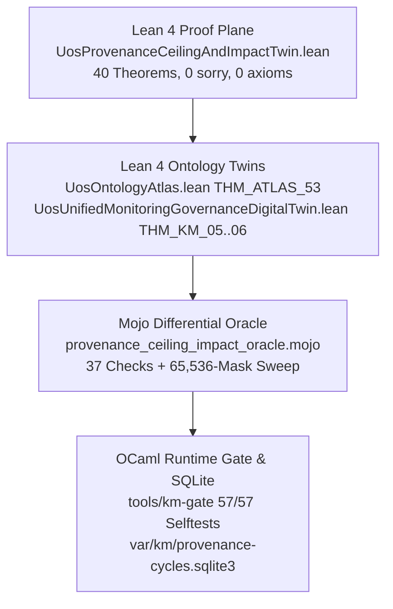

# 20261106-1007 — Comprehensive fractal prompt: Provenance Ceiling Digital Twin, 5-Modal Testing, 7-Cause Fractal RCA, and AK-47 Stuck-Free Forward Process

Tags: #fractal-l0 #fractal-l1 #fractal-l2 #fractal-l3 #fractal-l4 #fractal-l5 #fractal-l6 #fractal-l7 #fractal-l8 #fractal-l9 #km-triad #zk-adr #zero-muda #stamp-stpa

[Cockpit](http://nas-1.tail55d152.ts.net:4100/) · [Wiki](http://nas-1.tail55d152.ts.net:4100/wiki) · [ZK](http://nas-1.tail55d152.ts.net:4100/zk) · [Checklist](http://nas-1.tail55d152.ts.net:4100/checklist) · [Source](http://nas-1.tail55d152.ts.net:4100/files/docs/prompts/20261106-1007-uos-provenance-ceiling-digital-twin-and-ak47-anti-stuck-fractal-prompt.md)

Observed from the host clock at `2026-11-06T10:07Z`. Authority NONE. EV ceiling 93; `EV-94..109` and `ADR-071..086` `NOT_ADMITTED`; `EV-110..111` `SUPERSEDED`; no new EV number minted (`INV-PROV-05`).

---

## 0. Saved verbatim operator prompt chain (`PLAN-EV-CEILING-TWIN-SYNC-20261106`)

1. `what is current ev ceiling. update it to the latest`
2. `crete lean digital-twin . make sure lean simulation fully maps this functionality. make sure this is fully in sync with actual code ans runtime . create plan to update ceiling to the current state, do fract check on impacted items to ev. update all of them`
3. `crete lean digital-twin . make sure lean simulation fully maps this functionality. make sure this is fully in sync with actual code ans runtime . create plan to update ceiling to the current state, do fract check on impacted items to ev. update all of them, make sure the index functionality, lean ontology and digital twin and actual state of the code is fully in sync.`
4. `crete lean digital-twin . make sure lean simulation fully maps this functionality. make sure this is fully in sync with actual code ans runtime . create plan to update ceiling to the current state, do fract check on impacted items to ev. update all of them, make sure the index functionality, lean ontology and digital twin and actual state of the code is fully in sync. review with codex and claude`
5. `crete lean digital-twin . make sure lean simulation fully maps this functionality. make sure this is fully in sync with actual code ans runtime . create plan to update ceiling to the current state, do fract check on impacted items to ev. update all of them, make sure the index functionality, lean ontology and digital twin and actual state of the code is fully in sync. review with codex and claude. why is this getting stuck in the past . going forward how will process work without getting stuck again. fractal tps, fractal rca, ak 47 and digital twin`
6. `crete lean digital-twin . make sure lean simulation fully maps this functionality. make sure this is fully in sync with actual code ans runtime . create plan to update ceiling to the current state, do fract check on impacted items to ev. update all of them, make sure the index functionality, lean ontology and digital twin and actual state of the code is fully in sync. review with codex and claude. why is this getting stuck in the past . going forward how will process work without getting stuck again. fractal tps, fractal rca, ak 47 and digital twin. test this functionality with tdd, bdd, property based testing, fuzz testing and chaos testing first in lean and then on actual code`
7. `save prompt in journal. execute plan`

---

## 1. Architecture: Four Synchronized Provenance Planes

```text
+-----------------------------------------------------------------------------------+
| 1. LEAN 4 PROOF PLANE (formal/lean/UosProvenanceCeilingAndImpactTwin.lean)        |
|    40 Kernel-Checked Theorems (0 sorry, 0 axioms)                                 |
|    - km_ev.ml legacy containment vs executed-receipt two-key admission            |
|    - km_metrics.ml 137-ADR contiguity, 600-char window, 3.298-bit entropy         |
|    - km_rete.ml R0/R1/R2/R3/R4 forward-chaining & KMP-CEILING-SPLIT (93 vs 92)    |
|    - km_merge.ml M0..M7 merge readiness & wall-clock vs revision freshness        |
|    - 7-Cause Fractal RCA & AK-47 7-Boolean Stuck-Free Forward Process             |
|    - 5-Modal Verification: TDD + BDD + Property + Fuzz (64 LCG) + Chaos (CF1..7)  |
+-----------------------------------------+-----------------------------------------+
                                          |
                                          v
+-----------------------------------------------------------------------------------+
| 2. LEAN 4 ONTOLOGY & GOVERNANCE TWINS                                             |
|    - formal/lean/UosOntologyAtlas.lean (THM_ATLAS_53: 93 admitted, 94/109 barred) |
|    - formal/lean/UosUnifiedMonitoringGovernanceDigitalTwin.lean (THM_KM_05..06)   |
+-----------------------------------------+-----------------------------------------+
                                          |
                                          v
+-----------------------------------------------------------------------------------+
| 3. MOJO DIFFERENTIAL ORACLE (formal/mojo/provenance_ceiling_impact_oracle.mojo)   |
|    37 Checks (15 Algebra + 10 World + 12 Observations, 0 Failures)                |
|    - Exhaustive 65,536-mask (2^16) property & fuzz sweep                          |
|    - Dynamic extraction of all 28 fractalImpactInventory paths from Lean source   |
+-----------------------------------------+-----------------------------------------+
                                          |
                                          v
+-----------------------------------------------------------------------------------+
| 4. OCAML RUNTIME GATE & SQLITE APPEND-ONLY STORE (tools/km-gate)                  |
|    - 57/57 Runtime Selftests (--ev 17, --metrics 10, --rete 14, --merge 16)       |
|    - var/km/provenance-cycles.sqlite3 (CHAIN_INTACT)                              |
|    - generated/km-provenance/{metrics,gate,rete,ooda,adjudication}.json           |
+-----------------------------------------------------------------------------------+
```



---

## 2. Reusable 5-Modal Verification Recipe (Lean First, Then Runtime)

1. **Modality 1 — TDD (Equational Unit Laws)**: Prove boundary and transition laws in Lean (`THM_PROV_TWIN_01..34`), then execute the 57 OCaml runtime unit tests (`--ev-selftest`, `--metrics-selftest`, `--rete-selftest`, `--merge-selftest`).
2. **Modality 2 — BDD (Given / When / Then Scenarios)**: Encode explicit `BddScenarioResult` records (`BDD-01..05`) in Lean (`THM_PROV_TWIN_35`) covering nominal, adversarial, and elevation paths.
3. **Modality 3 — Exhaustive Property-Based Testing**: Verify algebraic properties (`deriveVerifiedCeiling ∈ [93, 109]`, monotonicity under bitwise OR `m1 ≤ (m1 ||| m2)`, idempotence, gap-at-bit-0 lock) over all $2^{16} = 65,536$ bitmasks in Mojo (`65536/65536`) and bounded sub-lattices in Lean (`THM_PROV_TWIN_36`, `THM_PROV_TWIN_37`).
4. **Modality 4 — Deterministic Fuzz Testing**: Run seeded LCG (`lcgNext s = (s * 1664525 + 1013904223) % 2^32`) over randomized `(mask, revMatch, hasRt, hasFm, cSigned, aSigned, oSigned)` tuples in Lean (`THM_PROV_TWIN_38`) and Mojo (`fuzz:64-lcg-random-states-preserve-all-invariants`).
5. **Modality 5 — Chaos Engineering & 1-Step Recovery**: Inject all 7 fault classes (`CF1` broken SQLite chain, `CF2` entropy collapse, `CF3` unmarked quarantine row, `CF4` revision drift, `CF5` undischargeable hold, `CF6` wall-clock expiry under revision freshness, `CF7` forged legacy file reference) and prove both fail-closed containment and 1-step recovery (`THM_PROV_TWIN_39`, `THM_PROV_TWIN_40`).

---

## 3. Verification Commands

```bash
./tools/lean formal/lean/UosProvenanceCeilingAndImpactTwin.lean
./tools/lean formal/lean/UosOntologyAtlas.lean
./tools/lean formal/lean/UosUnifiedMonitoringGovernanceDigitalTwin.lean
./tools/mojo run -I formal/mojo formal/mojo/provenance_ceiling_impact_oracle.mojo
ocaml -I +unix unix.cma tools/lean_mojo_differential.ml --pair provenance_ceiling_impact
bash tools/km-gate --gate
bash tools/km-gate --ev-selftest && bash tools/km-gate --metrics-selftest && bash tools/km-gate --rete-selftest && bash tools/km-gate --merge-selftest
bash tools/km-gate --adjudication-report --scan > generated/km-provenance/adjudication-scan.json
bash tools/km-gate --adjudication-report --validate-observed < governance/provenance/20261031-1658-ev94-109-observed-adjudication-ledger.json
bash tools/km-gate --publish
```
