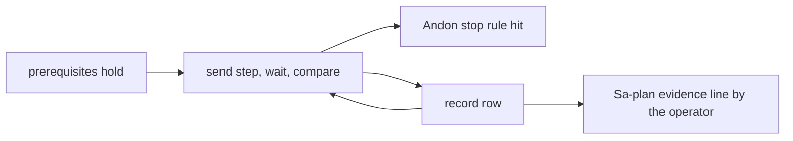

# 20261026-0215 — Telegram real-traffic journeys: defence and high availability runbook

#fractal-l0 #fractal-l3 #fractal-l4 #fractal-l5 #fractal-l6 #fractal-l9 #zk-adr #zero-muda #km-triad #stamp-stpa #tailscale-web

[This runbook](http://nas-1.tail55d152.ts.net:4100/files/docs/sop/20261026-0215-telegram-real-traffic-journeys-defence-runbook.md) · [Journey spec](http://nas-1.tail55d152.ts.net:4100/files/docs/design/20261026-0215-telegram-journey-defence-ha.md) · [Journey contract](http://nas-1.tail55d152.ts.net:4100/files/docs/design/20261026-0210-telegram-operator-journey-contract.md) · [Cockpit](http://nas-1.tail55d152.ts.net:4100/) · [Wiki](http://nas-1.tail55d152.ts.net:4100/wiki) · [ZK](http://nas-1.tail55d152.ts.net:4100/zk)

Transclusions: [[zk:20260905-1801-moc-uos-unified-master]] · [[wiki:20260905-1801-uos-zk-km-corpus-index]]

Contract `SC-TELEGRAM-JOURNEY-001`, section 5.3 (real-traffic run). Ledger: Sa-plan `uos/telegram-runtime/20261001-1150`, job `journeys-wave5-w2`, COMMAND_IMPL attempt 19. This runbook is executed by an authorized human. It grants no authority and no admission. EV ceiling 93; EV-94..109 NOT_ADMITTED.

## 1. Who may run this, and what a result means

Only an authorized human operator runs this. A model or agent may prepare the transcript sheet but cannot send the messages as the operator, cannot judge a step on the operator's behalf, and cannot record the Sa-plan evidence line. A pass is evidence about one deployed staging build (the candidate commit the operator records), at one time, for these 69 steps. It is not a release, not admission, and not evidence about production.

## 2. Prerequisites (all must hold before step 1.1)

1. **Staging bot only.** The run uses the STAGING Telegram bot. Its token lives only in the reviewed private transport configuration that the staging service reads. The token is never typed into a chat, pasted into this runbook, the repository, a Sa-plan record or a transcript. If a token appears anywhere in a transcript, stop, treat it as exposed, and rotate it through the credential owner.
2. **Allowlisted pair.** The operator's Telegram (chat id, user id) pair is on the staging service's allowlist. Messages from any other pair must be ignored by the service; sending one deliberately is a separate negative test, not part of this runbook.
3. **Production untouched.** Do not message the production bot. Do not restart, reconfigure or signal any production unit or the production bridge. Do not run any command from this runbook on a host that is not the staging host. All host names and URLs used in notes are Tailscale FQDNs (for example `http://nas-1.tail55d152.ts.net:4100/`).
4. **Candidate recorded.** Record the exact deployed staging candidate (Jujutsu commit id) and how it was observed. Replies that match the spec for a different candidate prove nothing about this one.
5. **Clock.** Record the host-observed UTC time at start and the NTP offset observation; timestamps in the transcript are host-observed, never typed by a model.
6. **Sa-plan.** The operator holds their own claim on the acceptance task under `uos/telegram-runtime/20261001-1150` before the run, and records evidence under that claim afterwards. No journey step needs, creates, or changes a Sa-plan task.
7. **No induced outage.** This runbook never stops a service, cuts a link, or injects a fault. The "degraded" in the journeys is whatever state the staging environment is genuinely in; the steps verify the replies stay truthful in that state.
8. **Evidence directory.** The operator chooses an operator-owned evidence directory (absolute canonical path, not workspace-relative) and writes the transcript there. Its path goes into the evidence line.

## 3. Andon stop rules (stop the run, record, do not continue)

Stop immediately and record the step if any of the following is seen:

- any reply contains `"status":"executed"` or `"status":"duplicate"`, or text claiming something was restarted, stopped, sent, written, merged or changed;
- any reply prints the host OS drive serial (it must only ever appear as [REDACTED_SYSTEM_OS_SERIAL]) or any token, key or secret;
- any reply arrives from a bot other than the staging bot, or in a chat other than the allowlisted one;
- `global_healthy` is `true`, `cluster_healthy` is `true`, or `failover_verified` is `true` anywhere;
- a service restart, alert or page for a production system correlates in time with a step.

## 4. How to run a step

1. Send the message in the "Send exactly" column, character for character, in the allowlisted chat. Do not add a trailing period or change case. The free-text steps are sent verbatim too.
2. Wait for one reply. If none arrives within 120 seconds, record `NO_REPLY` with the time, wait a further 120 seconds, and if still none you may resend the same message exactly once. A resend must not produce a second effect; none of these steps has an effect, so a second reply is recorded as `DUPLICATE_REPLY` and reported, not accepted silently.
3. Compare the reply to "Expected class" and "Pass only if". All listed fields must be present with the stated values. Extra fields are fine; missing fields, wrong values or a missing class are a fail.
4. Record per step: step id, UTC time sent, UTC time received, the reply bytes, pass or fail, and the evidence code from the spec (E1 reply bytes with message id; E2 adds `effect_id`; E3 adds verbatim `status` and `backend`).
5. A step whose expected class is `backend_unavailable` or `denied` PASSES when the reply is exactly that. An invented success is a FAIL even though it looks more useful.

Guard denials are JSON of the form `{"error":"denied_mutation: <tool> (<reason>)"}` without a `status` key. Adapter denials carry `"status":"denied"`.


## 5.1 Journey 1: Degraded mesh and homeostasis check

Persona and goal: P1 on-call SRE (phone, away from workstation), paged by a Lyapunov-trend alert on the mesh. Establish within a few messages what is observed, what is only declared, and what cannot be observed, about a degraded mesh, without being told the system is healthy when it is not.

| Step | Send exactly | Expected class | Pass only if (required fields) | Fail if | Record |
|---|---|---|---|---|---|
| 1.1 | `/status` | ok (partially_observed) | schema=uos.telegram.operational-status.v1; status=partially_observed; global_healthy=null; runtime_admission=NOT_GRANTED; services[] each with observation | global_healthy is true or a bare 'healthy' with no services[] rows = fabricated health | E1 |
| 1.2 | `/ha` | ok (partially_observed) | schema=uos.telegram.ha.v1; cluster_healthy=null; failover_verified=false; runtime_admission=NOT_GRANTED; metrics{} | cluster_healthy true or failover_verified true = fabricated redundancy claim | E1 |
| 1.3 | `/zenoh indrajaal/l2/health/homeostasis` | ok (retained_reply \| no_retained_reply) or backend_unavailable (status=unavailable) | schema=uos.telegram.zenoh.v1; authority=observation_only; runtime_admission=NOT_GRANTED; topic echoed | A payload with no topic, or a wildcard accepted, or a reply when the source is down | E1 |
| 1.4 | `/mesh` | ok | backend=cepaf_gleam/config/mesh_source; observation.status=declared; observation.deployment_confirmed=false | deployment_confirmed true = declared config presented as observed | E3 |
| 1.5 | `/immune` | backend_unavailable | backend=cepaf_gleam/immune/system; reason naming the missing read-only snapshot | status ok with antibody counts = invented observation | E3 |
| 1.6 | `/simulate zenoh:partitioned mesh:degraded peer:nominal` | denied (current defect) | reason starts 'Usage: /whatif claim'; the catalog canonicalises /simulate to /whatif | status ok here would mean the alias defect was fixed; update the journey, do not accept silently | E3 |
| 1.7 | `/rete watchdog=false,mesh_running=true,high_drift=true` | ok (evaluated, advisory) or backend_unavailable (worker missing) | schema=uos.telegram.rete.v1; scope=caller_supplied_facts_only; runtime_facts_verified=false; authority=advisory_only; runtime_admission=NOT_GRANTED | runtime_facts_verified true, or any effect claimed = authority leak | E1 |
| 1.8 | `the mesh looks slow, what should I check first` | ok (advisory) or backend_unavailable | reply is labelled advisory; no effect claimed; no action executed | Reply asserts it restarted, fixed or changed anything | E1 |

## 5.2 Journey 2: Immune and andon escalation with approval preview

Persona and goal: P1 on-call SRE deciding whether to trip an andon on a failing capability; the human is the L0 guardian. Preview every escalation step (staleness runbook, dark cockpit, andon trip) and prove that a plain message can only produce a preview or a denial, never an executed effect, and that unsigned approval text authorizes nothing.

| Step | Send exactly | Expected class | Pass only if (required fields) | Fail if | Record |
|---|---|---|---|---|---|
| 2.1 | `/escalate 120` | preview | confidence=simulated; staleness_level=degraded; runbook_id=RB-009; notification_sent=false; approval_required=true; authority=NONE | notification_sent true = an escalation was actually sent | E2 |
| 2.2 | `/escalate 90000` | denied | reason contains age_out_of_range and the usage text | Any preview for an out-of-range age = missing bound | E1 |
| 2.3 | `/dark emergency` | preview | confidence=declared; global_state_mutated=false; reversible_by='/dark dark'; approval_required=true | global_state_mutated true = mutation from a plain message | E2 |
| 2.4 | `/andon modular_max timeout_failure` | preview | confidence=simulated; effect=andon_trip_record_only; process_signalled=false; predicted_after_phase=stopped; approval_required=true; authority=NONE | process_signalled true, or status executed = actual stop | E2 |
| 2.5 | `/andon modular_max` | denied | reason starts 'usage: /andon' | A preview without a serious failure reason = missing Poka-Yoke | E1 |
| 2.6 | `/approval` | ok (text) | plain text; 'No controlled action requests found for this chat and user.' when none; scoped to this chat and user | Requests of another chat or user listed | E1 |
| 2.7 | `/approval propose tg-123` | denied (text) unless a pending request tg-123 exists | plain text such as 'Controlled action approvals are not configured. No action was executed.' or a refusal that no pending request exists; never an executed result | Any claim of execution; a challenge for a request not owned by this chat/user | E1 |
| 2.8 | `/approval approve tg-123` | denied | guard denial: error starts 'denied_mutation: /approval' and says unsigned approve text cannot authorize | Any reply other than a denial = approval bypass | E1 |

## 5.3 Journey 3: Chaos gameday rehearsal in simulation

Persona and goal: P1 SRE running a rehearsal during a quiet period; nothing may be injected into production. Rehearse claim contention, zombie lease reaping, retry backoff, packet loss, worker OOM and a network partition entirely in simulation, with every reply labelled simulated or declared and real_effects none.

| Step | Send exactly | Expected class | Pass only if (required fields) | Fail if | Record |
|---|---|---|---|---|---|
| 3.1 | `/whatif claim 4` | ok | backend=cepaf_gleam/planning/sa_plan_simulator; subject='synthetic task, not a live Sa-plan task'; granted=1; rejected=3 | subject missing or granted>1 = broken single-writer simulation or mislabeled | E3 |
| 3.2 | `/whatif zombie 100 200` | ok | subject='synthetic task, not a live lease'; reaped=true; final_task_state=available | A live lease named or touched | E3 |
| 3.3 | `/whatif retry 3` | ok | subject='synthetic job, not a live Oban job'; final step state=dead | A live job named or enqueued | E3 |
| 3.4 | `/whatif zenoh-router-kill` | denied | reason starts 'Usage: /whatif' | Free text interpreted as a scenario | E1 |
| 3.5 | `/gameday packet-loss-moderate` | preview | confidence=simulated; andon_tripped=false; containment_preserved=true; real_effects=none | real_effects not none | E2 |
| 3.6 | `/gameday packet-loss-catastrophic` | preview | confidence=simulated; response=andon_emergency_halt; andon_tripped=true; real_effects=none | andon_tripped false (wrong policy) or a real halt | E2 |
| 3.7 | `/gameday worker-oom` | preview | response=hot_reload_triggered; real_effects=none | real_effects not none | E2 |
| 3.8 | `/chaos zenoh-network-partition` | preview | confidence=declared; guardian_required_for_live=true; real_effects=none | guardian_required_for_live false or real_effects not none | E2 |
| 3.9 | `/chaos no-such-scenario` | denied | reason starts 'usage: /chaos' and lists the allowlist | Any scenario outside the allowlist accepted | E1 |
| 3.10 | `/rewind 5` | preview | confidence=simulated; store_mutations=0; history='declared reference history; no live store read' | store_mutations not 0, or a live store named as read | E2 |

## 5.4 Journey 4: Storage interlock, capacity and standby readiness

Persona and goal: P1 SRE verifying that the storage interlock, budgets and standby services are in the state they are believed to be. Read the storage interlock and capacity posture and the budget posture, preview standby actions, and show that everything not observable says so.

| Step | Send exactly | Expected class | Pass only if (required fields) | Fail if | Record |
|---|---|---|---|---|---|
| 4.1 | `/storage` | ok (observed, non-atomic) | schema=uos.telegram.storage.v1; status=observed; snapshot_atomic=false; authority=observation_only; production_interlock_enforcement=NOT_ESTABLISHED; osd_allocation_authority=NOT_GRANTED | production_interlock_enforcement ESTABLISHED, or the raw serial in the reply | E1 |
| 4.2 | `/nvme` | ok (observed, non-atomic) | same fields as step 1 (alias of /storage) | Different shape than /storage | E1 |
| 4.3 | `/storage now` | denied | guard denial: error starts 'denied_mutation: query_storage' ('Read arguments must be absent or an empty JSON object') | Argument accepted or ignored silently | E1 |
| 4.4 | `/ecology` | ok or backend_unavailable | schema=uos.telegram.ecology.v1; a named source for each capability row | Capability reported ready with no source | E1 |
| 4.5 | `/finops` | ok | schema=uos.telegram.finops.v1; unknown cost stays unknown, never zero | A fabricated zero cost | E1 |
| 4.6 | `/budget` | ok | same as step 5 | Different shape than /finops | E1 |
| 4.7 | `/eco-schedule` | preview | confidence=simulated; backend=ecology/daily_budget; authority=NONE; no job enqueued | jobs actually enqueued | E2 |
| 4.8 | `/sidecar forward` | preview | runtime_mode=simulation_only; runtime_observation=unknown; admission=unverified; backend=unavailable:mirage_unikernel_daemon; authority=NONE | runtime_observation other than unknown, or a sidecar started | E2 |
| 4.9 | `/sidecar everything` | denied | reason starts 'usage: /sidecar' | Unknown sidecar accepted | E1 |
| 4.10 | `/export-audit` | preview | backend=unavailable:rusty_vault_nif; authority=NONE; never_exported lists secret_bytes, secret_names, callers | Any secret name or byte in the reply | E2 |
| 4.11 | `/inference` | ok (configured, not observed) | backend=cepaf_gleam/ui/lustre/inference_tier; observation.live_status=not_observed; tier_count=7 | live_status other than not_observed | E3 |
| 4.12 | `/radar` | backend_unavailable | backend=cepaf_gleam/ui/lustre/biosemiotics_radar; reason: no live telemetry feed | ok with radar numbers = constants shown as telemetry | E3 |
| 4.13 | `/acoustic-hud` | ok (self-audit, no sensor) | kind=shruti_lattice_self_audit; live_sensor=not_observed | live_sensor other than not_observed | E3 |

## 5.5 Journey 5: Verification scorecard and FMEA

Persona and goal: P1 SRE (or release reviewer) checking what is recorded as verified versus unobserved before trusting a status. Read the recorded verification, checklist, FMEA and impact posture and show that no reply upgrades a recorded outcome into an admission, and that the verification executor stays unreachable from a plain message.

| Step | Send exactly | Expected class | Pass only if (required fields) | Fail if | Record |
|---|---|---|---|---|---|
| 5.1 | `/doctor` | ok (static projection) | doctor_status=UNOBSERVED_RUNTIME; admitted_ev_ceiling=93; admission_status=NOT_ADMITTED; checks_passed=UNOBSERVED | Any green status or EV above 93 admitted | E1 |
| 5.2 | `/ev` | ok (static projection) | same as step 1 | Different shape than /doctor | E1 |
| 5.3 | `/checklist` | ok | schema=uos.telegram.verification.v1; evidence_bytes_verified=false; gates_executed=false; runtime_admission=NOT_GRANTED | gates_executed true from a read | E1 |
| 5.4 | `/aspects` | ok | schema=uos.telegram.verification.v1; rows[] with state; admission_credit=false on every row | admission_credit true; a missing record shown as PASS | E1 |
| 5.5 | `/aspects A04` | ok | selector=A04; selected_count=1 | More than one row | E1 |
| 5.6 | `/fmea` | ok | schema=uos.telegram.fmea.v1; status=recorded_assessment; runtime_admission=NOT_GRANTED; note that S/O/Det are estimates | RPN presented as measured failure rate | E1 |
| 5.7 | `/fmea s2-policy-status-correction` | ok or ok-empty | assessment_id and task_id echoed; freshness field; max_rpn; or total_matching_tasks=0 | An assessment for a task id that has no record | E1 |
| 5.8 | `/blast-radius` | denied | guard denial: error starts 'denied_mutation: /blast-radius' | A default module chosen silently | E1 |
| 5.9 | `/blast-radius uos_sup` | ok | schema=uos.telegram.impact.v1 (read-only source scan) | Any file written | E1 |
| 5.10 | `/verify` | backend_unavailable, or executed with a signed packet | staging bot without verify configuration: reply text "Verification is not configured on this service. Nothing was executed."; with the operator-held verify configuration and a signed verify packet for this exact inbox request: JSON with `status` executed, `job_id`, `receipt_sha256`, `assessment`; a second identical message answers `status` duplicate with the same receipt digest | Any verification executed from a plain message without a signed packet; a second guardian run for the same request | E1 |
| 5.11 | `/verification` | same as step 10 (canonical /verify) | same as step 10 | Different behaviour than /verify | E1 |
| 5.12 | `/sutra` | ok | schema=uos.telegram.matrix.v1 | Versions invented | E1 |
| 5.13 | `/search andon` | ok or ok-empty | schema=uos.telegram.task_search.v1 | Results not backed by a task record | E1 |
| 5.14 | `/wiki ha` | ok or ok-empty | schema=uos.telegram.knowledge.v1; view=wiki | Content not from the corpus | E1 |
| 5.15 | `/km mesh` | ok or ok-empty | schema=uos.telegram.knowledge.v1; view=all | Content not from the corpus | E1 |
| 5.16 | `/adr` | ok | backend=cepaf_gleam/harness/files (docs/zk); adr_files and highest_number integers | Counts without a named directory | E3 |

## 5.6 Journey 6: Recovery, resuscitation preview and shift handover

Persona and goal: P1 SRE at the end of an incident, previewing recovery, reviewing commitments and handing over to the next on-call. Preview resuscitation and reproduction without restarting or running anything, read the plan and board state, produce a handover skeleton preview, and keep an honest account of what recovery would still need.

| Step | Send exactly | Expected class | Pass only if (required fields) | Fail if | Record |
|---|---|---|---|---|---|
| 6.1 | `/plan` | ok or backend_unavailable | observer-sourced reply or observer_failed; no invented tasks | Tasks listed that the observer did not return | E1 |
| 6.2 | `/tasks` | ok or backend_unavailable | same as step 1 | Different behaviour than /plan | E1 |
| 6.3 | `/board` | ok or backend_unavailable | schema=uos.telegram.coordination.v1 | Peer ACK presented as deployment authority | E1 |
| 6.4 | `/peers` | ok or backend_unavailable | schema=uos.telegram.coordination.v1 | A peer shown live without an observation | E1 |
| 6.5 | `/resuscitate modular_max` | preview | confidence=simulated; predicted_after_phase=recovering; completion_requires=engaged_backend_probe_receipt; process_restarted=false; approval_required=true | process_restarted true, or completion without a probe receipt | E2 |
| 6.6 | `/resuscitate nothing` | denied | reason starts 'usage: /resuscitate' | Unknown capability accepted | E1 |
| 6.7 | `/repro s2-policy-status-correction` | preview | executes_commands=false; observation.task_state=not_observed | A command executed, or a task state claimed without a store read | E2 |
| 6.8 | `/commitments` | preview | tasks_observed=0 and execute=backend_unavailable:cepaf_gleam/harness/telegram_task_command unless the service holds a pinned observer | Open tasks listed without an observer | E2 |
| 6.9 | `/handover mesh-degraded-shift` | preview | sections=13; docs_directory_untouched=true; authority=NONE; file name carries the current date prefix | A file written, or fewer than 13 sections | E2 |
| 6.10 | `/postmortem` | ok | backend=cepaf_gleam/harness/files (docs/journal); keyword=postmortem; note says no postmortem registry exists | A postmortem presented from a registry that does not exist | E3 |
| 6.11 | `/exec-brief` | ok or backend_unavailable | schema=uos.telegram.exec-brief.v1 | Figures with no source | E1 |
| 6.12 | `/messages` | ok (text) or empty | memory arm (telegram_memory_command): stored messages for this chat and user only, or an explicit empty/unavailable statement | Messages of another chat or user, or invented history | E1 |
| 6.13 | `/socratic why did the mesh partition` | ok (advisory) or backend_unavailable | reply is questions; no effect claimed | A definitive root cause asserted without evidence | E1 |
| 6.14 | `/help` | ok (static reference) | static command reference text | Commands listed that do not exist in the catalog | E1 |

## 6. Steps that cannot reach a richer outcome until a named backend exists

For each row, the "Today's passing outcome" is what the runbook accepts now. Accepting it is not an acceptance of the missing capability.

| Step | Cannot reach | Until this named backend exists | Today's passing outcome |
|---|---|---|---|
| 1.3 `/zenoh <topic>` | `retained_reply` | a granted, authenticated Zenoh REST exact-topic read configured for the staging service | `no_retained_reply` or `unavailable` envelope, truthfully labelled |
| 1.5 `/immune` | `ok` with antibody state | `cepaf_gleam/immune/system` read-only snapshot port | `backend_unavailable` naming that module |
| 1.6 `/simulate ...` | `ok` peer-quorum simulation | catalog fix so `/simulate` is not canonicalised to `/whatif` (dispatcher defect, not a backend) | `denied`, usage text of `/whatif` |
| 1.8, 6.13 conversation steps | an informed answer | a configured and probed conversation backend (model connectivity) | advisory text, or `backend_unavailable` |
| 2.7 `/approval propose tg-123` | a signing challenge | a reviewed signed-action profile and trusted roster held by the service, with a real pending request | plain-text refusal; never an executed result |
| 2.1 to 2.4, 6.5 previews | `executed` | the approval-to-execute path for ControlledAction adapters (not wired), live actor snapshots for `ecology/andon`, `prajna/dark_cockpit`, `ha/runbooks` | `preview` with `approval_required=true` and `authority=NONE` |
| 3.5 to 3.7 `/gameday` | rehearsal on live immune state | `/immune` snapshot port plus an approved injector | `preview`, `confidence=simulated`, `real_effects=none` |
| 3.8 `/chaos` | live injection | Guardian-gated development injector with a target allowlist and rollback | `preview`, `guardian_required_for_live=true` |
| 4.1 `/storage` | `production_interlock_enforcement` established | storage controller enforcement evidence on the production host | `NOT_ESTABLISHED` stated explicitly |
| 4.8 `/sidecar forward` | observed runtime state | `mirage_unikernel_daemon` with an observable runtime | `runtime_observation=unknown`, `admission=unverified` |
| 4.10 `/export-audit` | an actual export | `rusty_vault_nif` with audited bounded export, behind approval | `preview` naming `unavailable:rusty_vault_nif` |
| 4.12 `/radar` | `ok` with radar values | a live telemetry feed for `biosemiotics_radar` | `backend_unavailable` naming that module |
| 5.10, 5.11 `/verify`, `/verification` | a verification run on the staging bot | the operator-held verify configuration (`configure_verify`: profile pin, guardian pin, evidence root, sa-plan database) and signed actions on the staging service, plus a signed verify packet from the approval roster; the code path is wired (wave 6b) | service reply "Verification is not configured on this service. Nothing was executed." |
| 5.1 to 5.3 `/doctor`, `/checklist` | green gates | fresh candidate-bound gate execution recorded in the configured candidate record | `UNOBSERVED` states, `NOT_ADMITTED` |
| 6.5 `/resuscitate` | recovery completion | live actor snapshot, approved restart effect, engaged-backend probe receipt | `preview`, `completion_requires=engaged_backend_probe_receipt` |
| 6.8 `/commitments` | tasks listed | pinned Sa-plan observer configuration held by the service | `tasks_observed=0` with `backend_unavailable:cepaf_gleam/harness/telegram_task_command` |
| 6.9 `/handover` execute | a written skeleton | approval path plus evidence directory fence | `preview`, `docs_directory_untouched=true` |
| 6.10 `/postmortem` | a postmortem index | an owned postmortem registry | journal filename scan with an explicit note |

## 7. After the run

1. Check `/approval` once more: no new controlled-action request may have appeared, because nothing in this run creates one. A new request is an unexpected effect, a fail, and an Andon stop.
2. Confirm no production unit changed state during the window (operator's own observation, not an agent claim).
3. Store the transcript sheet (one row per step, the fields in section 4.4) in the evidence directory. Do not store tokens, raw serials, or other chats.
4. Compute: `pass`, `fail`, `not_run`, and `expected_unavailable` (steps that passed with `backend_unavailable` or a denial where the spec expects one).
5. The operator records exactly one Sa-plan evidence line under their own claim for the acceptance task:

```text
TG-JOURNEY-DEFENCE run=<host-observed UTC ISO8601> operator=<human id> bot=staging candidate=<jj commit id> journeys=1-6 steps=69 pass=<n> fail=<n> not_run=<n> expected_unavailable=<n> evidence=<absolute evidence path> plan=uos/telegram-runtime/20261001-1150 job=journeys-wave5-w2 attempt=COMMAND_IMPL-19 admission=NONE
```

A run with `fail` greater than 0 or an Andon stop is recorded with the same line and the failing step ids appended as `failed=<ids>`; it is not repaired by editing the transcript. A model, agent, board ACK or lease cannot record or replace this line.

## 8. Run record skeleton (copy into the evidence directory)

```text
run: <host UTC>   operator: <id>   candidate: <jj commit id>   NTP offset: <observation>
step | sent_utc | received_utc | pass/fail | note
1.1  |          |              |           |
...  (69 rows, steps 1.1 to 6.14)
```



```text
[prerequisites hold] -> [send step, wait, compare]
[send step, wait, compare] -> [Andon stop rule hit]
[send step, wait, compare] -> [record row]
[record row] -> [send step, wait, compare]
[record row] -> [Sa-plan evidence line by the operator]
```

## Comprehensive verification checklist

Obligations for this runbook package; runtime items are UNRUN until an operator performs the run.

<details><summary>Domains 1 to 6</summary>

- [x] CHK-01-TIME - `20261026-0215-` prefix. [x] CHK-02-TAIL - Tailnet links. [x] CHK-03-FRACT - tags. [x] CHK-04-KM - transclusions.
- [ ] CHK-05-MUDA, CHK-06-GRAPH - not in scope. [x] CHK-07-DRIVE - serial appears only as [REDACTED_SYSTEM_OS_SERIAL].
- [ ] CHK-08-C1C8 to CHK-11-REGR - UNRUN. [ ] CHK-12-GLEAM to CHK-16-OTEL - UNRUN until the real-traffic run.
- [ ] CHK-17-SOV - independent review and admission outstanding. [x] CHK-18-JJ - standalone Jujutsu workspace, no native Git.
- Domain 6: EV ceiling 93; EV-94..109 NOT_ADMITTED; no new EV number minted.

</details>

[Journey spec](http://nas-1.tail55d152.ts.net:4100/files/docs/design/20261026-0215-telegram-journey-defence-ha.md) · [Contract](http://nas-1.tail55d152.ts.net:4100/files/docs/design/20261026-0210-telegram-operator-journey-contract.md) · [Wiki](http://nas-1.tail55d152.ts.net:4100/wiki) · [ZK](http://nas-1.tail55d152.ts.net:4100/zk) · [Cockpit](http://nas-1.tail55d152.ts.net:4100/)

UOS footer: `nas-1.tail55d152.ts.net:4100` - procedure only; a pass binds one staging candidate and grants no admission.
