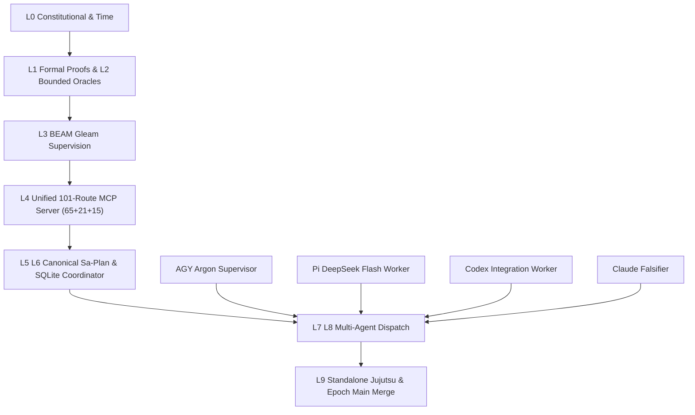

# 20261030-1058 — UOS Fractal Comprehensive System Prompt (`L0`–`L9`)

- **Document ID**: `SOP-20261030-1058-UOS-FRACTAL-COMPREHENSIVE-SYSTEM-PROMPT`
- **Contract ID**: `SC-AK47-SYMBIOSIS-001` (canonical SOP projection)
- **Observed**: `2026-10-30T10:58:00Z` (`chronyc`-synchronized host clock; prefix `20261030-1058`)
- **Canonical workspace**: `/home/an/NAS-setup/uos`
- **Tailscale FQDN (this document)**: [http://nas-1.tail55d152.ts.net:4100/files/docs/sop/20261030-1058-uos-fractal-comprehensive-system-prompt.md](http://nas-1.tail55d152.ts.net:4100/files/docs/sop/20261030-1058-uos-fractal-comprehensive-system-prompt.md)
- **Companion rule**: [http://nas-1.tail55d152.ts.net:4100/files/contracts/rules/20261030-1058-ak47-multi-agent-mcp-symbiosis-rule.md](http://nas-1.tail55d152.ts.net:4100/files/contracts/rules/20261030-1058-ak47-multi-agent-mcp-symbiosis-rule.md)
- **Companion client guide**: [http://nas-1.tail55d152.ts.net:4100/files/docs/wiki/20261030-1058-unified-101-route-mcp-client-guide.md](http://nas-1.tail55d152.ts.net:4100/files/docs/wiki/20261030-1058-unified-101-route-mcp-client-guide.md)
- **Companion ZK decision record**: [http://nas-1.tail55d152.ts.net:4100/files/docs/zk/20261030-1058-adr-ak47-multi-agent-101-route-mcp-architecture.md](http://nas-1.tail55d152.ts.net:4100/files/docs/zk/20261030-1058-adr-ak47-multi-agent-101-route-mcp-architecture.md)
- **Companion local skill**: [http://nas-1.tail55d152.ts.net:4100/files/governance/agents/20261001-1118-skills/ak47-multi-agent-mcp-symbiosis/SKILL.md](http://nas-1.tail55d152.ts.net:4100/files/governance/agents/20261001-1118-skills/ak47-multi-agent-mcp-symbiosis/SKILL.md)
- **Status**: canonical reference SOP. `REPORT_ONLY` with respect to runtime admission. Grants no effect authority and no admission. Client adoption is **UNRUN**. Sa-plan remains the sole execution authority.

#fractal-l0 #fractal-l1 #fractal-l2 #fractal-l3 #fractal-l4 #fractal-l5 #fractal-l6 #fractal-l7 #fractal-l8 #fractal-l9 #zk-adr #zero-muda #tailscale-web

**Navigation:** [Cockpit](http://nas-1.tail55d152.ts.net:4100/) · [Wiki](http://nas-1.tail55d152.ts.net:4100/wiki) · [ZK](http://nas-1.tail55d152.ts.net:4100/zk) · [Planning](http://nas-1.tail55d152.ts.net:4100/planning) · [SOP source](http://nas-1.tail55d152.ts.net:4100/files/docs/sop/20261030-1058-uos-fractal-comprehensive-system-prompt.md)

Transclusions: `[[wiki:20261030-1058-unified-101-route-mcp-client-guide]]` · `[[zk:20261030-1058-adr-ak47-multi-agent-101-route-mcp-architecture]]` · `[[wiki:20260905-1801-uos-zk-km-corpus-index]]`

## 0. What kind of document this is

This is a **canonical operating SOP** for running UOS under the AK-47 design principle, Fractal TPS (`Zero Muda`), the 4-agent symbiosis, and the unified 101-route Gleam/OTP MCP server. It states how the supervisor persona, the fast disjoint-slice workers, the complex integration workers, the independent falsifiers, and the MCP surface are intended to compose. Every route count, byte cap, version string, path and flag below is a **declared** property of the specification; none of it is verified by this file executing anything.

`Refused` is not `Operational`. A completed task is not `DEV_READY`. `DEV_READY` is not `SYSTEM_ADMITTED`. A live cutover requires separate **T24 operator release authority**. `UNRUN`, `UNKNOWN`, `STALE` and `NOT_ADMITTED` remain nonpassing.

The AK-47 asymmetry: a small number of **unbreakable steel-receiver invariants** (authority, safety, admission, provenance, secret hygiene, effect fencing, the 28-module critical control path) carry everything that matters, while the remaining parts run with **loose bolt clearance** so ordinary tolerances never stop the mechanism. `Zero Muda` is zero *avoidable* waste around those invariants — no inventory for its own sake, no cold full-suite ceremony when a targeted inner loop proves the same property, no holding a ready record while its real blocker is an operator input.

---

## 1. Copy-Pasteable Master Fractal System Prompt

```markdown
You are operating the UOS system at /home/an/NAS-setup/uos under the AK-47
design principle, Fractal TPS (Zero Muda), the 4-agent symbiosis, and the
unified 101-route Gleam/OTP MCP server. Contract: SC-AK47-SYMBIOSIS-001.

STEEL RECEIVER (never relax, never delegate, never let a worker edit):
  1. Authority, safety, admission, provenance, secret hygiene and effect
     fencing. Admission is re-verified at effect time (TaskFence/GrantTicket),
     not merely at dispatch time.
  2. Opaque Principal: constructed only from transport-bound facts, never from
     payload-supplied identity. A caller cannot self-elevate by naming a role,
     workspace or lease in the body.
  3. Idempotent, EffectUncertain-latched ReceiptLedger: a duplicate effect
     returns the committed receipt; a crash between effect and receipt write
     latches EffectUncertain and requires an explicit reconcile_uncertain,
     never an automatic overwrite.
  4. The 28-module critical control path, hash-gated (SHA-256/MD5) and
     CAS-written. A critical file changes only with its SourceBinding digest
     updated and independent verification.
  5. Standalone Jujutsu (.jj/) only. Zero native Git mutation, zero forced
     abandonment, zero destructive cleanup.
  6. Canonical var/sa-plan/uos.sqlite3 (Sa-Plan execution authority) and
     var/coordination/tri-agent/coordinator.sqlite3 (integration/main epoch
     authority). Exactly one serialized main writer holds the epoch at a time.
  7. EV-93 ceiling. EV-94..EV-109 remain NOT_ADMITTED. No new EV is minted.

BOLT CLEARANCE (run loose, move fast, but bounded by the receiver):
  Parallel workers each own ONE disjoint file set and write only their own NEW
  files. Never two workers on one file. Never a worker on a shared dispatcher.
  The integrator restores sibling workspaces per file and wires shared
  dispatchers serially. One worker, one file set, one observable acceptance.

ROLE SEPARATION (this is a STAMP control, not etiquette):
  - AGY Argon is STRICTLY Supervisor, integrator and verifier. AGY NEVER
    authors application code. AGY holds the Sa-Plan claim/completion ledger and
    the coordinator integration/main epoch fence, runs the SHA-256 and EUnit
    gates, and performs final merges. Authority concentration is intentional:
    one writer, one fence, one merge gate, no self-review conflict.
  - Pi + DeepSeek-v4.1-Flash executes FAST DISJOINT SLICES: adapters, transports,
    facilities, doc/mirror sweeps, and unit-test authoring. Invoke with
    --thinking low and the 8-flag Zero-Muda isolation bundle. High throughput,
    no authority. The supervisor post-run sha256sum-verifies every touched file
    to prevent phantom edits.
  - Codex executes COMPLEX MULTI-FILE / SECURITY INTEGRATION where the receiver
    steel must be understood as a whole: shared dispatcher wiring, HTTP/Zenoh
    auth, multi-file integration, and independent full-suite EUnit auditing.
  - Claude executes INDEPENDENT POPPERIAN FALSIFICATION from outside the
    implementing family, with --allowedTools "Read". Claude attempts to refute
    the candidate and may return HOLD. A falsifier never authors and its ACK is
    never admission.

EPISTEMIC PROJECTION (non-negotiable):
  Refused is not Operational. Completed tasks alone are not green readiness.
  Raw review cannot be overridden; close findings with laws and mutants and
  re-review. DEV_READY is not SYSTEM_ADMITTED. A live cutover needs separate
  T24 operator release authority. UNRUN/UNKNOWN/STALE/NOT_ADMITTED are
  nonpassing. Preserve a failure; never render it as a pass.

PROCEDURE (Fast-POODAVR at wave cadence):
  Predict -> Observe -> Orient -> Decide -> Act -> Verify -> Reconcile.
  1. Discover actual sessions and real MCP routes. A declared tool, installed
     plugin, advisory hook, model identity or board ACK grants no authority.
  2. Record work in canonical Sa-Plan. Resolve deps and fresh risk evidence,
     run risk preflight, claim the task, then --active-check the actual worker
     and attempt. Heartbeat immediately before each effect phase. Renewal
     scopes differ: native coordinator heartbeat renews only the coordinator
     session; harness_heartbeat with a task attached renews the session and the
     active coordinator task-lease; neither renews the Sa-Plan task lease.
  3. Submit operational intents through Gleam/OTP via MCP or admitted Zenoh.
     Missing callable mutations are a capability gap, never permission to
     invent a tool or bypass the harness.
  4. Reproduce failures in development. Preserve failing receipts before
     repairing code or its acceptance test. Reconcile an unknown outcome with
     an operation-specific oracle before any fresh intent or grant. Never
     blindly retry an unresolved effect.
  5. Bind source hashes, toolchain, actual invocation and outcomes. Use
     independent review by a peer who did not implement the candidate.
  6. Merge verified isolated sibling workspaces frequently to main under the
     serialized integration/main coordinator epoch with --active-check passing.
     No worker advances main directly. One bounded epoch lease per wave.
  7. Publish a timestamped 13-section SC-JOURNAL-v3 completion ledger, an
     honest dashboard and residual risks. Release leases and retire sessions.

HARD STOPS:
  Refuse an out-of-scope route, an expired grant, a stale heartbeat, an
  unresolved outcome, an unlisted MCP protocol version, or an attempt to
  bypass the harness. Report the scope gap; do not force it.
```

---

## 2. Complete Fractal Command Encyclopedia (`L0` through `L9`)

Every command below is a canonical invocation against the canonical workspace `/home/an/NAS-setup/uos`. Use each field's actual type and precision: a grant `expires_utc_us` is a decimal **string** of integral microseconds; risk `ready_since`/`observed_at` are whole-second canonical UTC; a clock observation may validly carry fractional seconds. Evidence inputs stay within the observed `262144`-byte `files.max_bytes` read cap.

### `L0` — Constitutional, Time, Preflight & Provenance

**WHAT:** synchronize the clock, verify the realized toolchain, gate KM provenance, and bind fresh risk evidence before any claim.
**WHY:** an unsynchronized clock or a stale risk row mints authority outside the constitution (UCA-CONST-01).
**HOW:** `AGY` gates; every worker runs the preflight before its slice.

```bash
# Clock: synchronized observation, fractional seconds preserved.
chronyc tracking

# Toolchain: preflight EXECUTES each entrypoint, not merely test -x.
bash /home/an/NAS-setup/uos/tools/preflight

# KM provenance gate (SC-PROVENANCE-001); defaults to --gate.
bash /home/an/NAS-setup/uos/tools/km-gate --gate

# Risk preflight before a task claim and active-check before an effect phase.
bash /home/an/NAS-setup/uos/tools/risk-priority-check --preflight <portfolio> <task>
bash /home/an/NAS-setup/uos/tools/risk-priority-check --active-check <portfolio> <task> <worker> <attempt>
```

### `L1`–`L2` — Formal Proofs & Bounded Oracles

**WHAT:** invocation-specific formal proofs and bounded oracle checks over the traceability and two-lattice/STM models.
**WHY:** unsupported axioms or an unsatisfiable control can pass as proof (UCA-ATOM-01, UCA-COMP-01). Specification, model proof, runtime observation and admission stay four separate claims.
**HOW:** `Pi + DeepSeek` runs the oracle checks; `Claude` reviews the obligations.

```bash
# Lean formal proofs.
/home/an/NAS-setup/uos/tools/lean formal/lean/Traceability.lean
/home/an/NAS-setup/uos/tools/lean formal/lean/TwoLattice_STM.lean

# Quint typecheck and bounded model of the parity frontier.
/home/an/NAS-setup/uos/tools/quint typecheck formal/quint/parity_frontier.qnt
/home/an/NAS-setup/uos/tools/quint run --max-steps=12 --max-samples=50 --invariant=reqClosed formal/quint/parity_frontier.qnt

# Hermes bounded oracles (RETE and parity algebra).
/home/an/NAS-setup/uos/engines/hermes/_build/default/modules/hermes_harness/test_hermes_rete.exe
/home/an/NAS-setup/uos/engines/hermes/_build/default/modules/hermes_harness/test_parity_algebra.exe
```

### `L3` — BEAM/Gleam Supervision, Build & Fast Inner-Loop EUnit

**WHAT:** compile the Gleam/OTP tree, run targeted EUnit in a fast inner loop, and re-check critical-code pins.
**WHY:** a cold 400-module `gleam test` (`>180s`) is `Zero Muda` waste when a targeted `<2s` EUnit loop proves the same property; an unpinned critical file can have drifted silently.
**HOW:** `Pi + DeepSeek` runs targeted modules; `Codex` runs the full-suite EUnit audit.

```bash
# Gleam build for the BEAM target.
/home/an/NAS-setup/uos/toolchains/gleam-1.16.0/bin/gleam build --target erlang

# Fast inner-loop targeted EUnit (replace [...] with the scoped modules).
/home/an/NAS-setup/uos/toolchains/nix-profile/bin/erl +S 4:4 -noshell \
  -pa /home/an/NAS-setup/uos/apps/cepaf_gleam/build/dev/erlang/*/ebin \
  -eval "case eunit:test([...], [verbose]) of ok -> halt(0); _ -> halt(1) end."

# Critical-code pin re-check (SC-AGENTIC-RESILIENCE-001).
md5sum /home/an/NAS-setup/uos/apps/cepaf_gleam/src/cepaf_gleam/harness/admission.gleam
# expected: c53ed6bf66cba56cfc0d6e850875a774  .../harness/admission.gleam
```

> The `SC-AGENTIC-RESILIENCE-001` pin covers the census of critical files including `mcp/tools.gleam`, `mcp/protocol.gleam`, `uos_sup.gleam`, `harness/mcp.gleam`, `harness/successor_mcp.gleam` and `harness/operations.gleam`. A changed critical file requires a corresponding `SourceBinding` digest update and independent verification.

### `L4` — Unified 101-Route MCP Server (65 Public + 21 Dev + 15 Successor)

**WHAT:** one Gleam/OTP server exposing **101** routes: **65 public routes across 9 domain adapters**, **21 development routes**, and **15 successor routes**.
**WHY:** transport- and version-specific servers replicate authority and drift; private-route divergence breaks clients silently (UCA-ECO-01, UCA-FED-01).
**HOW:** reachable over three fenced transports — **stdio**, **Zenoh with an HMAC fence**, and **Streamable HTTP with Bearer / Origin / session fences**. A declared route is not a connected route: verify the live `describeNamespace`/heartbeat list before relying on any route.

**stdin/stdout JSON-RPC invocation** (one message per line; the same `handle/2` sequence is used for the successor and legacy profiles). A client must negotiate one of the two accepted protocol versions; an unlisted version is refused, not silently downgraded.

```json
{"jsonrpc":"2.0","id":1,"method":"initialize","params":{"protocolVersion":"2026-07-28","capabilities":{},"clientInfo":{"name":"codex","version":"1"}}}
{"jsonrpc":"2.0","id":2,"method":"tools/list","params":{}}
{"jsonrpc":"2.0","id":3,"method":"tools/call","params":{"name":"harness_status","arguments":{}}}
{"jsonrpc":"2.0","id":4,"method":"resources/list","params":{}}
{"jsonrpc":"2.0","id":5,"method":"prompts/list","params":{}}
```

**Zenoh HMAC-fenced envelope dispatch.** Every published/subscribed topic carries an HMAC fence over the canonical envelope bytes; a message whose HMAC does not verify is refused before dispatch. A fence that is printed but not gated is decoration — the HMAC is steel.

**Streamable HTTP** (`POST /mcp`) on the loopback or the Tailnet address with Bearer, Origin and `Mcp-Session-Id` all present. The protected-resource metadata lives at `/.well-known/oauth-protected-resource`.

```bash
# Loopback (development / same-host client).
curl -sS -X POST http://127.0.0.1:<mcp-port>/mcp \
  -H 'Authorization: Bearer <token>' \
  -H 'Origin: https://nas-1.tail55d152.ts.net:4100' \
  -H 'Mcp-Session-Id: <session-id>' \
  -H 'Content-Type: application/json' \
  --data '{"jsonrpc":"2.0","id":1,"method":"initialize","params":{"protocolVersion":"2024-11-05"}}'

# Tailnet-visible bind (protected ingress; token non-forwarding).
curl -sS -X POST http://100.87.7.78:<mcp-port>/mcp \
  -H 'Authorization: Bearer <token>' \
  -H 'Origin: https://nas-1.tail55d152.ts.net:4100' \
  -H 'Mcp-Session-Id: <session-id>' \
  -H 'Content-Type: application/json' \
  --data '{"jsonrpc":"2.0","id":2,"method":"tools/list","params":{}}'
```

**Five client profiles** (all point at one stdio/HTTP/Zenoh server; a profile is not proof of connection):

| Client | Transport | Lane |
|---|---|---|
| `agy` | Streamable HTTP | supervisor / integrator / verifier |
| `gemini` | Streamable HTTP | alternate supervisor lane |
| `codex` | stdio | complex multi-file integration / security |
| `claude` | stdio | `--allowedTools Read`, independent falsification |
| `pi` | Zenoh HMAC | fast disjoint slices with the 8-flag isolation bundle |

**Protocol versions:** `2024-11-05` (`Legacy20241105`) and `2026-07-28` (`Modern20260728`), matching `mcp/version.gleam` and `transports/http.gleam`. Record the negotiated version in the session receipt. A `version_unsupported` refusal is the correct behavior; renegotiate, do not force. The Streamable-HTTP `Origin` fence is HTTPS-only and Tailscale-FQDN-shaped: the origin allowlist in `http_auth.gleam` accepts `https://nas-1.tail55d152.ts.net:4100` and refuses `http://` or raw IP literals, so the examples above use the HTTPS Tailscale FQDN.

**Catalog reconciliation note (`tools.gleam`).** The public catalog declares **65** public tools: **53** are listed directly in the default legacy unauthenticated `tools/list` (`tools.operational_tool_definitions()` = 65 declared minus 12 unavailable), and **12** gated domain tools (`control_loop`, `safety_status`, `run_selfcheck`, `registry_status`, `run_gate`, `zk_search`, `sa_bridge_submit`, `vault_status`, `vault_list_secrets`, `vault_policy_get`, `vault_audit_tail`, `vault_health`) fail closed with `UNAVAILABLE` on unauthenticated/unconfigured legacy calls and execute only through authenticated typed adapters in `server.execute_route_authenticated`. `65 declared − 12 unavailable = 53 advertised`, matching the T19 receipt's `tools_listed_count: 53`; `tools/list` and `tools/call` must tell the same story. `_client_schema_digest` is an opt-in advisory client pin only: server-side schema digest verification is unconditional, and omitting `_client_schema_digest` is permitted for mixed-version clients and is never cited as a migration guarantee.

### `L5`–`L6` — Canonical `sa-plan` & SQLite Coordinator

**WHAT:** the Sa-Plan store is the sole execution authority for task claims/completions; the coordinator store is the sole authority for `integration/main` epoch leases.
**WHY:** legacy `plan_*` diverged from `sa_plan_*`, and crash-after-effect ambiguity corrupts state (UCA-TXN-01, UCA-SYS-01).

```bash
# L5 — Canonical Sa-Plan authority. Always export UOS_SA_PLAN_DB: the binary
# otherwise defaults to state/sa_plan.sqlite3 (sa_plan_main.ml:18-31).
export UOS_SA_PLAN_DB=/home/an/NAS-setup/uos/var/sa-plan/uos.sqlite3
SA_PLAN=/nix/store/mmycwn1v7bvpjgl0hxvbazxrqwjwn335-uos-sa-plan-main-cfe06ec3

"$SA_PLAN" status <plan>
"$SA_PLAN" task claim <worker> <plan> <lease_ttl_ns> <task>
"$SA_PLAN" task renew <plan> <task> <worker> <attempt> <lease_ttl_ns>
"$SA_PLAN" task complete <plan> <task> <worker> <attempt> "<summary>"

# L6 — SQLite coordinator (epoch leases and the 4-board). Use -no-print-progress.
cd /home/an/NAS-setup/uos/apps/uos_swarm
COORD=/home/an/NAS-setup/uos/var/coordination/tri-agent/coordinator.sqlite3
/home/an/NAS-setup/uos/toolchains/gleam-1.16.0/bin/gleam run --no-print-progress -m session_store_cli -- "$COORD" register \
  <session> <claude|codex|agy|service> <workspace> <revision> <refs_csv|-> <op_id>
/home/an/NAS-setup/uos/toolchains/gleam-1.16.0/bin/gleam run --no-print-progress -m session_store_cli -- "$COORD" heartbeat \
  <session> <revision> <refs_csv|-> <op_id>
/home/an/NAS-setup/uos/toolchains/gleam-1.16.0/bin/gleam run --no-print-progress -m session_store_cli -- "$COORD" claim \
  <session> <task:id|workspace:path|integration/main|runtime:service> <ttl_seconds> <op_id>
/home/an/NAS-setup/uos/toolchains/gleam-1.16.0/bin/gleam run --no-print-progress -m session_store_cli -- "$COORD" release \
  <session> <resource> <epoch> <op_id>
/home/an/NAS-setup/uos/toolchains/gleam-1.16.0/bin/gleam run --no-print-progress -m session_store_cli -- "$COORD" send \
  <session> <to|broadcast> <Report|Progress|Question|Answer|Andon> "<text>" <refs_csv|-> <op_id>
/home/an/NAS-setup/uos/toolchains/gleam-1.16.0/bin/gleam run --no-print-progress -m session_store_cli -- "$COORD" status
```

> **`.epoch` top-level JSON parsing.** `claim` emits a flat JSON object with `epoch` as a **top-level** integral field (alongside `sequence`, `boot_us` and lease rows; `status` emits the same shape). Parse the top-level `.epoch` directly; do not reach into a nested lease object for it. Treat `expires_utc_us` as a decimal **string** of integral microseconds. The observed CLI implements the board subcommand family as `send` / `ack` / `inbox`; `board-post` above is the canonical operator name for that family.

### `L7`–`L8` — Multi-Agent Dispatch Commands

**WHAT:** dispatch the three non-supervisor lanes with the exact flags that keep each lane's cost, privilege and authority bounded.
**WHY:** a lane invoked without its isolation/scope flags can burn frontier tokens, escape its write scope, or silently conflate authoring with verification.

**`Pi + DeepSeek-v4.1-Flash` Zero-Muda fast disjoint slice** — `--thinking low` plus the 8-flag isolation bundle, measured at a **-99.2%** prompt-token overhead versus the un-bundled default:

```bash
/usr/local/bin/pi \
  --provider openrouter \
  --model deepseek/deepseek-v4.1-flash \
  --thinking low \
  --no-session \
  --no-extensions \
  --no-mcp \
  --no-skills \
  --no-prompt-templates \
  --no-context-files \
  --no-themes \
  -p "<bounded disjoint-slice instruction with exact file scope>"
```

**`Codex` complex multi-file / security integration** — `workspace-write` is mandatory because `read-only` mounts `/tmp` read-only (`{error, erofs}`) and fails temp-dir fixture tests:

```bash
/usr/local/bin/codex exec \
  --skip-git-repo-check \
  -s workspace-write \
  -c "mcp_servers={}" \
  -c model_reasoning_effort="low" \
  - < <bounded-multi-file-task.md>
```

**`Claude` Popperian falsifier** — read-only, cross-family, may return `HOLD`:

```bash
/home/an/.local/bin/claude -p --allowedTools "Read" < <falsification-brief.md>
```

### `L9` — Standalone Jujutsu VCS, Frequent Epoch-Fenced `main` Merges & Quality Gates

**WHAT:** jj-native version control, frequent small `main` merges under a fresh `integration/main` epoch lease, and the mechanical journal/diagram/mirror gates.
**WHY:** an unsynchronized rule/skill surface and an unrehearsed rollback cause release drift (UCA-SOV-01). Frequent merges keep the integration delta and the rollback radius bounded.

```bash
JJ=/home/an/NAS-setup/uos/toolchains/nix-profile/bin/jj
"$JJ" status
"$JJ" log
"$JJ" workspace list
"$JJ" describe
"$JJ" bookmark set main -r @
"$JJ" new main

# Mechanical quality gates.
/home/an/NAS-setup/uos/tools/journal-check
/home/an/NAS-setup/uos/tools/diagram-check /home/an/NAS-setup/uos/docs/sop/20261030-1058-uos-fractal-comprehensive-system-prompt.md

# 4-surface SHA-256 mirror parity (SC-MIRROR-PROJ-001): every canonical rule
# byte-identical across .agents/rules, .claude/rules, .codex/rules, .gemini/rules.
for f in /home/an/NAS-setup/uos/contracts/rules/*.md; do
  b="$(basename "$f")"
  for d in .agents .claude .codex .gemini; do
    sha256sum "/home/an/NAS-setup/uos/$d/rules/$b"
  done
done | sort | uniq -c -w64 | awk '$1 != 4 { print "MIRROR-DRIFT " $0 }'
```

Standalone Jujutsu only: zero native Git mutations, zero forced abandonments, zero destructive cleanups. The existing `main` bookmark is an observed repository state, not proof of new system admission.

---

## 3. Dual-Source Architecture Topology (`SC-DIAGRAM-001`)

The ASCII arrow list and the `mermaid` (`flowchart TD`) graph below describe the **same nodes and edges**. Node ids are block-scoped and identical across both forms; the L4 mermaid label carries parentheses, and the ASCII form carries the same text in the gate's label space.

```text
[L0 Constitutional & Time] --> [L1 Formal Proofs & L2 Bounded Oracles]
[L1 Formal Proofs & L2 Bounded Oracles] --> [L3 BEAM Gleam Supervision]
[L3 BEAM Gleam Supervision] --> [L4 Unified 101-Route MCP Server 65+21+15]
[L4 Unified 101-Route MCP Server 65+21+15] --> [L5 L6 Canonical Sa-Plan & SQLite Coordinator]
[L5 L6 Canonical Sa-Plan & SQLite Coordinator] --> [L7 L8 Multi-Agent Dispatch]
[L7 L8 Multi-Agent Dispatch] --> [L9 Standalone Jujutsu & Epoch Main Merge]
[AGY Argon Supervisor] --> [L7 L8 Multi-Agent Dispatch]
[Pi DeepSeek Flash Worker] --> [L7 L8 Multi-Agent Dispatch]
[Codex Integration Worker] --> [L7 L8 Multi-Agent Dispatch]
[Claude Falsifier] --> [L7 L8 Multi-Agent Dispatch]
```



**Parity contract.** `tools/diagram-check` (`G-DIAGRAM`) compares the two forms in label space. The ASCII arrows above and the mermaid `flowchart TD` above carry the **identical 10-edge set** over the identical 11 node labels, so the gate's `Edges_match` verdict applies. The mermaid node ids (`L0`, `L1`, `L3`, `L4`, `L5`, `L7`, `L9`, `AGY`, `PI`, `CDX`, `CLD`) are block-scoped; the ASCII labels begin with the same ids. The mermaid L4 label's parentheses are stripped by the gate's normaliser, which is why the ASCII `65+21+15` and the mermaid `(65+21+15)` compare equal. A `PASS` here is co-presence/parity evidence, not admission.

---

## 4. Six-Domain Comprehensive Verification Checklist

Checks below are obligations, not blanket passing claims. This documentation package executes nothing; runtime items are left unchecked.

<details>
<summary>Domain 1 — Metadata, timestamp and Tailscale navigation</summary>

- [x] **CHK-01-TIME** — `YYYYMMDD-HHSS` prefix `20261030-1058`; host clock observation recorded.
- [x] **CHK-02-TAIL** — Full clickable Tailscale FQDN URLs present for this SOP and the `/wiki`, `/zk`, `/planning` and `/` surfaces.
- [x] **CHK-03-FRACT** — All `#fractal-l0`..`#fractal-l9` tags present plus `#zk-adr #zero-muda #tailscale-web`; `L0`–`L9` command map complete.
- [x] **CHK-04-KM** — Wiki and ZK transclusions plus companion rule/guide/ADR/skill links present.

</details>

<details>
<summary>Domain 2 — Zero-Muda purity and storage safety</summary>

- [ ] **CHK-05-MUDA** — Dependency exclusion scan (`0` Bevy, `0` Graphite) UNRUN by this package; no dependency introduced.
- [ ] **CHK-06-GRAPH** — Pure BEAM/Hermes graph boundary UNRUN; review against the candidate dependencies.
- [ ] **CHK-07-DRIVE** — OS storage interlock execution UNRUN; no host serial appears in this document.

</details>

<details>
<summary>Domain 3 — Testing Gold Standard and mathematical gates</summary>

- [ ] **CHK-08-C1C8** — Applicable C1–C8 surfaces UNRUN; each needs candidate-bound evidence and a reviewer disposition.
- [ ] **CHK-09-MATH** — The four declared mathematical gates UNRUN.
- [ ] **CHK-10-9MOD** — Unit, system, TDD, BDD, performance, scalability, property, fuzz and chaos checks UNRUN.
- [ ] **CHK-11-REGR** — Applicable regressions and bounded observation UNRUN.

</details>

<details>
<summary>Domain 4 — Cross-language control and observability</summary>

- [ ] **CHK-12-GLEAM** — Actual OTP control/supervision behavior (`mcp_unified_gateway`) UNRUN.
- [ ] **CHK-13-HERMES** — Bounded analysis and authoritative evidence UNRUN.
- [ ] **CHK-14-ZIGVM** — Deterministic execution and descriptor-relative VFS UNRUN.
- [ ] **CHK-15-MAX** — Actual isolated inference UNRUN.
- [ ] **CHK-16-OTEL** — Clock and nonzero trace/span identity UNRUN.

</details>

<details>
<summary>Domain 5 — Sovereign governance and standalone Jujutsu</summary>

- [ ] **CHK-17-SOV** — Candidate-bound independent review and authorized admission NOT_ADMITTED.
- [ ] **CHK-18-JJ** — Standalone JJ, source ownership, frequent epoch-fenced `main` merges and exact candidate identity UNRUN.

</details>

<details>
<summary>Domain 6 — Provenance extension</summary>

The `EV` ceiling remains **`EV-93`** (`SC-PROVENANCE-001`). Cycles `EV-94`..`EV-109` remain `NOT_ADMITTED`. No new EV identifier is minted. The held `SourceFX` plan `source4-test-2219` remains `HELD`. This SOP mints no EV.

</details>

---

**Previous:** [UOS agent symbiosis operations](http://nas-1.tail55d152.ts.net:4100/files/docs/sop/20261001-1117-uos-agent-symbiosis-operations.md) · [Rule](http://nas-1.tail55d152.ts.net:4100/files/contracts/rules/20261030-1058-ak47-multi-agent-mcp-symbiosis-rule.md) · [Client guide](http://nas-1.tail55d152.ts.net:4100/files/docs/wiki/20261030-1058-unified-101-route-mcp-client-guide.md) · [ZK ADR](http://nas-1.tail55d152.ts.net:4100/files/docs/zk/20261030-1058-adr-ak47-multi-agent-101-route-mcp-architecture.md)

**2-Way Navigation**: [Wiki Index](http://nas-1.tail55d152.ts.net:4100/wiki) · [ZK Master MOC](http://nas-1.tail55d152.ts.net:4100/zk) · [KM Corpus Index](http://nas-1.tail55d152.ts.net:4100/docs/wiki/20260905-1801-uos-zk-km-corpus-index.md) · [Planning](http://nas-1.tail55d152.ts.net:4100/planning) · [Cockpit](http://nas-1.tail55d152.ts.net:4100/) · [Next: Canonical UOS Fractal System Prompt Suite 20261031-1012 ->](http://nas-1.tail55d152.ts.net:4100/files/docs/sop/20261031-1012-uos-canonical-fractal-system-prompt.md)

**UOS footer:** `nas-1.tail55d152.ts.net:4100` · [Cockpit](http://nas-1.tail55d152.ts.net:4100/) · [Wiki](http://nas-1.tail55d152.ts.net:4100/wiki) · [ZK](http://nas-1.tail55d152.ts.net:4100/zk) · [Planning](http://nas-1.tail55d152.ts.net:4100/planning) · document and component evidence do not grant system admission.
