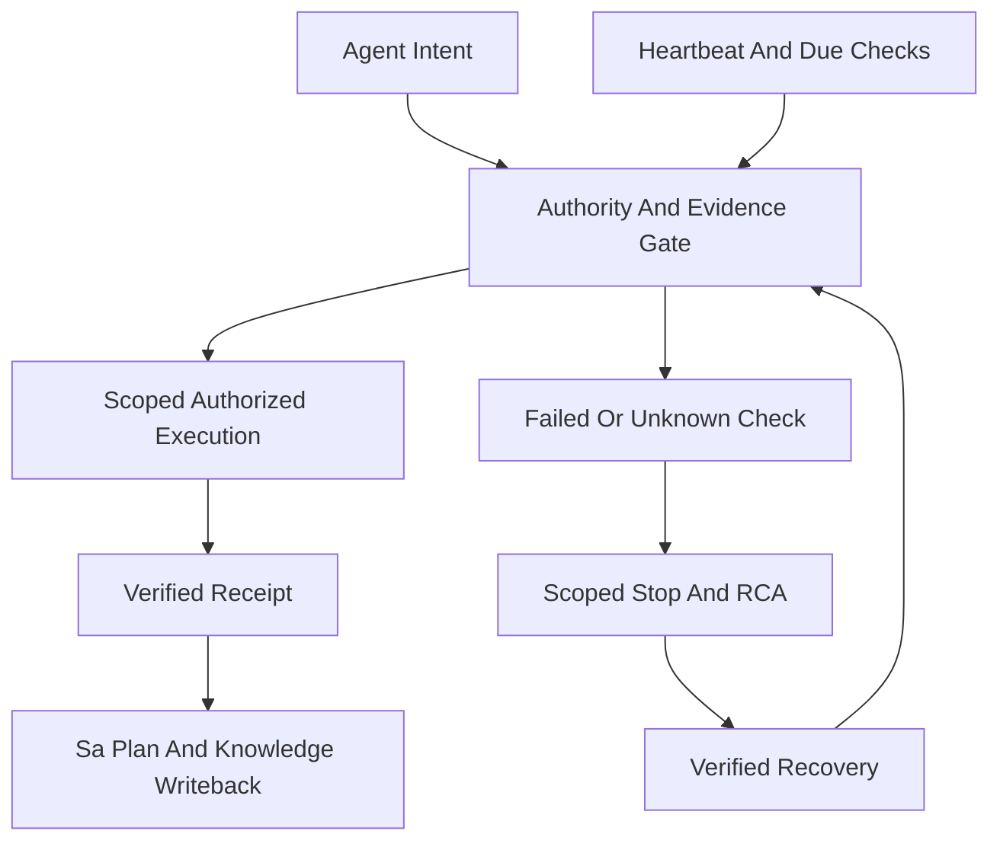

# 20261031-1807 — All-agent symbiosis operations, preflight, TPS and evolution

#fractal-l0 #fractal-l1 #fractal-l2 #fractal-l3 #fractal-l4 #fractal-l5 #fractal-l6 #fractal-l7 #fractal-l8 #fractal-l9 #km-triad #zk-adr #zero-muda

Host timestamp basis2026-10-31T18:30:07Z. [Contract](http://nas-1.tail55d152.ts.net:4100/files/contracts/rules/20261031-1807-all-agent-symbiosis-monitoring-contract.md) · [Artifact bindings](http://nas-1.tail55d152.ts.net:4100/files/governance/agents/policy/20261031-1807-all-agent-symbiosis-artifact-bindings.json).

## Purpose, authority and current scope

Full Codex symbiosis across Claude, Pi, AGY and Codex is priority one. Sa-plan uos/codex-handover-open-items-fractal-plan/20261031-1240 owns execution. OI02B_ALL_AGENT_SYMBIOSIS_PREFLIGHT is a development child, worker codex-symbiosis-preflight-20261031, attempt1. OI02 cutover and OI03..OI09 remain required; no monitor can close them by observation alone.

This SOP defines operations, development evolution and activation acceptance. New policy/watchdog/typed Rete projections are development components; actual production owner, collectors, official service inventory and effect-time consumers remain separate gates. Existing hooks and documentation are advisory. The development bootstrap still allows host tools and cannot be described as mandatory runtime enforcement.

Current operator role binding: Codex supervises and integrates; Pi executes eligible bounded slices with the cheapest acceptance-capable, price-verified model; Claude supplies independent review and may execute disjoint work whose acceptance is reviewed independently; AGY participates in peer/design/sovereign review. No agent approves its own implementation as an independent reviewer. This current binding supersedes earlier AGY-only supervisor prescriptions for this work; their historical evidence is preserved. Local Codex relays are not native Pi/Claude executions. Historical prompt-reduction measurements and a tenfold speedup target are not general performance guarantees.

## Architecture and aspect 17

Gleam/OTP owns agents, control, scheduling, models and effect policy. MCP and admitted Zenoh carry the same typed identity/authorization semantics. Hermes OCaml owns bounded evidence/analysis; ZigVM owns the deterministic kernel/VFS; MAX/Mojo remains isolated inference. SQLite stores durable execution/evidence. ETS is disposable derived state, never task or spend authority. Wiki, ZK and KB form the knowledge plane.

Aspect17 is durable execution: Sa-plan owns tasks, dependencies, attempts, leases, jobs and workflows. Check current authority before effects and reconcile uncertain outcomes before retry. A stored local workflow history does not prove a Temporal server/worker is running. An actor snapshot, board ACK, model opinion, Rete result or Stan posterior cannot complete a task.

## Operational cycle and anti-overchecking

1. PREDICT: state the operation, candidate/configuration, agent/session, declared latency/cost budget and expected failure evidence. Confirm this solves the requested problem.
2. OBSERVE: verify KM health/intactness, bounded search and top one or two documents; inspect current Sa-plan/risk/toolchain evidence. Never turn absent fields into success.
3. ORIENT: classify failures by agent, service, dimension and layer; use exact required service IDs. Bind counterevidence and evidence age.
4. DECIDE: dependency/authority eligibility precedes risk score. Reuse fresh candidate/configuration-bound evidence until expiry or relevant change. Heartbeats cannot renew functional evidence.
5. ACT: request only the due scoped probe or authorized operation. Development defaults: heartbeat30s, functional300s, coverage1800s, global minimum spacing1000ms, one in-flight collector per observer. Up to four consecutive due heartbeats precede a fair deep-check opportunity. Manual requests coalesce; failure backoff is bounded and cannot be bypassed by demand storms.
6. VERIFY: validate independent function/performance/operation dimensions, exact identities and source/clock bindings. A deadline bounds probe duration; performance acceptance still requires a trusted collector's declared service budget and measured latency. A heartbeat is not a functional smoke test.
7. REFLECT: preserve failures and RCA, update risk/SOP/skill bindings, reciprocal knowledge and the 13-section journal. Activation requires independent review and actual runtime receipts.

The nominal default schedule requests about0.2422 probes/second when each probe occupies at most one spacing interval; this is a workload calculation, not a measured production guarantee. Slow collectors, many instances or resource exhaustion can make it unschedulable. Export actual started/completed/error/timeout/stale/coalesced counters, heartbeat ages and next-due values. Do not launch duplicate observers per agent. Full check campaigns run on relevant changes, expiry or an authorized audit—not on every heartbeat.

## Evidence, exact coverage and recovery

Each agent has an exact candidate/configuration/session binding. Coverage includes explicit Agent in both proof and every service observation. Compare required and observed IDs exactly; reject missing, duplicate, unexpected, cross-agent, mismatched, stale or future evidence. Every service's three dimensions have individual timestamps. Count equality alone is insufficient.

The configured registry must independently be bound to the actual official catalog and authorized client profile. The pure checker validates supplied data, not its authenticity. READY_SCOPED_REGISTRY_OBSERVATION never means all world services or all transports are proved. Legacy callers without a registry remain UNKNOWN. A function marked successful without an actual authorized operational receipt does not establish full operational coverage.

Startup and missing evidence are UNKNOWN. Failures cause scoped STOP; invalid time or identity cannot clear a failure. Recovery requires two distinct successful fresh probes; coverage recovery requires advanced timestamps for every service dimension. Rebinding invalidates the changed agent's evidence and configured registry. A good heartbeat cannot clear a failing model-budget, authority or writeback capability.

## Collector lifecycle and TPS containment

The OTP observer owns one timer and one collector flight. Collectors are trusted, BEAM-preemptible, must not trap exits and must not spawn untracked descendants. Parent/observer death, Stop, timeout and rebinding use a kill/reap barrier. Capacity is not released until termination is confirmed. Unknown reaping keeps the flight fenced; no replacement worker is admitted.

A hostile collector that traps exits plus unexpected guardian loss can remain alive. The adversarial test proves fencing and requires explicit fixture cleanup; it does not prove automatic cleanup under that combined fault. Arbitrary blocking NIF/native calls require isolated bounded process-tree guardians. Do not generalize BEAM tests into OS-process or distributed liveness guarantees.

TPS: pull only dependency-ready tasks; bound work in progress; make malformed parameters fail before effects; stop affected lanes on UNKNOWN/STOP; level due probes; retain failure evidence; repair and verify before resuming. No automatic restart, grant issuance, task completion, budget refund or inference dispatch exists in the monitor or typed advisory bridge.

## Fractal RCA, Rete-UL and evolutionary control

Use competing hypotheses and falsifiers, not a count of repeated symptoms. Separate source/configuration defects, identity/authority gaps, stale evidence, missing collector truth, overload and lifecycle failure. The typed symbiosis guard bridge produces bounded scoped facts, existing RuleEvaluation diagnostics and grouped RCA; it does not encode facts into legacy entropy/Lyapunov sentinel floats. Existing105 scalar guards remain unchanged. Calling the bridge is an explicit integration point, not proof a live Rete engine consumes it.

Canonical layers: L0 constitutional authority; L1 atomic identity/time/receipts; L2 supervised components; L3 fenced transactions; L4 system/dev-production isolation; L5 cognitive reasoning/model routing; L6 ecosystem service discovery; L7 federation/MCP/Zenoh; L8 bounded evolution; L9 candidate verification. Assign a primary diagnostic layer where justified; zero/unobserved layers stay visible. Merely enumerating L0..L9 is not full cross-product coverage.

Evolution path: preserve observations; rank eligible risk reduction; design a falsifiable candidate; isolate implementation; test counterexamples and recovery; obtain independent review; serialize JJ integration; activate only with release/state authority; reobserve real behavior; update knowledge. Experiments and twins never auto-promote into production.

```ascii
[Agent Intent] --> [Authority And Evidence Gate]
[Authority And Evidence Gate] --> [Scoped Authorized Execution]
[Authority And Evidence Gate] --> [Failed Or Unknown Check]
[Scoped Authorized Execution] --> [Verified Receipt]
[Verified Receipt] --> [Sa Plan And Knowledge Writeback]
[Heartbeat And Due Checks] --> [Authority And Evidence Gate]
[Failed Or Unknown Check] --> [Scoped Stop And RCA]
[Scoped Stop And RCA] --> [Verified Recovery]
[Verified Recovery] --> [Authority And Evidence Gate]
```



This is the required target topology. End-to-end automatic enforcement is not claimed by these source components.

## FMEA and STPA

Raw analyst judgments, not measured failure probabilities; residual occurrence remains unmeasured.

| Failure mode | S | O | Det | RPN | Acceptance / residual |
|---|---:|---:|---:|---:|---|
| Missing official inventory or authentic collector |5|3|4|60|Actual catalog plus authenticated candidate-bound receipts required; activation blocked.|
| Cross-agent evidence reuse |4|3|3|36|Agent header/leaf guards and replay negative controls; real identity provenance remains external.|
| Lost owner or hostile collector |4|3|2|24|Lifecycle barriers and unconfirmed-reap fence; trusted collector restrictions and native isolation remain.|
| Duplicate observers or overchecking |3|3|2|18|One owner, cadence/backoff/counters and actual load/latency evidence required.|
| Unknown usage or missing effect authority |5|3|3|45|Keep usage HOLD and independent task/spend/effect gates; no advisory override.|

STPA controller is the harness/observer, action is readiness projection and observation scheduling. UCA not_provided: overdue checks omitted during an outage; constrain age-based UNKNOWN and observable lateness. Provided_unsafe: READY from incomplete/cross-agent/unauthenticated data; constrain exact IDs/Agent/bindings/dimensions and authentic collectors. Wrong_timing: late response after timeout/rebind; constrain pending sequence, monotonic epoch and current candidate. Duration: worker continues after Stop or capacity released before DOWN; constrain owner monitoring, kill/reap confirmation and fenced unknown termination. Constraints do not become enforced solely by publication.

## Stan, STANAG and decision evidence

Stan posterior analysis is advisory and its trigger has not fired for deterministic fixture counts or this small benchmark. Require real attributed longitudinal data, a probabilistic question whose uncertainty matters, and an independent oracle. Preserve missingness, censoring and clock provenance. Use repository-pinned OCaml serving/analytic summaries where appropriate; any justified sampler needs seed/diagnostic/calibration evidence. No new package/model or posterior-based authority bypass is authorized here.

STANAG/Admiralty source admissibility is separate: distinguish observed runtime B2 evidence within its scope from unrun assertions and unverified inputs. Neither a reliability estimate nor a credible interval can lower an authorization, provenance or budget gate.

## Knowledge performance and model costs

Live bounded baseline: search1498–1570ms, ZK783–838ms, read11–1507ms under two three-request batches. Private fresh-corpus prefetch646–798ms dominated ranking/response35–48ms. Request-local normalization preserved eight byte-identical synthetic queries; synthetic ranking median66.806ms to63.181ms is not a full-service speedup. Preserve fresh-disk/link/scope checks; do not introduce stale cross-request result caches. Prioritize measured collection/indexing improvements under OI09 and actual candidate-bound load/latency gates.

Use bounded search excerpts and top one or two expanded documents. Source-derived ETS indexes may accelerate access only with independently verified generation/content invalidation and recovery. ETS never replaces durable authority or fresh effect checks. Separate provider generation costs, SDK estimates, native Claude estimates and key-wide/account totals. Added credits do not raise USD10 daily policy. Unknown charges remain HOLD; no repeated model inference is required for monitoring. Select the cheapest model that meets acceptance, and escalate only bounded difficult work with current price/usage evidence.

## Activation, rollback and 17-aspect acceptance

Full symbiosis requires OI02 pinned release/configuration transaction, OI03 live backend fidelity, OI04 offline formal toolchain, OI05 links/aliases, OI06 isolated Telegram disposition, OI07 effect-time fencing, OI09 native knowledge unification and OI08 fault/soak/two-key acceptance. Repair the missing OI08 dependency on OI09 through Sa-plan's supported interface before final soak. OI01 dossier completion is not sovereign re-admission above EV93.

All17 aspects remain explicit: substrate/storage; JJ; purity/provenance; OTP supervision; ZigVM/VFS; Hermes evidence; mathematics; feedback/authority; isolated inference; mesh/observability; agent events; declarative UI; multi-interface/accessibility; Tailnet navigation; verification checklist; KM triad; durable execution. Applicable UNKNOWN/UNRUN rows block full compliance. Required production evidence includes actual unique owner and supervision, authenticated per-agent collectors/catalog binding, enforced operation gates, dashboard/API meaning, bounded overhead, signed/replay-negative transport, rollback, chaos and the planned24-hour soak.

A Codex restart is not required for currently working knowledge recall. After an authorized release/config change, compare loaded identities and reconnect only affected MCP sessions if necessary. Restarting Codex alone cannot supply missing collectors, authority or service wiring. No restart is part of this documentation update.

## Comprehensive verification checklist

These are obligations; unchecked global/runtime requirements are not passes.

<details><summary>Domain 1 — Metadata, timestamp and navigation</summary>

- [x] CHK-01-TIME — Host timestamp basis 2026-10-31T18:30:07Z.
- [ ] CHK-02-TAIL — Final published bytes and full FQDN links require live proof.
- [x] CHK-03-FRACT — Explicit L0–L9 implications and unobserved layers.
- [ ] CHK-04-KM — Final reciprocal wiki/ZK/inventory/journal reconciliation required.

</details>
<details><summary>Domain 2 — Zero-Muda and storage safety</summary>

- [x] CHK-05-MUDA — Reuse existing dependencies; no barred runtime introduced.
- [x] CHK-06-GRAPH — Pure Gleam policy and bounded supervised IO boundary.
- [x] CHK-07-DRIVE — No device effects; preserve existing storage interlocks.

</details>
<details><summary>Domain 3 — Tests and mathematical gates</summary>

- [ ] CHK-08-C1C8 — Integrated UI/accessibility categories remain UNRUN.
- [ ] CHK-09-MATH — Global four mathematical gates not inferred from finite tests.
- [ ] CHK-10-9MOD — All applicable modalities require candidate-bound evidence.
- [ ] CHK-11-REGR — Live actor/service/UI regression and load measurements required.

</details>
<details><summary>Domain 4 — Cross-language control and observability</summary>

- [ ] CHK-12-GLEAM — Actual production owner and restart behavior must be observed.
- [ ] CHK-13-HERMES — Applicable bounded evidence/solver gates require actual invocations.
- [ ] CHK-14-ZIGVM — No new deterministic-kernel or VFS proof claimed.
- [ ] CHK-15-MAX — No new inference or isolated-daemon readiness claimed.
- [ ] CHK-16-OTEL — Actual trace identity, clock domain and freshness required at integration.

</details>
<details><summary>Domain 5 — Sovereign governance and Jujutsu</summary>

- [ ] CHK-17-SOV — Independent runtime release and state authority outstanding.
- [ ] CHK-18-JJ — Final candidate, source pins and serialized integration receipt required.

</details>
<details><summary>Domain 6 — Provenance extension</summary>

EV93 ceiling; EV94..109 / ADR071..086 NOT_ADMITTED. No new EV numbers. Source guidance and tests do not grant system admission.

</details>

[[wiki:20260905-1801-uos-zk-km-corpus-index]] · [[zk:20260905-1801-moc-uos-unified-master]]

[Previous operations manual](http://nas-1.tail55d152.ts.net:4100/files/docs/sop/20261001-1117-uos-agent-symbiosis-operations.md) · [Wiki](http://nas-1.tail55d152.ts.net:4100/wiki) · [ZK](http://nas-1.tail55d152.ts.net:4100/zk) · [Cockpit](http://nas-1.tail55d152.ts.net:4100/) · [Next execution plan](http://nas-1.tail55d152.ts.net:4100/files/docs/design/20261031-1240-uos-open-items-fractal-design-implement-test-plan.md).

UOS footer: development/process scope only; no production admission.
