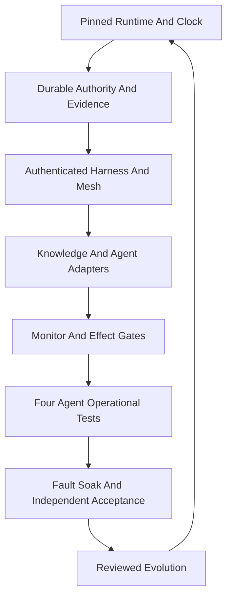

# 20261031-1918 — Full UOS hive services and functional acceptance

#fractal-l0 #fractal-l1 #fractal-l2 #fractal-l3 #fractal-l4 #fractal-l5 #fractal-l6 #fractal-l7 #fractal-l8 #fractal-l9 #km-triad #zk-adr #zero-muda

Observed timestamp basis 2026-10-31T19:22:18Z; host synchronization observed by the current risk checker. [Self](http://nas-1.tail55d152.ts.net:4100/files/docs/sop/20261031-1918-full-hive-service-activation-and-checks.md) · [Monitoring SOP](http://nas-1.tail55d152.ts.net:4100/files/docs/sop/20261031-1807-all-agent-symbiosis-preflight-tps-and-evolution-sop.md) · [Execution plan](http://nas-1.tail55d152.ts.net:4100/files/docs/design/20261031-1240-uos-open-items-fractal-design-implement-test-plan.md) · [Cockpit](http://nas-1.tail55d152.ts.net:4100/).

## What full hive means

Full hive is a verified operating configuration of UOS, with Codex, Claude, Pi and AGY using shared authenticated control, knowledge, execution and learning services. No verified single full-hive toggle exists. The manifest, actual runtime and required operation matrix must agree. This document is an activation and acceptance specification, not evidence that every service is active.

For every required agent, service and supported operation, require correct real backend behavior, current identity and task/effect authority, fresh candidate/configuration-bound evidence, measured resource/performance acceptance, durable outcomes, observable errors and tested recovery. A missing or unknown required cell prevents a full-readiness claim. Optional backends have explicit applicability; an authorized task and budget activate inference when needed.

Codex supervises and integrates; Pi executes eligible bounded work; Claude reviews independently and can implement disjoint independently reviewed slices; AGY contributes peer/design/sovereign review. Local Codex relays retain their real identity. No implementer supplies its own independent acceptance. Model names, service-active status, catalog counts and board acknowledgements do not establish end-to-end functionality.

## Required service planes and where they belong

| Plane | Services and responsibility | Canonical location / acceptance |
|---|---|---|
| Supervision | Gleam/OTP root, domain supervisors, child ownership, restart/capacity bounds | apps/cepaf_gleam and apps/uos_swarm; actual child processes and restart tests |
| Durable execution | Sa-plan DAG, tasks/jobs/workflows, attempts, claims, leases and effect IDs | engines/hermes/modules/sa_plan; current authority at effect time |
| Agent access | Four native clients, MCP ingress, scoped tools, reviewed adapters | Gleam harness and client configuration; authenticated positive and negative operations per agent |
| Knowledge | Wiki, ZK, KB, fresh search/read/transclusion/writeback, provenance | Hermes and Gleam KM triad; exact document bytes, real backends, reciprocal links |
| Federation | Zenoh router, authenticated owner/subscriber, signed event synchronization | Gleam admitted ingress; HMAC/replay/epoch tests, bounded disconnect recovery |
| Models and cost | Pi/native provider adapters, routing, durable reservations, token/cost reconciliation | Gleam policy plus bounded provider workers; unknown liabilities retained |
| Observation and evidence | Heartbeat, functional/performance/operation collectors, exact service catalog, receipt sink | Gleam monitor with bounded Hermes storage; unique owner, durable readback and freshness |
| Verification | Native tests, algebraic laws, formal models, differential oracles, fault/soak tests | Candidate-bound Hermes/Lean/Quint/toolchain receipts; independent acceptance |
| Operations UI | Dashboard/API/TUI with truthful service state, ages, queues, parallelism and costs | Canonical UI; actual runtime data and C1–C8/accessibility checks |
| Evolution | POODAVR, RCA, TPS, FMEA/STPA, Rete advisory, reviewed proposals and knowledge writeback | Sa-plan plus canonical rules/skills/SOPs; no automatic promotion from advice |
| Execution backends | Deterministic ZigVM/VFS; bounded Hermes; isolated MAX/Mojo when applicable | Explicit ABI, ownership, deadlines, resource limits and real operational receipts |

ETS may hold disposable derived indexes and counters. SQLite remains durable authority. Wiki/ZK/KB avoid repeated reasoning through bounded fresh recall. Zenoh synchronizes verified events; it does not replace ownership or authorization. A source-derived index needs verified invalidation and recovery before a high-performance claim.

## Startup waves and enforcement

1. Observe synchronized clocks, Tailnet reachability, available pinned toolchains, storage safety and the current candidate. Preserve existing service owners.
2. Reconcile durable Sa-plan/coordinator/evidence state, current epochs and uncertain outcomes. Never blindly repeat an uncertain effect.
3. Verify the immutable harness/cockpit capsule and authenticated MCP/Zenoh ingress. Complete the original OI02 release/configuration transaction and its reader barrier before claiming cutover.
4. Bind real knowledge backends and the exact official service inventory to each client. Verify OI03 route fidelity, OI05 aliases and OI09 native knowledge unification.
5. Wire one monitor owner, authenticated collectors, durable receipt storage, model accounting and effect-time gate consumers. Current B/C development slices do not complete OI07 by themselves.
6. Exercise all four clients with functional, performance and operational positive/negative tests. Activate budgeted inference only through current policy.
7. Observe dashboard truth, rollback, fault recovery and the OI08 planned 24-hour soak. Full acceptance follows fresh runtime behavior plus machine-verifiable specification at the same candidate, independent review and current release/state authority.

```ascii
[Pinned Runtime And Clock] --> [Durable Authority And Evidence]
[Durable Authority And Evidence] --> [Authenticated Harness And Mesh]
[Authenticated Harness And Mesh] --> [Knowledge And Agent Adapters]
[Knowledge And Agent Adapters] --> [Monitor And Effect Gates]
[Monitor And Effect Gates] --> [Four Agent Operational Tests]
[Four Agent Operational Tests] --> [Fault Soak And Independent Acceptance]
[Fault Soak And Independent Acceptance] --> [Reviewed Evolution]
[Reviewed Evolution] --> [Pinned Runtime And Clock]
```



This diagram specifies required dependencies. It does not assert that these edges are currently wired. Mandatory enforcement belongs at authenticated ingress and execution boundaries, including OS/native isolation. Instructions and advisory hooks alone cannot prevent agent mistakes or host-tool bypass.

## Checks, timing and tracking

Before claim: KM recall, dependency readiness, risk preflight and current task scope. Before an effect: recheck identity, candidate, configuration, epoch, attempt, lease, permissions, evidence age and budget. Periodically: heartbeat30s, functional300s, coverage1800s development defaults, minimum spacing1s and one collector flight per observer. Heartbeats cannot refresh deep proof. Coalesce duplicate demands and use bounded backoff with fair deep-check opportunities.

On changes/failures: invalidate affected evidence, stop the affected lane, preserve the failure, run RCA/regressions and verify recovery. Recovery needs two distinct fresh successful probes. Before release: exact candidate inventory, formal/runtime evidence, independent acceptance, current release/state authority, tested rollback and all applicable 17-aspect/checklist obligations.

Track task transitions in Sa-plan; evidence through durable sanitized receipts bound to agent, candidate, config, session, sequence, monotonic clock domain and time interval. Persist UNKNOWN/STOP as counterevidence. A stored receipt does not authenticate its collector or grant authority. Observer snapshots are volatile until the durable sink is actually connected. Reading old storage never refreshes proof after a VM restart.

## Fractal scope, predictive control and learning

L0 authority; L1 identity/time/receipts; L2 supervision; L3 transactions; L4 knowledge/system boundaries; L5 reasoning/models; L6 service discovery/coverage; L7 MCP/Zenoh federation; L8 bounded evolution; L9 candidate verification. Enumerating layers does not prove their cross-product.

The 17 aspects remain substrate/storage; JJ; purity/provenance; OTP supervision; ZigVM/VFS; Hermes evidence; mathematics; feedback/authority; isolated inference; mesh/observability; agent events; declarative UI; interfaces/accessibility; Tailnet navigation; verification checklist; KM triad; durable execution. A17 is Sa-plan tasks/jobs/workflows; stored workflow history is not a running Temporal deployment.

Use PREDICT → OBSERVE → ORIENT → DECIDE → ACT → VERIFY → REFLECT for each scoped change. First confirm the right problem: verified useful operation and recovery, rather than more named processes. Failures produce competing hypotheses, FMEA raw severity/occurrence/detection, all four STPA unsafe-control types, counterexamples and regression tests. Propose rule/skill/SOP improvements, test them in shadow/differential mode, independently review, serialize integration, activate under authority, then measure the result. Rete output and Stan posteriors advise; neither can create permission or mark tasks complete.

Stan requires attributed longitudinal data, a useful probabilistic question and an independent oracle, with diagnostics/calibration. Its new-monitor trigger has not fired. Deterministic fixtures are not reliability trials. Forecast source integration separately from runtime activation; the planned soak itself requires 24 hours after its entry gates. No unsupported full-hive completion date or fleet reliability probability is supplied.

## Homeostatic biomorphic operation and self-evolution

The requested biomorphic mode is an engineering organization of specialized agents and services: sensing, shared memory, bounded coordination, fault isolation, recovery and reviewed adaptation. It adds no biological correctness guarantee. Operational homeostasis requires measured per-variable target bands and hysteresis for queue depth, latency, CPU/memory pressure, evidence age, error rate, held worker slots and cost liability. Hard safety/authority failures are independent vetoes; a favorable aggregate health score cannot average them away.

The existing Gleam [homeostasis engine](http://nas-1.tail55d152.ts.net:4100/files/apps/cepaf_gleam/src/cepaf_gleam/ha/homeostasis_evolution_engine.gleam) contains PID calculations, physiological telemetry ingestion, proposal registration and a quorum state model. It assumes caller-supplied measurements and voter identity. Its three stable ticks and a local V(e)=0.5e² derivative calculation do not prove whole-system stability or authenticate remote ballots. The root's use of initial time0 is not fresh observed telemetry. The [predictive autoscaler](http://nas-1.tail55d152.ts.net:4100/files/apps/cepaf_gleam/src/cepaf_gleam/ha/predictive_autoscaler.gleam) recommends scaling; actual scheduling still needs current capacity, budget and effect authority.

Self-evolution has explicit stages: observe a deviation; preserve evidence; identify competing causes; propose a change with expected gain and falsifiers; implement in an isolated Sa-plan slice; compare against independent oracles and baseline; run mutation/fault/recovery/performance tests; obtain independent acceptance; activate under current release/state authority; measure the outcome and write learning back. Permitted operational adjustments stay within their reviewed envelopes. Safety rules, permission changes, budget increases and production replacement cannot be self-authorized by the proposing model or quorum preview.

Homeostasis acceptance needs real closed-loop experiments: step/burst workload changes, delayed/missing telemetry, oscillation/overshoot, integral windup, saturated capacity, budget exhaustion, repeated failures, owner loss and bounded recovery. Prove controller/plant properties where a justified mathematical model exists; independently simulate and measure native behavior. Decreasing V on sampled inputs is a diagnostic, not a general Lyapunov theorem. Predictive forecasts carry horizon, uncertainty and later resolution; forecasting never overrides a deterministic refusal.

## Parallelism and performance

Measure active supervisors, workers, independent reviewers, native requests and service probes separately over time. Do not multiply these counts or equate registered worker rows with concurrent live agents. Parallelize eligible disjoint leaves; serialize shared integration and state effects. Four local agent slots alone cannot establish tenfold speedup. Amdahl's bound is S=1/(s+(1-s)/p+o), where s is serial work, p effective parallelism and o normalized coordination overhead. Reduce duplicated recall/build/model work and the measured critical path before increasing workers.

Current inventory found running external C3I services, absent canonical bin launchers referenced by unit templates, a root spec larger than its actual five-child startup, and ecology startup that may invoke inference. New uos-hive/symbiosis/token-monitor/MAX units were not found. Preserve these findings; repair manifests and verify actual owners before starting/replacing services. No legacy service is silently reclassified as canonical UOS adoption.

## Artifacts affected by an admitted improvement

Update the implementation and tests; source/capsule manifests; service/unit/client configuration; Sa-plan tasks/dependencies/receipts; formal models and source bindings; Rete proposals; FMEA/STPA hazards and controls; justified predictive/Stan data/diagnostics; canonical rules, adapted skills and Superpowers bindings; dashboard schemas; contracts/SOP/fractal prompt; 13-section journal; wiki index, ZK MOC and capability inventory; release/rollback and handover evidence. Update affected active artifacts only; preserve imported and historical originals.

## Comprehensive verification checklist

All unchecked rows remain obligations at full-hive scope.

<details><summary>Domain 1 — Metadata, timestamp and navigation</summary>

- [x] CHK-01-TIME — Observed host-clock timestamp basis recorded.
- [ ] CHK-02-TAIL — Final live delivery needs byte proof.
- [x] CHK-03-FRACT — L0–L9 and 17 aspects specified.
- [ ] CHK-04-KM — Final reciprocal registration needs verification.

</details>
<details><summary>Domain 2 — Purity and storage safety</summary>

- [x] CHK-05-MUDA — No new dependency or excluded runtime requested.
- [x] CHK-06-GRAPH — Gleam supervision and bounded Hermes boundaries preserved.
- [x] CHK-07-DRIVE — Storage interlocks retained; no device effects.

</details>
<details><summary>Domain 3 — Tests and mathematical gates</summary>

- [ ] CHK-08-C1C8 — Full integrated UI acceptance outstanding.
- [ ] CHK-09-MATH — Entropy, complexity, trajectory and ITQS gates need scoped measurements.
- [ ] CHK-10-9MOD — Full relevant unit/system/TDD/BDD/performance/scalability/property/fuzz/chaos acceptance outstanding.
- [ ] CHK-11-REGR — Full operational matrix and soak outstanding.

</details>
<details><summary>Domain 4 — Control and observability</summary>

- [ ] CHK-12-GLEAM — Actual full production supervision/consumer wiring outstanding.
- [ ] CHK-13-HERMES — Durable sink integration and formal obligations outstanding.
- [ ] CHK-14-ZIGVM — Affected kernel/VFS acceptance required.
- [ ] CHK-15-MAX — Applicable isolated inference acceptance required.
- [ ] CHK-16-OTEL — Real clocks, trace identity, loaded candidates and evidence ages required.

</details>
<details><summary>Domain 5 — Governance and Jujutsu</summary>

- [ ] CHK-17-SOV — Independent release/state acceptance outstanding.
- [ ] CHK-18-JJ — Final integrated candidate and source receipts required.

</details>
<details><summary>Domain 6 — Provenance extension</summary>

EV93 ceiling. EV94..109 and ADR071..086 NOT_ADMITTED. No new EV, inferred authority or blanket system admission.

</details>

[[wiki:20260905-1801-uos-zk-km-corpus-index]] · [[zk:20260905-1801-moc-uos-unified-master]]

[Previous monitoring SOP](http://nas-1.tail55d152.ts.net:4100/files/docs/sop/20261031-1807-all-agent-symbiosis-preflight-tps-and-evolution-sop.md) · [Wiki](http://nas-1.tail55d152.ts.net:4100/wiki) · [ZK](http://nas-1.tail55d152.ts.net:4100/zk) · [Next execution plan](http://nas-1.tail55d152.ts.net:4100/files/docs/design/20261031-1240-uos-open-items-fractal-design-implement-test-plan.md).

UOS footer: activation specification and development evidence; full hive runtime acceptance remains open.
