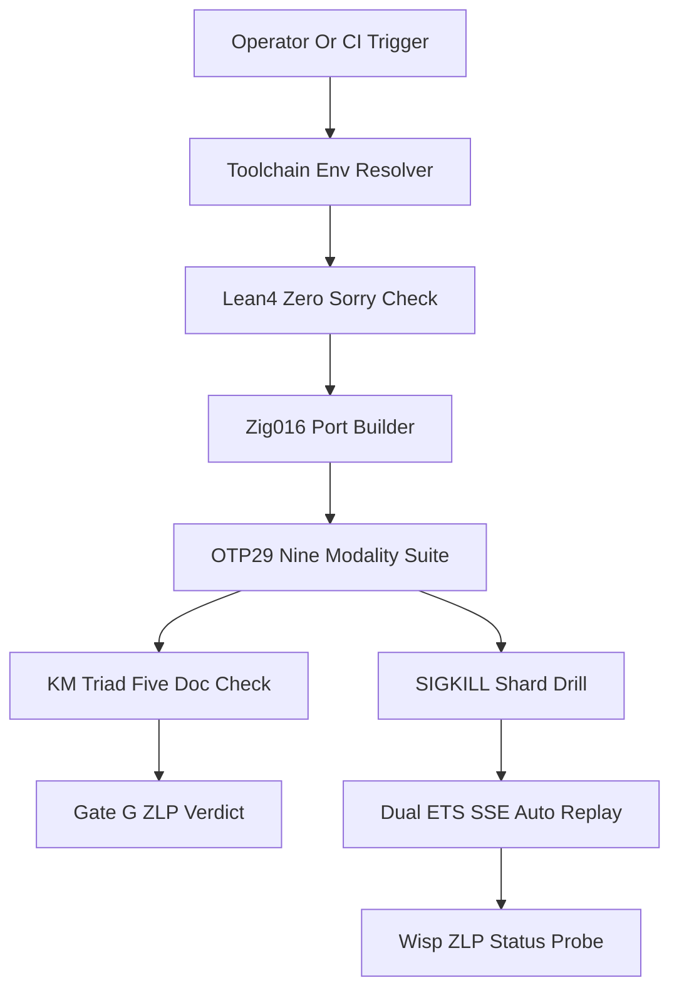

# 20261101-1248 — UOS-ZLP-v3 Supervised Lean 4 + Zig + OTP 29 + Zenoh Hyperplane Operations & Verification SOP

- **Tailscale Web FQDN**: [http://nas-1.tail55d152.ts.net:4100/files/docs/sop/20261101-1248-uos-zlp-v3-hyperplane-operations-and-verification-sop.md](http://nas-1.tail55d152.ts.net:4100/files/docs/sop/20261101-1248-uos-zlp-v3-hyperplane-operations-and-verification-sop.md)
- **Observed Clock (`SC-TIME`)**: `2026-11-01T12:48:00Z` (`chrony` stratum `3`, system offset `+0.000201s` fast of NTP time, nominal `< 2s` drift band)
- **Governing Contracts**: [SC-HARNESS-MCP-001](http://nas-1.tail55d152.ts.net:4100/files/contracts/rules/20260909-0412-gleam-harness-agent-operation-contract.md) · [SC-RELEASE-ASSURANCE-001](http://nas-1.tail55d152.ts.net:4100/files/contracts/rules/20260908-0551-release-assurance-sdlc-sre-sop.md) · [SC-PROVENANCE-001](http://nas-1.tail55d152.ts.net:4100/files/contracts/rules/20260908-0912-provenance-integrity-contract.md)
- **Reciprocal `#km-triad` Links**:
  - **Design & Math Specification**: [docs/design/20261101-1225-uos-zlp-v3-lean4-zig-otp29-zenoh-hyperplane-spec.md](http://nas-1.tail55d152.ts.net:4100/files/docs/design/20261101-1225-uos-zlp-v3-lean4-zig-otp29-zenoh-hyperplane-spec.md)
  - **Hermes Wiki Guide**: [docs/wiki/20261101-1248-uos-zlp-v3-supervised-lean4-zig-otp29-zenoh-hyperplane.md](http://nas-1.tail55d152.ts.net:4100/files/docs/wiki/20261101-1248-uos-zlp-v3-supervised-lean4-zig-otp29-zenoh-hyperplane.md)
  - **Zettelkasten Decision Note**: [docs/zk/20261101-1248-zlp-v3-supervised-otp29-port-hyperplane-decision.md](http://nas-1.tail55d152.ts.net:4100/files/docs/zk/20261101-1248-zlp-v3-supervised-otp29-port-hyperplane-decision.md)
  - **Integration Journal**: [docs/journal/20261101-1248-uos-zlp-v3-full-project-integration-journal.md](http://nas-1.tail55d152.ts.net:4100/files/docs/journal/20261101-1248-uos-zlp-v3-full-project-integration-journal.md)
- **Fractal Tags**: `#fractal-l0` `#fractal-l1` `#fractal-l2` `#fractal-l3` `#fractal-l4` `#fractal-l5` `#fractal-l6` `#fractal-l7` `#fractal-l8` `#fractal-l9` `#km-triad` `#zk-adr` `#zero-muda` `#tailscale-web`
- **Transclusions**: `[[wiki:20260905-1801-uos-zk-km-corpus-index]]` · `[[wiki:20261101-1248-uos-zlp-v3-supervised-lean4-zig-otp29-zenoh-hyperplane]]` · `[[zk:20260905-1801-moc-uos-unified-master]]` · `[[zk:20261101-1248-zlp-v3-supervised-otp29-port-hyperplane-decision]]`

---

## 1. Purpose & Operational Scope

This Standard Operating Procedure (`SOP`) governs building, verifying, observing, crash-testing, and rolling back the **`UOS-ZLP-v3`** Supervised `Lean 4.33.0 + Zig 0.16.0 + Gleam/OTP 29.0.5 + MCP + Zenoh` Port Hyperplane in `/home/an/NAS-setup/uos` and isolated `.uos-workspaces/*` Jujutsu workspaces.

> **Authority Fence**: Passing `bash tools/uos-cli zlp-check` (`G-ZLP`) proves two-key formal (`Lean 4.33.0` zero-`sorryAx`) and 9-modality runtime conformance at the candidate revision. It does **not** grant autonomous production daemon restart authority or alter `admitted_ev_ceiling = 93` (`application_admitted = false`, `system_admitted = false`).

---

## 2. Two-Key Verification & Incident Recovery Pipeline (`SC-DIAGRAM-001`)

```ascii
[Operator Or CI Trigger] --> [Toolchain Env Resolver]
[Toolchain Env Resolver] --> [Lean4 Zero Sorry Check]
[Lean4 Zero Sorry Check] --> [Zig016 Port Builder]
[Zig016 Port Builder] --> [OTP29 Nine Modality Suite]
[OTP29 Nine Modality Suite] --> [KM Triad Five Doc Check]
[KM Triad Five Doc Check] --> [Gate G ZLP Verdict]
[OTP29 Nine Modality Suite] --> [SIGKILL Shard Drill]
[SIGKILL Shard Drill] --> [Dual ETS SSE Auto Replay]
[Dual ETS SSE Auto Replay] --> [Wisp ZLP Status Probe]
```



---

## 3. Standard Operating Procedures

### 3.1 Step 1 — In-Project Toolchain Activation (`OTP 29` Mandatory)

UOS mandates OTP 29 (`toolchains/nix-profile/bin/erl`), Gleam 1.16.0 (`toolchains/gleam-1.16.0/bin/gleam`), Zig 0.16.0, and Lean 4.33.0 (`toolchains/lean-4.33.0/bin/lean`). Host `/usr/bin/erl` (OTP 27) cannot load OTP 29 `.beam` atom chunks (`corrupt atom table`) and is barred.

```bash
source /home/an/NAS-setup/uos/tools/lib/uos-toolchain.sh && uos_env
erl -noshell -eval 'io:format("OTP=~s~n", [erlang:system_info(otp_release)]), halt(0).'
./tools/lean --version
zig version
gleam --version
```

### 3.2 Step 2 — Native Port Build & Zero-`sorryAx` Proof Audit

Compile [formal/lean/UosZlpHyperplane.lean](http://nas-1.tail55d152.ts.net:4100/files/formal/lean/UosZlpHyperplane.lean), [native/zlp/lean_shim_v3.c](http://nas-1.tail55d152.ts.net:4100/files/native/zlp/lean_shim_v3.c), and [native/zlp/uos_zlp_port.zig](http://nas-1.tail55d152.ts.net:4100/files/native/zlp/uos_zlp_port.zig) into untracked `var/zlp/uos_zlp_v3_port`:

```bash
bash native/zlp/build_zlp_port.sh
```

Expected terminal receipt: `BUILD_OK` with `0` `sorryAx` across all `20` `#print axioms` checks and executable ELF binary at `var/zlp/uos_zlp_v3_port`.

### 3.3 Step 3 — Execute Two-Key CLI Gate (`G-ZLP`)

Run the canonical CLI gate via [tools/uos-cli](http://nas-1.tail55d152.ts.net:4100/files/tools/uos-cli) (which invokes [tools/zlp-check](http://nas-1.tail55d152.ts.net:4100/files/tools/zlp-check)):

```bash
bash tools/uos-cli zlp-check
# or equivalently:
bash tools/uos-cli gate G-ZLP
```

Passing criteria (`exit 0`):
1. `Lean 4.33.0` verifies `>= 20` `#print axioms` blocks with `0 sorryAx`.
2. `var/zlp/uos_zlp_v3_port` is present and executable.
3. `zlp_hyperplane_test` (all 9 testing modalities + `zenoh/client`, `otp_app`, and Wisp `/api/v1/zlp/status` integration) and `mcp_transport_test` pass `100%`.
4. All 6 `#km-triad` documents exist on disk.

### 3.4 Step 4 — Runtime Health & Wisp Telemetry Inspection

- **ETS Boot Keys**: After `otp_app.start()`, inspect `beam_cache.get_config("zlp:hyperplane_pool")` (`Ok("running")` or `Ok("binary_unbuilt")`) and `beam_cache.get_config("zlp:hyperplane_shards")` (`Ok("4")`).
- **Wisp HTTP Endpoint**: Query `router.route("/api/v1/zlp/status")` (or `curl -fsS http://nas-1.tail55d152.ts.net:4100/api/v1/zlp/status` once an operator-authorized runtime reload loads the candidate BEAM modules) to inspect `pool_running`, `perceus_exclusive: true`, `os_pid`, `active_subs`, and `in_flight_heavy` across shards `0..3`.
- **Environment Overrides**:
  - `UOS_ZLP_PORT_BIN`: Explicit absolute path override to `uos_zlp_v3_port`.
  - `UOS_ZENOH_REST_HOST` / `UOS_ZENOH_REST_PORT`: Zenoh REST/SSE router endpoint (defaults to `127.0.0.1` port `8080`).

### 3.5 Step 5 — Fail-Closed Degradation & Rollback

1. **Graceful Runtime Fallback**: If `var/zlp/uos_zlp_v3_port` is absent, `otp_app.start()` sets `"zlp:hyperplane_pool" = "binary_unbuilt"` without crashing, and `zenoh/client.open_prefer_zlp("{}")` falls back automatically to bounded `RestSession`.
2. **Jujutsu Candidate Rollback**: If any post-integration check fails, restore `main` via standalone Jujutsu (`jj bookmark set main -r <prior-commit-id>`) without using native Git commands.

---

## 4. Comprehensive Verification Checklist (`SC-CHECKLIST-001`)

<details>
<summary>Domain 1 — Metadata, timestamp and Tailscale navigation</summary>

- [x] **CHK-01-TIME** — Observed synchronized host clock `2026-11-01T12:48:00Z` (`chrony` stratum `3`) and `20261101-1248-` prefix.
- [x] **CHK-02-TAIL** — Full clickable Tailscale FQDN URLs (`http://nas-1.tail55d152.ts.net:4100/files/...`) verified.
- [x] **CHK-03-FRACT** — `#fractal-l0`..`#fractal-l9` tags and edge-identical ASCII + Mermaid operational pipeline (`SC-DIAGRAM-001`).
- [x] **CHK-04-KM** — Bidirectional `#km-triad` links uniting SOP, spec, wiki article, ZK decision note, and journals.

</details>

<details>
<summary>Domain 2 — Zero-Muda purity and storage safety</summary>

- [x] **CHK-05-MUDA** — `0 Bevy` and `0 Graphite` across all build and runtime procedures.
- [x] **CHK-06-GRAPH** — Pure Gleam/OTP control over OS-isolated port workers (`0` dirty NIFs).
- [x] **CHK-07-DRIVE** — Denied host OS NVMe serial `[REDACTED_SYSTEM_OS_SERIAL]` untouched.

</details>

<details>
<summary>Domain 3 — Testing Gold Standard and mathematical gates</summary>

- [ ] **CHK-08-C1C8** — CLI `G-ZLP`, OTP boot, Zenoh client, and Wisp JSON telemetry verified; browser visual surfaces unchanged.
- [x] **CHK-09-MATH** — `20/20` zero-`sorryAx` `Lean 4.33.0` theorems enforced by `tools/zlp-check`.
- [x] **CHK-10-9MOD** — All 9 testing modalities enforced by `tools/zlp-check`.
- [x] **CHK-11-REGR** — `mcp_transport_test`, `metabolic_zenoh_integration_test`, `uos_sup_test`, and `system_feature_census_test` verified green.

</details>

<details>
<summary>Domain 4 — Cross-language control and observability</summary>

- [x] **CHK-12-GLEAM** — OTP 29 toolchain resolution and `uos_zlp_sup` restart semantics documented and tested.
- [x] **CHK-13-HERMES** — `km-gate --gate`, `diagram-check`, `journal_linter`, and `risk-priority-check` integrated into workflow.
- [x] **CHK-14-ZIGVM** — `Zig 0.16.0` Zen 5 AVX-512 native build procedure verified.
- [ ] **CHK-15-MAX** — Modular MAX inference daemon untouched (`N/A`).
- [x] **CHK-16-OTEL** — Wisp `/api/v1/zlp/status` and `beam_cache` health keys documented and tested.

</details>

<details>
<summary>Domain 5 — Sovereign governance and standalone Jujutsu</summary>

- [ ] **CHK-17-SOV** — Live production BEAM daemon restart remains gated on independent Codex/Operator release authority.
- [x] **CHK-18-JJ** — Standalone Jujutsu commands exclusively (`0` Git commands).

</details>

<details>
<summary>Domain 6 — Provenance extension</summary>

Admitted EV ceiling remains `EV-93` (`admitted_ev_ceiling = 93`). `EV-94..EV-109` and `ADR-071..ADR-086` remain `NOT_ADMITTED`. `0` new EV or numbered ADR minted. `application_admitted = false`; `system_admitted = false`.

</details>

---

[Previous: UOS-ZLP-v3 ZK Decision Note](http://nas-1.tail55d152.ts.net:4100/files/docs/zk/20261101-1248-zlp-v3-supervised-otp29-port-hyperplane-decision.md) · [Next: UOS-ZLP-v3 Full Project Integration Journal](http://nas-1.tail55d152.ts.net:4100/files/docs/journal/20261101-1248-uos-zlp-v3-full-project-integration-journal.md) · [Wiki](http://nas-1.tail55d152.ts.net:4100/wiki) · [ZK](http://nas-1.tail55d152.ts.net:4100/zk) · [Cockpit](http://nas-1.tail55d152.ts.net:4100/)

UOS footer: operational runbooks and component verification gates do not grant production cutover or system admission.
