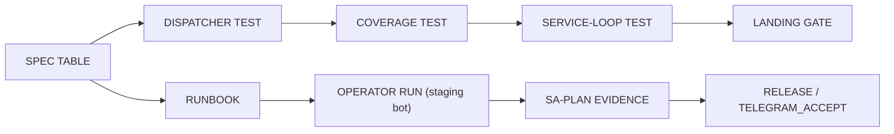

# 20261026-0220 — Telegram journeys guide

#fractal-l0 #fractal-l3 #fractal-l4 #fractal-l5 #fractal-l6 #fractal-l9 #zk-adr #zero-muda #km-triad #tailscale-web

[This guide](http://nas-1.tail55d152.ts.net:4100/docs/wiki/20261026-0220-telegram-journeys-guide.md) · [Contract](http://nas-1.tail55d152.ts.net:4100/files/docs/design/20261026-0210-telegram-operator-journey-contract.md) · [Rule](http://nas-1.tail55d152.ts.net:4100/files/contracts/rules/20261026-0220-telegram-journey-acceptance.md) · [Skill](http://nas-1.tail55d152.ts.net:4100/files/.claude/skills/uos-telegram-journeys/SKILL.md) · [Cockpit](http://nas-1.tail55d152.ts.net:4100/) · [Wiki index](http://nas-1.tail55d152.ts.net:4100/wiki) · [ZK](http://nas-1.tail55d152.ts.net:4100/zk)

Transclusions: [[zk:20260905-1801-moc-uos-unified-master]] · [[wiki:20260905-1801-uos-zk-km-corpus-index]]

Created: 2026-10-26. Contract `SC-TELEGRAM-JOURNEY-001`. Guide only; grants no authority and no admission.

## What a journey is

An ordered sequence of Telegram interactions an operator performs to reach an outcome, each step with the exact truthful reply class and the authority gate that applies. Reply classes: `ok`, `preview`, `denied`, `backend_unavailable`, `approval_required`; `executed` / `duplicate` only via the approval flow. Journeys never expect fabricated success.

## Specs and runbooks

| Use case | Spec | Real-traffic runbook |
|---|---|---|
| Security incident | [spec](http://nas-1.tail55d152.ts.net:4100/files/docs/design/20261026-0215-telegram-journey-security-incident.md) | [runbook](http://nas-1.tail55d152.ts.net:4100/files/docs/sop/20261026-0215-telegram-real-traffic-journeys-security-runbook.md) |
| Defence / high availability | [spec](http://nas-1.tail55d152.ts.net:4100/files/docs/design/20261026-0215-telegram-journey-defence-ha.md) | [runbook](http://nas-1.tail55d152.ts.net:4100/files/docs/sop/20261026-0215-telegram-real-traffic-journeys-defence-runbook.md) |
| Critical responder | [spec](http://nas-1.tail55d152.ts.net:4100/files/docs/design/20261026-0215-telegram-journey-critical-responder.md) | [runbook](http://nas-1.tail55d152.ts.net:4100/files/docs/sop/20261026-0215-telegram-real-traffic-journeys-responder-runbook.md) |

Related: [adapter contract](http://nas-1.tail55d152.ts.net:4100/files/docs/design/20261026-0115-telegram-controlled-action-adapter-contract.md) · [parity plan](http://nas-1.tail55d152.ts.net:4100/files/docs/journal/20261026-0049-claude-telegram-parity-plan-and-process.md).

## Staged versus real flow

```text
SPEC TABLE -> DISPATCHER TEST -> COVERAGE TEST -> SERVICE-LOOP TEST -> LANDING GATE
SPEC TABLE -> RUNBOOK -> OPERATOR RUN (staging bot) -> SA-PLAN EVIDENCE -> RELEASE / TELEGRAM_ACCEPT
```



The top path is development evidence only. The bottom path is executed and recorded by an authorized human; a model reply, board ACK or green dispatcher test is not a real Telegram pass.

## Staged run

See the skill for the full OTP 29 in-project recipe (`telegram_journey_{security,defence,responder}_test` and `telegram_journey_coverage_test` via eunit). Service-loop journeys live in `telegram_service_e2e_test`.

## Limits

Development journeys prove the dispatcher and staged service behave as specified, not a release, not admission. EV ceiling 93; EV-94..109 NOT_ADMITTED.

## Comprehensive verification checklist

This is a process/document package. The entries below do not assert production conformance.
UNRUN and NOT_ADMITTED remain nonpassing; N/A must be justified for each actual change.

<details><summary>Domain 1 — Metadata and navigation</summary>

- [x] CHK-01-TIME — Timestamp prefix recorded (20261026-0220).
- [x] CHK-02-TAIL — Full Tailscale FQDN references provided; live delivery unverified.
- [x] CHK-03-FRACT — L0–L9 applicability tagged.
- [x] CHK-04-KM — Contract, specs, runbooks and wiki guide linked in this package.

</details>
<details><summary>Domain 2 — Zero-Muda and storage safety</summary>

- [ ] CHK-05-MUDA — Fleet dependency exclusion scan UNRUN.
- [ ] CHK-06-GRAPH — Runtime language/NIF conformance UNRUN.
- [ ] CHK-07-DRIVE — OS storage interlock execution UNRUN.

</details>
<details><summary>Domain 3 — Testing and mathematical gates</summary>

- [ ] CHK-08-C1C8 — Full UI categories UNRUN.
- [ ] CHK-09-MATH — Mathematical quality gates UNRUN.
- [ ] CHK-10-9MOD — Nine runtime test modalities UNRUN.
- [ ] CHK-11-REGR — Live UI regression monitoring UNRUN.

</details>
<details><summary>Domain 4 — Cross-language control and observability</summary>

- [ ] CHK-12-GLEAM — Staged journey tests not run by this documentation package; UNRUN.
- [ ] CHK-13-HERMES — Mandatory enforcement NOT_IMPLEMENTED by this package.
- [ ] CHK-14-ZIGVM — Runtime kernel checks UNRUN.
- [ ] CHK-15-MAX — Actual inference checks UNRUN.
- [ ] CHK-16-OTEL — Runtime telemetry correlation UNRUN.

</details>
<details><summary>Domain 5 — Governance and Jujutsu</summary>

- [ ] CHK-17-SOV — Independent review/admission NOT_ADMITTED.
- [x] CHK-18-JJ — No native Git command used; standalone JJ workspace fable-w4 only.

</details>

<details><summary>Domain 6 — Provenance extension</summary>

EV ceiling remains 93. EV-94..109 remain NOT_ADMITTED. No new EV number is minted.
A real-traffic journey pass is recorded by an authorized human in Sa-plan; this package records none.

</details>

**UOS footer:** `nas-1.tail55d152.ts.net:4100` · wiki guide; document evidence grants no system admission.
