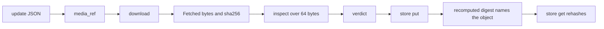

# 20261026-0801 — Telegram media pipeline guide (T1 to T4)

#fractal-l1 #fractal-l3 #fractal-l4 #fractal-l6 #fractal-l9 #zk-adr #zero-muda #km-triad #tailscale-web

[This guide](http://nas-1.tail55d152.ts.net:4100/docs/wiki/20261026-0801-telegram-media-pipeline-guide.md) · [Media design](http://nas-1.tail55d152.ts.net:4100/files/governance/planning/20261011-1354-claude-telegram-media-design.json) · [Wave 6c journal](http://nas-1.tail55d152.ts.net:4100/files/docs/journal/20261026-0750-claude-telegram-wave6c-media-inspect-store.md) · [Journeys guide](http://nas-1.tail55d152.ts.net:4100/docs/wiki/20261026-0220-telegram-journeys-guide.md) · [Cockpit](http://nas-1.tail55d152.ts.net:4100/) · [Wiki index](http://nas-1.tail55d152.ts.net:4100/wiki) · [ZK](http://nas-1.tail55d152.ts.net:4100/zk)

Transclusions: [[zk:20260905-1801-moc-uos-unified-master]] · [[wiki:20260905-1801-uos-zk-km-corpus-index]]

Created: 2026-10-26. Sa-plan `uos/telegram-runtime/20261001-1150` MEDIA_IMPL. Guide only; grants no authority and no admission. The 2026-09-09 simulator guide is preserved byte-for-byte and still names two functions renamed in wave 6c; this guide is current.

## The four stages

Every stage is a pure Gleam function in `apps/cepaf_gleam/src/cepaf_gleam/harness/`, and no stage trusts the one before it.

| Stage | Module | Input | Output | What it refuses |
|---|---|---|---|---|
| T1 parse | `telegram_media_ref` | update JSON | `Option(MediaRef)` (kind, file id, file_unique_id, declared mime, caption) | malformed updates; unsupported kinds become `Unsupported(label)` |
| T2 download | `telegram_media_download` | `MediaRef`, already-fetched ids, token thunk, injected `Transport` | `Fetched(kind, file_unique_id, bytes, sha256_hex, content)`, `Rejected(reason)`, `Aborted(observed, cap)` | over-cap declared size, repeat `file_unique_id`, token or transport failure; streams stop at the per-kind cap and at 4096 chunks; file URLs are redacted in every reason |
| T3 inspect | `telegram_media_inspect` | kind and content | `Accepted(sniffed)` or `Rejected(reason, sniffed)` | unknown signature, a type outside the kind's allowlist, `Unsupported` kinds; reads only the first 64 bytes; never reads `declared_mime` |
| T4 store | `telegram_media_store` | `Policy`, kind, file_unique_id, content, expected sha256, `now_ms`, measured `usage_bytes` | `Written`, `AlreadyStored`, `Refused(reason)`; `get` returns bytes and record or an error; `expired` returns a `Result` list; `delete` and `reclaim_expired` return receipts | caller digest that differs from the recomputed one, ceiling reached, invalid policy, `file_unique_id` over 128 bytes, an expired object already present (`expired_present`), an unverifiable stored object; `get` refuses tampered, expired, missing or malformed objects |

Allowlist (T3): Photo Jpeg Png Webp · Sticker Webp Png · Voice Ogg · Audio Mp3 Ogg · Video and Animation Mp4 · Document Pdf Png Jpeg Zip · GIF nowhere · ZIP never opened.

Layout (T4): `root/<base>/<first 2 hex>/<sha256>.bin` and `.json` (schema `uos.telegram.media-object.v1`). The name is the SHA-256 recomputed over the content. A caption, a file name or a `file_unique_id` never reaches a path.

```text
[update JSON] -> [media_ref]
[media_ref] -> [download]
[download] -> [Fetched bytes and sha256]
[Fetched bytes and sha256] -> [inspect over 64 bytes]
[inspect over 64 bytes] -> [verdict]
[verdict] -> [store put]
[store put] -> [recomputed digest names the object]
[recomputed digest names the object] -> [store get rehashes]
```



## Wiring a caller

The service wires the stages (wave 6h): the guard accepts a captioned media message with the caption as its command text, the stored input row carries the declared reference, and at dispatch `telegram_media_intake` runs download, inspection and the store, answering `backend_unavailable` until a deployment binds a fetch transport through `configure_media` (the HTTP transport is `telegram_media_transport.from_http(http_config)`, waves 6i and 6j: 4 MiB HTTP ranges from the configured base host only, so every per-kind cap up to the 52 MiB video cap is reachable while no single response exceeds the FFI ceiling), `denied` when a stage refuses, and `ok` only when the bytes are stored under their recomputed digest. A photo without a caption is a `media_without_caption` tombstone. The janitor is a child of the service supervisor whenever `configure_media` bound a policy. A deployment must:

1. Run `download` with a transport that holds the token outside the message and the logs.
2. Hand the `Fetched` outcome to `inspect_fetched`; treat anything but `Accepted` as a refusal reply, never as a fallback to the declared mime.
3. Measure `usage` and run `put` inside a supervised process bounded by the design's 2,000 ms `store_write` deadline; the module has no clock of its own.
4. Bind a media policy with `telegram_service.configure_media(config, policy, cadence_ms, max_objects, history_limit)`; the supervised service then starts `telegram_media_janitor` as its own child (wave 6g), which runs `reclaim_expired(policy, now_ms, max_objects)` once per cadence, keeps a bounded history and pauses after three consecutive errors until `Resume` (wave 6f); or run `reclaim_expired` yourself and keep its receipt; `delete(policy, sha)` removes one object on request (index first, then bytes; symlinks refused untouched). Deletion is an unlink, not a wipe (wave 6e).
5. Keep `Accepted` as "narrowed", not "safe": a magic-byte verdict is not content validation and nothing in these modules opens, decodes or renders.

## Run

```bash
cd apps/cepaf_gleam && bash -c 'export UOS_ROOT=/home/an/NAS-setup/uos; source $UOS_ROOT/tools/lib/uos-toolchain.sh; uos_env; gleam build --target erlang; PA=(); for d in build/dev/erlang/*/ebin; do PA+=(-pa $d); done; erl -noshell "${PA[@]}" -eval "eunit:test([telegram_media_ref_test,telegram_media_download_test,telegram_media_inspect_test,telegram_media_store_test],[verbose]), halt()."'
```

## Limits

T5 (upload) is deferred by the design's own condition; no use case survived review. The ceiling is a guard on a caller-measured number, not a quota lock, and it counts expired bytes until a caller runs `reclaim_expired`. Parent-directory rename races need a cooperative lease. MEDIA_REVIEW by an independent reviewer and TELEGRAM_E2E by an authorized human remain open. EV ceiling 93; EV-94..109 NOT_ADMITTED; no new EV number is minted.

## Comprehensive verification checklist

Checks below are obligations, not blanket passing claims.

<details><summary>Domain 1 — Metadata, timestamp and Tailscale navigation</summary>

- [x] CHK-01-TIME — Prefix `20261026-0801-` from the host UTC clock.
- [ ] CHK-02-TAIL — Tailnet links provided; serving not re-verified.
- [x] CHK-03-FRACT — L1, L3, L4, L6, L9 assigned.
- [x] CHK-04-KM — MOC and corpus index transcluded; design and journal linked.

</details>
<details><summary>Domain 2 — Zero-Muda purity and storage safety</summary>

- [x] CHK-05-MUDA — Gleam and one Erlang `file` external; no dependencies added.
- [ ] CHK-06-GRAPH — Not evaluated.
- [ ] CHK-07-DRIVE — Not in scope.

</details>
<details><summary>Domain 3 — Testing Gold Standard and mathematical gates</summary>

- [ ] CHK-08-C1C8 — Not evaluated.
- [ ] CHK-09-MATH — Not measured.
- [x] CHK-10-9MOD — Unit, negative, boundary, tamper, expiry, hostile-input and mutation tests at wave 6c.
- [x] CHK-11-REGR — Full suite at eee7f77b: 13744 passed, 0 failed.

</details>
<details><summary>Domain 4 — Cross-language control and observability</summary>

- [x] CHK-12-GLEAM — Gleam owns all four stages.
- [ ] CHK-13-HERMES — Not exercised.
- [ ] CHK-14-ZIGVM — Not exercised.
- [ ] CHK-15-MAX — Not applicable.
- [ ] CHK-16-OTEL — Not evaluated.

</details>
<details><summary>Domain 5 — Sovereign governance and standalone Jujutsu</summary>

- [ ] CHK-17-SOV — MEDIA_REVIEW and R5 review outstanding.
- [x] CHK-18-JJ — Standalone JJ, integrator workspace fable-l0.

</details>
<details><summary>Domain 6 — Provenance extension</summary>

EV ceiling remains 93. EV-94..109 remain NOT_ADMITTED. No new EV number is minted.

</details>

**UOS footer:** `nas-1.tail55d152.ts.net:4100` · wiki guide; document evidence grants no system admission.
