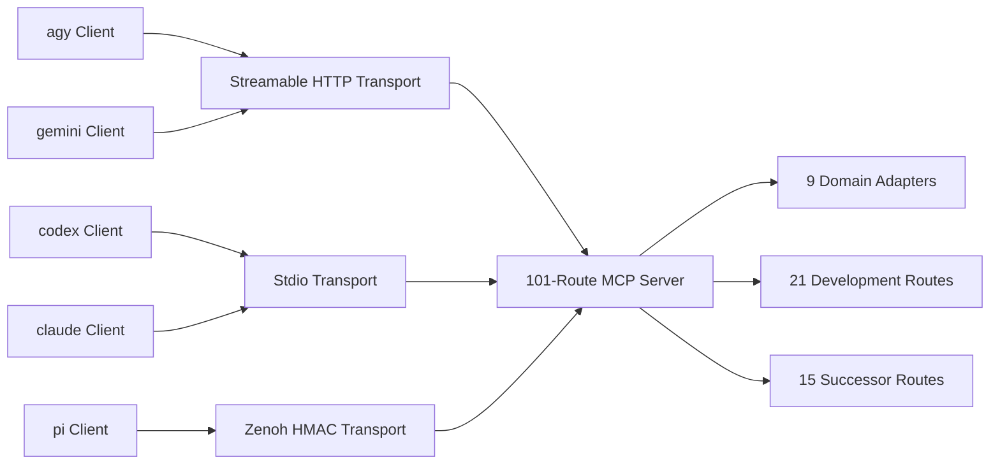

# 20261030-1058 — Unified 101-Route MCP Client & Operator Guide

- **Guide ID**: `SC-AK47-SYMBIOSIS-001` companion wiki
- **Contract**: [`contracts/rules/20261030-1058-ak47-multi-agent-mcp-symbiosis-rule.md`](http://nas-1.tail55d152.ts.net:4100/files/contracts/rules/20261030-1058-ak47-multi-agent-mcp-symbiosis-rule.md)
- **ZK decision record**: [http://nas-1.tail55d152.ts.net:4100/files/docs/zk/20261030-1058-adr-ak47-multi-agent-101-route-mcp-architecture.md](http://nas-1.tail55d152.ts.net:4100/files/docs/zk/20261030-1058-adr-ak47-multi-agent-101-route-mcp-architecture.md)
- **Tailscale FQDN**: [http://nas-1.tail55d152.ts.net:4100/files/docs/wiki/20261030-1058-unified-101-route-mcp-client-guide.md](http://nas-1.tail55d152.ts.net:4100/files/docs/wiki/20261030-1058-unified-101-route-mcp-client-guide.md)
- **Status**: Reference guide. Grants no effect authority and no admission. Client adoption is **UNRUN**.

#fractal-l0 #fractal-l1 #fractal-l2 #fractal-l3 #fractal-l4 #fractal-l5 #fractal-l6 #fractal-l7 #fractal-l8 #fractal-l9 #zk-adr #zero-muda #tailscale-web

**Navigation:** [Cockpit](http://nas-1.tail55d152.ts.net:4100/) · [Wiki](http://nas-1.tail55d152.ts.net:4100/wiki) · [ZK](http://nas-1.tail55d152.ts.net:4100/zk) · [Rule](http://nas-1.tail55d152.ts.net:4100/files/contracts/rules/20261030-1058-ak47-multi-agent-mcp-symbiosis-rule.md) · [Guide source](http://nas-1.tail55d152.ts.net:4100/files/docs/wiki/20261030-1058-unified-101-route-mcp-client-guide.md) · [Skill](http://nas-1.tail55d152.ts.net:4100/files/governance/agents/20261001-1118-skills/ak47-multi-agent-mcp-symbiosis/SKILL.md)

Transclusions: [[zk:20261030-1058-adr-ak47-multi-agent-101-route-mcp-architecture]] · [[wiki:20260905-1801-uos-zk-km-corpus-index]]

## 1. Route inventory

The unified Gleam/OTP server presents **101 routes**:

| Set | Count | Gating |
|---|---|---|
| Public domain routes across **9 domain adapters** | 65 | role + grant scope + bounds |
| Development routes | 21 | development grant, non-production |
| Successor routes | 15 | successor grant, task-scoped |

A declared route is **not** a connected route. Verify the live `describeNamespace` / heartbeat list before relying on any route, and report a route whose state is unprobed as unprobed rather than available.

**Catalog reconciliation note (`tools.gleam`).** The public catalog declares **65** public tools: **53** are listed directly in the default legacy unauthenticated `tools/list` (`tools.operational_tool_definitions()` = 65 declared minus 12 unavailable), and **12** gated domain tools (`control_loop`, `safety_status`, `run_selfcheck`, `registry_status`, `run_gate`, `zk_search`, `sa_bridge_submit`, `vault_status`, `vault_list_secrets`, `vault_policy_get`, `vault_audit_tail`, `vault_health`) fail closed with `UNAVAILABLE` on unauthenticated/unconfigured legacy calls and execute only through authenticated typed adapters in `server.execute_route_authenticated`. `65 declared − 12 unavailable = 53 advertised`, matching the T19 receipt's `tools_listed_count: 53`; `tools/list` and `tools/call` must tell the same story.

## 2. Protocol versions

The server accepts MCP protocol versions **`2024-11-05`** (`Legacy20241105`) and **`2026-07-28`** (`Modern20260728`), matching `mcp/version.gleam` and `transports/http.gleam`. A client must negotiate one of the two; an unlisted version is refused with `UNSUPPORTED_PROTOCOL_VERSION`, not silently downgraded. Record the negotiated version in the session receipt.

## 3. Transports

| Transport | Fence |
|---|---|
| stdio | process boundary, single client session |
| Zenoh | **HMAC fence** on every published/subscribed topic |
| Streamable HTTP | **Bearer**, **Origin** and **session** fences |

A fence that is printed but not gated is decoration. The HMAC, Bearer, Origin and session checks are steel: they refuse before dispatch. The Streamable-HTTP `Origin` fence is HTTPS-only and Tailscale-FQDN-shaped: the `http_auth.gleam` allowlist accepts `https://nas-1.tail55d152.ts.net:4100` and refuses `http://` or raw IP literals.

```bash
# Streamable HTTP (POST /mcp): Bearer + HTTPS Tailscale Origin + session.
curl -sS -X POST http://127.0.0.1:<mcp-port>/mcp \
  -H 'Authorization: Bearer <token>' \
  -H 'Origin: https://nas-1.tail55d152.ts.net:4100' \
  -H 'Mcp-Session-Id: <session-id>' \
  -H 'Content-Type: application/json' \
  --data '{"jsonrpc":"2.0","id":1,"method":"initialize","params":{"protocolVersion":"2024-11-05"}}'
```

## 4. Roles, grants and bounds

Every route declares a role, a grant scope and bounds. A caller is authorized only within its role and grant; an out-of-scope call is refused **before** dispatch. Bounds include byte caps (evidence inputs stay within the observed `262144`-byte `files.max_bytes` cap), timeouts and rate limits. Use each field's actual type and precision: a grant `expires_utc_us` is a decimal **string** of integral microseconds; risk `ready_since`/`observed_at` are whole-second canonical UTC; a clock observation may validly carry fractional seconds.

## 5. Client matrix

| Client | Transport | Notes |
|---|---|---|
| `agy` | Streamable HTTP | supervisor/integrator/verifier session |
| `gemini` | Streamable HTTP | alternate supervisor lane |
| `codex` | stdio | complex multi-file integration / security slices |
| `claude` | stdio | `--allowedTools Read`, independent falsification |
| `pi` | Zenoh HMAC | fast disjoint slices with the 8-flag isolation bundle |

## 6. Error taxonomy

| Class | Meaning | Operator action |
|---|---|---|
| `refused` | guard fired before dispatch | not an operational proof; inspect the guard and scope |
| `attachment_outcome_unknown` | attach outcome unresolved | reconcile with an operation-specific oracle; do not redispatch |
| `grant_decode` | grant field type/precision wrong | fix the field form (e.g. string microseconds) |
| `session_heartbeat_stale` | session heartbeat expired | heartbeat immediately before the next effect phase |
| `write_scope_refused` | target outside granted write scope | do not force; report the scope gap |
| `version_unsupported` | negotiated MCP version not accepted | renegotiate to `2024-11-05` or `2026-07-28` |

`UNRUN`, `UNKNOWN`, `STALE` and `NOT_ADMITTED` remain nonpassing.

## 7. Recovery

Keep the stable logical effect identity for status lookup. While an outcome is unresolved, do **not** redispatch it or mint a new intent or grant to evade the stop line; reconcile it to a known outcome first. A quarantined unknown is not retryable. Once the outcome is known, retry is governed by the actual policy and budget controls, not a fixed count. The reconciliation oracle must be specific to the operation attempted: an unchanged source map does not establish the absence of a network or other physical effect. Preserve the evidence and request independent review.

## 8. Epistemic projection

`Refused` is not `Operational`. Completed tasks alone are not green readiness. Raw review cannot be overridden. `DEV_READY` is not `SYSTEM_ADMITTED`. A live cutover requires separate **T24 operator release authority**.

## 9. Diagram (SC-DIAGRAM-001)

```text
[agy Client] --> [Streamable HTTP Transport]
[gemini Client] --> [Streamable HTTP Transport]
[codex Client] --> [Stdio Transport]
[claude Client] --> [Stdio Transport]
[pi Client] --> [Zenoh HMAC Transport]
[Streamable HTTP Transport] --> [101-Route MCP Server]
[Stdio Transport] --> [101-Route MCP Server]
[Zenoh HMAC Transport] --> [101-Route MCP Server]
[101-Route MCP Server] --> [9 Domain Adapters]
[101-Route MCP Server] --> [21 Development Routes]
[101-Route MCP Server] --> [15 Successor Routes]
```



The five clients reach one server through three fenced transports; the server partitions into the 9 public domain adapters plus the 21 development and 15 successor route sets.

## Comprehensive verification checklist

Checks below are obligations, not blanket passing claims. This documentation package executes nothing.

<details><summary>Domain 1 — Metadata, timestamp and Tailscale navigation</summary>

- [x] **CHK-01-TIME** — `20261030-1058` prefix recorded.
- [x] **CHK-02-TAIL** — Full Tailnet links provided; live serving status not asserted here.
- [x] **CHK-03-FRACT** — L0–L9 tags plus `#zk-adr #zero-muda #tailscale-web`.
- [x] **CHK-04-KM** — ZK/web transclusions plus rule, guide and skill links present.

</details>

<details><summary>Domain 2 — Zero-Muda purity and storage safety</summary>

- [ ] **CHK-05-MUDA** — Dependency exclusion scan UNRUN.
- [ ] **CHK-06-GRAPH** — Pure BEAM/Hermes graph boundary UNRUN.
- [ ] **CHK-07-DRIVE** — OS storage interlock execution UNRUN.

</details>

<details><summary>Domain 3 — Testing Gold Standard and mathematical gates</summary>

- [ ] **CHK-08-C1C8** — Applicable C1–C8 surfaces UNRUN.
- [ ] **CHK-09-MATH** — Four declared mathematical gates UNRUN.
- [ ] **CHK-10-9MOD** — Nine runtime test modalities UNRUN.
- [ ] **CHK-11-REGR** — Regressions and bounded observation UNRUN.

</details>

<details><summary>Domain 4 — Cross-language control and observability</summary>

- [ ] **CHK-12-GLEAM** — Actual OTP control/supervision behavior UNRUN.
- [ ] **CHK-13-HERMES** — Bounded analysis and authoritative evidence UNRUN.
- [ ] **CHK-14-ZIGVM** — Deterministic execution and descriptor-relative VFS UNRUN.
- [ ] **CHK-15-MAX** — Isolated inference UNRUN.
- [ ] **CHK-16-OTEL** — Clock and nonzero trace/span identity UNRUN.

</details>

<details><summary>Domain 5 — Sovereign governance and standalone Jujutsu</summary>

- [ ] **CHK-17-SOV** — Candidate-bound independent review and authorized admission NOT_ADMITTED.
- [ ] **CHK-18-JJ** — Standalone JJ, source ownership and exact candidate identity UNRUN.

</details>

<details><summary>Domain 6 — Provenance extension</summary>

EV ceiling remains 93. EV-94..109 remain NOT_ADMITTED. No new EV number is minted.

</details>

**UOS footer:** `nas-1.tail55d152.ts.net:4100` · wiki guide; document evidence grants no system admission.
