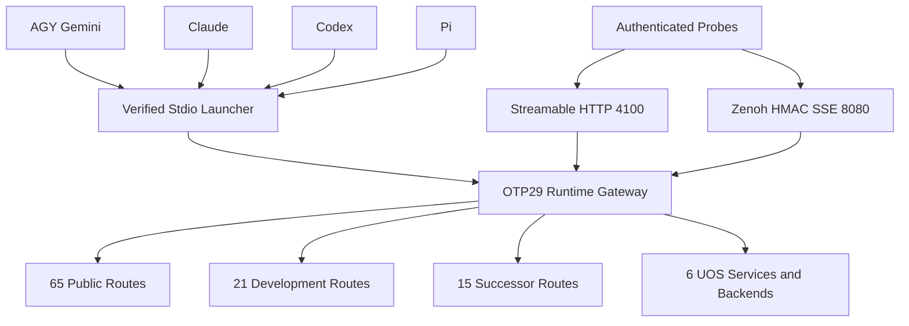

# 20261030-1058 — Unified 101-Route MCP Client & Operator Guide

- **Guide ID**: `SC-AK47-SYMBIOSIS-001` companion wiki
- **Contract**: [`contracts/rules/20261030-1058-ak47-multi-agent-mcp-symbiosis-rule.md`](http://nas-1.tail55d152.ts.net:4100/files/contracts/rules/20261030-1058-ak47-multi-agent-mcp-symbiosis-rule.md)
- **ZK decision record**: [http://nas-1.tail55d152.ts.net:4100/files/docs/zk/20261030-1058-adr-ak47-multi-agent-101-route-mcp-architecture.md](http://nas-1.tail55d152.ts.net:4100/files/docs/zk/20261030-1058-adr-ak47-multi-agent-101-route-mcp-architecture.md)
- **Tailscale FQDN**: [http://nas-1.tail55d152.ts.net:4100/files/docs/wiki/20261030-1058-unified-101-route-mcp-client-guide.md](http://nas-1.tail55d152.ts.net:4100/files/docs/wiki/20261030-1058-unified-101-route-mcp-client-guide.md)
- **Status**: Operational client guide with candidate-bound receipts. Grants no effect authority and no admission.

#fractal-l0 #fractal-l1 #fractal-l2 #fractal-l3 #fractal-l4 #fractal-l5 #fractal-l6 #fractal-l7 #fractal-l8 #fractal-l9 #zk-adr #zero-muda #tailscale-web

**Navigation:** [Cockpit](http://nas-1.tail55d152.ts.net:4100/) · [Wiki](http://nas-1.tail55d152.ts.net:4100/wiki) · [ZK](http://nas-1.tail55d152.ts.net:4100/zk) · [Rule](http://nas-1.tail55d152.ts.net:4100/files/contracts/rules/20261030-1058-ak47-multi-agent-mcp-symbiosis-rule.md) · [Guide source](http://nas-1.tail55d152.ts.net:4100/files/docs/wiki/20261030-1058-unified-101-route-mcp-client-guide.md) · [Skill](http://nas-1.tail55d152.ts.net:4100/files/governance/agents/20261001-1118-skills/ak47-multi-agent-mcp-symbiosis/SKILL.md)

Transclusions: [[zk:20261030-1058-adr-ak47-multi-agent-101-route-mcp-architecture]] · [[wiki:20260905-1801-uos-zk-km-corpus-index]]

## 1. Route inventory

The unified Gleam/OTP server presents **101 routes**:

| Set | Count | Gating |
|---|---|---|
| Public domain routes across **9 domain adapters** | 65 | role + grant scope + bounds |
| Development routes | 21 | development grant, non-production |
| Successor routes | 15 | successor grant, task-scoped |

A declared route is **not** a connected route. Verify the live `describeNamespace` / heartbeat list before relying on any route, and report a route whose state is unprobed as unprobed rather than available.

**Legacy catalog distinction.** The pinned `mcp/tools.gleam` catalog declares65 tools and advertises53 operational names after12 unavailable entries. That legacy categorization is distinct from the unified registry public65 specs (53 operational tools +12 facilities). Live `tools/list` advertises53; all101 registry routes are wired, while missing backend/grant/fence conditions continue to refuse honestly. Counts alone do not establish individual effect admission.

## 2. Protocol versions

The server accepts MCP protocol versions **`2024-11-05`** (`Legacy20241105`) and **`2025-03-26`**, **`2025-06-18`**, **`2025-11-25`**, **`2026-07-28`** (`Modern20260728`), matching `mcp/version.gleam`. Negotiate one of these five revisions; unlisted revisions refuse with `UNSUPPORTED_PROTOCOL_VERSION`. Accepted modern revisions are echoed exactly. Each authenticated HTTP request must keep `Mcp-Protocol-Version` equal to any body `params.protocolVersion`.

## Observed operational binding — S01..S04

Observed under operator SC-HARNESS-MCP-001 Clause 9 development bootstrap and separate ReleaseAuthority, Sa-plan `20261030-1634-mcp-full-symbiosis-closure`: immutable OTP 29 / ERTS 17.0.5 capsule `20261030-1811-79c8aa73a27a372e027e3fa677b75deae56e4fd1a1f84af6632b4409e82ba1e2` is selected by `var/releases/ecology/current-mcp-release` and verified by `tools/uos-mcp-stdio`. All 101 gateway routes are wired (65 public, including 53 operational tools + 12 server/resource/prompt/task/logging/completion facilities; 21 development; 15 successor). Private execution remains real-grant/task/fence gated; wiring does not grant authority or make unavailable backends available. Four native client bindings (AGY/Gemini, Claude, Codex, Pi) have 11-file capsule/payload-pin parity. Live authenticated stdio, Streamable HTTP `:4100/mcp`, and OTP-supervised Zenoh `indrajaal/mcp/request/**` round-trips passed, including HTTP 401 and forged-HMAC silent-drop checks with a valid ping bracket. See the [cutover receipt](http://nas-1.tail55d152.ts.net:4100/files/var/harness/20261030-s03-symbiosis-cutover/s03-outcome.json) and [native CLI proof ledger](http://nas-1.tail55d152.ts.net:4100/files/var/harness/20261030-s03-symbiosis-cutover/s04-4agent-cli-proofs.json). `application_admitted = false`, `SYSTEM_ADMITTED = false`, `system_admission = "NOT_ADMITTED"`, `admitted_ev_ceiling = 93`; EV-94..EV-109 remain NOT_ADMITTED and no EV number is minted. Cockpit HTTP200 does not imply semantic quorum health (observed `quorum_healthy=false`).

## 3. Transports

| Transport | Fence |
|---|---|
| stdio | process boundary, single client session |
| Zenoh | HMAC on each request envelope; pinned safe response destination |
| Streamable HTTP | **Bearer**, **Origin** and **session** fences |

A fence that is printed but not gated is decoration. The HMAC, Bearer, Origin and session checks are steel: they refuse before dispatch. The Streamable-HTTP `Origin` fence is HTTPS-only and Tailscale-FQDN-shaped: the `http_auth.gleam` allowlist accepts `https://nas-1.tail55d152.ts.net:4101` and refuses `http://` or raw IP literals.

```bash
# Streamable HTTP (POST /mcp): Bearer + HTTPS Tailscale Origin + session.
curl -sS -X POST http://nas-1.tail55d152.ts.net:4100/mcp \
  -H 'Authorization: Bearer <token>' \
  -H 'Origin: https://nas-1.tail55d152.ts.net:4101' \
  -H 'Mcp-Session-Id: <session-id>' \
  -H 'Mcp-Protocol-Version: 2026-07-28' \
  -H 'Content-Type: application/json' \
  --data '{"jsonrpc":"2.0","id":1,"method":"initialize","params":{"protocolVersion":"2026-07-28"}}'
```

## 4. Roles, grants and bounds

Every route declares a role, a grant scope and bounds. A caller is authorized only within its role and grant; an out-of-scope call is refused **before** dispatch. Bounds include byte caps (evidence inputs stay within the observed `262144`-byte `files.max_bytes` cap), timeouts and rate limits. Use each field's actual type and precision: a grant `expires_utc_us` is a decimal **string** of integral microseconds; risk `ready_since`/`observed_at` are whole-second canonical UTC; a clock observation may validly carry fractional seconds.

## 5. Client matrix

| Client | Transport | Notes |
|---|---|---|
| AGY / Gemini | verified capsule stdio | supervisor native call_mcp_tool observed; one vendor binding |
| Claude | verified capsule stdio | requested native MCP CLI calls; read-only review remains separately scoped |
| Codex | verified capsule stdio | 53 operational tools exposed, no four-tool enabled_tools filter |
| Pi | verified capsule stdio | public enabled; successor binding disabled |

All four use `/home/an/NAS-setup/uos/tools/uos-mcp-stdio`, `UOS_MCP_WORKSPACE_ROOT=/home/an/NAS-setup/uos`, `UOS_COCKPIT_RELEASE` and `UOS_MCP_EXPECTED_PAYLOAD_SHA256` pins. The launcher defaults to the verified `var/releases/ecology/current-mcp-release`; mutable build fallback is unset during acceptance. Never copy transport secrets or private credentials into these examples.

| Vendor | Exact native config surfaces | Files |
|---|---|---:|
| AGY / Gemini | `.gemini/settings.json`; `~/.gemini/settings.json`; `~/.gemini/config/mcp_config.json`; `~/.gemini/antigravity-cli/mcp_config.json` | 4 |
| Claude | `.mcp.json`; `~/.claude.json` | 2 |
| Codex | `.codex/config.toml`; `~/.codex/config.toml` | 2 |
| Pi | `.pi/mcp.json`; `~/.pi/agent/mcp.json`; `~/.pi/agent/mcp-adapter.json` | 3 |

Total: **11 files**. Non-UOS server entries and unrelated settings were byte-preserved. Public bindings use route `public`; disabled Codex/Pi private bindings use `successor`. Pi adapter `directTools: true` is retained. Rule mirrors are byte-identical copies; skill surfaces remain symlinks to the canonical target.

Streamable HTTP is `POST http://nas-1.tail55d152.ts.net:4100/mcp`, with signed Bearer, configured HTTPS Origin (observed `https://nas-1.tail55d152.ts.net:4101`), exact revision and session headers. RFC9728 metadata is served at `/.well-known/oauth-protected-resource`. Transport signing secrets live only in ignored mode0600 `var/harness/mcp-transport-secrets.env`.

The general `zenoh/client.gleam` subscription capability remains False (Telegram G-09 preserved); MCP owns a separate bounded subscriber. The current Zenoh gateway dispatches public calls, while private development/successor routes use supported route-bearing ingress and real grants/fences.

Only `c3i-gleam-server.service` sets `UOS_MCP_ZENOH_SUBSCRIBER=1`. Its independent OneForOne-supervised SSE worker subscribes to `/indrajaal/mcp/request/**` on fixed `nas-1.tail55d152.ts.net:8080`, verifies each HMAC envelope and publishes only safe `indrajaal/mcp/response/<client>/<id>` keys. The loopback OS mutex `127.0.0.1:41199` excludes cross-process duplicates; stdio children are excluded. Idle reconnect,1MiB caps and worker-owned atomics freshness preserve availability. Request keys are `indrajaal/mcp/request/<client>/<id>`. Prefix response subscriptions use `indrajaal/mcp/response/codex/s03live$*` (Zenoh sub-chunk wildcard), not an attached bare star. No DELETE is needed for probes.

### Native CLI proof invocation scope

The S04 Codex proof uses a process-scoped `-c mcp_servers.uos_gleam.tools.system_health.approval_mode="approve"` override for the explicitly operator-authorized read call; no persistent approval policy is weakened. The Pi proof selects `--mcp-config /home/an/NAS-setup/uos/.pi/mcp.json`, admitting only this explicitly chosen configuration rather than globally allowing unreviewed project servers or scripts. Default project trust remains ask. A connected `pi mcp list` is not itself a tool-execution proof. Native `sa_plan_status_for` advertises the required parameter `plan`; call `{"plan":"20261030-1634-mcp-full-symbiosis-closure"}` and validate the returned `plan_id`.

## 6. Error taxonomy

| Class | Meaning | Operator action |
|---|---|---|
| `refused` | guard fired before dispatch | not an operational proof; inspect the guard and scope |
| `attachment_outcome_unknown` | attach outcome unresolved | reconcile with an operation-specific oracle; do not redispatch |
| `grant_decode` | grant field type/precision wrong | fix the field form (e.g. string microseconds) |
| `session_heartbeat_stale` | session heartbeat expired | heartbeat immediately before the next effect phase |
| `write_scope_refused` | target outside granted write scope | do not force; report the scope gap |
| `version_unsupported` | negotiated MCP version not accepted | renegotiate to one of the five accepted revisions |

`UNRUN`, `UNKNOWN`, `STALE` and `NOT_ADMITTED` remain nonpassing.

## 7. Recovery

Keep the stable logical effect identity for status lookup. While an outcome is unresolved, do **not** redispatch it or mint a new intent or grant to evade the stop line; reconcile it to a known outcome first. A quarantined unknown is not retryable. Once the outcome is known, retry is governed by the actual policy and budget controls, not a fixed count. The reconciliation oracle must be specific to the operation attempted: an unchanged source map does not establish the absence of a network or other physical effect. Preserve the evidence and request independent review.

## 8. Epistemic projection

`Refused` is not `Operational`. Completed tasks alone are not green readiness. Raw review cannot be overridden. `DEV_READY` is not `SYSTEM_ADMITTED`. A live cutover requires separate **T24 operator release authority**.

## 9. Diagram (SC-DIAGRAM-001)

```text
[AGY Gemini] --> [Verified Stdio Launcher]
[Claude] --> [Verified Stdio Launcher]
[Codex] --> [Verified Stdio Launcher]
[Pi] --> [Verified Stdio Launcher]
[Authenticated Probes] --> [Streamable HTTP 4100]
[Authenticated Probes] --> [Zenoh HMAC SSE 8080]
[Verified Stdio Launcher] --> [OTP29 Runtime Gateway]
[Streamable HTTP 4100] --> [OTP29 Runtime Gateway]
[Zenoh HMAC SSE 8080] --> [OTP29 Runtime Gateway]
[OTP29 Runtime Gateway] --> [65 Public Routes]
[OTP29 Runtime Gateway] --> [21 Development Routes]
[OTP29 Runtime Gateway] --> [15 Successor Routes]
[OTP29 Runtime Gateway] --> [6 UOS Services and Backends]
```



Four native clients use the verified stdio launcher. Independent signed probes exercise the other two ingress transports against the same supervised gateway; private route execution remains fail-closed under real grants.

## Comprehensive verification checklist

Checks below are obligations, not blanket passing claims. This documentation package executes nothing.

<details><summary>Domain 1 — Metadata, timestamp and Tailscale navigation</summary>

- [x] **CHK-01-TIME** — `20261030-1058` prefix recorded.
- [x] **CHK-02-TAIL** — Full Tailnet links provided; live serving status not asserted here.
- [x] **CHK-03-FRACT** — L0–L9 tags plus `#zk-adr #zero-muda #tailscale-web`.
- [x] **CHK-04-KM** — ZK/web transclusions plus rule, guide and skill links present.

</details>

<details><summary>Domain 2 — Zero-Muda purity and storage safety</summary>

- [ ] **CHK-05-MUDA** — Dependency exclusion scan UNRUN.
- [ ] **CHK-06-GRAPH** — Pure BEAM/Hermes graph boundary UNRUN.
- [ ] **CHK-07-DRIVE** — OS storage interlock execution UNRUN.

</details>

<details><summary>Domain 3 — Testing Gold Standard and mathematical gates</summary>

- [ ] **CHK-08-C1C8** — Applicable C1–C8 surfaces UNRUN.
- [ ] **CHK-09-MATH** — Four declared mathematical gates UNRUN.
- [x] **CHK-10-9MOD** — Applicable source, transport, bounds, mutation and native-CLI observations recorded in S03/S04 receipts; no all-modalities claim.
- [ ] **CHK-11-REGR** — Regressions and bounded observation UNRUN.

</details>

<details><summary>Domain 4 — Cross-language control and observability</summary>

- [x] **CHK-12-GLEAM** — Actual OTP29 supervision and native MCP behavior observed under operator authority; private effects remain separately gated.
- [ ] **CHK-13-HERMES** — Bounded analysis and authoritative evidence UNRUN.
- [ ] **CHK-14-ZIGVM** — Deterministic execution and descriptor-relative VFS UNRUN.
- [ ] **CHK-15-MAX** — Isolated inference UNRUN.
- [ ] **CHK-16-OTEL** — Clock and nonzero trace/span identity UNRUN.

</details>

<details><summary>Domain 5 — Sovereign governance and standalone Jujutsu</summary>

- [x] **CHK-17-SOV** — Independent Claude source reviews PASS and operator ReleaseAuthority recorded; global/application admission remains NOT_ADMITTED.
- [x] **CHK-18-JJ** — Standalone JJ identities and scoped source preservation observed; final S04 completion and main integration remain supervisor-owned.

</details>

<details><summary>Domain 6 — Provenance extension</summary>

EV ceiling remains 93. EV-94..109 remain NOT_ADMITTED. No new EV number is minted.

</details>

**UOS footer:** `nas-1.tail55d152.ts.net:4100` · wiki guide; document evidence grants no system admission.
