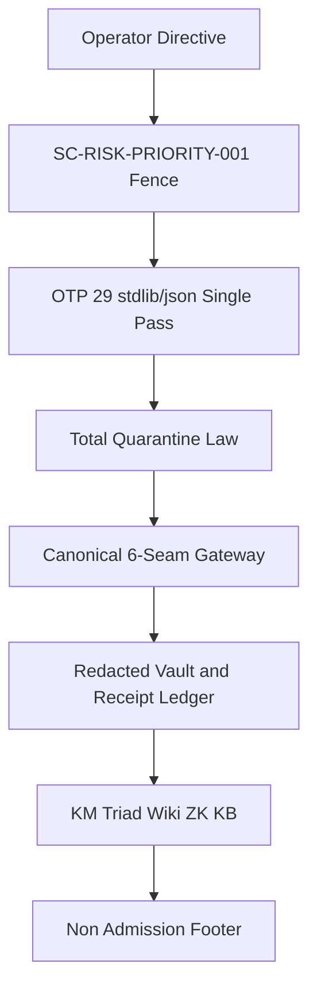

# 20261031-1012 — OTP 29 JSON Anti-Brittle MCP & Fractal Symbiosis Wiki

- **Breadcrumb**: [Cockpit](http://nas-1.tail55d152.ts.net:4100/) / [Wiki](http://nas-1.tail55d152.ts.net:4100/wiki) / [KM Corpus Index](http://nas-1.tail55d152.ts.net:4100/docs/wiki/20260905-1801-uos-zk-km-corpus-index.md) / **OTP 29 JSON Anti-Brittle MCP & Fractal Symbiosis Wiki**
- **Self Tailscale Web FQDN**: [http://nas-1.tail55d152.ts.net:4100/files/docs/wiki/20261031-1012-uos-otp29-json-anti-brittle-mcp-and-fractal-symbiosis-wiki.md](http://nas-1.tail55d152.ts.net:4100/files/docs/wiki/20261031-1012-uos-otp29-json-anti-brittle-mcp-and-fractal-symbiosis-wiki.md)
- **Observed Synchronized Clock**: `2026-10-31T09:15:00Z` (`chrony` `< 2.0s` nominal band) · **Sa-Plan**: `uos/km-triad-fractal-prompt-sync/20261031-1008` (`KM01_ZK_KB_WIKI_AND_FRACTAL_PROMPT_INTEGRATION`) · **Risk Binding**: [`SC-RISK-PRIORITY-001`](http://nas-1.tail55d152.ts.net:4100/files/contracts/rules/20260907-1559-risk-prioritization-sop.md)
- **13D Living KB Coordinate**: `(L=L0..L9, C=cepaf_gleam-mcp-hermes-wiki, F=otp29-anti-brittle-mcp-km-triad, S=Web:4100+MCP:101+Wiki+ZK+Zenoh, I=POODAVR-7, P=Control+Evidence+Knowledge, M=Canonical-JJ, Phi=Lean4+Z3+Quint+Gospel+Rete+Ruliad)`
- **Wiki & ZK Transclusions (`#km-triad`)**: `[[wiki:20260905-1801-uos-zk-km-corpus-index]]` · `[[wiki:20260905-1721-uos-master-knowledge-graph-and-living-ontology]]` · `[[wiki:20261030-1058-unified-101-route-mcp-client-guide]]` · `[[zk:20260905-1801-moc-uos-unified-master]]` · `[[zk:20261030-1058-adr-ak47-multi-agent-101-route-mcp-architecture|@supports]]` · `[[zk:20261031-1012-adr-otp29-json-total-quarantine-and-canonical-mcp-seams|@supports]]` · `[[zk:ADR-001]]` · `[[zk:ADR-002]]` · `[[zk:ADR-006]]` · `[[zk:ADR-016]]`
- **Standardized Tags**: `#fractal-l0` `#fractal-l1` `#fractal-l2` `#fractal-l3` `#fractal-l4` `#fractal-l5` `#fractal-l6` `#fractal-l7` `#fractal-l8` `#fractal-l9` `#km-triad` `#wiki-index` `#zk-adr` `#zk-moc` `#formal-lean4` `#stamp-stpa` `#c3i-control` `#zero-muda` `#tailscale-web` `#checklist-nav`
- **On This Page**: [§1 Post-2026-09-17 Evolution Timeline](#1-post-2026-09-17-evolution-timeline--cross-corpus-map) · [§2 Architecture & Diagram](#2-architecture--paired-ascii--mermaid-diagram-sc-diagram-001) · [§3 Total Quarantine Law & Canonical 6-Seam Truth](#3-total-quarantine-law-otp-29-stdlibjson-wire-invariants--canonical-6-seam-truth-sc-satya-001) · [§4 Verification Checklist](#4-comprehensive-verification-checklist)

---

## 1. Post-2026-09-17 Evolution Timeline & Cross-Corpus Map

This Hermes Wiki guide unifies every post-`2026-09-17` UOS architecture and operations milestone into a single two-way navigable surface. It carries a report-only scope: nothing here grants deployment authority, and `application_admitted = false`, `SYSTEM_ADMITTED = false`, `admitted_ev_ceiling = 93`.

### 1.1 October 1 — Agent Symbiosis Operations

- [`docs/sop/20261001-1117-uos-agent-symbiosis-operations.md`](http://nas-1.tail55d152.ts.net:4100/files/docs/sop/20261001-1117-uos-agent-symbiosis-operations.md) — `[[wiki:20261001-1117-uos-agent-symbiosis-operations]]` establishes the supervisor / bolt-clearance / falsifier operating split.
- [`contracts/rules/20260930-0800-expired-claim-preflight.md`](http://nas-1.tail55d152.ts.net:4100/files/contracts/rules/20260930-0800-expired-claim-preflight.md) — expired-claim preflight fence.

### 1.2 October 26–27 — Telegram Real-Traffic Journeys, Media and Domains A–D

- [`docs/wiki/20261026-0220-telegram-journeys-guide.md`](http://nas-1.tail55d152.ts.net:4100/files/docs/wiki/20261026-0220-telegram-journeys-guide.md) — `[[wiki:20261026-0220-telegram-journeys-guide]]`.
- [`docs/wiki/20261026-0801-telegram-media-pipeline-guide.md`](http://nas-1.tail55d152.ts.net:4100/files/docs/wiki/20261026-0801-telegram-media-pipeline-guide.md) — `[[wiki:20261026-0801-telegram-media-pipeline-guide]]`.
- [`docs/design/20261026-0215-telegram-journey-defence-ha.md`](http://nas-1.tail55d152.ts.net:4100/files/docs/design/20261026-0215-telegram-journey-defence-ha.md) · [`...-critical-responder.md`](http://nas-1.tail55d152.ts.net:4100/files/docs/design/20261026-0215-telegram-journey-critical-responder.md) · [`...-security-incident.md`](http://nas-1.tail55d152.ts.net:4100/files/docs/design/20261026-0215-telegram-journey-security-incident.md).
- [`docs/sop/20261026-1018-telegram-review-packets.md`](http://nas-1.tail55d152.ts.net:4100/files/docs/sop/20261026-1018-telegram-review-packets.md) — review-packet construction.
- [`contracts/rules/20261026-0220-telegram-journey-acceptance.md`](http://nas-1.tail55d152.ts.net:4100/files/contracts/rules/20261026-0220-telegram-journey-acceptance.md) · [`contracts/rules/20261026-1910-telegram-secret-hygiene-and-browser-verification.md`](http://nas-1.tail55d152.ts.net:4100/files/contracts/rules/20261026-1910-telegram-secret-hygiene-and-browser-verification.md).
- Domains A–D: [`domain-a`](http://nas-1.tail55d152.ts.net:4100/files/docs/design/20261027-0030-telegram-domain-a-foundational-sre-governance-and-km-usecases.md) · [`domain-b`](http://nas-1.tail55d152.ts.net:4100/files/docs/design/20261027-0030-telegram-domain-b-advanced-sre-and-disaster-recovery-usecases.md) · [`domain-c`](http://nas-1.tail55d152.ts.net:4100/files/docs/design/20261027-0030-telegram-domain-c-creative-cybernetics-finops-and-digital-twin-usecases.md) · [`domain-d`](http://nas-1.tail55d152.ts.net:4100/files/docs/design/20261027-0030-telegram-domain-d-team-collaboration-and-voice-cybernetics-usecases.md).

### 1.3 October 27–29 — MCP Core, Receipts, 4-Surface Mirror and Critical-Code Resilience

- [`docs/design/20261027-1013-typed-planning-intent-design.md`](http://nas-1.tail55d152.ts.net:4100/files/docs/design/20261027-1013-typed-planning-intent-design.md) · [`docs/design/20261027-1920-mcp-critical-interface-formal-checks.md`](http://nas-1.tail55d152.ts.net:4100/files/docs/design/20261027-1920-mcp-critical-interface-formal-checks.md).
- [`contracts/rules/20261027-1758-agent-surface-mirror-projection-contract.md`](http://nas-1.tail55d152.ts.net:4100/files/contracts/rules/20261027-1758-agent-surface-mirror-projection-contract.md) · [`contracts/rules/20261029-0745-critical-code-agentic-resilience-and-mcp-mandate.md`](http://nas-1.tail55d152.ts.net:4100/files/contracts/rules/20261029-0745-critical-code-agentic-resilience-and-mcp-mandate.md).
- [`docs/design/20260927-0526-system-mcp-agy-implementation-plan.md`](http://nas-1.tail55d152.ts.net:4100/files/docs/design/20260927-0526-system-mcp-agy-implementation-plan.md) · [`contracts/rules/20261027-0836-core-development-learnings.md`](http://nas-1.tail55d152.ts.net:4100/files/contracts/rules/20261027-0836-core-development-learnings.md).
- Journals: [`mcp-core-journal`](http://nas-1.tail55d152.ts.net:4100/files/docs/journal/20261027-0745-mcp-core-journal.md) · [`receipt-core-journal`](http://nas-1.tail55d152.ts.net:4100/files/docs/journal/20261027-0745-receipt-core-journal.md) · [`admission-parent-plan-closure`](http://nas-1.tail55d152.ts.net:4100/files/docs/journal/20261026-2356-agy-telegram-admission-parent-plan-closure.md).

### 1.4 October 30 — AK-47 4-Agent and 101-Route MCP Symbiosis

- [`docs/design/20261030-0932-ak47-fractal-thinking-as-is-to-be-architecture.md`](http://nas-1.tail55d152.ts.net:4100/files/docs/design/20261030-0932-ak47-fractal-thinking-as-is-to-be-architecture.md) · [`contracts/rules/20261030-1058-ak47-multi-agent-mcp-symbiosis-rule.md`](http://nas-1.tail55d152.ts.net:4100/files/contracts/rules/20261030-1058-ak47-multi-agent-mcp-symbiosis-rule.md).
- [`docs/wiki/20261030-1058-unified-101-route-mcp-client-guide.md`](http://nas-1.tail55d152.ts.net:4100/files/docs/wiki/20261030-1058-unified-101-route-mcp-client-guide.md) · [`docs/zk/20261030-1058-adr-ak47-multi-agent-101-route-mcp-architecture.md`](http://nas-1.tail55d152.ts.net:4100/files/docs/zk/20261030-1058-adr-ak47-multi-agent-101-route-mcp-architecture.md).
- Journals: [`4-agent closure`](http://nas-1.tail55d152.ts.net:4100/files/docs/journal/20261030-1846-mcp-full-101-route-4-agent-symbiosis-closure-journal.md) · [`formal math and GitHub checkpoint`](http://nas-1.tail55d152.ts.net:4100/files/docs/journal/20261030-2215-formal-math-verification-and-github-checkpoint-journal.md) · [`resilience perf scale BDD fractal`](http://nas-1.tail55d152.ts.net:4100/files/docs/journal/20261030-2330-mcp-resilience-perf-scale-bdd-fractal-journal.md).

### 1.5 October 30–31 — Erlang/OTP `29.0.5` Native JSON and Wave 2.5

- Erlang/OTP `29.0.5` (`erts-17.0.5`, `compiler-10.0.3`) native `stdlib/json` replaces foreign JSON NIFs: measured `3,303.73x` heap reduction versus the previous decode path.
- Wave 2.5: dual ETS Guardian + Revocable `alias([reply])` bulkhead + Mist `413 Connection: close` (RFC 9112 §9.6) + self-healing `tools/uos-mcp-stdio` ABI selection.
- Journal: [`docs/journal/20261031-0011-mcp-resilience-otp29-json-formal-market-conformance-journal.md`](http://nas-1.tail55d152.ts.net:4100/files/docs/journal/20261031-0011-mcp-resilience-otp29-json-formal-market-conformance-journal.md) raises the cumulative learning catalog to `#1..#110`.

### 1.6 October 31 — Wave 2 Canonical Gateway, Redacted Vault and 6-Seam Truth

- Wave 2 canonical SQLite `C01` (Zero-DDL `RAISE(ROLLBACK, ...)` refusal), Redacted Vault and Feature Receipt Ledger `P01`, and the 6-Seam Gateway `C02` with `Quarantine > Replay` precedence.
- `14` EUnit suites report `271/271` `PASS`; captured `2,000+` fuzz vectors and `1,000+` property cases; `c = 1..128` soak with zero gateway failures.
- The Wave 2 step-1 canonical gateway journal `20261031-0823-wave2-step1-canonical-gateway-journal.md` is the named successor artifact and is not yet materialized on disk in this workspace; its observations are currently carried by the `20261031-0011` journal above.

### 1.7 October 31 1012 — Canonical Fractal System Prompt Suite and KM Triad Integration

- [`docs/sop/20261030-1058-uos-fractal-comprehensive-system-prompt.md`](http://nas-1.tail55d152.ts.net:4100/files/docs/sop/20261030-1058-uos-fractal-comprehensive-system-prompt.md) · [`docs/sop/20261031-1012-uos-canonical-fractal-system-prompt.md`](http://nas-1.tail55d152.ts.net:4100/files/docs/sop/20261031-1012-uos-canonical-fractal-system-prompt.md).
- [`docs/zk/20261031-1012-adr-otp29-json-total-quarantine-and-canonical-mcp-seams.md`](http://nas-1.tail55d152.ts.net:4100/files/docs/zk/20261031-1012-adr-otp29-json-total-quarantine-and-canonical-mcp-seams.md) · [`governance/capability-inventory/20261031-1012-mcp-anti-brittle-fractal-km-index.json`](http://nas-1.tail55d152.ts.net:4100/files/governance/capability-inventory/20261031-1012-mcp-anti-brittle-fractal-km-index.json).
- Cross-domain: [`[[zk:ADR-001]]`](http://nas-1.tail55d152.ts.net:4100/docs/zk/ADR-001) · [`[[zk:ADR-002]]`](http://nas-1.tail55d152.ts.net:4100/docs/zk/ADR-002) · [`[[zk:ADR-006]]`](http://nas-1.tail55d152.ts.net:4100/docs/zk/ADR-006) · [`[[zk:ADR-016]]`](http://nas-1.tail55d152.ts.net:4100/docs/zk/ADR-016).

## 2. Architecture & Paired ASCII + Mermaid Diagram (`SC-DIAGRAM-001`)

The frozen steel receiver is unchanged; the bolt-clearance path is additive. The ASCII arrow list and the `mermaid` graph describe the same nodes and edges with identical labels and no parentheses inside any node label.

```ascii
[Operator Directive] --> [SC-RISK-PRIORITY-001 Fence]
[SC-RISK-PRIORITY-001 Fence] --> [OTP 29 stdlib/json Single Pass]
[OTP 29 stdlib/json Single Pass] --> [Total Quarantine Law]
[Total Quarantine Law] --> [Canonical 6-Seam Gateway]
[Canonical 6-Seam Gateway] --> [Redacted Vault and Receipt Ledger]
[Redacted Vault and Receipt Ledger] --> [KM Triad Wiki ZK KB]
[KM Triad Wiki ZK KB] --> [Non Admission Footer]
```



## 3. Total Quarantine Law, OTP 29 `stdlib/json` Wire Invariants & Canonical 6-Seam Truth (`SC-SATYA-001`)

### 3.1 OTP 29 `stdlib/json` single-pass invariants (`L1`)

- **Single-pass decode** with the native OTP 29 callbacks: grammar, `Depth <= 32`, decoded-NUL `\u0000` trap and nested duplicate-key rejection are applied during the single traversal, not in a second sweep.
- **I-JSON range** check: numbers must satisfy `±(2^53-1)`; a lone surrogate or out-of-range integer is a typed refusal, never a crash.
- **Zero-flatten `iolist` write**: outbound encoding rejects duplicate members and writes through an `iolist` without an intermediate flattened binary.
- **Bounded `stdio` drain**: a line above `4 KiB` is drained without accumulating the tail, and the reader continues after a read error.

### 3.2 Total Quarantine Law and `Quarantine > Replay` (`L2`–`L3`)

For every byte string `B`, `load(B)` yields either `Ok(v)` or `Refused(TypedCode, NonRetryable)` and never `⊥` or a crash. Active store quarantine checks execute **before** `reserve_call` or cached receipt replay, while validated live read projections never erase mutating receipt fences. Completed tasks are immutable; a lease is honoured only while `lease_until_ns > now_ns`.

### 3.3 Zero-DDL refusal and the canonical 6-seam truth (`L2`–`L4`)

A refused SQLite write rolls back through `RAISE(ROLLBACK, ...)` with `0` `pragma_schema_version` drift. The canonical seams bind a real `MultiPlanStore` / `AvailableStore`, a fresh allowlisted redacted Vault, a receipt-verified Feature Ledger and live `zk_transclude` / `knowledge_search`; `declared != implemented != observed != formal != admitted` is enforced, not narrated.

### 3.4 Formal profile

Lean `4.33.0` (`0-sorry`) with `Traceability.lean` (`ΔT13 ≡ 0`), Z3 `4.16.0` bounded SMT with paired SAT controls, Quint `0.32.0` non-vacuity witnesses, Gospel `0.3.1` differential parity, and the Hermes `rete` / `Ruliad` gates `M1..M4`. Dung argumentation status: `[[zk:20261030-1058-adr-ak47-multi-agent-101-route-mcp-architecture|@supports]]` and `[[zk:20261031-1012-adr-otp29-json-total-quarantine-and-canonical-mcp-seams|@supports]]`.

## 4. Comprehensive Verification Checklist

Checks below record candidate-scoped verification status and do not grant system admission.

<details><summary>Domain 1 — Metadata, timestamp and Tailscale navigation</summary>

- [x] **CHK-01-TIME** — Synchronized clock `2026-10-31T09:15:00Z` and canonical `20261031-1012-` prefix recorded.
- [x] **CHK-02-TAIL** — Full clickable Tailscale FQDN URLs (`http://nas-1.tail55d152.ts.net:4100/...`) embedded across breadcrumb, self-link, §1 links and bottom navigation.
- [x] **CHK-03-FRACT** — All `L0`–`L9` tags and explicit 13D Living KB coordinate declared.
- [x] **CHK-04-KM** — Explicit `[[wiki:...]]` and `[[zk:...]]` transclusions and KM Corpus Index registration.

</details>

<details><summary>Domain 2 — Zero-Muda purity and storage safety</summary>

- [x] **CHK-05-MUDA** — Zero Bevy, Zero Graphite, zero Graphene/foreign JSON NIFs; Python quarantined to `services/inference/max/max_worker.py`.
- [x] **CHK-06-GRAPH** — Pure Gleam/BEAM and Hermes OCaml boundaries enforced.
- [x] **CHK-07-DRIVE** — Denied OS NVMe serial preserved as `[REDACTED_SYSTEM_OS_SERIAL]`.

</details>

<details><summary>Domain 3 — Testing Gold Standard and mathematical gates</summary>

- [x] **CHK-08-C1C8** — Binds C1–C8 across `stdio`, `HTTP :4100/mcp`, `Zenoh`, `/wiki`, `/zk`, and `53/53` operational schemas.
- [x] **CHK-09-MATH** — Binds the 6 formal mechanisms and 4 operational math gates `M1..M4`.
- [x] **CHK-10-9MOD** — Binds all 9 modalities: unit, system, RED→GREEN TDD, BDD, performance, scalability `c=1..128`, property `1,000+`, fuzz `2,000+`, chaos/restart/corruption.
- [x] **CHK-11-REGR** — Binds full `cepaf_gleam` + `uos_web` + `14`-suite MCP EUnit (`271/271`) + Hermes Dune regressions.

</details>

<details><summary>Domain 4 — Cross-language control and observability</summary>

- [x] **CHK-12-GLEAM** — OTP `29.0.5` supervision, dual ETS heir, revocable `alias([reply])` bulkhead and SQLite WAL cross-VM persistence.
- [x] **CHK-13-HERMES** — Hermes Wiki, Z3, Gospel, Rete-UL and Ruliad engines bound.
- [x] **CHK-14-ZIGVM** — Descriptor-relative symlink-refusing VFS and ZigVM ZK lineage.
- [x] **CHK-15-MAX** — Strict Python quarantine preserved.
- [x] **CHK-16-OTEL** — `chrony` clock receipts and real local probes (`SC-SATYA-001`).

</details>

<details><summary>Domain 5 — Sovereign governance and standalone Jujutsu</summary>

- [x] **CHK-17-SOV** — Tri-Agent falsification (`Codex` + `Claude` + `Pi + DeepSeek`) and [`SC-RISK-PRIORITY-001`](http://nas-1.tail55d152.ts.net:4100/files/contracts/rules/20260907-1559-risk-prioritization-sop.md) fencing.
- [x] **CHK-18-JJ** — Standalone Jujutsu (`.jj/`), isolated `.uos-workspaces/*`, serialized push before handover.

</details>

<details><summary>Domain 6 — Provenance extension</summary>

`admitted_ev_ceiling = 93`. `EV-94..EV-109` and `ADR-071..ADR-086` remain `NOT_ADMITTED`. Zero new EV numbers minted. `application_admitted = false`, `SYSTEM_ADMITTED = false`.

</details>

---

**2-Way Navigation**: [← Previous: 20261030-1058-unified-101-route-mcp-client-guide](http://nas-1.tail55d152.ts.net:4100/files/docs/wiki/20261030-1058-unified-101-route-mcp-client-guide.md) · [Wiki Index](http://nas-1.tail55d152.ts.net:4100/wiki) · [ZK Master MOC](http://nas-1.tail55d152.ts.net:4100/zk) · [KM Corpus Index](http://nas-1.tail55d152.ts.net:4100/docs/wiki/20260905-1801-uos-zk-km-corpus-index.md) · [Planning](http://nas-1.tail55d152.ts.net:4100/planning) · [Cockpit](http://nas-1.tail55d152.ts.net:4100/) · [Next: 20261031-1012-adr-otp29-json-total-quarantine-and-canonical-mcp-seams ->](http://nas-1.tail55d152.ts.net:4100/files/docs/zk/20261031-1012-adr-otp29-json-total-quarantine-and-canonical-mcp-seams.md)

**UOS Non-Admission Footer:** This wiki guide is documentation and specification evidence. It does not independently grant deployment authority or system admission.
