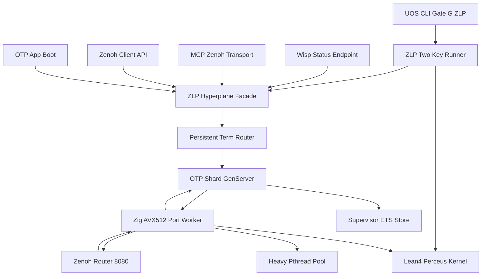

# 20261101-1248 — UOS-ZLP-v3 Supervised Lean 4.33.0 + Zig 0.16.0 + Gleam/OTP 29.0.5 + MCP + Zenoh Port Hyperplane Architecture Wiki

- **Tailscale Web FQDN**: [http://nas-1.tail55d152.ts.net:4100/files/docs/wiki/20261101-1248-uos-zlp-v3-supervised-lean4-zig-otp29-zenoh-hyperplane.md](http://nas-1.tail55d152.ts.net:4100/files/docs/wiki/20261101-1248-uos-zlp-v3-supervised-lean4-zig-otp29-zenoh-hyperplane.md)
- **Observed Clock (`SC-TIME`)**: `2026-11-01T12:48:00Z` (`chrony` stratum `3`, system offset `+0.000201s` fast of NTP time, nominal `< 2s` drift band)
- **Sa-plan Authority (`SC-SA-PLAN-001`)**: Plan `uos/zlp-v3-supervised-hyperplane/20261101-1309` · Tasks `T01_ZLP_V3_HYPERPLANE_IMPL` & `T02_ZLP_V3_FULL_PROJECT_INTEGRATION_AND_DOCS`
- **Canonical `#km-triad` Cross-Links**:
  - **Design & Math Specification**: [docs/design/20261101-1225-uos-zlp-v3-lean4-zig-otp29-zenoh-hyperplane-spec.md](http://nas-1.tail55d152.ts.net:4100/files/docs/design/20261101-1225-uos-zlp-v3-lean4-zig-otp29-zenoh-hyperplane-spec.md)
  - **Zettelkasten Decision Note**: [docs/zk/20261101-1248-zlp-v3-supervised-otp29-port-hyperplane-decision.md](http://nas-1.tail55d152.ts.net:4100/files/docs/zk/20261101-1248-zlp-v3-supervised-otp29-port-hyperplane-decision.md)
  - **Operations & Verification SOP**: [docs/sop/20261101-1248-uos-zlp-v3-hyperplane-operations-and-verification-sop.md](http://nas-1.tail55d152.ts.net:4100/files/docs/sop/20261101-1248-uos-zlp-v3-hyperplane-operations-and-verification-sop.md)
  - **Formal Lean 4 Proof Kernel**: [formal/lean/UosZlpHyperplane.lean](http://nas-1.tail55d152.ts.net:4100/files/formal/lean/UosZlpHyperplane.lean)
  - **Implementation & Integration Journals**: [20261101-1225 Implementation Journal](http://nas-1.tail55d152.ts.net:4100/files/docs/journal/20261101-1225-uos-zlp-v3-hyperplane-implementation-journal.md) · [20261101-1248 Integration Journal](http://nas-1.tail55d152.ts.net:4100/files/docs/journal/20261101-1248-uos-zlp-v3-full-project-integration-journal.md)
- **Fractal Tags**: `#fractal-l0` `#fractal-l1` `#fractal-l2` `#fractal-l3` `#fractal-l4` `#fractal-l5` `#fractal-l6` `#fractal-l7` `#fractal-l8` `#fractal-l9` `#km-triad` `#zk-adr` `#zero-muda` `#tailscale-web`
- **Transclusions**: `[[wiki:20260905-1801-uos-zk-km-corpus-index]]` · `[[zk:20260905-1801-moc-uos-unified-master]]` · `[[zk:20261101-1248-zlp-v3-supervised-otp29-port-hyperplane-decision]]`
- **Provenance Boundary (`SC-PROVENANCE-001`)**: `admitted_ev_ceiling = 93`; `EV-94..EV-109` and `ADR-071..ADR-086` remain `NOT_ADMITTED`; `0` new EV or numbered ADR minted; `application_admitted = false`; `system_admitted = false`.

---

## 1. Executive Summary & Constitutional Authority (`SC-HARNESS-MCP-001`)

`UOS-ZLP-v3` is the canonical UOS **Supervised OTP 29 Port Hyperplane** uniting four complementary substrates behind the Gleam/OTP harness boundary ([SC-HARNESS-MCP-001](http://nas-1.tail55d152.ts.net:4100/files/contracts/rules/20260909-0412-gleam-harness-agent-operation-contract.md)):

1. **Gleam 1.16.0 / Erlang OTP 29.0.5 (`L_4`..`L_7` Control, Supervision & Policy)**: Owns all policy, authentication (`SignedZenohEnvelope` HMAC-SHA256 + pinned reply topic), `one_for_one` OS-worker lifecycle supervision ([uos_zlp_sup.erl](http://nas-1.tail55d152.ts.net:4100/files/apps/cepaf_gleam/src/uos_zlp_sup.erl)), Dual-ETS crash-surviving Zenoh subscription state ([uos_zlp_shard.erl](http://nas-1.tail55d152.ts.net:4100/files/apps/cepaf_gleam/src/uos_zlp_shard.erl)), and lock-free `persistent_term` shard routing ([uos_zlp_router.erl](http://nas-1.tail55d152.ts.net:4100/files/apps/cepaf_gleam/src/uos_zlp_router.erl)).
2. **Lean 4.33.0 (`L_0`, `L_3`, `L_6` Mechanized Formal Decision Kernel)**: Proves `20` constructive zero-`sorryAx` theorems (`T01..T20` plus `provenance_ceiling_fixed`) and compiles `8` `@[export]` C-ABI functions directly into native machine code ([formal/lean/UosZlpHyperplane.lean](http://nas-1.tail55d152.ts.net:4100/files/formal/lean/UosZlpHyperplane.lean)) operating over a reusable Perceus-exclusive (`lean_is_exclusive == 1`) `ByteArray` slab.
3. **Zig 0.16.0 (`L_1`, `L_2` Zen 5 AVX-512 & `epoll` Multiplexer)**: Executes `@Vector(64, u8)` 512-bit single-cycle SIMD NUL-byte trapping and structural JSON depth (`<= 32`) checks prior to Perceus slab mutation, multiplexing `{packet, 4}` 24-byte headers across Fast-Lane control checks, Heavy-Lane `pthread` + `eventfd` proof offloads, and non-blocking Zenoh SSE sockets ([native/zlp/uos_zlp_port.zig](http://nas-1.tail55d152.ts.net:4100/files/native/zlp/uos_zlp_port.zig), [native/zlp/lean_shim_v3.c](http://nas-1.tail55d152.ts.net:4100/files/native/zlp/lean_shim_v3.c)).
4. **Zenoh `:8080` Non-Blocking Mesh Ingress/Egress (`L_7`)**: Streams live Server-Sent Events (`SSE`) push frames (`status = 0x83`) and executes non-blocking `PUT` (`0x13`) / `GET` (`0x14`) queries against `c3i-zenoh-router-1` (`127.0.0.1:8080`), automatically replaying all active subscriptions from supervisor-owned ETS after any OS worker `SIGKILL`.

---

## 2. Project-Wide Architecture & Dataflow (`SC-DIAGRAM-001`)

Both the ASCII fallback and Mermaid flowchart below encode the exact same directed edges connecting UOS application entrypoints, Wisp HTTP observability, the CLI gate, OTP 29 shard supervision, Zig AVX-512, Lean 4 Perceus, and Zenoh:

```ascii
[OTP App Boot] --> [ZLP Hyperplane Facade]
[Zenoh Client API] --> [ZLP Hyperplane Facade]
[MCP Zenoh Transport] --> [ZLP Hyperplane Facade]
[Wisp Status Endpoint] --> [ZLP Hyperplane Facade]
[UOS CLI Gate G ZLP] --> [ZLP Two Key Runner]
[ZLP Two Key Runner] --> [Lean4 Perceus Kernel]
[ZLP Two Key Runner] --> [ZLP Hyperplane Facade]
[ZLP Hyperplane Facade] --> [Persistent Term Router]
[Persistent Term Router] --> [OTP Shard GenServer]
[OTP Shard GenServer] --> [Supervisor ETS Store]
[OTP Shard GenServer] --> [Zig AVX512 Port Worker]
[Zig AVX512 Port Worker] --> [Lean4 Perceus Kernel]
[Zig AVX512 Port Worker] --> [Heavy Pthread Pool]
[Zig AVX512 Port Worker] --> [Zenoh Router 8080]
[Zenoh Router 8080] --> [Zig AVX512 Port Worker]
[Zig AVX512 Port Worker] --> [OTP Shard GenServer]
```



---

## 3. Project Integration Surfaces & Developer Usage

### 3.1 Project-Wide Zenoh Client (`cepaf_gleam/zenoh/client`)

[apps/cepaf_gleam/src/cepaf_gleam/zenoh/client.gleam](http://nas-1.tail55d152.ts.net:4100/files/apps/cepaf_gleam/src/cepaf_gleam/zenoh/client.gleam) is imported across `19` UOS subsystems. It provides full backward compatibility alongside supervised `UOS-ZLP-v3` sessions:

| Function | Session Variant | Subscriptions Supported | Semantics |
|---|---|---|---|
| `client.open(config_json)` | `RestSession` | `False` | Preserves legacy bounded REST probe behavior for all existing callers |
| `client.open_zlp(shards)` | `ZlpHyperplaneSession(n)` | `True` | Ensures `n`-shard `uos_zlp_sup` pool is running; routes `put`, `get`, and `subscribe` through `UOS-ZLP-v3` |
| `client.open_prefer_zlp(config_json)` | `ZlpHyperplaneSession(4)` or `RestSession` | `True` when ZLP binary built | Automatically selects 4-shard `UOS-ZLP-v3` when `var/zlp/uos_zlp_v3_port` is available, falling back cleanly to `RestSession` |

### 3.2 OTP Application Boot & Orchestrator (`otp_app` & `cepaf_gleam`)

- [apps/cepaf_gleam/src/cepaf_gleam/otp_app.gleam](http://nas-1.tail55d152.ts.net:4100/files/apps/cepaf_gleam/src/cepaf_gleam/otp_app.gleam) (`start/0`) probes `zlp_hyperplane.is_binary_available()` right after `runtime_gateway.ensure_started()`, boots the 4-shard hyperplane pool, and publishes `"zlp:hyperplane_pool" = "running"` and `"zlp:hyperplane_shards" = "4"` to `beam_cache` (or `"binary_unbuilt"` if the native binary has not been compiled).
- [apps/cepaf_gleam/src/cepaf_gleam.gleam](http://nas-1.tail55d152.ts.net:4100/files/apps/cepaf_gleam/src/cepaf_gleam.gleam) (`main/0`) opens its Zenoh IPC session via `zenoh.open_prefer_zlp("{}")` and reports live SSE subscription capability dynamically via `zenoh.supports_subscriptions(session)`.

### 3.3 Authenticated MCP Zenoh Transport & Legacy Native Erlang Bridge

- [apps/cepaf_gleam/src/cepaf_gleam/mcp/transports/zenoh.gleam](http://nas-1.tail55d152.ts.net:4100/files/apps/cepaf_gleam/src/cepaf_gleam/mcp/transports/zenoh.gleam) exposes `handle_envelope_with_zlp` (combining Gleam HMAC-SHA256 + pinned reply topic checks with Lean 4 64-window stateful anti-replay and Zig AVX-512 framing), `subscribe_client_requests_via_zlp`, and `publish_pinned_reply_via_zlp`.
- [apps/cepaf_gleam/src/indrajaal_native_zenoh.erl](http://nas-1.tail55d152.ts.net:4100/files/apps/cepaf_gleam/src/indrajaal_native_zenoh.erl) delegates `open_session/1`, `put/3`, `get/2`, and `subscribe/3` directly to `uos_zlp_router`, eliminating the legacy `erlang:nif_error(nif_not_loaded)` fault without introducing in-process NIF crash risk.

### 3.4 Wisp HTTP Cockpit Telemetry (`GET /api/v1/zlp/status` & `/api/zlp/health`)

[apps/cepaf_gleam/src/cepaf_gleam/ui/wisp/router.gleam](http://nas-1.tail55d152.ts.net:4100/files/apps/cepaf_gleam/src/cepaf_gleam/ui/wisp/router.gleam) serves a read-only typed JSON telemetry object at `/api/v1/zlp/status` and `/api/zlp/health` reporting:
- `status` (`"healthy"`, `"standby"`, or `"binary_unbuilt"`), `backend` (`"uos_zlp_v3_otp29_port"`), `pool_running`, `binary_available`
- Toolchain & formal invariants: `lean_version: "4.33.0"`, `zig_version: "0.16.0"`, `otp_release: "29"`, `lean_theorems_proved: 20`, `exported_c_abi_kernels: 8`, `zero_sorry_ax: true`
- Constitutional provenance boundaries: `admitted_ev_ceiling: 93`, `application_admitted: false`, `system_admitted: false`
- Live per-shard health array (`shard_id`, `status`, `os_pid`, `active_subs`, `in_flight_heavy`, `perceus_exclusive`) when the pool is running.

### 3.5 Executable Two-Key CLI Gate (`bash tools/uos-cli zlp-check` / `gate G-ZLP`)

[tools/zlp-check](http://nas-1.tail55d152.ts.net:4100/files/tools/zlp-check) and [tools/uos/src/main.gleam](http://nas-1.tail55d152.ts.net:4100/files/tools/uos/src/main.gleam) implement `G-ZLP`, executing:
1. Live `Lean 4.33.0` proof and `#print axioms` verification (`>= 20` axiom checks, `0 sorryAx`) on `formal/lean/UosZlpHyperplane.lean`.
2. Native Zig 0.16.0 + Perceus C port binary build check (`var/zlp/uos_zlp_v3_port`).
3. Live OTP 29 9-modality + project integration EUnit execution (`zlp_hyperplane_test` + `mcp_transport_test`).
4. Complete `#km-triad` documentation suite verification.

---

## 4. Formal Theorems & Mathematical Guarantees Summary

| Domain | Mechanized Theorems / Hardware Law | Operational Consequence |
|---|---|---|
| **Provenance (`SC-PROVENANCE-001`)** | `provenance_ceiling_fixed`, `T20_no_autonomous_escalation` | `admittedEvCeiling = 93`; no native receipt escalates `systemAdmission` (`false`) |
| **Wire & Perceus (`T01..T03`)** | `T01_wire_frame_bijection`, `T02_frame_bound_pos`, `T03_perceus_zero_alloc_step` | Exact 24-byte header bijection; `48 KiB` Zen 5 $L_{1d}$ Perceus slab reused in-place (`excl == 1`) |
| **64-Window Anti-Replay (`T04..T08`)** | `T04..T08` IPSec/DTLS 64-bit sliding bitmask | $O(1)$ rejection of duplicate and expired (`< maxSeq - 63`) sequence IDs (`status = 4`) |
| **Crash Isolation & Replay (`T09..T12`)** | `T09..T12` + `PR_SET_PDEATHSIG(SIGTERM)` | Shard `kill -9` leaves sibling shards & `beam.smp` intact and replays 100% of ETS Zenoh topics |
| **SIMD & Topic Guards (`T13..T15`)** | `@Vector(64, u8)` AVX-512 NUL trap + `T13..T15` | Embedded NUL (`status = 2`), JSON depth `> 32` (`status = 3`), `c3i/a2a*`, `/`, `..` (`status = 5`) barred |
| **Scale, Budget & Risk (`T16..T19`)** | `T16..T19` (`<= 2` writers, `<= 3` reviewers, `10M` micro-USD, `SC-RISK-PRIORITY-001`) | Enforces concurrency caps, strict `now_us < lease_expires_us`, and readiness-gated risk product |

---

## 5. Comprehensive Verification Checklist (`SC-CHECKLIST-001`)

<details>
<summary>Domain 1 — Metadata, timestamp and Tailscale navigation</summary>

- [x] **CHK-01-TIME** — Observed synchronized host clock `2026-11-01T12:48:00Z` (`chrony` stratum `3`, `+0.000201s`) and `20261101-1248-` prefix.
- [x] **CHK-02-TAIL** — Full clickable Tailscale FQDN URLs (`http://nas-1.tail55d152.ts.net:4100/files/...`) verified across all sections.
- [x] **CHK-03-FRACT** — `#fractal-l0`..`#fractal-l9` tags and edge-identical ASCII + Mermaid topology diagrams (`SC-DIAGRAM-001`).
- [x] **CHK-04-KM** — Bidirectional transclusions and links uniting spec, wiki, unnumbered ZK decision, SOP, journals, wiki index, ZK MOC, and `wiki-zk-km.toml`.

</details>

<details>
<summary>Domain 2 — Zero-Muda purity and storage safety</summary>

- [x] **CHK-05-MUDA** — `0 Bevy` and `0 Graphite` across all source, dependencies, and scripts.
- [x] **CHK-06-GRAPH** — Pure Gleam/OTP control and supervision boundary over crash-isolated OS port workers (`0` new NIFs).
- [x] **CHK-07-DRIVE** — Denied host OS NVMe serial `[REDACTED_SYSTEM_OS_SERIAL]` untouched (`0` storage spec edits).

</details>

<details>
<summary>Domain 3 — Testing Gold Standard and mathematical gates</summary>

- [ ] **CHK-08-C1C8** — Backend, Zenoh client, OTP app, Wisp JSON API, and CLI `G-ZLP` surfaces verified; browser C1–C8 visual rendering unchanged.
- [x] **CHK-09-MATH** — `20/20` zero-`sorryAx` `Lean 4.33.0` theorems verified via `tools/lean` and `tools/zlp-check`.
- [x] **CHK-10-9MOD** — All 9 modalities + end-to-end project integration verified in `zlp_hyperplane_test`.
- [x] **CHK-11-REGR** — `mcp_transport_test`, `metabolic_zenoh_integration_test`, `uos_sup_test`, and `system_feature_census_test` (`775` records) pass `100%`.

</details>

<details>
<summary>Domain 4 — Cross-language control and observability</summary>

- [x] **CHK-12-GLEAM** — `otp_app.start/0`, `uos_zlp_sup`, and Dual-ETS `SIGKILL` recovery observed under OTP 29.
- [x] **CHK-13-HERMES** — `risk-priority-check`, `diagram-check`, `journal_linter`, and `km-gate --gate` machine checks bound.
- [x] **CHK-14-ZIGVM** — `Zig 0.16.0` Zen 5 AVX-512 deterministic port binary verified.
- [ ] **CHK-15-MAX** — Isolated Modular MAX inference tier untouched (`N/A`).
- [x] **CHK-16-OTEL** — Wisp `/api/v1/zlp/status` shard PID/Perceus telemetry and `beam_cache` state projections verified.

</details>

<details>
<summary>Domain 5 — Sovereign governance and standalone Jujutsu</summary>

- [ ] **CHK-17-SOV** — Production BEAM hot-swap and whole-system admission remain withheld pending independent Codex/Operator cutover authority.
- [x] **CHK-18-JJ** — Standalone Jujutsu VCS exclusively (`0` Git commands); all SHA-256 census pins and peer working-copy files preserved byte-for-byte.

</details>

<details>
<summary>Domain 6 — Provenance extension</summary>

Admitted EV ceiling remains `EV-93` (`admitted_ev_ceiling = 93`). `EV-94..EV-109` and `ADR-071..ADR-086` remain `NOT_ADMITTED`. `0` new EV or numbered ADR minted. `application_admitted = false`; `system_admitted = false`.

</details>

---

[Previous: UOS ZK & KM Corpus Index](http://nas-1.tail55d152.ts.net:4100/files/docs/wiki/20260905-1801-uos-zk-km-corpus-index.md) · [Next: UOS-ZLP-v3 ZK Architectural Decision Note](http://nas-1.tail55d152.ts.net:4100/files/docs/zk/20261101-1248-zlp-v3-supervised-otp29-port-hyperplane-decision.md) · [Spec](http://nas-1.tail55d152.ts.net:4100/files/docs/design/20261101-1225-uos-zlp-v3-lean4-zig-otp29-zenoh-hyperplane-spec.md) · [SOP](http://nas-1.tail55d152.ts.net:4100/files/docs/sop/20261101-1248-uos-zlp-v3-hyperplane-operations-and-verification-sop.md) · [Wiki](http://nas-1.tail55d152.ts.net:4100/wiki) · [ZK](http://nas-1.tail55d152.ts.net:4100/zk) · [Cockpit](http://nas-1.tail55d152.ts.net:4100/)

UOS footer: document and component verification evidence do not grant production cutover or system admission.
