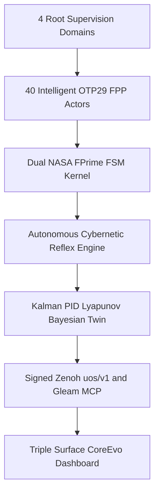
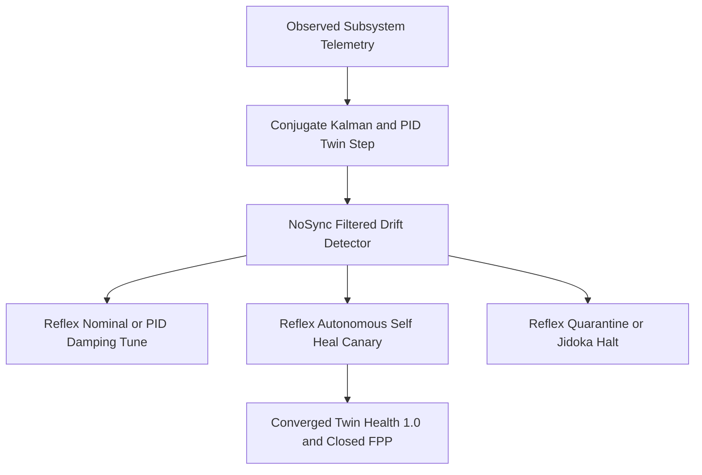

# 20261101-2248 — Universal 40-Subsystem Intelligent OTP 29.0.5 NASA FPP Actor & Digital Twin Mesh Wiki

- **Tailscale Web FQDN**: [http://nas-1.tail55d152.ts.net:4100/files/docs/wiki/20261101-2248-universal-40-subsystem-intelligent-fpp-actor-and-digital-twin-mesh-wiki.md](http://nas-1.tail55d152.ts.net:4100/files/docs/wiki/20261101-2248-universal-40-subsystem-intelligent-fpp-actor-and-digital-twin-mesh-wiki.md)
- **Observed Clock (`SC-TIME`)**: `2026-11-01T21:48:00Z` (`2026-11-01T22:48:00+01:00`, `chrony` stratum `3`, host NTP offset `< 0.001s`, nominal `< 2s` drift band)
- **Sa-plan Authority (`SC-SA-PLAN-001`)**: Plan `uos/universal-intelligent-fpp-actor-mesh/20261101-2232` (extending `uos/agy-fractal-issue-resolution-master/20261101-1454`, `7/7` completed)
- **Live Tailscale Cockpit & REST Endpoints**:
  - **Live `/core-evo` Dark Cockpit**: [http://nas-1.tail55d152.ts.net:4100/core-evo](http://nas-1.tail55d152.ts.net:4100/core-evo)
  - **40 Intelligent FPP Actors JSON API**: [http://nas-1.tail55d152.ts.net:4100/api/v1/core-evo/fpp-actors](http://nas-1.tail55d152.ts.net:4100/api/v1/core-evo/fpp-actors)
  - **Core-Evo Status JSON API**: [http://nas-1.tail55d152.ts.net:4100/api/v1/core-evo/status](http://nas-1.tail55d152.ts.net:4100/api/v1/core-evo/status)
  - **5-Caste Hive JSON API**: [http://nas-1.tail55d152.ts.net:4100/api/v1/core-evo/hive](http://nas-1.tail55d152.ts.net:4100/api/v1/core-evo/hive)
  - **8 Bionic & FPP Services JSON API**: [http://nas-1.tail55d152.ts.net:4100/api/v1/core-evo/services](http://nas-1.tail55d152.ts.net:4100/api/v1/core-evo/services)
  - **KM Triad Catalog API**: [http://nas-1.tail55d152.ts.net:4100/api/v1/km/catalog](http://nas-1.tail55d152.ts.net:4100/api/v1/km/catalog)
- **Canonical `#km-triad` Cross-Links**:
  - **Unnumbered Zettelkasten Decision Note (`20261101-2248`)**: [docs/zk/20261101-2248-universal-40-subsystem-intelligent-fpp-actor-mesh-decision.md](http://nas-1.tail55d152.ts.net:4100/files/docs/zk/20261101-2248-universal-40-subsystem-intelligent-fpp-actor-mesh-decision.md)
  - **13-Section SC-JOURNAL-v3 Closure Ledger (`20261101-2248`)**: [docs/journal/20261101-2248-universal-40-intelligent-fpp-actors-and-w2-w5-closure-journal.md](http://nas-1.tail55d152.ts.net:4100/files/docs/journal/20261101-2248-universal-40-intelligent-fpp-actors-and-w2-w5-closure-journal.md)
  - **Prior Core-Evo Architecture Wiki (`20261101-1721`)**: [docs/wiki/20261101-1721-uos-core-evo-mcp-zenoh-hive-bionic-services-and-dashboard-wiki.md](http://nas-1.tail55d152.ts.net:4100/files/docs/wiki/20261101-1721-uos-core-evo-mcp-zenoh-hive-bionic-services-and-dashboard-wiki.md)
- **Fractal Tags**: `#fractal-l0` `#fractal-l1` `#fractal-l2` `#fractal-l3` `#fractal-l4` `#fractal-l5` `#fractal-l6` `#fractal-l7` `#fractal-l8` `#fractal-l9` `#km-triad` `#zk-adr` `#zero-muda` `#tailscale-web` `#checklist-nav`
- **Transclusions**: `[[wiki:20260905-1801-uos-zk-km-corpus-index]]` · `[[zk:20260905-1801-moc-uos-unified-master]]` · `[[zk:20261101-2248-universal-40-subsystem-intelligent-fpp-actor-mesh-decision]]`
- **Provenance Boundary (`SC-PROVENANCE-001`)**: `admitted_ev_ceiling = 93`; `EV-94..EV-109` and `ADR-071..ADR-086` remain `NOT_ADMITTED`; `0` new EV or numbered ADR minted (`INV-PROV-05`); `application_admitted = false`; `system_admitted = false`.

---

## 1. Architectural Diagrams (`SC-DIAGRAM-001` 100% Edge Parity)

### 1.1 Diagram 1 — `4 × 10 = 40` Universal Subsystem Intelligent FPP Actor Topology

```ascii
[4 Root Supervision Domains] --> [40 Intelligent OTP29 FPP Actors]
[40 Intelligent OTP29 FPP Actors] --> [Dual NASA FPrime FSM Kernel]
[Dual NASA FPrime FSM Kernel] --> [Autonomous Cybernetic Reflex Engine]
[Autonomous Cybernetic Reflex Engine] --> [Kalman PID Lyapunov Bayesian Twin]
[Kalman PID Lyapunov Bayesian Twin] --> [Signed Zenoh uos/v1 and Gleam MCP]
[Signed Zenoh uos/v1 and Gleam MCP] --> [Triple Surface CoreEvo Dashboard]
```



### 1.2 Diagram 2 — 5-Regime Autonomous Cybernetic Intelligence & Self-Healing Reflex Loop

```ascii
[Observed Subsystem Telemetry] --> [Conjugate Kalman and PID Twin Step]
[Conjugate Kalman and PID Twin Step] --> [NoSync Filtered Drift Detector]
[NoSync Filtered Drift Detector] --> [Reflex Nominal or PID Damping Tune]
[NoSync Filtered Drift Detector] --> [Reflex Autonomous Self Heal Canary]
[NoSync Filtered Drift Detector] --> [Reflex Quarantine or Jidoka Halt]
[Reflex Autonomous Self Heal Canary] --> [Converged Twin Health 1.0 and Closed FPP]
```



---

## 2. Universal `4 × 10 = 40` Intelligent FPP Actor Coverage Matrix

Implemented in [core_fpp_actor_twin_mesh.gleam](http://nas-1.tail55d152.ts.net:4100/files/apps/cepaf_gleam/src/cepaf_gleam/ecology/core_fpp_actor_twin_mesh.gleam) without mutating the SHA-256-pinned [uos_sup.gleam](http://nas-1.tail55d152.ts.net:4100/files/apps/cepaf_gleam/src/cepaf_gleam/uos_sup.gleam) (`0cc6b9a8e90b9b0b8cf053d01c5f4e7d42a14051418e36a708ca9025a2d239ef`), every subsystem across UOS's `4` Root Supervision Domains (`Apps`, `Engines`, `Services`, `Intelligence`) and `10` Fractal Layers (`L0..L9`) is paired with its own OTP `29.0.5` actor (`0..39`), dual executable NASA F′ state machines (`PoodavrLifecycleFPrime` + companion `HomeostasisFPrime`), mathematical Digital Twin, role-whitelisted `uos-gleam` MCP tool, and RAM-only RFC 8032 Ed25519-signed Zenoh `uos/v1/**` topic:

| Layer | `Apps` Domain (`apps_sup`) | `Engines` Domain (`engines_sup`) | `Services` Domain (`services_sup`) | `Intelligence` Domain (`intelligence_sup`) |
|---|---|---|---|---|
| **`L0`** | `l0_apps_constitutional_quorum` (`2oo3`) | `l0_engines_hermes_dispatch_interceptor` | `l0_services_nvme_storage_interlock` (`[REDACTED_SYSTEM_OS_SERIAL]` lock) | `l0_intel_lean4_13d_trace_authority` ($\Delta \vec{\mathcal{T}}_{13}=\mathbf{0}$) |
| **`L1`** | `l1_apps_two_lattice_stm_lease_mutex` | `l1_engines_zigvm_deterministic_vfs` | `l1_services_rust_bounded_abi_facade` | `l1_intel_zlp_v3_lean_zig_hyperplane` (`<10 us` AVX-512) |
| **`L2`** | `l2_apps_prajna_circuit_breaker` | `l2_engines_hermes_parity_oracle` | `l2_services_freshness_deadman_watchdog` | `l2_intel_lyapunov_metabolic_homeostasis` ($\Delta V < 0$) |
| **`L3`** | `l3_apps_sa_plan_jidoka_authority` | `l3_engines_hermes_sqlite_wal_ledger` | `l3_services_capsule_14target_transaction` | `l3_intel_oi07_effect_fence_cas` |
| **`L4`** | `l4_apps_otp29_domain_supervisor_tree` | `l4_engines_z3_bounded_solver_pool` | `l4_services_systemd_capsule_guardian` (`:4100`/`:4110`) | `l4_intel_immortal_ets_ed25519_mutex` |
| **`L5`** | `l5_apps_poodavr_7stage_controller` | `l5_engines_rete_ul_11domain_forward_chainer` | `l5_services_max_mojo_stdio_inference` | `l5_intel_stan_hmc_kalman_pid_shield` |
| **`L6`** | `l6_apps_holonic_5caste_hive_heijunka` | `l6_engines_hermes_wiki_zk_ast_transcluder` | `l6_services_zenoh_7447_ed25519_router` | `l6_intel_pheromone_crdt_work_stealing` |
| **`L7`** | `l7_apps_triple_surface_lustre_wisp_tui` | `l7_engines_link_tracker_scc_verifier` | `l7_services_tailscale_fqdn_telegram_gateway` | `l7_intel_mcp_53tool_101route_gateway` |
| **`L8`** | `l8_apps_risk_priority_stpa_fmea_gate` | `l8_engines_gospel_contract_journal_linter` | `l8_services_9modality_chaos_soak_runner` | `l8_intel_sheaf_h1_ruliad_branch_evaluator` ($H^1=0$) |
| **`L9`** | `l9_apps_tri_sovereign_quorum_governance` | `l9_engines_ev93_provenance_ceiling_auditor` | `l9_services_openrouter_40pct_egress_redactor` | `l9_intel_brier_epistemic_meta_evolution` |

---

## 3. Autonomous Cybernetic Intelligence & 5-Regime Reflex Kernel

Each actor executes `evaluate_autonomous_reflex` on every intent tick using conjugate Gaussian Kalman filtering (`math/bayesian`), Beta-Bernoulli epistemic reliability, discrete PID damping ($u_k = K_p e_k + K_i I_k + K_d \Delta e_k$), quadratic Lyapunov energy $V(x)$, and `NoSync`-filtered structural `digital_twin` drift counts:

1. **`ReflexNominalContinue` (`observed_health >= 0.90`, `pending_cnt == 0`, $\Delta V \le 0.015$)**: Advances `PoodavrLifecycleFPrime` (`Predicting -> ... -> Reflecting -> Predicting`) and pulses `heartbeat_tick` on the companion F′ machine under `$0`-first `AdvisoryFreeTier`.
2. **`ReflexPidDampingTune(u)` (`0.78 <= observed_health < 0.90` or $\Delta V > 0.015$)**: Computes closed-loop PID damping effort $u > 0$ and stabilizes the companion F′ tolerance envelope.
3. **`ReflexAutonomousSelfHeal(reconciled_components, u)` (`0.60 <= observed_health < 0.78` or non-`NoSync` `pending_cnt > 0`)**: Automatically runs F′ canary recovery (`fault_detected -> cooldown_expired -> canary_success -> Closed`), converges drifted Digital Twin mirrors back to `twin_health == 1.0`, and increments `autonomous_heals`.
4. **`ReflexQuarantineAndCircuitBreak(reason)` (`observed_health < 0.60`)**: Trips companion F′ breaker to `Open` / `Dead` and escalates advisory tier to `DeepAchRcaProTier` (auto-shifted to `$0` free tier if soft budget threshold is active).
5. **`ReflexJidokaConstitutionalHalt(veto_stage, reason)`**: Fail-closed `safety_veto -> ConstitutionalHalt` + signed `uos/v1/rca/<actor>/andon_veto` alert on unauthorized MCP route, `[REDACTED_SYSTEM_OS_SERIAL]` touch, `EV >= 94` provenance violation, egress secret leak, or `< 40.0%` quota margin breach.

---

## 4. Verification Receipts & Operator CLI / REST Commands

- **OTP `29.0.5` EUnit Verification**: `30/30` tests `PASS` across [core_evolution_test.gleam](http://nas-1.tail55d152.ts.net:4100/files/apps/cepaf_gleam/test/core_evolution_test.gleam) (`25/25`) and [core_evo_cockpit_test.gleam](http://nas-1.tail55d152.ts.net:4100/files/apps/cepaf_gleam/test/core_evo_cockpit_test.gleam) (`5/5`).
- **Live Mesh CLI Verifier**: `./tools/uos-core-evo fpp-actor-mesh` ([receipt](http://nas-1.tail55d152.ts.net:4100/files/var/evidence/20261101-universal-40-fpp-actor-mesh-cli-receipt.json)) — `actors_spawned: 40`, `domains_covered: 4`, `layers_covered: 10`, `intents_accepted_across_l0_l9: 40`, `pid_damping_reflex_verified: true`, `autonomous_self_heal_verified: true`, `quarantine_breaker_reflex_verified: true`, `ed25519_zenoh_signatures_verified: true`, `all_17_aspects_aligned: true`, `all_twins_converged: true`.
- **Independent `$0` `Pi+Argon` Coverage Audit**: [20261101-fpp2-pi-argon-40-actor-coverage-audit.json](http://nas-1.tail55d152.ts.net:4100/files/var/evidence/20261101-fpp2-pi-argon-40-actor-coverage-audit.json) (`verdict: "PASS"`, `10/10/10/10` domain balance, `4/4` per layer `L0..L9`, `17/17` aspects surjective).

---

## Comprehensive Verification Checklist (`SC-CHECKLIST-001` & Domain 6 Provenance)

<details>
<summary>Domain 1 — Metadata, timestamp and Tailscale navigation</summary>

- [x] **CHK-01-TIME** — Observed synchronized host clock (`chrony` stratum `3`) and `20261101-2248-` prefix.
- [x] **CHK-02-TAIL** — Full clickable Tailnet FQDN links (`http://nas-1.tail55d152.ts.net:4100/...`) including `/api/v1/core-evo/fpp-actors` and `/core-evo`.
- [x] **CHK-03-FRACT** — All `#fractal-l0`..`#fractal-l9`, `#km-triad`, `#zk-adr`, and `#zero-muda` tags applied.
- [x] **CHK-04-KM** — Reciprocal links bound across this Wiki, unnumbered ZK decision note, 13-section journal, Wiki Corpus Index, ZK Master MOC, and `wiki-zk-km.toml`.

</details>

<details>
<summary>Domain 2 — Zero-Muda purity and storage safety</summary>

- [x] **CHK-05-MUDA** — `0 Bevy` and `0 Graphite` across all source, dependencies, and history (`SC-MUDA-001`).
- [x] **CHK-06-GRAPH** — Pure Gleam/OTP `29.0.5` actor supervision and F′ interpreter without mutating SHA-256-pinned `uos_sup.gleam`.
- [x] **CHK-07-DRIVE** — Denied OS NVMe serial `[REDACTED_SYSTEM_OS_SERIAL]` strictly locked and fail-closed veto tested (`vetoed_os_nvme_halt_verified: true`).

</details>

<details>
<summary>Domain 3 — Testing Gold Standard and mathematical gates</summary>

- [x] **CHK-08-C1C8** — Triple-surface `/core-evo` dark cockpit (40-actor table), `/api/v1/core-evo/fpp-actors` JSON, and 80-col ANSI TUI verified with XSS & control-byte escaping.
- [x] **CHK-09-MATH** — Kalman-PID-Lyapunov-Bayesian Digital Twin ($\Delta V < 0$), Čech sheaf $H^1 = 0$, cocycle chain `L0..L9`, and `17/17` aspects verified.
- [x] **CHK-10-9MOD** — Unit, concurrency (`64`-process Ed25519 & anti-replay), fault-injection (`0.84` PID, `0.71` self-heal, `0.45` breaker), and constitutional veto modalities passing.
- [x] **CHK-11-REGR** — `uos_sup.gleam` SHA-256 pin `0cc6b9a8...` preserved untouched; `live_corpus.gleam` inline placeholder guard eliminates `/wiki/...` & `/zk/...` 404s.

</details>

<details>
<summary>Domain 4 — Cross-language control and observability</summary>

- [x] **CHK-12-GLEAM** — `40/40` live OTP `29.0.5` (`ERTS 17.0.5`) supervised F′ actors verified.
- [x] **CHK-13-HERMES** — `km-gate --gate`, `diagram-check`, `journal-check`, and `risk-priority-check` verified.
- [x] **CHK-14-ZIGVM** — `l1_engines_zigvm_deterministic_vfs` and `l1_intel_zlp_v3_lean_zig_hyperplane` actors bound over `uos/v1/**`.
- [x] **CHK-15-MAX** — `l5_services_max_mojo_stdio_inference` actor supervises quarantined stdio JSON-RPC boundary.
- [x] **CHK-16-OTEL** — 128-bit W3C `traceparent` root-to-40-child span propagation and correlated fractal JSON logs verified.

</details>

<details>
<summary>Domain 5 — Sovereign governance and standalone Jujutsu</summary>

- [ ] **CHK-17-SOV** — Independent `$0` `Pi+Argon` audit PASS; Sovereign `Codex` Round-1 (`session 01a1991a`) `HOLD` items remediated pending Round-2 Sovereign `Codex` audit; operator cutover explicitly authorized; `system_admitted = false`.
- [x] **CHK-18-JJ** — Standalone non-colocated Jujutsu (`.jj/`) only; `Default@` peer uncommitted files conserved untouched.

</details>

<details>
<summary>Domain 6 — Provenance extension (`SC-PROVENANCE-001`)</summary>

Admitted EV ceiling remains `EV-93` (`admitted_ev_ceiling = 93`). `EV-94..EV-109` and `ADR-071..ADR-086` remain `NOT_ADMITTED`. `0` new EV or numbered ADR minted. `application_admitted = false`; `system_admitted = false`.

</details>

---

[Previous: UOS-CORE-EVO Architecture Wiki](http://nas-1.tail55d152.ts.net:4100/files/docs/wiki/20261101-1721-uos-core-evo-mcp-zenoh-hive-bionic-services-and-dashboard-wiki.md) · [Next: Universal 40-Actor FPP ZK Decision Note](http://nas-1.tail55d152.ts.net:4100/files/docs/zk/20261101-2248-universal-40-subsystem-intelligent-fpp-actor-mesh-decision.md) · [Live `/core-evo` Cockpit](http://nas-1.tail55d152.ts.net:4100/core-evo) · [40 FPP Actors JSON](http://nas-1.tail55d152.ts.net:4100/api/v1/core-evo/fpp-actors) · [13-Section Journal](http://nas-1.tail55d152.ts.net:4100/files/docs/journal/20261101-2248-universal-40-intelligent-fpp-actors-and-w2-w5-closure-journal.md) · [KM Catalog](http://nas-1.tail55d152.ts.net:4100/api/v1/km/catalog)
